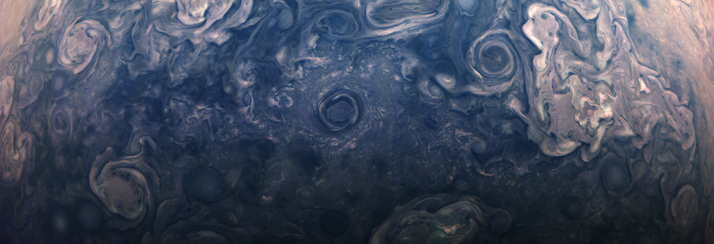

+++
title = "Science en vrac"
date = 2021-03-06T14:20:50+01:00
weight = 0
chapter = true
+++

# En vrac

 

<nav class="accueil-nav" aria-label="Rubriques">
  <a class="accueil-btn" href="./logique/">Logique</a>
  <a class="accueil-btn" href="./info/">Informatique</a>
  <a class="accueil-btn" href="./maths/">Mathématiques</a>
  <a class="accueil-btn" href="./physique/">Physique</a>
</nav>

  

Pour toute question : 
    

