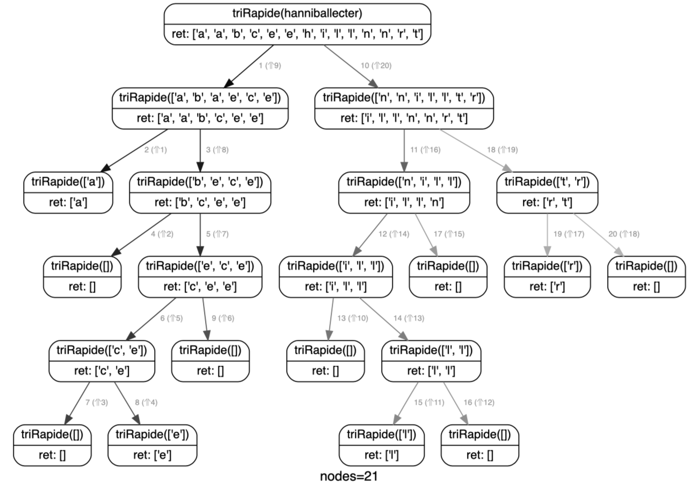

+++
title = "Algorithmique"
date = 2021-03-06T14:20:50+01:00
weight = 1
chapter = false
css = "algo.css"
+++

<style>
 #correc
  {
    color: #006C65;
    border-left: solid 10px #C7DDDC;
  }
 #comm
  {
    color: #004D80;
    border-left: solid 10px #B3CAD9;
  }
 #commsum
  {
    color: #004D80;
  }
 #correcsum
  {
    color: #006C65;
  }
 #debord
{
overflow-x: auto; 
}
details > summary:first-of-type {
  display: list-item;     
  cursor: pointer;        
}
details > summary:first-of-type {
  list-style: disclosure-closed inside;
}
details[open] > summary:first-of-type {
  list-style-type: disclosure-open;
}
</style>


# Algorithmique

«&nbsp;Peut-on faire mieux&nbsp;?&nbsp;» Toute l'algorithmique tient peut-être dans cette question. Tim Roughgarden, dont les livres *Algorithms Illuminated* inspirent cette page, en fait le mantra du concepteur d'algorithmes, en citant Aho, Hopcroft et Ullman&nbsp;: «&nbsp;*Perhaps the most important principle for the good algorithm designer is to refuse to be content*&nbsp;» (le principe le plus important est sans doute de ne jamais se contenter de ce qu'on a).

Cette page suit quelques fils conducteurs&nbsp;:

- **mesurer** l'efficacité d'un algorithme sans chronomètre, grâce à la complexité&nbsp;;
- **raffiner** pas à pas une solution, en gagnant à chaque étape une classe de complexité en temps ou en espace&nbsp;;
- laisser la **bonne structure de données** guider le code&nbsp;;
- oser **emprunter une idée** à un domaine qui semblait sans rapport&nbsp;;
- reconnaître les **grandes stratégies** qui reviennent sans cesse&nbsp;: récursivité, diviser pour régner, programmation dynamique, gloutons.

## Complexité&nbsp;: peut-on faire mieux&nbsp;?

### Mesurer sans chronomètre

<div style="position:relative; width:800px; max-width: 100%; margin-left: auto;margin-right: auto;box-shadow: 0 4px 8px 0 rgba(0, 0, 0, 0.2), 0 6px 20px 0 rgba(0, 0, 0, 0.19);">

</div>


<br>

Chronométrer un programme renseigne sur une machine, un langage, un jour donné. Pour comparer des **algorithmes**, on compte plutôt le nombre d'opérations élémentaires (comparaisons, additions, accès à une case…) en fonction de la taille $n$ de l'entrée, dans le pire des cas. Et l'on ne garde de ce décompte que son **ordre de grandeur**&nbsp;: $3n^2+10n+7$ opérations, c'est «&nbsp;du $n^2$&nbsp;».

<div class="encadre bleu">
<div class="encadre-titre">La notation $\mathcal{O}$</div>

**Intuition.** $f=\mathcal{O}(g)$ signifie que, pour $n$ assez grand, $f$ ne croît pas plus vite que $g$, à une constante multiplicative près.

**Définition.** Soient $f$ et $g$ deux suites à valeurs positives. On note $f(n)=\mathcal{O}(g(n))$ s'il existe une constante $c>0$ et un rang $n\_0\in\mathbb{N}$ tels que

$$\forall n\geqslant n\_0,\quad f(n)\leqslant c\\,g(n).$$

**Exemple.** $3n^2+10n+7=\mathcal{O}(n^2)$&nbsp;: avec $c=4$, il suffit que $n^2\geqslant 10n+7$, ce qui est vrai dès $n\_0=11$.

On note de même $f=\Omega(g)$ quand $f$ est **minorée** par un multiple de $g$ à partir d'un certain rang, et $f=\Theta(g)$ quand on a les deux&nbsp;: $f$ et $g$ ont alors exactement le même ordre de grandeur.

</div>

<div class="encadre">
<div class="encadre-titre">Pourquoi oublier les constantes&nbsp;?</div>

Roughgarden donne trois raisons. Les constantes dépendent du langage, du compilateur et de la machine&nbsp;: elles ne disent rien de l'algorithme lui-même. Quand $n$ grandit, c'est la vitesse de croissance qui l'emporte, et de loin. Enfin, ce niveau de détail est un **juste milieu**&nbsp;: assez grossier pour s'affranchir de l'anecdotique, assez fin pour départager les algorithmes. Un algorithme «&nbsp;rapide&nbsp;» est simplement un algorithme dont le temps d'exécution, dans le pire des cas, croît lentement avec la taille de l'entrée.

</div>

Faites varier la taille de l'entrée ci-dessous&nbsp;: à $n=100$, un algorithme en $2^n$ demande déjà près de trois mille fois l'âge de l'Univers, quand un algorithme en $n^2$ répond en dix microsecondes.

<div class="anim" data-anim="complexites"></div>


<div class="quiz">

Un algorithme en $n^2$ tourne sur une machine mille fois plus rapide qu'un algorithme en $n\log\_2 n$. Lequel l'emporte&nbsp;?

<details><summary>Réponse</summary>

Le premier fait $n^2/1000$ opérations «&nbsp;à l'échelle&nbsp;» du second, qui en fait $n\log\_2 n$. Il gagne tant que $n<1000\log\_2 n$, c'est-à-dire jusqu'à $n\approx 14\\,000$. Au-delà, il perd, et de plus en plus nettement&nbsp;: pour $n=10^9$, il est déjà 30&nbsp;000 fois plus lent. Une meilleure classe de complexité finit toujours par battre une meilleure machine.

</details>
</div>

### Une échelle de raffinement&nbsp;: la recherche du doublon

La notion de complexité permet de classer des algorithmes réalisant la même tâche, comme dans la vidéo suivante. C'est finalement une sorte d'échelle de raffinement&nbsp;; descendre d'un barreau la complexité temporelle ou spatiale demande le plus souvent de pousser la réflexion plus loin, voire de repenser entièrement le problème. Et c'est ainsi qu'une recherche de doublons dans une liste se transforme en chasse aux cycles sur un graphe dans l'ultime mouture pour atteindre le Graal ($\mathcal{O}(n)$ en temps et $\mathcal{O}(1)$ en espace sans mutation).

<div style="position:relative; width:800px; max-width: 100%; margin-left: auto;margin-right: auto;box-shadow: 0 4px 8px 0 rgba(0, 0, 0, 0.2), 0 6px 20px 0 rgba(0, 0, 0, 0.19);">

</div>


<br>

**Le problème.** Un tableau `t` contient $n+1$ entiers, tous compris entre $1$ et $n$. Il y a forcément un doublon&nbsp;: c'est le **principe des tiroirs**, $n+1$ chaussettes rangées dans $n$ tiroirs obligent un tiroir à en contenir deux. Comment le trouver&nbsp;? Tous les codes ci-dessous sont exécutables et modifiables, et travaillent sur le même exemple.

#### Barreau 1&nbsp;: comparer toutes les paires

La solution de premier jet&nbsp;: comparer chaque élément à tous ceux qui le suivent. Il y a $\binom{n+1}{2}$ paires, d'où un temps en $\mathcal{O}(n^2)$, mais aucune mémoire supplémentaire.


def doublon_paires(t):
    for i in range(len(t)):
        for j in range(i + 1, len(t)):
            if t[i] == t[j]:
                return t[i]

print(doublon_paires([2, 6, 4, 1, 3, 1, 5]))


#### Barreau 2&nbsp;: trier d'abord

Une fois le tableau trié, deux valeurs égales sont **voisines**&nbsp;: un seul passage suffit à les repérer. Le tri coûte $\mathcal{O}(n\log n)$ et domine le reste. On a gagné une classe en temps, mais à un prix&nbsp;: soit on trie une copie, qui occupe $\mathcal{O}(n)$ de mémoire, soit on trie sur place, et l'on modifie les données.


def doublon_tri(t):
    s = sorted(t)                      # copie triée : O(n log n)
    for i in range(len(s) - 1):
        if s[i] == s[i + 1]:           # deux valeurs égales sont voisines
            return s[i]

print(doublon_tri([2, 6, 4, 1, 3, 1, 5]))


#### Barreau 3&nbsp;: se souvenir de ce qu'on a vu

Un **ensemble** (une table de hachage) répond en temps constant, en moyenne, à la question «&nbsp;ai-je déjà vu cette valeur&nbsp;?&nbsp;». Un seul passage suffit&nbsp;: temps $\mathcal{O}(n)$. C'est l'échange le plus classique de l'algorithmique&nbsp;: on achète du temps avec de la mémoire, ici $\mathcal{O}(n)$.


def doublon_ensemble(t):
    vus = set()
    for x in t:
        if x in vus:                   # test en temps constant (en moyenne)
            return x
        vus.add(x)

print(doublon_ensemble([2, 6, 4, 1, 3, 1, 5]))


#### Barreau 4&nbsp;: le tableau comme mémoire

Les valeurs sont comprises entre $1$ et $n$, et le tableau a des cases numérotées de $0$ à $n$&nbsp;: chaque valeur $x$ désigne une case. Pour «&nbsp;se souvenir&nbsp;» qu'on a vu $x$, on peut donc marquer la case $x$, en changeant le signe de son contenu. Plus besoin d'ensemble&nbsp;: temps $\mathcal{O}(n)$, mémoire $\mathcal{O}(1)$. Mais c'est une ruse&nbsp;: on a **modifié** les données, ce qui est souvent interdit (elles peuvent être en lecture seule, ou partagées).


def doublon_marquage(t):
    for x in t:
        case = abs(x)                  # la valeur x désigne la case x
        if t[case] < 0:                # déjà marquée : x a déjà été vu
            return case
        t[case] = -t[case]             # on marque

print(doublon_marquage([2, 6, 4, 1, 3, 1, 5]))


#### Barreau 5&nbsp;: chercher parmi les valeurs, pas parmi les cases

Reprenons le principe des tiroirs, mais sur un **intervalle de valeurs**. Si plus de $m$ éléments du tableau tombent dans un intervalle qui ne contient que $m$ valeurs, le doublon s'y trouve. On coupe l'intervalle $[1,n]$ en deux, on compte combien d'éléments tombent dans la moitié gauche, et l'on garde la moitié «&nbsp;trop peuplée&nbsp;». C'est une dichotomie&nbsp;: $\log\_2 n$ étapes, chacune lisant tout le tableau. Temps $\mathcal{O}(n\log n)$, mémoire $\mathcal{O}(1)$, et cette fois sans toucher aux données. On a reculé d'un barreau en temps pour respecter l'entrée.


def doublon_dichotomie(t):
    bas, haut = 1, len(t) - 1          # le doublon est dans [bas, haut]
    while bas < haut:
        milieu = (bas + haut) // 2
        compte = sum(1 for x in t if bas <= x <= milieu)
        if compte > milieu - bas + 1:  # trop de pigeons pour ces tiroirs
            haut = milieu
        else:
            bas = milieu + 1
    return bas

print(doublon_dichotomie([2, 6, 4, 1, 3, 1, 5]))


#### Barreau 6&nbsp;: changer de regard, le tableau est un graphe

Peut-on tout avoir à la fois&nbsp;: temps linéaire, mémoire constante, données intactes&nbsp;? Oui, à condition de changer complètement de point de vue. Voyons le tableau comme une **fonction**&nbsp;: la case $i$ pointe vers la case `t[i]`. Partons de la case $0$, vers laquelle personne ne pointe puisque les valeurs valent au moins $1$, et suivons les flèches&nbsp;: $0\to$ `t[0]` $\to$ `t[t[0]]` $\to\cdots$ Comme il n'y a qu'un nombre fini de cases, on finit par repasser par une case déjà visitée. Le chemin dessine alors un **ρ**&nbsp;: une queue, puis une boucle.

L'entrée de la boucle est une case vers laquelle pointent **deux** flèches&nbsp;: celle de la queue et celle qui referme la boucle. Deux cases contiennent donc cette valeur&nbsp;: c'est le doublon. Chercher un doublon dans un tableau, c'est chercher l'entrée d'un cycle dans un graphe.

Pour la trouver sans rien mémoriser, on lâche deux coureurs depuis la case $0$&nbsp;: une **tortue** qui avance d'un pas à la fois, et un **lièvre** qui en fait deux. Une fois tous deux dans la boucle, le lièvre gagne une case par pas sur la tortue&nbsp;: il finit par la rattraper. On renvoie alors la tortue au départ, et chacun avance d'un pas&nbsp;: ils se retrouvent exactement à l'entrée de la boucle.

<div class="anim" data-anim="floyd"></div>



def doublon_floyd(t):
    tortue = lievre = 0
    while True:                        # phase 1 : le lièvre rattrape la tortue dans la boucle
        tortue = t[tortue]
        lievre = t[t[lievre]]
        if tortue == lievre:
            break
    tortue = 0                         # phase 2 : même allure, rendez-vous à l'entrée
    while tortue != lievre:
        tortue = t[tortue]
        lievre = t[lievre]
    return tortue

print(doublon_floyd([2, 6, 4, 1, 3, 1, 5]))


<div class="encadre bleu">
<div class="encadre-titre">Pourquoi la phase 2 tombe-t-elle pile sur l'entrée&nbsp;?</div>

Notons $\mu$ la longueur de la queue et $\lambda$ celle de la boucle. Supposons que la rencontre ait lieu après $k$ pas&nbsp;: la tortue a fait $k$ pas, le lièvre $2k$. Ils sont sur la même case de la boucle, donc la différence $2k-k=k$ est un multiple de $\lambda$.

Lors de la phase 2, après $\mu$ pas, la tortue (repartie de $0$) arrive à l'entrée de la boucle. Le lièvre, parti de la case atteinte après $k$ pas, se trouve alors à la case atteinte après $k+\mu$ pas&nbsp;: c'est l'entrée, plus $k$ pas, c'est-à-dire un nombre entier de tours de boucle. Il est donc lui aussi à l'entrée&nbsp;: ils se rencontrent là, et nulle part avant, puisque la tortue n'est pas encore dans la boucle.

</div>

<div class="tableau-large">
<table class="tab-recap">
<tr><th>Barreau</th><th>Idée</th><th>Temps</th><th>Mémoire en plus</th><th>Données intactes&nbsp;?</th></tr>
<tr><td>1</td><td>toutes les paires</td><td>$\mathcal{O}(n^2)$</td><td>$\mathcal{O}(1)$</td><td>oui</td></tr>
<tr><td>2</td><td>trier, puis comparer les voisins</td><td>$\mathcal{O}(n\log n)$</td><td>$\mathcal{O}(n)$ ou $\mathcal{O}(1)$ sur place</td><td>non, si l'on trie sur place</td></tr>
<tr><td>3</td><td>ensemble des valeurs vues</td><td>$\mathcal{O}(n)$</td><td>$\mathcal{O}(n)$</td><td>oui</td></tr>
<tr><td>4</td><td>marquer les cases par le signe</td><td>$\mathcal{O}(n)$</td><td>$\mathcal{O}(1)$</td><td>non</td></tr>
<tr><td>5</td><td>dichotomie sur les valeurs</td><td>$\mathcal{O}(n\log n)$</td><td>$\mathcal{O}(1)$</td><td>oui</td></tr>
<tr><td>6</td><td>lièvre et tortue sur le graphe</td><td>$\mathcal{O}(n)$</td><td>$\mathcal{O}(1)$</td><td>oui</td></tr>
</table>
</div>

<div class="encadre prune">
<div class="encadre-titre">Floyd, Pollard et le paradoxe des anniversaires</div>

L'algorithme du lièvre et de la tortue est attribué à Robert Floyd, sans qu'on lui connaisse de publication&nbsp;: Donald Knuth le mentionne à la fin des années 1960 dans *The Art of Computer Programming*. Il a trouvé son application la plus spectaculaire en arithmétique. En 1975, John Pollard l'utilise pour **factoriser** des entiers&nbsp;: on itère une fonction comme $x\mapsto x^2+1$ modulo le nombre à factoriser, et le chemin obtenu dessine, lui aussi, un ρ, d'où le nom de «&nbsp;méthode rho de Pollard&nbsp;». Le paradoxe des anniversaires garantit que la boucle arrive vite, après environ la racine carrée du nombre de valeurs possibles. En 1980, Richard Brent et Pollard factorisent ainsi le huitième nombre de Fermat, $2^{256}+1$.

</div>

<div class="encadre bref">
<div class="encadre-titre">En bref</div>

- Chaque barreau gagne quelque chose&nbsp;: du temps, de la mémoire, ou le respect des données.
- Le barreau 3 achète du temps avec de la mémoire, grâce à la bonne structure de données.
- Le barreau 4 «&nbsp;triche&nbsp;» en réutilisant l'entrée comme mémoire&nbsp;; le barreau 5 change ce que l'on cherche (des valeurs au lieu de positions).
- Le dernier barreau vient d'un autre domaine&nbsp;: un tableau est aussi un graphe, et un doublon, l'entrée d'un cycle.

</div>

### Quatre algorithmes, quatre classes&nbsp;: le plus grand sous-tableau

L'échelle du doublon n'est pas une exception. Voici un autre problème, tout aussi simple à énoncer, dont l'histoire est racontée par Jon Bentley dans ses *Programming Pearls*, et où **chaque idée nouvelle fait gagner exactement une classe de complexité**.

**Le problème.** On dispose d'un tableau de nombres, positifs et négatifs, par exemple les gains et pertes quotidiens d'une action. Quelle est la plus grande somme d'une **tranche** (une suite de cases consécutives)&nbsp;? Par convention, la tranche vide, de somme $0$, est permise&nbsp;: si tout est négatif, mieux vaut ne rien acheter.

<div class="encadre prune">
<div class="encadre-titre">Une course de quelques années</div>

En 1977, Ulf Grenander, statisticien à l'université Brown, cherche des motifs dans des images numérisées. Il ramène son problème à cette version à une dimension, écrit un algorithme en $\mathcal{O}(n^3)$, puis l'améliore en $\mathcal{O}(n^2)$. Michael Shamos trouve ensuite, en une nuit, un algorithme «&nbsp;diviser pour régner&nbsp;» en $\mathcal{O}(n\log n)$. Peu après, lors d'un séminaire à Carnegie-Mellon où Shamos raconte cette histoire, le statisticien Jay Kadane trouve en une minute un algorithme **linéaire**. On ne peut pas faire mieux&nbsp;: il faut au moins lire chaque case une fois.

</div>

#### $\mathcal{O}(n^3)$&nbsp;: toutes les tranches, chacune recalculée

Il y a environ $n^2/2$ tranches, et le calcul de chaque somme coûte jusqu'à $n$ additions.


def max_cubique(t):
    meilleur = 0
    for i in range(len(t)):
        for j in range(i, len(t)):
            s = 0
            for k in range(i, j + 1):  # somme de la tranche t[i..j], recalculée
                s += t[k]
            meilleur = max(meilleur, s)
    return meilleur

print(max_cubique([31, -41, 59, 26, -53, 58, 97, -93, -23, 84]))


#### $\mathcal{O}(n^2)$&nbsp;: ne pas recalculer, prolonger

La somme de `t[i..j]` est celle de `t[i..j-1]`, plus `t[j]`. Inutile de tout recommencer&nbsp;: il suffit de **prolonger** la somme précédente. Une boucle disparaît.


def max_quadratique(t):
    meilleur = 0
    for i in range(len(t)):
        s = 0
        for j in range(i, len(t)):
            s += t[j]                  # la tranche t[i..j] prolonge t[i..j-1]
            meilleur = max(meilleur, s)
    return meilleur

print(max_quadratique([31, -41, 59, 26, -53, 58, 97, -93, -23, 84]))


#### $\mathcal{O}(n\log n)$&nbsp;: diviser pour régner

Coupons le tableau en deux moitiés. La meilleure tranche est soit entièrement à gauche, soit entièrement à droite (deux problèmes deux fois plus petits, résolus récursivement), soit à cheval sur le milieu. Ce dernier cas se règle en temps linéaire&nbsp;: c'est la meilleure tranche qui **finit** au milieu côté gauche, accolée à la meilleure qui **commence** au milieu côté droit. Le coût vérifie $T(n)=2T(n/2)+\mathcal{O}(n)$, d'où $T(n)=\mathcal{O}(n\log n)$, comme pour le tri fusion.


def max_diviser(t, g=0, d=None):
    if d is None:
        d = len(t)
    if d - g <= 1:                     # zéro ou une case
        return max(0, t[g]) if d > g else 0
    m = (g + d) // 2
    s, gauche = 0, 0                   # meilleure tranche qui finit juste avant m
    for i in range(m - 1, g - 1, -1):
        s += t[i]
        gauche = max(gauche, s)
    s, droite = 0, 0                   # meilleure tranche qui commence en m
    for j in range(m, d):
        s += t[j]
        droite = max(droite, s)
    return max(max_diviser(t, g, m), max_diviser(t, m, d), gauche + droite)

print(max_diviser([31, -41, 59, 26, -53, 58, 97, -93, -23, 84]))


#### $\mathcal{O}(n)$&nbsp;: un seul passage (Kadane)

Changeons de question&nbsp;: au lieu de chercher la meilleure tranche partout, demandons-nous quelle est la meilleure tranche qui **se termine** à la case courante. Si l'on connaît la réponse pour la case précédente, la nouvelle s'en déduit aussitôt&nbsp;: on prolonge, ou l'on repart de zéro si la somme est devenue négative (un début de somme négatif ne peut que nuire à la suite). C'est de la **programmation dynamique** réduite à deux variables.

<div class="anim" data-anim="kadane"></div>



def max_kadane(t):
    courant = meilleur = 0
    for x in t:
        courant = max(0, courant + x)  # meilleure tranche qui finit ici
        meilleur = max(meilleur, courant)
    return meilleur

print(max_kadane([31, -41, 59, 26, -53, 58, 97, -93, -23, 84]))


#### La course

Le programme ci-dessous compte les additions effectuées par les quatre versions sur des tableaux aléatoires de taille croissante. Quand $n$ double, la version cubique fait environ huit fois plus d'additions, la quadratique quatre fois plus, la version «&nbsp;diviser pour régner&nbsp;» un peu plus de deux fois plus, et Kadane exactement deux fois plus.


from random import randint

def additions(n):
    t = [randint(-100, 100) for _ in range(n)]
    c3 = sum(j - i + 1 for i in range(n) for j in range(i, n))   # cubique
    c2 = n * (n + 1) // 2                                         # quadratique
    def cd(g, d):                                                 # diviser pour régner
        return 0 if d - g <= 1 else cd(g, (g + d) // 2) + cd((g + d) // 2, d) + (d - g)
    return c3, c2, cd(0, n), n                                    # Kadane : n

print("     n      n³        n²   n log n     n")
for n in [20, 40, 80, 160, 320]:
    print("".join(str(x).rjust(w) for x, w in zip((n,) + additions(n), (6, 10, 10, 10, 6))))


<div style="text-align:center;margin:1.2em 0 0.4em;">
<svg viewBox="0 0 600 380" role="img" aria-label="Nombre d'opérations des quatre algorithmes du plus grand sous-tableau en fonction de n, en échelles logarithmiques : quatre droites de pentes 3, 2, environ 1 et 1" style="width:100%;max-width:600px;height:auto;"><line x1="62" y1="334.0" x2="472" y2="334.0" stroke="#e2e8f0"/><text x="54" y="338.0" text-anchor="end" font-size="12" fill="#475569" font-family="sans-serif">10<tspan dy="-6" font-size="9">0</tspan></text><line x1="62" y1="247.8" x2="472" y2="247.8" stroke="#e2e8f0"/><text x="54" y="251.8" text-anchor="end" font-size="12" fill="#475569" font-family="sans-serif">10<tspan dy="-6" font-size="9">3</tspan></text><line x1="62" y1="161.6" x2="472" y2="161.6" stroke="#e2e8f0"/><text x="54" y="165.6" text-anchor="end" font-size="12" fill="#475569" font-family="sans-serif">10<tspan dy="-6" font-size="9">6</tspan></text><line x1="62" y1="75.5" x2="472" y2="75.5" stroke="#e2e8f0"/><text x="54" y="79.5" text-anchor="end" font-size="12" fill="#475569" font-family="sans-serif">10<tspan dy="-6" font-size="9">9</tspan></text><line x1="62.0" y1="18" x2="62.0" y2="334" stroke="#e2e8f0"/><text x="62.0" y="351" text-anchor="middle" font-size="12" fill="#475569" font-family="sans-serif">8</text><line x1="198.7" y1="18" x2="198.7" y2="334" stroke="#e2e8f0"/><text x="198.7" y="351" text-anchor="middle" font-size="12" fill="#475569" font-family="sans-serif">64</text><line x1="335.3" y1="18" x2="335.3" y2="334" stroke="#e2e8f0"/><text x="335.3" y="351" text-anchor="middle" font-size="12" fill="#475569" font-family="sans-serif">512</text><line x1="472.0" y1="18" x2="472.0" y2="334" stroke="#e2e8f0"/><text x="472.0" y="351" text-anchor="middle" font-size="12" fill="#475569" font-family="sans-serif">4096</text><text x="267.0" y="372" text-anchor="middle" font-size="12" fill="#475569" font-family="sans-serif">taille du tableau n (échelle logarithmique)</text><text transform="translate(14,176.0) rotate(-90)" text-anchor="middle" font-size="12" fill="#475569" font-family="sans-serif">nombre d'additions</text><line x1="62" y1="334" x2="472" y2="334" stroke="#94a3b8"/><line x1="62" y1="18" x2="62" y2="334" stroke="#94a3b8"/><polyline points="62.0,274.3 107.6,250.4 153.1,225.5 198.7,200.1 244.2,174.5 289.8,148.7 335.3,122.8 380.9,96.9 426.4,71.0 472.0,45.0" fill="none" stroke="#B91C1C" stroke-width="2.4" stroke-linejoin="round"/><circle cx="62.0" cy="274.3" r="3" fill="#B91C1C"/><circle cx="107.6" cy="250.4" r="3" fill="#B91C1C"/><circle cx="153.1" cy="225.5" r="3" fill="#B91C1C"/><circle cx="198.7" cy="200.1" r="3" fill="#B91C1C"/><circle cx="244.2" cy="174.5" r="3" fill="#B91C1C"/><circle cx="289.8" cy="148.7" r="3" fill="#B91C1C"/><circle cx="335.3" cy="122.8" r="3" fill="#B91C1C"/><circle cx="380.9" cy="96.9" r="3" fill="#B91C1C"/><circle cx="426.4" cy="71.0" r="3" fill="#B91C1C"/><circle cx="472.0" cy="45.0" r="3" fill="#B91C1C"/><text x="482.0" y="46.0" font-size="13" font-weight="600" fill="#B91C1C" font-family="sans-serif">n³</text><text x="482.0" y="60.0" font-size="11" fill="#B91C1C" font-family="sans-serif">pente 3</text><polyline points="62.0,289.3 107.6,272.7 153.1,255.8 198.7,238.7 244.2,221.5 289.8,204.2 335.3,187.0 380.9,169.7 426.4,152.4 472.0,135.1" fill="none" stroke="#C2410C" stroke-width="2.4" stroke-linejoin="round"/><circle cx="62.0" cy="289.3" r="3" fill="#C2410C"/><circle cx="107.6" cy="272.7" r="3" fill="#C2410C"/><circle cx="153.1" cy="255.8" r="3" fill="#C2410C"/><circle cx="198.7" cy="238.7" r="3" fill="#C2410C"/><circle cx="244.2" cy="221.5" r="3" fill="#C2410C"/><circle cx="289.8" cy="204.2" r="3" fill="#C2410C"/><circle cx="335.3" cy="187.0" r="3" fill="#C2410C"/><circle cx="380.9" cy="169.7" r="3" fill="#C2410C"/><circle cx="426.4" cy="152.4" r="3" fill="#C2410C"/><circle cx="472.0" cy="135.1" r="3" fill="#C2410C"/><text x="482.0" y="136.1" font-size="13" font-weight="600" fill="#C2410C" font-family="sans-serif">n²</text><text x="482.0" y="150.1" font-size="11" fill="#C2410C" font-family="sans-serif">pente 2</text><polyline points="62.0,290.8 107.6,279.3 153.1,268.4 198.7,257.8 244.2,247.5 289.8,237.4 335.3,227.4 380.9,217.6 426.4,207.9 472.0,198.2" fill="none" stroke="#5B6CB0" stroke-width="2.4" stroke-linejoin="round"/><circle cx="62.0" cy="290.8" r="3" fill="#5B6CB0"/><circle cx="107.6" cy="279.3" r="3" fill="#5B6CB0"/><circle cx="153.1" cy="268.4" r="3" fill="#5B6CB0"/><circle cx="198.7" cy="257.8" r="3" fill="#5B6CB0"/><circle cx="244.2" cy="247.5" r="3" fill="#5B6CB0"/><circle cx="289.8" cy="237.4" r="3" fill="#5B6CB0"/><circle cx="335.3" cy="227.4" r="3" fill="#5B6CB0"/><circle cx="380.9" cy="217.6" r="3" fill="#5B6CB0"/><circle cx="426.4" cy="207.9" r="3" fill="#5B6CB0"/><circle cx="472.0" cy="198.2" r="3" fill="#5B6CB0"/><text x="482.0" y="199.2" font-size="13" font-weight="600" fill="#5B6CB0" font-family="sans-serif">n log n</text><text x="482.0" y="213.2" font-size="11" fill="#5B6CB0" font-family="sans-serif">pente ≈ 1</text><polyline points="62.0,308.1 107.6,299.4 153.1,290.8 198.7,282.1 244.2,273.5 289.8,264.8 335.3,256.2 380.9,247.5 426.4,238.9 472.0,230.2" fill="none" stroke="#004D80" stroke-width="2.4" stroke-linejoin="round"/><circle cx="62.0" cy="308.1" r="3" fill="#004D80"/><circle cx="107.6" cy="299.4" r="3" fill="#004D80"/><circle cx="153.1" cy="290.8" r="3" fill="#004D80"/><circle cx="198.7" cy="282.1" r="3" fill="#004D80"/><circle cx="244.2" cy="273.5" r="3" fill="#004D80"/><circle cx="289.8" cy="264.8" r="3" fill="#004D80"/><circle cx="335.3" cy="256.2" r="3" fill="#004D80"/><circle cx="380.9" cy="247.5" r="3" fill="#004D80"/><circle cx="426.4" cy="238.9" r="3" fill="#004D80"/><circle cx="472.0" cy="230.2" r="3" fill="#004D80"/><text x="482.0" y="231.2" font-size="13" font-weight="600" fill="#004D80" font-family="sans-serif">n</text><text x="482.0" y="245.2" font-size="11" fill="#004D80" font-family="sans-serif">pente 1</text></svg>
</div>
<p class="legende">Nombre d'additions des quatre algorithmes, en échelles logarithmiques sur les deux axes.</p>

<div class="encadre bleu">
<div class="encadre-titre">Lire une complexité sur un graphe log-log</div>

Si un algorithme fait environ $c\\,n^k$ opérations, alors $\log(c\\,n^k)=\log c+k\log n$&nbsp;: en échelles logarithmiques, sa courbe est une **droite de pente $k$**. La constante $c$ ne fait que la décaler verticalement. On lit donc directement l'exposant sur le graphe&nbsp;: pente 3, pente 2, et pente 1 pour les deux dernières. La courbe en $n\log n$ est à peine plus pentue que celle en $n$&nbsp;: le facteur $\log n$ croît si lentement qu'il se voit à peine.

</div>

<div class="encadre bref">
<div class="encadre-titre">En bref</div>

- $n^3\to n^2$&nbsp;: réutiliser un calcul au lieu de le refaire.
- $n^2\to n\log n$&nbsp;: diviser pour régner.
- $n\log n\to n$&nbsp;: changer de question, pour qu'un seul passage suffise (programmation dynamique).
- On ne peut pas descendre plus bas&nbsp;: il faut au moins lire chaque case une fois.

</div>

### $\mathrm{P}\stackrel{?}{=}\mathrm{NP}$

La notion de complexité est au centre d'une des plus importantes conjectures des mathématiques&nbsp;: $\mathrm{P}\stackrel{?}{=}\mathrm{NP}$. 

Grossièrement, la conjecture revient à se demander si l'ensemble $\mathrm{NP}$ des problèmes dont les solutions sont facilement vérifiables (en temps polynomial) est le même que l'ensemble $\mathrm{P}$ des problèmes faciles (qu'on peut résoudre en temps polynomial).

Prenons l'exemple classique du voyageur de commerce.<br>
Le problème (dans sa version décisionnelle) demande s'il existe un trajet de longueur inférieure à une valeur $K$ passant une et une seule fois par un ensemble de villes. Pour valider une solution, il suffit donc de vérifier que chaque ville est bien là une et une seule fois, calculer la distance et la comparer à $K$. Cela se fait bien sûr en temps polynomial rendant le problème $\mathrm{NP}$.<br>
Par contre, aucun algorithme connu à ce jour ne sait aboutir à la solution en un temps mieux qu'exponentiel...<br>
Or si $\mathrm{P=NP}$, cela voudrait dire qu'un algorithme polynomial existe bel et bien. 

La grande majorité des chercheurs se rangent dans le camp pessimiste $\mathrm{P≠NP}$.

La question a été posée formellement en 1971 par Stephen Cook, et indépendamment par Leonid Levin. Elle fait partie des sept «&nbsp;problèmes du millénaire&nbsp;» pour lesquels l'institut Clay promet, depuis 2000, un million de dollars à qui les résoudra.


## Les grandes stratégies

### Récursivité

Un algorithme de programmation dynamique ne se laisse pas approcher facilement, particulièrement dans sa forme non récursive avec sa grosse matrice mystérieuse. Mais c'est plutôt rare que la forme itérative d'un algorithme vole la vedette à sa forme récursive tant la récursivité sait insuffler un air de magie aux algorithmes en permettant à de tout petits codes de réaliser des tâches étonnamment complexes. 

<div style="position:relative; width:800px; max-width: 100%; margin-left: auto;margin-right: auto;box-shadow: 0 4px 8px 0 rgba(0, 0, 0, 0.2), 0 6px 20px 0 rgba(0, 0, 0, 0.19);">

</div>

<br>




<p style="margin-top:1.5em;">Fonction centrale du programme ci-dessus&nbsp;:</p>

<pre style="margin-top:-0.5em;"><code class="language-python">def Hanoi(n, depart, cible, inter):
    if n == 1:
      deplacement(depart,cible)
    else :
      Hanoi(n-1,depart,inter,cible)
      Hanoi(1,depart,cible,inter)
      Hanoi(n-1,inter,cible,depart)

Hanoi(6, 0, 2,1)</code></pre>


<div class="encadre prune">
<div class="encadre-titre">La tour de Brahma</div>

Le casse-tête est inventé en 1883 par le mathématicien Édouard Lucas, sous le pseudonyme de «&nbsp;N. Claus de Siam&nbsp;», anagramme de «&nbsp;Lucas d'Amiens&nbsp;». Il l'accompagne d'une légende&nbsp;: dans un temple de Bénarès, des prêtres déplaceraient sans relâche 64 disques d'or, et le monde finirait quand ils auraient terminé.

Combien de mouvements faut-il&nbsp;? Déplacer $n$ disques, c'est déplacer deux fois $n-1$ disques, plus le grand&nbsp;: $H(n)=2H(n-1)+1$ avec $H(1)=1$, d'où $H(n)=2^n-1$. On montre que c'est le minimum possible. Pour 64 disques, à un mouvement par seconde, il faudrait $2^{64}-1\approx 1{,}8\cdot 10^{19}$ secondes, soit environ 585 milliards d'années&nbsp;: le monde a de la marge.

</div>

### Diviser pour régner

Couper le problème en morceaux plus petits, les résoudre récursivement, puis combiner les réponses&nbsp;: on l'a vu avec le plus grand sous-tableau. Le gain vient de ce que la combinaison coûte peu, et de ce que les morceaux rapetissent vite.

#### Multiplier plus vite qu'à l'école

Pour multiplier deux nombres de $n$ chiffres, la méthode apprise à l'école calcule $n^2$ produits de chiffres. En 1960, lors d'un séminaire à Moscou, Andreï Kolmogorov conjecture qu'on ne peut pas faire mieux. Moins d'une semaine plus tard, Anatoli Karatsouba, un étudiant de 23 ans, lui apporte un contre-exemple. Kolmogorov, enthousiaste, présente le résultat et le fait publier en 1962&nbsp;; Karatsouba ne l'apprend qu'en recevant les tirés à part.

L'idée, qui remonte à une astuce de Gauss pour les nombres complexes&nbsp;: écrire $x=a\cdot 10^m+b$ et $y=c\cdot 10^m+d$. Le produit demande $ac$, $bd$ et $ad+bc$, soit quatre produits en apparence. Mais $ad+bc=(a+b)(c+d)-ac-bd$&nbsp;: **trois** produits suffisent. Appliquée récursivement, cette économie donne un coût en $\mathcal{O}(n^{\log\_2 3})\approx\mathcal{O}(n^{1{,}585})$.


from random import randint
produits = 0                           # nombre de produits de petits nombres

def karatsuba(x, y):
    global produits
    if x < 10 or y < 10:
        produits += 1
        return x * y
    m = max(len(str(x)), len(str(y))) // 2
    a, b = divmod(x, 10 ** m)
    c, d = divmod(y, 10 ** m)
    ac, bd = karatsuba(a, c), karatsuba(b, d)
    milieu = karatsuba(a + b, c + d) - ac - bd     # 3 produits au lieu de 4
    return ac * 10 ** (2 * m) + milieu * 10 ** m + bd

def nombre(n):                         # un nombre aléatoire de n chiffres
    return int(str(randint(1, 9)) + "".join(str(randint(0, 9)) for _ in range(n - 1)))

for n in [8, 16, 32, 64, 128]:
    x, y = nombre(n), nombre(n)
    produits = 0
    assert karatsuba(x, y) == x * y
    print(n, "chiffres :", produits, "produits, contre", n * n, "à l'école")


En 2019, David Harvey et Joris van der Hoeven ont atteint $\mathcal{O}(n\log n)$, la limite que l'on conjecture depuis les années 1970.

#### Trier, «&nbsp;la mère de tous les problèmes&nbsp;»

Les tris sont omniprésents en informatique et Tim Roughgarden (auteur des géniaux *Algorithms illuminated*) en parle même comme de la “mère de tous les problèmes algorithmiques”.

Ci-dessous, vous pourrez comparer l'efficacité de différents tris par comparaison en les voyant se débattre courageusement avec les données.




#### Quicksort

<div style="position:relative; width:800px; max-width: 100%; margin-left: auto;margin-right: auto;box-shadow: 0 4px 8px 0 rgba(0, 0, 0, 0.2), 0 6px 20px 0 rgba(0, 0, 0, 0.19);">

</div>


Un code Python possible pour la version détaillée dans la vidéo&nbsp;:

<details>
<summary id="correcsum">Code</summary>
<blockquote id="correc">

```python
from random import randint

def permute(L, i, j):
    L[i], L[j] = L[j], L[i]

def partition(L, g, d):
    p = L[g]
    i = g+1
    for j in range(g+1,d+1):
        if L[j] < p:
            permute(L,i,j)
            i += 1
    permute(L,g,i-1)
    return i-1

def tri_rapide_gd(L, g, d):
    if g < d: 
        pivot = randint(g,d)
        permute(L,pivot,g)
        pivot = partition(L, g, d)
        tri_rapide_gd(L, g, pivot-1)
        tri_rapide_gd(L, pivot+1, d)
    return L

def tri_rapide(L):
    g = 0
    d = len(L)-1
    return tri_rapide_gd(L, g, d)
```

</blockquote>
</details>

La danse hongroise ci-dessous implémente une version de l'algorithme sans hasard&nbsp;:

<div style="position:relative; width:800px; max-width: 100%; margin-left: auto;margin-right: auto;box-shadow: 0 4px 8px 0 rgba(0, 0, 0, 0.2), 0 6px 20px 0 rgba(0, 0, 0, 0.19);">

</div>

Dans cette version, le premier élément est systématiquement choisi comme pivot (chapeau noir) et la partition marche un peu différemment&nbsp;:<br>
<ul>
<li>Le chapeau rouge <code>i</code> est d'abord donné au dernier élément de la partition puis comparé au pivot <code>p</code>.</li>
<ul>
<li>Si le chapeau rouge est plus petit que le pivot, les deux éléments échangent leur place et le chapeau rouge est donné au plus proche voisin du côté du pivot.</li>
<li>Sinon le pivot reste à sa place et le chapeau rouge est là aussi donné au voisin immédiat le plus proche du pivot.</li>
</ul>
<li>Lorsque le pivot récupère le chapeau rouge, il est bien placé.</li>
<li>On coupe ensuite la liste en deux sur le pivot et on recommence récursivement.</li>
</ul>

Un code Python possible pour cette variante&nbsp;:

<details>
<summary id="correcsum">Code</summary>
<blockquote id="correc">

```python
def partition(L):
    p = 0         # pivot (chapeau noir)
    i = len(L)-1  # chapeau rouge
    while i != p:
      if (L[p]-L[i])*(p-i) < 0:
        L[p],L[i] = L[i],L[p]
        p,i = i,p
      i -= (i-p)//abs(i-p)
    return p
    
def tri_rapide(L):
    if len(L) <= 1:
      return L
    else:
      p = partition(L)
      L[:p] = tri_rapide(L[:p])
      L[p+1:] = tri_rapide(L[p+1:])
      return L
```

</blockquote>
</details>


Un tirage non aléatoire du pivot rend l'algorithme moins robuste sur certaines entrées. Avec le choix systématique du premier élément (par exemple), on se retrouve avec une complexité en $O(n^2)$ sur des données déjà triées ou presque. Le tirage aléatoire rend extrêmement peu probable un scénario "défavorable".  

Si en plus de choisir le premier élément comme pivot, on ne s'occupe même plus d'avoir un tri en place (c'est-à-dire qu'on s'autorise des copies de la liste de départ), Quicksort peut s'écrire de manière très compacte&nbsp;:

```python
def triRapide(elements):
    if len(elements) <= 1:
        return elements
    else: 
        pivot = elements[0]
        plusPetit = triRapide([e for e in elements[1:] if e <= pivot])
        plusGrand = triRapide([e for e in elements[1:] if e > pivot])
        return plusPetit + [pivot] + plusGrand
```

<div style="position:relative;margin-left:auto;margin-right:auto;width:700px;max-width:100%;">

</div>

Mais attention, l'élégance de ce code cache sa lâcheté puisqu'en ne rangeant plus en place, il esquive la principale difficulté d'un algorithme de tri. S'interdire la création de nouvelles listes oblige en effet à gérer astucieusement les permutations au sein de la liste de départ. Et si cela donne souvent des codes plus verbeux, ils n'en sont pas moins beaucoup plus fins.

<br>


Le tirage aléatoire du pivot a une conséquence remarquable, que Roughgarden met en avant&nbsp;: pour **toute** entrée, le temps moyen (sur les tirages) est en $\mathcal{O}(n\log n)$. Il n'y a plus de «&nbsp;mauvaise entrée&nbsp;», seulement de mauvais tirages, et ils sont rarissimes.

### Programmation dynamique

Le meilleur algorithme (non quantique) permettant de résoudre de manière exacte le problème du voyageur de commerce, l'algorithme de Held-Karp, utilise la **programmation dynamique** dont la logique est présentée dans la vidéo suivante.

<div style="position:relative; width:800px; max-width: 100%; margin-left: auto;margin-right: auto;box-shadow: 0 4px 8px 0 rgba(0, 0, 0, 0.2), 0 6px 20px 0 rgba(0, 0, 0, 0.19);">

</div>

{}
L'idée fondatrice de la programmation dynamique (DP) tient en une phrase&nbsp;: beaucoup de problèmes qui semblent exiger d'explorer un nombre exponentiel de scénarios ne comportent en réalité qu'un petit nombre de sous-problèmes distincts, chacun rencontré un très grand nombre de fois.<br>
Dit autrement, l'arbre des possibilités est immense mais des branches très différentes de l'arbre convergent sans arrêt vers les mêmes situations. Une exploration récursive aboutirait à un graphe acyclique dense en nœuds partagés (cf. Fibonacci).<br>
La DP consiste à identifier les sous-problèmes, à les résoudre chacun une seule fois, à stocker les résultats (la fameuse matrice), et à les combiner.
{}

Une implémentation de l'algorithme de Held-Karp est donnée ci-dessous. Elle utilise la technique du masquage pour parcourir tous les sous-ensembles de villes visitées possibles et pour pouvoir tester rapidement l'appartenance ou non d'une ville à ce sous-ensemble.

<details>
<summary id="correcsum">Code</summary>
<blockquote id="correc">

```python
def tsp_chemin(distance, depart=0):
        """
        Résout le problème du voyageur de commerce (TSP) en utilisant une programmation dynamique basée sur les masques binaires.
        
        Cette fonction calcule, pour chaque sous-ensemble de villes et pour chaque ville terminale, le coût minimal pour parcourir l'ensemble des villes spécifié par le masque et terminer dans cette ville.
        Elle permet également de reconstruire le chemin optimal en stockant, pour chaque état, la ville précédente.
        
        Paramètres
        ----------
        distance : list[list[float]]
            Matrice des distances entre les villes, où distance[i][j] représente la distance allant de la ville i à la ville j.
        depart : int, optionnel
            Indice de la ville de départ (par défaut 0).   
        
        Retourne
        --------
        tuple
            Un tuple (dp, parent) contenant :
              - dp : list[list[float]]
                Tableau à deux dimensions de taille (2^n x n) où dp[masque][j] est le coût minimum pour visiter
                l'ensemble de villes indiqué par le masque (représenté en binaire) et terminer à la ville j.
              - parent : list[list[int]]
                Tableau à deux dimensions de taille (2^n x n) permettant de reconstruire le chemin optimal.
                Pour chaque état (masque, j), parent[masque][j] stocke l'indice de la ville qui précède j dans le chemin optimal.
        
        Description
        -----------
        L'algorithme initialise une table dp avec des valeurs infinies, sauf pour l'état correspondant au départ.
        Il parcourt ensuite tous les masques possibles (correspondant aux 2^n sous-ensembles de villes) et, pour chaque ville déjà visitée, il tente de mettre à jour le coût minimal pour atteindre chaque ville non encore visitée.
        La structure parent est utilisée pour enregistrer les transitions effectuées, ce qui permet ultérieurement
        de reconstruire le chemin optimal.
        
        Exemple d'utilisation
        ---------------------
        >>> distance = [
        ...     [0, 10, 15, 20],
        ...     [10, 0, 35, 25],
        ...     [15, 35, 0, 30],
        ...     [20, 25, 30, 0]
        ... ]
        >>> dp, parent = tsp_chemin(distance, depart=0)
        """
        n = len(distance)
        INF = float('inf')
        dp = [[INF] * n for _ in range(1 << n)] 
        parent = [[-1] * n for _ in range(1 << n)]
        
        dp[1 << depart][depart] = 0
        for masque in range(1 << n):  # 2^n possibilités (chaque ville est visitée ou non visitée)
            for i in range(n):
                if masque & (1 << i):  # si la ville i est visitée
                    for j in range(n):
                        if not (masque & (1 << j)):  # si la ville j n'est pas encore visitée
                            nv_masque = masque | (1 << j)
                            if dp[nv_masque][j] > dp[masque][i] + distance[i][j]:
                                dp[nv_masque][j] = dp[masque][i] + distance[i][j]
                                parent[nv_masque][j] = i
        return dp, parent
```

</blockquote>
</details>


Comme à chaque fois en programmation dynamique, la matrice `dp` contient toutes les informations nécessaires et pour reconstruire le plus petit chemin et obtenir son coût, on peut utiliser le code suivant&nbsp;:

<details>
<summary id="correcsum">Code</summary>
<blockquote id="correc">

```python
def reconstr_chemin(parent, masque, dernier):
    chemin = []
    while dernier != -1:
        chemin.append(dernier)
        temp = parent[masque][dernier]
        masque = masque & ~(1 << dernier)
        dernier = temp
    chemin.reverse()
    return chemin
 
dp, parent = tsp_chemin(distance, depart=0)
masque_final = (1 << len(distance)) - 1
coût_min, chemin_min = float('inf'), None

for i in range(len(distance)):
    coût_total = dp[masque_final][i] + distance[i][0] 
    if coût_total < coût_min:
        coût_min = coût_total
        chemin_min = reconstr_chemin(parent, masque_final, i)
        chemin_min.append(0)  # Fermer le cycle
```

</blockquote>
</details>

<br>

<video width="500" controls style="display:block;max-width:100%;position:relative;margin-left:auto;margin-right: auto; box-shadow: 0 4px 8px 0 rgba(0, 0, 0, 0.2), 0 6px 20px 0 rgba(0, 0, 0, 0.19);">
  <source src="/tps_vid.mp4" type="video/mp4">
</video>

<br>

La logique de cet algorithme repose sur la relation de récurrence suivante : $C(S,i) = \min_{j \in S,\ j \neq i} \left\\{ C\left(S \setminus \\{i\\}, j\right) + \mathrm{d}(j,i) \right\\}$ où $C(S,i)$ représente la plus petite distance pour parcourir chaque ville de l'ensemble $S$ et terminer dans la ville $i$ et $d(i,j)$ est la distance entre la ville $i$ et la ville $j$.

Sa complexité temporelle est en $\mathcal{O}(n^2 2^n)$. En effet, tous les sous-ensembles de villes sont inspectés $\mathcal{O}(2^n)$ et pour chacun, on parcourt toutes les paires ville de départ - ville d'arrivée possibles $\mathcal{O}(n)\times\mathcal{O}(n)$ sans jamais faire autre chose que des opérations en temps constant $\mathcal{O}(1)$ pour chaque paire.


#### Fibonacci, quatre fois

La suite de Fibonacci offre une petite échelle de raffinement, sur le modèle des précédentes. La version récursive naïve recalcule sans cesse les mêmes termes&nbsp;: son coût croît comme $\varphi^n$, exponentiellement. En mémorisant chaque terme (c'est la programmation dynamique), on descend à $\mathcal{O}(n)$ en temps et en mémoire. En ne gardant que les deux derniers termes, la mémoire tombe à $\mathcal{O}(1)$. Enfin, les formules de **doublement**, $F\_{2k}=F\_k(2F\_{k+1}-F\_k)$ et $F\_{2k+1}=F\_k^2+F\_{k+1}^2$, permettent de sauter de $k$ à $2k$&nbsp;: $\mathcal{O}(\log n)$ opérations arithmétiques.


def fib_naif(n):                       # O(φ^n) : les mêmes termes sont recalculés
    return n if n < 2 else fib_naif(n - 1) + fib_naif(n - 2)

def fib_memo(n, memo={0: 0, 1: 1}):    # O(n) en temps et en mémoire
    if n not in memo:
        memo[n] = fib_memo(n - 1) + fib_memo(n - 2)
    return memo[n]

def fib_iter(n):                       # O(n) en temps, O(1) en mémoire
    a, b = 0, 1
    for _ in range(n):
        a, b = b, a + b
    return a

def fib_double(n):                     # O(log n) opérations : renvoie (F(n), F(n+1))
    if n == 0:
        return 0, 1
    a, b = fib_double(n // 2)
    c, d = a * (2 * b - a), a * a + b * b      # F(2k), F(2k+1)
    return (d, c + d) if n % 2 else (c, d)

print(fib_naif(20), fib_memo(20), fib_iter(20), fib_double(20)[0])
print(fib_double(300)[0])


### Algorithmes gloutons

Les algorithmes gloutons sont très faciles à comprendre et à implémenter. Si on devait leur trouver un défaut, il est à chercher du côté de leur correction, pas toujours simple à démontrer...

<div style="position:relative; width:800px; max-width: 100%; margin-left: auto;margin-right: auto;box-shadow: 0 4px 8px 0 rgba(0, 0, 0, 0.2), 0 6px 20px 0 rgba(0, 0, 0, 0.19);">

</div>

Sont présentés ci-dessous deux algorithmes gloutons très similaires qui permettent de résoudre des problèmes d'optimisation sur des graphes&nbsp;:
- **Dijkstra** cherche le plus court chemin entre deux nœuds.
- **Prim** construit l'arbre couvrant de poids minimal.

<div style="position:relative; width:800px; max-width: 100%; margin-left: auto;margin-right: auto;box-shadow: 0 4px 8px 0 rgba(0, 0, 0, 0.2), 0 6px 20px 0 rgba(0, 0, 0, 0.19);">

</div>

<br>

<div style="position:relative; width:800px; max-width: 100%; margin-left: auto;margin-right: auto;box-shadow: 0 4px 8px 0 rgba(0, 0, 0, 0.2), 0 6px 20px 0 rgba(0, 0, 0, 0.19);">

</div>

<br>


## La structure de données guide le code

Bien choisir sa structure de données, c'est souvent avoir déjà écrit l'algorithme. On l'a vu avec le doublon, où un simple ensemble fait gagner une classe de complexité, ou avec Kadane, où deux nombres suffisent à résumer tout le passé. L'exemple le plus frappant est celui des parcours de graphe.

### Pile, file, file de priorité&nbsp;: un seul parcours

Pour inventorier les sommets d'un graphe, deux stratégies sont possibles : 
- le **parcours en largeur (BFS)**,
- et le **parcours en profondeur (DFS)**.

<div style="position:relative; width:800px; max-width: 100%; margin-left: auto;margin-right: auto;box-shadow: 0 4px 8px 0 rgba(0, 0, 0, 0.2), 0 6px 20px 0 rgba(0, 0, 0, 0.19);">

</div>

Le code est identique entre les deux algorithmes à la structure de données utilisée près&nbsp;! On utilise une **file** (queue en anglais) pour le parcours en largeur et une **pile** pour le parcours en profondeur.

 

Avec sa logique FIFO (premier arrivé, premier parti, comme dans une file d'attente), BFS explore le graphe de proche en proche.


```python
from collections import deque
# deque est une file à double extrémités (double-ended queue) avec la primitive popleft() pour retirer à gauche comme une file et pop() pour retirer à droite comme une pile.

def BFS(G,depart):
    """
    graphe G(S,A) représenté par une liste d'adjacence implémentée par un dictionnaire et depart un sommet de S
    """
    file = deque()
    file.append(depart)
    Vus = {s : False for s in G}
    Sommets = []
    while file: # tant que la file n'est pas vide
        sommet = file.popleft() # méthode de la classe deque permettant de défiler
        if not Vus[sommet]:
            file += G[sommet]
            Vus[sommet] = True
            Sommets.append(sommet) 
    return Sommets
```

Avec sa logique LIFO (dernier arrivé, premier parti, comme pour une pile d'assiettes pendant la vaisselle), DFS s'enfonce dans une branche du graphe jusqu'à son extrémité puis revient à la dernière jonction rencontrée et explore une nouvelle branche, et ainsi de suite.

 
 
 

```python
def DFS(G,depart):
    pile = deque()
    pile.append(depart)
    Vus = {s : False for s in G}
    Sommets = []
    while pile:
        sommet = pile.pop()
        if not Vus[sommet]:
            pile += G[sommet]
            Vus[sommet] = True
            Sommets.append(sommet) 
    return Sommets
```

Comme la récursivité utilise naturellement une pile via la pile d'exécution, il y a une écriture récursive naturelle de la recherche en profondeur.

```python
def DFS(G,depart,Vus,Sommets=[]):
    Sommets.append(depart)
    Vus[depart] = True
    for sommet in G[depart]:
        if not Vus[sommet]:
            DFS(G,sommet,Vus,Sommets)
    return Sommets
```


Le programme ci-dessous rend cette symétrie explicite&nbsp;: un **unique** parcours, auquel on passe la façon de retirer le prochain sommet à visiter. Retirer le premier arrivé donne le parcours en largeur, retirer le dernier, le parcours en profondeur.


def parcours(G, depart, retirer):
    a_voir, vus, ordre = [depart], set(), []
    while a_voir:
        s = retirer(a_voir)
        if s not in vus:
            vus.add(s)
            ordre.append(s)
            a_voir.extend(G[s])
    return ordre

file = lambda L: L.pop(0)              # premier arrivé, premier servi
pile = lambda L: L.pop()               # dernier arrivé, premier servi

G = {"A": ["B", "C"], "B": ["D", "E"], "C": ["F"], "D": [], "E": ["F"], "F": []}
print("largeur   :", parcours(G, "A", file))
print("profondeur:", parcours(G, "A", pile))


On peut voir Dijkstra comme un parcours de graphe où la structure de données n'est plus une file ou une pile mais une file de priorité (qui donne en $\mathcal{O}(1)$ l'élément stocké de plus grand score).

Pour implémenter une file de priorité, on peut utiliser un tas (heap), arbre binaire presque ordonné dont la racine est l'élément prioritaire.

<div style="position:relative; width:800px; max-width: 100%; margin-left: auto;margin-right: auto;box-shadow: 0 4px 8px 0 rgba(0, 0, 0, 0.2), 0 6px 20px 0 rgba(0, 0, 0, 0.19);">

</div>

<br>


Une implémentation possible de Dijkstra&nbsp;:

<details>
<summary id="correcsum">Code</summary>
<blockquote id="correc">

```python
import heapq

def Dijkstra(G, depart):
    """
    Calcule les plus courts chemins dans un graphe pondéré à partir d'un sommet de départ.

    Paramètres :
      - G : dict, représentation du graphe où les clés sont les sommets et les valeurs sont des dictionnaires {voisin: poids}.
      - depart : le sommet de départ.

    Retourne :
      - predecesseurs : dict, permettant de reconstruire les plus courts chemins.
      - distances : dict, distances minimales depuis le sommet de départ.
    """
    if depart not in G:
        raise ValueError("Le sommet de départ n'est pas présent dans le graphe")

    distances = {sommet: float('infinity') for sommet in G}
    predecesseurs = {sommet: None for sommet in G}
    distances[depart] = 0

    tas = [(0, depart)]
    while tas:
        distance_actuelle, sommet_actuel = heapq.heappop(tas)
        # On ignore l'entrée obsolète si un meilleur chemin a été trouvé
        if distance_actuelle > distances[sommet_actuel]:
            continue

        for voisin, poids in G[sommet_actuel].items():
            nouvelle_distance = distance_actuelle + poids
            if nouvelle_distance < distances[voisin]:
                distances[voisin] = nouvelle_distance
                predecesseurs[voisin] = sommet_actuel
                heapq.heappush(tas, (nouvelle_distance, voisin))
    return predecesseurs, distances
```

</blockquote>
</details>

<br>


<div class="tableau-large">
<table class="tab-recap">
<tr><th>Structure de données</th><th>On retire…</th><th>Algorithme obtenu</th></tr>
<tr><td>pile</td><td>le dernier arrivé</td><td>parcours en profondeur</td></tr>
<tr><td>file</td><td>le premier arrivé</td><td>parcours en largeur (plus courts chemins en nombre d'arêtes)</td></tr>
<tr><td>file de priorité, clé = distance</td><td>le plus proche du départ</td><td>Dijkstra (plus courts chemins pondérés)</td></tr>
<tr><td>file de priorité, clé = distance + estimation</td><td>le plus prometteur</td><td>A* (recherche guidée)</td></tr>
</table>
</div>

## Quelques algorithmes remarquables

### Algorithme d'Euclide

Un des plus vieux algorithmes ($\approx$-300).


<div style="position:relative; width:800px; max-width: 100%; margin-left: auto;margin-right: auto;box-shadow: 0 4px 8px 0 rgba(0, 0, 0, 0.2), 0 6px 20px 0 rgba(0, 0, 0, 0.19);">

</div>


La suite de Fibonacci est un peu la tarte à la crème du mathématicien de série télévisée avec ses spirales dans les coquillages... Mais c'est bien elle qui montre le bout de son nez là où on ne l'attendait pas vraiment dans cette vidéo sur la complexité de l'algorithme d'Euclide.

<div style="position:relative; width:800px; max-width: 100%; margin-left: auto;margin-right: auto;box-shadow: 0 4px 8px 0 rgba(0, 0, 0, 0.2), 0 6px 20px 0 rgba(0, 0, 0, 0.19);">

</div>

On peut utiliser le pulvérisateur (algorithme d'Euclide étendu) ci-dessous. Le code est corrigé par rapport à celui de la vidéo qui présente une erreur dans le cas de base (on doit retourner `b, 0, 1` comme Euclide bien sûr et non `a,0,1`).


def pulverisateur(a, b):
    assert b!=0 and a>b
    if a%b == 0:
        return b, 0, 1
    else:
        pgcd, x, y = pulverisateur(b, a % b)
        return pgcd, y, x - (a // b) * y

a, b = 1920, 1080
pgcd,x,y = pulverisateur(1920,1080)
print(f"pgcd({a},{b}) = {pgcd}\n{a}*{x} + {b}*{y} = {pgcd}")


Et ce petit programme donne la décomposition en fraction continue&nbsp;:


def frac_ctn(a,b):
    C = []
    while b!= 0:
        C.append(a//b)
        a,b = b,a%b
    return C

print(frac_ctn(144,89))


<br>


### Algorithme X

Polyominos et Sudoku ont droit à leur algorithme au nom aguicheur&nbsp;: X.

<div style="position:relative; width:800px; max-width: 100%; margin-left: auto;margin-right: auto;box-shadow: 0 4px 8px 0 rgba(0, 0, 0, 0.2), 0 6px 20px 0 rgba(0, 0, 0, 0.19);">

</div>


## Pour aller plus loin

- Tim Roughgarden, *Algorithms Illuminated*, 4 volumes (Soundlikeyourself Publishing, 2017-2020), et ses [cours en ligne](https://www.algorithmsilluminated.org/)&nbsp;: la philosophie de cette page.
- Jon Bentley, *Programming Pearls* (Addison-Wesley, 2<sup>e</sup> éd. 2000), colonne 8&nbsp;: l'histoire du plus grand sous-tableau.
- Donald Knuth, *The Art of Computer Programming*, vol. 2, section 3.1&nbsp;: le lièvre et la tortue.
