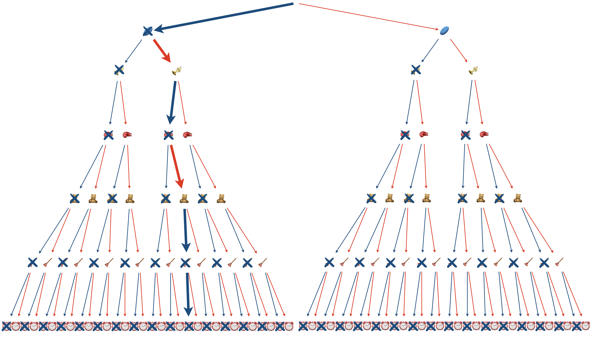

+++
title = "Gloutons et programmation dynamique"
date = 2026-11-19T10:00:00+01:00
weight = 7
chapter = false
css = "algo.css"
+++

# Gloutons et programmation dynamique

## Choisir sans regret&nbsp;: les algorithmes gloutons

Beaucoup de problèmes consistent à construire une solution par une suite de choix&nbsp;: quelle pièce rendre, quelle réservation accepter, quel objet glisser dans le sac. Un algorithme **glouton** fait à chaque étape le choix qui semble le meilleur sur le moment, et ne le remet jamais en cause. Dans l'arbre de tous les choix possibles, il ne suit qu'une seule branche&nbsp;: c'est ce qui le rend si rapide, et si simple à écrire. Toute la difficulté est ailleurs&nbsp;: savoir si cette branche mène bien à la meilleure solution.

### Rendre la monnaie

Pour rendre une somme avec le moins de pièces possible, la caissière prend toujours la plus grosse pièce qui ne dépasse pas ce qui reste à rendre. Avec les euros, ça marche à tous les coups. Avec les pièces britanniques d'avant 1971 (1, 3, 6, 12, 24 et 30 pence), ça échoue&nbsp;: pour rendre 48 pence, le glouton donne $30+12+6$, trois pièces, alors que deux florins, $24+24$, suffisaient.



Pour connaître l'optimum, il faut une autre idée, que la bande du bas met en œuvre&nbsp;: le meilleur rendu d'un montant $m$ commence par une pièce $p$, suivie du meilleur rendu de $m-p$. Si l'on connaît déjà les meilleurs rendus de tous les montants plus petits, il suffit d'essayer chaque pièce. C'est de la **programmation dynamique**, l'objet de la seconde partie de cette page.


def glouton(montant, pieces):
    rendu = []
    for p in sorted(pieces, reverse=True):     # la plus grosse pièce d'abord
        while montant >= p:
            montant -= p
            rendu.append(p)
    return rendu

def optimal(montant, pieces):                  # programmation dynamique
    meilleur = [[]] + [None] * montant          # meilleur[m] : rendu optimal de m
    for m in range(1, montant + 1):
        for p in pieces:
            if p <= m and meilleur[m - p] is not None:
                essai = meilleur[m - p] + [p]
                if meilleur[m] is None or len(essai) < len(meilleur[m]):
                    meilleur[m] = essai
    return meilleur[montant]

euros = [1, 2, 5, 10, 20, 50, 100, 200]        # en centimes
pence = [1, 3, 6, 12, 24, 30]                  # Royaume-Uni, avant 1971
print("289 c :", glouton(289, euros), "contre", optimal(289, euros))
print("48 d  :", glouton(48, pence), "contre", optimal(48, pence))


Quand peut-on faire confiance à un glouton&nbsp;?

Il faut le **démontrer**, et l'argument classique est un **échange**. On part d'une solution optimale quelconque, et l'on montre qu'on peut la modifier, sans la dégrader, pour qu'elle commence par le choix du glouton. On recommence sur la suite, et, de proche en proche, la solution du glouton se révèle elle-même optimale. Pour les euros, l'échange marche&nbsp;: deux pièces de 1 centime se remplacent par une pièce de 2, trois pièces de 2 par une de 5 et une de 1, et ainsi de suite. Pour les anciens pence, il échoue sur 48. Les systèmes monétaires modernes sont conçus pour que le glouton de la caissière soit optimal.

### Réserver une salle

Une salle reçoit des demandes de réservation pour la journée, chacune avec une heure de début et une heure de fin. On veut en satisfaire le plus grand nombre possible, sans que deux réservations se chevauchent. Plusieurs critères gloutons viennent à l'esprit&nbsp;: accepter d'abord les demandes qui commencent le plus tôt, ou les plus courtes, ou celles qui gênent le moins de monde. Un seul est toujours optimal.



Le bon critère est de prendre d'abord la demande qui **se termine le plus tôt**&nbsp;: c'est elle qui laisse la salle libre le plus tôt pour la suite. L'argument d'échange le confirme. Dans n'importe quelle solution optimale, on peut remplacer la première réservation par celle qui finit le plus tôt de toutes&nbsp;: elle se termine avant, donc ne gêne aucune des suivantes, et le nombre de réservations ne change pas. Les autres critères ont chacun leur cas piège, que le bouton du même nom construit.


def planning(demandes):
    acceptees, libre_a = [], 0
    for debut, fin in sorted(demandes, key=lambda d: d[1]):   # par heure de fin
        if debut >= libre_a:
            acceptees.append((debut, fin))
            libre_a = fin
    return acceptees

demandes = [(8, 10), (9, 12), (10, 11), (11, 14), (12, 13), (13, 16), (14, 15), (15, 18), (17, 19)]
print(planning(demandes))


### Compresser&nbsp;: le code de Huffman

Un texte est stocké lettre par lettre, et l'ASCII consacre 8 bits à chaque caractère. Pourtant, toutes les lettres ne se valent pas&nbsp;: en français, le «&nbsp;e&nbsp;» est bien plus fréquent que le «&nbsp;w&nbsp;». En donnant des codes courts aux caractères fréquents et des codes longs aux caractères rares, on raccourcit le texte. Encore faut-il pouvoir le relire sans ambiguïté&nbsp;: aucun code ne doit être le début d'un autre. C'est le cas si les codes sont les chemins d'un arbre binaire, de la racine aux feuilles, où chaque feuille porte un caractère.

En 1951, au MIT, Robert Fano laisse à ses étudiants le choix entre un examen final et un devoir&nbsp;: trouver le meilleur de ces codes. David Huffman cherche pendant des mois, s'apprête à renoncer et à réviser pour l'examen, quand l'idée lui vient. Au lieu de construire l'arbre depuis la racine, comme le faisait son professeur, il le construit depuis les feuilles, en fusionnant toujours les deux arbres les plus légers. Ce glouton est optimal, et il a battu la méthode de Fano.





Le codage de Huffman est partout&nbsp;: dans les fichiers ZIP, dans les images JPEG, dans la musique MP3, où il intervient à la dernière étape de la compression.


def huffman(texte):
    freq = {}
    for c in texte:
        freq[c] = freq.get(c, 0) + 1
    foret = [(n, c) for c, n in freq.items()]     # (poids, arbre) ; une feuille est un caractère
    while len(foret) > 1:
        foret.sort(key=lambda t: t[0])             # les deux plus légers d'abord
        (n1, a), (n2, b) = foret[0], foret[1]
        foret = foret[2:] + [(n1 + n2, (a, b))]   # fusion : un nouvel arbre
    codes = {}
    def lire(arbre, code):
        if isinstance(arbre, str):
            codes[arbre] = code or "0"
        else:
            lire(arbre[0], code + "0")
            lire(arbre[1], code + "1")
    lire(foret[0][1], "")
    return codes

texte = "un chasseur sachant chasser doit savoir chasser sans son chien"
codes = huffman(texte)
for c in sorted(codes, key=lambda c: len(codes[c])):
    print(repr(c), codes[c])
code = "".join(codes[c] for c in texte)
print(len(code), "bits au lieu de", 8 * len(texte))


### Les gloutons des graphes

Trois des grands algorithmes de la page [Graphes](../graphes/) sont des gloutons, et tous trois sont optimaux. **Dijkstra** valide à chaque étape le sommet le plus proche du départ parmi ceux qui attendent. **Prim** ajoute à son arbre l'arête la plus courte qui en sort. **Kruskal** examine les arêtes de la plus courte à la plus longue et garde toutes celles qui ne ferment pas de cycle. Chaque fois, un argument d'échange garantit que le choix du moment ne sera jamais regretté.

### Quand le glouton se trompe&nbsp;: le sac à dos

Un cambrioleur dispose d'un sac qui supporte 10 kilos, et hésite entre six objets&nbsp;: une guitare de 6 kilos d'une valeur de 30, un appareil photo et un télescope de 5 kilos valant 24 chacun, une peluche de 3 kilos valant 13, des livres de 2 kilos valant 7, et un réveil d'un kilo valant 1. Le réflexe glouton est de prendre les objets dans l'ordre de leur valeur au kilo&nbsp;: la guitare (5 par kilo), puis la peluche, puis le réveil, pour une valeur de 44. Mais l'appareil photo et le télescope, ensemble, valent 48.

Le premier choix du glouton, la guitare, semblait le meilleur&nbsp;; il interdit pourtant la meilleure combinaison. Aucun critère glouton ne résout ce problème. Faut-il alors essayer les $2^n$ sous-ensembles d'objets&nbsp;?

## Quand les sous-problèmes se répètent&nbsp;: la programmation dynamique

La suite de Fibonacci, $F\_n=F\_{n-1}+F\_{n-2}$, appelle une fonction récursive immédiate. Mais son [arbre des appels explose](../recursivite/#quand-larbre-explose)&nbsp;: pour calculer $F\_5$, on calcule deux fois $F\_3$, trois fois $F\_2$, cinq fois $F\_1$. Ces sous-problèmes ne sont pas indépendants, ce sont **les mêmes**&nbsp;: l'arbre n'est qu'un petit graphe déguisé.

<svg viewBox="0 0 760 300" role="img" aria-label="À gauche, l'arbre des appels récursifs de F5, avec 15 nœuds où les mêmes termes reviennent plusieurs fois ; à droite, le même calcul replié en 6 sous-problèmes distincts" style="width:100%;max-width:760px;height:auto;"><line x1="238.7" y1="42.5" x2="171.3" y2="81.5" stroke="#cbd5e1" stroke-width="1.3" opacity="1"/><line x1="262.3" y1="40.3" x2="387.7" y2="83.7" stroke="#cbd5e1" stroke-width="1.3" opacity="1"/><line x1="150.2" y1="96.5" x2="109.8" y2="131.5" stroke="#cbd5e1" stroke-width="1.3" opacity="1"/><line x1="171.3" y1="94.5" x2="238.7" y2="133.5" stroke="#cbd5e1" stroke-width="1.3" opacity="1"/><line x1="93.5" y1="151.3" x2="76.5" y2="180.7" stroke="#cbd5e1" stroke-width="1.3" opacity="1"/><line x1="109.8" y1="148.5" x2="150.2" y2="183.5" stroke="#cbd5e1" stroke-width="1.3" opacity="1"/><line x1="63.5" y1="203.3" x2="46.5" y2="232.7" stroke="#cbd5e1" stroke-width="1.3" opacity="1"/><line x1="76.5" y1="203.3" x2="93.5" y2="232.7" stroke="#cbd5e1" stroke-width="1.3" opacity="1"/><line x1="243.5" y1="151.3" x2="226.5" y2="180.7" stroke="#cbd5e1" stroke-width="1.3" opacity="1"/><line x1="256.5" y1="151.3" x2="273.5" y2="180.7" stroke="#cbd5e1" stroke-width="1.3" opacity="1"/><line x1="393.5" y1="99.3" x2="376.5" y2="128.7" stroke="#cbd5e1" stroke-width="1.3" opacity="1"/><line x1="409.8" y1="96.5" x2="450.2" y2="131.5" stroke="#cbd5e1" stroke-width="1.3" opacity="1"/><line x1="363.5" y1="151.3" x2="346.5" y2="180.7" stroke="#cbd5e1" stroke-width="1.3" opacity="1"/><line x1="376.5" y1="151.3" x2="393.5" y2="180.7" stroke="#cbd5e1" stroke-width="1.3" opacity="1"/><circle cx="250.0" cy="36.0" r="13" fill="#FBE9EF" stroke="#970E53" stroke-width="1.6" opacity="1"/><text x="250.0" y="40.0" text-anchor="middle" font-size="11" fill="#970E53" font-family="sans-serif" opacity="1">F5</text><circle cx="160.0" cy="88.0" r="13" fill="#FEF3C7" stroke="#B45309" stroke-width="1.6" opacity="1"/><text x="160.0" y="92.0" text-anchor="middle" font-size="11" fill="#B45309" font-family="sans-serif" opacity="1">F4</text><circle cx="100.0" cy="140.0" r="13" fill="#E6EEF5" stroke="#004D80" stroke-width="1.6" opacity="1"/><text x="100.0" y="144.0" text-anchor="middle" font-size="11" fill="#004D80" font-family="sans-serif" opacity="1">F3</text><circle cx="70.0" cy="192.0" r="13" fill="#E6F3F1" stroke="#006C65" stroke-width="1.6" opacity="1"/><text x="70.0" y="196.0" text-anchor="middle" font-size="11" fill="#006C65" font-family="sans-serif" opacity="1">F2</text><circle cx="40.0" cy="244.0" r="13" fill="#F1F5F9" stroke="#475569" stroke-width="1.6" opacity="1"/><text x="40.0" y="248.0" text-anchor="middle" font-size="11" fill="#475569" font-family="sans-serif" opacity="1">F1</text><circle cx="100.0" cy="244.0" r="13" fill="#F8FAFC" stroke="#64748b" stroke-width="1.6" opacity="1"/><text x="100.0" y="248.0" text-anchor="middle" font-size="11" fill="#64748b" font-family="sans-serif" opacity="1">F0</text><circle cx="160.0" cy="192.0" r="13" fill="#F1F5F9" stroke="#475569" stroke-width="1.6" opacity="1"/><text x="160.0" y="196.0" text-anchor="middle" font-size="11" fill="#475569" font-family="sans-serif" opacity="1">F1</text><circle cx="250.0" cy="140.0" r="13" fill="#E6F3F1" stroke="#006C65" stroke-width="1.6" opacity="1"/><text x="250.0" y="144.0" text-anchor="middle" font-size="11" fill="#006C65" font-family="sans-serif" opacity="1">F2</text><circle cx="220.0" cy="192.0" r="13" fill="#F1F5F9" stroke="#475569" stroke-width="1.6" opacity="1"/><text x="220.0" y="196.0" text-anchor="middle" font-size="11" fill="#475569" font-family="sans-serif" opacity="1">F1</text><circle cx="280.0" cy="192.0" r="13" fill="#F8FAFC" stroke="#64748b" stroke-width="1.6" opacity="1"/><text x="280.0" y="196.0" text-anchor="middle" font-size="11" fill="#64748b" font-family="sans-serif" opacity="1">F0</text><circle cx="400.0" cy="88.0" r="13" fill="#E6EEF5" stroke="#004D80" stroke-width="1.6" opacity="1"/><text x="400.0" y="92.0" text-anchor="middle" font-size="11" fill="#004D80" font-family="sans-serif" opacity="1">F3</text><circle cx="370.0" cy="140.0" r="13" fill="#E6F3F1" stroke="#006C65" stroke-width="1.6" opacity="1"/><text x="370.0" y="144.0" text-anchor="middle" font-size="11" fill="#006C65" font-family="sans-serif" opacity="1">F2</text><circle cx="340.0" cy="192.0" r="13" fill="#F1F5F9" stroke="#475569" stroke-width="1.6" opacity="1"/><text x="340.0" y="196.0" text-anchor="middle" font-size="11" fill="#475569" font-family="sans-serif" opacity="1">F1</text><circle cx="400.0" cy="192.0" r="13" fill="#F8FAFC" stroke="#64748b" stroke-width="1.6" opacity="1"/><text x="400.0" y="196.0" text-anchor="middle" font-size="11" fill="#64748b" font-family="sans-serif" opacity="1">F0</text><circle cx="460.0" cy="140.0" r="13" fill="#F1F5F9" stroke="#475569" stroke-width="1.6" opacity="1"/><text x="460.0" y="144.0" text-anchor="middle" font-size="11" fill="#475569" font-family="sans-serif" opacity="1">F1</text><text x="250" y="294" text-anchor="middle" font-size="12" fill="#475569" font-family="sans-serif">l'arbre des appels : 15 appels</text><line x1="520" y1="20" x2="520" y2="270" stroke="#e2e8f0"/><line x1="640.0" y1="181.0" x2="640.0" y2="199.0" stroke="#cbd5e1" stroke-width="1.4" opacity="1"/><path d="M652.0,174.0 C692.0,188.0 692.0,236.0 652.0,250.0" fill="none" stroke="#cbd5e1" stroke-width="1.4"/><line x1="640.0" y1="137.0" x2="640.0" y2="155.0" stroke="#cbd5e1" stroke-width="1.4" opacity="1"/><path d="M652.0,130.0 C692.0,144.0 692.0,192.0 652.0,206.0" fill="none" stroke="#cbd5e1" stroke-width="1.4"/><line x1="640.0" y1="93.0" x2="640.0" y2="111.0" stroke="#cbd5e1" stroke-width="1.4" opacity="1"/><path d="M652.0,86.0 C692.0,100.0 692.0,148.0 652.0,162.0" fill="none" stroke="#cbd5e1" stroke-width="1.4"/><line x1="640.0" y1="49.0" x2="640.0" y2="67.0" stroke="#cbd5e1" stroke-width="1.4" opacity="1"/><path d="M652.0,42.0 C692.0,56.0 692.0,104.0 652.0,118.0" fill="none" stroke="#cbd5e1" stroke-width="1.4"/><circle cx="640.0" cy="256.0" r="13" fill="#F8FAFC" stroke="#64748b" stroke-width="1.6" opacity="1"/><text x="640.0" y="260.0" text-anchor="middle" font-size="11" fill="#64748b" font-family="sans-serif" opacity="1">F0</text><circle cx="640.0" cy="212.0" r="13" fill="#F1F5F9" stroke="#475569" stroke-width="1.6" opacity="1"/><text x="640.0" y="216.0" text-anchor="middle" font-size="11" fill="#475569" font-family="sans-serif" opacity="1">F1</text><circle cx="640.0" cy="168.0" r="13" fill="#E6F3F1" stroke="#006C65" stroke-width="1.6" opacity="1"/><text x="640.0" y="172.0" text-anchor="middle" font-size="11" fill="#006C65" font-family="sans-serif" opacity="1">F2</text><circle cx="640.0" cy="124.0" r="13" fill="#E6EEF5" stroke="#004D80" stroke-width="1.6" opacity="1"/><text x="640.0" y="128.0" text-anchor="middle" font-size="11" fill="#004D80" font-family="sans-serif" opacity="1">F3</text><circle cx="640.0" cy="80.0" r="13" fill="#FEF3C7" stroke="#B45309" stroke-width="1.6" opacity="1"/><text x="640.0" y="84.0" text-anchor="middle" font-size="11" fill="#B45309" font-family="sans-serif" opacity="1">F4</text><circle cx="640.0" cy="36.0" r="13" fill="#FBE9EF" stroke="#970E53" stroke-width="1.6" opacity="1"/><text x="640.0" y="40.0" text-anchor="middle" font-size="11" fill="#970E53" font-family="sans-serif" opacity="1">F5</text><text x="640" y="294" text-anchor="middle" font-size="12" fill="#475569" font-family="sans-serif">replié : 6 sous-problèmes</text></svg>

À gauche, l'arbre des appels récursifs de $F_5$&nbsp;; à droite, le même calcul une fois les doublons fusionnés.

L'idée de la programmation dynamique est de replier l'arbre&nbsp;: résoudre chaque sous-problème **une seule fois**, ranger la réponse, et la réutiliser. On peut le faire de haut en bas, en mémorisant les résultats de la fonction récursive (c'est la **mémoïsation**), ou de bas en haut, en remplissant un tableau des plus petits sous-problèmes vers les plus grands, comme la bande du rendu de monnaie. Beaucoup de problèmes qui semblent exiger d'explorer un nombre exponentiel de possibilités ne comportent en réalité qu'un petit nombre de sous-problèmes distincts, rencontrés un très grand nombre de fois.

Un nom choisi pour ne rien dire

Richard Bellman, qui invente la méthode au début des années 1950 à la RAND Corporation, a raconté d'où vient son nom. Le secrétaire à la Défense de l'époque, Charles Wilson, dont dépendait le financement de la RAND, avait «&nbsp;une peur et une haine pathologiques du mot *recherche*&nbsp;». Bellman cherche donc un nom qui ne sente pas les mathématiques. *Programming*, au sens de planifier, convient. Et *dynamic* a cet avantage qu'il est impossible de l'employer dans un sens péjoratif&nbsp;: «&nbsp;c'était quelque chose à quoi même un membre du Congrès ne pourrait rien objecter&nbsp;».



### Fibonacci, quatre fois

Fibonacci offre même une petite échelle de raffinement. La version récursive naïve recalcule sans cesse les mêmes termes&nbsp;: son coût croît comme $\varphi^n$, exponentiellement. En mémorisant chaque terme, on descend à $\mathcal{O}(n)$ en temps et en mémoire. En ne gardant que les deux derniers termes, la mémoire tombe à $\mathcal{O}(1)$. Enfin, les formules de **doublement**, $F\_{2k}=F\_k(2F\_{k+1}-F\_k)$ et $F\_{2k+1}=F\_k^2+F\_{k+1}^2$, permettent de sauter de $k$ à $2k$, comme l'[exponentiation rapide](../recursivite/#lexponentiation-rapide)&nbsp;: $\mathcal{O}(\log n)$ opérations.


def fib_naif(n):                       # O(φ^n) : les mêmes termes sont recalculés
    return n if n < 2 else fib_naif(n - 1) + fib_naif(n - 2)

memo = {0: 0, 1: 1}
def fib_memo(n):                       # O(n) en temps et en mémoire
    if n not in memo:
        memo[n] = fib_memo(n - 1) + fib_memo(n - 2)
    return memo[n]

def fib_iter(n):                       # O(n) en temps, O(1) en mémoire
    a, b = 0, 1
    for _ in range(n):
        a, b = b, a + b
    return a

def fib_double(n):                     # O(log n) opérations : renvoie (F(n), F(n+1))
    if n == 0:
        return 0, 1
    a, b = fib_double(n // 2)
    c, d = a * (2 * b - a), a * a + b * b      # F(2k), F(2k+1)
    return (d, c + d) if n % 2 else (c, d)

print(fib_naif(20), fib_memo(20), fib_iter(20), fib_double(20)[0])
print(fib_double(300)[0])


La même idée, réduite à deux variables, fait la force de l'[algorithme de Kadane](../complexite/#mathcalon-un-seul-passage-kadane)&nbsp;: la meilleure tranche qui se termine en $i$ se déduit de celle qui se termine en $i-1$.

### Le sac à dos

Revenons au cambrioleur. Essayer tous les sous-ensembles d'objets revient à parcourir un arbre binaire&nbsp;: à chaque objet, on le prend ou on le laisse. Avec $n$ objets, l'arbre a $2^n$ feuilles&nbsp;: un millier pour dix objets, un milliard pour trente.

Mais beaucoup de branches aboutissent à la même situation&nbsp;: les mêmes objets restent à examiner, avec la même place libre. Notons $T[i][c]$ la meilleure valeur qu'on peut emporter avec les $i$ premiers objets dans un sac de capacité $c$. Pour le $i$-ème objet, de poids $p$ et de valeur $v$, il n'y a que deux possibilités&nbsp;: le laisser, et l'on obtient $T[i-1][c]$, ou le prendre, s'il tient, et l'on obtient $v+T[i-1][c-p]$. D'où la relation
$$T[i][c]=\max\big(T[i-1][c],\ v+T[i-1][c-p]\big),$$
qui remplit une table ligne par ligne.


objets = [("guitare", 6, 30), ("appareil photo", 5, 24), ("télescope", 5, 24),
          ("peluche", 3, 13), ("livres", 2, 7), ("réveil", 1, 1)]

def sac_a_dos(objets, C):
    n = len(objets)
    T = [[0] * (C + 1) for _ in range(n + 1)]
    for i in range(1, n + 1):
        nom, p, v = objets[i - 1]
        for c in range(C + 1):
            T[i][c] = T[i - 1][c]                          # sans l'objet i
            if p <= c:
                T[i][c] = max(T[i][c], v + T[i - 1][c - p])  # avec l'objet i
    pris, c = [], C                                        # on remonte la table
    for i in range(n, 0, -1):
        if T[i][c] != T[i - 1][c]:
            pris.append(objets[i - 1][0])
            c -= objets[i - 1][1]
    return T[n][C], pris

print(sac_a_dos(objets, 10))


La table compte $(n+1)(C+1)$ cases, chacune calculée en temps constant&nbsp;: le coût est proportionnel à $n\times C$, au lieu de $2^n$. Attention pourtant&nbsp;: le sac à dos est un problème NP-complet, et la programmation dynamique ne contredit pas la conjecture P ≠ NP. Le coût dépend de la **valeur** de la capacité $C$, et non de la **longueur** de son écriture&nbsp;: avec une capacité d'un milliard de grammes, la table devient gigantesque. On parle d'algorithme **pseudo-polynomial**.

### La distance d'édition

Combien faut-il d'opérations élémentaires (insérer une lettre, en supprimer une, en remplacer une) pour passer d'un mot à un autre&nbsp;? Cette **distance d'édition**, introduite par Vladimir Levenshtein en 1965, sert aux correcteurs orthographiques, qui proposent les mots du dictionnaire les plus proches d'une faute de frappe, à la comparaison de séquences d'ADN, ou encore à l'outil `diff`, qui montre ce qui a changé d'une version d'un fichier à la suivante.

Le raisonnement est le même&nbsp;: pour transformer les $i$ premières lettres du premier mot en les $j$ premières du second, la dernière opération est soit la suppression de la $i$-ème lettre, soit l'insertion de la $j$-ème, soit le remplacement de l'une par l'autre (gratuit si ce sont les mêmes). La meilleure des trois se lit dans des cases déjà remplies.




def distance(a, b):
    D = [[0] * (len(b) + 1) for _ in range(len(a) + 1)]
    for i in range(len(a) + 1):
        D[i][0] = i                                # i suppressions
    for j in range(len(b) + 1):
        D[0][j] = j                                # j insertions
    for i in range(1, len(a) + 1):
        for j in range(1, len(b) + 1):
            D[i][j] = min(D[i - 1][j] + 1,                            # supprimer a[i-1]
                          D[i][j - 1] + 1,                            # insérer b[j-1]
                          D[i - 1][j - 1] + (a[i - 1] != b[j - 1]))   # remplacer, ou garder
    return D[len(a)][len(b)]

dictionnaire = ["algorithme", "logarithme", "rythme", "algèbre", "arithmétique", "allergie"]
faute = "algoritme"
for mot in sorted(dictionnaire, key=lambda m: distance(faute, m)):
    print(mot, distance(faute, mot))


### Le voyageur de commerce&nbsp;: Held-Karp

Le problème du voyageur de commerce, rencontré à propos de [P = NP](../complexite/#mathrmpstackrelmathrmnp), demande le plus court circuit passant une fois par chaque ville. On ne lui connaît pas d'algorithme polynomial, et essayer tous les circuits coûte $(n-1)!/2$ évaluations&nbsp;: plus de $10^{16}$ pour vingt villes. La programmation dynamique fait beaucoup mieux. Notons $C(S,i)$ la longueur du plus court chemin qui part de la ville $0$, visite exactement les villes de l'ensemble $S$ et termine en $i$&nbsp;; la dernière étape vient d'une ville $j$ de $S$, d'où
$$C(S,i)=\min\_{j\in S,\ j\neq i}\big(C(S\setminus\\{i\\},j)+d(j,i)\big).$$
Il y a $2^n$ ensembles $S$ et $n$ villes d'arrivée, et chaque case demande un minimum sur $n$ villes&nbsp;: un coût de l'ordre de $n^2 2^n$, soit environ quatre cents millions d'opérations pour vingt villes. C'est encore exponentiel, mais c'est, depuis 1962, le meilleur algorithme exact connu. Michael Held et Richard Karp le publient cette année-là, en même temps que Bellman.


from random import random
from math import factorial, hypot

def held_karp(d):
    n = len(d)
    INF = float("inf")
    C = [[INF] * n for _ in range(1 << n)]       # C[S][i], S codé en binaire (bit k : ville k visitée)
    pred = [[-1] * n for _ in range(1 << n)]
    C[1][0] = 0                                  # au départ : la ville 0 seule
    for S in range(1 << n):
        for i in range(n):
            if C[S][i] == INF:
                continue
            for j in range(n):
                if not S & (1 << j):             # j pas encore visitée
                    T = S | (1 << j)
                    if C[S][i] + d[i][j] < C[T][j]:
                        C[T][j] = C[S][i] + d[i][j]
                        pred[T][j] = i
    tout = (1 << n) - 1
    fin = min(range(1, n), key=lambda i: C[tout][i] + d[i][0])
    circuit, S, i = [], tout, fin
    while i != -1:                               # on remonte les prédécesseurs
        circuit.append(i)
        S, i = S & ~(1 << i), pred[S][i]
    return C[tout][fin] + d[fin][0], circuit[::-1] + [0]

n = 11
villes = [(random(), random()) for _ in range(n)]
d = [[hypot(a[0] - b[0], a[1] - b[1]) for b in villes] for a in villes]
longueur, circuit = held_karp(d)
print("circuit :", circuit, " longueur :", round(longueur, 3))
print(f"{n} villes : {n * n * 2 ** n} opérations, contre {factorial(n - 1) // 2} circuits à essayer")


Ci-dessous, Held-Karp à l'œuvre sur une carte de France, au départ de Paris&nbsp;: chaque étape calcule un état (S,i)$, le plus court chemin qui visite les villes de /tmp/claude-0/-home-user-sciencesilencieuse-github-io/0641f4f8-b77a-5f09-b936-31f76d4a96b7/scratchpad$ et arrive en $, en prolongeant d'une ville des chemins déjà calculés. On peut le comparer à la force brute, qui mesure un à un tous les circuits, et ajouter ou retirer des villes d'un clic pour voir les deux nombres d'étapes s'écarter.



Distances à vol d'oiseau. Contour de la France&nbsp;: Admin Express (IGN), Licence ouverte, via le dépôt <a href="https://github.com/gregoiredavid/france-geojson">france-geojson</a>.

## Une branche, toutes les branches

Les deux stratégies répondent à la même question, posée face à l'arbre de tous les choix possibles. Le glouton n'en suit qu'une branche&nbsp;: c'est rapide, mais il faut prouver que c'est la bonne, et il arrive qu'elle ne le soit pas. La programmation dynamique les explore toutes, mais chacune une seule fois, en reconnaissant les situations déjà rencontrées&nbsp;: c'est sûr, et souvent étonnamment rapide, à condition que ces situations ne soient pas trop nombreuses. Quand elles le sont, il reste à [explorer l'arbre lui-même](../explorer/), en élaguant le plus tôt possible les branches sans avenir.
