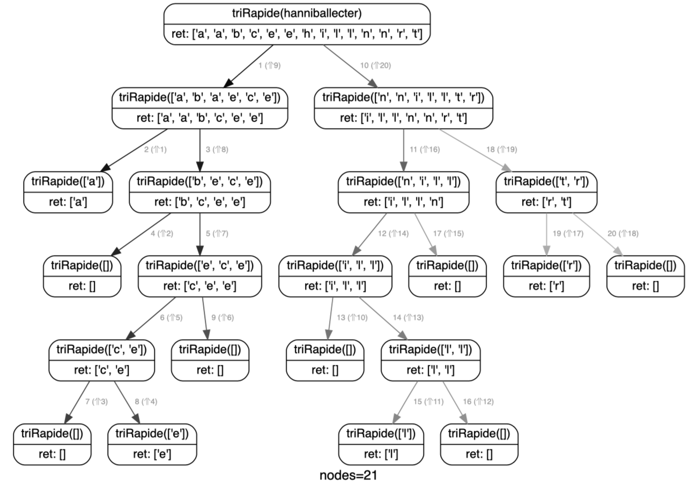

+++
title = "Stratégies"
date = 2026-11-18T10:00:00+01:00
weight = 2
chapter = false
css = "algo.css"
+++

<style>
 #correc
  {
    color: #006C65;
    border-left: solid 10px #C7DDDC;
  }
 #comm
  {
    color: #004D80;
    border-left: solid 10px #B3CAD9;
  }
 #commsum
  {
    color: #004D80;
  }
 #correcsum
  {
    color: #006C65;
  }
 #debord
{
overflow-x: auto; 
}
details > summary:first-of-type {
  display: list-item;     
  cursor: pointer;        
}
details > summary:first-of-type {
  list-style: disclosure-closed inside;
}
details[open] > summary:first-of-type {
  list-style-type: disclosure-open;
}
</style>


# Stratégies algorithmiques

Quelques grandes idées reviennent sans cesse dans la conception des algorithmes. Roughgarden les appelle des *paradigmes*&nbsp;: les connaître, c'est disposer d'une boîte à outils pour attaquer un problème nouveau. On les a déjà vues à l'œuvre sur la page [Complexité](../complexite/), qui présente aussi la notation $\mathcal{O}$ employée ici.

- La **récursivité**&nbsp;: ramener un problème à une version plus petite de lui-même.
- **Diviser pour régner**&nbsp;: couper en morceaux indépendants, les résoudre, recombiner.
- La **programmation dynamique**&nbsp;: quand les mêmes sous-problèmes reviennent sans cesse, ne les résoudre qu'une fois.
- Les **algorithmes gloutons**&nbsp;: faire à chaque étape le choix qui semble le meilleur sur le moment.
- Et, en filigrane, le choix de la **structure de données**, qui dicte souvent le code lui-même.

## Récursivité

Une fonction récursive s'appelle elle-même sur une version plus petite du problème, jusqu'à un cas assez simple pour être résolu directement. Ce n'est pas toujours la forme la plus économe, mais c'est souvent la plus claire&nbsp;: la récursivité sait insuffler un air de magie aux algorithmes en permettant à de tout petits codes de réaliser des tâches étonnamment complexes. Les tours de Hanoï en sont l'exemple le plus célèbre. 






<p style="margin-top:1.5em;">Fonction centrale du programme ci-dessus&nbsp;:</p>

<pre style="margin-top:-0.5em;"><code class="language-python">def Hanoi(n, depart, cible, inter):
    if n == 1:
      deplacement(depart,cible)
    else :
      Hanoi(n-1,depart,inter,cible)
      Hanoi(1,depart,cible,inter)
      Hanoi(n-1,inter,cible,depart)

Hanoi(6, 0, 2,1)</code></pre>


<div class="encadre prune">
<div class="encadre-titre">La tour de Brahma</div>

Le casse-tête est inventé en 1883 par le mathématicien Édouard Lucas, sous le pseudonyme de «&nbsp;N. Claus de Siam&nbsp;», anagramme de «&nbsp;Lucas d'Amiens&nbsp;». Il l'accompagne d'une légende&nbsp;: dans un temple de Bénarès, des prêtres déplaceraient sans relâche 64 disques d'or, et le monde finirait quand ils auraient terminé.

Combien de mouvements faut-il&nbsp;? Déplacer $n$ disques, c'est déplacer deux fois $n-1$ disques, plus le grand&nbsp;: $H(n)=2H(n-1)+1$ avec $H(1)=1$, d'où $H(n)=2^n-1$. On montre que c'est le minimum possible. Pour 64 disques, à un mouvement par seconde, il faudrait $2^{64}-1\approx 1{,}8\cdot 10^{19}$ secondes, soit environ 585 milliards d'années&nbsp;: le monde a de la marge.

</div>

## Diviser pour régner

Couper le problème en morceaux plus petits, les résoudre récursivement, puis combiner les réponses&nbsp;: on l'a vu avec le [plus grand sous-tableau](../complexite/#mathcalonlog-n-diviser-pour-régner). Le gain vient de ce que la combinaison coûte peu, et de ce que les morceaux rapetissent vite.

### Multiplier plus vite qu'à l'école

Pour multiplier deux nombres de $n$ chiffres, la méthode apprise à l'école calcule $n^2$ produits de chiffres. En 1960, lors d'un séminaire à Moscou, Andreï Kolmogorov conjecture qu'on ne peut pas faire mieux. Moins d'une semaine plus tard, Anatoli Karatsouba, un étudiant de 23 ans, lui apporte un contre-exemple. Kolmogorov, enthousiaste, présente le résultat et le fait publier en 1962&nbsp;; Karatsouba ne l'apprend qu'en recevant les tirés à part.

L'idée, qui remonte à une astuce de Gauss pour les nombres complexes&nbsp;: écrire $x=a\cdot 10^m+b$ et $y=c\cdot 10^m+d$. Le produit demande $ac$, $bd$ et $ad+bc$, soit quatre produits en apparence. Mais $ad+bc=(a+b)(c+d)-ac-bd$&nbsp;: **trois** produits suffisent. Appliquée récursivement, cette économie donne un coût en $\mathcal{O}(n^{\log\_2 3})\approx\mathcal{O}(n^{1{,}585})$.


from random import randint
produits = 0                           # nombre de produits de petits nombres

def karatsuba(x, y):
    global produits
    if x < 10 or y < 10:
        produits += 1
        return x * y
    m = max(len(str(x)), len(str(y))) // 2
    a, b = divmod(x, 10 ** m)
    c, d = divmod(y, 10 ** m)
    ac, bd = karatsuba(a, c), karatsuba(b, d)
    milieu = karatsuba(a + b, c + d) - ac - bd     # 3 produits au lieu de 4
    return ac * 10 ** (2 * m) + milieu * 10 ** m + bd

def nombre(n):                         # un nombre aléatoire de n chiffres
    return int(str(randint(1, 9)) + "".join(str(randint(0, 9)) for _ in range(n - 1)))

for n in [8, 16, 32, 64, 128]:
    x, y = nombre(n), nombre(n)
    produits = 0
    assert karatsuba(x, y) == x * y
    print(n, "chiffres :", produits, "produits, contre", n * n, "à l'école")


En 2019, David Harvey et Joris van der Hoeven ont atteint $\mathcal{O}(n\log n)$, la limite que l'on conjecture depuis les années 1970.

### Trier, «&nbsp;la mère de tous les problèmes&nbsp;»

Les tris sont omniprésents en informatique et Tim Roughgarden (auteur des géniaux *Algorithms illuminated*) en parle même comme de la “mère de tous les problèmes algorithmiques”.

Ci-dessous, vous pourrez comparer l'efficacité de différents tris par comparaison en les voyant se débattre courageusement avec les données.




### Quicksort




Un code Python possible pour la version détaillée dans la vidéo&nbsp;:

<details>
<summary id="correcsum">Code</summary>
<blockquote id="correc">

```python
from random import randint

def permute(L, i, j):
    L[i], L[j] = L[j], L[i]

def partition(L, g, d):
    p = L[g]
    i = g+1
    for j in range(g+1,d+1):
        if L[j] < p:
            permute(L,i,j)
            i += 1
    permute(L,g,i-1)
    return i-1

def tri_rapide_gd(L, g, d):
    if g < d: 
        pivot = randint(g,d)
        permute(L,pivot,g)
        pivot = partition(L, g, d)
        tri_rapide_gd(L, g, pivot-1)
        tri_rapide_gd(L, pivot+1, d)
    return L

def tri_rapide(L):
    g = 0
    d = len(L)-1
    return tri_rapide_gd(L, g, d)
```

</blockquote>
</details>

La danse hongroise ci-dessous implémente une version de l'algorithme sans hasard&nbsp;:



Dans cette version, le premier élément est systématiquement choisi comme pivot (chapeau noir) et la partition marche un peu différemment&nbsp;:<br>
<ul>
<li>Le chapeau rouge <code>i</code> est d'abord donné au dernier élément de la partition puis comparé au pivot <code>p</code>.</li>
<ul>
<li>Si le chapeau rouge est plus petit que le pivot, les deux éléments échangent leur place et le chapeau rouge est donné au plus proche voisin du côté du pivot.</li>
<li>Sinon le pivot reste à sa place et le chapeau rouge est là aussi donné au voisin immédiat le plus proche du pivot.</li>
</ul>
<li>Lorsque le pivot récupère le chapeau rouge, il est bien placé.</li>
<li>On coupe ensuite la liste en deux sur le pivot et on recommence récursivement.</li>
</ul>

Un code Python possible pour cette variante&nbsp;:

<details>
<summary id="correcsum">Code</summary>
<blockquote id="correc">

```python
def partition(L):
    p = 0         # pivot (chapeau noir)
    i = len(L)-1  # chapeau rouge
    while i != p:
      if (L[p]-L[i])*(p-i) < 0:
        L[p],L[i] = L[i],L[p]
        p,i = i,p
      i -= (i-p)//abs(i-p)
    return p
    
def tri_rapide(L):
    if len(L) <= 1:
      return L
    else:
      p = partition(L)
      L[:p] = tri_rapide(L[:p])
      L[p+1:] = tri_rapide(L[p+1:])
      return L
```

</blockquote>
</details>


Un tirage non aléatoire du pivot rend l'algorithme moins robuste sur certaines entrées. Avec le choix systématique du premier élément (par exemple), on se retrouve avec une complexité en $O(n^2)$ sur des données déjà triées ou presque. Le tirage aléatoire rend extrêmement peu probable un scénario "défavorable".  

Si en plus de choisir le premier élément comme pivot, on ne s'occupe même plus d'avoir un tri en place (c'est-à-dire qu'on s'autorise des copies de la liste de départ), Quicksort peut s'écrire de manière très compacte&nbsp;:

```python
def triRapide(elements):
    if len(elements) <= 1:
        return elements
    else: 
        pivot = elements[0]
        plusPetit = triRapide([e for e in elements[1:] if e <= pivot])
        plusGrand = triRapide([e for e in elements[1:] if e > pivot])
        return plusPetit + [pivot] + plusGrand
```

<div style="position:relative;margin-left:auto;margin-right:auto;width:700px;max-width:100%;">

</div>

Mais attention, l'élégance de ce code cache sa lâcheté puisqu'en ne rangeant plus en place, il esquive la principale difficulté d'un algorithme de tri. S'interdire la création de nouvelles listes oblige en effet à gérer astucieusement les permutations au sein de la liste de départ. Et si cela donne souvent des codes plus verbeux, ils n'en sont pas moins beaucoup plus fins.

<br>


Le tirage aléatoire du pivot a une conséquence remarquable, que Roughgarden met en avant&nbsp;: pour **toute** entrée, le temps moyen (sur les tirages) est en $\mathcal{O}(n\log n)$. Il n'y a plus de «&nbsp;mauvaise entrée&nbsp;», seulement de mauvais tirages, et ils sont rarissimes.

## Programmation dynamique

La logique de la **programmation dynamique** est présentée dans la vidéo suivante.



{}
L'idée fondatrice de la programmation dynamique (DP) tient en une phrase&nbsp;: beaucoup de problèmes qui semblent exiger d'explorer un nombre exponentiel de scénarios ne comportent en réalité qu'un petit nombre de sous-problèmes distincts, chacun rencontré un très grand nombre de fois.<br>
Dit autrement, l'arbre des possibilités est immense mais des branches très différentes de l'arbre convergent sans arrêt vers les mêmes situations. Une exploration récursive aboutirait à un graphe acyclique dense en nœuds partagés (cf. Fibonacci).<br>
La DP consiste à identifier les sous-problèmes, à les résoudre chacun une seule fois, à stocker les résultats (la fameuse matrice), et à les combiner.
{}

### Fibonacci, quatre fois

La suite de Fibonacci, l'exemple que cite l'encadré, offre une petite échelle de raffinement, sur le modèle de celles de la page [Complexité](../complexite/#une-échelle-de-raffinement-la-recherche-du-doublon). La version récursive naïve recalcule sans cesse les mêmes termes&nbsp;: son coût croît comme $\varphi^n$, exponentiellement. En mémorisant chaque terme (c'est la programmation dynamique), on descend à $\mathcal{O}(n)$ en temps et en mémoire. En ne gardant que les deux derniers termes, la mémoire tombe à $\mathcal{O}(1)$. Enfin, les formules de **doublement**, $F\_{2k}=F\_k(2F\_{k+1}-F\_k)$ et $F\_{2k+1}=F\_k^2+F\_{k+1}^2$, permettent de sauter de $k$ à $2k$&nbsp;: $\mathcal{O}(\log n)$ opérations arithmétiques.


def fib_naif(n):                       # O(φ^n) : les mêmes termes sont recalculés
    return n if n < 2 else fib_naif(n - 1) + fib_naif(n - 2)

def fib_memo(n, memo={0: 0, 1: 1}):    # O(n) en temps et en mémoire
    if n not in memo:
        memo[n] = fib_memo(n - 1) + fib_memo(n - 2)
    return memo[n]

def fib_iter(n):                       # O(n) en temps, O(1) en mémoire
    a, b = 0, 1
    for _ in range(n):
        a, b = b, a + b
    return a

def fib_double(n):                     # O(log n) opérations : renvoie (F(n), F(n+1))
    if n == 0:
        return 0, 1
    a, b = fib_double(n // 2)
    c, d = a * (2 * b - a), a * a + b * b      # F(2k), F(2k+1)
    return (d, c + d) if n % 2 else (c, d)

print(fib_naif(20), fib_memo(20), fib_iter(20), fib_double(20)[0])
print(fib_double(300)[0])


On retrouve la même idée, réduite à deux variables, dans l'[algorithme de Kadane](../complexite/#mathcalon-un-seul-passage-kadane)&nbsp;: la meilleure tranche qui se termine en $i$ se déduit de celle qui se termine en $i-1$.

### Le voyageur de commerce&nbsp;: Held-Karp

Le problème du voyageur de commerce, rencontré à propos de [P = NP](../complexite/#mathrmpstackrelmathrmnp), n'a pas d'algorithme polynomial connu. Le meilleur algorithme exact (non quantique), celui de Held et Karp, utilise la programmation dynamique. L'implémentation ci-dessous utilise la technique du masquage pour parcourir tous les sous-ensembles de villes visitées possibles et pour pouvoir tester rapidement l'appartenance ou non d'une ville à ce sous-ensemble.

<details>
<summary id="correcsum">Code</summary>
<blockquote id="correc">

```python
def tsp_chemin(distance, depart=0):
        """
        Résout le problème du voyageur de commerce (TSP) en utilisant une programmation dynamique basée sur les masques binaires.
        
        Cette fonction calcule, pour chaque sous-ensemble de villes et pour chaque ville terminale, le coût minimal pour parcourir l'ensemble des villes spécifié par le masque et terminer dans cette ville.
        Elle permet également de reconstruire le chemin optimal en stockant, pour chaque état, la ville précédente.
        
        Paramètres
        ----------
        distance : list[list[float]]
            Matrice des distances entre les villes, où distance[i][j] représente la distance allant de la ville i à la ville j.
        depart : int, optionnel
            Indice de la ville de départ (par défaut 0).   
        
        Retourne
        --------
        tuple
            Un tuple (dp, parent) contenant :
              - dp : list[list[float]]
                Tableau à deux dimensions de taille (2^n x n) où dp[masque][j] est le coût minimum pour visiter
                l'ensemble de villes indiqué par le masque (représenté en binaire) et terminer à la ville j.
              - parent : list[list[int]]
                Tableau à deux dimensions de taille (2^n x n) permettant de reconstruire le chemin optimal.
                Pour chaque état (masque, j), parent[masque][j] stocke l'indice de la ville qui précède j dans le chemin optimal.
        
        Description
        -----------
        L'algorithme initialise une table dp avec des valeurs infinies, sauf pour l'état correspondant au départ.
        Il parcourt ensuite tous les masques possibles (correspondant aux 2^n sous-ensembles de villes) et, pour chaque ville déjà visitée, il tente de mettre à jour le coût minimal pour atteindre chaque ville non encore visitée.
        La structure parent est utilisée pour enregistrer les transitions effectuées, ce qui permet ultérieurement
        de reconstruire le chemin optimal.
        
        Exemple d'utilisation
        ---------------------
        >>> distance = [
        ...     [0, 10, 15, 20],
        ...     [10, 0, 35, 25],
        ...     [15, 35, 0, 30],
        ...     [20, 25, 30, 0]
        ... ]
        >>> dp, parent = tsp_chemin(distance, depart=0)
        """
        n = len(distance)
        INF = float('inf')
        dp = [[INF] * n for _ in range(1 << n)] 
        parent = [[-1] * n for _ in range(1 << n)]
        
        dp[1 << depart][depart] = 0
        for masque in range(1 << n):  # 2^n possibilités (chaque ville est visitée ou non visitée)
            for i in range(n):
                if masque & (1 << i):  # si la ville i est visitée
                    for j in range(n):
                        if not (masque & (1 << j)):  # si la ville j n'est pas encore visitée
                            nv_masque = masque | (1 << j)
                            if dp[nv_masque][j] > dp[masque][i] + distance[i][j]:
                                dp[nv_masque][j] = dp[masque][i] + distance[i][j]
                                parent[nv_masque][j] = i
        return dp, parent
```

</blockquote>
</details>


Comme à chaque fois en programmation dynamique, la matrice `dp` contient toutes les informations nécessaires et pour reconstruire le plus petit chemin et obtenir son coût, on peut utiliser le code suivant&nbsp;:

<details>
<summary id="correcsum">Code</summary>
<blockquote id="correc">

```python
def reconstr_chemin(parent, masque, dernier):
    chemin = []
    while dernier != -1:
        chemin.append(dernier)
        temp = parent[masque][dernier]
        masque = masque & ~(1 << dernier)
        dernier = temp
    chemin.reverse()
    return chemin
 
dp, parent = tsp_chemin(distance, depart=0)
masque_final = (1 << len(distance)) - 1
coût_min, chemin_min = float('inf'), None

for i in range(len(distance)):
    coût_total = dp[masque_final][i] + distance[i][0] 
    if coût_total < coût_min:
        coût_min = coût_total
        chemin_min = reconstr_chemin(parent, masque_final, i)
        chemin_min.append(0)  # Fermer le cycle
```

</blockquote>
</details>

<br>

<video width="500" controls style="display:block;max-width:100%;position:relative;margin-left:auto;margin-right: auto; box-shadow: 0 4px 8px 0 rgba(0, 0, 0, 0.2), 0 6px 20px 0 rgba(0, 0, 0, 0.19);">
  <source src="/tps_vid.mp4" type="video/mp4">
</video>

La logique de cet algorithme repose sur la relation de récurrence suivante : $C(S,i) = \min_{j \in S,\ j \neq i} \left\\{ C\left(S \setminus \\{i\\}, j\right) + \mathrm{d}(j,i) \right\\}$ où $C(S,i)$ représente la plus petite distance pour parcourir chaque ville de l'ensemble $S$ et terminer dans la ville $i$ et $d(i,j)$ est la distance entre la ville $i$ et la ville $j$.

Sa complexité temporelle est en $\mathcal{O}(n^2 2^n)$. En effet, tous les sous-ensembles de villes sont inspectés $\mathcal{O}(2^n)$ et pour chacun, on parcourt toutes les paires ville de départ - ville d'arrivée possibles $\mathcal{O}(n)\times\mathcal{O}(n)$ sans jamais faire autre chose que des opérations en temps constant $\mathcal{O}(1)$ pour chaque paire.

## Algorithmes gloutons

Les algorithmes gloutons sont très faciles à comprendre et à implémenter. Si on devait leur trouver un défaut, il est à chercher du côté de leur correction, pas toujours simple à démontrer...



Sont présentés ci-dessous deux algorithmes gloutons très similaires qui permettent de résoudre des problèmes d'optimisation sur des graphes&nbsp;:
- **Dijkstra** cherche le plus court chemin entre deux nœuds.
- **Prim** construit l'arbre couvrant de poids minimal.





## La structure de données guide le code

Bien choisir sa structure de données, c'est souvent avoir déjà écrit l'algorithme. On l'a vu avec le [doublon](../complexite/#barreau-3-se-souvenir-de-ce-quon-a-vu), où un simple ensemble fait gagner une classe de complexité, ou avec [Kadane](../complexite/#mathcalon-un-seul-passage-kadane), où deux nombres suffisent à résumer tout le passé. L'exemple le plus frappant est celui des parcours de graphe.

### Pile, file, file de priorité&nbsp;: un seul parcours

Pour inventorier les sommets d'un graphe, deux stratégies sont possibles : 
- le **parcours en largeur (BFS)**,
- et le **parcours en profondeur (DFS)**.



Le code est identique entre les deux algorithmes à la structure de données utilisée près&nbsp;! On utilise une **file** (queue en anglais) pour le parcours en largeur et une **pile** pour le parcours en profondeur.

 

Avec sa logique FIFO (premier arrivé, premier parti, comme dans une file d'attente), BFS explore le graphe de proche en proche.


```python
from collections import deque
# deque est une file à double extrémités (double-ended queue) avec la primitive popleft() pour retirer à gauche comme une file et pop() pour retirer à droite comme une pile.

def BFS(G,depart):
    """
    graphe G(S,A) représenté par une liste d'adjacence implémentée par un dictionnaire et depart un sommet de S
    """
    file = deque()
    file.append(depart)
    Vus = {s : False for s in G}
    Sommets = []
    while file: # tant que la file n'est pas vide
        sommet = file.popleft() # méthode de la classe deque permettant de défiler
        if not Vus[sommet]:
            file += G[sommet]
            Vus[sommet] = True
            Sommets.append(sommet) 
    return Sommets
```

Avec sa logique LIFO (dernier arrivé, premier parti, comme pour une pile d'assiettes pendant la vaisselle), DFS s'enfonce dans une branche du graphe jusqu'à son extrémité puis revient à la dernière jonction rencontrée et explore une nouvelle branche, et ainsi de suite.

 
 
 

```python
def DFS(G,depart):
    pile = deque()
    pile.append(depart)
    Vus = {s : False for s in G}
    Sommets = []
    while pile:
        sommet = pile.pop()
        if not Vus[sommet]:
            pile += G[sommet]
            Vus[sommet] = True
            Sommets.append(sommet) 
    return Sommets
```

Comme la récursivité utilise naturellement une pile via la pile d'exécution, il y a une écriture récursive naturelle de la recherche en profondeur.

```python
def DFS(G,depart,Vus,Sommets=[]):
    Sommets.append(depart)
    Vus[depart] = True
    for sommet in G[depart]:
        if not Vus[sommet]:
            DFS(G,sommet,Vus,Sommets)
    return Sommets
```


Le programme ci-dessous rend cette symétrie explicite&nbsp;: un **unique** parcours, auquel on passe la façon de retirer le prochain sommet à visiter. Retirer le premier arrivé donne le parcours en largeur, retirer le dernier, le parcours en profondeur.


def parcours(G, depart, retirer):
    a_voir, vus, ordre = [depart], set(), []
    while a_voir:
        s = retirer(a_voir)
        if s not in vus:
            vus.add(s)
            ordre.append(s)
            a_voir.extend(G[s])
    return ordre

file = lambda L: L.pop(0)              # premier arrivé, premier servi
pile = lambda L: L.pop()               # dernier arrivé, premier servi

G = {"A": ["B", "C"], "B": ["D", "E"], "C": ["F"], "D": [], "E": ["F"], "F": []}
print("largeur   :", parcours(G, "A", file))
print("profondeur:", parcours(G, "A", pile))


On peut voir Dijkstra comme un parcours de graphe où la structure de données n'est plus une file ou une pile mais une file de priorité (qui donne en $\mathcal{O}(1)$ l'élément stocké de plus grand score).

Pour implémenter une file de priorité, on peut utiliser un tas (heap), arbre binaire presque ordonné dont la racine est l'élément prioritaire.




Une implémentation possible de Dijkstra&nbsp;:

<details>
<summary id="correcsum">Code</summary>
<blockquote id="correc">

```python
import heapq

def Dijkstra(G, depart):
    """
    Calcule les plus courts chemins dans un graphe pondéré à partir d'un sommet de départ.

    Paramètres :
      - G : dict, représentation du graphe où les clés sont les sommets et les valeurs sont des dictionnaires {voisin: poids}.
      - depart : le sommet de départ.

    Retourne :
      - predecesseurs : dict, permettant de reconstruire les plus courts chemins.
      - distances : dict, distances minimales depuis le sommet de départ.
    """
    if depart not in G:
        raise ValueError("Le sommet de départ n'est pas présent dans le graphe")

    distances = {sommet: float('infinity') for sommet in G}
    predecesseurs = {sommet: None for sommet in G}
    distances[depart] = 0

    tas = [(0, depart)]
    while tas:
        distance_actuelle, sommet_actuel = heapq.heappop(tas)
        # On ignore l'entrée obsolète si un meilleur chemin a été trouvé
        if distance_actuelle > distances[sommet_actuel]:
            continue

        for voisin, poids in G[sommet_actuel].items():
            nouvelle_distance = distance_actuelle + poids
            if nouvelle_distance < distances[voisin]:
                distances[voisin] = nouvelle_distance
                predecesseurs[voisin] = sommet_actuel
                heapq.heappush(tas, (nouvelle_distance, voisin))
    return predecesseurs, distances
```

</blockquote>
</details>

<br>


<div class="tableau-large">
<table class="tab-recap">
<tr><th>Structure de données</th><th>On retire…</th><th>Algorithme obtenu</th></tr>
<tr><td>pile</td><td>le dernier arrivé</td><td>parcours en profondeur</td></tr>
<tr><td>file</td><td>le premier arrivé</td><td>parcours en largeur (plus courts chemins en nombre d'arêtes)</td></tr>
<tr><td>file de priorité, clé = distance</td><td>le plus proche du départ</td><td>Dijkstra (plus courts chemins pondérés)</td></tr>
<tr><td>file de priorité, clé = distance + estimation</td><td>le plus prometteur</td><td>A* (recherche guidée)</td></tr>
</table>
</div>

## Quelques algorithmes remarquables

### Algorithme d'Euclide

Un des plus vieux algorithmes ($\approx$-300).





La suite de Fibonacci est un peu la tarte à la crème du mathématicien de série télévisée avec ses spirales dans les coquillages... Mais c'est bien elle qui montre le bout de son nez là où on ne l'attendait pas vraiment dans cette vidéo sur la complexité de l'algorithme d'Euclide.



On peut utiliser le pulvérisateur (algorithme d'Euclide étendu) ci-dessous. Le code est corrigé par rapport à celui de la vidéo qui présente une erreur dans le cas de base (on doit retourner `b, 0, 1` comme Euclide bien sûr et non `a,0,1`).


def pulverisateur(a, b):
    assert b!=0 and a>b
    if a%b == 0:
        return b, 0, 1
    else:
        pgcd, x, y = pulverisateur(b, a % b)
        return pgcd, y, x - (a // b) * y

a, b = 1920, 1080
pgcd,x,y = pulverisateur(1920,1080)
print(f"pgcd({a},{b}) = {pgcd}\n{a}*{x} + {b}*{y} = {pgcd}")


Et ce petit programme donne la décomposition en fraction continue&nbsp;:


def frac_ctn(a,b):
    C = []
    while b!= 0:
        C.append(a//b)
        a,b = b,a%b
    return C

print(frac_ctn(144,89))


<br>


### Algorithme X

Polyominos et Sudoku ont droit à leur algorithme au nom aguicheur&nbsp;: X.




<nav class="suite-nav" aria-label="Page précédente">
<a href="../complexite/" class="precedent"><span>← Précédent</span><b>Complexité</b></a>
</nav>
