+++
title = "Logique modale - Différentes logiques modales"
menuTitle = "Différentes logiques modales"
date = 2021-03-06T14:20:50+01:00
weight = 3
aliases = ["/logique/logique6/"]
css = "logique.css"
+++

# Logique modale

Différentes logiques modales&nbsp;: nécessité, devoir, savoir, temps, preuve

<nav class="chap-nav" aria-label="Chapitres">
<a href="../syntaxe-semantique/">Syntaxe et sémantique</a>
<a href="../systemes/">Systèmes logiques</a>
<a href="../logiques/" class="actif">Différentes logiques modales</a>
</nav>

Notes de lecture du livre <i>La logique pas à pas</i> de Jacques Duparc.

<i>Petit condensé de logique modale&nbsp;:</i>

En logique modale, un "<b>monde possible</b>" contient les propositions qui sont vraies dans ce monde. Il correspond à un modèle du calcul des propositions (à une ligne d'une table de vérité). Ces mondes possibles sont connectés entre eux par des <b>relations d'accessibilité</b>, et les <b>opérateurs de modalité</b> permettent d'explorer ces relations. Si $P$ est vraie dans tous les mondes accessibles depuis le monde $a$, alors on écrit $a\Vdash \Box P$ et si $P$ est vraie dans au moins un de ces mondes, on utilise $a\Vdash \Diamond P$. Un modèle de la logique modale est alors un <b>graphe orienté</b>, appelé système de transition ou structure de Kripke.

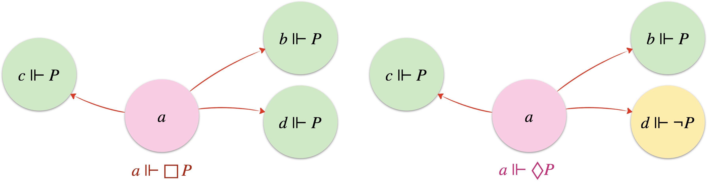

L'un des objectifs fondamentaux des systèmes logiques est de fournir un cadre où les propositions peuvent être systématiquement et formellement prouvées ou réfutées. On cherche au final une recette pour mettre à jour les tautologies de la théorie, les vérités absolues, les formules validées dans tout modèle. Cette exigence conduit à une axiomatisation, l'établissement d'un ensemble de règles d'inférence et de principes de base pour forger une machine à produire du vrai. 
Avec pour axiomes les tautologies du calcul des propositions auxquelles on ajoute l'axiome modal $\text{(K)}$ (qui distribue $\Box$ dans une implication), et les règles de nécessitation (si $\vdash\phi$, alors on a aussi $\vdash\Box\phi$), de substitution uniforme (une formule prouvable où toute occurrence d'une proposition est remplacée par une même formule quelconque est tout autant prouvable) et de <i>modus ponens</i> pour assurer la cohérence de la machinerie, on se retrouve avec la <b>logique modale normale</b> de base $\mathbf{K}$ qui permet de produire l'ensemble des formules universellement vraies. Toute formule obtenue dans $\mathbf{K}$ est vraie dans tout monde possible de toute structure de Kripke, et inversement. On dit alors qu'il y a <b>correction</b> et <b>complétude</b> entre le système formel et les modèles associés&nbsp;: $\vdash_\textbf{K}\phi$ ssi $\Vdash_\mathscr{C}\phi$ où $\vdash_\textbf{K}\phi$ dit que $\phi$ a été prouvée dans $\mathbf{K}$, et $\Vdash_\mathscr{C}\phi$ dit que $\phi$ est valide (vraie dans tout monde) pour tout modèle de la classe $\mathscr{C}$ qui désigne l'ensemble des systèmes de transition. 
En ajoutant de nouveaux axiomes modaux au système formel, on ajoute par là même des contraintes aux modèles associés (les graphes gagnent de nouvelles propriétés). À chaque jeu d'axiomes va correspondre une certaine classe de systèmes de transition où la vérité pourra se déployer. En ajoutant l'axiome $\text{(B)}=P\rightarrow \Box\Diamond P$, par exemple, la validité des formules obtenues sera limitée aux graphes non orientés $\mathscr{C}_{sym.}$ puisque l'axiome $\text{(B)}$ ajoute la symétrie aux structures.

## Les différentes logiques modales

On cherche maintenant à incarner la logique modale avec des interprétations précises des opérateurs modaux. La **boîte** peut servir à exprimer qu'un agent sait quelque chose et son dual, le **diamant**, exprime alors le fait que cet agent croit seulement possible cette même chose. Ça nous place dans une logique épistémique (logique de la connaissance) et c'est principalement cette version qu'on a utilisée jusqu'ici pour donner corps à la théorie. Mais d'autres emplois sont courants et ne rattachent pas forcément les opérateurs modaux à un agent, comme c'est le cas de la logique aléthique et la logique déontique. On verra aussi qu'en fonction des interprétations, certains axiomes sont plus naturels que d'autres et donc que ces différentes logiques modales s'épanouissent dans des univers aux topologies différentes.

### Logique aléthique

La logique modale est dite **aléthique** lorsque les opérateurs modaux traduisent la nécessité et la possibilité.

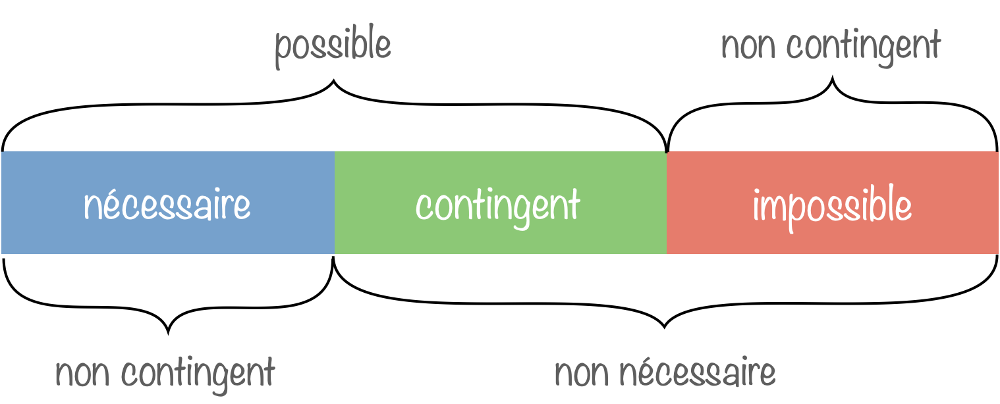

Les trois cellules rectangulaires sont destinées à être conjointement exhaustives et mutuellement exclusives&nbsp;: chaque proposition peut être nécessaire, contingente (possiblement vraie mais aussi possiblement fausse), ou encore impossible, mais jamais plus qu'un de ces trois choix.

On peut en déduire l'hexagone logique suivant, extension du carré des oppositions d'Aristote, dû à Sesmat et Blanché&nbsp;:

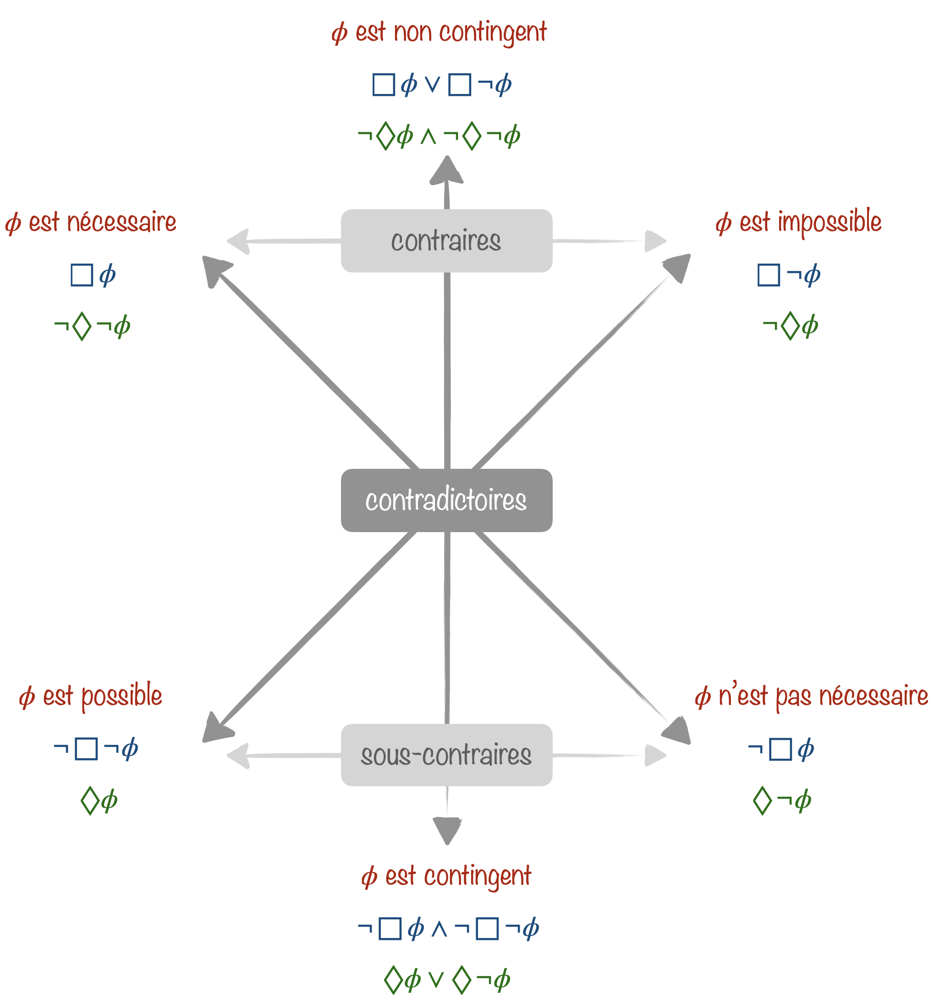

<ul>
<li>Deux propositions <b>contradictoires</b> ne sont jamais ni vraies, ni fausses en même temps.
<li>Deux propositions <b>contraires</b> ne sont jamais vraies en même temps, mais peuvent être fausses en même temps.
<li>Deux propositions <b>sous-contraires</b> ne sont jamais fausses en même temps, mais peuvent être vraies en même temps.
</ul>

L'axiome $\text{(K)}=\Box(P\rightarrow Q)\rightarrow(\Box P\rightarrow\Box Q)$, qui rappelons-le est vrai dans tout système, se traduit en logique aléthique par "s'il est nécessaire que $P$ entraîne $Q$, alors si $P$ est nécessaire, $Q$ est nécessaire également."

Parmi les autres axiomes qu'on a pu rencontrer, deux semblent plus adaptés à cette interprétation de la modalité&nbsp;:
<ul>
<li>l'axiome $\text{(T)}=\Box P\rightarrow P$&nbsp;: "s'il est nécessaire que $P$, alors $P$ est réalisée" (les logiciens du Moyen Âge, déjà, employaient la formule <i>ab necesse esse</i>).</li>
<li>l'axiome $\text{(B)}= P\rightarrow \Box\Diamond P$&nbsp;: "si $P$ est réalisée, alors il est nécessaire que $P$ soit possible" (cela semble en effet assez naturel).
</li>
</ul>

Le système logique normal adapté à la logique aléthique semble donc être $\textbf{KBT}$ et la classe de modèles adaptée est donc celle des systèmes de transition à la fois réflexifs et symétriques.

Aristote est à l'origine de la logique aléthique et il en donne un exemple célèbre dans *De l'interprétation*&nbsp;:
> Nécessairement il y aura demain une bataille navale ou il n'y en aura pas. Mais il n'est pas nécessaire qu'il y ait demain une bataille navale, pas plus qu'il n'est nécessaire qu'il n'y en ait pas. Mais qu'il y ait ou qu'il n'y ait pas demain une bataille navale, voilà qui est nécessaire.

En appelant $P$ l'affirmation "il y aura une bataille navale demain", la première et la troisième phrase se traduisent par la même formule, $\Box(P\lor\neg P)$, alors que la deuxième phrase se traduit par $\neg\Box P\land\neg\Box\neg P$.

Le modèle ci-dessous représente les deux mondes possibles (avec ou sans bataille navale). Les deux formules sont vérifiées en chacun des mondes.

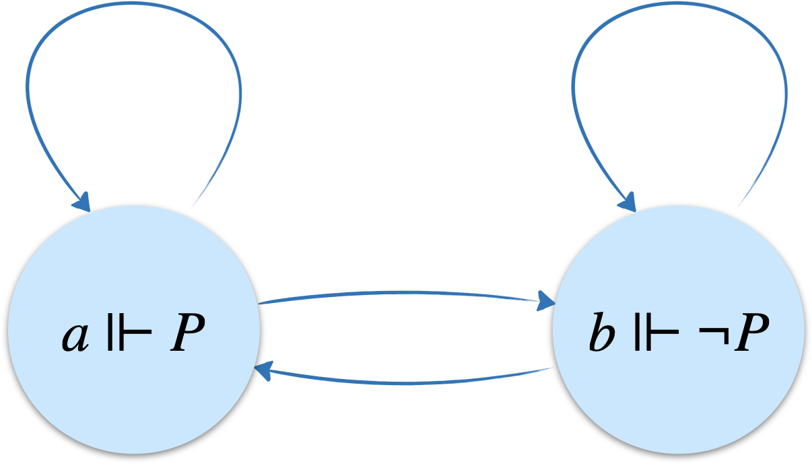

La logique modale "moderne" a elle aussi d'abord été aléthique lorsqu'elle est née du désir de C.I. Lewis, en 1913, de renforcer l'implication matérielle $P\rightarrow Q$. Il a voulu lui substituer une implication stricte qui s'avérera finalement une implication matérielle renforcée du caractère de la nécessité. L'étude de l'implication stricte revenait donc à celle de la logique aléthique. La logique modale s'est ensuite développée de manière purement axiomatique jusqu'au début des années 60, quand S. Kripke introduit l'idée des mondes possibles pour créer une sémantique à la logique modale.

Mais revenons à l'implication. La formule $(P\rightarrow Q)\lor(Q\rightarrow P)$ est une tautologie du calcul des propositions. Pour deux propositions quelconques, il y en a donc toujours une qui implique l'autre, ce qui paraît absurde puisque les propositions peuvent être totalement indépendantes&nbsp;! 
Avec l'implication stricte (implication ordinaire renforcée de la nécessité), le paradoxe disparaît car $\Box(P\rightarrow Q)\lor\Box(Q\rightarrow P)$ n'est pas valide. En effet, aucun des mondes du modèle ci-dessous ne satisfait la formule.

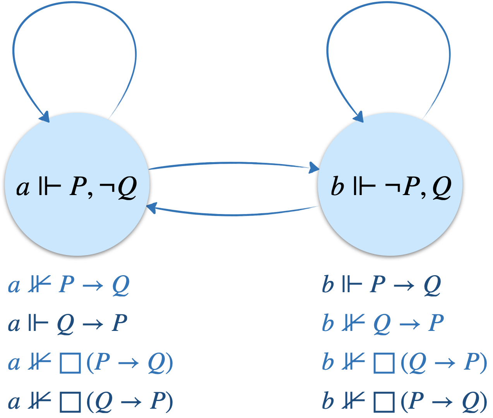

Le métaphysicien Charles Hartshorne a produit une "preuve" de l'existence de Dieu qui repose sur la logique $\textbf{{KB}}$ et qui nécessite un théorème de la logique modale $\vdash_\textbf{K} \Box(P\rightarrow Q)\rightarrow(\Diamond P\rightarrow\Diamond Q)$, l'axiome d'Anselme $G\rightarrow\Box G$ (si Dieu existe, il est nécessaire que Dieu existe) et l'axiome de Leibniz $\Diamond G$ (il est possible que Dieu existe).

<b>Lemme 1</b>&nbsp;: si Dieu est possible, il est possible qu'il soit nécessaire.

$$
\begin{prooftree}
\AxiomC{}
\RightLabel{$\scriptstyle Anselme$}
\UnaryInfC{$G\to\Box G$}
\RightLabel{$\scriptstyle nec.$}
\UnaryInfC{$\Box(G\to\Box G)$}
\AxiomC{}
\RightLabel{$\scriptstyle th.$}
\UnaryInfC{$\Box(P\to Q)\to(\Diamond P\to\Diamond Q)$}
\RightLabel{$\scriptstyle sub.$}
\UnaryInfC{$\Box(G\to Q)\to(\Diamond G\to\Diamond Q)$}
\RightLabel{$\scriptstyle sub.$}
\UnaryInfC{$\Box(G\to\Box G)\to(\Diamond G\to\Diamond\Box G)$}
\RightLabel{$\scriptstyle mod.p.$}
\BinaryInfC{$\Diamond G\to\Diamond\Box G$}
\end{prooftree}
$$

<b>Lemme 2</b>&nbsp;: s'il est possible que Dieu soit nécessaire, alors Dieu existe (c'est ici qu'intervient l'axiome $\text{(B)}$).

$$
\begin{prooftree}
\AxiomC{}
\RightLabel{$\scriptstyle (B)$}
\UnaryInfC{$P\to\Box\Diamond P$}
\RightLabel{$\scriptstyle sub.$}
\UnaryInfC{$\neg P\to\Box\Diamond\neg P$}
\RightLabel{$\scriptstyle contrap.$}
\UnaryInfC{$\neg\Box\Diamond\neg P\to\neg\neg P$}
\RightLabel{$\scriptstyle dual$}
\UnaryInfC{$\Diamond\Box P\to P$}
\RightLabel{$\scriptstyle sub.$}
\UnaryInfC{$\Diamond\Box G\to G$}
\end{prooftree}
$$

<b>Conclusion</b>&nbsp;: on enchaîne les deux lemmes, puis on applique l'axiome de Leibniz.

$$
\begin{prooftree}
\AxiomC{}
\RightLabel{$\scriptstyle ax.$}
\UnaryInfC{$(A\to B)\to((B\to C)\to(A\to C))$}
\RightLabel{$\scriptstyle sub.$}
\UnaryInfC{$(\Diamond G\to\Diamond\Box G)\to((\Diamond\Box G\to G)\to(\Diamond G\to G))$}
\AxiomC{}
\RightLabel{$\scriptstyle lemme\ 1$}
\UnaryInfC{$\Diamond G\to\Diamond\Box G$}
\RightLabel{$\scriptstyle mod.p.$}
\BinaryInfC{$(\Diamond\Box G\to G)\to(\Diamond G\to G)$}
\AxiomC{}
\RightLabel{$\scriptstyle lemme\ 2$}
\UnaryInfC{$\Diamond\Box G\to G$}
\RightLabel{$\scriptstyle mod.p.$}
\BinaryInfC{$\Diamond G\to G$}
\AxiomC{}
\RightLabel{$\scriptstyle Leibniz$}
\UnaryInfC{$\Diamond G$}
\RightLabel{$\scriptstyle mod.p.$}
\BinaryInfC{$G$}
\end{prooftree}
$$

Abréviations&nbsp;: <i>ax.</i> tautologie du calcul des propositions, <i>sub.</i> substitution uniforme, <i>nec.</i> nécessitation, <i>mod.p.</i> <i>modus ponens</i>, <i>th.</i> théorème déjà établi, <i>contrap.</i> contraposition, <i>dual</i> passage d'un opérateur modal à l'autre par $\Diamond\phi\equiv\neg\Box\neg\phi$ (et élimination de la double négation).

Monsieur Phi a <a href="https://youtu.be/zf0KkTpiUzc?si=JO_FOXcC4sd3afuU">une chouette vidéo</a> sur ce genre d'argument ontologique.

### Logique déontique

Cette logique porte sur l'**obligation** ou la **permission**.

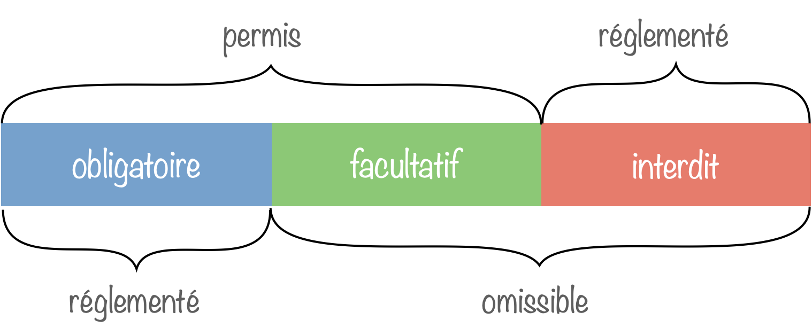

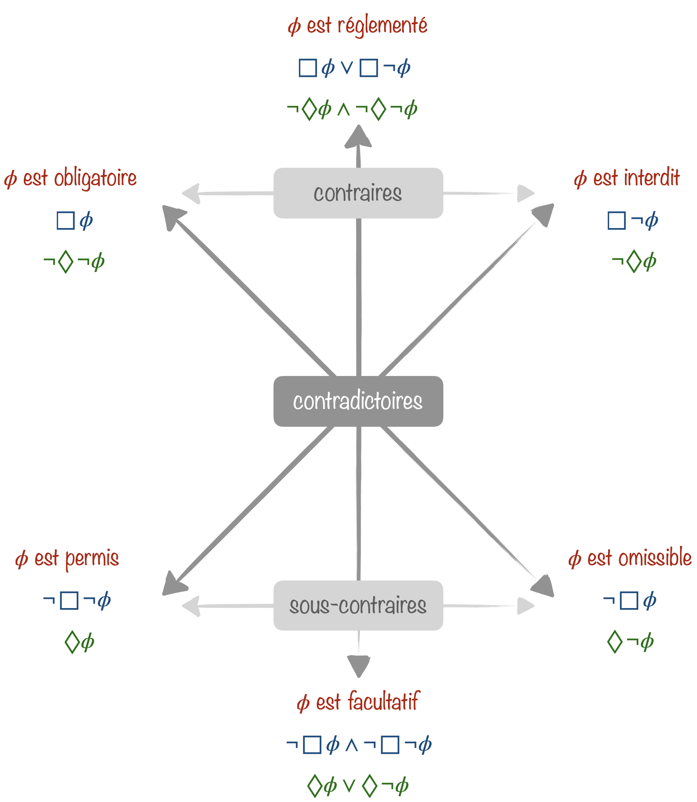

Les deux principes de la logique aléthique (les deux axiomes choisis) deviennent clairement faux en logique déontique&nbsp;:

<ul>
<li>$\Box P\rightarrow P$&nbsp;: si $P$ est obligatoire, alors $P$ est vraie. Ça n'a ici pas de sens puisque c'est le caractère propre de l'obligation que de pouvoir être transgressée&nbsp;! Il ne s'agirait pas sinon d'une obligation mais bien d'une nécessité.
<li>$P\rightarrow \Box\Diamond P$&nbsp;: si $P$ est vraie, alors $P$ doit être permise. C'est à nouveau dénué de sens puisque des choses non permises arrivent. Considérer cette proposition comme vraie revient d'ailleurs à tomber dans le sophisme naturaliste qui stipule que tout ce qui est naturel est bon ("il n'y a pas de vêtements dans la nature, donc il ne faut pas autoriser les vêtements").
</ul>

Mais quelle formule s'adapte à la logique déontique&nbsp;? L'axiome $\text{(D)}=\Box P\rightarrow\Diamond P$ affirmant que "si quelque chose est obligatoire, alors c'est permis", convient naturellement. En triturant un peu la formule, on obtient $\Box P\rightarrow\Diamond P\equiv\neg\Box P\lor\Diamond P\equiv\Diamond\neg P\lor\Diamond P$ "soit c'est permis de faire une chose, soit c'est permis de ne pas la faire". Ou encore&nbsp;: $\Diamond\neg P\lor\Diamond P\equiv \neg\Box P\lor\neg\Box\neg P\equiv\neg (\Box P\land\Box\neg P)$ "ne peuvent être obligatoires à la fois une chose et son contraire". Tout cela semble plutôt évident.

Le système formel correspondant est donc $\textbf{KD}$ et la classe de systèmes de transition associée est $\mathscr{C}_{n.b.d.}$. La raison de cette topologie ouverte, avec des mondes qui ont tous une échappatoire est qu'une impasse est par construction un monde où rien n'est permis&nbsp;!

Plusieurs paradoxes découlent de cette formalisation de l'obligation et de la permission. Penchons-nous d'abord sur le **paradoxe de Ross** (dû à... Ross). 
L'énoncé "Il est obligatoire de poster la lettre" ($\Box P$ où $P$ correspond à poster la lettre) entraîne "il est obligatoire de poster la lettre ou de la brûler" ($\Box(P\lor B)$ où $B$ correspond à brûler la lettre). En effet $\Box P\rightarrow \Box(P\lor B)$ est prouvable sans hypothèse et est donc vérifiée en tout nœud de tout modèle de Kripke d'une logique modale normale (puisque l'axiome $\text{(D)}$ n'est même pas nécessaire à la preuve).

On part de la tautologie $P\rightarrow (P\lor Q)$ et de l'axiome $\text{(K)}$&nbsp;:

Si l'obligation de poster une lettre implique l'obligation de la poster ou de la brûler, alors on peut satisfaire l'obligation découlant de la première en brûlant la lettre. Certes, la lettre est loin d'être postée et on a d'ailleurs probablement enfreint un interdit, mais on a pourtant bien aussi satisfait une obligation...  L'implication a permis une sorte de réduction du poids de l'obligation par affaiblissement de $P$ en $P\lor B$.

On rencontre un autre problème en affaiblissant une conjonction comme le montre le **paradoxe du Bon Samaritain** (dû à Prior)&nbsp;: l'énoncé "il est obligatoire qu'Alice aide Bob qui a été volé" peut se traduire par $\Box(A\land B)$ où $A$ est "Alice aide Bob" et $B$ est "Bob a été volé". Le problème est que $\Box(A\land B)\rightarrow\Box B$ est prouvable dans le système $\textbf{K}$ ($\text{(D)}$ n'est toujours pas nécessaire à la preuve).

On part de la tautologie $(A\land B)\rightarrow B$ et de l'axiome $\text{(K)}$&nbsp;:

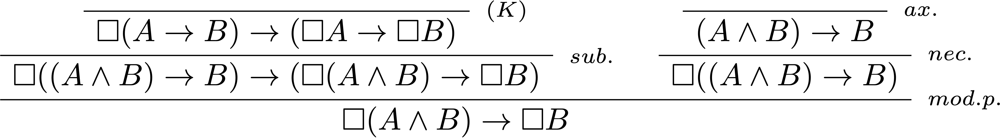

Donc si aider Bob lors d'un vol est obligatoire, il devient alors tout aussi obligatoire que Bob soit volé. Bob n'est pas ravi de la situation.

Une façon de se sortir de ces pièges est de maintenir une séparation stricte entre les descriptions des faits et les prescriptions déontiques. Cela évite d'inférer des faits (comme l'existence d'une victime) à partir des obligations morales ou légales. 

Mais plus fondamentalement, en habillant modalement les deux tautologies ($P\rightarrow(P\lor Q)$ et $(A\land B)\rightarrow B$) qui ont servi d'axiome dans les démonstrations, on permet de les interpréter sous un jour plus concret révélant leur bizarrerie. Le ver était dans le fruit dès l'utilisation de l'implication matérielle classique (celle que Lewis cherchait justement à dompter avec la modalité).

Pourquoi ces paradoxes sont-ils attachés à la logique déontique alors qu'on peut très bien obtenir les mêmes formules dans les autres logiques modales (puisqu'aucun axiome n'est nécessaire)&nbsp;? 
La logique déontique vise à proposer un guide éthique, des normes à suivre, là où la logique aléthique, par exemple, n'énonce qu'un état de fait. Devant l'affirmation que la nécessité du postage d'une lettre rend nécessaire son postage ou sa destruction par le feu, on a moins envie de monter au rideau (même si ça reste un peu bizarre). Une chose nécessaire s'impose physiquement et non moralement, il n'y a pas le choix, et l'application brute de la logique "mathématique" fait donc plus sens. En tant que prescripteur de comportement, la logique déontique a besoin d'une plus grande incarnation et de plus d'attention sur l'interprétation.

Le **dilemme du libre choix** (étudié par von Wright, puis par Kamp) est une autre curiosité qui voit une hypothèse d'allure bénigne se transformer en boîte de Pandore. 
"Tu peux soit dormir sur le sofa soit dans la chambre d'amis" semble impliquer que "tu peux dormir sur le sofa et tu peux dormir dans la chambre d'amis". On imagine ainsi que l'implication $\Diamond(A\lor B)\rightarrow(\Diamond A\land\Diamond B)$ est prouvable dans le système. Mais ce n'est pas le cas (voir ci-dessous). Qu'à cela ne tienne&nbsp;! Ajoutons-la aux hypothèses. Cela serait dommage de se passer d'une implication si naturelle... Mais là, patatras, tout devient possible&nbsp;! Imaginons en effet qu'il existe une quelconque possibilité $\Diamond A$, alors $\Diamond (A\lor B)$ aussi est vraie, et ce quel que soit $B$ (s'il y a un monde accessible où $A$ est vraie, alors dans ce même monde, $A\lor B$ est vraie) et grâce à notre pernicieux nouvel axiome, on déduit la vérité de $\Diamond A\land\Diamond B$ qui se réduit à celle de $\Diamond B$ (puisque par hypothèse $\Diamond A$ est vraie). On a finalement $\Diamond A\rightarrow \Diamond B$ pour tout $B$. La possibilité de $A$ rend tout possible grâce à cet axiome diabolique.

On prouve que $\Diamond(A\lor B)\rightarrow(\Diamond A\land\Diamond B)$ n'est pas prouvable dans le système $\textbf{KD}$ en trouvant un modèle appartenant à $\mathscr{C}_{n.b.d.}$ et tel qu'au moins un de ses nœuds ne satisfait pas la formule.

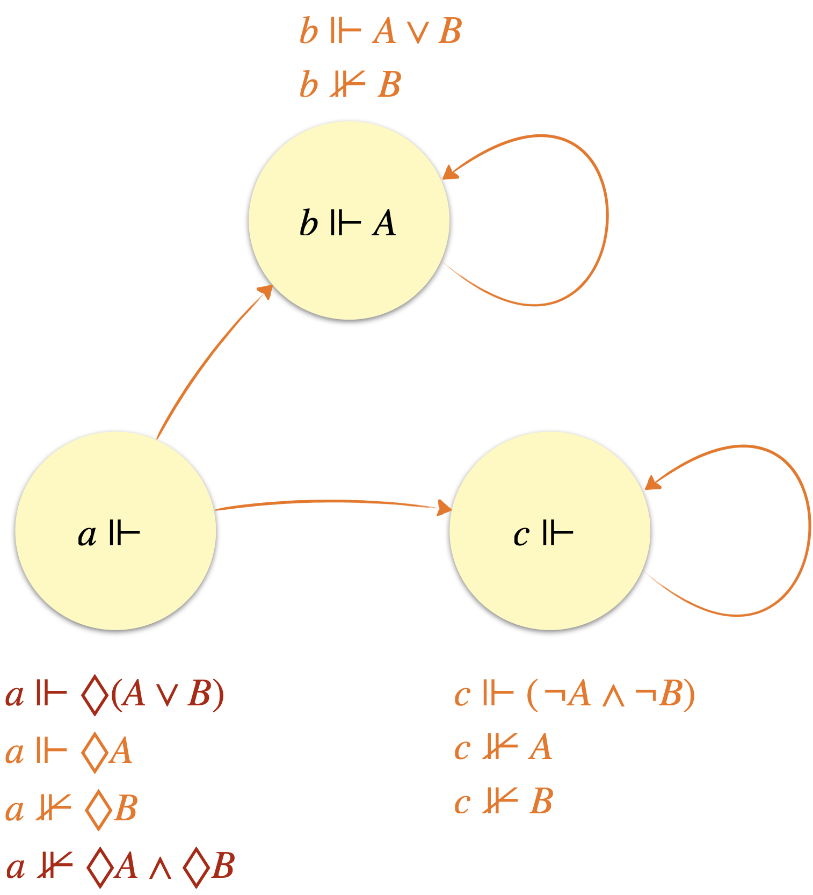

Un dernier pour la route&nbsp;: le **dilemme de Sartre** (dû à Lemmon). Il décrit l'impossibilité de représenter un conflit d'obligations en logique déontique standard (à cause de l'axiome $\text{(D)}$). La situation dans laquelle se retrouve Jephté dans la Bible en est une illustration parfaite. Jephté promet à Dieu de sacrifier le premier être vivant qu'il croise s'il gagne la guerre. Il gagne la guerre et croise sa fille (c'est ballot). On a bien conflit d'obligations puisque l'obligation de ne pas tuer sa fille doit bien figurer quelque part aussi... On a donc une situation où il est obligatoire de faire une chose $\Box A$ et aussi obligatoire de ne pas la faire $\Box \neg A$. Or $\Box A\rightarrow \Diamond A$ d'après $\text{(D)}$ et par dualité, on obtient $\Box A\rightarrow \neg \Box\neg A$. La situation de départ (la satisfaction de $\Box A$ et $\Box\neg A$), bien qu'envisageable, aboutit à une inconsistance interdisant donc même son existence dans le système formel $\textbf{KD}$ (qui commet sûrement là un péché). 

Malgré ses "petits" défauts, la logique déontique connait différentes applications en informatique. En autorisant l'expression de raisonnements normatifs, elle permet de spécifier la marche à suivre en cas de comportement anormal. De manière plus générale, elle propose un cadre pour gérer les autorisations et politiques d'accès, et on la retrouve dans le secteur de l'automatisation juridique ou encore celui des contraintes sur les bases de données.

### Logique épistémique

Elle permet de raisonner à propos de la connaissance d'un ou plusieurs agents.

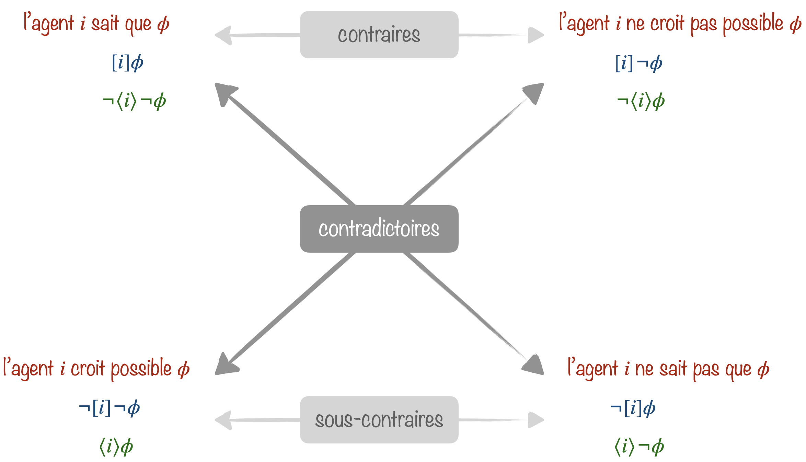

C'est elle qui est au cœur de notre histoire introductive de dragons ou de cette blague sur des logiciens assoiffés.

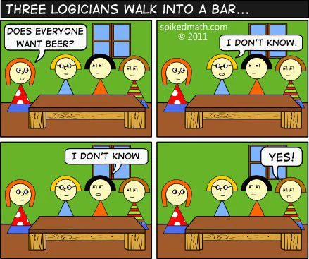

<!-- https://www.beingamathematician.org/Jokes/445-three-logicians-walk-into-a-bar.png -->

Appelons $1$, $2$ et $3$ les trois logiciens de gauche à droite et $B_i$ l'affirmation "le logicien $i$ veut une bière".

- Au départ, $1$ veut une bière (et elle le sait...), mais elle ne peut pas savoir dans lequel des 4 mondes restant possibles elle se trouve&nbsp;: $[1]B_1\land\langle1\rangle B_2\land\langle1\rangle B_3$. Comme le monde où $B_1\land B_2\land B_3$ fait partie des mondes possibles, elle répond "je ne sais pas".
- $2$ en déduit $B_1$. Car si $\neg B_1$, alors $[1]\neg B_1$ et donc le monde $B_1\land B_2\land B_3$ où tous veulent picoler n'est plus accessible et elle aurait répondu non. Voulant elle aussi une bière, $2$ hésite encore entre deux mondes $[2]B_1\land[2]B_2\land\langle2\rangle B_3$. 
- $3$ en déduit $B_2$ et peut maintenant répondre puisque $[3]B_1\land[3]B_2\land[3] B_3$ ($3$ aussi veut une bière bien sûr). Plus qu'un monde possible, celui qui satisfait $B_1\land B_2\land B_3$. C'est un grand "Oui !".

La règle de nécessitation et l'axiome $\text{(K)}$ (valables dans tout nœud de tout système d'une logique normale) impliquent l'**omniscience logique** de l'agent $i$. En effet, par nécessitation $A\rightarrow B$ devient $\[i](A\rightarrow B)$ et $\text{(K)}=\[i](A\rightarrow B)\rightarrow([i]A\rightarrow [i]B)$. Par conséquent, l'agent connait toutes les conséquences logiques ($[i]B$) de ce qu'il sait ($[i]A$).

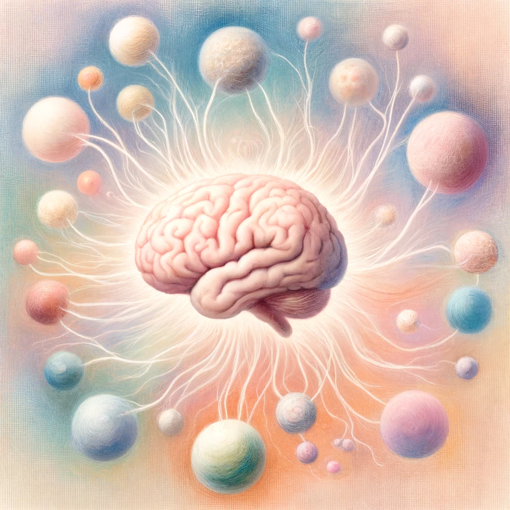

En logique modale épistémique, la relation binaire entre deux mondes est une relation d'**indistinguabilité**&nbsp;; l'agent ne sait pas dans quel monde il se trouve. Cette relation est nécessairement **symétrique** par la notion même d'indistinguabilité. Et comme un monde ne pourra jamais être distingué de lui-même, il faut ajouter une relation **réflexive** de chaque monde à lui-même. Le dernier ingrédient est la **transitivité**. Si $a$ est indistinguable de $b$ et que $b$ est indistinguable de $c$, alors $a$ est aussi indistinguable de $c$. Une telle relation, symétrique, réflexive et transitive est une **relation d'équivalence**. Et on aurait pu partir de là finalement puisque c'est bien l'équivalence qui se cache derrière la notion d'indistinguabilité.

La classe de systèmes de transition assurant une relation d'équivalence entre les mondes possibles correspond à la logique $\textbf{S5}$. 
Deux jeux d'axiomes équivalents permettent d'obtenir $\textbf{S5}$&nbsp;: $\set{(\text{K}),(\text{T}),(\text{B}),(\text{4})}$ où $\text{(T)}$ apporte la réflexivité, $\text{(B)}$ la symétrie et $\text{(4)}$ la transitivité, ou bien le jeu $\set{(\text{K}),(\text{T}),(\text{5})}$ où $\text{(5)}$ apporte l'euclidanité sachant qu'un système de transition réflexif et euclidien est aussi symétrique et transitif.

Les axiomes doivent être vérifiés dans tous les mondes possibles. Ainsi $\text{(T)}=[i]P\rightarrow P$ signifie que dans un monde quelconque, si l'agent $i$ sait que $P$, alors $P$ est vrai dans ce monde (l'agent ne sait que des choses vraies). Et il faut aussi que soit réalisée $\text{(5)}=\neg[i]P\rightarrow[i]\neg[i]P$, ce qui signifie que si l'agent $i$ ne sait pas quelque chose, alors il sait qu'il ne le sait pas. C'est le principe d'**introspection négative**.

L'agent de la logique $\textbf{S5}$ est une sorte d'agent idéal pour lequel l'accès à la connaissance est maximal (sans qu'il ne sache tout pour autant). Il n'est tellement pas humain qu'il ne peut pas croire 

On place parfois l'agent dans une logique inférieure, $\textbf{S4}$, qui perd la symétrie (et donc l'indistinguabilité&nbsp;!). L'introspection négative disparaît alors et est remplacée par l'**introspection positive** $\text{(4)}:[i]P\rightarrow [i][i] P$ où si l'agent sait quelque chose, alors il sait qu'il sait. Mine de rien, ça lui limite pas mal l'accès à la connaissance par rapport à l'autre introspection. L'agent reste idéal en ce qu'il conserve une omniscience logique totale, mais il peut vivre dans un monde où il peut croire possible qu'il sait quelque chose qu'il ne sait pas (la honte).

Dans $\textbf{S4}$, l'accessibilité n'est plus nécessairement réciproque entre les mondes. Cela introduit une hiérarchie, un ordre où certains mondes peuvent être considérés comme des extensions ou des raffinements d'autres, des mondes "plus informés". C'est pertinent pour modéliser la communication dans des réseaux où l'information n'est pas toujours réciproquement échangée (dès que les canaux sont asymétriques comme c'est le cas dans la plupart des structures hiérarchiques). 
Couplé à une logique temporelle, cela permet de modéliser un apprentissage progressif où l'acquisition d'information se fait de manière séquentielle ou cumulative. En robotique ou en intelligence artificielle, cela permet dans la même veine de modéliser des processus de planification où chaque décision ou action mène à un nouvel état du monde qui intègre toutes les connaissances et conséquences des actions précédentes.

### Logique temporelle

Il y a beaucoup de logiques temporelles qui multiplient généralement les opérateurs modaux. Mais de base, une logique modale temporelle peut exprimer ce qu'on trouve dans le carré des oppositions ci-dessous.

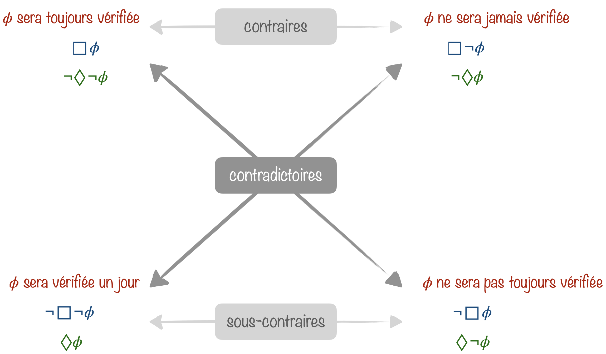

La logique temporelle peut aussi bien s'intéresser au passé qu'au futur.

Le temps dont il est question ici est discret, chaque monde possible correspondant à un instant $t$. 

Pas de raison particulière pour que la relation d'accessibilité entre ces mondes soit réflexive ou symétrique, par contre, elle se doit d'être transitive pour conserver l'ordonnancement entre les différents instants considérés. L'axiome clé est donc le $\text{(4)}$ et le futur d'un monde correspond alors à l'ensemble des mondes qui lui sont accessibles (l'absence de réflexivité entraîne que le monde actuel ne fasse pas partie du futur).

On peut alors traduire les opérateurs modaux par&nbsp;:

- $\Box \phi$&nbsp;: $\phi$ sera toujours vérifiée,
- $\Diamond \phi$&nbsp;: $\phi$ sera vérifiée à un certain moment.

Cela permet d'exprimer des énoncés tels que&nbsp;:

- $\Box\neg(\texttt{started}\land\neg\texttt{ready})$&nbsp;:  il est impossible d'atteindre un état où $\texttt{started}$ est activé, mais pas $\texttt{ready}$,
- $\Box(\texttt{request}\rightarrow\Diamond\texttt{acknowledged})$&nbsp;: pour tout état, si une demande (de quelque ressource que ce soit) est effectuée, alors elle sera finalement reconnue,

Le temps des logiques temporelles peut prendre une forme linéaire ou arborescente. 
Dans la logique temporelle linéaire (LTL), les instants s'enchaînent en un collier de perles infini. C'est idéal pour explorer un système déterministe ou une seule branche d'exécution et vérifier efficacement que toutes les spécifications sont satisfaites.

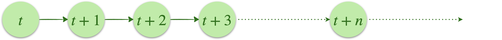

Dans une logique temporelle arborescente (CTL), le champ des possibles s'ouvre. Elle permet de modéliser des systèmes non déterministes où des choix amenant sur des branches différentes peuvent être faits.

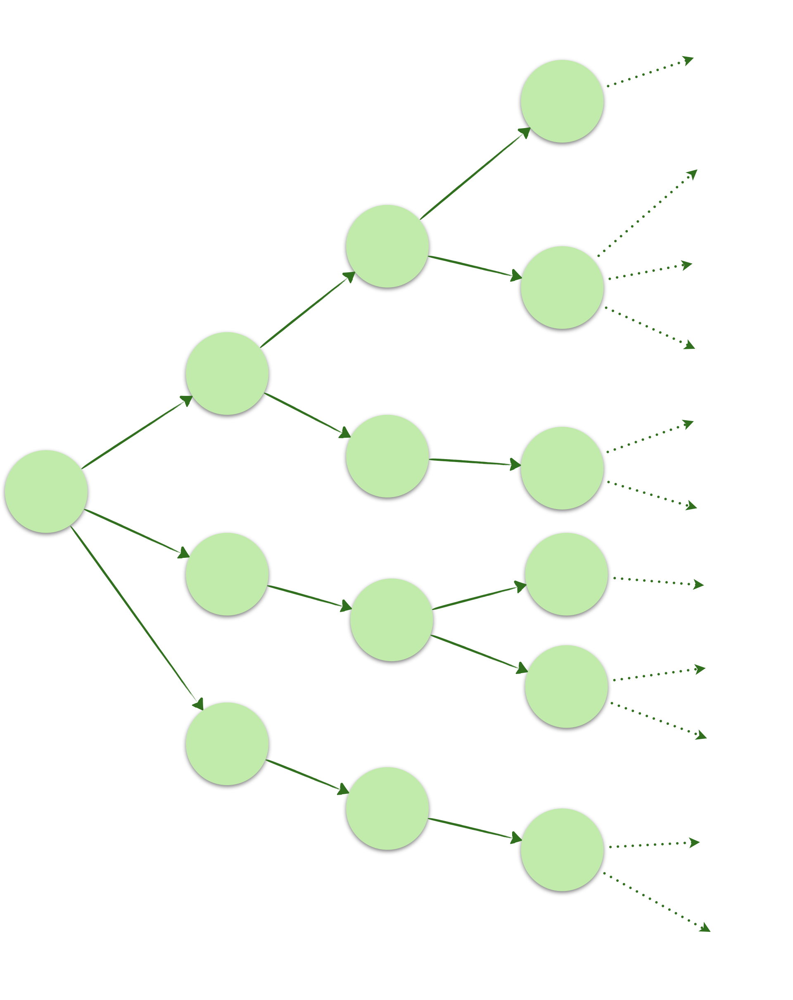

La logique temporelle est très utilisée en vérification formelle, où la technique de base est essentiellement le model checking.

### Logique de la prouvabilité

Voici sans doute l'usage le plus étonnant de la boîte. On lit désormais $\Box\phi$ comme «&nbsp;**$\phi$ est prouvable**&nbsp;» (dans une théorie fixée, par exemple l'arithmétique), et $\Diamond\phi=\neg\Box\neg\phi$ comme «&nbsp;on ne peut pas réfuter $\phi$&nbsp;», c'est-à-dire «&nbsp;$\phi$ est compatible avec la théorie&nbsp;». Avec ce simple changement de lecture, les théorèmes d'incomplétude de Gödel, réputés ardus, tiennent en quelques lignes de logique modale.

Gödel sur l'île des chevaliers et des filous

Dans *Forever Undecided* (1987), Raymond Smullyan fait tenir toute l'affaire dans une énigme. Un logicien visite l'île où les chevaliers disent toujours vrai et où les filous mentent toujours. Ce logicien est **fiable**&nbsp;: il ne croit jamais rien de faux. Un habitant lui déclare&nbsp;:

<i>«&nbsp;Vous ne croirez jamais que je suis un chevalier.&nbsp;»</i>

Si l'habitant était un filou, sa phrase serait fausse&nbsp;: le logicien finirait donc par croire que c'est un chevalier, et croirait une chose fausse, ce qui est exclu. C'est donc un chevalier, sa phrase est vraie… et le logicien ne le croira jamais. Il existe une vérité que ce logicien, pourtant irréprochable, ne peut pas atteindre.

Le plus piquant est que *nous* venons de le démontrer. Pourquoi le logicien ne tiendrait-il pas le même raisonnement&nbsp;? Parce que ce raisonnement s'appuie sur sa propre fiabilité&nbsp;: s'il s'en croyait assuré, il conclurait «&nbsp;c'est un chevalier&nbsp;», et la phrase deviendrait fausse. Un logicien fiable ne peut pas être certain de l'être. Remplacez «&nbsp;croire&nbsp;» par «&nbsp;prouver&nbsp;» et «&nbsp;fiable&nbsp;» par «&nbsp;cohérent&nbsp;»&nbsp;: ce sont les deux théorèmes de Gödel.

#### Des nombres qui parlent de preuves

Souhaitant éprouver la solidité de l'édifice mathématique, et d'abord de l'arithmétique, Gödel imagine en 1931 une méthode astucieuse, une sorte de hack, pour faire parler l'arithmétique d'elle-même. Le cadre est l'arithmétique de Peano $\text{PA}$&nbsp;: une théorie, c'est-à-dire un ensemble d'axiomes, écrite en logique du premier ordre et dont les entiers naturels sont un modèle. Gödel associe à chaque formule $\phi$ un numéro, son **code de Gödel**, noté $\ulcorner\phi\urcorner$. Un énoncé sur les nombres peut alors, de façon détournée, être un énoncé sur les formules.

Ce qui semblait à l'époque un tour de force est devenu banal à l'ère de l'informatique. Pour associer un nombre unique à une formule, il suffit de regarder le code binaire du fichier où elle est écrite (en ajoutant un «&nbsp;1&nbsp;» au début si ça commence par des «&nbsp;0&nbsp;»).

On peut coder de même un arbre de preuve complet, comme tout ce qu'on peut taper dans un traitement de texte. Dès lors, «&nbsp;$\phi$ est prouvable&nbsp;» devient une affirmation arithmétique&nbsp;: *il existe un entier qui est le code d'une preuve de la formule de code $\ulcorner\phi\urcorner$*. Gödel construit la formule qui dit cela et la baptise $\text{Bew}(x)$, de l'allemand *beweisbar*, «&nbsp;prouvable&nbsp;». Notre boîte n'est qu'une abréviation&nbsp;:

$\Box\phi$ désigne la formule arithmétique $\text{Bew}(\ulcorner\phi\urcorner)$.

Que sait l'arithmétique de sa propre prouvabilité&nbsp;? Trois choses, appelées **conditions de dérivabilité** (elles sont dues à Hilbert, Bernays et Löb), et qui vont nous rappeler des souvenirs&nbsp;:

<table class="tab-recap">
<tr><th>Ce que l'arithmétique démontre</th><th>Lecture</th><th>En logique modale</th></tr>
<tr><td>si $\vdash\phi$, alors $\vdash\Box\phi$</td><td class="g">une preuve de $\phi$ étant un objet fini, on peut vérifier que c'en est une</td><td class="g">règle de nécessitation</td></tr>
<tr><td>$\vdash\Box(\phi\rightarrow\psi)\rightarrow(\Box\phi\rightarrow\Box\psi)$</td><td class="g">les preuves s'enchaînent par <i>modus ponens</i></td><td class="g">axiome $\text{(K)}$</td></tr>
<tr><td>$\vdash\Box\phi\rightarrow\Box\Box\phi$</td><td class="g">si $\phi$ est prouvable, on peut prouver qu'elle l'est</td><td class="g">axiome $\text{(4)}$</td></tr>
</table>

Autrement dit, la prouvabilité se comporte comme la boîte de la logique $\textbf{K4}$, et tout ce qu'on démontre dans $\textbf{K4}$ est vrai de $\text{Bew}$. En revanche, on se gardera d'ajouter l'axiome $\text{(T)}=\Box\phi\rightarrow\phi$, «&nbsp;ce qui est prouvable est vrai&nbsp;». Il a l'air inoffensif, il est même *vrai* si la théorie est saine. Mais la théorie ne peut pas le *démontrer*, et c'est tout le sujet de cette section.

#### Le lemme de diagonalisation

Il manque un ingrédient&nbsp;: des formules qui parlent d'elles-mêmes.

<b>Lemme de diagonalisation</b>&nbsp;: 
Pour toute formule arithmétique $S(x)$ à une variable libre, il existe un énoncé $\phi$ tel que $\vdash\phi\leftrightarrow S(\ulcorner\phi\urcorner)$.

Quelle que soit la propriété $S$, il existe donc une formule qui affirme «&nbsp;j'ai la propriété $S$&nbsp;». Il n'y a aucune magie&nbsp;: le philosophe Quine a montré qu'on peut faire la même chose en français, sans jamais écrire «&nbsp;cette phrase&nbsp;»&nbsp;:

«&nbsp;précédé de sa propre citation, donne une phrase qui a la propriété $S$&nbsp;» précédé de sa propre citation, donne une phrase qui a la propriété $S$.

La phrase décrit une recette (prendre un bout de texte et le faire précéder de sa citation), et la recette, appliquée au bout de texte indiqué, redonne la phrase elle-même. Les informaticiens connaissent bien ce tour&nbsp;: c'est celui des *quines*, ces programmes qui affichent leur propre code.

La preuve est la traduction arithmétique de la recette de Quine.

Si $n$ est le code d'une formule $A(x)$ à une variable libre, on note $d(n)$ le code de la formule obtenue en appliquant $A$ à son propre code&nbsp;: $d(\ulcorner A(x)\urcorner)=\ulcorner A(\ulcorner A(x)\urcorner)\urcorner$. Ainsi $d(\ulcorner x=0 \urcorner)=\ulcorner(\ulcorner x=0 \urcorner = 0)\urcorner$. C'est «&nbsp;faire précéder de sa propre citation&nbsp;». La fonction $d$ se calcule mécaniquement, et l'arithmétique sait donc en parler.

On pose alors $g(x)= S(d(x))$ («&nbsp;précédé de sa propre citation, donne une phrase qui a la propriété $S$&nbsp;»), puis $\phi= g(\ulcorner g(x)\urcorner)$ (cette même formule, appliquée à son propre code). On obtient&nbsp;:

$$
\begin{aligned}
\phi &= g(\ulcorner g(x)\urcorner)\\
&= S(d(\ulcorner g(x)\urcorner)) \\
&\leftrightarrow S(\ulcorner g(\ulcorner g(x)\urcorner)\urcorner)\\
&= S(\ulcorner\phi\urcorner)
\end{aligned}
$$

Le nom du lemme vient de sa parenté avec l'argument diagonal de Cantor&nbsp;: on range les formules $A_0(x), A_1(x),\ldots$ en lignes, les codes en colonnes, et la fonction $d$ parcourt la diagonale, là où chaque formule est appliquée à elle-même.

#### Le premier théorème d'incomplétude

Appliquons le lemme à la propriété «&nbsp;ne pas être prouvable&nbsp;», c'est-à-dire à $S(x)=\neg\text{Bew}(x)$. On obtient la célèbre **formule de Gödel** $G$&nbsp;:

$\vdash G\leftrightarrow\neg\Box G$ &nbsp;&nbsp;&nbsp; («&nbsp;je ne suis pas prouvable&nbsp;»)

Elle ressemble au paradoxe du menteur, «&nbsp;cette phrase est fausse&nbsp;», à une nuance près qui change tout. Le menteur parle de *vérité* et mène à une contradiction. $G$ parle de *prouvabilité* et ne mène qu'à une surprise. En effet, si $G$ était prouvable, on aurait $\vdash G$, donc $\vdash\Box G$ par nécessitation&nbsp;; mais $G$ entraîne $\neg\Box G$, et la théorie prouverait une chose et son contraire. Dans une théorie cohérente, $G$ n'est donc pas prouvable. Or c'est exactement ce qu'elle affirme&nbsp;: **$G$ est vraie et non prouvable**.

<b>Premier théorème d'incomplétude</b>&nbsp;: 
Dans toute théorie cohérente (on ne peut pas y prouver le faux), dont on sait reconnaître mécaniquement les axiomes et assez expressive pour décrire l'arithmétique, il existe un énoncé vrai qui n'est pas prouvable. La prouvabilité est plus faible que la vérité.

Ajouter $G$ aux axiomes ne répare rien&nbsp;: la nouvelle théorie a sa propre formule de Gödel, et tout recommence.

Le raisonnement ci-dessus se formalise entièrement dans la logique $\textbf{K4}$&nbsp;: à partir de $\vdash G\leftrightarrow\neg\Box G$, on arrive à $\vdash\neg\Box\bot\rightarrow\neg\Box G$, «&nbsp;si aucune contradiction n'est prouvable, alors $G$ n'est pas prouvable&nbsp;».

<ol>
<li>$G\leftrightarrow\neg\Box G$</li>
<li>$\Box G\rightarrow\neg G$ (à partir de 1.)</li>
<li>$\Box(\Box G\rightarrow\neg G)$ (nécessitation)</li>
<li>$\Box\Box G\rightarrow\Box\neg G$ (distribution de la boîte grâce à $\text{(K)}$)</li>
<li>$\Box G\rightarrow\Box\neg G$ (par l'axiome $\text{(4)}= \Box G\rightarrow\Box\Box G$ et avec l'étape 4., on déduit $\Box G\rightarrow\Box\Box G\rightarrow\Box\neg G$)</li>
<li>$\Box G\rightarrow(\Box G\land\Box\neg G)$ (à partir de 5. et $\Box G\rightarrow\Box G$)</li>
<li>$\Box G\rightarrow\Box(G\land \neg G)$ (la boîte se distribue sur la conjonction)</li>
<li>$\Box G\rightarrow\Box\bot$</li>
<li>$\neg\Box\bot\rightarrow \neg\Box G$ (contraposée de 8.)</li>
</ol>

Ce petit calcul a une conséquence considérable. La formule $\neg\Box\bot$ dit «&nbsp;le faux n'est pas prouvable&nbsp;»&nbsp;: c'est la théorie qui affirme sa propre **cohérence**. Or la ligne 9 et la ligne 1 donnent ensemble $\vdash\neg\Box\bot\rightarrow G$. Si la théorie prouvait sa cohérence, elle prouverait donc $G$, ce qui est impossible. Une théorie cohérente ne peut pas prouver qu'elle l'est&nbsp;! C'est le second théorème d'incomplétude, que l'on va retrouver par un chemin plus général.

Königsberg, septembre 1930

David Hilbert rêvait de mettre les mathématiques à l'abri du doute en démontrant, par des moyens élémentaires et incontestables, que leurs axiomes ne mènent à aucune contradiction. Le 8 septembre 1930, dans sa ville natale de Königsberg, il conclut une allocution restée célèbre par ces mots, aujourd'hui gravés sur sa tombe&nbsp;: «&nbsp;*Wir müssen wissen, wir werden wissen*&nbsp;», nous devons savoir, nous saurons.

La veille, dans la même ville, à la fin d'une table ronde sur les fondements des mathématiques, un jeune homme de vingt-quatre ans avait indiqué en quelques phrases prudentes qu'il existait des énoncés arithmétiques vrais et indémontrables. Presque personne ne releva. John von Neumann, lui, comprit sur-le-champ, et écrivit à Gödel quelques semaines plus tard qu'il en avait tiré une conséquence remarquable&nbsp;: l'impossibilité de prouver la cohérence. Gödel lui répondit, courtoisement, qu'il venait de l'envoyer à l'imprimeur.

#### Le théorème de Löb

En 1952, le logicien Leon Henkin pose la question miroir. On sait ce que vaut la formule qui dit «&nbsp;je ne suis pas prouvable&nbsp;». Que dire de celle qui affirme «&nbsp;**je suis prouvable**&nbsp;», $\vdash H\leftrightarrow\Box H$&nbsp;? Elle évoque non plus le menteur mais le diseur de vérité, «&nbsp;ce que je dis là est vrai&nbsp;», auquel aucune valeur de vérité ne semble s'imposer puisqu'un menteur dirait la même chose.

La réponse, donnée par Martin Löb en 1955, est une surprise&nbsp;: $H$ est prouvable, et donc vraie. C'est un cas particulier d'un résultat général.

Le <b>théorème de Löb</b> stipule que les seules formules $\phi$ pour lesquelles on peut prouver $\Box\phi\rightarrow\phi$ sont les formules prouvables&nbsp;:

Si $\vdash\Box\phi\rightarrow\phi$, alors $\vdash \phi$.

Le théorème affirme donc que si on peut prouver une formule en admettant qu'elle est prouvable, alors on peut la prouver tout court. C'est une sorte de méthode Coué logique, une prophétie autoréalisatrice&nbsp;: «&nbsp;si tu crois en toi, ça va le faire&nbsp;». C'est bizarre, mais ça se démontre.

Lu dans l'autre sens, il est tout aussi troublant. On aimerait que la théorie sache, pour chaque $\phi$, que «&nbsp;si $\phi$ est prouvable, alors $\phi$ est vraie&nbsp;». Löb nous dit qu'elle ne le démontre *que* pour les $\phi$ qu'elle démontre déjà, c'est-à-dire quand cela ne sert plus à rien. Voilà pourquoi $\text{(T)}$ ne peut pas être un axiome de la prouvabilité.

Preuve du théorème de Löb&nbsp;:

On suppose $\vdash \Box\phi\rightarrow\phi$. 
Grâce au lemme de diagonalisation, on construit la formule arithmétique autoréférente suivante&nbsp;: 
$\vdash\sigma\leftrightarrow (\Box\sigma\rightarrow\phi)$ («&nbsp;si je suis prouvable, alors $\phi$&nbsp;»). 

<ol>
<li>$\vdash\Box(\sigma\rightarrow (\Box\sigma\rightarrow\phi))$ (sens direct de la formule autoréférente, puis nécessitation)</li>
<li>$\vdash\Box\sigma\rightarrow \Box(\Box\sigma\rightarrow\phi)$ puis $\vdash\Box\sigma\rightarrow (\Box\Box\sigma\rightarrow\Box\phi)$ (distribution de la boîte grâce à $\text{(K)}$, deux fois)</li>
<li>Comme $\vdash \Box\sigma\rightarrow\Box\Box\sigma$ par $\text{(4)}$, on en tire $\vdash \Box\sigma\rightarrow\Box\phi$</li>
<li>$\vdash \Box\sigma\rightarrow\phi$ (car $\vdash \Box\sigma\rightarrow\Box\phi\rightarrow\phi$ puisqu'on suppose $\vdash \Box\phi\rightarrow\phi$)</li>
<li>$\vdash (\Box\sigma\rightarrow\phi)\rightarrow\sigma$ (sens réciproque de la formule autoréférente)</li>
<li>$\vdash\sigma$ par <i>modus ponens</i> de 4. et 5.</li>
<li>$\vdash\Box\sigma$ par nécessitation.</li>
<li>$\vdash \phi$  par <i>modus ponens</i> de 4. et 7.</li>
</ol>

Le père Noël existe

Smullyan adorait «&nbsp;démontrer&nbsp;» l'existence du père Noël à l'aide de la phrase suivante&nbsp;:

<i>«&nbsp;Si cette phrase est vraie, alors le père Noël existe.&nbsp;»</i>

Supposons la phrase vraie. Alors ce qu'elle dit a lieu&nbsp;: si elle est vraie, le père Noël existe. Comme on l'a supposée vraie, le père Noël existe. Nous venons de montrer que *si la phrase est vraie, alors le père Noël existe*… or c'est précisément la phrase. Elle est donc vraie, et le père Noël existe.

C'est le paradoxe de Curry, et la preuve de Löb en est la copie conforme, où «&nbsp;vraie&nbsp;» est remplacé par «&nbsp;prouvable&nbsp;»&nbsp;: la formule $\sigma$ dit «&nbsp;si je suis prouvable, alors $\phi$&nbsp;». Avec la vérité, on obtient une absurdité, signe qu'un langage ne peut pas contenir son propre prédicat de vérité (c'est un théorème de Tarski). Avec la prouvabilité, qui s'exprime bel et bien dans l'arithmétique, on obtient un théorème.

#### Le second théorème d'incomplétude

<b>Second théorème d'incomplétude</b>&nbsp;: 
Une théorie cohérente, dont on sait reconnaître mécaniquement les axiomes et qui contient l'arithmétique, ne peut pas prouver sa propre cohérence. Les seules théories de ce type qui «&nbsp;prouvent&nbsp;» leur cohérence sont celles qui sont incohérentes, et qui prouvent donc n'importe quoi…

Ce théorème n'est autre que le théorème de Löb appliqué à $\phi=\bot$&nbsp;!

La formule $\Box\bot\rightarrow\bot$ équivaut à $\neg\Box\bot$, l'énoncé de cohérence. Le théorème de Löb devient donc&nbsp;: si $\vdash\neg\Box\bot$, alors $\vdash\bot$. Par contraposition, si la théorie est cohérente ($\nvdash\bot$), alors elle ne prouve pas sa cohérence ($\nvdash\neg\Box\bot$).

Par dualité, $\Diamond P = \neg\Box\neg P$ exprime qu'on ne peut pas prouver que $P$ est fausse, autrement dit que $P$ est compatible avec la théorie. L'énoncé de cohérence $\neg\Box\bot$ s'écrit alors simplement $\Diamond\top$, et le second théorème prend, à l'intérieur même de la théorie, la forme $\Diamond\top\rightarrow \neg\Box\Diamond \top$&nbsp;: «&nbsp;si la théorie est cohérente, alors elle ne peut pas le prouver&nbsp;».

C'est la fin du programme de Hilbert sous sa forme initiale&nbsp;: pour prouver la cohérence de l'arithmétique, il faut des moyens qui la dépassent. Gerhard Gentzen, l'inventeur de la déduction naturelle et du calcul des séquents, y parviendra en 1936 au prix d'une récurrence sur des ordinaux infinis.

#### La logique GL

Le théorème de Löb peut lui-même être démontré *par* la théorie, ce qui en donne une version internalisée, devenue un axiome.

La <b>logique de la prouvabilité de Gödel-Löb</b> ($\textbf{GL}$) est formée à partir du système $\textbf{K}$ auquel on ajoute l'axiome de Löb $\text{(L)}=\Box(\Box\phi\rightarrow\phi)\rightarrow\Box\phi$ (c'est la version formalisée du théorème de Löb).

Avec $\phi=\bot$, l'axiome $\text{(L)}$ donne $\Box\neg\Box\bot\rightarrow\Box\bot$, soit, par contraposition et en notation diamant, $\Diamond\top\rightarrow\neg\Box\Diamond\top$&nbsp;: on retrouve en une ligne le second théorème d'incomplétude.

On remarque que l'axiome $\text{(4)}$, dont on s'est tant servi, ne figure pas dans la définition. C'est qu'il est devenu superflu.

$\vdash_\textbf{GL}\text{(4)}=\Box\phi\rightarrow\Box\Box \phi$

Et donc $\textbf{K4}≤\textbf{GL}$ ($\textbf{K4}$ se réduit à $\textbf{GL}$).

Obtention d'un premier théorème&nbsp;: $\vdash_\textbf{K}\Box P\rightarrow \Box ((\Box P\land \Box\Box P)\rightarrow(P\land \Box P))$

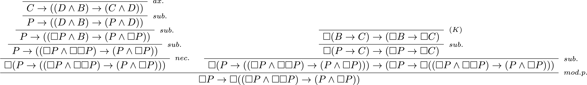

Puis d'un deuxième&nbsp;: $\vdash_\textbf{K}\Box (P\land\Box P)\rightarrow \Box\Box P$

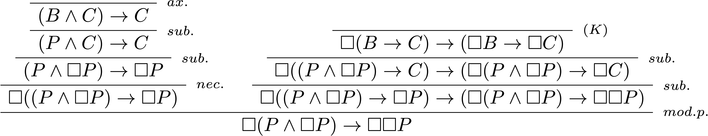

On les imbrique à l'aide de l'axiome de Löb $\text{(L)}$. Deux nouvelles abréviations apparaissent dans l'arbre&nbsp;: <i>rempl.</i> désigne le remplacement d'une sous-formule par une formule équivalente (ici $\Box(P\land\Box P)$ par $\Box P\land\Box\Box P$, grâce au théorème de $\textbf{K}$&nbsp;: $\Box(A\land B)\leftrightarrow(\Box A\land\Box B)$), et <i>syll.</i> le syllogisme&nbsp;: de $X\rightarrow Y$ et $Y\rightarrow Z$, on tire $X\rightarrow Z$.

$$
\begin{prooftree}
\AxiomC{}
\RightLabel{$\scriptstyle th.1$}
\UnaryInfC{$\Box P\to\Box((\Box P\land\Box\Box P)\to(P\land\Box P))$}
\AxiomC{}
\RightLabel{$\scriptstyle (L)$}
\UnaryInfC{$\Box(\Box A\to A)\to\Box A$}
\RightLabel{$\scriptstyle sub.$}
\UnaryInfC{$\Box(\Box(P\land\Box P)\to(P\land\Box P))\to\Box(P\land\Box P)$}
\RightLabel{$\scriptstyle rempl.$}
\UnaryInfC{$\Box((\Box P\land\Box\Box P)\to(P\land\Box P))\to\Box(P\land\Box P)$}
\RightLabel{$\scriptstyle syll.$}
\BinaryInfC{$\Box P\to\Box(P\land\Box P)$}
\AxiomC{}
\RightLabel{$\scriptstyle th.2$}
\UnaryInfC{$\Box(P\land\Box P)\to\Box\Box P$}
\RightLabel{$\scriptstyle syll.$}
\BinaryInfC{$\Box P\to\Box\Box P$}
\end{prooftree}
$$

Tout système de transition qui valide $\textbf{GL}$ valide donc $\text{(4)}$&nbsp;: il est **transitif**&nbsp;!

À quoi ressemblent les mondes de la prouvabilité&nbsp;? Certainement pas à ceux de la connaissance. Le modèle ci-dessous valide $\color{#1DB100}\text{(L)}$ en chacun de ses nœuds, mais on y voit échouer, au nœud $a$, l'axiome $\color{#F27200}\text{(T)}=\Box P \rightarrow  P$ ainsi que $\color{#FF42A1}\neg P\rightarrow \Box\Diamond\neg P$, une instance de l'axiome $\text{(B)}$.

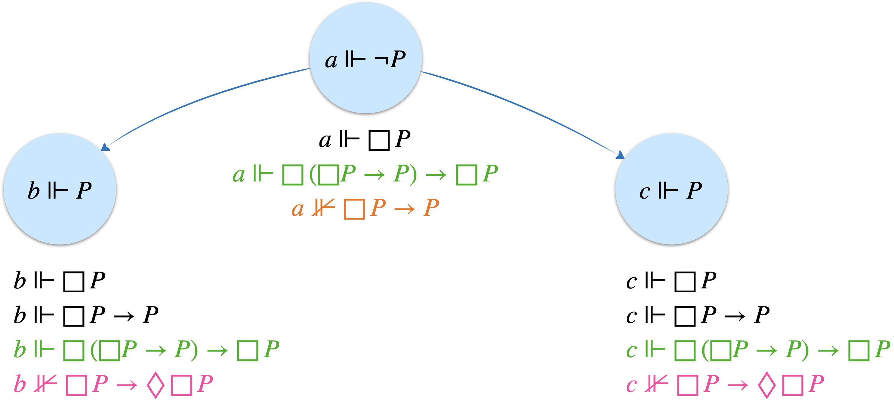

Les deux échecs ont un sens. Celui de $\text{(T)}$ confirme que $\textbf{GL}$ ne prouve pas «&nbsp;ce qui est prouvable est vrai&nbsp;». Celui de $\text{(B)}$ tient à l'absence de retour&nbsp;: $a$ voit $b$, mais $b$, cul-de-sac, ne voit rien du tout, et rien n'y est donc possible, pas même $\neg P$. Dans un cul-de-sac, tout est nécessaire et rien n'est possible&nbsp;: $\textbf{GL}$ ne prouve donc ni l'axiome $\text{(D)}$, ni même $\Diamond\top$, sa propre cohérence. Les culs-de-sac ne sont pas un accident, ils sont indispensables, comme le montre la caractérisation suivante.

Un système de transition valide $\text{(L)}$ si et seulement s'il est <b>transitif</b> et ne contient <b>aucun chemin infini</b> $a_0\longrightarrow a_1\longrightarrow a_2\longrightarrow\cdots$

En particulier, un tel système est <b>irréflexif</b> (une boucle $a\longrightarrow a$ est un chemin infini $a\longrightarrow a\longrightarrow a\longrightarrow\cdots$) et <b>asymétrique</b> (un aller-retour $a\longrightarrow b\longrightarrow a$ aussi), et tout chemin finit dans un cul-de-sac.

Montrons le sens qui nous importe&nbsp;: dans un système $\mathcal{T}=(N,A)$ transitif et sans chemin infini, l'axiome de Löb est valide.

Supposons au contraire qu'il ne soit pas satisfait en un nœud $a$, pour une certaine valuation. On a donc $\langle \mathcal{T},a\rangle \not\models \Box(\Box P\rightarrow P)\rightarrow \Box P$, ce qui implique&nbsp;:

<ol>
<li>$\langle \mathcal{T},a\rangle \models \Box(\Box P\rightarrow P)$, et</li>
<li> $\langle \mathcal{T},a\rangle \not\models  \Box P$.</li>
</ol>

La deuxième affirmation entraîne qu'il existe un nœud $a'\in N$ tel que $a\longrightarrow a'$ et $\langle \mathcal{T},a'\rangle \not\models  P$. 
Par contre, la première affirmation nous assure que $\langle \mathcal{T},a'\rangle \models \Box P\rightarrow P$. 
Par conséquent $\langle \mathcal{T},a'\rangle \not\models \Box P$. Cela signifie qu'il existe un nœud $a''\in N$, successeur de $a'$ ($a'\longrightarrow a''$) tel que  $\langle \mathcal{T},a''\rangle \not\models P$. 
Par transitivité, $a \longrightarrow a''$. Or si on retourne à l'affirmation 1., on a aussi $\langle \mathcal{T},a''\rangle \models \Box P\rightarrow P$, et le même raisonnement fournit un successeur $a'''$ de $a''$, puis un autre, et ainsi de suite. On construit de fil en aiguille un chemin infini $a\longrightarrow a'\longrightarrow a''\longrightarrow\cdots$, ce qui est exclu.

Pour la réciproque, contentons-nous de voir pourquoi une boucle est interdite. Si $a\longrightarrow a$, on choisit la valuation où $P$ est fausse en $a$ et vraie partout ailleurs. Alors $\Box P$ est fausse en $a$, et $\Box P\rightarrow P$ est vraie partout (en $a$ parce que $\Box P$ y est fausse, ailleurs parce que $P$ y est vraie). Le nœud $a$ force donc $\Box(\Box P\rightarrow P)$ sans forcer $\Box P$&nbsp;: l'axiome de Löb y est en défaut.

Les exemples les plus simples de tels systèmes sont les **arbres finis**, où une flèche relie chaque nœud à tous ses descendants (c'est la transitivité). Et il se trouve qu'ils suffisent. C'est plutôt génial que cette logique de la prouvabilité s'exprime naturellement sur des arbres finis, qui représentent intuitivement la notion de preuve (la racine représentant la formule prouvée, et les feuilles les axiomes).

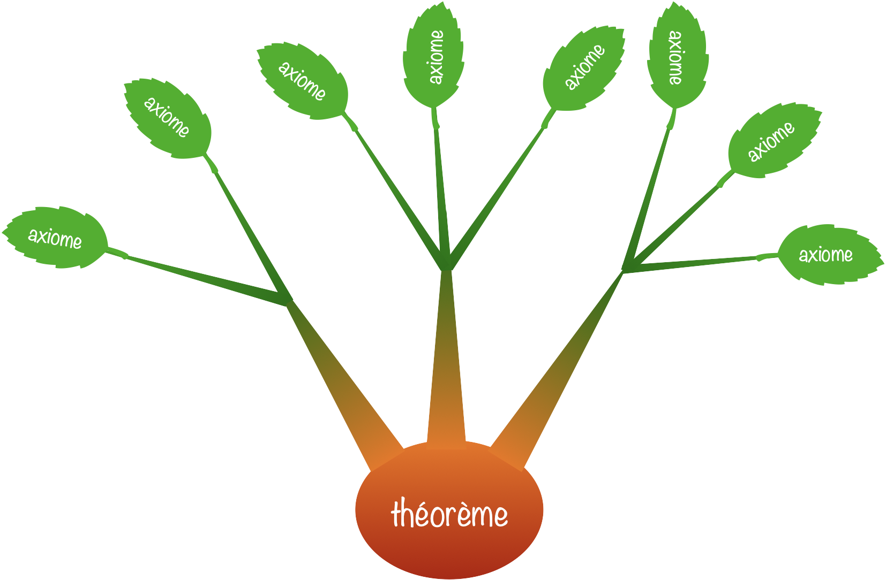

Notons $\mathscr{C}\_{\text{arbres finis}}$ la classe de ces arbres finis transitifs.

<b>Correction et complétude</b>&nbsp;:

$\vdash_\textbf{GL} \phi$ si et seulement si $\models_{\mathscr{C}_{\text{arbres finis}}}\phi$.

La correction découle de ce qui précède&nbsp;: l'axiome $\text{(K)}$ est valide partout, $\text{(L)}$ l'est dans tout arbre fini transitif, et les règles de la logique modale normale conservent la validité. La complétude, due à Krister Segerberg (1971), est plus délicate, car la méthode du modèle canonique du chapitre précédent ne s'applique plus telle quelle. Elle a une conséquence pratique agréable&nbsp;: pour savoir si une formule est un théorème de $\textbf{GL}$, il suffit de chercher un contre-exemple parmi des arbres finis de taille bornée. La logique $\textbf{GL}$ est **décidable**, alors que l'arithmétique, elle, ne l'est pas.

#### Retour à l'arithmétique&nbsp;: le théorème de Solovay

Reste la question essentielle. On a justifié les axiomes de $\textbf{GL}$ par des propriétés de la prouvabilité arithmétique. Mais en a-t-on oublié&nbsp;? Existe-t-il d'autres lois générales de la prouvabilité, que $\textbf{GL}$ ne verrait pas&nbsp;?

Pour donner un sens précis à la question, on appelle **traduction arithmétique** d'une formule modale le résultat obtenu en remplaçant chaque variable $P$, $Q$,… par un énoncé arithmétique de son choix, et chaque $\Box$ par $\text{Bew}$.

<b>Théorème de Solovay</b> (1976)&nbsp;: 
Une formule modale est un théorème de $\textbf{GL}$ si et seulement si <i>toutes</i> ses traductions arithmétiques sont prouvables dans $\text{PA}$.

Le sens direct est la **correction arithmétique** de $\textbf{GL}$&nbsp;: c'est le travail fait plus haut. La réciproque, sa **complétude arithmétique**, est le tour de force de Robert Solovay&nbsp;: si une formule modale n'est pas un théorème de $\textbf{GL}$, il existe un arbre fini qui la réfute, et Solovay parvient à «&nbsp;plonger&nbsp;» cet arbre dans l'arithmétique pour fabriquer des énoncés qui la réfutent aussi.

La boucle est bouclée. Tout ce que l'arithmétique est capable de démontrer, en toute généralité, sur sa propre prouvabilité tient dans un axiome, $\text{(L)}$, et se lit sur de petits arbres finis. Il est rare qu'un sujet aussi vertigineux se laisse résumer aussi simplement.

<nav class="suite-nav" aria-label="Chapitre précédent et suivant">
<a href="../systemes/" class="precedent">← Précédent<b>Systèmes logiques</b></a>
</nav>
