+++
title = "Logique modale - Syntaxe et sémantique"
menuTitle = "Syntaxe et sémantique"
date = 2021-03-06T14:20:50+01:00
weight = 1
aliases = ["/logique/logique4/"]
css = "logique.css"
+++

# Logique modale

Syntaxe et sémantique&nbsp;: des graphes de mondes possibles

<nav class="chap-nav" aria-label="Chapitres">
<a href="../syntaxe-semantique/" class="actif">Syntaxe et sémantique</a>
<a href="../systemes/">Systèmes logiques</a>
<a href="../logiques/">Différentes logiques modales</a>
</nav>

Notes de lecture du livre <i>La logique pas à pas</i> de Jacques Duparc.

Le calcul des propositions ne connaît que deux verdicts&nbsp;: vrai ou faux. Le langage courant est plus nuancé. «&nbsp;Il pleut&nbsp;», «&nbsp;il pleut forcément&nbsp;», «&nbsp;il se peut qu'il pleuve&nbsp;», «&nbsp;je sais qu'il pleut&nbsp;», «&nbsp;il pleuvra toujours&nbsp;»&nbsp;: autant de **modalités** d'une même affirmation. La logique modale se donne les moyens de les exprimer, et, pour leur donner un sens, remplace le monde unique du calcul des propositions par tout un **graphe de mondes possibles**.

Commençons par une énigme.

Une petite communauté de dragons vit sur une île aux règles spéciales. Si un dragon apprend qu'il a les yeux bleus, c'est la honte et il doit partir le soir même. Mais les autres dragons n'ont pas le droit de lui dire et aucun de ces dragons n'a de reflet et ne peut donc constater la couleur de ses propres yeux.

Trois dragons peuplent l'île, **A**pophis, **B**ahamut et **C**araxès, lorsqu'un jour, un étranger débarque. 
L'étranger déclare&nbsp;:
> l'un de vous au moins a les yeux bleus.

Le premier soir, aucun dragon ne part. 
Le deuxième soir, toujours rien. 
Le troisième soir, ils partent tous les trois...

Que s'est-il passé&nbsp;? Chaque dragon voyait bien que les deux autres avaient les yeux bleus, l'étranger ne leur a donc rien appris… et pourtant, sans lui, personne ne serait jamais parti. Pour démêler l'affaire, il faut pouvoir parler de ce que chacun **sait**, et de ce que chacun **croit possible**&nbsp;: c'est exactement ce que la logique modale permet de modéliser.

## Syntaxe

La **syntaxe** de la logique modale est celle du calcul des propositions à laquelle on ajoute deux opérateurs unaires, les **opérateurs de modalité**&nbsp;:
- la boîte $\Box$, qu'on lira selon les contextes «&nbsp;nécessairement&nbsp;», «&nbsp;je sais que&nbsp;», «&nbsp;toujours&nbsp;», «&nbsp;il est obligatoire que&nbsp;»…
- le diamant $\Diamond$, son compagnon plus timide&nbsp;: «&nbsp;possiblement&nbsp;», «&nbsp;je n'exclus pas que&nbsp;», «&nbsp;un jour&nbsp;», «&nbsp;il est permis que&nbsp;»…

$\Box P$ et $\Diamond\neg Q$ sont des formules, mais aussi $\Box(P\rightarrow\Diamond Q)$ ou $\Box\Box\Diamond P$&nbsp;: les opérateurs s'empilent et se combinent librement avec les connecteurs.

On va être amené à non pas définir un seul $\Box$ et $\Diamond$ mais potentiellement une infinité (dénombrable). 
On écrira alors $[i]$ et $\langle i \rangle$, où $i$ varie dans un ensemble $I$. Dans l'histoire des dragons, par exemple, il y aura une boîte par dragon&nbsp;: $[A]$ pour «&nbsp;Apophis sait que&nbsp;», $[B]$ pour «&nbsp;Bahamut sait que&nbsp;», etc.

Le <b>langage</b> $\mathcal{L}$ de la logique modale est l'ensemble suivant&nbsp;:

$\mathcal{L}=VAR\cup\set{\top,\bot,\neg,\lor,\land\rightarrow,\leftrightarrow,(,)}\cup\set{[i]:i\in\mathbb{N}}\cup\set{\langle i\rangle:i\in\mathbb{N}}$

Soient $\phi$, $\psi$, $\theta$ trois formules, on note $\phi[\theta/\psi]$ la <b>substitution uniforme</b> de la formule $\theta$ à toutes les occurrences de $\psi$ dans $\phi$.

Une substitution uniforme consiste dans un premier temps à retirer toutes les occurrences de $\psi$ puis à remplacer chacune par $\theta$.

## Sémantique

### Système de transition

On va utiliser les **modèles de Kripke**, c'est-à-dire des graphes dirigés, pour interpréter les formules de la logique modale. Mais on se cantonnera ici à la logique classique (les interprétations de la négation et de l'implication seront traditionnelles et non intuitionnistes). Chaque nœud va correspondre à un **monde possible** qui sont ou non liés entre eux par des arcs.

Un lycéen d'Omaha

L'idée de «&nbsp;mondes possibles&nbsp;» remonte à Leibniz, pour qui une vérité nécessaire est une vérité qui vaut dans tous les mondes que Dieu aurait pu créer (le nôtre étant, comme s'en moquera Voltaire dans *Candide*, «&nbsp;le meilleur des mondes possibles&nbsp;»). Mais pendant un demi-siècle, la logique modale moderne reste une collection de systèmes d'axiomes concurrents, sans que personne sache dire précisément de quoi ils parlent.

La réponse vient d'un adolescent du Nebraska, Saul Kripke, qui rédige à dix-sept ans un article publié en 1959&nbsp;: un monde possible est un nœud dans un graphe, et «&nbsp;nécessaire&nbsp;» veut dire «&nbsp;vrai dans tous les mondes accessibles&nbsp;». La légende veut qu'un département de mathématiques de Harvard, impressionné, lui ait proposé un poste, et qu'il ait répondu&nbsp;: «&nbsp;Ma mère dit que je dois d'abord finir le lycée et aller à l'université.&nbsp;»

On appelle ces graphes dirigés des **systèmes de transition** (*frame* en anglais)&nbsp;:

Pour $I$ un ensemble non vide, un système de transition étiqueté par $I$ (ou de signature $I$) est une structure relationnelle (un graphe dirigé étiqueté) 
$$\mathcal{S}=(N,A)$$
où $N$ est un ensemble non vide dont les éléments sont appelés nœuds 
 et $A$ est un ensemble de relations binaires sur $N$ indicées par $I$ ($A=\set{A_i\subseteq N\times N|i\in I}$).

Un système de transition $\mathcal{S}(N,A)$ (avec $A=\set{A_i\subseteq N\times N|i\in I}$) est dit
<ul>
<li><b>réflexif</b> si, pour tout $i\in I$ et pour tout $a\in N$, il vérifie $a\xrightarrow{i}a$&nbsp;;</li>
<li><b>symétrique</b> si, pour tout $i\in I$ et pour tout $a,b\in N$, dès qu'il vérifie $a\xrightarrow{i}b$, il vérifie aussi $b\xrightarrow{i}a$&nbsp;;</li>
<li><b>transitif</b> si, pour tout $i\in I$ et pour tout $a,b,c\in N$, dès qu'il vérifie à la fois $a\xrightarrow{i}b$ et $b\xrightarrow{i}c$, il vérifie aussi $a\xrightarrow{i}c$&nbsp;;</li>
<li><b>famélique</b> si, pour tout $i\in I$ et pour tout $a,b\in N$, dès qu'il vérifie $a\xrightarrow{i} b$ alors $a=b$&nbsp;;</li>
<li><b>dense</b>  si, pour tout $i\in I$ et pour tout $a,c\in N$, dès qu'il vérifie $a\xrightarrow{i} c$, alors il existe $b$ tel que $a\xrightarrow{i} b$ et $b\xrightarrow{i} c$&nbsp;;</li>
<li><b>non borné à droite</b>  si, pour tout $i\in I$ et pour tout $a\in N$, il existe un nœud $b\in N$ tel que $a\xrightarrow{i}b$&nbsp;;</li>
<li><b>euclidien</b>  si, pour tout $i\in I$ et pour tout $a,b,c\in N$,  dès qu'il vérifie à la fois $a\xrightarrow{i} b$ et $a\xrightarrow{i} c$, alors il vérifie aussi $b\xrightarrow{i} c$.</li>
</ul>

### Satisfaction

Un système de transition se mue en **modèle de la logique modale** (modèle de Kripke) dès qu'il est équipé d'une valuation portant sur les variables étudiées. Une valuation indique pour chaque nœud du graphe les variables qui sont forcées en ce nœud.

Soient $I$ un ensemble non vide et $\mathcal{S}=(N,A)$ un système de transition étiqueté par $I$. 
Une <b>valuation</b> sur ce système de transition $\mathcal{S}$ est une fonction&nbsp;:
$$
\begin{array}{ccc}
\mathcal{V}: VAR & \to & \mathcal{P}(N)\\\\
\phantom{\mathcal{V}:}P & \mapsto & \set{a|a\Vdash P}
\end{array}
$$

La <b>satisfaction</b> d'une formule $\phi$ au nœud $a$ (au sein de $\mathcal{S}$ et pour la valuation $\mathcal{V}$) est notée $a\Vdash\phi$ et se définit par induction sur la hauteur de $\phi$&nbsp;:
<ul>
<li>$a\Vdash\top$ et $a\nVdash\bot$</li>
<li>$a\Vdash P$ ssi $a\in\mathcal{V}(P)$ (pour une variable $P$ quelconque)</li>
<li>$a\Vdash\neg\phi$ ssi $a\nVdash\phi$</li>
<li>$a\Vdash\phi\lor\psi$ ssi ($a\Vdash\phi$ ou $a\Vdash\psi$)</li>
<li>$a\Vdash\phi\land\psi$ ssi ($a\Vdash\phi$ et $a\Vdash\psi$)</li>
<li>$a\Vdash\phi\rightarrow\psi$ ssi ($a\nVdash\phi$ ou $a\Vdash\psi$)</li>
<li>$a\Vdash\phi\leftrightarrow\psi$ ssi (($a\Vdash\phi$ et $a\Vdash\psi$) ou ($a\nVdash\phi$ et $a\nVdash\psi$))</li>
<li>$a\Vdash[i]\phi$ ssi pour tout $b$, si $a\xrightarrow{i}b$, alors $b\Vdash\phi$</li>
<li>$a\Vdash\langle i\rangle\phi$ ssi il existe $b$ tel que $a\xrightarrow{i}b$ et $b\Vdash\phi$</li>
</ul>

Les sept premières lignes ne font que recopier le calcul des propositions, monde par monde. Tout le sel est dans les deux dernières&nbsp;: pour évaluer $[i]\phi$ ou $\langle i\rangle\phi$ en $a$, on ne regarde pas $a$ lui-même, on va voir **chez les voisins**, au bout des flèches étiquetées $i$. La boîte exige $\phi$ chez tous les voisins, le diamant se contente d'un seul. Ce sont, en somme, un «&nbsp;pour tout&nbsp;» et un «&nbsp;il existe&nbsp;» à portée limitée.

Attention au cas d'un nœud sans voisin (un cul-de-sac)&nbsp;:

- S'il n'existe pas de nœud $b$ tel que $a\xrightarrow{i}b$, alors quelle que soit la formule $\phi$, $a\Vdash\langle i\rangle\phi$ est toujours fausse. Autrement dit, $a\nVdash \langle i\rangle\phi$.

- Par contre, s'il n'existe pas de nœud $b$ tel que $a\xrightarrow{i}b$, alors $a\Vdash[i]\phi$ est toujours vraie quelle que soit la formule $\phi$. En effet pour que $a\Vdash[i]\phi$ soit vérifiée il faut que si $a\xrightarrow{i}b$, alors $b\Vdash\phi$. Mais s'il n'y a aucun $a\xrightarrow{i}b$ alors l'implication est toujours vérifiée. Dans un cul-de-sac, tout est nécessaire et rien n'est possible&nbsp;: même $[i]\bot$ y est vraie&nbsp;!

La satisfaction d'une formule en un nœud $a$ d'un système de transition $\mathcal{S}$ équipé d'une valuation $\mathcal{V}$ dépend de ces trois ingrédients et on notera donc $\langle \mathcal{S},\mathcal{V},a\rangle\Vdash\phi$.

Revenons à nos dragons&nbsp;:

### Exemple des dragons aux yeux bleus

Les mondes possibles (les nœuds du graphe) vont correspondre aux différentes combinaisons possibles de couleurs d'yeux pour les trois dragons $A$, $B$ et $C$. On a deux possibilités (yeux bleus ou non) pour chacun des trois dragons. Cela fait 8 mondes possibles. 

Les arcs entre mondes vont être étiquetés chacun par un des trois dragons et vont correspondre aux différents mondes que ce dragon pense possibles depuis le monde où il est.

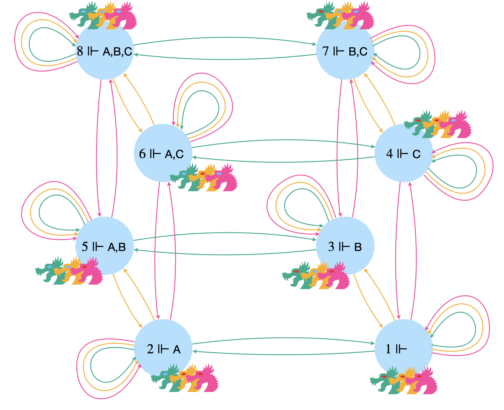

Par exemple, dans le monde où seul $B$ a les yeux bleus (le monde 3) $A$ imagine aussi possible  le monde où $A$ et $B$ ont tous les deux les yeux bleus (le monde 5). Une flèche étiquetée par $A$ rejoint donc ces deux mondes possibles. Et bien sûr, dans le monde où $A$ et $B$ ont les yeux bleus, $A$ imagine possible le monde où seul $B$ a les yeux bleus (il y a donc une flèche de 5 vers 3). Et comme c'est vrai dans chaque cas et pour les trois dragons, cela montre que ce système de transition est **symétrique**. Il est de plus évident que chaque monde semble possible pour les dragons qui s'y trouvent. Le système est donc aussi **réflexif**.

Imaginons que l'on soit dans le monde 2. L'ensemble des mondes possibles se simplifie alors grandement.

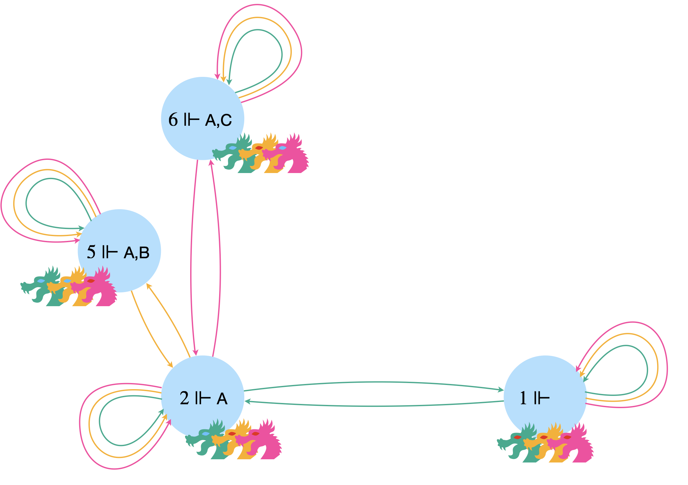

La déclaration de l'étranger n'est pas une surprise pour $B$ et $C$ qui voient bien que le pauvre $A$ a les yeux bleus et est donc sans effet pour eux. Par contre $A$ comprend que l'autre monde qu'il pensait possible, le monde béni où il n'avait pas des yeux infâmes (le monde 1) est en fait impossible.

Avant la déclaration de l'étranger, $2\Vdash\color{#00AB8E}\langle A\rangle \color{#000}\neg A$ puisqu'il y a une flèche étiquetée par $A$ qui rejoint 1 (qui réalise $\neg A$). On peut traduire ça par&nbsp;: "dans le monde 2, Apophis croit possible qu'il n'ait pas les yeux bleus". De même $2\Vdash\color{#FEAE00}\langle B\rangle \color{#000}\neg B$ et $2\Vdash\color{#FF42A1}\langle C\rangle \color{#000}\neg C$, grâce cette fois aux boucles étiquetées par $B$ et par $C$ qui reviennent sur le monde 2, où ni $B$ ni $C$ n'ont les yeux bleus. Donc chaque dragon croit encore possible de ne pas avoir les yeux bleus. Mais Bahamut n'est sûr de rien&nbsp;: la flèche étiquetée par $B$ vers le monde 5 donne aussi $2\Vdash\color{#FEAE00}\langle B\rangle \color{#000} B$ (et de même pour Caraxès, avec la flèche vers le monde 6).
 D'autre part, on peut écrire que $2\Vdash\color{#FF42A1}[C] \color{#000} A$ puisque les deux arcs étiquetés par $C$ qui partent de 2 vont dans des mondes (2 et 6) où $A$ est réalisée. Ça peut se lire&nbsp;: "dans le monde 2, Caraxès sait qu'Apophis a les yeux bleus". 
On peut aussi compliquer les énoncés avec par exemple&nbsp;: $6 \Vdash \color{#FF42A1}\langle C\rangle \color{#FEAE00}\langle B\rangle \color{#000} (B\land\neg C)$ (une flèche rose part de 6 vers 2 et une flèche jaune part de 2 vers 5 où $B$ a les yeux bleus mais pas $C$).

Après la déclaration de l'étranger, le monde 1 disparaît&nbsp;!

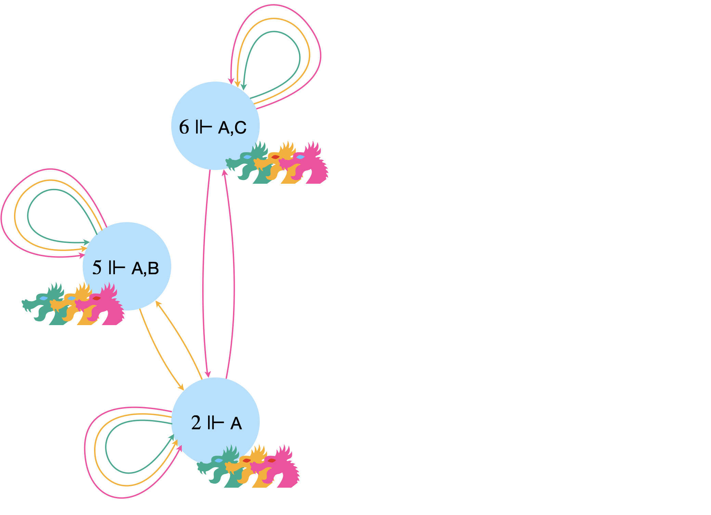

Si $B$ et $C$ sont toujours dans le doute quant à la couleur de leurs yeux, pour $A$, les jeux sont faits. En effet, on a dorénavant $2\Vdash\color{#00AB8E}[A] \color{#000} A$. Et le soir même, Apophis s'en va tout penaud.

En généralisant, dans les mondes où seul un dragon a les yeux bleus (2, 3 et 4), ce dragon le comprend au moment de la déclaration de l'étranger et se retire le soir même.

Imaginons maintenant que l'on soit dans le monde 5 où Apophis et Bahamut ont les yeux bleus.

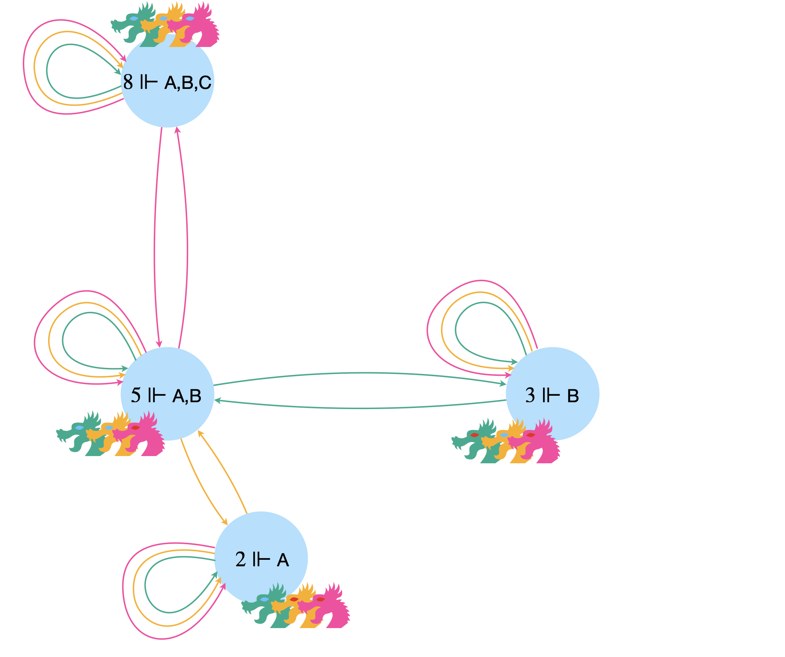

La déclaration de l'étranger ne fait pas beaucoup d'effet car ils étaient déjà tous les trois au courant qu'au moins l'un d'eux avait les yeux bleus... Par conséquent, le soir même, personne ne part. Et ça par contre, ça change pas mal de choses&nbsp;! En effet, les mondes 2 et 3 deviennent d'un coup impossibles puisqu'on a vu que les mondes où seul un des dragons a les yeux bleus voient ce dragon décamper dès le premier soir.

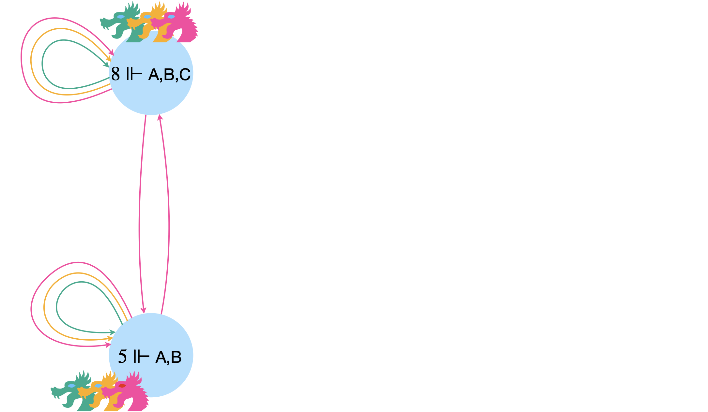

On a maintenant&nbsp;: $5\Vdash (\color{#00AB8E}[A] \color{#000} A)\land (\color{#FEAE00}[B] \color{#000} B)$. $A$ et $B$ ont acquis la certitude d'avoir les yeux bleus et s'envolent au deuxième soir. 
Les deux dragons aux yeux bleus des mondes 7 ou 6 auraient fait de même.

La dernière situation possible correspond au monde 8.

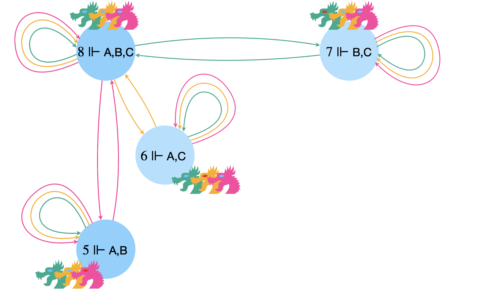

On reprend le raisonnement précédent. Personne ne part au premier soir, mais cette fois-ci, ça ne permet d'éliminer aucun monde possible... Et par conséquent, au deuxième soir, personne ne s'envole. Mais là, bingo&nbsp;! Ça élimine les mondes où seuls deux dragons ont les yeux piscine. Finalement, ils comprennent tous les trois qu'ils sont bannis et s'envolent au troisième soir. 
La situation de départ correspondait donc au monde 8.

Mais qu'a donc appris l'étranger&nbsp;?

Dans le monde 8, chaque dragon voit deux paires d'yeux bleus. Tous savaient donc déjà qu'«&nbsp;au moins l'un de nous a les yeux bleus&nbsp;». L'étranger n'a rien dit de neuf, et pourtant sa phrase déclenche tout.

Ce qui change n'est pas ce que chacun sait, mais ce que chacun sait **de ce que savent les autres**. Avant la déclaration, le monde 8 vérifie

$8\Vdash \color{#00AB8E}\langle A\rangle\color{#FEAE00}\langle B\rangle\color{#FF42A1}\langle C\rangle\color{#000}(\neg A\land\neg B\land\neg C)$

Apophis juge possible le monde 7 (où il n'a pas les yeux bleus)&nbsp;; dans ce monde, Bahamut jugerait possible le monde 4&nbsp;; et dans celui-là, Caraxès jugerait possible le monde 1, où personne n'a les yeux bleus. Autrement dit&nbsp;: Apophis n'exclut pas que Bahamut n'exclue pas que Caraxès n'exclue pas qu'aucun dragon n'ait les yeux bleus&nbsp;! En supprimant le monde 1, l'étranger rend cette formule fausse.

Une information publique devient ce qu'on appelle une **connaissance commune**&nbsp;: tout le monde la sait, tout le monde sait que tout le monde la sait, et ainsi de suite indéfiniment. C'est beaucoup plus fort que «&nbsp;tout le monde le sait&nbsp;», et la notion joue un rôle central en théorie des jeux et en économie (c'est toute la différence entre un secret de Polichinelle et une annonce officielle).

L'énigme circule sous bien des déguisements (insulaires aux yeux bleus, enfants au front sale, maris trompés) et se généralise&nbsp;: avec $n$ dragons aux yeux bleus, tous partent le $n$-ième soir.

On peut remarquer en passant différentes équivalences&nbsp;:
- $a\Vdash\neg\color{#00AB8E}[A] \color{#000} \phi$ ssi $a\Vdash \color{#00AB8E}\langle A\rangle \color{#000} \neg \phi$ 
Pour A, ne pas savoir quelque chose est équivalent à croire possible son contraire.
- $a\Vdash\color{#00AB8E}[A] \color{#000} \phi$ ssi $a\Vdash \neg\color{#00AB8E}\langle A\rangle \color{#000} \neg \phi$ 
Pour A, savoir quelque chose est identique à ne pas croire possible le contraire de cette chose.
- $a\Vdash\neg\color{#00AB8E}[A] \color{#000} \neg\phi$ ssi $a\Vdash \color{#00AB8E}\langle A\rangle \color{#000}  \phi$ 
Pour A, croire possible quelque chose revient à ne pas savoir le contraire de cette chose.

### Modèles et classes

Jusqu'ici, on a parlé de vérité **en un nœud**. On peut prendre de la hauteur, par paliers successifs.

Un <b>modèle</b> de la logique modale (modèle de Kripke) est un système de transition équipé d'une valuation&nbsp;: $\mathcal{M}=\langle\mathcal{S},\mathcal{V}\rangle$.

<table class="tab-recap">
<tr><th>On dit que $\phi$ est…</th><th>si elle est forcée…</th><th>Notation</th></tr>
<tr><td class="g">satisfaite au nœud $a$</td><td class="g">en $a$, pour la valuation $\mathcal{V}$</td><td>$\langle\mathcal{S},\mathcal{V},a\rangle\Vdash\phi$</td></tr>
<tr><td class="g"><b>vraie</b> dans le modèle $\langle\mathcal{S},\mathcal{V}\rangle$</td><td class="g">en tous les nœuds</td><td>$\langle\mathcal{S},\mathcal{V}\rangle\Vdash^{\forall a}\phi$</td></tr>
<tr><td class="g"><b>valide</b> dans le système $\mathcal{S}$</td><td class="g">en tous les nœuds, pour toutes les valuations</td><td>$\mathcal{S}\Vdash^{\forall a,\forall \mathcal{V}} \phi$</td></tr>
<tr><td class="g">valide dans la <b>classe</b> $\mathscr{C}$</td><td class="g">dans tous les systèmes de la classe</td><td>$\mathscr{C}\Vdash\phi$</td></tr>
</table>

La vérité dans un modèle est une notion **globale**, ce qui réserve des surprises. Prenons le système de transition $\mathcal{S}$ équipé de la valuation $\mathcal{V}$ ci-dessous&nbsp;:

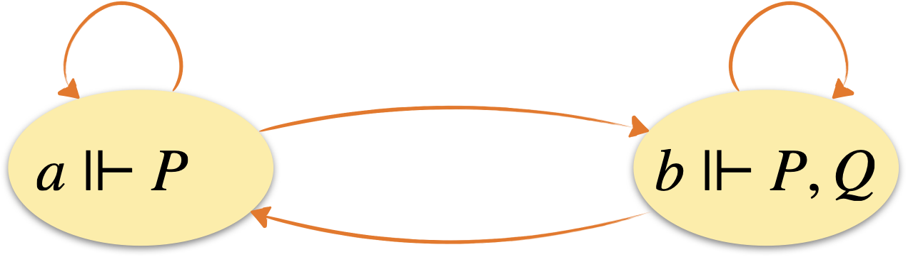

La formule $Q\lor\neg Q$ y est vraie. Mais comme $b\Vdash Q$ alors que $a\Vdash\neg Q$, ni $Q$ ni $\neg Q$ ne sont vraies dans le modèle. On peut donc avoir une formule $\phi\lor\psi$ vraie sans que ni $\phi$ ni $\psi$ ne le soient&nbsp;!

Une formule **valide** dans un système, elle, ne dépend plus du tout de ce que racontent les variables&nbsp;: elle ne tient qu'à la forme du graphe. Deux exemples&nbsp;:

- une formule sans opérateur modal est valide dans un système (n'importe lequel) si et seulement si c'est une tautologie du calcul des propositions. Rien d'étonnant&nbsp;: sans boîte ni diamant, on ne quitte jamais le nœud où l'on se trouve, et chaque nœud se comporte comme un modèle du calcul des propositions&nbsp;;
- la formule $\Box(P\rightarrow Q)\rightarrow(\Box P\rightarrow \Box Q)$ est valide dans **tous** les systèmes de transition. Si tous mes voisins vérifient $P\rightarrow Q$ et que tous vérifient $P$, alors tous vérifient $Q$.

### Quand une formule dessine un graphe

Voici maintenant le phénomène le plus remarquable de la logique modale&nbsp;: certaines formules «&nbsp;voient&nbsp;» la **forme du graphe**. Peu importe la valuation&nbsp;: telle formule est valide exactement quand les flèches sont disposées de telle manière. Commençons par la réflexivité, croisée dans l'histoire des dragons.

Un système de transition est <b>réflexif</b> si et seulement s'il valide $\Box\phi\rightarrow\phi$ pour toute formule $\phi$.

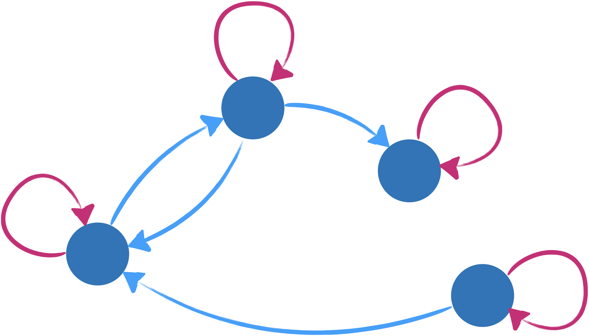

<ul>
<li><b>Si le système est réflexif.</b> Supposons $a\Vdash\Box \phi$&nbsp;: tous les successeurs de $a$ forcent $\phi$. Or $a$ est l'un de ses propres successeurs, donc $a\Vdash\phi$.</li>
<li><b>S'il ne l'est pas.</b> Il existe un nœud $a$ sans boucle. On choisit la valuation qui rend $P$ vraie exactement chez les successeurs de $a$. Alors $a\Vdash\Box P$, mais $a\nVdash P$ puisque $a$ n'est pas son propre successeur&nbsp;: la formule $\Box P\rightarrow P$ est en défaut.</li>
</ul>

Toutes les correspondances se démontrent sur ce modèle&nbsp;: dans un sens, on suit les flèches&nbsp;; dans l'autre, on fabrique une valuation sur mesure qui fait échouer la formule là où une flèche manque. On se contente donc, pour les suivantes, de l'énoncé et de l'idée.

Un système de transition est <b>transitif</b> si et seulement s'il valide $\Box\phi\rightarrow \Box\Box\phi$ pour toute formule $\phi$.

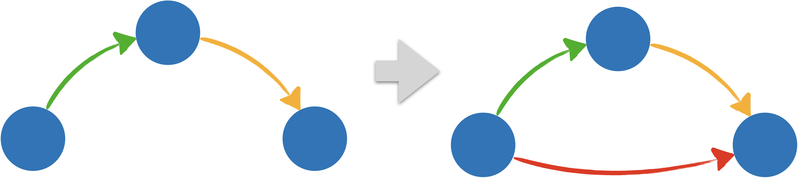

Si $\phi$ est vraie chez tous mes voisins, l'est-elle chez les voisins de mes voisins&nbsp;? Oui, pourvu que ceux-ci soient aussi mes voisins.

Un système de transition est <b>symétrique</b> si et seulement s'il valide $\phi\rightarrow \Box\Diamond\phi$ pour toute formule $\phi$.

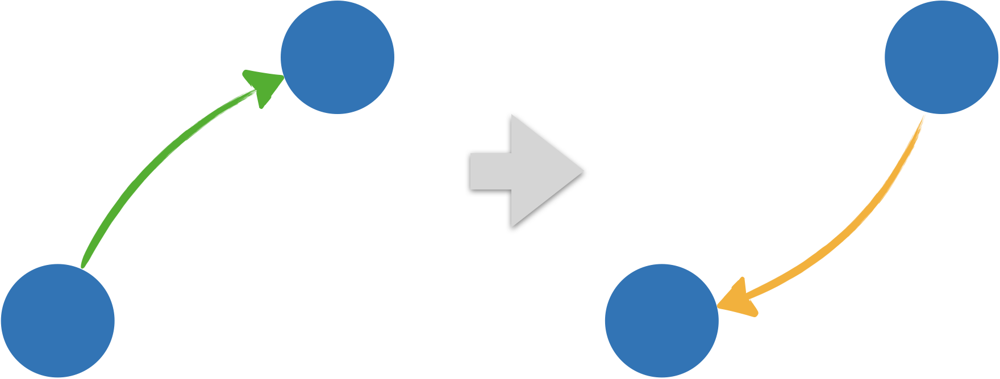

Si $\phi$ est vraie ici, alors chacun de mes voisins peut revenir vers moi, et voit donc un monde où $\phi$ est vraie.

Un système de transition est <b>non borné à droite</b> si et seulement s'il valide $\Box\phi\rightarrow \Diamond\phi$ pour toute formule $\phi$.

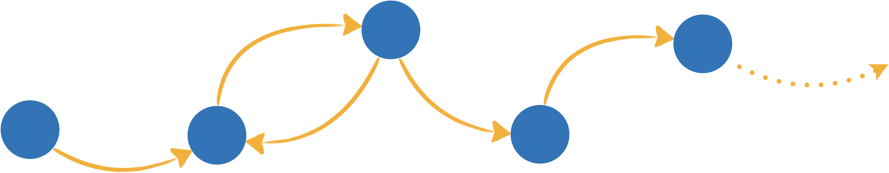

La formule n'échoue que dans un cul-de-sac, où tout est nécessaire et rien n'est possible. La valider, c'est ne pas avoir de cul-de-sac.

Un système de transition est <b>euclidien</b> si et seulement s'il valide $\Diamond\phi\rightarrow \Box\Diamond\phi$ pour toute formule $\phi$.

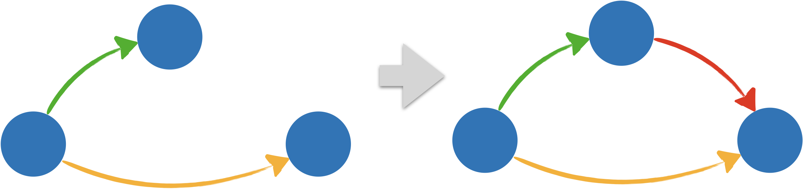

Si $\phi$ est vraie chez l'un de mes voisins, tous mes voisins doivent pouvoir s'y rendre&nbsp;: deux voisins d'un même nœud sont reliés entre eux.

Un système de transition est <b>dense</b> si et seulement s'il valide $\Box\Box\phi\rightarrow \Box\phi$ pour toute formule $\phi$.

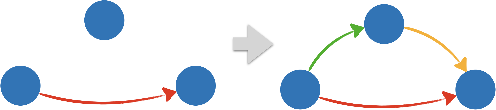

Ce qui est vrai à deux pas d'ici l'est à un pas, pourvu que tout pas puisse se décomposer en deux.

Un système de transition est <b>famélique</b> si et seulement s'il valide $\phi\rightarrow\Box\phi$ pour toute formule $\phi$.

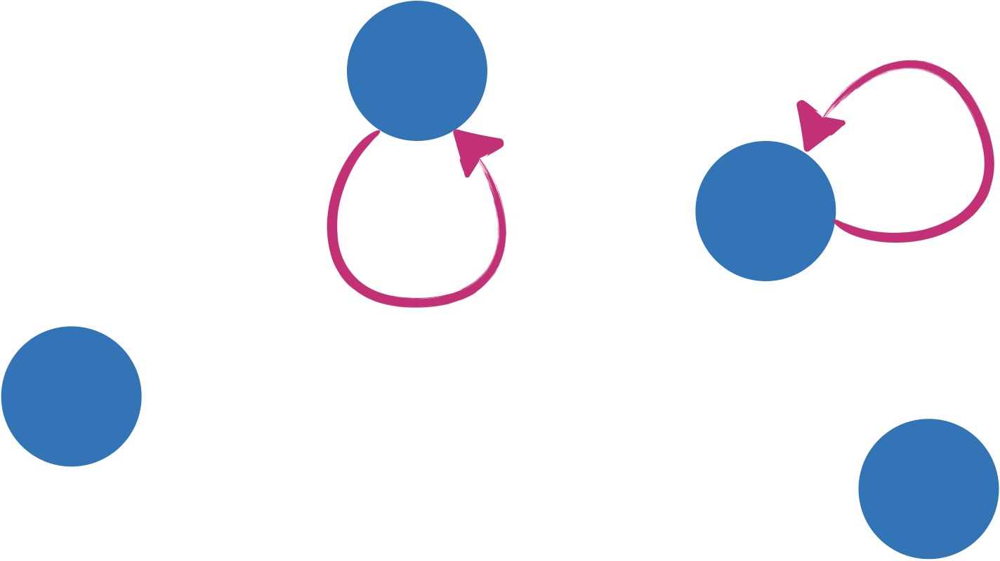

Ce qui est vrai ici ne l'est chez tous mes voisins, quelle que soit la valuation, que si je suis mon seul voisin possible.

En résumé&nbsp;:

<table class="tab-recap">
<tr><th>Le système est…</th><th>c'est-à-dire…</th><th>si et seulement s'il valide</th></tr>
<tr><td class="g">réflexif</td><td class="g">chaque nœud se voit lui-même</td><td>$\Box\phi\rightarrow\phi$</td></tr>
<tr><td class="g">transitif</td><td class="g">tout ce qu'on atteint en deux pas s'atteint en un seul</td><td>$\Box\phi\rightarrow\Box\Box\phi$</td></tr>
<tr><td class="g">symétrique</td><td class="g">toute flèche a sa flèche retour</td><td>$\phi\rightarrow\Box\Diamond\phi$</td></tr>
<tr><td class="g">non borné à droite</td><td class="g">aucun cul-de-sac</td><td>$\Box\phi\rightarrow\Diamond\phi$</td></tr>
<tr><td class="g">euclidien</td><td class="g">deux voisins d'un même nœud se voient l'un l'autre</td><td>$\Diamond\phi\rightarrow\Box\Diamond\phi$</td></tr>
<tr><td class="g">dense</td><td class="g">tout pas peut se décomposer en deux</td><td>$\Box\Box\phi\rightarrow\Box\phi$</td></tr>
<tr><td class="g">famélique</td><td class="g">un nœud ne voit, au plus, que lui-même</td><td>$\phi\rightarrow\Box\phi$</td></tr>
</table>

Ces formules deviendront, au chapitre suivant, les **axiomes** des principaux systèmes de logique modale.

On note $\mathscr{C}$ la classe de tous les systèmes de transition, et $\mathscr{C}_{ref.}$, $\mathscr{C}_{tr.}$, $\mathscr{C}_{sym.}$, $\mathscr{C}_{n.b.d.}$ les classes des systèmes respectivement réflexifs, transitifs, symétriques et non bornés à droite.

### Conséquences sémantiques

Soient $\Gamma$ un ensemble de formules et $\mathscr{C}$ une classe de systèmes de transition. 
$\phi$ est une <b>conséquence sémantique globale</b> de $\Gamma$ (noté $\Gamma\models^{\forall a}_\mathscr{C}\phi$) si et seulement si pour tout système de transition $\mathcal{S}\in \mathscr{C}$, et toute valuation $\mathcal{V}$, si $\langle\mathcal{S},\mathcal{V}\rangle\Vdash^{\forall a}\Gamma$ alors $\langle\mathcal{S},\mathcal{V}\rangle\Vdash^{\forall a}\phi$

Plus simplement, une formule est conséquence d'un ensemble d'hypothèses si chaque fois que ces hypothèses sont vraies dans un modèle de la classe considérée, alors cette formule est également vraie dans ce modèle.

Soient $\Gamma$ un ensemble de formules et $\mathscr{C}$ une classe de systèmes de transition. 
$\phi$ est une <b>conséquence sémantique locale</b> de $\Gamma$ (noté $\Gamma\models_\mathscr{C}\phi$) si et seulement si pour tout système de transition $\mathcal{S}\in \mathscr{C}$, toute valuation $\mathcal{V}$, et tout nœud $a\in N$, si $\langle\mathcal{S},\mathcal{V},a\rangle\Vdash\Gamma$ alors $\langle\mathcal{S},\mathcal{V},a\rangle\Vdash\phi$

La conséquence sémantique locale est plus forte que la globale au sens où si $\Gamma\models_\mathscr{C}\phi$ alors $\Gamma\models^{\forall a}_\mathscr{C}\phi$. L'inverse est généralement faux comme le montre l'exemple suivant&nbsp;:

Soient $\mathscr{C}$ la classe de tous les systèmes de transition, $\Gamma=\set{P}$ et $\phi=\Box P$. 
On a  $\Gamma\models^{\forall a}_\mathscr{C}\phi$. 
En effet, considérons un modèle quelconque $\langle\mathcal{S},\mathcal{V}\rangle$ qui vérifie $\langle\mathcal{S},\mathcal{V}\rangle\Vdash^{\forall a}\Gamma$, ce qui revient ici à affirmer que $\langle\mathcal{S},\mathcal{V},a\rangle\Vdash P$ est vraie pour tout nœud $a$. En particulier, pour tout nœud $b$ tel que $a\longrightarrow b$, la relation $\langle\mathcal{S},\mathcal{V},b\rangle\Vdash P$ est vérifiée, ce qui signifie que tout nœud $a$ vérifie $\langle\mathcal{S},\mathcal{V},a\rangle\Vdash \Box P$.

Par contre, il est facile de trouver un modèle où $\Gamma\models_\mathscr{C}\phi$ est faux&nbsp;:

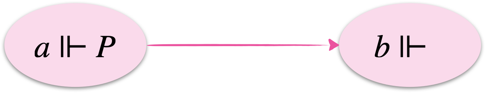

Dans ce modèle, on a $\langle\mathcal{S},\mathcal{V},a\rangle\Vdash P$ et $\langle\mathcal{S},\mathcal{V},a\rangle\nVdash \Box P$

{}
Plus prosaïquement, la conséquence locale dit que partout où il y a $\Gamma$, il y a $\phi$, alors que la conséquence globale dit que s'il y a $\Gamma$ partout alors il y a $\phi$ partout.
{}

Dans la suite, c'est la conséquence **locale** qui servira à énoncer les théorèmes de complétude.

### Théories, équivalence et bisimulation

Quand deux modèles sont-ils «&nbsp;les mêmes&nbsp;» aux yeux de la logique modale&nbsp;? Quand aucune formule ne les départage.

La <b>théorie</b> d'un modèle $\mathcal{M}$ est l'ensemble des formules qui y sont vraies. Sa <b>théorie locale</b> au nœud $a$ est l'ensemble des formules satisfaites en $a$.

<ul>
<li>Deux modèles $\mathcal{M}$ et $\mathcal{N}$ sont <b>équivalents</b>, noté $\mathcal{M} \equiv \mathcal{N}$, s'ils ont la même théorie.</li>
<li>Ils sont <b>localement équivalents</b> en $a$ et $b$, noté $(\mathcal{M},a) \equiv (\mathcal{N},b)$, si la théorie locale de $\mathcal{M}$ en $a$ est celle de $\mathcal{N}$ en $b$.</li>
</ul>

Les deux modèles suivants sont équivalents ($\mathcal{M} \equiv \mathcal{N}$).

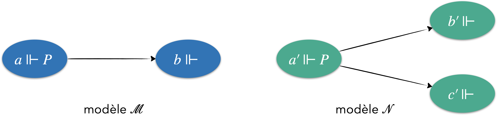

Et par ailleurs, $(\mathcal{M},a) \equiv (\mathcal{N},a')$, $(\mathcal{M},b) \equiv (\mathcal{N},b')$, $(\mathcal{M},b) \equiv (\mathcal{N},c')$. 
La <b>bisimulation</b> va nous permettre de reconnaître que ces modèles sont localement équivalents.

Deux modèles correspondent en quelque sorte à deux univers parallèles. Mais il se peut que depuis un des mondes du premier univers, tout paraisse exactement identique à ce que l'on perçoit depuis un monde du deuxième univers. Bien que les univers soient différents, ses "habitants" ne peuvent pas les différencier. On dit qu'ils sont <b>indiscernables</b> ou <b>bisimilaires</b>. Deux mondes sont indiscernables s'il n'existe pas de formule vraie dans l'un et fausse dans l'autre.

La notion vient d'ailleurs autant de l'informatique que de la logique&nbsp;: dans les années 1980, Robin Milner et David Park cherchaient à dire quand deux programmes ou deux machines, vus de l'extérieur, se comportent de la même façon. Un système de transition, c'est aussi un automate.

Un jeu à deux joueurs à information parfaite, le jeu de bisimulation, est défini de telle sorte que le joueur appelé <b>Duplicateur</b> possède une stratégie gagnante si et seulement si les deux mondes (associés à leurs modèles respectifs) qui interviennent dans le jeu sont indiscernables.

Plus besoin de passer en revue toutes les formules possibles pour déterminer si deux mondes sont ou non discernables...

Soient $\mathcal{M}=\langle\mathcal{S}=(N,A) , \mathcal{V}\rangle$ et  $\mathcal{N}=\langle\mathcal{T}=(M,B),\mathcal{W}\rangle$ deux modèles de la logique modale et soient $a\in N$ et $b\in M$ deux nœuds.

Le jeu de bisimulation $\mathbb{Bis}((\mathcal{M},a),(\mathcal{N},b))$ est défini comme suit&nbsp;:
<ul>
<li>il comprend deux joueurs appelés <b>Duplicateur</b> et <b>Corrupteur</b>. 
Le Duplicateur ($\text{D}_{up}$) cherche à montrer que les deux modèles sont localement bisimilaires, alors que le Corrupteur ($\text{C}_{or}$) au contraire veut montrer qu'ils ne le sont pas. 
Un coup, pour chacun des joueurs, consiste à choisir un nœud dans un système de transition. Les nœuds de départ étant $a$ dans $\mathcal{S}$ et $b$ dans $\mathcal{T}$.
</li>
 
<li>
À chaque tour, pour une position $a'$ dans $\mathcal{M}$ et une position $b'$ dans $\mathcal{N}$, $\text{C}_{or}$ choisit d'abord de jouer dans $\mathcal{S}$ ou dans $\mathcal{T}$ puis il choisit un arc permettant d'arriver à un successeur du nœud $a'$ ou $b'$ et $\text{D}_{up}$ répond en choisissant un successeur dans l'autre modèle tel que les nœuds choisis dans chaque modèle satisfont les mêmes variables propositionnelles.
</li>
 
<li>Fin de la partie&nbsp;:
<ul>
<li>S'il existe une variable $P$ telle que la position initiale vérifie $\langle\mathcal{S},\mathcal{V},a\rangle\Vdash P$ si et seulement si $\langle\mathcal{T},\mathcal{W},b\rangle\nVdash P$, alors $\text{C}_{or}$ l'emporte.</li>
<li>Si un joueur ne peut plus avancer alors il perd la partie.</li>
<li>Si la partie est infinie, $\text{D}_{up}$ l'emporte.</li>
</ul>
</li>
</ul>

Exemple 1&nbsp;:

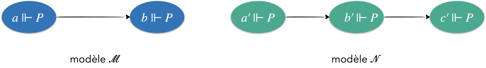

Le Corrupteur possède une stratégie gagnante&nbsp;:
<ul>
<li>$\text{C}_{or}$ choisit de jouer dans $\mathcal{N}$ puis va en $b'$.</li>
<li>$\text{D}_{up}$ n'a pas d'autre choix que d'aller en $b$.</li>
<li>$\text{C}_{or}$ choisit à nouveau de jouer dans $\mathcal{N}$ et va en $c'$.</li>
<li>$\text{D}_{up}$ perd car il ne peut plus avancer.</li>
</ul>

Exemple 2&nbsp;:

Le Duplicateur possède une stratégie gagnante&nbsp;:
<ul>
<li>Si $\text{C}_{or}$ choisit d'aller en $b'$ ou en $c'$, $\text{D}_{up}$ va en $b$ (il n'a pas trop le choix en même temps...).</li>
<li>Si $\text{C}_{or}$ choisit d'aller en $b$, $\text{D}_{up}$ va en $b'$ ou en $c'$ (c'est sans importance).</li>
</ul>
Le Corrupteur ne peut pas jouer son deuxième coup et perd la partie.

Exemple 3&nbsp;:

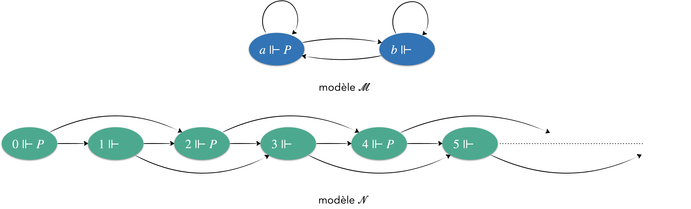

Le modèle $\mathcal{N}$ est défini par&nbsp;:
<ul>
<li>l'ensemble des nœuds est $\mathbb{N}$,</li>
<li>de tout nœud $n\in\mathbb{N}$ partent deux arcs&nbsp;: $n\longrightarrow n+1$ et $n\longrightarrow n+2$</li>
<li>$2n\Vdash P$ et $2n+1\nVdash P$</li>
</ul>
Le Duplicateur possède une stratégie gagnante qui consiste à tout moment de la partie&nbsp;:
<ul>
<li>si $\text{C}_{or}$ joue dans $\mathcal{N}$ et va sur $n$, à aller sur $a$ si $n$ est pair et sur $b$ sinon,</li>
<li>si $\text{C}_{or}$ joue dans $\mathcal{M}$ et va sur $a$, à aller sur $n+2$ si $n$ est pair et sur $n+1$ sinon,</li>
<li>si $\text{C}_{or}$ joue dans $\mathcal{M}$ et va sur $b$, à aller sur $n+1$ si $n$ est pair et sur $n+2$ sinon,</li>
</ul>
De la sorte, le jeu continue indéfiniment.

<b>Théorème de Hennessy-Milner</b>&nbsp;:
<ul>
<li>Si $\text{D}_{up}$ a une stratégie gagnante dans $\mathbb{Bis}((\mathcal{M},a),(\mathcal{N},b))$, alors $(\mathcal{M},a)\equiv(\mathcal{N},b)$.</li>
<li>La réciproque est vraie dès que, dans les deux modèles, chaque nœud n'a qu'un nombre fini de successeurs (c'est le cas en particulier de tous les modèles finis).</li>
</ul>

Le premier point se comprend bien&nbsp;: une formule ne peut explorer un modèle qu'en suivant des flèches et en consultant des variables, exactement comme le Corrupteur. Si le Duplicateur sait toujours répondre, aucune formule ne fera la différence. Pour la réciproque, l'hypothèse de finitude est nécessaire&nbsp;: une formule est un objet fini, et avec une infinité de successeurs, le Corrupteur peut disposer de coups qu'aucune formule ne sait décrire.

<nav class="suite-nav" aria-label="Chapitre précédent et suivant">
<a href="../../propositions/preuve/" class="precedent">← Précédent<b>Calcul des propositions</b></a>
<a href="../systemes/" class="suivant">Suite →<b>Systèmes logiques</b></a>
</nav>
