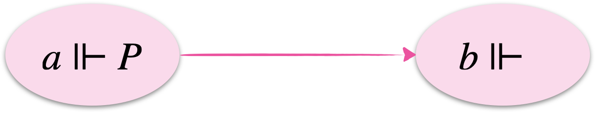
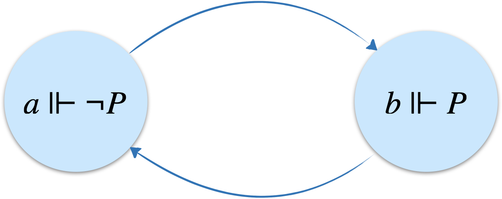
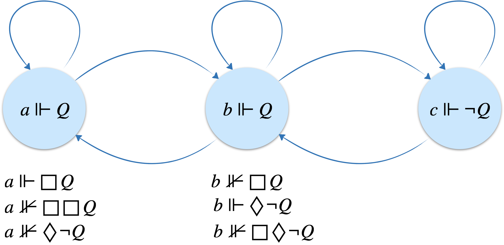
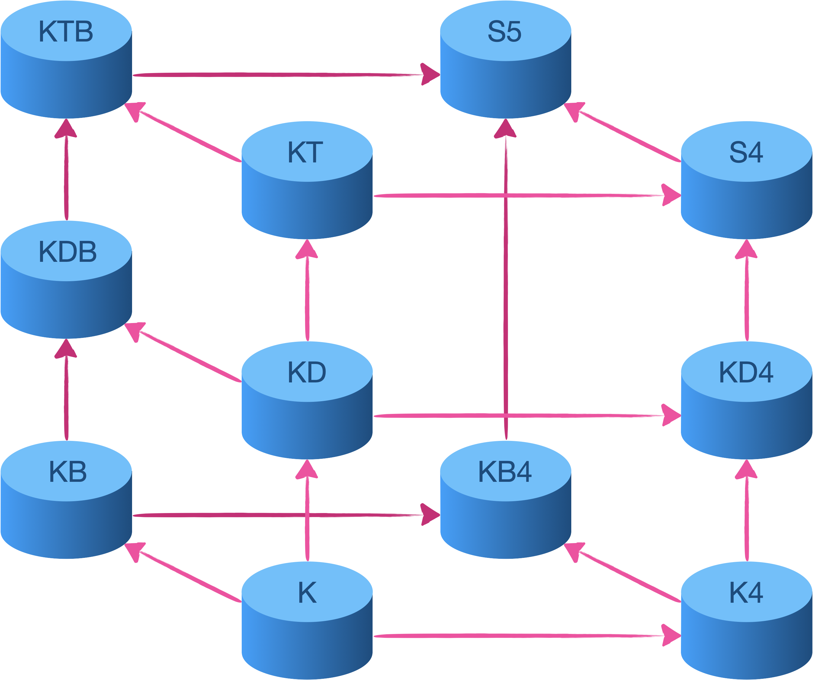
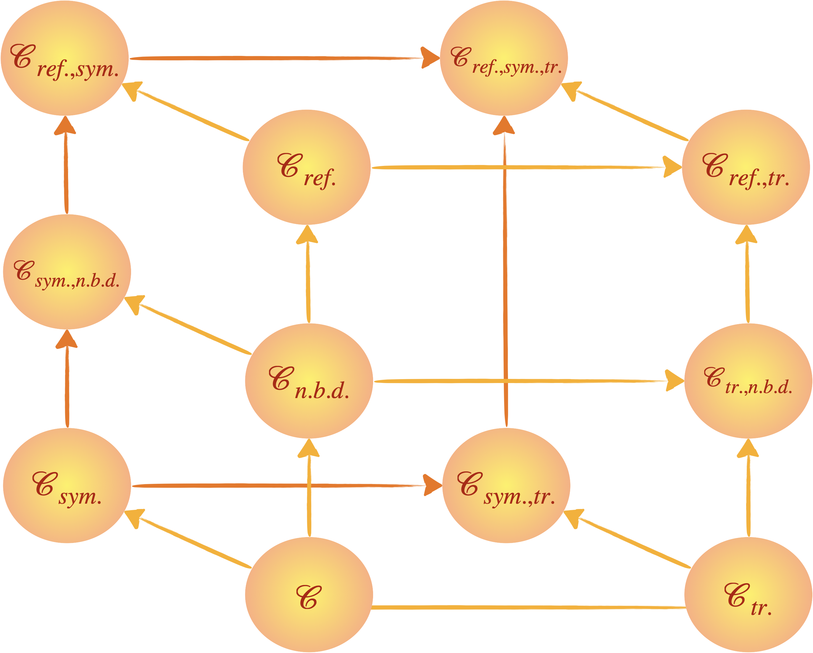
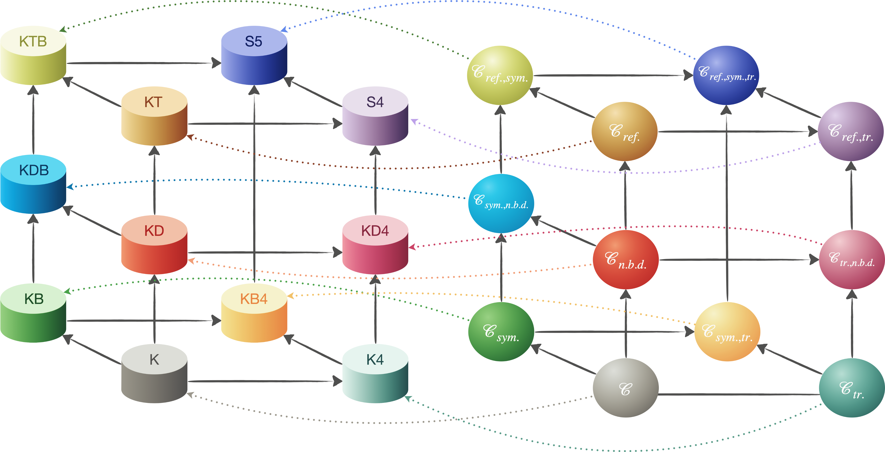

+++
title = "Logique modale - Systèmes logiques"
menuTitle = "Systèmes logiques"
date = 2021-03-06T14:20:50+01:00
weight = 2
aliases = ["/logique/logique5/"]
css = "logique.css"
+++

# Logique modale

Systèmes logiques&nbsp;: axiomes, correction et complétude

<nav class="chap-nav" aria-label="Chapitres">
<a href="../syntaxe-semantique/">Syntaxe et sémantique</a>
<a href="../systemes/" class="actif">Systèmes logiques</a>
<a href="../logiques/">Différentes logiques modales</a>
</nav>

Notes de lecture du livre <i>La logique pas à pas</i> de Jacques Duparc.

Au chapitre précédent, on a regardé les formules modales «&nbsp;de l'extérieur&nbsp;»&nbsp;: on se donnait un graphe, et on vérifiait ce qui y était vrai. On change maintenant de point de vue, comme on l'a fait pour le calcul des propositions en passant de la sémantique à la preuve. Peut-on **engendrer** les formules valides à partir de quelques axiomes et de quelques règles, sans jamais dessiner un seul graphe&nbsp;?

On verra que oui, et qu'à chaque choix d'axiomes correspond une famille de graphes bien précise. C'est ce dictionnaire entre axiomes et formes de graphes qui fait tout le charme du sujet.

## Axiomatique&nbsp;: les systèmes logiques

Nous cherchons l'équivalent en logique modale des tautologies pour le calcul des propositions&nbsp;; des formules vraies dans tous les modèles, ou plutôt dans toute une classe de modèles car comme on va le voir, la topologie d'un modèle contraint la vérité à l'intérieur de celui-ci.

La <b>logique de la classe $\mathscr{C}$</b> est la classe de toutes les formules qui sont valides dans tous les systèmes de transition de $\mathscr{C}$&nbsp;: $\mathbb{Log}_\mathscr{C}=\set{\phi|\text{pour tout }\mathcal{S}\in\mathscr{C},\mathcal{S}\Vdash^{\forall a,\forall \mathcal{V}} \phi}$

Cette logique doit contenir toutes les formules qui sont des tautologies du calcul des propositions puisque ces formules de profondeur modale nulle (pas d'opérateurs modaux) sont nécessairement forcées en tout nœud de n'importe quel modèle.

<ul>
<li>Si la logique contient la formule $\phi$, elle doit aussi contenir $\Box\phi$. En effet, si $\phi$ est forcée en tout nœud, alors le successeur de tout nœud force aussi $\phi$. On appelle ça la <b>nécessitation</b> (ou généralisation) d'une formule.</li>
 
<li>De plus, si $\phi$ appartient à la logique, elle est forcée en tout nœud <i>quelle que soit la valuation</i>, c'est-à-dire quel que soit l'ensemble des nœuds où l'on décide qu'une variable $P$ est vraie. Or remplacer $P$ par une formule $\psi$ revient à choisir pour $P$ l'ensemble des nœuds où $\psi$ est vraie&nbsp;: la formule $\phi[\psi/P]$ reste donc forcée partout. Toute <b>substitution uniforme</b> opérée sur les variables d'une formule appartenant à la logique donne une formule qui sera aussi dans la logique.</li>
 
<li>Enfin, la logique de la classe de tous les systèmes de transition est close par <b><i>modus ponens</i></b>&nbsp;; si $\phi \rightarrow\psi$ et $\phi$ appartiennent toutes deux à la logique, alors $\psi$ également. En effet, le <i>modus ponens</i> préserve la validité puisque si un modèle vérifie en un nœud à la fois $\phi$ et $\phi\rightarrow\psi$, alors (par définition de l'interprétation de l'implication) il vérifie également $\psi$.</li>
</ul>

Pour déterminer de nouvelles tautologies en calcul des propositions, on a utilisé des systèmes de déduction (à la Hilbert, déduction naturelle, calcul des séquents). La modalité complique un peu les choses et seul le système à la Hilbert va pouvoir s'adapter facilement.

<ul>
<li>Un <b>axiome</b> est une formule.</li>
<li>Un <b>système formel</b> est un ensemble d'axiomes.</li>
</ul>

Soient $I$ un ensemble non vide, $\phi$ une formule et $\textbf{S}$ un système formel. 
Une <b>preuve</b> de la formule $\varphi$ dans le système formel $\textbf{S}$ est une suite finie de formules $\langle\varphi_1,\varphi_2,\ldots,\varphi_n\rangle$ telle que&nbsp;:
<ul>
<li>$\varphi_n=\phi$</li>
 
<li>chaque $\varphi_l$ vérifie l'une des quatre conditions suivantes&nbsp;:
<ul>
<li>$\varphi_l \in \textbf{S}$ ($\varphi_l$ est un axiome)</li>
<li>$\varphi_l$ est obtenue par application de la règle du <i>modus ponens</i> à deux formules d'indice inférieur $\varphi_j$ et $\varphi_k$ où $j , k < l$ ($\varphi_j = \varphi_k\rightarrow\varphi_l$)</li>
<li>$\varphi_l = \varphi_k[\theta /P]$ où $k < l$ (substitution d'une variable $P$ quelconque par une formule $\theta$ quelconque dans une formule d'indice inférieure)</li>
<li>$\varphi_l = [i]\varphi_j$ où $j < l$ ($\varphi_l$ est obtenue à partir de l'application de la règle de nécessitation appliquée à une formule d'indice inférieure pour une étiquette $i\in I$ quelconque)</li>
</ul>
</li>
</ul>

<b>Exemple.</b> Prenons pour $\textbf{S}$ l'ensemble des tautologies du calcul des propositions. Voici, sous forme d'arbre, une preuve de $\Box (\Diamond  \phi\rightarrow(\Diamond \phi\lor\neg\Diamond \phi))$&nbsp;: on part d'une tautologie, on y substitue $\Diamond Q$ à $P$, on applique la nécessitation, puis on substitue $\phi$ à $Q$.

$$
\begin{prooftree}
\AxiomC{}
\RightLabel{$\scriptsize\;ax$}
\UnaryInfC{$P\rightarrow(P\lor\neg P)$}
\RightLabel{$\scriptsize\;sub.$}
\UnaryInfC{$\Diamond  Q\rightarrow(\Diamond Q\lor\neg\Diamond Q)$}
\RightLabel{$\scriptsize\;nec.$}
\UnaryInfC{$\Box (\Diamond  Q\rightarrow(\Diamond Q\lor\neg\Diamond Q))$}
\RightLabel{$\scriptsize\;sub.$}
\UnaryInfC{$\Box (\Diamond  \phi\rightarrow(\Diamond \phi\lor\neg\Diamond \phi))$}
\end{prooftree}
$$

Soient $\textbf{S}$ un système formel et $\Gamma$ un ensemble de formules appelées hypothèses. 
On écrit $\Gamma\vdash_\textbf{S}\phi$ s'il existe un ensemble fini de formules $\set{\psi_1,\psi_2,\ldots,\psi_n}\subseteq\Gamma$ tel que la formule $(\psi_1\land\psi_2\land\ldots\land\psi_n)\rightarrow\phi$ puisse être prouvée dans le système formel $\textbf{S}$. Autrement dit le séquent $\vdash_\textbf{S}(\psi_1\land\psi_2\land\ldots\land\psi_n)\rightarrow\phi$ est vérifié pour un nombre fini de formules bien choisies de $\Gamma$.

{}
Attention, ici les hypothèses n'ont pas le même sens qu'en logique des propositions. En effet, pour prouver le séquent $\phi\vdash_\textbf{S}\psi$, on ne peut pas ajouter $\phi$ aux axiomes et tenter d'atteindre $\psi$ à partir des règles (*modus ponens*, substitution uniforme et nécessitation). Il faut ici réussir à prouver la formule $\phi\rightarrow\psi$ sur la base des seuls axiomes.
  
Si on pouvait faire comme en logique des propositions, prouver $\phi\vdash_\textbf{S}\Box\phi$ deviendrait évident&nbsp;: on place $\phi$ dans les axiomes et on applique la règle de nécessitation. Mais non, il faut pouvoir prouver $\vdash_\textbf{S}\phi\rightarrow\Box\phi$ et comme on va le voir, dans le système $\textbf{K}$, la formule $P\rightarrow\Box P$ n'est pas prouvable ($P\nvdash_\textbf{K}\Box P$).
{}

### Le système K

Le système $\textbf{K}$ est le plus petit système formel qui contient&nbsp;:
<ul>
<li>chaque tautologie du calcul des propositions</li>
<li>$\text{(K)}$&nbsp;: $\Box(P\rightarrow Q)\rightarrow (\Box P\rightarrow \Box Q)$</li>
<li>$\text{(dual)}$&nbsp;: $\Diamond P\leftrightarrow\neg\Box\neg P$</li>
</ul>

Le système $\textbf{K}$ est **minimal** en ce sens que ses axiomes sont valides dans tout système de transition&nbsp;: il n'impose aucune contrainte à la forme du graphe.

Pour tout modèle $\mathcal{M}=\langle\mathcal{S},\mathcal{V}\rangle$ et tout nœud $a$, si $a\Vdash\Box(P\rightarrow Q)$ et $a\Vdash\Box P$, cela signifie que pour tout nœud $b$ tel que $a\longrightarrow b$, $b\Vdash P\rightarrow Q$ et $b\Vdash P$, par conséquent $b\Vdash Q$ et donc $a\Vdash \Box Q$.  Cela montre que l'axiome $\text{(K)}$ est valide dans tous les systèmes de transition.

Pour montrer que $P\rightarrow\Box P$ n'est pas prouvable dans $\textbf{K}$, il suffit donc de présenter un modèle (et le système $\textbf{K}$ autorise tous les systèmes de transition) où l'implication est fausse pour au moins un nœud. Or on a déjà vu un tel modèle&nbsp;:

Dans ce modèle, on a $a\Vdash P$ mais aussi $a\nVdash \Box P$ et par conséquent $a\nVdash P\rightarrow\Box P$.

Cet axiome $\text{(K)}$ (K en l'honneur de Kripke) est appelé **axiome de distribution** car il permet de distribuer l'opérateur modal $\Box$ à l'intérieur de l'implication. On l'appelle aussi parfois axiome d'omniscience logique car il stipule que si un agent sait que $P$ implique $Q$, alors s’il sait également que $P$ il doit savoir que $Q$. En d’autres termes, l'agent doit connaître toutes les conséquences logiques de ce qu'il sait déjà. 

L'axiome $\text{(dual)}$ permet, lui, de passer d'un opérateur modal à l'autre et est aussi valide dans tout système de transition (juger une chose possible revient à ne pas être sûr de son absence, ou pour rester sur la structure du système de transition, dire qu'il existe un chemin vers $P$ revient à ne pas dire que tous les chemins vont vers $\neg P$). 
La relation sœur permettant de passer de l'opérateur boite à l'opérateur diamant $\Box P \leftrightarrow \neg\Diamond\neg P$ (si tous les chemins mènent à $P$, il n'existe pas de chemin menant à $\neg P$) est elle aussi vraie partout. 
Ces deux relations soulignent bien la nature duale des opérateurs $\Diamond$ et $\Box$.

Mais ce système formel n'est pas encore suffisamment riche pour contenir toutes les formules valides dans tous les modèles quels qu'ils soient. Pour cela, il faudrait également considérer toutes les substitutions uniformes possibles (entre autres dans la formule  $\text{(K)}$). On passe alors aux **logiques modales**.

### Logique modale normale

Une <b>logique modale normale</b> $\mathbb{L}$ est un ensemble de formules qui contient le système formel $\textbf{K}$ et qui est clos par&nbsp;:
<ul>
<li><i>modus ponens</i>
$$
\begin{prooftree}
\AxiomC{$\phi$}
\AxiomC{$\phi\rightarrow\psi$}
\RightLabel{$\scriptsize\;mod.p.$}
\BinaryInfC{$\psi$}
\end{prooftree}
$$
</li>
<li>substitution uniforme
$$
\begin{prooftree}
\AxiomC{$\phi$}
\RightLabel{$\scriptsize\;sub.$}
\UnaryInfC{$\phi[\theta/P]$}
\end{prooftree}
$$
</li>
<li>nécessitation
$$
\begin{prooftree}
\AxiomC{$\phi$}
\RightLabel{$\scriptsize\;nec.$}
\UnaryInfC{$\Box\phi$}
\end{prooftree}
$$
</li>
</ul>

Toute logique modale normale contient chaque formule $\phi$ prouvable dans le système formel $\textbf{K}$ (si $\vdash_\textbf{K}\phi$ alors $\phi$ fait partie de toute logique modale normale).

La plus petite logique modale normale est construite sur la base du système formel $\textbf{K}$. On la note $\mathbb{L}\_\textbf{K}$. Le lien entre la logique normale $\mathbb{L}\_\textbf{K}$ et le système formel $\textbf{K}$ est le suivant&nbsp;: $\phi \in \mathbb{L}\_\textbf{K}$ ssi $\vdash_\textbf{K}\phi$.

### Quelques axiomes usuels

$\text{(K) :}$ $\Box(P\rightarrow Q)\rightarrow(\Box P\rightarrow \Box Q)$

On l'a vu, l'axiome $\text{(K)}$ est à la base des logiques modales normales.

$\text{(D) :}$ $\Box P\rightarrow \Diamond P$

La formule $\text{(D)}$ dit que si quelque chose est nécessaire, alors cela doit être possible. On peut aussi l'interpréter différemment dans d'autres types de logiques que nous allons entrevoir ensuite&nbsp;: en logique déontique, la formule dit que quelque chose d'obligatoire doit être permis&nbsp;; en logique épistémique, elle dit que si je sais $P$, alors il est faux que je sache $\neg P$&nbsp;; et en logique doxastique, que si je crois que $P$, alors il est faux que je crois que $\neg P$. 
$\text{(D)}$ est parfois appelé axiome de consistance.

[Comme on l'a vu plus tôt](../syntaxe-semantique/#nbd), un système de transition qui valide $\text{(D)}$ n'admet **pas d'impasse**. Autrement dit, les arcs doivent être **non bornés à droite**.

$\text{(T) :}$ $\Box P\rightarrow P$

La formule $\text{(T)}$ dit que si quelque chose est nécessaire, alors cela est. On l'appelle parfois axiome de factivité. 
En logique déontique&nbsp;: ce qui est obligatoire est. 
En logique épistémique&nbsp;: si je sais $P$, alors $P$ est avéré. 
En logique doxastique&nbsp;: si je crois que $P$, alors $P$ est également avéré. 
On voit au passage qu'un axiome n'est pas une vérité universelle mais un **choix de modélisation**&nbsp;: $\text{(T)}$ caractérise bien le savoir (on ne peut savoir que ce qui est vrai), mais il serait déraisonnable de l'imposer à l'obligation ou à la croyance, car ce qui est obligatoire n'est pas toujours fait, et l'on croit parfois des choses fausses.

Et [nous avons vu](../syntaxe-semantique/#refl) qu'un système de transition valide $\text{(T)}$ si et seulement si ce système est **réflexif**. $\text{(T)}$ est donc aussi l'axiome de réflexivité.

$\text{(B) :}$ $P\rightarrow \Box\Diamond P$

La formule $\text{(B)}$ dit que si quelque chose est vrai, alors il est nécessaire que cela soit possible. 
En logique déontique&nbsp;: ce qui est, est obligatoirement permis. 
En logique épistémique&nbsp;: si $P$ est avéré, alors je sais que je ne sais pas $\neg P$. 
En logique doxastique&nbsp;: si $P$ est avéré, alors je crois que je ne crois pas $\neg P$.

Et [nous avons vu](../syntaxe-semantique/#syme) qu'un système de transition valide $\text{(B)}$ si et seulement si ce système est **symétrique**. $\text{(B)}$ est donc aussi l'axiome de symétrie.

$\text{(4) :}$ $\Box P\rightarrow \Box\Box P$

La formule $\text{(4)}$ dit que si quelque chose est nécessaire, alors cela est nécessairement nécessaire. 
En logique déontique&nbsp;: si quelque chose est obligatoire, c'est obligatoire que cela le soit. 
En logique épistémique&nbsp;: si je sais $P$, alors je sais que je sais $P$. Et transitivement, on sait que l'on sait que l'on sait... Autrement dit, avec la formule (4) nous décrivons des agents parfaitement lucides sur leur propre savoir. 
On appelle $\text{(4)}$ l'axiome d'introspection positive dans le cadre de la logique épistémique.

Et [nous avons vu](../syntaxe-semantique/#trans) qu'un système de transition valide $\text{(4)}$ si et seulement si ce système est **transitif**. $\text{(4)}$ est donc aussi l'axiome de transitivité.

$\text{(5) :}$ $\Diamond P\rightarrow \Box\Diamond P$

La formule $\text{(5)}$ dit que s'il n'est pas nécessaire que quelque chose ne soit pas, alors il est nécessaire que cela soit possible. 
En logique déontique&nbsp;: si quelque chose est permis, c'est obligatoire que cela soit permis. 
En logique épistémique&nbsp;: si je ne sais pas quelque chose, alors je sais que je ne le sais pas. L'interprétation épistémique décrit un agent parfaitement conscient de ce qu'il ne sait pas. 
En logique doxastique&nbsp;: si je ne crois pas quelque chose, alors je crois que je ne le crois pas. L'interprétation doxastique décrit un agent parfaitement conscient de ce qu'il ne croit pas. 
On appelle $\text{(5)}$ l'axiome d'introspection négative dans le cadre de la logique épistémique.

Et [nous avons vu](../syntaxe-semantique/#eucl) qu'un système de transition valide $\text{(5)}$ si et seulement si ce système est **euclidien**. $\text{(5)}$ est donc aussi l'axiome d'euclidité.

Rassemblons le tout&nbsp;:

<table class="tab-recap">
<tr><th>Axiome</th><th>Formule</th><th>Forme du graphe</th><th>Lecture épistémique</th></tr>
<tr><td>$\text{(K)}$</td><td>$\Box(P\rightarrow Q)\rightarrow(\Box P\rightarrow \Box Q)$</td><td class="g">quelconque</td><td class="g">je connais les conséquences de ce que je sais</td></tr>
<tr><td>$\text{(D)}$</td><td>$\Box P\rightarrow \Diamond P$</td><td class="g">sans cul-de-sac</td><td class="g">je ne sais jamais une chose et son contraire</td></tr>
<tr><td>$\text{(T)}$</td><td>$\Box P\rightarrow P$</td><td class="g">réflexif</td><td class="g">ce que je sais est vrai</td></tr>
<tr><td>$\text{(B)}$</td><td>$P\rightarrow \Box\Diamond P$</td><td class="g">symétrique</td><td class="g">ce qui est vrai, je sais que je ne l'exclus pas</td></tr>
<tr><td>$\text{(4)}$</td><td>$\Box P\rightarrow \Box\Box P$</td><td class="g">transitif</td><td class="g">je sais ce que je sais</td></tr>
<tr><td>$\text{(5)}$</td><td>$\Diamond P\rightarrow \Box\Diamond P$</td><td class="g">euclidien</td><td class="g">je sais ce que j'ignore</td></tr>
</table>

D'où viennent ces noms&nbsp;?

Cette nomenclature hétéroclite, où des lettres côtoient des chiffres, est un fossile de l'histoire du sujet.

- $\text{(K)}$ rend hommage à **K**ripke.
- $\text{(D)}$ est l'axiome caractéristique de la logique **d**éontique, celle des obligations.
- $\text{(T)}$ doit son nom au système «&nbsp;t&nbsp;» du logicien belge Robert Feys (1937).
- $\text{(B)}$ est l'axiome «&nbsp;**b**rouwérien&nbsp;»&nbsp;: Oskar Becker lui trouvait un air de famille avec la loi $P\rightarrow\neg\neg P$ chère à l'intuitionniste Brouwer.
- $\text{(4)}$ et $\text{(5)}$ sont les axiomes distinctifs des systèmes $\textbf{S4}$ et $\textbf{S5}$, quatrième et cinquième d'une série de systèmes d'«&nbsp;implication stricte&nbsp;» proposés par C.I. Lewis et C.H. Langford en 1932. Les trois premiers sont à peu près tombés dans l'oubli.

En prenant ensemble les formules $\text{(5)}$ et $\text{(T)}$, on regarde des systèmes de transition à la fois **euclidiens** et **réflexifs**. Or la conjonction de ces deux propriétés est équivalente à la conjonction des trois propriétés d'une relation d'équivalence&nbsp;!

Un système de transition est à la fois **euclidien** et **réflexif** si et seulement s'il est à la fois **réflexif**, **symétrique** et **transitif**.

Autrement dit, un graphe euclidien et réflexif est en fait ni plus ni moins qu'un graphe dans lequel la relation d'accessibilité est une **relation d'équivalence** (relation définie par les trois propriétés réflexivité, symétrie et transitivité).

<ul>
<li>$\Rightarrow$&nbsp;: 
<ul>
<li>réflexif&nbsp;: c'est immédiat</li>
<li>symétrique&nbsp;: si on a un arc $a\longrightarrow b$, alors par réflexivité, on a aussi $a\longrightarrow a$, et le caractère euclidien impose donc $b\longrightarrow a$.</li>
<li>transitif&nbsp;: supposons qu'on ait deux arcs $a\longrightarrow b$ et $b\longrightarrow c$. Comme on a montré la symétrie du graphe, on a aussi un arc $b\longrightarrow a$ et le caractère euclidien impose donc un arc $a\longrightarrow c$.
</li>
</ul>
</li>
<li>$\Leftarrow$&nbsp;: 
<ul>
<li>réflexif&nbsp;: c'est immédiat</li>
<li>euclidien&nbsp;: supposons qu'on ait deux arcs $a\longrightarrow b$ et $a\longrightarrow c$. La symétrie donne un arc $b\longrightarrow a$ et la transitivité impose alors un arc $b\longrightarrow c$.</li>
</ul>
</li>
</ul>

## Quelques systèmes formels et logiques usuels

Par la suite, nous confondrons un système formel et la logique qu'il induit par clôture. Les systèmes formels qu'on va introduire sont tous des extensions du système $\textbf{K}$.

<ul>
<li>$\textbf{K}$</li>
<li>$\textbf{KD}$&nbsp;: $\textbf{K}\cup\set{\text{(D)}}$</li>
<li>$\textbf{KB}$&nbsp;: $\textbf{K}\cup\set{\text{(B)}}$</li>
<li>$\textbf{KT}$&nbsp;: $\textbf{K}\cup\set{\text{(T)}}$</li>
<li>$\textbf{K4}$&nbsp;: $\textbf{K}\cup\set{\text{(4)}}$</li>
<li>$\textbf{KB4}$&nbsp;: $\textbf{K}\cup\set{\text{(B),(4)}}$</li>
<li>$\textbf{KD4}$&nbsp;: $\textbf{K}\cup\set{\text{(D),(4)}}$</li>
<li>$\textbf{KDB}$&nbsp;: $\textbf{K}\cup\set{\text{(D),(B)}}$</li>
<li>$\textbf{KTB}$&nbsp;: $\textbf{K}\cup\set{\text{(T),(B)}}$</li>
<li>$\textbf{S4} = \textbf{KT4}$&nbsp;: $\textbf{K}\cup\set{\text{(T),(4)}}$</li>
<li>$\textbf{S5} = \textbf{KT5}$&nbsp;: $\textbf{K}\cup\set{\text{(T),(5)}}$</li>
</ul>

Convainquons-nous dans un premier temps que ces axiomes apportent bien quelque chose de plus en montrant par exemple que la logique $\textbf{KB}$ ne permet pas de prouver l'axiome $\text{(4)}$.

Comme $\text{(B)}$ est vraie dans tout système de transition symétrique, il suffit de trouver un modèle symétrique où au moins un nœud ne satisfait pas $\text{(4)}=\Box P\rightarrow\Box\Box P$ pour montrer que $\textbf{K4}\not\subseteq \textbf{KB}$.

Comme $P$ est satisfait dans tous les successeurs de $a$, $a\Vdash\Box P$. Mais pour avoir $a\Vdash\Box\Box P$, il faudrait que tous les successeurs de $a$ satisfassent $\Box P$, or ce n'est pas le cas de $b$ (qui a pour successeur $a$ lui-même par symétrie et $a\nVdash P$). D'où $a\nVdash \Box\Box P$.

De même, montrons que $\textbf{KTB}$ ne peut prouver ni $\text{(4)}$ ni $\text{(5)}$.

$\text{(T)}$ et $\text{(B)}$ seront vraies ensemble dans tout système de transition à la fois réflexif et symétrique. Exhibons un tel modèle où au moins un nœud ne satisfait ni $\text{(4)}=\Box P\rightarrow\Box\Box P$ ni $\text{(5)}=\Diamond P\rightarrow\Box\Diamond P$.

On constate que dans ce modèle réflexif et symétrique, $a$ ne satisfait pas $\text{(4)}$ et $b$ ne satisfait pas une instance de $\text{(5)}$ où $P=\neg Q$.

Il reste à comparer ces systèmes entre eux.

Un système formel $\textbf{S}$ <b>se réduit à</b> $\textbf{S'}$, noté $\textbf{S}≤\textbf{S'}$, si tout ce qui est prouvable dans $\textbf{S}$ l'est aussi dans $\textbf{S'}$.

Ajouter des axiomes ne peut que faire prouver davantage&nbsp;: on a donc gratuitement $\textbf{K}≤\textbf{KD}$, $\textbf{K4}≤\textbf{S4}$, $\textbf{KB}≤\textbf{KTB}$, etc. D'autres réductions sont moins visibles, parce que l'axiome à retrouver ne figure pas dans la liste.

<ul>
<li>$\textbf{KD}≤\textbf{KT}$&nbsp;: l'axiome $\text{(D)}$ se prouve à partir de $\text{(T)}$.</li>
<li>$\textbf{KTB}≤\textbf{S5}$, $\textbf{S4}≤\textbf{S5}$ et $\textbf{KB4}≤\textbf{S5}$&nbsp;: les axiomes $\text{(B)}$ et $\text{(4)}$ se prouvent à partir de $\text{(T)}$ et $\text{(5)}$.</li>
</ul>

La première se voit en deux lignes. L'axiome $\text{(T)}$ donne $\Box P\rightarrow P$. Appliqué à $\neg P$ puis retourné par contraposition, il donne aussi $P\rightarrow\Diamond P$ («&nbsp;ce qui est vrai est possible&nbsp;»). En enchaînant les deux&nbsp;: $\Box P\rightarrow\Diamond P$, c'est-à-dire $\text{(D)}$.

Les suivantes demandent des preuves formelles plus longues, mais on les lit directement sur les graphes. Un graphe réflexif n'a pas de cul-de-sac (chaque nœud a au moins lui-même pour voisin)&nbsp;: voilà $\textbf{KD}≤\textbf{KT}$. Un graphe réflexif et euclidien est symétrique et transitif, on vient de le voir&nbsp;: voilà pourquoi $\textbf{S5}$ démontre $\text{(B)}$ et $\text{(4)}$. De façon générale, plus un système prouve de formules, moins il reste de graphes pour les valider toutes&nbsp;: une réduction entre systèmes correspond à une inclusion, en sens inverse, entre classes de graphes.

Dans le premier diagramme, une flèche de $\textbf{S}$ vers $\textbf{S'}$ signifie $\textbf{S}≤\textbf{S'}$. Dans le second, une flèche de $\mathscr{C}$ vers $\mathscr{C'}$ désigne l'inclusion inverse $\mathscr{C}\supseteq\mathscr{C'}$.

## Correction et complétude

Le projet est maintenant de préciser le rapport entre axiomatique et sémantique avec l'espoir que l'ensemble des formules valides sur les structures d'un certain type soit identique à l'ensemble des axiomes et théorèmes d'un certain système (ce qu'on a appelé une logique modale), car ainsi la validité formera une interprétation du système. Mais pour s'assurer de cette adéquation entre sémantique et axiomatique, il faut d'une part obtenir la **correction** (ou solidité, soundness en anglais) du système (toutes les formules prouvables sont vraies), et sa réciproque, la **complétude** (toutes les formules vraies sont prouvables). 
Dit autrement, on doit pouvoir déduire du système formel **tout le vrai** (**complétude**) et **rien que le vrai** (**correction**).

Soient $\mathscr{C}$ une classe de systèmes de transition et $\mathbb{L}$ une logique modale normale.

<ul>
<li>$\mathbb{L}$ est <b>correcte</b> pour $\mathscr{C}$ si tout ce qu'elle prouve est valide dans $\mathscr{C}$&nbsp;: si $\vdash_\mathbb{L}\phi$ alors $\models_{\mathscr{C}}\phi$.</li>
<li>$\mathbb{L}$ est <b>fortement complète</b> pour $\mathscr{C}$ si toute conséquence sémantique (locale) dans $\mathscr{C}$ est prouvable&nbsp;: si $\Gamma \models_\mathscr{C}\phi$ alors $\Gamma \vdash_\mathbb{L}\phi$.</li>
</ul>

Le résultat central du chapitre tient en un tableau.

Chacun des onze systèmes est <b>correct et fortement complet</b> pour la classe de graphes que dessinent ses axiomes&nbsp;:

<table class="tab-recap">
<tr><th>Système</th><th>Classe des systèmes de transition…</th></tr>
<tr><td>$\textbf{K}$</td><td class="g">quelconques</td></tr>
<tr><td>$\textbf{KD}$</td><td class="g">non bornés à droite (sans cul-de-sac)</td></tr>
<tr><td>$\textbf{KT}$</td><td class="g">réflexifs</td></tr>
<tr><td>$\textbf{KB}$</td><td class="g">symétriques</td></tr>
<tr><td>$\textbf{K4}$</td><td class="g">transitifs</td></tr>
<tr><td>$\textbf{KD4}$</td><td class="g">transitifs et non bornés à droite</td></tr>
<tr><td>$\textbf{KDB}$</td><td class="g">symétriques et non bornés à droite</td></tr>
<tr><td>$\textbf{KB4}$</td><td class="g">symétriques et transitifs</td></tr>
<tr><td>$\textbf{KTB}$</td><td class="g">réflexifs et symétriques</td></tr>
<tr><td>$\textbf{S4}$</td><td class="g">réflexifs et transitifs</td></tr>
<tr><td>$\textbf{S5}$</td><td class="g">réflexifs, symétriques et transitifs (relations d'équivalence)</td></tr>
</table>

Les deux diagrammes suivants disent la même chose&nbsp;: une flèche du système vers la classe pour la correction, de la classe vers le système pour la complétude.

### Pourquoi c'est correct

On a en fait déjà tout démontré. Les axiomes de $\textbf{K}$ (tautologies, $\text{(K)}$ et $\text{(dual)}$) sont valides dans tous les systèmes de transition, et les trois règles (nécessitation, substitution uniforme, <i>modus ponens</i>) préservent la validité. Quant aux axiomes supplémentaires, chacun est valide dans la classe de graphes qui lui correspond&nbsp;: $\text{(T)}$ dans les graphes réflexifs, $\text{(B)}$ dans les symétriques, $\text{(4)}$ dans les transitifs, $\text{(D)}$ dans les graphes sans cul-de-sac, $\text{(5)}$ dans les euclidiens.

### Pourquoi c'est complet

C'est la partie difficile, et l'idée qui en vient à bout est l'une des plus jolies de la logique.

**Reformulons.** Appelons un ensemble de formules $\Gamma$ **consistant** si l'on ne peut pas en déduire l'absurde ($\Gamma\nvdash_\mathbb{L}\bot$). La complétude revient alors à ceci&nbsp;: tout ensemble consistant est *satisfaisable*, c'est-à-dire vrai en un nœud d'un modèle de la bonne classe. (Si $\Gamma\models\phi$ sans que $\Gamma\vdash\phi$, l'ensemble $\Gamma\cup\set{\neg\phi}$ serait consistant sans être satisfaisable.) Il s'agit donc de **fabriquer un modèle** à partir d'un simple ensemble de formules dont on sait seulement qu'il ne se contredit pas.

**Des mondes faits de formules.** L'astuce, due à Leon Henkin (1949), est de modeler les nœuds directement à partir d'ensembles de formules&nbsp;! La sémantique détourne ainsi la syntaxe à son profit en donnant vie à une sorte de Golem syntaxique. Encore faut-il que ces ensembles se comportent comme de vrais mondes, où toute question a une réponse. On prend donc des ensembles **maximaux consistants**&nbsp;: consistants, mais auxquels on ne peut plus rien ajouter sans les rendre contradictoires. Un tel ensemble contient, pour chaque formule $\phi$, soit $\phi$ soit $\neg\phi$. Et tout ensemble consistant peut être complété en un ensemble maximal consistant (c'est le **lemme de Lindenbaum**&nbsp;: on passe en revue toutes les formules une à une, en ajoutant chacune ou sa négation).

Le <b>modèle canonique</b> d'une logique modale normale $\mathbb{L}$ est défini ainsi&nbsp;:

<ul>
<li>ses nœuds sont les ensembles maximaux $\mathbb{L}$-consistants&nbsp;;</li>
<li>il y a une flèche $\Gamma\longrightarrow\Gamma'$ lorsque tout ce que $\Gamma$ tient pour nécessaire est vrai dans $\Gamma'$&nbsp;: pour toute formule $\phi$, si $\Box\phi\in\Gamma$ alors $\phi\in\Gamma'$&nbsp;;</li>
<li>une variable $P$ est vraie au nœud $\Gamma$ lorsque $P\in\Gamma$.</li>
</ul>

**Le lemme de vérité.** Ce qui est décrété pour les variables se propage à toutes les formules&nbsp;: dans le modèle canonique, une formule est forcée au nœud $\Gamma$ si et seulement si elle appartient à $\Gamma$. Un ensemble consistant, une fois complété en un nœud $\Gamma_{max}$, est donc satisfait en ce nœud.

**La bonne forme.** Il reste à vérifier que le graphe canonique appartient à la classe voulue, et c'est là que les axiomes entrent en scène. Prenons $\textbf{KT}$. Tout nœud $\Gamma$ contient la logique, donc toutes les formules $\Box\phi\rightarrow\phi$. Si $\Box\phi\in\Gamma$, alors $\phi\in\Gamma$ par <i>modus ponens</i>&nbsp;: c'est exactement la condition pour avoir une flèche $\Gamma\longrightarrow\Gamma$. Le graphe canonique de $\textbf{KT}$ est réflexif. Chaque axiome façonne de même le graphe canonique à son image&nbsp;: $\text{(4)}$ le rend transitif, $\text{(B)}$ symétrique, $\text{(D)}$ sans cul-de-sac.

{}
La notion de conséquence sémantique $\models$ demande une satisfaction sur tous les modèles alors que la notion de conséquence syntaxique $\vdash$ demande seulement l'existence d'une preuve. 
Dit autrement, $\models$ est définie avec un quantificateur universel $\forall$ et $\vdash$ avec un quantificateur existentiel $\exists$ or la négation du quantificateur universel est le quantificateur existentiel et inversement. 
Démontrer qu'une formule est non démontrable est donc très difficile du côté de la  théorie de la démonstration puisque cela oblige à montrer que **toutes** les preuves échouent. Par contre, sur le versant sémantique, il suffit de trouver **un** modèle où la négation de la formule est satisfaite (un contre-exemple suffit). 
C'est la **correction** qui nous permet le changement de versant (on passe de la syntaxe à la sémantique). 
On peut trouver d'ailleurs un peu douloureux que la correspondance de loin la plus difficile à démontrer (la complétude) apporte si peu d'applications concrètes.
{}

<nav class="suite-nav" aria-label="Chapitre précédent et suivant">
<a href="../syntaxe-semantique/" class="precedent">← Précédent<b>Syntaxe et sémantique</b></a>
<a href="../logiques/" class="suivant">Suite →<b>Différentes logiques modales</b></a>
</nav>
