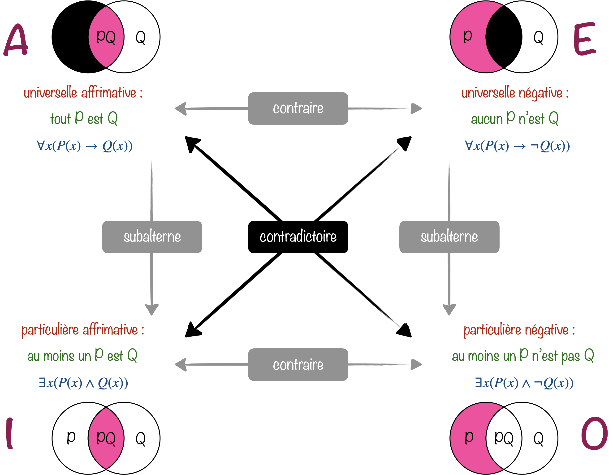

+++
title = "Calcul des prédicats - Langage et sens"
menuTitle = "Langage et sens"
date = 2026-11-13T10:00:00+01:00
weight = 1
css = "logique.css"
+++

# Calcul des prédicats

Langage et sens&nbsp;: des objets, des propriétés et des quantificateurs

<nav class="chap-nav" aria-label="Chapitres">
<a href="../langage/" class="actif">Langage et sens</a>
<a href="../preuve/">Démontrer au premier ordre</a>
</nav>

Le calcul des propositions traite chaque affirmation comme un bloc indivisible&nbsp;: «&nbsp;il pleut&nbsp;» devient $P$, et l'on ne regarde jamais à l'intérieur. Le raisonnement le plus célèbre de l'histoire de la logique lui échappe pourtant complètement&nbsp;:

> Tous les hommes sont mortels. Socrate est un homme. Donc Socrate est mortel.

Pour le calcul des propositions, ce sont trois affirmations sans rapport, $P$, $Q$ et $R$, et rien ne permet de tirer $R$ de $P$ et $Q$. Pour attraper ce raisonnement, il faut ouvrir les propositions et regarder ce qu'elles contiennent&nbsp;: des **objets** (Socrate) et des **propriétés** de ces objets (être un homme, être mortel). C'est ce que fait le **calcul des prédicats**, qu'on appelle aussi **logique du premier ordre**&nbsp;: les deux noms désignent la même chose.

Pourquoi «&nbsp;premier ordre&nbsp;»&nbsp;?

On s'autorise à dire «&nbsp;pour tout objet $x$&nbsp;», mais pas «&nbsp;pour toute propriété $P$&nbsp;». Quantifier sur les propriétés elles-mêmes, c'est passer au **second ordre**.

La différence a l'air technique, mais elle se fait sentir très vite. Le principe de récurrence dit&nbsp;: «&nbsp;**pour toute propriété** $P$, si $P(0)$ et si $P(n)$ entraîne $P(n+1)$, alors $P$ est vraie de tous les entiers&nbsp;». C'est un énoncé du second ordre. Au premier ordre, on devra se contenter d'écrire une récurrence séparée pour chaque propriété qu'on sait exprimer par une formule&nbsp;: on verra au chapitre suivant que ce n'est pas tout à fait la même chose.

## Ouvrir les propositions

<svg viewBox="0 0 570 150" role="img" aria-label="La proposition « Socrate est mortel » : une boîte noire P en calcul des propositions, un prédicat appliqué à un terme en calcul des prédicats" style="width:100%;max-width:570px;height:auto;"><text x="20" y="34" text-anchor="start" font-size="13" fill="#64748b" font-family="Georgia,'Times New Roman',serif">Calcul des propositions</text><rect x="20" y="46" width="230" height="64" rx="10" fill="#e2e8f0" stroke="#cbd5e1"/><text x="135" y="87" text-anchor="middle" font-size="30" fill="#334155" font-family="Georgia,'Times New Roman',serif" font-style="italic">P</text><text x="135" y="134" text-anchor="middle" font-size="12.5" fill="#64748b" font-family="Georgia,'Times New Roman',serif" font-style="italic">« Socrate est mortel » : une boîte noire</text><text x="300" y="34" text-anchor="start" font-size="13" fill="#64748b" font-family="Georgia,'Times New Roman',serif">Calcul des prédicats</text><rect x="300" y="46" width="112" height="64" rx="10" fill="#FBE9EF" stroke="#970E53" stroke-width="1.5"/><text x="356" y="86" text-anchor="middle" font-size="22" fill="#970E53" font-family="Georgia,'Times New Roman',serif" font-style="italic">Mortel</text><text x="424" y="88" text-anchor="middle" font-size="26" fill="#334155" font-family="Georgia,'Times New Roman',serif">(</text><rect x="436" y="46" width="104" height="64" rx="10" fill="#E8F0F7" stroke="#004D80" stroke-width="1.5"/><text x="488" y="86" text-anchor="middle" font-size="20" fill="#004D80" font-family="Georgia,'Times New Roman',serif" font-style="italic">socrate</text><text x="552" y="88" text-anchor="middle" font-size="26" fill="#334155" font-family="Georgia,'Times New Roman',serif">)</text><text x="356" y="134" text-anchor="middle" font-size="12.5" fill="#970E53" font-family="Georgia,'Times New Roman',serif">prédicat</text><text x="488" y="134" text-anchor="middle" font-size="12.5" fill="#004D80" font-family="Georgia,'Times New Roman',serif">terme</text></svg>

Le calcul des propositions ne voit qu'une boîte noire&nbsp;; le calcul des prédicats distingue ce dont on parle (le terme) de ce qu'on en dit (le prédicat).

Le langage s'enrichit de deux sortes d'ingrédients.

- Les **termes** désignent des objets. Ce sont des **constantes** ($\mathit{socrate}$, $0$), des **variables** ($x$, $y$, $z$…), et les termes fabriqués à l'aide de **fonctions** à partir des précédents&nbsp;: $\mathit{père}(\mathit{socrate})$, $x+1$.
- Les **prédicats** disent quelque chose des objets. $\mathit{Homme}(x)$ ou $\mathit{Pair}(x)$ portent sur un seul objet, ce sont des **propriétés**&nbsp;; $x\lt y$ ou $\mathit{Aime}(x,y)$ en relient deux, ce sont des **relations**. Le nombre de places d'un prédicat s'appelle son **arité**.

Un prédicat dont on a rempli les places, comme $\mathit{Mortel}(\mathit{socrate})$ ou $2\lt 3$, forme une **formule atomique**. Elle joue exactement le rôle des variables propositionnelles d'autrefois&nbsp;: on la combine avec les mêmes connecteurs $\neg$, $\land$, $\lor$, $\rightarrow$, $\leftrightarrow$, et tout ce que l'on sait du calcul des propositions reste vrai.

<table class="tab-recap">
<tr><th></th><th>Calcul des propositions</th><th>Calcul des prédicats</th></tr>
<tr><td class="g"><b>briques</b></td><td>variables propositionnelles $P$, $Q$…</td><td>formules atomiques $\mathit{Mortel}(\mathit{socrate})$, $x\lt y$…</td></tr>
<tr><td class="g"><b>connecteurs</b></td><td>$\neg$, $\land$, $\lor$, $\rightarrow$, $\leftrightarrow$</td><td>les mêmes</td></tr>
<tr><td class="g"><b>nouveautés</b></td><td></td><td>des termes (les objets) et deux quantificateurs, $\forall$ et $\exists$</td></tr>
<tr><td class="g"><b>un modèle</b></td><td>une ligne de table de vérité</td><td>une structure&nbsp;: des objets et le sens de chaque symbole</td></tr>
</table>

## Les quantificateurs

Deux symboles permettent de parler de tous les objets à la fois, ou d'au moins l'un d'eux&nbsp;:

- $\forall x$ se lit «&nbsp;**pour tout** $x$&nbsp;» (quantificateur universel)&nbsp;;
- $\exists x$ se lit «&nbsp;**il existe** $x$&nbsp;» (quantificateur existentiel).

Le syllogisme de Socrate s'écrit enfin&nbsp;:

$$\forall x\,\big(\mathit{Homme}(x)\rightarrow \mathit{Mortel}(x)\big),\ \ \mathit{Homme}(\mathit{socrate})\ \models\ \mathit{Mortel}(\mathit{socrate})$$

et cette fois, la conclusion découle bien des prémisses&nbsp;: la première affirme que, pour **chaque** objet, être un homme entraîne être mortel, en particulier pour Socrate.

Deux pièges classiques

«&nbsp;Tous les hommes sont mortels&nbsp;» s'écrit $\forall x\\,(\mathit{Homme}(x)\rightarrow \mathit{Mortel}(x))$, et non $\forall x\\,(\mathit{Homme}(x)\land \mathit{Mortel}(x))$. Cette dernière formule affirme que **tout** est un homme mortel, y compris les chaises et les nombres premiers.

À l'inverse, «&nbsp;un homme au moins est mortel&nbsp;» s'écrit $\exists x\\,(\mathit{Homme}(x)\land \mathit{Mortel}(x))$, et non $\exists x\\,(\mathit{Homme}(x)\rightarrow \mathit{Mortel}(x))$. Cette dernière est vraie dès qu'il existe un objet qui n'est pas un homme&nbsp;: une chaise suffit, puisqu'une implication dont la prémisse est fausse est vraie.

Règle pratique&nbsp;: **$\forall$ va avec $\rightarrow$, $\exists$ va avec $\land$**.

Nier un quantificateur, c'est le retourner&nbsp;: «&nbsp;il est faux que tous les cygnes soient blancs&nbsp;» veut dire «&nbsp;il existe un cygne qui n'est pas blanc&nbsp;».

$$\neg\forall x\,\phi\ \equiv\ \exists x\,\neg\phi\qquad\qquad \neg\exists x\,\phi\ \equiv\ \forall x\,\neg\phi$$

Ce sont les lois de De Morgan, version quantificateurs, et la dualité $\Box$/$\Diamond$ de la logique modale n'en est qu'un cas particulier. La boîte est un «&nbsp;pour tout&nbsp;» qui ne porte que sur les mondes accessibles, et le diamant un «&nbsp;il existe&nbsp;»&nbsp;:

$$a\Vdash\Box P \quad\text{signifie}\quad \forall b\,\big(R(a,b)\rightarrow P(b)\big),\qquad a\Vdash\Diamond P \quad\text{signifie}\quad \exists b\,\big(R(a,b)\land P(b)\big).$$

La logique modale se traduit ainsi tout entière dans le calcul des prédicats (on parle de *traduction standard*)&nbsp;: c'en est un fragment, que la boîte et le diamant permettent d'écrire sans variables.

Qui a inventé $\forall$ et $\exists$&nbsp;?

Les quantificateurs sont nés en 1879 dans la *Begriffsschrift* («&nbsp;idéographie&nbsp;») de Gottlob Frege, l'acte de naissance de la logique moderne. Sa notation, qui s'étalait en deux dimensions sur la page, était si déroutante qu'elle rebuta la plupart de ses contemporains. Charles Peirce, de l'autre côté de l'Atlantique, aboutit indépendamment à la même idée quelques années plus tard.

Les symboles actuels sont venus après coup&nbsp;: le $\exists$, un E retourné pour «&nbsp;existe&nbsp;», apparaît chez Giuseppe Peano en 1897, et le $\forall$, un A retourné pour *alle* («&nbsp;tous&nbsp;» en allemand), chez Gerhard Gentzen en 1935, par analogie.

### Le carré d'Aristote

Les quatre phrases types de la syllogistique d'Aristote (celle de l'encadré plus bas) s'organisent depuis l'Antiquité en un **carré des oppositions**. Les logiciens médiévaux les ont baptisées avec les voyelles du latin *AffIrmo* («&nbsp;j'affirme&nbsp;») et *nEgO* («&nbsp;je nie&nbsp;»)&nbsp;: A et I pour les affirmatives, E et O pour les négatives.

Dans chaque diagramme, le cercle de gauche contient les objets qui sont P, celui de droite ceux qui sont Q.

Les **diagonales** relient des énoncés **contradictoires**&nbsp;: dans chaque paire, l'un est vrai et l'autre faux. Ce sont exactement les lois de De Morgan qu'on vient de voir&nbsp;: nier «&nbsp;tout P est Q&nbsp;», c'est affirmer qu'au moins un P n'est pas Q.

Les trois autres côtés sont plus délicats&nbsp;:

- A et E sont **contraires**&nbsp;: elles ne peuvent pas être vraies ensemble, mais elles peuvent être fausses ensemble (si certains P sont Q et d'autres non)&nbsp;;
- I et O sont **sous-contraires**&nbsp;: elles ne peuvent pas être fausses ensemble, mais elles peuvent être vraies ensemble&nbsp;;
- I est **subalterne** de A&nbsp;: si tout P est Q, alors au moins un P est Q. De même, O est subalterne de E.

Le carré et les dragons

Ces trois côtés reposent tous sur l'hypothèse écrite en haut de la figure&nbsp;: il existe au moins un P. Sans elle, ils s'effondrent.

Prenons pour P «&nbsp;être un dragon&nbsp;». Faute de dragons, la prémisse de $\forall x\\,(\mathit{Dragon}(x)\rightarrow \mathit{Feu}(x))$ est toujours fausse, donc l'implication est toujours vraie&nbsp;: «&nbsp;tout dragon crache du feu&nbsp;» est vrai (on dit vrai **par vacuité**). Mais «&nbsp;aucun dragon ne crache du feu&nbsp;» est vrai pour la même raison&nbsp;: A et E sont vraies ensemble. Symétriquement, I et O sont fausses ensemble, puisqu'aucun dragon n'existe pour les rendre vraies. Et A est vraie quand I est fausse.

Seules les diagonales résistent, car les lois de De Morgan ne supposent rien sur l'existence. La logique traditionnelle raisonnait implicitement sur des termes qui désignent quelque chose. La logique moderne, avec Boole, Venn puis Frege, a choisi de ne plus le supposer.

### L'ordre compte

Quand plusieurs quantificateurs se suivent, leur ordre change tout le sens de la phrase.

<svg viewBox="0 0 560 226" role="img" aria-label="Deux ordres de quantificateurs : à gauche chacun aime quelqu'un de différent, à droite tous aiment la même personne" style="width:100%;max-width:560px;height:auto;"><defs><marker id="qa-b" viewBox="0 0 10 10" refX="9" refY="5" markerUnits="userSpaceOnUse" markerWidth="8" markerHeight="8" orient="auto"><path d="M0,1 L10,5 L0,9 z" fill="#004D80"/></marker><marker id="qa-p" viewBox="0 0 10 10" refX="9" refY="5" markerUnits="userSpaceOnUse" markerWidth="8" markerHeight="8" orient="auto"><path d="M0,1 L10,5 L0,9 z" fill="#970E53"/></marker></defs><text x="135" y="22" text-anchor="middle" font-size="17" fill="#004D80" font-family="Georgia,'Times New Roman',serif" font-style="italic">∀x ∃y Aime(x, y)</text><circle cx="50" cy="56" r="16" fill="#fff" stroke="#94a3b8"/><text x="50" y="61" text-anchor="middle" font-size="14" fill="#334155" font-family="Georgia,'Times New Roman',serif">A</text><circle cx="220" cy="56" r="16" fill="#fff" stroke="#94a3b8"/><text x="220" y="61" text-anchor="middle" font-size="14" fill="#334155" font-family="Georgia,'Times New Roman',serif">A</text><circle cx="50" cy="104" r="16" fill="#fff" stroke="#94a3b8"/><text x="50" y="109" text-anchor="middle" font-size="14" fill="#334155" font-family="Georgia,'Times New Roman',serif">B</text><circle cx="220" cy="104" r="16" fill="#fff" stroke="#94a3b8"/><text x="220" y="109" text-anchor="middle" font-size="14" fill="#334155" font-family="Georgia,'Times New Roman',serif">B</text><circle cx="50" cy="152" r="16" fill="#fff" stroke="#94a3b8"/><text x="50" y="157" text-anchor="middle" font-size="14" fill="#334155" font-family="Georgia,'Times New Roman',serif">C</text><circle cx="220" cy="152" r="16" fill="#fff" stroke="#94a3b8"/><text x="220" y="157" text-anchor="middle" font-size="14" fill="#334155" font-family="Georgia,'Times New Roman',serif">C</text><text x="50" y="188" text-anchor="middle" font-size="14" fill="#64748b" font-family="Georgia,'Times New Roman',serif" font-style="italic">x</text><text x="220" y="188" text-anchor="middle" font-size="14" fill="#64748b" font-family="Georgia,'Times New Roman',serif" font-style="italic">y</text><path d="M68,56 L200,104" stroke="#004D80" stroke-width="1.6" fill="none" marker-end="url(#qa-b)"/><path d="M68,104 L200,152" stroke="#004D80" stroke-width="1.6" fill="none" marker-end="url(#qa-b)"/><path d="M68,152 L200,56" stroke="#004D80" stroke-width="1.6" fill="none" marker-end="url(#qa-b)"/><text x="135" y="214" text-anchor="middle" font-size="13" fill="#64748b" font-family="Georgia,'Times New Roman',serif" font-style="italic">« tout le monde aime quelqu'un »</text><text x="425" y="22" text-anchor="middle" font-size="17" fill="#970E53" font-family="Georgia,'Times New Roman',serif" font-style="italic">∃y ∀x Aime(x, y)</text><circle cx="340" cy="56" r="16" fill="#fff" stroke="#94a3b8"/><text x="340" y="61" text-anchor="middle" font-size="14" fill="#334155" font-family="Georgia,'Times New Roman',serif">A</text><circle cx="510" cy="56" r="16" fill="#fff" stroke="#94a3b8"/><text x="510" y="61" text-anchor="middle" font-size="14" fill="#334155" font-family="Georgia,'Times New Roman',serif">A</text><circle cx="340" cy="104" r="16" fill="#fff" stroke="#94a3b8"/><text x="340" y="109" text-anchor="middle" font-size="14" fill="#334155" font-family="Georgia,'Times New Roman',serif">B</text><circle cx="510" cy="104" r="16" fill="#fff" stroke="#94a3b8"/><text x="510" y="109" text-anchor="middle" font-size="14" fill="#334155" font-family="Georgia,'Times New Roman',serif">B</text><circle cx="340" cy="152" r="16" fill="#fff" stroke="#94a3b8"/><text x="340" y="157" text-anchor="middle" font-size="14" fill="#334155" font-family="Georgia,'Times New Roman',serif">C</text><circle cx="510" cy="152" r="16" fill="#fff" stroke="#94a3b8"/><text x="510" y="157" text-anchor="middle" font-size="14" fill="#334155" font-family="Georgia,'Times New Roman',serif">C</text><text x="340" y="188" text-anchor="middle" font-size="14" fill="#64748b" font-family="Georgia,'Times New Roman',serif" font-style="italic">x</text><text x="510" y="188" text-anchor="middle" font-size="14" fill="#64748b" font-family="Georgia,'Times New Roman',serif" font-style="italic">y</text><path d="M358,56 L490,152" stroke="#970E53" stroke-width="1.6" fill="none" marker-end="url(#qa-p)"/><path d="M358,104 L490,152" stroke="#970E53" stroke-width="1.6" fill="none" marker-end="url(#qa-p)"/><path d="M358,152 L490,152" stroke="#970E53" stroke-width="1.6" fill="none" marker-end="url(#qa-p)"/><text x="425" y="214" text-anchor="middle" font-size="13" fill="#64748b" font-family="Georgia,'Times New Roman',serif" font-style="italic">« quelqu'un est aimé de tous »</text><line x1="290" y1="40" x2="290" y2="196" stroke="#e2e8f0"/></svg>

À gauche, chacun aime quelqu'un, mais pas forcément la même personne. À droite, une même personne (ici Chloé) est aimée de tous. La formule de droite entraîne celle de gauche, mais pas l'inverse.

Il faut retrouver cette femme

On prête à l'humoriste américain Sam Levenson cette annonce alarmée&nbsp;: «&nbsp;Toutes les quinze secondes, une femme met un enfant au monde quelque part. Il faut absolument retrouver cette femme et l'arrêter&nbsp;!&nbsp;»

Toute la blague tient dans l'inversion des quantificateurs. La statistique dit $\forall t\ \exists f$ («&nbsp;à chaque instant, il y a une femme qui accouche&nbsp;»), et le personnage entend $\exists f\ \forall t$ («&nbsp;il y a une femme qui accouche à chaque instant&nbsp;»).

Les mathématiciens connaissent bien le phénomène. Une fonction est **continue** sur un intervalle si $\forall x\ \forall\varepsilon\ \exists\delta\ldots$, et **uniformément continue** si $\forall\varepsilon\ \exists\delta\ \forall x\ldots$&nbsp;: dans le second cas, le même $\delta$ doit convenir pour tous les $x$. La fonction $x\mapsto 1/x$ sur $]0,1]$ est continue sans être uniformément continue.

## Variables libres, variables liées

Dans $\displaystyle\sum_{i=1}^{n} i$, la lettre $i$ est **muette**&nbsp;: on pourrait l'appeler $k$ sans rien changer, et le résultat ne dépend que de $n$. Les quantificateurs fonctionnent de la même façon. Dans $\forall x\\,\mathit{Homme}(x)$, la variable $x$ est **liée** par le quantificateur&nbsp;; une variable qu'aucun quantificateur ne lie est **libre**.

<svg viewBox="0 0 467 150" role="img" aria-label="Arcs reliant chaque quantificateur aux occurrences de la variable qu'il lie ; la variable z, qu'aucun quantificateur ne lie, est libre" style="width:100%;max-width:551px;height:auto;"><text x="22.0" y="98" font-size="19" fill="#004D80" font-family="Georgia,'Times New Roman',serif" textLength="14" lengthAdjust="spacingAndGlyphs">∀</text><text x="38.0" y="98" font-size="19" fill="#004D80" font-family="Georgia,'Times New Roman',serif" font-style="italic" textLength="10" lengthAdjust="spacingAndGlyphs">x</text><text x="55.0" y="98" font-size="19" fill="#334155" font-family="Georgia,'Times New Roman',serif" textLength="7" lengthAdjust="spacingAndGlyphs">(</text><text x="63.0" y="98" font-size="19" fill="#334155" font-family="Georgia,'Times New Roman',serif" font-style="italic" textLength="58" lengthAdjust="spacingAndGlyphs">Homme</text><text x="123.0" y="98" font-size="19" fill="#334155" font-family="Georgia,'Times New Roman',serif" textLength="7" lengthAdjust="spacingAndGlyphs">(</text><text x="131.0" y="98" font-size="19" fill="#004D80" font-family="Georgia,'Times New Roman',serif" font-style="italic" textLength="10" lengthAdjust="spacingAndGlyphs">x</text><text x="142.0" y="98" font-size="19" fill="#334155" font-family="Georgia,'Times New Roman',serif" textLength="7" lengthAdjust="spacingAndGlyphs">)</text><text x="159.0" y="98" font-size="19" fill="#334155" font-family="Georgia,'Times New Roman',serif" textLength="19" lengthAdjust="spacingAndGlyphs">→</text><text x="188.0" y="98" font-size="19" fill="#00A89D" font-family="Georgia,'Times New Roman',serif" textLength="13" lengthAdjust="spacingAndGlyphs">∃</text><text x="203.0" y="98" font-size="19" fill="#00A89D" font-family="Georgia,'Times New Roman',serif" font-style="italic" textLength="10" lengthAdjust="spacingAndGlyphs">y</text><text x="220.0" y="98" font-size="19" fill="#334155" font-family="Georgia,'Times New Roman',serif" font-style="italic" textLength="40" lengthAdjust="spacingAndGlyphs">Aime</text><text x="262.0" y="98" font-size="19" fill="#334155" font-family="Georgia,'Times New Roman',serif" textLength="7" lengthAdjust="spacingAndGlyphs">(</text><text x="270.0" y="98" font-size="19" fill="#00A89D" font-family="Georgia,'Times New Roman',serif" font-style="italic" textLength="10" lengthAdjust="spacingAndGlyphs">y</text><text x="281.0" y="98" font-size="19" fill="#334155" font-family="Georgia,'Times New Roman',serif" textLength="5" lengthAdjust="spacingAndGlyphs">,</text><text x="291.0" y="98" font-size="19" fill="#004D80" font-family="Georgia,'Times New Roman',serif" font-style="italic" textLength="10" lengthAdjust="spacingAndGlyphs">x</text><text x="302.0" y="98" font-size="19" fill="#334155" font-family="Georgia,'Times New Roman',serif" textLength="7" lengthAdjust="spacingAndGlyphs">)</text><text x="310.0" y="98" font-size="19" fill="#334155" font-family="Georgia,'Times New Roman',serif" textLength="7" lengthAdjust="spacingAndGlyphs">)</text><text x="328.0" y="98" font-size="19" fill="#334155" font-family="Georgia,'Times New Roman',serif" textLength="15" lengthAdjust="spacingAndGlyphs">∧</text><text x="354.0" y="98" font-size="19" fill="#334155" font-family="Georgia,'Times New Roman',serif" font-style="italic" textLength="46" lengthAdjust="spacingAndGlyphs">Riche</text><text x="402.0" y="98" font-size="19" fill="#334155" font-family="Georgia,'Times New Roman',serif" textLength="7" lengthAdjust="spacingAndGlyphs">(</text><text x="410.0" y="98" font-size="19" fill="#970E53" font-family="Georgia,'Times New Roman',serif" font-style="italic" textLength="9" lengthAdjust="spacingAndGlyphs">z</text><text x="420.0" y="98" font-size="19" fill="#334155" font-family="Georgia,'Times New Roman',serif" textLength="7" lengthAdjust="spacingAndGlyphs">)</text><path d="M43.0,79 C43.0,45 136.0,45 136.0,79" stroke="#004D80" stroke-width="1.4" fill="none"/><path d="M43.0,79 C43.0,19 296.0,19 296.0,79" stroke="#004D80" stroke-width="1.4" fill="none"/><path d="M208.0,79 C208.0,53 275.0,53 275.0,79" stroke="#00A89D" stroke-width="1.4" fill="none"/><text x="169.5" y="18" text-anchor="middle" font-size="12.5" fill="#004D80" font-family="Georgia,'Times New Roman',serif" lengthAdjust="spacingAndGlyphs" textLength="104">x est liée par ∀x</text><path d="M275.0,106 L275.0,122" stroke="#00A89D" stroke-width="1.4"/><text x="275.0" y="138" text-anchor="middle" font-size="12.5" fill="#00A89D" font-family="Georgia,'Times New Roman',serif" lengthAdjust="spacingAndGlyphs" textLength="104">y est liée par ∃y</text><path d="M414.5,106 L414.5,122" stroke="#970E53" stroke-width="1.4"/><text x="414.5" y="138" text-anchor="middle" font-size="12.5" fill="#970E53" font-family="Georgia,'Times New Roman',serif" lengthAdjust="spacingAndGlyphs" textLength="66">z est libre</text></svg>

Chaque quantificateur lie les occurrences de sa variable qui se trouvent dans sa portée. La variable $z$, qu'aucun quantificateur ne lie, est libre.

Une formule sans variable libre est un **énoncé** (on dit aussi une formule close)&nbsp;: une fois qu'on sait de quel monde on parle, il est vrai ou faux.

Une formule **avec** une variable libre n'est ni vraie ni fausse tant qu'on n'a pas choisi la valeur de cette variable&nbsp;: elle exprime une **propriété**. Ainsi $\exists y\\,(x=y+y)$, où $x$ est libre et $y$ liée, dit «&nbsp;$x$ est pair&nbsp;». Elle est vraie pour $x=6$ et fausse pour $x=7$. C'est exactement en ce sens que, dans le lemme de diagonalisation, une formule $S(x)$ «&nbsp;exprime une propriété $S$&nbsp;».

{}
On ne remplace pas une variable libre n'importe comment. Dans $\exists y\\,(x=y+y)$, remplacer $x$ par $y$ donne $\exists y\\,(y=y+y)$, qui ne dit plus «&nbsp;$y$ est pair&nbsp;» mais «&nbsp;zéro existe&nbsp;»&nbsp;: la variable $y$ s'est fait **capturer** par le quantificateur. Il faut d'abord renommer la variable muette, par exemple en $\exists u\\,(x=u+u)$, comme on le ferait avec un indice de sommation.
{}

## Les mondes du premier ordre&nbsp;: les structures

En calcul des propositions, un modèle se contentait de dire quelles variables étaient vraies. Il faut maintenant décrire tout un petit monde. Une **structure** se compose&nbsp;:

- d'un **domaine**&nbsp;: un ensemble non vide d'objets, ceux sur lesquels portent les quantificateurs&nbsp;;
- du **sens de chaque symbole**&nbsp;: à chaque constante un objet, à chaque fonction une fonction sur le domaine, et à chaque prédicat les objets (ou les couples, triplets…) qui le vérifient.

On évalue ensuite une formule comme on s'y attend&nbsp;: une formule atomique en regardant si les objets désignés sont dans la relation, les connecteurs comme en calcul des propositions, et $\forall x\\,\phi$ en vérifiant $\phi$ pour **chaque** objet du domaine (respectivement **au moins un** pour $\exists x\\,\phi$).

Une même formule peut être vraie dans une structure et fausse dans une autre. Voici trois structures pour un langage qui ne contient qu'une relation $R$ (dessinée par des flèches)&nbsp;:

<svg viewBox="0 0 560 222" role="img" aria-label="La même formule dans trois structures : vraie dans les entiers et sur une horloge, fausse sur un escalier qui s'arrête" style="width:100%;max-width:560px;height:auto;"><defs><marker id="st-a" viewBox="0 0 10 10" refX="9" refY="5" markerUnits="userSpaceOnUse" markerWidth="8" markerHeight="8" orient="auto"><path d="M0,1 L10,5 L0,9 z" fill="#004D80"/></marker></defs><circle cx="30" cy="60" r="14" fill="#E8F0F7" stroke="#004D80" stroke-width="1.4"/><text x="30" y="65" text-anchor="middle" font-size="13" fill="#004D80" font-family="Georgia,'Times New Roman',serif">0</text><path d="M45,60 L64,60" stroke="#004D80" stroke-width="1.5" fill="none" marker-end="url(#st-a)"/><circle cx="80" cy="60" r="14" fill="#E8F0F7" stroke="#004D80" stroke-width="1.4"/><text x="80" y="65" text-anchor="middle" font-size="13" fill="#004D80" font-family="Georgia,'Times New Roman',serif">1</text><path d="M95,60 L114,60" stroke="#004D80" stroke-width="1.5" fill="none" marker-end="url(#st-a)"/><circle cx="130" cy="60" r="14" fill="#E8F0F7" stroke="#004D80" stroke-width="1.4"/><text x="130" y="65" text-anchor="middle" font-size="13" fill="#004D80" font-family="Georgia,'Times New Roman',serif">2</text><path d="M145,60 L164,60" stroke="#004D80" stroke-width="1.5" fill="none" marker-end="url(#st-a)"/><circle cx="180" cy="60" r="14" fill="#E8F0F7" stroke="#004D80" stroke-width="1.4"/><text x="180" y="65" text-anchor="middle" font-size="13" fill="#004D80" font-family="Georgia,'Times New Roman',serif">3</text><path d="M195,60 L214,60" stroke="#004D80" stroke-width="1.5" fill="none" marker-end="url(#st-a)"/><text x="232" y="65" text-anchor="middle" font-size="18" fill="#004D80" font-family="Georgia,'Times New Roman',serif">…</text><text x="125" y="22" text-anchor="middle" font-size="13.5" fill="#334155" font-family="Georgia,'Times New Roman',serif">Les entiers naturels</text><text x="125" y="104" text-anchor="middle" font-size="14" fill="#00A89D" font-family="Georgia,'Times New Roman',serif" font-weight="bold">vraie</text><circle cx="360" cy="30" r="14" fill="#E8F0F7" stroke="#004D80" stroke-width="1.4"/><text x="360" y="35" text-anchor="middle" font-size="13" fill="#004D80" font-family="Georgia,'Times New Roman',serif">0</text><circle cx="390" cy="60" r="14" fill="#E8F0F7" stroke="#004D80" stroke-width="1.4"/><text x="390" y="65" text-anchor="middle" font-size="13" fill="#004D80" font-family="Georgia,'Times New Roman',serif">1</text><circle cx="360" cy="90" r="14" fill="#E8F0F7" stroke="#004D80" stroke-width="1.4"/><text x="360" y="95" text-anchor="middle" font-size="13" fill="#004D80" font-family="Georgia,'Times New Roman',serif">2</text><circle cx="330" cy="60" r="14" fill="#E8F0F7" stroke="#004D80" stroke-width="1.4"/><text x="330" y="65" text-anchor="middle" font-size="13" fill="#004D80" font-family="Georgia,'Times New Roman',serif">3</text><path d="M373.2,33.0 A30 30 0 0 1 387.0,46.8" stroke="#004D80" stroke-width="1.5" fill="none" marker-end="url(#st-a)"/><path d="M387.0,73.2 A30 30 0 0 1 373.2,87.0" stroke="#004D80" stroke-width="1.5" fill="none" marker-end="url(#st-a)"/><path d="M346.8,87.0 A30 30 0 0 1 333.0,73.2" stroke="#004D80" stroke-width="1.5" fill="none" marker-end="url(#st-a)"/><path d="M333.0,46.8 A30 30 0 0 1 346.8,33.0" stroke="#004D80" stroke-width="1.5" fill="none" marker-end="url(#st-a)"/><text x="360" y="22" text-anchor="middle" font-size="1" fill="#334155" font-family="Georgia,'Times New Roman',serif" font-style="italic"></text><text x="452" y="40" text-anchor="start" font-size="13.5" fill="#334155" font-family="Georgia,'Times New Roman',serif">Une horloge</text><text x="452" y="60" text-anchor="start" font-size="13.5" fill="#334155" font-family="Georgia,'Times New Roman',serif">à quatre heures</text><text x="360" y="124" text-anchor="middle" font-size="14" fill="#00A89D" font-family="Georgia,'Times New Roman',serif" font-weight="bold">vraie</text><circle cx="30" cy="168" r="14" fill="#E8F0F7" stroke="#004D80" stroke-width="1.4"/><text x="30" y="173" text-anchor="middle" font-size="13" fill="#004D80" font-family="Georgia,'Times New Roman',serif">0</text><path d="M45,168 L64,168" stroke="#004D80" stroke-width="1.5" fill="none" marker-end="url(#st-a)"/><circle cx="80" cy="168" r="14" fill="#E8F0F7" stroke="#004D80" stroke-width="1.4"/><text x="80" y="173" text-anchor="middle" font-size="13" fill="#004D80" font-family="Georgia,'Times New Roman',serif">1</text><path d="M95,168 L114,168" stroke="#004D80" stroke-width="1.5" fill="none" marker-end="url(#st-a)"/><circle cx="130" cy="168" r="14" fill="#E8F0F7" stroke="#004D80" stroke-width="1.4"/><text x="130" y="173" text-anchor="middle" font-size="13" fill="#004D80" font-family="Georgia,'Times New Roman',serif">2</text><path d="M145,168 L164,168" stroke="#004D80" stroke-width="1.5" fill="none" marker-end="url(#st-a)"/><circle cx="180" cy="168" r="14" fill="#FBE9EF" stroke="#970E53" stroke-width="1.4"/><text x="180" y="173" text-anchor="middle" font-size="13" fill="#970E53" font-family="Georgia,'Times New Roman',serif">3</text><text x="232" y="173" text-anchor="start" font-size="12.5" fill="#970E53" font-family="Georgia,'Times New Roman',serif">impasse</text><text x="125" y="140" text-anchor="middle" font-size="13.5" fill="#334155" font-family="Georgia,'Times New Roman',serif">Un escalier de quatre marches</text><text x="125" y="212" text-anchor="middle" font-size="14" fill="#970E53" font-family="Georgia,'Times New Roman',serif" font-weight="bold">fausse</text><text x="420" y="160" text-anchor="middle" font-size="13.5" fill="#64748b" font-family="Georgia,'Times New Roman',serif">La formule</text><text x="420" y="186" text-anchor="middle" font-size="19" fill="#004D80" font-family="Georgia,'Times New Roman',serif" font-style="italic">∀x ∃y R(x, y)</text><text x="420" y="208" text-anchor="middle" font-size="12.5" fill="#64748b" font-family="Georgia,'Times New Roman',serif" font-style="italic">« tout objet a un successeur »</text></svg>

L'énoncé $\forall x\,\exists y\,R(x,y)$ est vrai dans les deux premières structures et faux dans la troisième, où la dernière marche n'a pas de successeur.

Ces dessins vous rappellent quelque chose&nbsp;? Un système de transition de la logique modale n'est rien d'autre qu'une structure pour un langage réduit à une relation binaire, l'accessibilité. Et l'énoncé $\forall x\\,\exists y\\,R(x,y)$ est exactement la propriété «&nbsp;[non borné à droite](../../modale/syntaxe-semantique/#nbd)&nbsp;» qui caractérise l'axiome $\text{(D)}$. La différence est de point de vue&nbsp;: le calcul des prédicats **décrit** le graphe avec des quantificateurs, la logique modale s'y **promène** de monde en monde.

On note $\mathcal{M}\models\phi$ quand l'énoncé $\phi$ est vrai dans la structure $\mathcal{M}$. Un énoncé vrai dans **toutes** les structures est dit **universellement valide**&nbsp;: c'est l'analogue des tautologies. Par exemple, $\exists y\\,\forall x\\,R(x,y)\rightarrow\forall x\\,\exists y\\,R(x,y)$ est universellement valide, mais pas sa réciproque, comme le montre le panneau de gauche de la figure sur l'ordre des quantificateurs.

Aristote, Kant… et les canards de Lewis Carroll

Pendant plus de deux mille ans, la logique s'est confondue avec la **syllogistique** d'Aristote, qui classe les raisonnements du type «&nbsp;tout $P$ est $Q$, tout $R$ est $P$, donc tout $R$ est $Q$&nbsp;» (le syllogisme que les scolastiques appelaient *Barbara*). Kant pouvait écrire en 1787, dans la préface de la *Critique de la raison pure*, que la logique n'avait pas fait un pas en avant depuis Aristote et semblait donc «&nbsp;close et achevée&nbsp;». En langage moderne, la syllogistique n'est qu'un tout petit morceau du calcul des prédicats, celui où les prédicats n'ont qu'une place&nbsp;; elle ne sait rien dire des relations comme «&nbsp;aimer&nbsp;» ou «&nbsp;être plus petit que&nbsp;».

Lewis Carroll, professeur de logique à Oxford, s'amusait à fabriquer des chaînes de syllogismes délirantes. Celle-ci est tirée de sa *Logique symbolique* (1896)&nbsp;:

> Aucun canard ne valse. Aucun officier ne refuse jamais de valser. Toutes mes volailles sont des canards.

Que peut-on en conclure&nbsp;? Avec des prédicats, la chaîne se déroule toute seule&nbsp;: $\mathit{Volaille}(x)\rightarrow\mathit{Canard}(x)\rightarrow\neg\mathit{Valse}(x)\rightarrow\neg\mathit{Officier}(x)$, la dernière flèche étant la contraposée de «&nbsp;tout officier valse&nbsp;». D'où la conclusion de Carroll&nbsp;: **aucune de mes volailles n'est officier**.

Le langage dispose presque toujours d'un prédicat spécial, l'**égalité** $=$, qui permet de compter. «&nbsp;Il y a au moins deux objets&nbsp;» s'écrit $\exists x\\,\exists y\\,\neg(x=y)$, et l'on écrit de même «&nbsp;il y a au moins trois objets&nbsp;», «&nbsp;au moins cent objets&nbsp;», «&nbsp;exactement sept objets&nbsp;». Mais aucune formule ne dit «&nbsp;le domaine est fini&nbsp;». Ce n'est pas un manque d'astuce&nbsp;: c'est un théorème, que l'on rencontrera au chapitre suivant.

<nav class="suite-nav" aria-label="Chapitre précédent et suivant">
<a href="../../modale/logiques/" class="precedent">← Précédent<b>Logique modale</b></a>
<a href="../preuve/" class="suivant">Suite →<b>Démontrer au premier ordre</b></a>
</nav>
