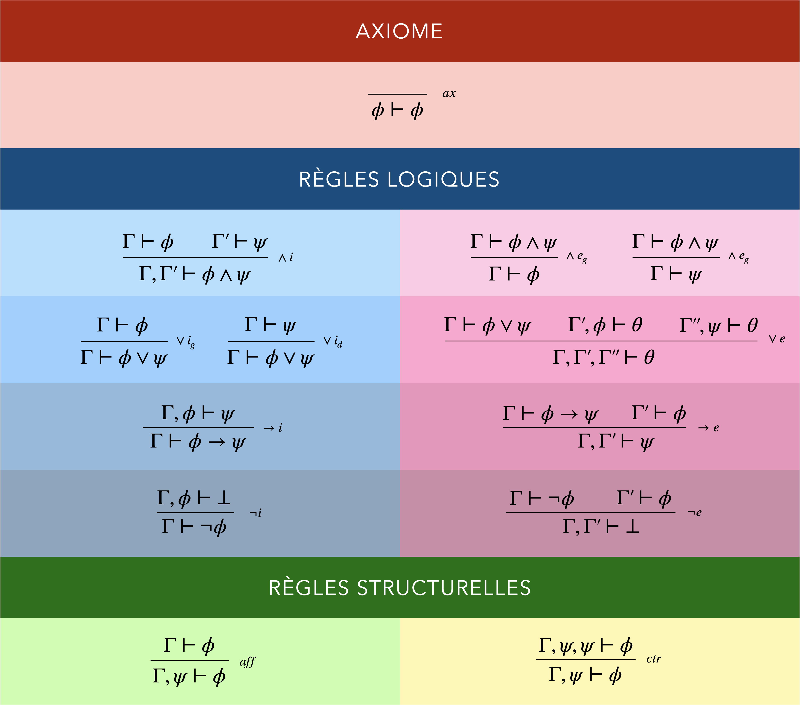
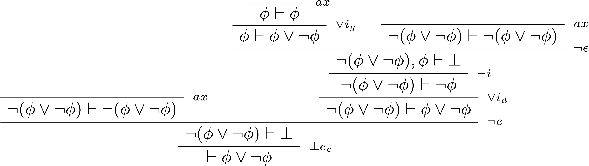
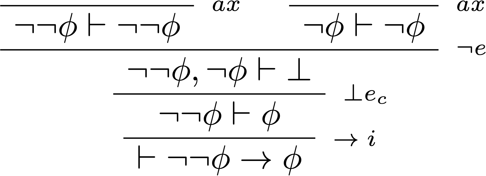
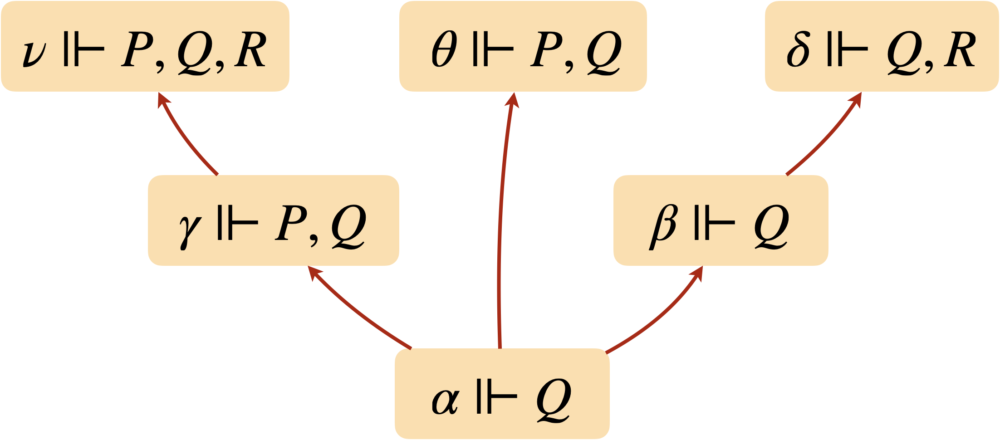
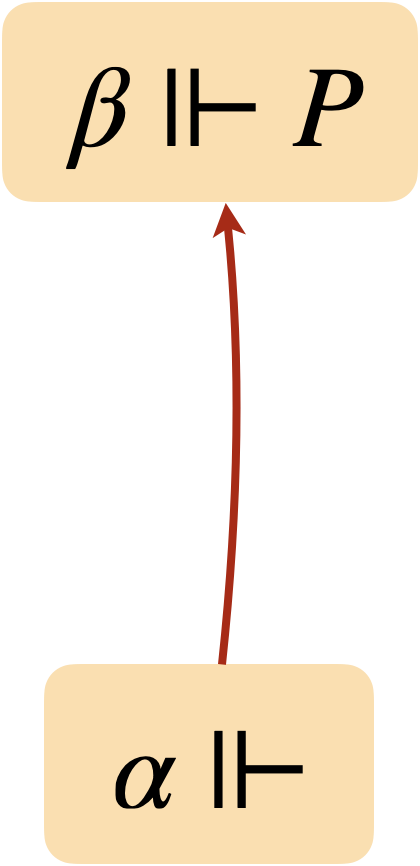
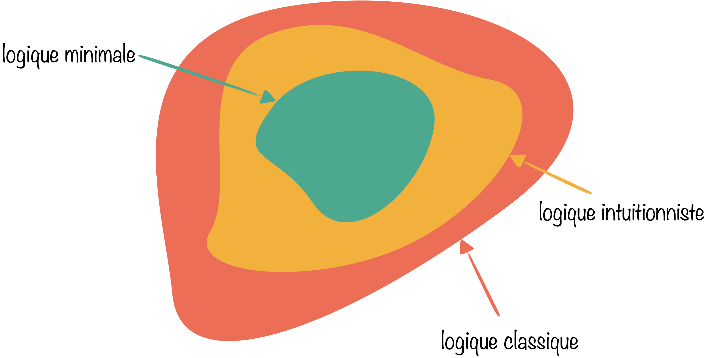
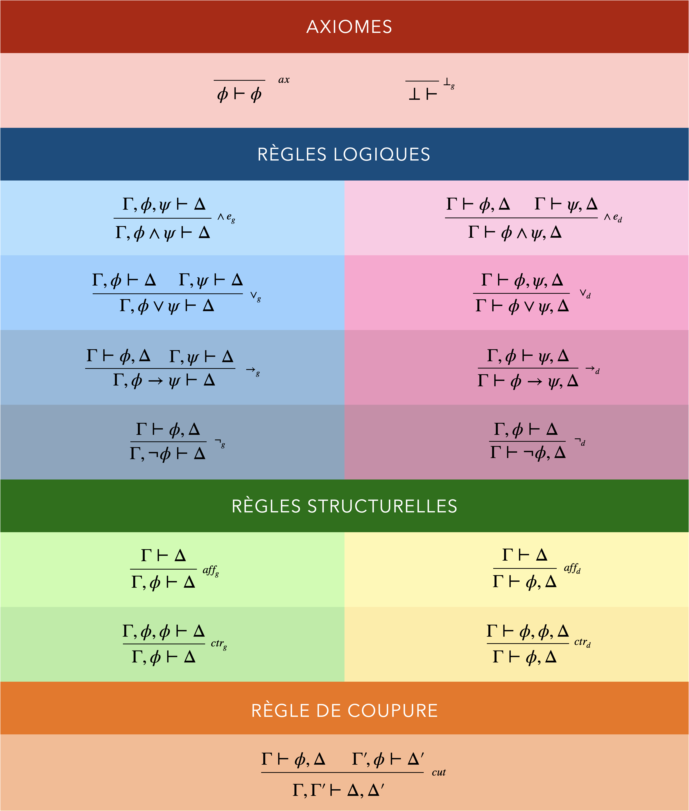

+++
title = "Calcul des propositions - Preuve"
menuTitle = "Preuve"
date = 2021-03-06T14:20:50+01:00
weight = 3
aliases = ["/logique/logique3/"]
css = "logique.css"
+++

# Calcul des propositions

Preuve&nbsp;: démontrer sans regarder le sens

<nav class="chap-nav" aria-label="Chapitres">
<a href="../syntaxe/">Syntaxe</a>
<a href="../semantique/">Sémantique</a>
<a href="../preuve/" class="actif">Preuve</a>
</nav>

Notes de lecture du livre <i>La logique pas à pas</i> de Jacques Duparc.

Pour savoir si une formule est une tautologie, on a jusqu'ici passé en revue tous ses modèles. C'est sûr, mais ce n'est pas ainsi que raisonne un mathématicien&nbsp;: personne ne démontre le théorème de Pythagore en inspectant tous les triangles. On part de ce qu'on sait, et on avance pas à pas, par des étapes que n'importe qui peut contrôler.

Une **preuve**, c'est cela&nbsp;: un objet fini, purement syntaxique, qu'une machine pourrait vérifier sans rien comprendre à ce qu'elle lit. Toute la question est de savoir si ce jeu de symboles attrape exactement les vérités de la sémantique.

## Théorie de la démonstration

Une preuve ou une démonstration&nbsp;:

- est de longueur finie,
- est vérifiable mécaniquement,
- s'appuie sur des hypothèses,
- aboutit à une conclusion.

Une démonstration permet de mettre au jour une vérité syntaxique  (s'appuyant sur un jeu de règles) plutôt que sémantique (faisant intervenir les modèles d'une théorie).

On a vu que $\phi$ est une **conséquence sémantique** de la théorie $\mathcal{T}$, noté $\mathcal{T}\models \phi$, si $\phi$ est vraie dans tous les modèles de $\mathcal{T}$.

On va maintenant se pencher sur la **conséquence syntaxique** de la théorie $\mathcal{T}$. $\phi$ est une conséquence syntaxique de $\mathcal{T}$, noté $\mathcal{T} \vdash \phi$, s'il existe une démonstration de $\phi$ sur la base d'hypothèses contenues dans la théorie $\mathcal{T}$. Fini les modèles, on ne s'intéresse plus qu'à la syntaxe par un jeu de réécriture.

Quel est le lien entre les conséquences sémantiques et syntaxiques&nbsp;?

Si on veut que nos démonstrations aboutissent à des résultats ayant du sens, il faut qu'ils correspondent aux conséquences sémantiques. Et à l'inverse, on souhaite qu'une conséquence sémantique puisse se démontrer mécaniquement. Le système de règles de démonstrations va être consciencieusement mis au point afin d'aboutir à l'équivalence entre les deux conséquences&nbsp;: $\mathcal{T}\models \phi$ si et seulement si $\mathcal{T} \vdash \phi$. Et en particulier, on veut qu'une formule soit une tautologie si et seulement si elle est prouvable sans hypothèse&nbsp;: $\models \phi$ ssi $\vdash \phi$.

On va distinguer trois familles de systèmes de démonstration différents pour le calcul des propositions&nbsp;:

- les **systèmes axiomatiques**,
- la **déduction naturelle**,
- le **calcul des séquents**.

### Les systèmes axiomatiques

Les systèmes axiomatiques ou systèmes **"à la Hilbert"** reposent sur un petit nombre de vérités élémentaires, les **axiomes**, et sur des **règles** de construction qui préservent la vérité. 
Les démonstrations obtenues sont concises mais très peu explicatives. Ça marche, mais on ne sait pas pourquoi, tant ces preuves manquent de structure.

Exemple d'un système axiomatique reposant sur le système complet de connecteurs $\set{\neg,\rightarrow}$ et comportant 3 axiomes pour une seule règle&nbsp;:

<table>
<tr>
<th colspan="3">Axiomes</th>
</tr>
<tr>
<td style="width:33.33%">$(1)\quad\phi\rightarrow (\psi\rightarrow\phi)$</td><td style="width:33.33%">$(2)\quad(\phi\rightarrow (\psi\rightarrow\theta))\rightarrow ((\phi\rightarrow\psi)\rightarrow(\phi\rightarrow\theta))$</td><td>$(3)\quad(\neg\psi\rightarrow \neg\phi) \rightarrow ((\neg \psi\rightarrow\phi)\rightarrow \psi)$</td>
</tr>
<tr>
<th colspan="3">Règle</th>
</tr>
<tr>
<td colspan="3"><i>modus ponens</i>&nbsp;: de $\phi$ et $\phi\rightarrow \psi$ on déduit $\psi$</td>
</tr>
</table>

Pourquoi une règle n'est pas un axiome&nbsp;: Achille et la Tortue

En 1895, Lewis Carroll, logicien à Oxford quand il n'écrivait pas *Alice*, publie dans la revue *Mind* un dialogue de trois pages. La Tortue accorde à Achille deux prémisses&nbsp;: $A$, et «&nbsp;si $A$ alors $B$&nbsp;». Achille triomphe&nbsp;: donc $B$&nbsp;!

«&nbsp;Pas si vite, dit la Tortue. Pourquoi serais-je forcée d'accepter $B$&nbsp;? — Parce que si $A$ et $A\rightarrow B$ sont vraies, alors $B$ l'est. — Voilà une nouvelle prémisse. Notez-la dans votre carnet, je l'accepte volontiers.&nbsp;» Achille note $(A\land(A\rightarrow B))\rightarrow B$. «&nbsp;Et maintenant, vous devez accepter $B$&nbsp;! — Pourquoi&nbsp;? — Parce que si ces trois prémisses sont vraies… — Encore une prémisse&nbsp;! Notez, notez.&nbsp;» Le carnet d'Achille n'est toujours pas terminé.

La morale est celle des systèmes à la Hilbert&nbsp;: on peut ajouter autant d'axiomes qu'on veut, il ne se passera jamais rien si l'on n'a pas au moins une **règle**, qui n'est pas une formule de plus mais une autorisation d'agir. Le *modus ponens* ne s'écrit pas dans le carnet&nbsp;: il s'applique.

La déduction de $\phi$ à partir d'un ensemble de formules $\Gamma$ est une suite finie de formules $\langle \phi_1,\phi_2,\ldots,\phi_n\rangle$ telle que&nbsp;:

- chaque $\phi_i$ vérifie une des trois conditions suivantes&nbsp;:
    - $\phi_i$ est un axiome,
    - $\phi_i$ est une hypothèse ($\phi_i \in \Gamma$),
    - $\phi_i$ est obtenue à partir de l'application de la règle du <i>modus ponens</i> à deux formules $\phi_j$ et $\phi_k$ telles que $j,k<i$.
- $\phi_n=\phi$

Exemple de la démonstration de la formule $(\phi\rightarrow\phi)$ sans hypothèse&nbsp;:

$
\begin{array}{llr}
  (1)& (\phi\rightarrow ((\phi\rightarrow \phi)\rightarrow\phi))\rightarrow ((\phi\rightarrow (\phi\rightarrow \phi))\rightarrow(\phi\rightarrow\phi)) & \text{(axiome 2 avec } \psi = (\phi\rightarrow \phi) \text{ et }\theta = \phi )\\\\
  (2)& \phi\rightarrow ((\phi\rightarrow \phi)\rightarrow\phi) & \text{(axiome 1 avec } \psi = (\phi\rightarrow \phi) )\\\\
  (3)&  (\phi\rightarrow (\phi\rightarrow \phi))\rightarrow(\phi\rightarrow\phi) & (\textit{modus ponens} \text{ (1) - (2))}\\\\
  (4)& \phi\rightarrow (\phi\rightarrow \phi) & \text{(axiome 1 avec } \psi = \phi )\\\\
  (5)& \phi\rightarrow\phi & (\textit{modus ponens} \text{ (3) - (4))}
\end{array}
$

Cinq lignes et deux axiomes tarabiscotés pour établir que «&nbsp;si $\phi$ alors $\phi$&nbsp;»… On ne peut pas dire que la démonstration nous éclaire beaucoup.

$1+1=2$, page 379

Le monument du genre est *Principia Mathematica* de Whitehead et Russell (1910-1913), qui entreprend de reconstruire les mathématiques à partir d'un système axiomatique. Il faut attendre la page 379 du premier volume pour lire, sous la proposition ✱54.43&nbsp;: «&nbsp;De cette proposition il suivra, quand l'addition arithmétique aura été définie, que $1+1=2$.&nbsp;» La preuve ne s'achève que dans le deuxième volume, accompagnée de ce commentaire pince-sans-rire&nbsp;: «&nbsp;La proposition ci-dessus est parfois utile.&nbsp;»

En conclusion, les systèmes à la Hilbert sont économes et commodes quand il s'agit de raisonner *sur* un système de preuve (il n'y a qu'une règle à examiner), mais ils sont pénibles pour démontrer quoi que ce soit, et leurs preuves ne ressemblent en rien à un raisonnement humain.

### La déduction naturelle

C'est précisément ce divorce entre les preuves formelles et la pratique des mathématiciens qui pousse le jeune Gerhard Gentzen, dans sa thèse de 1934, à inventer un formalisme «&nbsp;qui se rapproche autant que possible du raisonnement réel&nbsp;». Son idée&nbsp;: très peu d'axiomes, beaucoup de règles, et surtout le droit de faire ce que tout le monde fait sans cesse, à savoir **poser une hypothèse**, en tirer des conséquences, puis s'en débarrasser («&nbsp;supposons $\phi$… donc $\psi$&nbsp;; ainsi, si $\phi$ alors $\psi$&nbsp;»).

Pour garder la trace des hypothèses en cours, on ne manipule plus des formules mais des séquents.

Un <b>séquent</b>, noté $\Gamma\vdash\phi$, est un couple où&nbsp;:

<ul>
<li>$\Gamma$ est un ensemble fini de formules,</li>
<li>$\phi$ est une formule.</li>
</ul>

Remarques&nbsp;:

- $\Gamma$ représente les hypothèses que l'on veut utiliser.
- $\phi$ est la conclusion du séquent, la formule à démontrer.
- $\vdash$ se lit "**démontre**" ou "**prouve**".
- On écrit $\vdash\phi$ si $\phi$ se démontre sans hypothèse ($\Gamma=\emptyset $).

<ul>
<li>Un séquent est <b>prouvable</b> s'il peut être obtenu par une application finie de règles de démonstration.</li>
<li>Une formule $\phi$ est prouvable si le séquent $\vdash\phi$ est prouvable.
</ul>

On écrit $\Gamma\nvdash\phi$ si $\Gamma\vdash\phi$ n'est pas prouvable.

La **règle** est la brique de base de la démonstration. Une démonstration est ainsi un assemblage de règles généralement représenté sous forme d'arbre.

Chaque règle est composée&nbsp;:

- d'un ensemble de **prémisses** (de 0 à 3), chacune étant un séquent.
- d'un séquent **conclusion**.
- d'une barre horizontale qui sépare les deux (on identifie la règle à droite de la barre).

Pour chaque connecteur logique, on a deux types de règles&nbsp;:

- les règles d'**introduction**,
- et les règles d'**élimination**.

On va dans la suite considérer le système complet de connecteurs $\set{\neg,\land,\lor,\rightarrow}$, auquel on adjoint le symbole $\bot$ qui représente la contradiction (l'absurde).

En dehors des <b>axiomes</b> représentés par le séquent $\phi \vdash\phi$, les règles peuvent être regroupées en deux catégories&nbsp;:

- les <b>règles logiques</b> (règles d'introduction et d'élimination des différents connecteurs).
- les <b>règles structurelles</b> permettant de manipuler les hypothèses&nbsp;; l'affaiblissement permet d'ajouter de nouvelles hypothèses et la contraction permet de fusionner deux occurrences de la même hypothèse.

#### Logique minimale

La **logique minimale** est le socle commun&nbsp;: un axiome, une règle d'introduction et une règle d'élimination par connecteur, et deux règles structurelles.

Chaque règle se lit de haut en bas&nbsp;: si les séquents du dessus sont prouvés, celui du dessous l'est aussi. Lues à voix haute, elles ne font que consigner des gestes familiers&nbsp;:

- **axiome**&nbsp;: une hypothèse se prouve elle-même&nbsp;;
- $\land i$ et $\land e$&nbsp;: prouver «&nbsp;$\phi$ et $\psi$&nbsp;», c'est prouver chacune&nbsp;; et de «&nbsp;$\phi$ et $\psi$&nbsp;», on tire l'une ou l'autre&nbsp;;
- $\lor i$&nbsp;: qui a prouvé $\phi$ a prouvé *a fortiori* «&nbsp;$\phi$ ou $\psi$&nbsp;»&nbsp;;
- $\lor e$&nbsp;: c'est le **raisonnement par disjonction de cas**. Sachant «&nbsp;$\phi$ ou $\psi$&nbsp;», on obtient $\theta$ en la prouvant une fois sous l'hypothèse $\phi$, une fois sous l'hypothèse $\psi$&nbsp;;
- $\rightarrow i$&nbsp;: pour prouver «&nbsp;si $\phi$ alors $\psi$&nbsp;», on **suppose** $\phi$ et on prouve $\psi$. L'hypothèse $\phi$ disparaît alors de la partie gauche du séquent&nbsp;: elle a été absorbée par l'implication&nbsp;;
- $\rightarrow e$&nbsp;: c'est le *modus ponens*&nbsp;;
- $\neg i$&nbsp;: pour prouver $\neg\phi$, on suppose $\phi$ et on aboutit à une contradiction&nbsp;;
- $\neg e$&nbsp;: avoir prouvé à la fois $\phi$ et $\neg\phi$, c'est avoir prouvé l'absurde&nbsp;;
- l'**affaiblissement** et la **contraction** sont de l'intendance&nbsp;: on a le droit d'ajouter des hypothèses qui ne servent pas et de fusionner celles qui font double emploi. On les passera souvent sous silence.

Une <b>déduction</b> est un arbre fini de séquents dont les feuilles sont des axiomes et dont chaque autre nœud s'obtient à partir de ceux qui le surmontent par l'une des règles.

On note $\Gamma\vdash_m \phi$ lorsqu'il existe une déduction en logique minimale dont la racine est le séquent $\Delta\vdash\phi$, pour un ensemble d'hypothèses $\Delta \subseteq \Gamma$.

<b>Exemple.</b> Voici une preuve de $\phi\rightarrow\neg\neg\phi$. Elle se lit de bas en haut comme on la chercherait&nbsp;: pour prouver une implication, je suppose $\phi$&nbsp;; pour prouver une négation, je suppose $\neg\phi$ et je cherche une contradiction&nbsp;; or elle saute aux yeux.

$$
\begin{prooftree}
\AxiomC{}
\RightLabel{$\;\scriptsize ax$}
\UnaryInfC{$\neg\phi\vdash\neg\phi$}
\AxiomC{}
\RightLabel{$\;\scriptsize ax$}
\UnaryInfC{$\phi\vdash\phi$}
\RightLabel{$\;\scriptsize \neg e$}
\BinaryInfC{$\neg\phi,\phi\vdash\bot$}
\RightLabel{$\;\scriptsize \neg i$}
\UnaryInfC{$\phi\vdash\neg\neg\phi$}
\RightLabel{$\;\scriptsize \rightarrow i$}
\UnaryInfC{$\vdash \phi\rightarrow\neg\neg\phi$}
\end{prooftree}
$$

En revanche, l'implication inverse $\neg\neg\phi\rightarrow\phi$ n'est **pas** prouvable avec ces règles&nbsp;: en logique minimale, on ne peut pas éliminer les doubles négations. C'est tout l'enjeu de ce qui suit.

Notons enfin que, pour ces règles, $\neg\phi$ se comporte exactement comme $\phi\rightarrow\bot$ («&nbsp;$\phi$ mène à l'absurde&nbsp;»)&nbsp;: chacune des deux formules se déduit de l'autre.

#### Logique intuitionniste

Certains raisonnements ne sont pas possibles avec la logique minimale. On l'enrichit d'une règle qui dit quoi faire d'une contradiction $\bot$.

**Absurdité intuitionniste** (ou **élimination de la contradiction**) 
 
$
\begin{prooftree}
\AxiomC{$\Gamma\vdash\bot$}
\RightLabel{$\\;\scriptsize \bot e_i$}
\UnaryInfC{$\Gamma\vdash\phi$}
\end{prooftree}
$
 
 
Si une contradiction découle d'un jeu d'hypothèses, alors n'importe quelle formule est démontrable avec ces mêmes hypothèses. Les médiévaux disaient <i>ex falso quodlibet</i>&nbsp;: du faux, on déduit ce qu'on veut.

Bertrand Russell est le pape

On raconte que Russell, expliquant lors d'un dîner qu'une proposition fausse implique n'importe quoi, fut mis au défi&nbsp;: «&nbsp;Alors, de $2+2=5$, démontrez donc que vous êtes le pape&nbsp;!&nbsp;» Il aurait répondu sans se démonter&nbsp;: «&nbsp;Si $2+2=5$, alors $4=5$. Retranchons 3 de chaque côté&nbsp;: $1=2$. Or le pape et moi sommes deux. Donc le pape et moi sommes un.&nbsp;»

On obtient ainsi un nouveau système déductif, celui de la **logique intuitionniste**&nbsp;: la logique minimale, plus cette seule règle.

La règle n'est pas démontrable en logique minimale, et elle apporte réellement quelque chose&nbsp;: la formule $\neg\neg(\neg\neg\phi\rightarrow\phi)$, par exemple, devient prouvable alors qu'elle ne l'était pas. Mais $\neg\neg\phi\rightarrow\phi$ elle-même reste hors d'atteinte.

#### La logique classique

**Absurdité classique** 
 
$
\begin{prooftree}
\AxiomC{$\Gamma,\neg\phi\vdash\bot$}
\RightLabel{$\\;\scriptsize \bot e_c$}
\UnaryInfC{$\Gamma\vdash\phi$}
\end{prooftree}
$
 
 
Si une contradiction découle d'un jeu d'hypothèses auquel on ajoute la négation d'une formule, alors la formule est démontrable à partir du jeu d'hypothèses de départ.

En ajoutant à la logique minimale non pas la règle de l'absurdité intuitionniste mais cette règle de l'absurdité classique, on obtient la **logique classique**.

C'est le **raisonnement par l'absurde** des cours de mathématiques. Il contient l'absurdité intuitionniste comme cas particulier&nbsp;:

$$
\begin{prooftree}
\AxiomC{$\Gamma\vdash\bot$}
\RightLabel{$\scriptsize\;aff$}
\UnaryInfC{$\Gamma,\neg\phi\vdash\bot$}
\RightLabel{$\scriptsize\;\bot e_c$}
\UnaryInfC{$\Gamma\vdash\phi$}
\end{prooftree}
$$

Tout ce que prouve la logique intuitionniste, la logique classique le prouve donc aussi.

Le tiers exclu et l'élimination des doubles négations deviennent enfin démontrables.

<b>Loi du tiers exclu</b> $\vdash\phi\lor\neg\phi$

<b>Élimination des doubles négations</b> $\vdash\neg\neg\phi\rightarrow\phi$

L'absurdité classique n'est d'ailleurs qu'une porte d'entrée parmi d'autres. Chacun des principes suivants, ajouté comme axiome, redonne exactement la même logique&nbsp;:

<ol>
<li>logique classique = logique intuitionniste + <b>tiers exclu</b> $\phi\lor\neg\phi$</li>
<li>logique classique = logique intuitionniste + <b><i>consequentia mirabilis</i></b> $(\neg\phi\rightarrow\phi)\rightarrow\phi$</li>
<li>logique classique = logique minimale + <b>élimination des doubles négations</b> $\neg\neg\phi\rightarrow\phi$</li>
<li>logique classique = logique minimale + <b>contraposition</b> $(\neg\psi\rightarrow\neg\phi)\rightarrow(\phi\rightarrow\psi)$</li>
</ol>

La *consequentia mirabilis* («&nbsp;si une proposition découle de sa propre négation, alors elle est vraie&nbsp;») est un cas particulier de la **loi de Peirce** $((\phi\rightarrow\psi)\rightarrow\phi)\rightarrow\phi$, obtenu en prenant $\psi=\bot$.

{}
La logique intuitionniste, contrairement à la logique classique, vise à obtenir des preuves **constructives**. Montrer qu'une formule ne peut pas être fausse ne suffit pas&nbsp;: il faut en construire la vérité, étape par étape. Or un raisonnement par l'absurde classique ne construit rien, il se contente d'établir que $\neg\phi$ mène à une contradiction. De même, le tiers exclu affirme $\psi\lor\neg\psi$ sans jamais dire laquelle des deux est vraie.  
Exemple classique de l'utilisation du tiers exclu en mathématiques&nbsp;: 
prouvons qu'il existe deux nombres irrationnels $a$ et $b$ tels que $a^b$ soit rationnel. 
Sachant que $\sqrt{2}$ est irrationnel, on distingue deux cas&nbsp;:
- si $\sqrt{2}^{\sqrt{2}}$ est rationnel, alors on prend $a=b=\sqrt{2}$&nbsp;;
- si $\sqrt{2}^{\sqrt{2}}$ est irrationnel, alors on prend $a=\sqrt{2}^{\sqrt{2}}$ et $b=\sqrt{2}$, puisqu'ainsi $a^b=\sqrt{2}^{\sqrt{2}\times\sqrt{2}}=\sqrt{2}^2=2$.

D'après le tiers exclu, on est dans un cas ou dans l'autre&nbsp;: le théorème est démontré. Mais la preuve est incapable d'exhiber le couple annoncé&nbsp;! Pour cela, il faudrait savoir si $\sqrt{2}^{\sqrt{2}}$ est rationnel (il ne l'est pas, mais c'est une conséquence du théorème de Gelfond-Schneider, autrement plus difficile). Un intuitionniste réclamera une preuve qui montre ses témoins, par exemple $a=\sqrt{2}$ et $b=\log_2 9$, pour lesquels $a^b=3$.  
En logique intuitionniste, si l'on a réussi à démontrer $\vdash_i\phi\lor\psi$, c'est qu'on a démontré l'un des deux séquents $\vdash_i\phi$ ou $\vdash_i\psi$. Il n'y a pas de vérité intermédiaire indéterminée.  
Un autre grief contre la logique classique concerne l'implication matérielle&nbsp;: $\phi\rightarrow\psi$ est considérée comme vraie dès que $\phi$ est fausse, sans qu'on ait jamais eu à construire de lien entre $\phi$ et $\psi$. La philosophe Dorothy Edgington en a tiré une «&nbsp;démonstration&nbsp;» de l'existence de Dieu. Première prémisse&nbsp;: si Dieu n'existe pas ($\neg G$), alors il n'est pas vrai que si je prie ($P$), mes prières seront exaucées ($A$). L'affirmation ne semble pas choquante. Sous forme de formule&nbsp;: $\neg G\rightarrow \neg(P\rightarrow A)$, ce qui se réécrit, en éliminant les implications, $G\lor(P \land \neg A)$. Deuxième prémisse, et coup de grâce&nbsp;: $\neg P$, «&nbsp;je ne prie pas&nbsp;». Si $P$ est fausse, $P\land\neg A$ l'est aussi, et seul $G$ survit&nbsp;: «&nbsp;Dieu existe&nbsp;». Il suffit donc de ne pas prier…
{}

La querelle du tiers exclu

L'intuitionnisme naît au début du XXe siècle sous l'impulsion du mathématicien néerlandais L.E.J. Brouwer, pour qui un objet mathématique n'existe que si l'on sait le construire. Appliquer le tiers exclu à des ensembles infinis lui paraît aussi injustifié que d'affirmer qu'une question sans réponse connue en possède forcément une.

David Hilbert, le plus influent des mathématiciens de l'époque, s'en étrangle&nbsp;: «&nbsp;Priver le mathématicien du tiers exclu, ce serait comme interdire le télescope à l'astronome, ou au boxeur l'usage de ses poings.&nbsp;» La querelle tourne à la brouille personnelle, jusqu'à l'éviction de Brouwer du comité de rédaction des *Mathematische Annalen* en 1928.

L'histoire a donné un peu raison à chacun&nbsp;: les mathématiques courantes sont restées classiques, mais la logique intuitionniste est devenue, grâce à son caractère constructif, le langage naturel de l'informatique théorique et des assistants de preuve.

Les règles de la logique classique permettent de faire coïncider les notions de conséquence syntaxique et de conséquence sémantique.

<b>Correction</b> de la logique classique&nbsp;:

Soient $\Gamma$ un ensemble fini de formules et $\phi$ une formule du calcul des propositions, 
Si $\Gamma\vdash_{\\!c}\phi$ alors $\Gamma\models\phi$ 

L'idée de la preuve est simple&nbsp;: on vérifie, règle par règle, que si les prémisses sont des conséquences sémantiques, la conclusion en est une aussi. Pour le *modus ponens*, par exemple&nbsp;: dans un modèle où $\phi\rightarrow\psi$ et $\phi$ sont vraies, $\psi$ l'est forcément. La vérité se transmet ainsi des feuilles de l'arbre de preuve jusqu'à sa racine.

Tout ce que l'on peut déduire syntaxiquement d'une théorie est donc vrai dans tous les modèles de cette théorie. La réciproque est plus profonde.

<b>Complétude</b> de la logique classique&nbsp;:

Soient $\Gamma$ un ensemble fini de formules et $\phi$ une formule du calcul des propositions, 
Si $\Gamma\models\phi$ alors $\Gamma\vdash_{\\!c}\phi$

Voici l'idée d'une preuve due au logicien hongrois László Kalmár (1935), dans le cas d'une tautologie $\phi$ dont les variables sont $P$ et $Q$.

- **Chaque ligne de la table de vérité se convertit en preuve.** Sur la ligne où $P$ est vraie et $Q$ fausse, $\phi$ vaut 1, et l'on peut effectivement prouver le séquent $P,\neg Q\vdash\phi$ (on le montre par induction sur la formule, en suivant le calcul de sa valeur). Comme $\phi$ est une tautologie, on obtient ainsi quatre preuves de $\phi$, une par ligne, sous les hypothèses $\set{P,Q}$, $\set{P,\neg Q}$, $\set{\neg P,Q}$ et $\set{\neg P,\neg Q}$.
- **Le tiers exclu recolle les lignes.** Des preuves de $P,Q\vdash\phi$ et $P,\neg Q\vdash\phi$, on tire $P\vdash\phi$ par disjonction de cas sur $Q\lor\neg Q$. On fait de même avec $\neg P$, puis on recommence sur $P\lor\neg P$&nbsp;: les hypothèses disparaissent une à une, et il reste $\vdash\phi$.

C'est donc le tiers exclu qui fait le travail, ce qui explique que la sémantique des tables de vérité soit celle de la logique *classique*.

{}
La complétude du calcul des propositions a été établie par Emil Post dans sa thèse de 1921. 
De façon informelle, la correction stipule que toute formule prouvable est vraie, alors que la complétude, de son côté, affirme que toutes les formules vraies sont prouvables. 
Et dit autrement encore, on peut prouver **toute la vérité** (**complétude**) et **rien que la vérité** (**correction**).
{}

Corollaire&nbsp;: 

$\models\phi$ ssi $\vdash_{\\!c}\phi$ 
Toute tautologie est démontrable sans utiliser d'hypothèse et à l'inverse, toute formule démontrable sans hypothèse est une tautologie.

On a montré finalement que **la sémantique du calcul des propositions correspond à la logique classique**. On peut d'ailleurs parler de "sémantique classique". Mais qu'en est-il de la logique intuitionniste&nbsp;? Peut-on définir une sémantique qui lui soit adaptée afin d'obtenir un théorème de complétude pour la logique intuitionniste&nbsp;? 
Oui, grâce aux modèles de Kripke.

### Les modèles de Kripke du calcul des propositions intuitionniste

On a vu qu'une formule est démontrable en logique classique si et seulement si elle est vraie dans tous les modèles (classiques) possibles. On va aboutir à une proposition similaire grâce aux modèles de Kripke&nbsp;: une formule est démontrable en logique intuitionniste si et seulement si elle est réalisée dans tous les modèles de Kripke possibles.

L'idée, proposée par Saul Kripke en 1965, se raconte bien. Un modèle classique est une photographie&nbsp;: tout y est déjà tranché, vrai ou faux. Un modèle de Kripke est plutôt le **film d'une recherche**. Chaque nœud de l'arbre est un état des connaissances, et ses descendants sont les états futurs envisageables, selon ce qu'on découvrira. «&nbsp;Le nœud $\alpha$ force $P$&nbsp;» signifie que $P$ est *établie* à ce stade. Deux principes en découlent&nbsp;:
- ce qui est établi le reste (on ne désapprend pas)&nbsp;;
- ne pas avoir établi $P$ n'est pas avoir établi $\neg P$&nbsp;: pour affirmer $\neg P$, il faut être sûr que $P$ ne sera *jamais* établie, quelle que soit la suite de l'histoire.

Soit $\set{P_1,\ldots,P_k}$ un ensemble de variables propositionnelles. 
$\mathcal{K}=(\mathcal{T}_\mathcal{K},\Vdash)$ est un <b>modèle de Kripke</b> arborescent fini sur les variables $P\_1,\ldots,P\_k$ si&nbsp;:

<ul>
<li>$\mathcal{T}_\mathcal{K}$ est un arbre fini dont la <b>relation d'ancestralité</b> entre deux nœuds est notée $\alpha≤\beta$ ($\alpha$ est un ancêtre de $\beta$).</li>
 
<li>$\Vdash$ est une relation binaire appelée <b>relation de forcing</b> entre les nœuds de $\mathcal{T}_\mathcal{K}$ et les variables propositionnelles qui vérifie&nbsp;: 

<ul>
<li>pour tout nœud $\alpha$&nbsp;: $\alpha\not\Vdash\bot$</li>

<li>pour tout nœud $\alpha$, $\beta$ et variable propositionnelle $P_i$, si à la fois $\alpha≤\beta$ et $\alpha\Vdash P_i$ alors on a $\beta\Vdash P_i$.</li>
</ul>
</li>
</ul>

{}
Un modèle de Kripke avec un seul nœud peut être vu comme un modèle de la logique classique car les conditions de la relation de forcing ($\Vdash$) sont alors identiques à celles de la relation de vérité sémantique ($\models$).
{}

La relation de forcing fait en sorte que si une formule est vraie dans un nœud (qui représente un monde, comme on le verra en logique modale), alors elle reste vraie dans tous les nœuds accessibles depuis le nœud de départ (tous les mondes accessibles).

Soit $\mathcal{K}=(\mathcal{T}_\mathcal{K},\Vdash)$ un modèle de Kripke arborescent fini sur les variables $P\_1,\ldots,P\_k$, $\alpha$ un nœud de $\mathcal{T}\_\mathcal{K}$ et $\phi$, $\psi$ des formules du calcul des propositions dont les variables sont parmi $\set{P\_1,\ldots,P\_k}$,

<ul>
<li>$\alpha\Vdash \phi\land\psi$ ssi $\alpha\Vdash\phi$ et $\alpha\Vdash\psi$</li>
 
<li>$\alpha\Vdash \phi\lor\psi$ ssi $\alpha\Vdash\phi$ ou $\alpha\Vdash\psi$</li>
 
<li>$\alpha\Vdash \phi\rightarrow\psi$ ssi pour tout nœud $\beta$ de $\mathcal{T}_\mathcal{K}$ tel que $\alpha≤\beta$, si $\beta\Vdash\phi$ alors $\beta\Vdash\psi$. 
On cherche ici à construire explicitement la vérité de $\psi$ à partir de celle de $\phi$ (alors qu'en logique classique, l'établissement de la vérité de $\phi$ n'est pas nécessaire puisque l'implication est considérée comme vraie soit par l'absence de $\phi$, soit par la présence de $\psi$).
</li>
 
<li>$\alpha\Vdash \neg\phi$ ssi pour tout nœud $\beta$ de $\mathcal{T}_\mathcal{K}$ tel que $\alpha≤\beta$, $\beta\not\Vdash\phi$. 
Dit autrement&nbsp;: $\alpha$ force $\neg\phi$ quand ni lui ni aucun de ses descendants ne force $\phi$. 
En effet, la négation $\neg\phi$ est interprétée ici comme la formule $\phi\rightarrow\bot$. La définition de la relation de forcing de l'implication dit que&nbsp;: $\alpha\Vdash\phi\rightarrow\bot$ ssi pour tout nœud $\beta$ de $\mathcal{T}_\mathcal{K}$ tel que $\alpha≤\beta$, si $\beta\Vdash\phi$ alors $\beta\Vdash\bot$. Or la condition $\beta\Vdash\bot$ est interdite par définition des modèles de la logique intuitionniste, donc $\beta\Vdash\bot$ n'est satisfait nulle part. D'où $\beta\not\Vdash\phi$.</li>
</ul>
</li>
</ul>

Voilà un exemple de modèle de Kripke sur les variables $P$, $Q$, $R$.

On y trouve les relations de forcing suivantes&nbsp;:

- $\theta\Vdash Q\land P$ mais $\beta\not\Vdash Q\land P$
- $\alpha\Vdash P\rightarrow Q$ mais $\alpha\not\Vdash Q\rightarrow P$
- $\beta\Vdash\neg P$ mais $\alpha\not\Vdash\neg P$
- $\alpha\not\Vdash P$, $\alpha\not\Vdash \neg P$ et $\alpha\not\Vdash \neg\neg P$

Soit $\mathcal{K}=(\mathcal{T}_\mathcal{K},\Vdash)$ un modèle de Kripke arborescent fini sur les variables $P\_1,\ldots,P\_k$, $\alpha$ un nœud de $\mathcal{T}\_\mathcal{K}$, $\phi$ une formule et $\Gamma$ un ensemble fini de formules dont les variables sont parmi $\set{P\_1,\ldots,P\_k}$,

<ul>
<li>$\alpha\Vdash \Gamma$ ssi $\alpha\Vdash\phi$ pour toute formule de $\Gamma$.</li>
 
<li>$\phi$ (respectivement $\Gamma)$ est <b>réalisée</b> dans $\mathcal{K}$ si pour tout nœud $\alpha$ de $\mathcal{T}_\mathcal{K}$, $\alpha\Vdash\phi$ (respectivement $\alpha\Vdash\Gamma$).</li>
 
<li>$\phi$ est une conséquence intuitionniste de $\Gamma$, noté $\Gamma\Vdash_i\phi$, ssi pour tout modèle de Kripke $\mathcal{K}=(\mathcal{T}_\mathcal{K},\Vdash)$ et tout nœud $\alpha$ si $\alpha\Vdash\Gamma$ alors $\alpha\Vdash\phi$. 
En particulier, on note $\Vdash_i \phi$ si $\phi$ est réalisée dans tout modèle de Kripke.
</li>
</ul>
</li>
</ul>

Ce modèle ne réalise ni le tiers exclu $(P\lor\neg P)$, ni l'élimination des doubles négations $(\neg\neg P\rightarrow P)$.

En effet&nbsp;:

- $\alpha \not\Vdash P$ par définition et $\alpha\not\Vdash \neg P$ puisque $\alpha≤\beta$ et $\beta\Vdash P$. Donc $\alpha\not\Vdash P\lor\neg P$.

- $\alpha\not\Vdash\neg P$ et $\beta\not\Vdash\neg P$ d'où $\alpha\Vdash \neg\neg P$ et $\beta\Vdash \neg\neg P$. D'où $\beta\Vdash\neg\neg P\rightarrow P$ et $\alpha\not\Vdash\neg\neg P\rightarrow P$ (puisque $\alpha \not\Vdash P$).

Cela permet de constater l'adaptation des modèles de Kripke à la logique intuitionniste&nbsp;; il peut exister des modèles où ni $\phi$, ni $\neg\phi$ ne sont établis comme vrais.

<b>Correction et complétude de la logique intuitionniste</b>&nbsp;:

Soient $\Gamma$ un ensemble fini de formules et $\phi$ une formule du calcul des propositions, 
$\Gamma\Vdash_i\phi$ ssi $\Gamma\vdash_{\\!i} \phi$

Corollaire&nbsp;:

$\Vdash_i\phi$ ssi $\vdash_{\\!i} \phi$

En abandonnant la condition $\alpha\not\Vdash\bot$ (on autorise un nœud à forcer l'absurde), on obtient de la même façon des modèles de Kripke adaptés à la logique minimale, avec le même théorème de correction et de complétude. Ils permettent de vérifier que la formule $\neg\neg(\neg\neg P\rightarrow P)$, prouvable en logique intuitionniste, ne l'est pas en logique minimale.

Les trois logiques sont donc strictement emboîtées.

### Le calcul des séquents

Comme la déduction naturelle, le calcul des séquents a été mis au point par Gerhard Gentzen, dans la même thèse de 1934. Son but est de mettre encore mieux en lumière les propriétés mathématiques de la notion de démonstration.

Les différences principales avec la déduction naturelle sont que la partie droite des séquents n'est plus une seule formule conclusion mais un ensemble fini de formules, et les règles d'élimination sont remplacées par des règles d'introduction à gauche afin de rendre le système de démonstration symétrique.

Un <b>séquent</b> (noté $\Gamma\vdash\Delta$) est un couple où&nbsp;:

<ul>
<li>$\Gamma$ est un ensemble fini de formules, appelé la partie gauche du séquent,</li>

<li>$\Delta$ est également un ensemble fini de formules, appelé la partie droite du séquent.</li>
</ul>

Intuitivement, un séquent $\Gamma\vdash\Delta$ où $\Gamma=\set{\phi_1,\ldots,\phi_n}$ et $\Delta=\set{\psi_1,\ldots,\psi_k}$ est interprété comme $\bigwedge_{1≤i≤n}\phi_i \vdash \bigvee_{1≤j≤k} \psi_j$. Une conjonction d'hypothèses prouve une disjonction de conclusions. 
La conjonction vide d'hypothèses est interprétée comme le vrai, alors que la disjonction vide de conclusion est interprétée comme le faux. 
$\vdash\Delta$ signifie donc $(\psi_1\lor\psi_2\lor\ldots\lor\psi_k)$, alors que le séquent $\Gamma\vdash$ signifie $(\phi_1\land\phi_2\land\ldots\land\phi_n)\rightarrow\bot$, c'est-à-dire $\neg(\phi_1\land\phi_2\land\ldots\land\phi_n)$. 
Enfin $\vdash$, qui signifie "vrai implique faux", est interprété comme l'absurde (il correspond au séquent $\vdash\bot$ de la déduction naturelle).

Les **règles** du calcul des séquents sont très proches de celles de la déduction naturelle. 
D'un ensemble de **prémisses** (0, 1 ou 2), on déduit un séquent **conclusion**.

Les règles d'introduction sont conservées, mais elles deviennent des règles d'introduction à droite. Les règles d'élimination deviennent, elles, des règles d'introduction à gauche.

Les règles structurelles sont symétrisées et on ajoute un axiome ainsi qu'une nouvelle règle, la <b>règle de coupure</b>&nbsp;:

$$
\begin{prooftree}
\AxiomC{$\Gamma\vdash\phi,\Delta$}
\AxiomC{$\Gamma',\phi\vdash\Delta'$}
\RightLabel{$\scriptsize\;cut$}
\BinaryInfC{$\Gamma,\Gamma'\vdash\Delta,\Delta'$}
\end{prooftree}
$$

En déduction naturelle, cela correspond aux deux prémisses $\Gamma\vdash\phi$ et $\phi\vdash\psi$ desquelles on déduit $\Gamma\vdash\psi$. 
La règle de coupure est souvent utilisée dans les preuves pour simplifier la déduction en introduisant des lemmes ou des théorèmes intermédiaires. 
Étant donné qu'il n'y a plus de règles d'élimination, c'est la règle de coupure qui permet de rétablir la transitivité dans les déductions.

L'**affaiblissement à droite** reflète l'idée que si on a une preuve que quelque chose est vrai à partir d'un ensemble de prémisses, ajouter une conclusion supplémentaire comme possibilité n'enlève rien à la validité de cette preuve. 
En remplaçant $\Delta$ par $\emptyset$, on retrouve la règle d'**absurdité intuitionniste**.

Preuve du tiers exclu&nbsp;:

$$
\begin{prooftree}
\AxiomC{}
\RightLabel{$\scriptsize\;ax$}
\UnaryInfC{$\phi\vdash\phi$}
\RightLabel{$\scriptsize\;\neg_d$}
\UnaryInfC{$\vdash\phi,\neg\phi$}
\RightLabel{$\scriptsize\;\lor_d$}
\UnaryInfC{$\vdash\phi\lor\neg\phi$}
\end{prooftree}
$$

Preuve de $\vdash\phi\rightarrow\neg\neg\phi$&nbsp;:

$$
\begin{prooftree}
\AxiomC{}
\RightLabel{$\scriptsize\;ax$}
\UnaryInfC{$\phi\vdash\phi$}
\RightLabel{$\scriptsize\;\neg_g$}
\UnaryInfC{$\phi,\neg\phi\vdash$}
\RightLabel{$\scriptsize\;\neg_d$}
\UnaryInfC{$\phi\vdash\neg\neg\phi$}
\RightLabel{$\scriptsize\;\rightarrow_d$}
\UnaryInfC{$\vdash\phi\rightarrow\neg\neg\phi$}
\end{prooftree}
$$

Preuve de l'élimination des doubles négations&nbsp;:

$$
\begin{prooftree}
\AxiomC{}
\RightLabel{$\scriptsize\;ax$}
\UnaryInfC{$\phi\vdash\phi$}
\RightLabel{$\scriptsize\;\neg_d$}
\UnaryInfC{$\vdash\phi,\neg\phi$}
\RightLabel{$\scriptsize\;\neg_g$}
\UnaryInfC{$\neg\neg\phi\vdash\phi$}
\RightLabel{$\scriptsize\;\rightarrow_d$}
\UnaryInfC{$\vdash\neg\neg\phi\rightarrow\phi$}
\end{prooftree}
$$

Les deux formules précédentes se ressemblent fortement mais seule la première est prouvable en logique intuitionniste. 
Les deux preuves en calcul des séquents sont quasiment les mêmes, mais l'ordre d'introduction des négations est inversé (gauche-droite pour la première et droite-gauche pour la deuxième).

La <b>logique intuitionniste</b> est la version du calcul des séquents dont les règles sont restreintes aux séquents avec au plus une formule à droite, la contraction à droite étant considérée comme implicite.

L'idée est d'obliger une preuve à indiquer spécifiquement la conclusion dérivée, sans ambiguïté. 
Et la négation est interprétée comme l'absence de preuve puisque c'est maintenant seulement $\phi\vdash\bot$ qui donne $\vdash\neg\phi$. Cela rend par conséquent l'utilisation de la négation à droite impossible dans la deuxième preuve alors qu'il n'y a pas de problème dans la première.

La <b>logique minimale</b> est la version du calcul des séquents sans la règle de l'affaiblissement à droite et dont les règles sont restreintes aux séquents avec au plus une formule à droite (la contraction à droite n'est ici pas considérée comme implicite).

La <b>règle de coupure</b> correspond, en déduction naturelle, à l'introduction de l'implication suivie aussitôt de son élimination&nbsp;:

$$
\begin{prooftree}
\AxiomC{$\Gamma,\phi\vdash\psi$}
\RightLabel{$\scriptsize\;\rightarrow_i$}
\UnaryInfC{$\Gamma\vdash\phi\rightarrow\psi$}
\AxiomC{$\Gamma'\vdash\phi$}
\RightLabel{$\scriptsize\;\rightarrow_e$}
\BinaryInfC{$\Gamma,\Gamma'\vdash\psi$}
\end{prooftree}
$$

Cette règle est essentielle pour tenir compte de la manière dont nous raisonnons puisqu'il arrive très souvent que l'on utilise les conclusions d'un raisonnement antérieur comme hypothèses pour de nouvelles démonstrations (hypothèses que nous faisons disparaître sur la base du fait que nous les avons démontrées).

Mais si notre objectif est d'automatiser les preuves, de les algorithmiser, les règles de coupure deviennent un handicap.

<b>Élimination des coupures</b> (le <i>Hauptsatz</i>, «&nbsp;théorème principal&nbsp;», de Gentzen)

S'il existe, en calcul des séquents classique (respectivement intuitionniste), une preuve du séquent $\Gamma\vdash\Delta$, alors il existe une preuve en calcul des séquents classique (respectivement intuitionniste) de ce séquent sans utilisation de la règle de coupure.

Tout séquent est donc prouvable par utilisation des seuls axiomes, règles logiques et règles structurelles. La démonstration du théorème consiste alors  justement à remplacer dans une preuve donnée chaque utilisation de la règle de coupure par d'autres règles.

<b>Corollaire</b>&nbsp;: le séquent "$\vdash$" n'est pas prouvable en logique classique.

"$\vdash$" signifie que le vrai entraîne le faux. Nous voilà plutôt soulagés d'être dans l'incapacité de prouver ce résultat qui ferait s'effondrer tout l'édifice logique patiemment construit. Si $\vdash$ était prouvable, alors par affaiblissement, tout séquent $\vdash\Delta$ le serait également...

S'il existait une preuve du séquent $\vdash$, il en existerait aussi une sans utilisation de la règle de coupure. Or toutes les autres règles introduisent une formule soit à droite, soit à gauche, soit des deux côtés à la fois. La seule règle permettant de faire disparaître une formule est la règle de contraction, mais elle ne la fait pas disparaître complètement puisqu'elle se contente d'en faire disparaître les occurrences. On ne pourra donc jamais aboutir à "$\vdash$" sans la règle de coupure et donc d'après le théorème d'élimination des coupures, on ne peut pas démontrer $\vdash$ en calcul des séquents. Youpi.

<b>Propriété de la sous-formule</b>

Si le séquent $\Gamma\vdash\Delta$ est prouvable en logique classique (respectivement intuitionniste), alors il existe une preuve en logique classique (respectivement intuitionniste) de ce séquent dans laquelle n'apparaissent que des séquents constitués de sous-formules des formules de $\Gamma$ et de $\Delta$.

Il existe une preuve sans coupure de $\Gamma\vdash\Delta$. Or on peut vérifier règle par règle, par induction sur la hauteur de cette preuve sans coupure, qu'elle peut ne faire apparaître que des sous-formules de $\Gamma$ et de $\Delta$.

{}
Une conséquence de la propriété de la sous-formule est qu'une preuve d'une disjonction en logique intuitionniste passe nécessairement par une preuve d'un des termes de la disjonction&nbsp;:
 
$\vdash_{\\!i}\phi\lor\psi$ si et seulement si ($\vdash_{\\!i}\phi$ ou $\vdash_{\\!i}\psi$).
 
Par exemple, prouver une instance du tiers exclu $\vdash_i\phi\lor\neg\phi$ en logique intuitionniste suppose qu'on a été capable soit de prouver $\vdash_i\phi$, soit de prouver $\vdash_i\neg\phi$, ce qui n'est pas le cas en logique classique. (Attention, la propriété ne vaut que sans hypothèses&nbsp;: de l'hypothèse $P\lor Q$ on déduit évidemment $P\lor Q$, sans pouvoir déduire ni $P$ ni $Q$.)
{}

La conséquence majeure de la propriété de la sous-formule est de permettre (tout particulièrement en logique intuitionniste) une **recherche de preuve automatique**. La production mécanique de preuve comme par exemple la preuve de correction de programmes informatiques devient en effet possible une fois qu'on se débarrasse du caractère abstrait des preuves par coupures. Cela donne des preuves longues mais simples ne faisant appel qu'aux sous-formules des formules du séquent qu'il s'agit de prouver.

Des preuves aux programmes

L'élimination des coupures a une postérité inattendue. Dans les années 1960, on s'aperçoit (c'est la **correspondance de Curry-Howard**) qu'une preuve en logique intuitionniste et un programme informatique sont un seul et même objet, vu sous deux angles&nbsp;:

<table class="tab-recap">
<tr><th>Logique</th><th>Programmation</th></tr>
<tr><td>formule</td><td>type</td></tr>
<tr><td>preuve de $\phi\rightarrow\psi$</td><td>fonction qui transforme une donnée de type $\phi$ en donnée de type $\psi$</td></tr>
<tr><td>preuve de $\phi\land\psi$</td><td>couple (une donnée de chaque type)</td></tr>
<tr><td><i>modus ponens</i></td><td>application d'une fonction à un argument</td></tr>
<tr><td>élimination d'une coupure</td><td>une étape de calcul</td></tr>
</table>

Utiliser un lemme (une coupure), c'est appeler une fonction&nbsp;; éliminer la coupure, c'est exécuter l'appel. Les assistants de preuve comme Rocq (ex-Coq) ou Lean reposent sur cette idée&nbsp;: y vérifier une démonstration, c'est vérifier qu'un programme est bien typé.

<nav class="suite-nav" aria-label="Chapitre précédent et suivant">
<a href="../semantique/" class="precedent">← Précédent<b>Sémantique</b></a>
<a href="../../modale/syntaxe-semantique/" class="suivant">Suite →<b>Logique modale</b></a>
</nav>
