+++
title = "Calcul des propositions - Sémantique"
menuTitle = "Sémantique"
date = 2021-03-06T14:20:50+01:00
weight = 2
aliases = ["/logique/logique2/"]
css = "logique.css"
+++

# Calcul des propositions

Sémantique&nbsp;: ce que les formules veulent dire

<nav class="chap-nav" aria-label="Chapitres">
<a href="../syntaxe/">Syntaxe</a>
<a href="../semantique/" class="actif">Sémantique</a>
<a href="../preuve/">Preuve</a>
</nav>

Notes de lecture du livre <i>La logique pas à pas</i> de Jacques Duparc.

Une formule bien formée ne dit encore rien&nbsp;: c'est un dessin. Lui donner un **sens**, c'est décider dans quelles situations elle est vraie et dans lesquelles elle est fausse. En calcul des propositions, une «&nbsp;situation&nbsp;» est on ne peut plus rudimentaire&nbsp;: on dit pour chaque variable si elle est vraie ou fausse, et tout le reste s'en déduit mécaniquement.

## Sémantique

### Modèle

La sémantique concerne l'interprétation des formules. Le calcul propositionnel est très fruste à cet égard. Une variable propositionnelle vaut soit 1, soit 0, c'est-à-dire qu'elle est soit vraie, soit fausse. Et il en est de même pour une formule dont l'interprétation se déduit de celles des variables et des règles qu'impliquent les connecteurs.

À partir de l'ensemble des variables $VAR$, on peut construire une fonction $\delta$ qui associe une valeur de vérité à chaque variable de $VAR$&nbsp;: $\delta :\\;VAR\rightarrow\set{0,1}$ 
$\delta$ est une **distribution de valeurs de vérité**.

Se donner $\delta$, c'est se donner un **modèle** $\mathcal{M}$ du calcul propositionnel&nbsp;: un monde miniature où l'on sait, pour chaque affirmation élémentaire, si elle a lieu ou non.

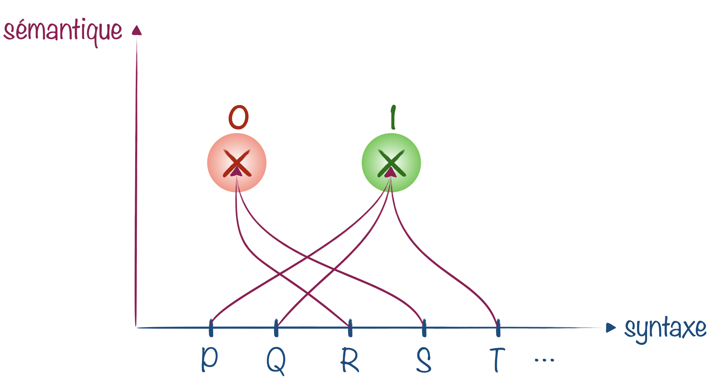

Imaginons qu'un ensemble de formules ne possède que deux variables $P$ et $Q$. On a alors 4 modèles différents possibles&nbsp;:

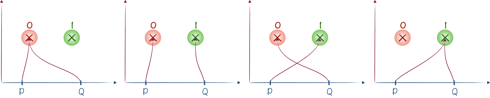

- $\mathcal{M}_1$ pour lequel la distribution de valeur de vérité $\delta_1$ est définie par&nbsp;: $\delta_1(P) = 0$ et $\delta_1(Q)=0$
- $\mathcal{M}_2$ pour lequel la distribution de valeur de vérité $\delta_2$ est définie par&nbsp;: $\delta_2(P) = 0$ et $\delta_2(Q)=1$
- $\mathcal{M}_3$ pour lequel la distribution de valeur de vérité $\delta_3$ est définie par&nbsp;: $\delta_3(P) = 1$ et $\delta_3(Q)=0$
- $\mathcal{M}_4$ pour lequel la distribution de valeur de vérité $\delta_4$ est définie par&nbsp;: $\delta_4(P) = 1$ et $\delta_4(Q)=1$

Pour un modèle $\mathcal{M}$, si $\delta(P)=1$, on note $\mathcal{M}\models P$. Cela signifie que $P$ est vraie dans le modèle $\mathcal{M}$. 
À l'inverse, si $\delta(P)=0$, on écrira $\mathcal{M}\not\models P$.

Si  $\mathcal{M}\not\models P$ alors $\mathcal{M}\models \neg P$.

Exemple : 
si $\mathcal{M}\models P,\neg Q,R$, cela signifie que dans le modèle $\mathcal{M}$, $P$ et $R$ sont vraies, mais $Q$ est fausse.

### Évaluation des formules

Pour évaluer des formules, il faut pouvoir étendre la fonction de distribution de valeurs de vérité des seules variables propositionnelles à toutes les formules de $\mathcal{F}$. $\delta$ devient alors $\delta_\mathcal{F}$ et on construit $\delta_\mathcal{F}$ à partir de $\delta$ en utilisant les règles suivantes&nbsp;:

<ul>
<li>$\delta_\mathcal{F}(\phi) = \delta(\phi)$ si $\phi$ est une variable propositionnelle.</li>

<li>$\delta_\mathcal{F}(\neg\phi) = 1- \delta_\mathcal{F}(\phi)$ (non $\phi$ est vraie seulement si $\phi$ est fausse).

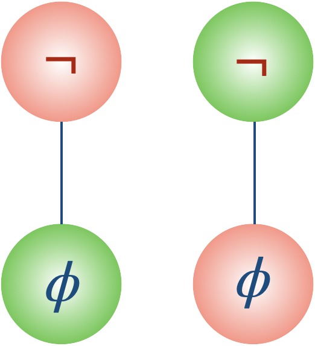
</li>
<li>$\delta_\mathcal{F}(\phi \lor\psi) = \max(\delta_\mathcal{F}(\phi) ,\delta_\mathcal{F}(\psi) ) $ ($\phi \lor\psi$ est toujours vraie sauf lorsque les deux sous-formules $\phi$ et $\psi$ sont toutes deux fausses).

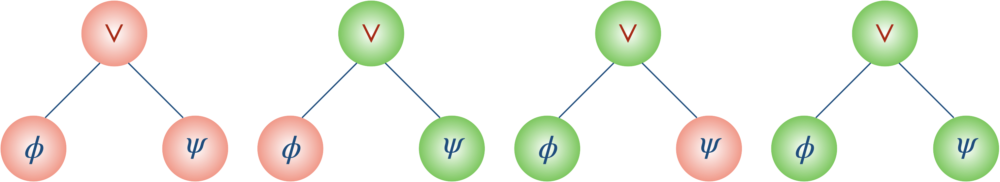
</li>
<li>$\delta_\mathcal{F}(\phi \land \psi) = \delta_\mathcal{F}(\phi) \cdot \delta_\mathcal{F}(\psi)$ ($\phi \land\psi$ est toujours fausse sauf lorsque les deux sous-formules $\phi$ et $\psi$ sont toutes deux vraies).

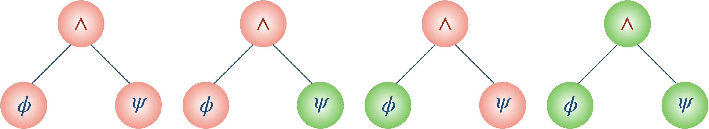
</li>
<li>$\delta_\mathcal{F}(\phi \rightarrow \psi) = \max(1- \delta_\mathcal{F}(\phi) ,\delta_\mathcal{F}(\psi) )$ ($\phi \rightarrow \psi$ est toujours vraie sauf quand à la fois $\phi$ est vraie et $\psi$ est fausse).

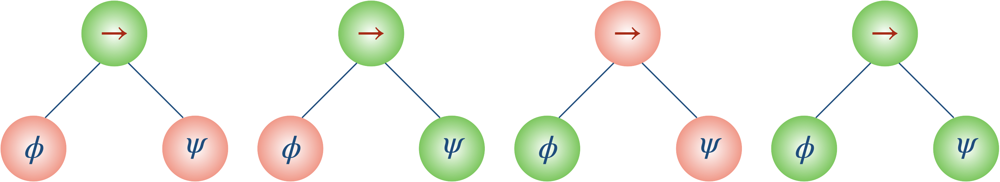
</li>
<li>$\delta_\mathcal{F}(\phi \leftrightarrow \psi) = \max(\delta_\mathcal{F}(\phi) \cdot\delta_\mathcal{F}(\psi), (1-\delta_\mathcal{F}(\phi) )\cdot(1-\delta_\mathcal{F}(\psi) ) )$ ($\phi \leftrightarrow \psi$ est vraie lorsque $\phi$ et $\psi$ ont la même valeur de vérité).

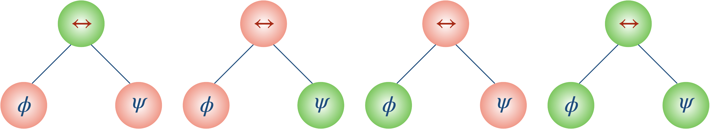
</li>
</ul>

Deux de ces règles heurtent l'intuition.

Un «&nbsp;ou&nbsp;» qui n'exclut rien

La femme d'un logicien vient d'accoucher. Un ami accourt&nbsp;: «&nbsp;Alors, c'est un garçon ou une fille&nbsp;?&nbsp;» Le logicien, radieux&nbsp;: «&nbsp;Oui.&nbsp;»

Le $\lor$ de la logique est le *ou inclusif*&nbsp;: $\phi\lor\psi$ est vraie dès que l'une des deux l'est, y compris quand les deux le sont. Le «&nbsp;fromage ou dessert&nbsp;» des restaurants est un *ou exclusif*, qui correspond à un autre connecteur, la négation de $\leftrightarrow$.

L'implication à l'épreuve&nbsp;: les quatre cartes de Wason

Quatre cartes portent chacune une lettre sur une face et un nombre sur l'autre. On voit&nbsp;:

<b>A&nbsp;D&nbsp;4&nbsp;7</b>

On affirme&nbsp;: «&nbsp;si une carte porte une voyelle, alors elle porte un nombre pair au dos&nbsp;». Quelles cartes faut-il retourner, et seulement celles-là, pour vérifier que la règle est respectée&nbsp;?

Réponse

Il faut retourner **A** et **7**. L'implication $V\rightarrow P$ n'est fausse que dans un seul cas&nbsp;: voyelle d'un côté, nombre impair de l'autre. Seules A (si son dos est impair) et 7 (si son dos est une voyelle) peuvent donc la prendre en défaut. La carte 4 ne peut rien réfuter&nbsp;: la règle ne dit pas qu'un nombre pair exige une voyelle. Quant à D, la règle ne dit rien des consonnes&nbsp;: quand $V$ est fausse, $V\rightarrow P$ est vraie d'office.

Lorsque le psychologue Peter Wason propose ce test en 1966, moins d'une personne sur dix répond correctement, la plupart choisissant A et 4. Habillé autrement («&nbsp;si quelqu'un boit de la bière, alors il est majeur&nbsp;»&nbsp;: qui contrôler parmi un buveur de bière, un buveur de soda, un adulte et un adolescent&nbsp;?), le même problème devient évident pour presque tout le monde.

Retenons que $\phi\rightarrow\psi$ ne prétend à aucun lien de cause à effet entre $\phi$ et $\psi$&nbsp;: elle interdit seulement le cas «&nbsp;$\phi$ vraie et $\psi$ fausse&nbsp;». En particulier, une implication dont la prémisse est fausse est toujours vraie («&nbsp;si la Lune est en fromage, alors $2+2=5$&nbsp;» est une implication vraie).

Avec nos petits coloriages, on peut maintenant s'atteler à la valeur de vérité d'une formule complexe dans un modèle donné. 

Soit le modèle $\mathcal{M}$ défini par $\mathcal{M}\models P,\neg Q, R$ et la formule $\phi$ qu'on s'est amusé à linéariser [à la fin du chapitre sur la syntaxe](../syntaxe/#linéarisation-dune-formule). On va partir des feuilles et remonter jusqu'à la racine de l'arbre.
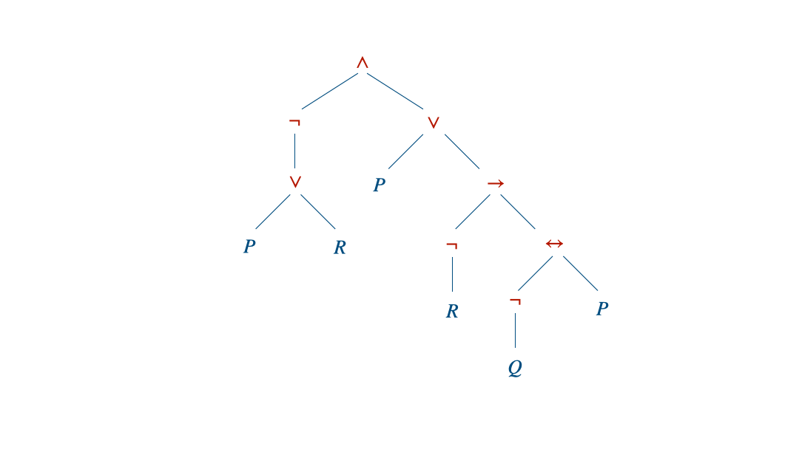

Comme la racine est fausse, la formule $\phi$ est fausse dans ce modèle&nbsp;: $\mathcal{M}\not\models\phi$. 
La formule n'est d'ailleurs vraie que dans un seul des 8 modèles possibles.

Si la hauteur $n$ de la formule est grande, le coloriage devient vite impraticable car trop long. En imaginant que tous les opérateurs sont binaires et que chaque branche est de longueur $n$, cela nous demanderait le coloriage de $1+2+2^2+\ldots+2^{n-1}=2^n-1$ nouveaux nœuds. Avec une formule de hauteur 31, ce qui ne semble pas délirant, on pourrait se retrouver à devoir colorier plus d'un milliard de nœuds...

### Formules logiquement équivalentes

Une formule $\phi$ est <b>satisfaite</b> dans un modèle $\mathcal{M}$ si elle y est vraie. On note alors $\mathcal{M}\models\phi$, et $\mathcal{M}\not\models\phi$ dans le cas contraire.

Deux formules $\phi$ et $\psi$ sont <b>équivalentes</b>, ce qu'on note $\phi\equiv\psi$, si elles sont satisfaites exactement dans les mêmes modèles.

Deux formules équivalentes disent la même chose avec des mots différents. «&nbsp;Il ne pleut pas, ou alors je prends mon parapluie&nbsp;» et «&nbsp;s'il pleut, je prends mon parapluie&nbsp;» sont indiscernables&nbsp;: $\neg P\lor Q\equiv P\rightarrow Q$.

{}
Les symboles $\leftrightarrow$ et $\equiv$ ne vivent pas au même étage. $\leftrightarrow$ est un **connecteur**, un symbole du langage&nbsp;: $\phi\leftrightarrow\psi$ est une formule, qui peut être vraie dans un modèle et fausse dans un autre. $\equiv$ est une **relation entre formules**, qui n'appartient pas au langage&nbsp;: $\phi\equiv\psi$ est une affirmation *sur* les formules, faite depuis l'extérieur. 
Le lien entre les deux&nbsp;: $\phi\equiv\psi$ exactement quand la formule $\phi\leftrightarrow\psi$ est vraie dans tous les modèles.
{}

### Théorie et conséquence sémantique

Une <b>théorie</b> $\mathcal{T}$ est un ensemble de formules, qu'on voit comme une liste d'hypothèses.

<ul>
<li>$\mathcal{M}$ est un <b>modèle de</b> $\mathcal{T}$, noté $\mathcal{M}\models\mathcal{T}$, s'il satisfait toutes les formules de $\mathcal{T}$.</li>
<li>$\mathcal{T}$  est <b>consistante</b> (ou satisfaisable) si elle possède au moins un modèle, et <b>inconsistante</b> sinon.</li>
</ul>

Une théorie est inconsistante lorsqu'elle se contredit&nbsp;: elle dit une chose et son contraire, ce qu'aucun modèle ne peut réaliser.

Une formule $\phi$ est une <b>conséquence sémantique</b> de $\mathcal{T}$, noté $\mathcal{T} \models \phi$, si tout modèle de $\mathcal{T}$ satisfait aussi $\phi$.

Plus généralement, $\mathcal{T} \models \mathcal{T'}$ si tout modèle de $\mathcal{T}$ est un modèle de $\mathcal{T'}$, et les deux théories sont <b>équivalentes</b> si elles ont exactement les mêmes modèles.

C'est la version sémantique de la déduction&nbsp;: partout où les hypothèses sont vraies, la conclusion l'est aussi. En termes d'ensembles, $\mathcal{T}\models\mathcal{T'}$ signifie simplement que les modèles de $\mathcal{T}$ sont inclus dans ceux de $\mathcal{T'}$.

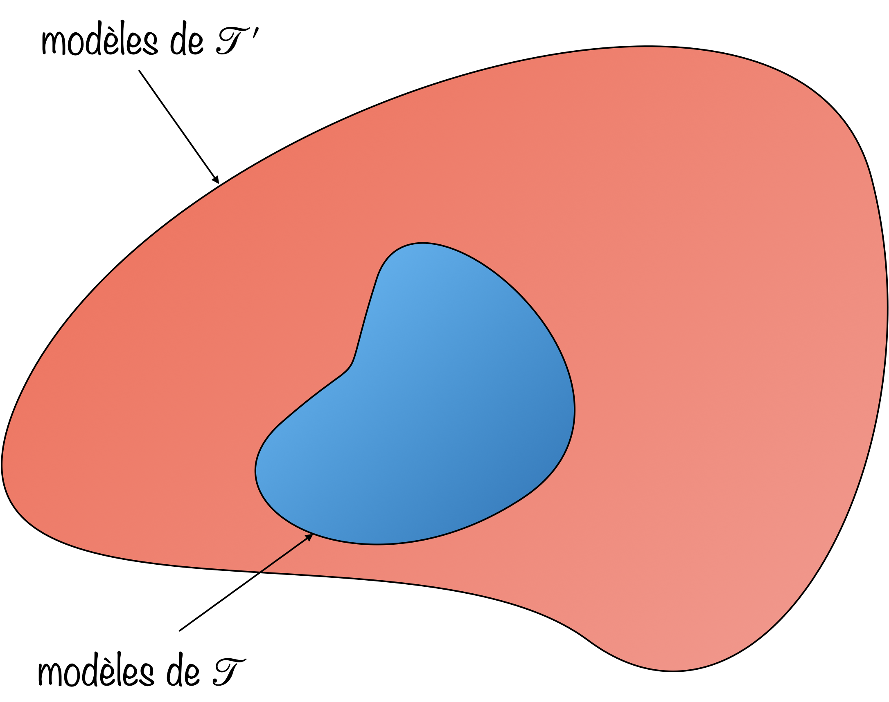

Plus une théorie raconte de choses, moins elle a de modèles&nbsp;; si elle en raconte trop, il ne lui en reste aucun. À l'opposé, la théorie vide ne dit rien et tous les modèles lui conviennent&nbsp;: ses conséquences, notées $\models\phi$, sont les formules vraies dans tous les modèles, les **tautologies**.

Quatre propriétés résument le comportement de la conséquence sémantique.

<ul>
<li><b>Ajouter des hypothèses ne fait rien perdre.</b> Si $\mathcal{T'}\subseteq\mathcal{T}$ et $\mathcal{T'}\models\phi$, alors $\mathcal{T}\models\phi$.</li>
<li><b>Du faux, on déduit ce qu'on veut</b> (<i>ex falso quodlibet</i>). $\mathcal{T}$ est inconsistante si et seulement si $\mathcal{T}\models\phi$ pour toute formule $\phi$&nbsp;: faute de modèle à examiner, tout est vrai «&nbsp;dans tous les modèles de $\mathcal{T}$&nbsp;».</li>
<li><b>Raisonnement par l'absurde.</b> $\mathcal{T}\models\phi$ si et seulement si $\mathcal{T}\cup\set{\neg\phi}$ est inconsistante.</li>
<li><b>Une hypothèse vaut une implication.</b> $\mathcal{T}\cup\set{\phi}\models\psi$ si et seulement si $\mathcal{T}\models\phi\rightarrow\psi$. Déduire «&nbsp;si $\phi$ alors $\psi$&nbsp;», c'est déduire $\psi$ en supposant $\phi$.</li>
</ul>

### Substitution de sous-formules équivalentes

Dans une formule, **substituer** une sous-formule par une autre revient à retirer toute la partie de l'arbre qui descend d'un nœud et la remplacer par un autre sous-arbre.

Si la sous-formule "greffée" est équivalente à la sous-formule retirée, alors la nouvelle formule est équivalente à l'originale.

L'intérêt des substitutions est de simplifier la formule pour rendre son interprétation plus facile. 

Une simplification forte (bien qu'elle agrandisse l'arbre) consiste à restreindre le nombre de symboles utilisés.

On peut ainsi toujours transformer une formule $\phi$ par une formule $\phi_{\neg,\lor,\land}\equiv\phi$ avec tous ses connecteurs logiques dans $\set{\neg,\lor,\land}$.

 

Il suffit en effet de substituer les nœuds $\rightarrow$ et $\leftrightarrow$&nbsp;:

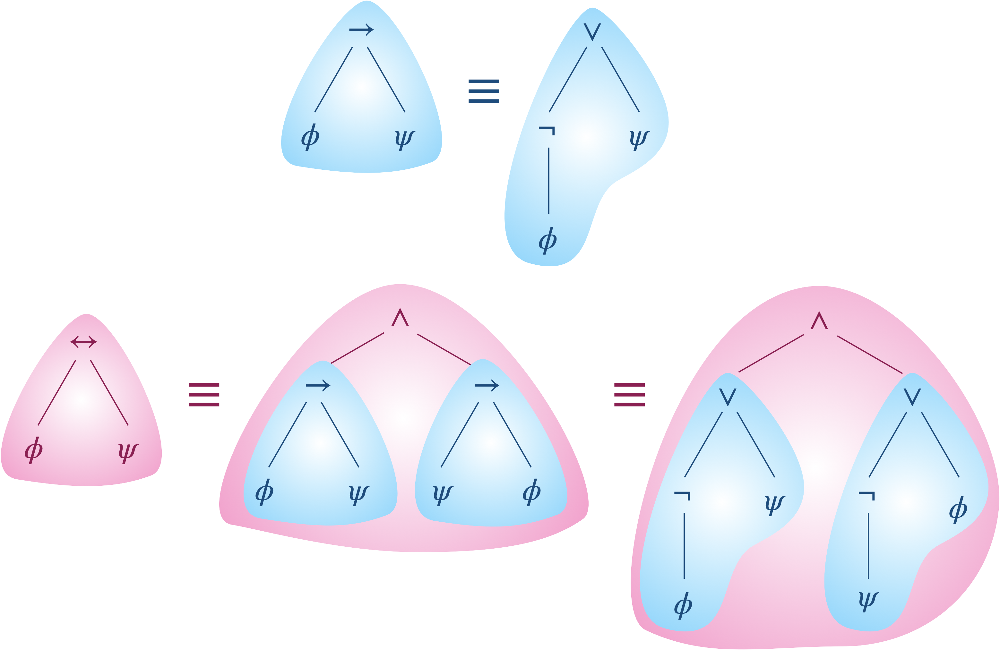

On peut aller encore plus loin en transformant une formule $\phi$ par une formule $\phi_{\neg,\lor}\equiv\phi$ avec tous ses connecteurs logiques dans $\set{\neg,\lor}$. 
Ou bien en transformant une formule $\phi$ par une formule $\phi_{\neg,\land}\equiv\phi$ avec tous ses connecteurs logiques dans $\set{\neg,\land}$.

 

On utilise pour cela les deux substitutions suivantes&nbsp;:

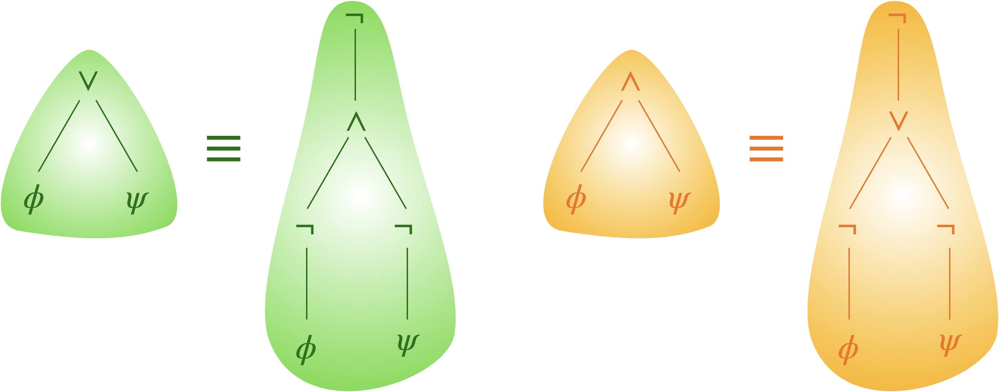

Dans l'exemple suivant, on détermine une formule équivalente avec $\neg$ et $\lor$ comme seuls connecteurs logiques (et on élimine les doubles négations dans la dernière étape).

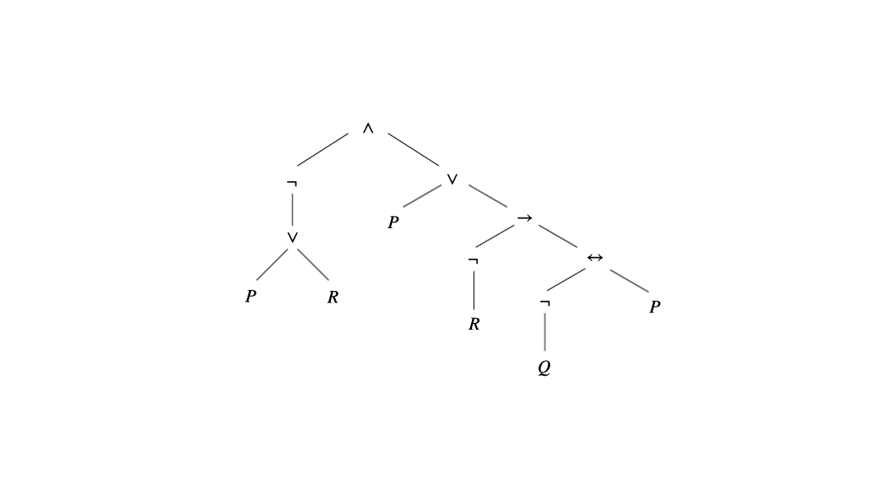

### Jeux d'évaluation

Évaluer une formule peut aussi se voir comme une partie entre deux joueurs. Il faut d'abord un résultat général sur les jeux.

Ernst Zermelo a démontré (dans un article de 1913 consacré aux échecs) que les jeux finis à deux joueurs, joués tour à tour, à information parfaite (pas comme la bataille navale), sans hasard et sans match nul, sont tous <b>déterminés</b>&nbsp;: l'un des deux joueurs a une <b>stratégie gagnante</b>.

L'idée de la preuve est un coloriage. On dessine l'arbre de toutes les parties possibles, chaque nœud appartenant au joueur <b style="color:#EE220C">0</b> ou au joueur <b style="color:#1DB100">1</b>, et on colorie chaque feuille de la couleur de celui qui y gagne. On remonte ensuite vers la racine&nbsp;: un nœud prend la couleur de son propriétaire dès que l'un de ses successeurs a cette couleur (il lui suffit d'y aller), et la couleur de l'adversaire sinon (il n'a que de mauvais coups). La couleur de la racine désigne le joueur qui gagne à coup sûr.

Le **jeu d'évaluation**, inventé par Jaakko Hintikka, applique cette idée à un modèle $\mathcal{M}$ et une formule $\phi$ écrite avec les seuls connecteurs $\neg$, $\land$ et $\lor$ (ce qui, comme on l'a vu, est toujours possible).

Les deux joueurs sont le **V**érificateur (<b style="color:#1DB100">V</b>), qui soutient que la formule est vraie dans le modèle, et le **F**alsificateur (<b style="color:#EE220C">F</b>), qui soutient qu'elle est fausse. La partie descend dans l'arbre de la formule&nbsp;:
- sur une disjonction $\lor$, c'est <b style="color:#1DB100">V</b> qui choisit la branche (pour défendre un «&nbsp;ou&nbsp;», il suffit d'en défendre un côté)&nbsp;;
- sur une conjonction $\land$, c'est <b style="color:#EE220C">F</b> qui choisit (pour attaquer un «&nbsp;et&nbsp;», il suffit d'en attaquer un côté)&nbsp;;
- sur une négation $\neg$, les deux joueurs échangent leurs rôles&nbsp;;
- arrivé sur une variable, <b style="color:#1DB100">V</b> gagne si elle est vraie dans $\mathcal{M}$, <b style="color:#EE220C">F</b> si elle est fausse.

$\mathcal{M}\models\phi$ si et seulement si <b style="color:#1DB100">V</b> a une stratégie gagnante dans le jeu d'évaluation, et $\mathcal{M}\not\models\phi$ si et seulement si c'est <b style="color:#EE220C">F</b> qui en a une.

La vérité d'une formule devient ainsi la possibilité de la défendre contre n'importe quel contradicteur.

Exemple&nbsp;: considérons la formule $\bar{\phi}=\neg ( \neg( \neg P \land (( Q\land ( R \land \neg P )) \lor ( Q \land \neg P ))) \land ( ( P \land ( R \lor \neg R )) \lor ( R \land Q ) ))$ dont l'arbre est représenté ci-dessous. Et on se donne le modèle $\mathcal{M}\models P,Q,\neg R$

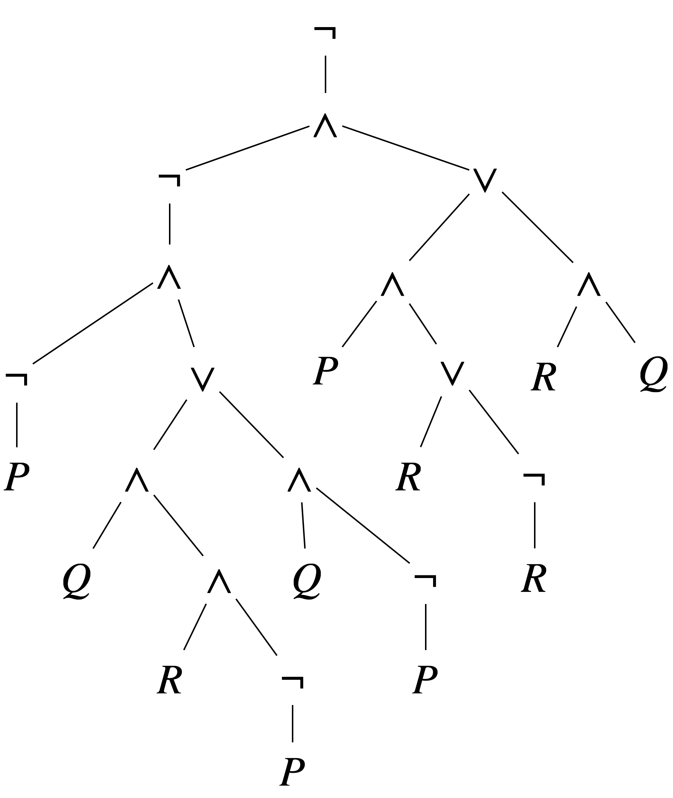

On commence par colorier les feuilles conformément au modèle, puis on remplace chaque occurrence de $\lor$, $\land$, $\neg$ respectivement par les symboles <b style="color:#1DB100">V</b>, <b style="color:#EE220C">F</b> et <b  style="color:#0076BA">⇔</b>.

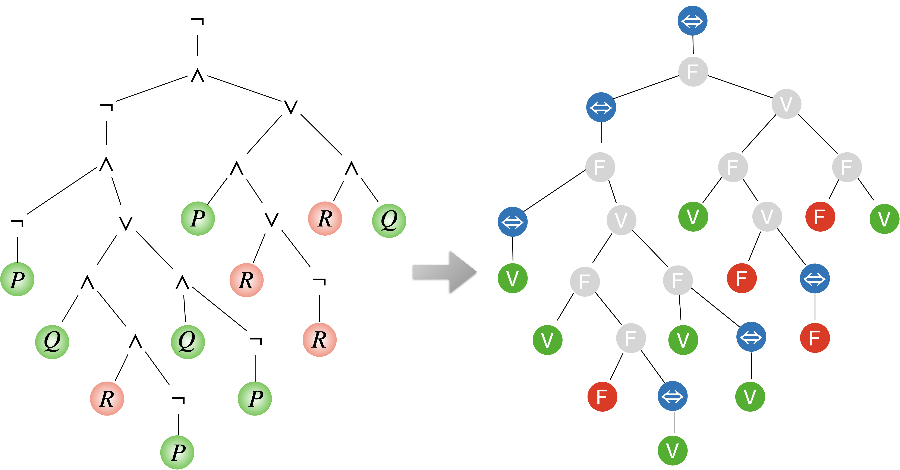

Ensuite on s'occupe des changements de rôle&nbsp;: si la branche connectant un nœud à la racine contient un nombre impair d'inversions, on intervertit l'étiquette du nœud, et sinon on la laisse telle quelle.

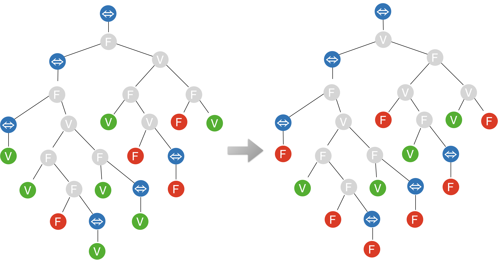

On peut maintenant retirer les symboles d'inversion et chercher lequel de <b style="color:#1DB100">V</b> ou <b style="color:#EE220C">F</b> a une stratégie gagnante en remontant depuis les feuilles.

Victoire au Falsificateur <b style="color:#EE220C">F</b>&nbsp;! D'après le théorème, on a donc $\mathcal{M}\not\models\bar{\phi}$.

Les trois stratégies gagnantes possibles pour le Falsificateur sont les suivantes&nbsp;:

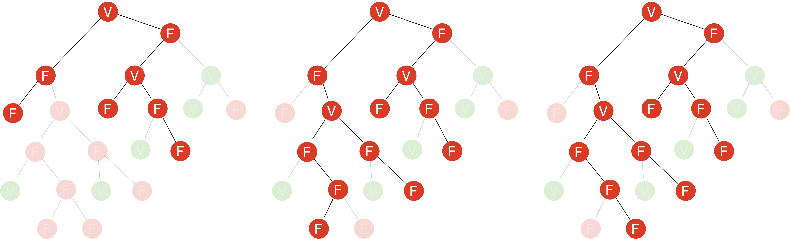

### Table de vérité

Une **table de vérité** est un tableau regroupant de manière synthétique tous les modèles d'une formule donnée.

Si la formule possède $n$ variables propositionnelles, le tableau contient $2^n$ lignes, une ligne par modèle.

Exemple&nbsp;: 
Construisons la table de vérité de $\phi := \left(\left(P\land\neg Q\right)\rightarrow\left(\neg\left( P\lor R\right) \leftrightarrow\neg Q\right)\right)$

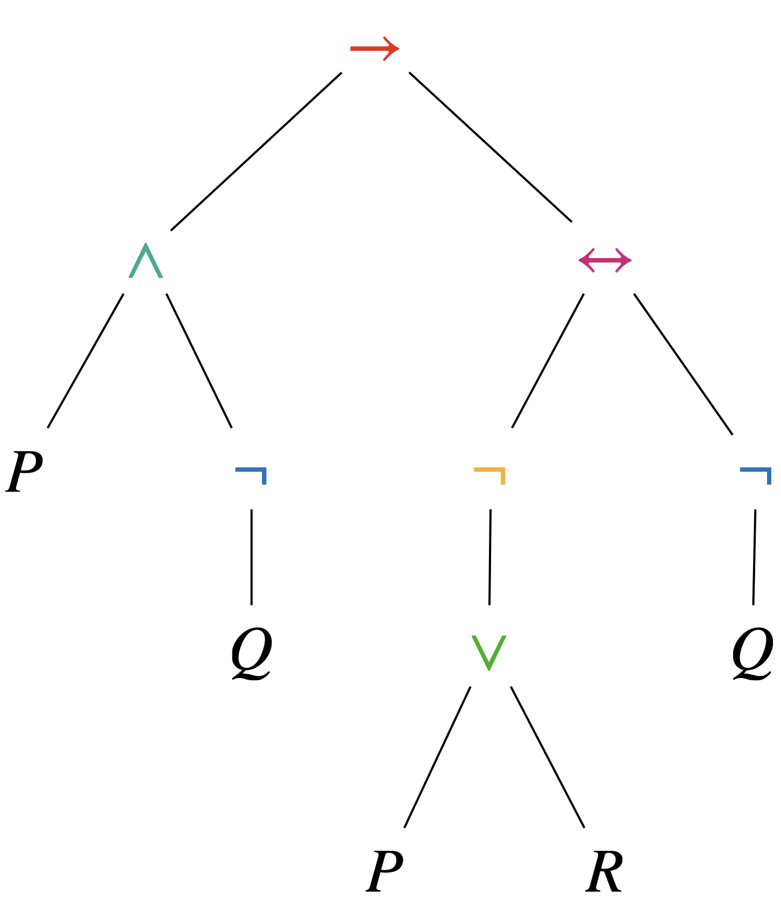

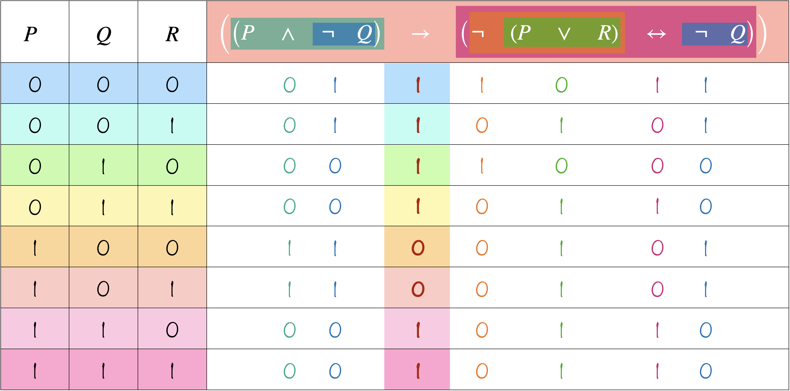

Une table de vérité pour démasquer un menteur

Raymond Smullyan, logicien, pianiste et magicien, a peuplé ses livres d'une île où chaque habitant est soit un **chevalier**, qui dit toujours vrai, soit un **filou**, qui ment toujours (*knights* et *knaves* dans le texte original de *What Is the Name of This Book?*).

Vous croisez deux habitants, $A$ et $B$. $A$ déclare&nbsp;: «&nbsp;L'un de nous deux au moins est un filou.&nbsp;» Qui est quoi&nbsp;?

Notons $P$&nbsp;: «&nbsp;$A$ est un chevalier&nbsp;» et $Q$&nbsp;: «&nbsp;$B$ est un chevalier&nbsp;». La phrase de $A$ s'écrit $\neg P\lor\neg Q$, et elle est vraie exactement quand $A$ est un chevalier. La situation est donc décrite par la formule $P\leftrightarrow(\neg P\lor\neg Q)$, dont il ne reste qu'à dresser la table&nbsp;:

<table class="tab-recap">
<tr><th>$P$</th><th>$Q$</th><th>$\neg P\lor\neg Q$</th><th>$P\leftrightarrow(\neg P\lor\neg Q)$</th></tr>
<tr><td>0</td><td>0</td><td>1</td><td>0</td></tr>
<tr><td>0</td><td>1</td><td>1</td><td>0</td></tr>
<tr><td><b>1</b></td><td><b>0</b></td><td><b>1</b></td><td><b>1</b></td></tr>
<tr><td>1</td><td>1</td><td>0</td><td>0</td></tr>
</table>

Un seul modèle survit&nbsp;: $A$ est un chevalier et $B$ un filou. (Sans table&nbsp;: un filou ne peut pas dire «&nbsp;l'un de nous est un filou&nbsp;», car ce serait vrai.)

### Tautologies et contradictions

$\phi$ est une <b>tautologie</b> si elle est vraie dans tous les modèles, ce qu'on note $\models \phi$ ou $\phi \equiv \top$.

$\phi$ est une <b>contradiction</b> si elle est fausse dans tous les modèles, autrement dit si $\neg\phi$ est une tautologie. On note $\phi\equiv\bot$.

Dans une table de vérité, une tautologie est une colonne de 1 et une contradiction une colonne de 0.

Tautologies importantes&nbsp;:

<table class="tab-lois">
<tr>
<th scope="row" colspan="2">tiers exclu et non-contradiction</th>
</tr>
<tr>
<td style="width:50%;">$P\lor\neg P$</td><td>$\neg(P\land\neg P)$</td>
</tr>
</table>

<table class="tab-lois">
<tr>
<th scope="row" colspan="2">idempotence de la conjonction et de la disjonction</th>
</tr>
<tr>
<td style="width:50%;">$(P\land P)\leftrightarrow P$</td><td>$(P\lor P)\leftrightarrow P$</td>
</tr>
</table>
<table class="tab-lois">
<tr>
<th scope="row" colspan="3">commutativité de la conjonction, disjonction et de la double implication</th>
</tr>
<tr>
<td style="width:33.33%;">$(P\lor Q) \leftrightarrow (Q\lor P)$</td><td style="width:33.33%;">$(P\land Q) \leftrightarrow (Q\land P)$</td><td style="width:33.33%;">$(P\leftrightarrow Q) \leftrightarrow (Q\leftrightarrow P)$</td>
</tr>
</table>
<table class="tab-lois">
<tr>
<th scope="row" colspan="3">associativité de la disjonction, de la conjonction et de la double implication</th>
</tr>
<tr>
<td style="width:33.33%;">$((P\lor Q) \lor R)\leftrightarrow (P\lor(Q\lor R))$</td><td style="width:33.33%;">$((P\land Q) \land R)\leftrightarrow (P\land(Q\land R))$</td><td style="width:33.33%;">$((P\leftrightarrow Q) \leftrightarrow R)\leftrightarrow (P\leftrightarrow(Q\leftrightarrow R))$</td>
</tr>
</table>
<table class="tab-lois">
<tr>
<th scope="row" colspan="2">distributivité de la disjonction par rapport à la conjonction et réciproquement</th>
</tr>
<tr>
<td style="width:50%;">$(P\lor (Q\land R))\leftrightarrow ((P\lor Q)\land (P\lor R))$</td><td>$(P\land (Q\lor R))\leftrightarrow ((P\land Q)\lor (P\land R))$</td>
</tr>
</table>
<table class="tab-lois">
<tr>
<th scope="row" colspan="2">lois d'absorption</th>
</tr>
<tr>
<td style="width:50%;">$(P\land(P\lor Q))\leftrightarrow P$</td><td>$(P\lor(P\land Q))\leftrightarrow P$</td>
</tr>
</table>
<table class="tab-lois">
<tr>
<th scope="row" colspan="2">lois de De Morgan</th>
</tr>
<tr>
<td style="width:50%;">$\neg (P\lor Q) \leftrightarrow (\neg P \land \neg Q)$</td><td>$\neg (P\land Q) \leftrightarrow (\neg P \lor \neg Q)$</td>
</tr>
</table>
<table class="tab-lois">
<tr>
<th scope="row">contraposée</th>
</tr>
<tr>
<td>$(P\rightarrow Q) \leftrightarrow (\neg Q \rightarrow \neg P)$</td>
</tr>
</table>

Les tautologies sont le carburant du **raisonnement**&nbsp;: si $\phi$ est une tautologie et si $\phi\rightarrow\psi$ en est une aussi, alors $\psi$ est une tautologie (dans un modèle quelconque, $\phi$ est vraie, donc $\psi$ doit l'être pour que l'implication tienne). On peut ainsi avancer de vérité universelle en vérité universelle.

Le **raisonnement par l'absurde** n'est pas plus mystérieux&nbsp;: si supposer $\neg\phi$ mène à une contradiction, c'est que $\neg\phi$ n'est vraie dans aucun modèle, et donc que $\phi$ est vraie dans tous.

Le poisson d'avril de Smullyan

Smullyan racontait que sa vocation de logicien datait du 1er avril 1925. Il a six ans, il est au lit avec la grippe, et son frère Émile lui annonce le matin&nbsp;: «&nbsp;Aujourd'hui, je vais te faire un poisson d'avril comme on ne t'en a jamais fait&nbsp;!&nbsp;» Raymond attend toute la journée. Rien. Le soir, incapable de dormir, il réclame des explications.

— Tu t'attendais à ce que je te joue un tour&nbsp;? 
— Oui. 
— Et je ne l'ai pas fait&nbsp;? 
— Non. 
— Mais tu t'y attendais. Donc je t'ai bien eu&nbsp;!

Et Smullyan de rester éveillé à se demander s'il avait été dupé ou non. S'il ne l'a pas été, alors il a attendu pour rien, et il l'a été. S'il l'a été, alors il a eu ce qu'il attendait, et il ne l'a pas été. La proposition $D$&nbsp;: «&nbsp;Raymond a été dupé&nbsp;» semble vérifier $D\leftrightarrow\neg D$, formule qui est une contradiction du calcul des propositions.

### Formes normales

Toute formule, si tarabiscotée soit-elle, peut se ramener à deux formes standard très régulières. Appelons **littéral** une variable ou sa négation ($P$, $\neg Q$…).

<ul>
<li>Une formule est sous <b>forme normale disjonctive</b> si c'est une disjonction de conjonctions de littéraux, comme $(P\land\neg Q)\lor(\neg P\land R)$.</li>
<li>Elle est sous <b>forme normale conjonctive</b> si c'est une conjonction de disjonctions de littéraux, comme $(P\lor Q)\land(\neg Q\lor R)$.</li>
</ul>

Toute formule est équivalente à une formule sous forme normale disjonctive, et à une formule sous forme normale conjonctive.

Il suffit de **lire la table de vérité**. Prenons $P\leftrightarrow Q$, vraie sur deux lignes et fausse sur deux autres&nbsp;:

- chaque ligne où la formule est vraie se décrit par une conjonction ($P=0, Q=0$ donne $\neg P\land\neg Q$), et la formule dit qu'on est sur l'une de ces lignes&nbsp;: $(\neg P\land\neg Q)\lor(P\land Q)$. C'est une forme normale disjonctive.
- chaque ligne où la formule est fausse s'interdit par une disjonction (pour exclure $P=0, Q=1$, on exige $P\lor\neg Q$), et la formule dit qu'on n'est sur aucune de ces lignes&nbsp;: $(P\lor\neg Q)\land(\neg P\lor Q)$. C'est une forme normale conjonctive.

On peut aussi procéder par réécriture, sans dresser la table&nbsp;: on élimine $\rightarrow$ et $\leftrightarrow$, on pousse les négations jusqu'aux variables grâce aux lois de De Morgan, puis on distribue $\lor$ sur $\land$ (ou l'inverse, selon la forme visée).

<b>Exemple.</b> Soit $\phi = \neg((\neg P \rightarrow Q)\rightarrow \neg (Q\leftrightarrow P))$.

$$\begin{aligned}
\phi &\equiv \neg ( \neg (P \lor Q ) \lor \neg ( ( \neg Q \lor P ) \land ( \neg P \lor Q ) )) &&\text{(élimination de } \rightarrow \text{ et } \leftrightarrow\text{)}\\
&\equiv ( P \lor Q ) \land ( \neg Q \lor P ) \land ( \neg P \lor Q ) &&\text{(De Morgan et doubles négations)}
\end{aligned}$$

{}
Sans stratégie, **tester la validité** d'une formule (est-ce une tautologie&nbsp;?) revient à l'évaluer pour chaque combinaison des valeurs des variables, soit $2^n$ lignes pour $n$ variables, ce qui devient vite impraticable. 
Sur une forme normale conjonctive $\phi=\bigwedge\_{i}\phi\_i$, le test devient purement syntaxique et immédiat&nbsp;: $\phi$ est une tautologie si et seulement si chaque disjonction $\phi\_i$ contient un littéral et son contraire ($P\_j$ et $\neg P\_j$). 
Pour un **test de satisfiabilité** (existe-t-il au moins un modèle&nbsp;?), c'est la forme normale disjonctive $\phi=\bigvee\_i \phi\_i$ qui est adaptée&nbsp;: $\phi$ est satisfaisable si et seulement si au moins une conjonction $\phi\_i$ ne contient pas à la fois un littéral et son contraire. 
Il n'y a hélas pas de miracle&nbsp;: c'est la **mise sous forme normale** qui peut coûter cher, la distribution pouvant faire exploser exponentiellement la taille de la formule.
{}

Un problème à un million de dollars

Savoir si une formule est satisfaisable, le problème **SAT**, paraît anodin. C'est pourtant le problème le plus célèbre de l'informatique théorique&nbsp;: en 1971, Stephen Cook (et indépendamment Leonid Levin, en URSS) montre que des milliers de problèmes d'apparence très différente (remplir un sudoku, colorier une carte, organiser une tournée) peuvent tous se traduire efficacement en une question de satisfiabilité. SAT est le premier problème démontré **NP-complet**.

Vérifier qu'une distribution de valeurs de vérité satisfait une formule est rapide. En trouver une, on ne sait le faire dans le pire cas qu'en un temps exponentiel, et personne ne sait démontrer qu'on ne peut pas faire mieux&nbsp;: c'est la question «&nbsp;P = NP&nbsp;?&nbsp;», l'un des sept problèmes du prix du millénaire, dotés chacun d'un million de dollars par l'institut Clay.

### Connecteurs binaires et systèmes complets de connecteurs

Appelons $*$ un connecteur binaire quelconque. On a 4 modèles possibles à considérer et comme la valeur de $P\*Q$ dans chacun de ces modèles peut être soit vraie, soit fausse, cela fait en tout $2^4$ tables de vérité possibles et donc 16 connecteurs binaires différents&nbsp;:

<table id="tabcondit">
<tr>
<th>P</th><th style="border-right: solid lightgrey 2px;">Q</th><th>$\bot$</th><th>$\downarrow$</th><th>$\nleftarrow$</th><th>$\overline{\pi_1}$</th><th>$\nrightarrow$</th><th>$\overline{\pi_2}$</th><th>$\nleftrightarrow$</th><th>$\uparrow$</th><th>$\land$</th><th>$\leftrightarrow$</th><th>$\pi_2$</th><th>$\rightarrow$</th><th>$\pi_1$</th><th>$\leftarrow$</th><th>$\lor$</th><th>$\top$</th>
</tr>
<tr>
<td>0</td><td style="border-right:  solid lightgrey 2px;">0</td><td>0</td><td>1</td><td>0</td><td>1</td><td>0</td><td>1</td><td>0</td><td>1</td><td>0</td><td>1</td><td>0</td><td>1</td><td>0</td><td>1</td><td>0</td><td>1</td>
</tr>
<tr>
<td>0</td><td style="border-right:  solid lightgrey 2px;">1</td><td>0</td><td>0</td><td>1</td><td>1</td><td>0</td><td>0</td><td>1</td><td>1</td><td>0</td><td>0</td><td>1</td><td>1</td><td>0</td><td>0</td><td>1</td><td>1</td>
</tr>
<tr>
<td>1</td><td style="border-right:  solid lightgrey 2px;">0</td><td>0</td><td>0</td><td>0</td><td>0</td><td>1</td><td>1</td><td>1</td><td>1</td><td>0</td><td>0</td><td>0</td><td>0</td><td>1</td><td>1</td><td>1</td><td>1</td>
</tr>
<tr>
<td>1</td><td style="border-right:  solid lightgrey 2px;">1</td><td>0</td><td>0</td><td>0</td><td>0</td><td>0</td><td>0</td><td>0</td><td>0</td><td>1</td><td>1</td><td>1</td><td>1</td><td>1</td><td>1</td><td>1</td><td>1</td>
</tr>
</table>

On y reconnaît nos quatre connecteurs binaires ($\lor$, $\land$, $\rightarrow$, $\leftrightarrow$), accompagnés de quelques nouveaux venus&nbsp;:

- la **négation** de chacun d'eux&nbsp;: $\downarrow$ («&nbsp;ni… ni…&nbsp;», le NOR des électroniciens), $\uparrow$ (le NAND), $\nrightarrow$ et $\nleftrightarrow$ (qui n'est autre que le «&nbsp;ou exclusif&nbsp;»)&nbsp;;
- l'implication inverse $\leftarrow$ et sa négation $\nleftarrow$&nbsp;;
- les deux connecteurs constants $\top$ (toujours vrai) et $\bot$ (toujours faux)&nbsp;;
- les projections $\pi\_1$ et $\pi\_2$, qui recopient respectivement $P$ et $Q$, et leurs négations $\overline{\pi\_1}$ et $\overline{\pi\_2}$.

Aucun n'apporte de pouvoir expressif supplémentaire. La lecture de la table de vérité, qui nous a donné les formes normales, fonctionne pour n'importe quel connecteur, binaire ou non&nbsp;: tous s'expriment avec $\neg$, $\lor$ et $\land$. La vraie question est plutôt de savoir de combien de connecteurs on peut se passer.

Un ensemble de connecteurs est un <b>système complet de connecteurs</b> si toute formule est équivalente à une formule écrite avec ces seuls connecteurs. Il est <b>minimal</b> si on ne peut lui retirer aucun connecteur sans perdre cette propriété.

$\set{\neg,\lor,\land,\rightarrow,\leftrightarrow}$, $\set{\neg,\lor}$ et $\set{\neg,\land}$ sont des systèmes complets de connecteurs. Les deux derniers sont minimaux.

La complétude a été vue au moment des substitutions. Pour la minimalité de $\set{\neg,\lor}$, il suffit de remarquer qu'avec $\lor$ seul, une formule est forcément vraie quand toutes ses variables le sont (impossible, donc, d'écrire une négation), et qu'avec $\neg$ seul, une formule ne peut parler que d'une variable à la fois.

On peut faire encore mieux, avec un seul connecteur&nbsp;!

$\set{\downarrow}$ et $\set{\uparrow}$ sont des systèmes complets de connecteurs.

Puisque $\set{\neg,\lor}$ est complet, il suffit de fabriquer $\neg$ et $\lor$ avec $\downarrow$&nbsp;:

$\neg\phi\equiv\phi\downarrow\phi$ &nbsp;&nbsp;&nbsp;et&nbsp;&nbsp;&nbsp; $\phi\lor\psi\equiv(\phi\downarrow\psi)\downarrow(\phi\downarrow\psi)$

La première dit «&nbsp;ni $\phi$ ni $\phi$&nbsp;», la seconde est la négation, obtenue par le même procédé, de «&nbsp;ni $\phi$ ni $\psi$&nbsp;». De la même façon, $\neg\phi\equiv\phi\uparrow\phi$ et $\phi\land\psi\equiv(\phi\uparrow\psi)\uparrow(\phi\uparrow\psi)$.

Le connecteur $\downarrow$ est appelé flèche de Peirce, et $\uparrow$ (parfois noté $\mid$) barre de Sheffer.

{}
C'est ainsi qu'un ordinateur peut être construit entièrement avec des portes logiques NAND ou NOR, dites universelles&nbsp;: elles réalisent électroniquement les opérations $\uparrow$ et $\downarrow$, qui suffisent à construire toutes les formules de la logique des propositions. 
L'exemple le plus spectaculaire est l'Apollo Guidance Computer, qui a posé les astronautes sur la Lune&nbsp;: dans sa version embarquée, toute sa logique reposait sur un unique composant, une porte NOR à trois entrées, reproduit à quelques milliers d'exemplaires. 
Le résultat, lui, est bien antérieur aux ordinateurs&nbsp;: Charles Peirce l'avait remarqué vers 1880 dans des notes restées inédites, et c'est Henry Sheffer qui le publie en 1913.
{}

 

{}
Après la notion de **modèle**, on va maintenant s'intéresser à la notion de **preuve**. Peut-on reconnaître les tautologies sans jamais parler de vrai ni de faux, en manipulant seulement des symboles&nbsp;? Ces deux notions seront réunies par le **théorème de complétude**.
{}

<nav class="suite-nav" aria-label="Chapitre précédent et suivant">
<a href="../syntaxe/" class="precedent">← Précédent<b>Syntaxe</b></a>
<a href="../preuve/" class="suivant">Suite →<b>Preuve</b></a>
</nav>
