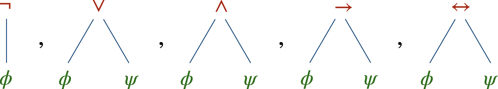
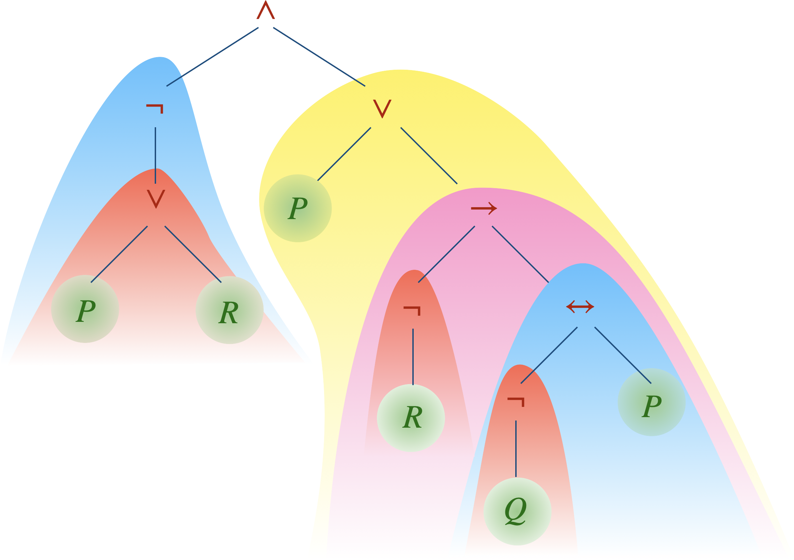
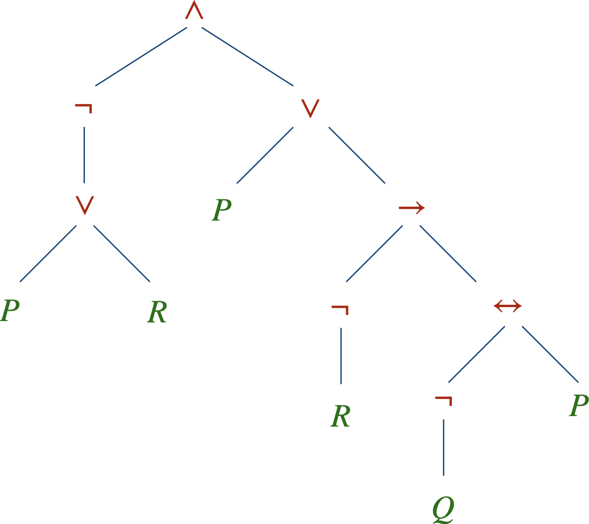

+++
title = "Calcul des propositions - Syntaxe"
menuTitle = "Syntaxe"
date = 2021-03-06T14:20:50+01:00
weight = 1
aliases = ["/logique/logique1/"]
css = "logique.css"
+++

# Calcul des propositions

Syntaxe&nbsp;: l'alphabet et la grammaire des formules

<nav class="chap-nav" aria-label="Chapitres">
<a href="../syntaxe/" class="actif">Syntaxe</a>
<a href="../semantique/">Sémantique</a>
<a href="../preuve/">Preuve</a>
</nav>

Notes de lecture du livre <i>La logique pas à pas</i> de Jacques Duparc.

Le calcul des propositions (ou **calcul propositionnel**, ou **logique des propositions**) modélise les raisonnements les plus simples&nbsp;: ceux qui ne reposent que sur *non*, *et*, *ou*, *si… alors*. Son pouvoir expressif est limité, mais c'est sur ses fondations que se construisent toutes les logiques plus évoluées.

Avant de se demander si une formule est vraie, il faut savoir ce qu'est une formule. C'est l'affaire de la **syntaxe**&nbsp;: un alphabet, une grammaire, et rien d'autre. À ce stade, les symboles ne veulent encore rien dire.

## Syntaxe

### Langage

Le **langage** du calcul des propositions est constitué&nbsp;:
<ul>
<li>de <b>variables propositionnelles</b> $P$, $Q$, $R$,… dont l'ensemble, potentiellement infini, est noté $VAR=\Set{P,Q,R,\dots}$&nbsp;;</li>
<li>de <b>connecteurs logiques</b> $\neg, \lor, \land, \rightarrow, \leftrightarrow$&nbsp;;</li>
<li>de parenthèses.</li>
</ul>

C'est donc l'ensemble de symboles $\mathcal{L} = VAR\cup\Set{\neg,\lor,\land,\rightarrow,\leftrightarrow,(,)}$.

Une variable propositionnelle représente une affirmation élémentaire, qu'on ne cherche pas à décortiquer&nbsp;: «&nbsp;il pleut&nbsp;», «&nbsp;7 est premier&nbsp;», «&nbsp;le dragon a les yeux bleus&nbsp;». Les connecteurs servent à en fabriquer de plus compliquées.

<ul>
<li>Le connecteur $\neg$ est <b>unaire</b> (ou d'arité 1) puisqu'il transforme à lui seul une formule en une autre formule. C'est le symbole de <b>négation</b> et il se lit «&nbsp;<b>non</b>&nbsp;».</li>
<li>Les autres connecteurs sont <b>binaires</b> (d'arité 2) puisqu'ils lient deux formules en une nouvelle&nbsp;:
<ul>
    <li>$\lor$ est le symbole de <b>disjonction</b> («&nbsp;<b>ou</b>&nbsp;»),</li>
    <li>$\land$ est le symbole de <b>conjonction</b> («&nbsp;<b>et</b>&nbsp;»),</li>
    <li>$\rightarrow$ est le symbole d'<b>implication</b> («&nbsp;<b>implique</b>&nbsp;», «&nbsp;si… alors&nbsp;»),</li>
    <li>$\leftrightarrow$ est le symbole de <b>double implication</b> ou d'<b>équivalence</b> («&nbsp;<b>si et seulement si</b>&nbsp;», «&nbsp;<b>équivaut à</b>&nbsp;»).</li>
</ul>
</li>
</ul>

Du français aux formules

Posons $P$&nbsp;: «&nbsp;il pleut&nbsp;», $Q$&nbsp;: «&nbsp;j'ai un parapluie&nbsp;» et $R$&nbsp;: «&nbsp;je suis mouillé&nbsp;».

<ul>
<li>«&nbsp;Il pleut et je n'ai pas de parapluie&nbsp;»&nbsp;: $(P\land\neg Q)$</li>
<li>«&nbsp;S'il pleut et que je n'ai pas de parapluie, alors je suis mouillé&nbsp;»&nbsp;: $((P\land\neg Q)\rightarrow R)$</li>
<li>«&nbsp;Je suis mouillé seulement s'il pleut&nbsp;»&nbsp;: $(R\rightarrow P)$, et non $(P\rightarrow R)$&nbsp;!</li>
</ul>

Le dernier exemple est un piège classique&nbsp;: «&nbsp;$A$ seulement si $B$&nbsp;» affirme que $B$ est <i>nécessaire</i> à $A$, donc que $A$ entraîne $B$.

### Formules

Toutes les suites de symboles ne sont pas des formules&nbsp;: $)\lor\neg P($ ne ressemble à rien. Pour dire lesquelles sont bien formées, le plus propre est de voir une formule comme un **arbre** dont les feuilles sont des variables propositionnelles et les nœuds des connecteurs.

L'ensemble $\mathcal{F}$ des <b>formules</b> du calcul propositionnel est le plus petit ensemble d'arbres qui

<ul>
<li>contient chaque arbre réduit à sa racine qui est une variable propositionnelle,</li>
<li>chaque fois qu'il contient des formules $\phi$ et $\psi$, contient également les formules suivantes&nbsp;:

</li>
</ul>

La **hauteur** d'une formule est la longueur de sa plus longue branche.

{}
C'est une définition par **récurrence** (ou **inductive**)&nbsp;: on a d'abord défini les feuilles, cas de base de hauteur 0, puis on a donné la recette pour passer d'arbres de hauteur au plus $n$ à un arbre de hauteur $n+1$. 
L'intérêt est immense&nbsp;: pour démontrer qu'une propriété est vraie de **toutes** les formules, il suffira de la vérifier pour les variables, puis de montrer que chaque connecteur la préserve. Presque toutes les preuves des chapitres suivants procèdent ainsi, « par induction sur la hauteur de la formule ».
{}

Une **sous-formule** d'une formule $\phi$ est un sous-arbre de $\phi$&nbsp;: on choisit un nœud de $\phi$, qui devient la racine, et on garde tout ce qui en descend.

La formule de hauteur 5 ci-dessus contient&nbsp;:
- 6 feuilles, sous-formules de hauteur 0 (en vert),
-  3 sous-formules de hauteur 1 (en rouge),
-  2 sous-formules de hauteur 2 (en bleu),
- 1 sous-formule de hauteur 3 (en rose),
- 1 sous-formule de hauteur 4 (en jaune).

Lorsqu'une sous-formule apparaît plusieurs fois dans une formule, on dit qu'elle a plusieurs **occurrences**.

### Linéarisation d'une formule

Un arbre, c'est limpide mais encombrant. Pour écrire une formule sur une ligne, on la **linéarise**, et ce sont les parenthèses qui gardent la mémoire de la forme de l'arbre.

La linéarisation d'une formule $\theta$ s'obtient par induction&nbsp;:
- une feuille $\color{#007100}P$ se linéarise en $\color{#007100}P$&nbsp;: $\theta=\color{#007100}P$
- les linéarisations des formules suivantes 
sont données respectivement par $\theta=\left(\color{#B51700}{\neg}\color{#007100}{\phi}\color{#000} \right)$, $\theta=\left(\color{#007100}{\phi} \color{#B51700}{\lor} \color{#007100}{\psi} \color{#000} \right)$, $\theta=\left( \color{#007100}{\phi} \color{#B51700}{\land} \color{#007100}{\psi} \color{#000} \right)$, $\theta=\left( \color{#007100}{\phi} \color{#B51700}{\rightarrow} \color{#007100}{\psi} \color{#000} \right)$, $\theta=\left( \color{#007100}{\phi} \color{#B51700}{\leftrightarrow} \color{#007100} \psi  \color{#000} \right)$.

**Exemple.** La linéarisation de cette formule $\phi$ donne&nbsp;:

$$\displaystyle
\phi =  ( \color{#B51700}{\neg}\color{#000}  ( \color{#007100}{P} \color{#B51700}{\lor} \color{#007100}{R}\color{#000}  ) ) \color{#B51700}{\land} \color{#000} (\color{#007100}{P} \color{#B51700}{\lor}\color{#000}  ( ( \color{#B51700}{\neg} \color{#007100}{R}\color{#000}  ) \color{#B51700}{\rightarrow} \color{#000}( ( \color{#B51700}{\neg} \color{#007100}{Q}\color{#000} ) \color{#B51700}{\leftrightarrow} \color{#007100}{P} \color{#000} ) ))
$$

Fromage ou dessert et café

Sans parenthèses, «&nbsp;fromage ou dessert et café&nbsp;» désigne deux menus différents&nbsp;: $(F\lor(D\land C))$, où le café ne vient qu'avec le dessert, et $((F\lor D)\land C)$, où il est servi à tout le monde. Ce sont deux arbres distincts, et c'est exactement pour cela qu'on définit les formules comme des arbres&nbsp;: un arbre n'est jamais ambigu.

Dans la pratique, on allège l'écriture en supprimant les parenthèses extérieures et en convenant que $\neg$ ne porte que sur ce qui le suit immédiatement&nbsp;: $\neg P\lor Q$ se lit $((\neg P)\lor Q)$.

Se passer des parenthèses&nbsp;: la notation polonaise

En 1924, le logicien polonais Jan Łukasiewicz remarque que les parenthèses deviennent inutiles si l'on écrit le connecteur <i>avant</i> ses arguments&nbsp;: c'est le parcours de l'arbre de la racine vers les feuilles. Il note $N$ la négation, $K$ la conjonction, $A$ la disjonction, $C$ l'implication et $E$ l'équivalence. Nos deux menus deviennent $AFKDC$ et $KAFDC$, sans aucune ambiguïté.

La variante «&nbsp;inversée&nbsp;», où le connecteur vient <i>après</i> ses arguments, a fait la fortune des calculatrices HP à partir des années 1970&nbsp;: on y tape <code>3 4 +</code> plutôt que <code>3 + 4</code>, et il n'y a ni touche parenthèse ni touche «&nbsp;=&nbsp;».

{}
La **syntaxe**, c'est l'articulation des symboles. La **sémantique**, c'est ce que ça raconte. 
Le linguiste Noam Chomsky a illustré la différence par une phrase restée célèbre&nbsp;: «&nbsp;*D'incolores idées vertes dorment furieusement*&nbsp;». La grammaire est irréprochable, le sens introuvable. Nos formules en sont là&nbsp;: bien formées, mais encore muettes.
{}

<nav class="suite-nav" aria-label="Chapitre précédent et suivant">
<a href="../semantique/" class="suivant">Suite →<b>Sémantique</b></a>
</nav>
