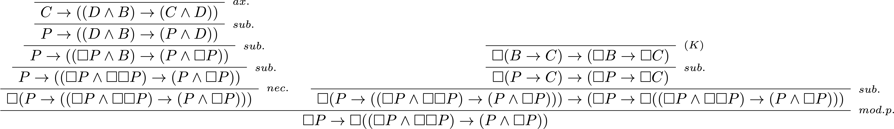
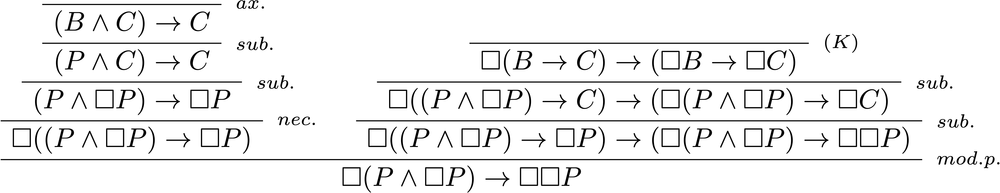
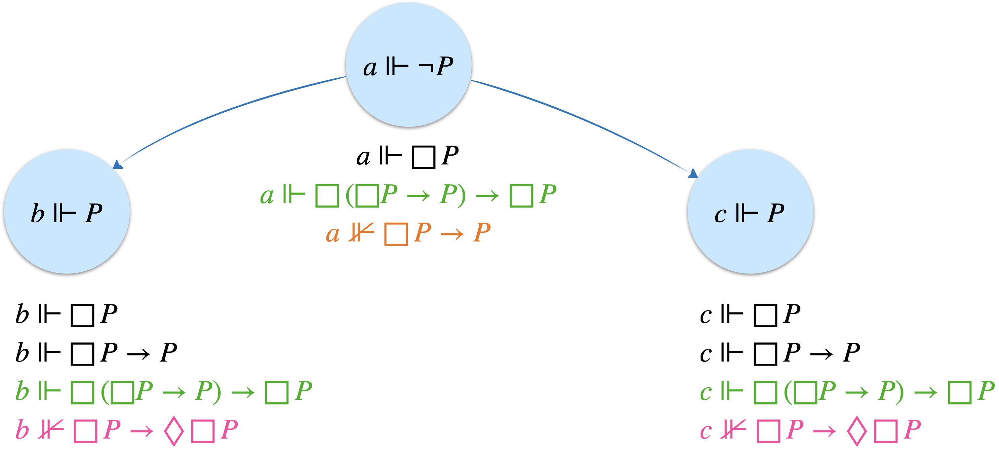
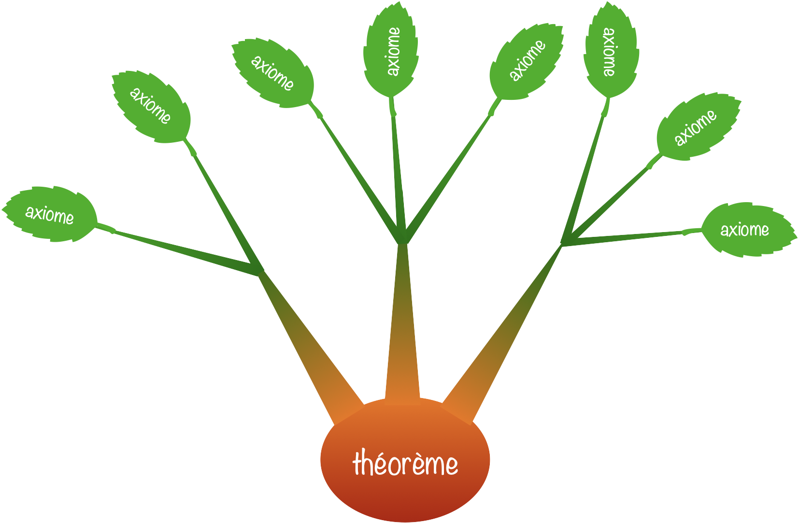

+++
title = "Prouvabilité et incomplétude"
date = 2026-11-13T10:00:00+01:00
weight = 4
css = "logique.css"
+++

# Prouvabilité et incomplétude

Quand l'arithmétique parle de ses propres preuves

Cette rubrique réunit les deux fils des précédentes. L'**arithmétique de Peano**, une théorie écrite en [calcul des prédicats](../predicats/), sait parler de ses propres démonstrations&nbsp;; la **boîte** de la [logique modale](../modale/) permet de mettre en forme ce qu'elle en dit. Plutôt que de suivre la démonstration classique des théorèmes de Gödel, entièrement menée dans l'arithmétique, on les lit ici avec les outils de la logique modale.

Voici sans doute l'usage le plus étonnant de la boîte. On lit désormais $\Box\phi$ comme «&nbsp;**$\phi$ est prouvable**&nbsp;» (dans une théorie fixée, par exemple l'arithmétique), et $\Diamond\phi=\neg\Box\neg\phi$ comme «&nbsp;on ne peut pas réfuter $\phi$&nbsp;», c'est-à-dire «&nbsp;$\phi$ est compatible avec la théorie&nbsp;». Avec ce simple changement de lecture, les théorèmes d'incomplétude de Gödel, réputés ardus, tiennent en quelques lignes de logique modale.

Gödel sur l'île des chevaliers et des filous

Dans *Forever Undecided* (1987), Raymond Smullyan fait tenir toute l'affaire dans une énigme. Un logicien visite l'île où les chevaliers disent toujours vrai et où les filous mentent toujours. Ce logicien est **fiable**&nbsp;: il ne croit jamais rien de faux. Un habitant lui déclare&nbsp;:

<i>«&nbsp;Vous ne croirez jamais que je suis un chevalier.&nbsp;»</i>

Si l'habitant était un filou, sa phrase serait fausse&nbsp;: le logicien finirait donc par croire que c'est un chevalier, et croirait une chose fausse, ce qui est exclu. C'est donc un chevalier, sa phrase est vraie… et le logicien ne le croira jamais. Il existe une vérité que ce logicien, pourtant irréprochable, ne peut pas atteindre.

Le plus piquant est que *nous* venons de le démontrer. Pourquoi le logicien ne tiendrait-il pas le même raisonnement&nbsp;? Parce que ce raisonnement s'appuie sur sa propre fiabilité&nbsp;: s'il s'en croyait assuré, il conclurait «&nbsp;c'est un chevalier&nbsp;», et la phrase deviendrait fausse. Un logicien fiable ne peut pas être certain de l'être. Remplacez «&nbsp;croire&nbsp;» par «&nbsp;prouver&nbsp;» et «&nbsp;fiable&nbsp;» par «&nbsp;cohérent&nbsp;»&nbsp;: ce sont les deux théorèmes de Gödel.

## Des nombres qui parlent de preuves

Souhaitant éprouver la solidité de l'édifice mathématique, et d'abord de l'arithmétique, Gödel imagine en 1931 une méthode astucieuse, une sorte de hack, pour faire parler l'arithmétique d'elle-même. Le cadre est l'arithmétique de Peano $\text{PA}$&nbsp;: une théorie, c'est-à-dire un ensemble d'axiomes, écrite en [logique du premier ordre](../predicats/preuve/#vers-larithmétique) et dont les entiers naturels sont un modèle. Gödel associe à chaque formule $\phi$ un numéro, son **code de Gödel**, noté $\ulcorner\phi\urcorner$. Un énoncé sur les nombres peut alors, de façon détournée, être un énoncé sur les formules.

Ce qui semblait à l'époque un tour de force est devenu banal à l'ère de l'informatique. Pour associer un nombre unique à une formule, il suffit de regarder le code binaire du fichier où elle est écrite (en ajoutant un «&nbsp;1&nbsp;» au début si ça commence par des «&nbsp;0&nbsp;»).

On peut coder de même un arbre de preuve complet, comme tout ce qu'on peut taper dans un traitement de texte. Dès lors, «&nbsp;$\phi$ est prouvable&nbsp;» devient une affirmation arithmétique&nbsp;: *il existe un entier qui est le code d'une preuve de la formule de code $\ulcorner\phi\urcorner$*. Gödel construit la formule qui dit cela et la baptise $\text{Bew}(x)$, de l'allemand *beweisbar*, «&nbsp;prouvable&nbsp;». Notre boîte n'est qu'une abréviation&nbsp;:

$\Box\phi$ désigne la formule arithmétique $\text{Bew}(\ulcorner\phi\urcorner)$.

Que sait l'arithmétique de sa propre prouvabilité&nbsp;? Trois choses, appelées **conditions de dérivabilité** (elles sont dues à Hilbert, Bernays et Löb), et qui vont nous rappeler des souvenirs&nbsp;:

<table class="tab-recap">
<tr><th>Ce que l'arithmétique démontre</th><th>Lecture</th><th>En logique modale</th></tr>
<tr><td>si $\vdash\phi$, alors $\vdash\Box\phi$</td><td class="g">une preuve de $\phi$ étant un objet fini, on peut vérifier que c'en est une</td><td class="g">règle de nécessitation</td></tr>
<tr><td>$\vdash\Box(\phi\rightarrow\psi)\rightarrow(\Box\phi\rightarrow\Box\psi)$</td><td class="g">les preuves s'enchaînent par <i>modus ponens</i></td><td class="g">axiome $\text{(K)}$</td></tr>
<tr><td>$\vdash\Box\phi\rightarrow\Box\Box\phi$</td><td class="g">si $\phi$ est prouvable, on peut prouver qu'elle l'est</td><td class="g">axiome $\text{(4)}$</td></tr>
</table>

Autrement dit, la prouvabilité se comporte comme la boîte de la logique $\textbf{K4}$, et tout ce qu'on démontre dans $\textbf{K4}$ est vrai de $\text{Bew}$. En revanche, on se gardera d'ajouter l'axiome $\text{(T)}=\Box\phi\rightarrow\phi$, «&nbsp;ce qui est prouvable est vrai&nbsp;». Il a l'air inoffensif, il est même *vrai* si la théorie est saine. Mais la théorie ne peut pas le *démontrer*, et c'est tout le sujet de cette section.

## Le lemme de diagonalisation

Il manque un ingrédient&nbsp;: des formules qui parlent d'elles-mêmes. À première vue, c'est impossible. Une formule qui contiendrait son propre code serait plus longue que ce code, lequel est au moins aussi long qu'elle… Un programme qui voudrait afficher son propre texte bute sur la même difficulté&nbsp;: `print("print(\"print(...)\")")` ne fait que repousser le problème indéfiniment.

L'astuce consiste à ne jamais citer le tout, mais seulement un **gabarit**, accompagné d'une **recette** pour reconstituer le tout à partir du gabarit. Le philosophe Quine en a donné une version en langue naturelle, sans jamais écrire «&nbsp;cette phrase&nbsp;»&nbsp;:

«&nbsp;précédé de sa propre citation, donne une phrase qui a la propriété $S$&nbsp;» précédé de sa propre citation, donne une phrase qui a la propriété $S$.

La phrase a deux morceaux&nbsp;: un gabarit, entre guillemets, et une recette qui dit quoi en faire («&nbsp;le faire précéder de sa propre citation&nbsp;»). Appliquée au gabarit, la recette reconstitue exactement la phrase entière. La phrase parle donc d'elle-même sans jamais se contenir.

Un programme qui s'affiche lui-même

Les informaticiens appellent ***quine***, en hommage au philosophe, un programme qui affiche son propre code. En Python, deux lignes suffisent (lancez-le, puis comparez le résultat au code)&nbsp;:


s = 's = %r\nprint(s %% s)'
print(s % s)


On y retrouve le découpage de Quine&nbsp;:
- la chaîne `s` est le **gabarit**, avec un trou `%r`&nbsp;;
- `s % s` est la **recette**&nbsp;: elle remplit le trou avec la citation de `s` (son texte entre guillemets), c'est-à-dire «&nbsp;précédé de sa propre citation&nbsp;»&nbsp;;
- le résultat est le texte complet du programme, qu'il ne reste qu'à afficher.

Rien n'oblige à se contenter d'afficher son code&nbsp;: le programme peut calculer ce qu'il veut à son sujet. Celui-ci compte les lettres «&nbsp;e&nbsp;» de son propre texte&nbsp;:


s = 's = %r\ncode = s %% s\nprint(code.count("e"), "lettres e dans mon propre code")'
code = s % s
print(code.count("e"), "lettres e dans mon propre code")


C'est exactement le lemme qui suit&nbsp;: pour n'importe quelle propriété $S$ (ici «&nbsp;compter les e&nbsp;»), on fabrique un objet qui applique $S$ à son propre code.

<b>Lemme de diagonalisation</b>&nbsp;: 
Pour toute formule arithmétique $S(x)$ à une variable libre, il existe un énoncé $\phi$ tel que

$\vdash\phi\leftrightarrow S(\ulcorner\phi\urcorner)$.

Une formule $S(x)$ à une [variable libre](../predicats/langage/#variables-libres-variables-liées) exprime une **propriété** des nombres&nbsp;: en remplaçant $x$ par un nombre $n$, on obtient un énoncé $S(n)$ qui dit si $n$ a cette propriété, comme «&nbsp;$x$ est pair&nbsp;» ou «&nbsp;$x$ est le code d'une formule prouvable&nbsp;». Et puisque chaque formule a un code, une propriété des nombres devient du même coup une propriété des formules&nbsp;: $S(\ulcorner\phi\urcorner)$ dit que la formule $\phi$ a la propriété $S$. Le lemme affirme donc que, quelle que soit la propriété $S$, il existe une formule qui dit d'elle-même «&nbsp;j'ai la propriété $S$&nbsp;». La preuve suit pas à pas la recette de Quine.

<b>Étape 1 : la recette $d$.</b> Si $n$ est le code d'une formule $A(x)$ à une variable libre, on note $d(n)$ le code de la formule obtenue en appliquant $A$ à son propre code&nbsp;:

$d(\ulcorner A(x)\urcorner)=\ulcorner A(\ulcorner A(x)\urcorner)\urcorner$.

Par exemple $d(\ulcorner x=0 \urcorner)=\ulcorner\,\ulcorner x=0 \urcorner = 0\,\urcorner$&nbsp;: la formule «&nbsp;$x$ est nul&nbsp;», appliquée à son propre code, affirme que son code est nul (ce qui est faux, mais peu importe). C'est le «&nbsp;précédé de sa propre citation&nbsp;» de Quine, ou le <code>s % s</code> du programme. La fonction $d$ se calcule mécaniquement (décoder, substituer, recoder)&nbsp;: l'arithmétique sait donc en parler.

<b>Étape 2 : le gabarit $g$.</b> On pose $g(x)=S(d(x))$, qui affirme «&nbsp;la diagonale de $x$ a la propriété $S$&nbsp;». C'est le gabarit entre guillemets de la phrase de Quine, ou la chaîne <code>s</code> du programme.

<b>Étape 3 : le gabarit appliqué à lui-même.</b> On pose $\phi=g(\ulcorner g(x)\urcorner)$.

<b>Étape 4 : la vérification.</b> Par définition de $g$, l'énoncé $\phi$ affirme $S\big(d(\ulcorner g(x)\urcorner)\big)$. Or, par définition de $d$, $d(\ulcorner g(x)\urcorner)=\ulcorner g(\ulcorner g(x)\urcorner)\urcorner=\ulcorner\phi\urcorner$. L'énoncé $\phi$ affirme donc $S(\ulcorner\phi\urcorner)$&nbsp;: il dit de lui-même qu'il a la propriété $S$. Comme ce calcul de $d$ est mécanique, l'arithmétique sait le refaire, et elle démontre $\phi\leftrightarrow S(\ulcorner\phi\urcorner)$.

Le schéma ci-dessous montre pourquoi l'on parle de **diagonalisation**. On range toutes les formules à une variable en lignes et tous les codes $n_0, n_1,\ldots$ en colonnes&nbsp;; la case $A_i(n_j)$ applique la formule $A_i$ au code de $A_j$. La recette $d$ parcourt la diagonale (en rose), où chaque formule est appliquée à son propre code.

<svg viewBox="0 0 560 300" role="img" aria-label="Tableau diagonal : lignes = formules, colonnes = codes ; la ligne de g renvoie à la diagonale et, dans sa propre colonne, à elle-même" style="width:100%;max-width:560px;height:auto;">
<defs><marker id="dg-fl" viewBox="0 0 10 10" refX="8" refY="5" markerWidth="7" markerHeight="7" orient="auto-start-reverse"><path d="M0,0 L10,5 L0,10 z" fill="#004D80"/></marker></defs>
<text x="144.0" y="32" text-anchor="middle" font-size="16" fill="#334155" font-family="Georgia,'Times New Roman',serif" font-style="italic">n<tspan dy="4" font-size="11">0</tspan><tspan dy="-4"></tspan></text>
<text x="248.0" y="32" text-anchor="middle" font-size="16" fill="#334155" font-family="Georgia,'Times New Roman',serif" font-style="italic">n<tspan dy="4" font-size="11">1</tspan><tspan dy="-4"></tspan></text>
<text x="352.0" y="32" text-anchor="middle" font-size="16" fill="#334155" font-family="Georgia,'Times New Roman',serif" font-style="italic">n<tspan dy="4" font-size="11" font-style="italic">g</tspan><tspan dy="-4"></tspan></text>
<text x="456.0" y="32" text-anchor="middle" font-size="16" fill="#334155" font-family="Georgia,'Times New Roman',serif" font-style="italic">n<tspan dy="4" font-size="11">3</tspan><tspan dy="-4"></tspan></text>
<text x="528" y="32" text-anchor="middle" font-size="16" fill="#94a3b8" font-family="Georgia,'Times New Roman',serif">…</text>
<text x="78" y="78.0" text-anchor="end" font-size="16" fill="#334155" font-family="Georgia,'Times New Roman',serif" font-style="italic">A<tspan dy="4" font-size="11">0</tspan><tspan dy="-4"></tspan></text>
<rect x="94" y="48" width="100" height="50" rx="6" fill="#FBE9EF" stroke="#e2e8f0" stroke-width="1"/>
<text x="144.0" y="78.0" text-anchor="middle" font-size="15" fill="#970E53" font-family="Georgia,'Times New Roman',serif" font-style="italic">A<tspan dy="4" font-size="11">0</tspan><tspan dy="-4">(n<tspan dy="4" font-size="11">0</tspan><tspan dy="-4">)</tspan></tspan></text>
<rect x="198" y="48" width="100" height="50" rx="6" fill="#ffffff" stroke="#e2e8f0" stroke-width="1"/>
<text x="248.0" y="78.0" text-anchor="middle" font-size="15" fill="#475569" font-family="Georgia,'Times New Roman',serif" font-style="italic">A<tspan dy="4" font-size="11">0</tspan><tspan dy="-4">(n<tspan dy="4" font-size="11">1</tspan><tspan dy="-4">)</tspan></tspan></text>
<rect x="302" y="48" width="100" height="50" rx="6" fill="#ffffff" stroke="#e2e8f0" stroke-width="1"/>
<text x="352.0" y="78.0" text-anchor="middle" font-size="15" fill="#475569" font-family="Georgia,'Times New Roman',serif" font-style="italic">A<tspan dy="4" font-size="11">0</tspan><tspan dy="-4">(n<tspan dy="4" font-size="11" font-style="italic">g</tspan><tspan dy="-4">)</tspan></tspan></text>
<rect x="406" y="48" width="100" height="50" rx="6" fill="#ffffff" stroke="#e2e8f0" stroke-width="1"/>
<text x="456.0" y="78.0" text-anchor="middle" font-size="15" fill="#475569" font-family="Georgia,'Times New Roman',serif" font-style="italic">A<tspan dy="4" font-size="11">0</tspan><tspan dy="-4">(n<tspan dy="4" font-size="11">3</tspan><tspan dy="-4">)</tspan></tspan></text>
<text x="528" y="78.0" text-anchor="middle" font-size="16" fill="#94a3b8" font-family="Georgia,'Times New Roman',serif">…</text>
<text x="78" y="132.0" text-anchor="end" font-size="16" fill="#334155" font-family="Georgia,'Times New Roman',serif" font-style="italic">A<tspan dy="4" font-size="11">1</tspan><tspan dy="-4"></tspan></text>
<rect x="94" y="102" width="100" height="50" rx="6" fill="#ffffff" stroke="#e2e8f0" stroke-width="1"/>
<text x="144.0" y="132.0" text-anchor="middle" font-size="15" fill="#475569" font-family="Georgia,'Times New Roman',serif" font-style="italic">A<tspan dy="4" font-size="11">1</tspan><tspan dy="-4">(n<tspan dy="4" font-size="11">0</tspan><tspan dy="-4">)</tspan></tspan></text>
<rect x="198" y="102" width="100" height="50" rx="6" fill="#FBE9EF" stroke="#e2e8f0" stroke-width="1"/>
<text x="248.0" y="132.0" text-anchor="middle" font-size="15" fill="#970E53" font-family="Georgia,'Times New Roman',serif" font-style="italic">A<tspan dy="4" font-size="11">1</tspan><tspan dy="-4">(n<tspan dy="4" font-size="11">1</tspan><tspan dy="-4">)</tspan></tspan></text>
<rect x="302" y="102" width="100" height="50" rx="6" fill="#ffffff" stroke="#e2e8f0" stroke-width="1"/>
<text x="352.0" y="132.0" text-anchor="middle" font-size="15" fill="#475569" font-family="Georgia,'Times New Roman',serif" font-style="italic">A<tspan dy="4" font-size="11">1</tspan><tspan dy="-4">(n<tspan dy="4" font-size="11" font-style="italic">g</tspan><tspan dy="-4">)</tspan></tspan></text>
<rect x="406" y="102" width="100" height="50" rx="6" fill="#ffffff" stroke="#e2e8f0" stroke-width="1"/>
<text x="456.0" y="132.0" text-anchor="middle" font-size="15" fill="#475569" font-family="Georgia,'Times New Roman',serif" font-style="italic">A<tspan dy="4" font-size="11">1</tspan><tspan dy="-4">(n<tspan dy="4" font-size="11">3</tspan><tspan dy="-4">)</tspan></tspan></text>
<text x="528" y="132.0" text-anchor="middle" font-size="16" fill="#94a3b8" font-family="Georgia,'Times New Roman',serif">…</text>
<text x="78" y="186.0" text-anchor="end" font-size="16" fill="#334155" font-family="Georgia,'Times New Roman',serif" font-style="italic">g</text>
<rect x="94" y="156" width="100" height="50" rx="6" fill="#E8F0F7" stroke="#e2e8f0" stroke-width="1"/>
<text x="136.0" y="186.0" text-anchor="middle" font-size="15" fill="#004D80" font-family="Georgia,'Times New Roman',serif" font-style="italic">g(n<tspan dy="4" font-size="11">0</tspan><tspan dy="-4">)</tspan></text>
<rect x="198" y="156" width="100" height="50" rx="6" fill="#E8F0F7" stroke="#e2e8f0" stroke-width="1"/>
<text x="240.0" y="186.0" text-anchor="middle" font-size="15" fill="#004D80" font-family="Georgia,'Times New Roman',serif" font-style="italic">g(n<tspan dy="4" font-size="11">1</tspan><tspan dy="-4">)</tspan></text>
<rect x="302" y="156" width="100" height="50" rx="6" fill="#F3E6F0" stroke="#970E53" stroke-width="2"/>
<text x="345.0" y="186.0" text-anchor="middle" font-size="15" fill="#970E53" font-family="Georgia,'Times New Roman',serif" font-style="italic">g(n<tspan dy="4" font-size="11" font-style="italic">g</tspan><tspan dy="-4">)</tspan></text>
<rect x="406" y="156" width="100" height="50" rx="6" fill="#E8F0F7" stroke="#e2e8f0" stroke-width="1"/>
<text x="448.0" y="186.0" text-anchor="middle" font-size="15" fill="#004D80" font-family="Georgia,'Times New Roman',serif" font-style="italic">g(n<tspan dy="4" font-size="11">3</tspan><tspan dy="-4">)</tspan></text>
<text x="528" y="186.0" text-anchor="middle" font-size="16" fill="#94a3b8" font-family="Georgia,'Times New Roman',serif">…</text>
<text x="78" y="240.0" text-anchor="end" font-size="16" fill="#334155" font-family="Georgia,'Times New Roman',serif" font-style="italic">A<tspan dy="4" font-size="11">3</tspan><tspan dy="-4"></tspan></text>
<rect x="94" y="210" width="100" height="50" rx="6" fill="#ffffff" stroke="#e2e8f0" stroke-width="1"/>
<text x="144.0" y="240.0" text-anchor="middle" font-size="15" fill="#475569" font-family="Georgia,'Times New Roman',serif" font-style="italic">A<tspan dy="4" font-size="11">3</tspan><tspan dy="-4">(n<tspan dy="4" font-size="11">0</tspan><tspan dy="-4">)</tspan></tspan></text>
<rect x="198" y="210" width="100" height="50" rx="6" fill="#ffffff" stroke="#e2e8f0" stroke-width="1"/>
<text x="248.0" y="240.0" text-anchor="middle" font-size="15" fill="#475569" font-family="Georgia,'Times New Roman',serif" font-style="italic">A<tspan dy="4" font-size="11">3</tspan><tspan dy="-4">(n<tspan dy="4" font-size="11">1</tspan><tspan dy="-4">)</tspan></tspan></text>
<rect x="302" y="210" width="100" height="50" rx="6" fill="#ffffff" stroke="#e2e8f0" stroke-width="1"/>
<text x="352.0" y="240.0" text-anchor="middle" font-size="15" fill="#475569" font-family="Georgia,'Times New Roman',serif" font-style="italic">A<tspan dy="4" font-size="11">3</tspan><tspan dy="-4">(n<tspan dy="4" font-size="11" font-style="italic">g</tspan><tspan dy="-4">)</tspan></tspan></text>
<rect x="406" y="210" width="100" height="50" rx="6" fill="#FBE9EF" stroke="#e2e8f0" stroke-width="1"/>
<text x="456.0" y="240.0" text-anchor="middle" font-size="15" fill="#970E53" font-family="Georgia,'Times New Roman',serif" font-style="italic">A<tspan dy="4" font-size="11">3</tspan><tspan dy="-4">(n<tspan dy="4" font-size="11">3</tspan><tspan dy="-4">)</tspan></tspan></text>
<text x="528" y="240.0" text-anchor="middle" font-size="16" fill="#94a3b8" font-family="Georgia,'Times New Roman',serif">…</text>
<text x="248.0" y="280" text-anchor="middle" font-size="16" fill="#94a3b8" font-family="Georgia,'Times New Roman',serif">⋮</text>
<path d="M184.0,167.0 L184.0,87.0" stroke="#004D80" stroke-width="1.6" fill="none" marker-end="url(#dg-fl)"/>
<path d="M288.0,167.0 L288.0,141.0" stroke="#004D80" stroke-width="1.6" fill="none" marker-end="url(#dg-fl)"/>
<path d="M496.0,195.0 L496.0,221.0" stroke="#004D80" stroke-width="1.6" fill="none" marker-end="url(#dg-fl)"/>
<path d="M377.37,176.23 A9.0 9.0 0 1 1 377.54,186.03" stroke="#970E53" stroke-width="1.6" fill="none" stroke-linecap="round"/><path d="M376.00,181.00 L381.30,185.62 L374.91,187.95 Z" fill="#970E53"/>
<text x="352.0" y="280" text-anchor="middle" font-size="14" fill="#970E53" font-family="Georgia,'Times New Roman',serif" font-style="italic">φ = g(n<tspan dy="4" font-size="10">g</tspan><tspan dy="-4">)</tspan></text>
</svg>

La ligne de $g$ (en bleu) parle de la diagonale&nbsp;: sa case de la colonne $n_j$ affirme que la case diagonale $A_j(n_j)$ a la propriété $S$. Dans la colonne de $g$ elle-même, la case diagonale visée est… la case de départ&nbsp;: $\phi=g(n_g)$ parle d'elle-même.

C'est le même mouvement que l'argument diagonal de Cantor, à une différence près. Cantor modifie la diagonale pour fabriquer un objet qui n'est dans aucune ligne. Ici, la ligne $g$ fait partie du tableau, et elle finit par croiser sa propre diagonale&nbsp;: au lieu d'une contradiction, on obtient un **point fixe**.

<table class="tab-recap">
<tr><th></th><th>Quine</th><th>Python</th><th>Arithmétique</th></tr>
<tr><td class="g"><b>gabarit</b></td><td>«&nbsp;précédé de sa propre citation, donne…&nbsp;»</td><td>la chaîne <code>s</code></td><td>$g(x)=S(d(x))$</td></tr>
<tr><td class="g"><b>recette</b></td><td>précéder de sa citation</td><td><code>s % s</code></td><td>$d$</td></tr>
<tr><td class="g"><b>résultat</b></td><td>la phrase entière</td><td>le texte du programme</td><td>$\phi=g(\ulcorner g(x)\urcorner)$</td></tr>
<tr><td class="g"><b>ce qu'il en dit</b></td><td>«&nbsp;a la propriété $S$&nbsp;»</td><td><code>print</code>, <code>count("e")</code></td><td>$S(\ulcorner\phi\urcorner)$</td></tr>
</table>

## Le premier théorème d'incomplétude

Appliquons le lemme à la propriété «&nbsp;ne pas être prouvable&nbsp;», c'est-à-dire à $S(x)=\neg\text{Bew}(x)$. On obtient la célèbre **formule de Gödel** $G$&nbsp;:

$\vdash G\leftrightarrow\neg\Box G$ &nbsp;&nbsp;&nbsp; («&nbsp;je ne suis pas prouvable&nbsp;»)

Elle ressemble au paradoxe du menteur, «&nbsp;cette phrase est fausse&nbsp;», à une nuance près qui change tout. Le menteur parle de *vérité* et mène à une contradiction. $G$ parle de *prouvabilité* et ne mène qu'à une surprise. En effet, si $G$ était prouvable, on aurait $\vdash G$, donc $\vdash\Box G$ par nécessitation&nbsp;; mais $G$ entraîne $\neg\Box G$, et la théorie prouverait une chose et son contraire. Dans une théorie cohérente, $G$ n'est donc pas prouvable. Or c'est exactement ce qu'elle affirme&nbsp;: **$G$ est vraie et non prouvable**.

<b>Premier théorème d'incomplétude</b>&nbsp;: 
Dans toute théorie cohérente (on ne peut pas y prouver le faux), dont on sait reconnaître mécaniquement les axiomes et assez expressive pour décrire l'arithmétique, il existe un énoncé vrai qui n'est pas prouvable. La prouvabilité est plus faible que la vérité.

Ajouter $G$ aux axiomes ne répare rien&nbsp;: la nouvelle théorie a sa propre formule de Gödel, et tout recommence.

Le raisonnement ci-dessus se formalise entièrement dans la logique $\textbf{K4}$&nbsp;: à partir de $\vdash G\leftrightarrow\neg\Box G$, on arrive à $\vdash\neg\Box\bot\rightarrow\neg\Box G$, «&nbsp;si aucune contradiction n'est prouvable, alors $G$ n'est pas prouvable&nbsp;».

<ol>
<li>$G\leftrightarrow\neg\Box G$</li>
<li>$\Box G\rightarrow\neg G$ (à partir de 1.)</li>
<li>$\Box(\Box G\rightarrow\neg G)$ (nécessitation)</li>
<li>$\Box\Box G\rightarrow\Box\neg G$ (distribution de la boîte grâce à $\text{(K)}$)</li>
<li>$\Box G\rightarrow\Box\neg G$ (par l'axiome $\text{(4)}= \Box G\rightarrow\Box\Box G$ et avec l'étape 4., on déduit $\Box G\rightarrow\Box\Box G\rightarrow\Box\neg G$)</li>
<li>$\Box G\rightarrow(\Box G\land\Box\neg G)$ (à partir de 5. et $\Box G\rightarrow\Box G$)</li>
<li>$\Box G\rightarrow\Box(G\land \neg G)$ (la boîte se distribue sur la conjonction)</li>
<li>$\Box G\rightarrow\Box\bot$</li>
<li>$\neg\Box\bot\rightarrow \neg\Box G$ (contraposée de 8.)</li>
</ol>

Ce petit calcul a une conséquence considérable. La formule $\neg\Box\bot$ dit «&nbsp;le faux n'est pas prouvable&nbsp;»&nbsp;: c'est la théorie qui affirme sa propre **cohérence**. Or la ligne 9 et la ligne 1 donnent ensemble $\vdash\neg\Box\bot\rightarrow G$. Si la théorie prouvait sa cohérence, elle prouverait donc $G$, ce qui est impossible. Une théorie cohérente ne peut pas prouver qu'elle l'est&nbsp;! C'est le second théorème d'incomplétude, que l'on va retrouver par un chemin plus général.

Königsberg, septembre 1930

David Hilbert rêvait de mettre les mathématiques à l'abri du doute en démontrant, par des moyens élémentaires et incontestables, que leurs axiomes ne mènent à aucune contradiction. Le 8 septembre 1930, dans sa ville natale de Königsberg, il conclut une allocution restée célèbre par ces mots, aujourd'hui gravés sur sa tombe&nbsp;: «&nbsp;*Wir müssen wissen, wir werden wissen*&nbsp;», nous devons savoir, nous saurons.

La veille, dans la même ville, à la fin d'une table ronde sur les fondements des mathématiques, un jeune homme de vingt-quatre ans avait indiqué en quelques phrases prudentes qu'il existait des énoncés arithmétiques vrais et indémontrables. Presque personne ne releva. John von Neumann, lui, comprit sur-le-champ, et écrivit à Gödel quelques semaines plus tard qu'il en avait tiré une conséquence remarquable&nbsp;: l'impossibilité de prouver la cohérence. Gödel lui répondit, courtoisement, qu'il venait de l'envoyer à l'imprimeur.

## Le théorème de Löb

En 1952, le logicien Leon Henkin pose la question miroir. On sait ce que vaut la formule qui dit «&nbsp;je ne suis pas prouvable&nbsp;». Que dire de celle qui affirme «&nbsp;**je suis prouvable**&nbsp;», $\vdash H\leftrightarrow\Box H$&nbsp;? Elle évoque non plus le menteur mais le diseur de vérité, «&nbsp;ce que je dis là est vrai&nbsp;», auquel aucune valeur de vérité ne semble s'imposer puisqu'un menteur dirait la même chose.

La réponse, donnée par Martin Löb en 1955, est une surprise&nbsp;: $H$ est prouvable, et donc vraie. C'est un cas particulier d'un résultat général.

Le <b>théorème de Löb</b> stipule que les seules formules $\phi$ pour lesquelles on peut prouver $\Box\phi\rightarrow\phi$ sont les formules prouvables&nbsp;:

Si $\vdash\Box\phi\rightarrow\phi$, alors $\vdash \phi$.

Le théorème affirme donc que si on peut prouver une formule en admettant qu'elle est prouvable, alors on peut la prouver tout court. C'est une sorte de méthode Coué logique, une prophétie autoréalisatrice&nbsp;: «&nbsp;si tu crois en toi, ça va le faire&nbsp;». C'est bizarre, mais ça se démontre.

Lu dans l'autre sens, il est tout aussi troublant. On aimerait que la théorie sache, pour chaque $\phi$, que «&nbsp;si $\phi$ est prouvable, alors $\phi$ est vraie&nbsp;». Löb nous dit qu'elle ne le démontre *que* pour les $\phi$ qu'elle démontre déjà, c'est-à-dire quand cela ne sert plus à rien. Voilà pourquoi $\text{(T)}$ ne peut pas être un axiome de la prouvabilité.

Preuve du théorème de Löb&nbsp;:

On suppose $\vdash \Box\phi\rightarrow\phi$. 
Grâce au lemme de diagonalisation, on construit la formule arithmétique autoréférente suivante&nbsp;: 
$\vdash\sigma\leftrightarrow (\Box\sigma\rightarrow\phi)$ («&nbsp;si je suis prouvable, alors $\phi$&nbsp;»). 

<ol>
<li>$\vdash\Box(\sigma\rightarrow (\Box\sigma\rightarrow\phi))$ (sens direct de la formule autoréférente, puis nécessitation)</li>
<li>$\vdash\Box\sigma\rightarrow \Box(\Box\sigma\rightarrow\phi)$ puis $\vdash\Box\sigma\rightarrow (\Box\Box\sigma\rightarrow\Box\phi)$ (distribution de la boîte grâce à $\text{(K)}$, deux fois)</li>
<li>Comme $\vdash \Box\sigma\rightarrow\Box\Box\sigma$ par $\text{(4)}$, on en tire $\vdash \Box\sigma\rightarrow\Box\phi$</li>
<li>$\vdash \Box\sigma\rightarrow\phi$ (car $\vdash \Box\sigma\rightarrow\Box\phi\rightarrow\phi$ puisqu'on suppose $\vdash \Box\phi\rightarrow\phi$)</li>
<li>$\vdash (\Box\sigma\rightarrow\phi)\rightarrow\sigma$ (sens réciproque de la formule autoréférente)</li>
<li>$\vdash\sigma$ par <i>modus ponens</i> de 4. et 5.</li>
<li>$\vdash\Box\sigma$ par nécessitation.</li>
<li>$\vdash \phi$  par <i>modus ponens</i> de 4. et 7.</li>
</ol>

Le père Noël existe

Smullyan adorait «&nbsp;démontrer&nbsp;» l'existence du père Noël à l'aide de la phrase suivante&nbsp;:

<i>«&nbsp;Si cette phrase est vraie, alors le père Noël existe.&nbsp;»</i>

Supposons la phrase vraie. Alors ce qu'elle dit a lieu&nbsp;: si elle est vraie, le père Noël existe. Comme on l'a supposée vraie, le père Noël existe. Nous venons de montrer que *si la phrase est vraie, alors le père Noël existe*… or c'est précisément la phrase. Elle est donc vraie, et le père Noël existe.

C'est le paradoxe de Curry, et la preuve de Löb en est la copie conforme, où «&nbsp;vraie&nbsp;» est remplacé par «&nbsp;prouvable&nbsp;»&nbsp;: la formule $\sigma$ dit «&nbsp;si je suis prouvable, alors $\phi$&nbsp;». Avec la vérité, on obtient une absurdité, signe qu'un langage ne peut pas contenir son propre prédicat de vérité (c'est un théorème de Tarski). Avec la prouvabilité, qui s'exprime bel et bien dans l'arithmétique, on obtient un théorème.

## Le second théorème d'incomplétude

<b>Second théorème d'incomplétude</b>&nbsp;: 
Une théorie cohérente, dont on sait reconnaître mécaniquement les axiomes et qui contient l'arithmétique, ne peut pas prouver sa propre cohérence. Les seules théories de ce type qui «&nbsp;prouvent&nbsp;» leur cohérence sont celles qui sont incohérentes, et qui prouvent donc n'importe quoi…

Ce théorème n'est autre que le théorème de Löb appliqué à $\phi=\bot$&nbsp;!

La formule $\Box\bot\rightarrow\bot$ équivaut à $\neg\Box\bot$, l'énoncé de cohérence. Le théorème de Löb devient donc&nbsp;: si $\vdash\neg\Box\bot$, alors $\vdash\bot$. Par contraposition, si la théorie est cohérente ($\nvdash\bot$), alors elle ne prouve pas sa cohérence ($\nvdash\neg\Box\bot$).

Par dualité, $\Diamond P = \neg\Box\neg P$ exprime qu'on ne peut pas prouver que $P$ est fausse, autrement dit que $P$ est compatible avec la théorie. L'énoncé de cohérence $\neg\Box\bot$ s'écrit alors simplement $\Diamond\top$, et le second théorème prend, à l'intérieur même de la théorie, la forme $\Diamond\top\rightarrow \neg\Box\Diamond \top$&nbsp;: «&nbsp;si la théorie est cohérente, alors elle ne peut pas le prouver&nbsp;».

C'est la fin du programme de Hilbert sous sa forme initiale&nbsp;: pour prouver la cohérence de l'arithmétique, il faut des moyens qui la dépassent. Gerhard Gentzen, l'inventeur de la déduction naturelle et du calcul des séquents, y parviendra en 1936 au prix d'une récurrence sur des ordinaux infinis.

## La logique GL

Le théorème de Löb peut lui-même être démontré *par* la théorie, ce qui en donne une version internalisée, devenue un axiome.

La <b>logique de la prouvabilité de Gödel-Löb</b> ($\textbf{GL}$) est formée à partir du système $\textbf{K}$ auquel on ajoute l'axiome de Löb $\text{(L)}=\Box(\Box\phi\rightarrow\phi)\rightarrow\Box\phi$ (c'est la version formalisée du théorème de Löb).

Avec $\phi=\bot$, l'axiome $\text{(L)}$ donne $\Box\neg\Box\bot\rightarrow\Box\bot$, soit, par contraposition et en notation diamant, $\Diamond\top\rightarrow\neg\Box\Diamond\top$&nbsp;: on retrouve en une ligne le second théorème d'incomplétude.

On remarque que l'axiome $\text{(4)}$, dont on s'est tant servi, ne figure pas dans la définition. C'est qu'il est devenu superflu.

$\vdash_\textbf{GL}\text{(4)}=\Box\phi\rightarrow\Box\Box \phi$

Et donc $\textbf{K4}≤\textbf{GL}$ ($\textbf{K4}$ se réduit à $\textbf{GL}$).

Obtention d'un premier théorème&nbsp;: $\vdash_\textbf{K}\Box P\rightarrow \Box ((\Box P\land \Box\Box P)\rightarrow(P\land \Box P))$

Puis d'un deuxième&nbsp;: $\vdash_\textbf{K}\Box (P\land\Box P)\rightarrow \Box\Box P$

On les imbrique à l'aide de l'axiome de Löb $\text{(L)}$. Deux nouvelles abréviations apparaissent dans l'arbre&nbsp;: <i>rempl.</i> désigne le remplacement d'une sous-formule par une formule équivalente (ici $\Box(P\land\Box P)$ par $\Box P\land\Box\Box P$, grâce au théorème de $\textbf{K}$&nbsp;: $\Box(A\land B)\leftrightarrow(\Box A\land\Box B)$), et <i>syll.</i> le syllogisme&nbsp;: de $X\rightarrow Y$ et $Y\rightarrow Z$, on tire $X\rightarrow Z$.

$$
\begin{prooftree}
\AxiomC{}
\RightLabel{$\scriptstyle th.1$}
\UnaryInfC{$\Box P\to\Box((\Box P\land\Box\Box P)\to(P\land\Box P))$}
\AxiomC{}
\RightLabel{$\scriptstyle (L)$}
\UnaryInfC{$\Box(\Box A\to A)\to\Box A$}
\RightLabel{$\scriptstyle sub.$}
\UnaryInfC{$\Box(\Box(P\land\Box P)\to(P\land\Box P))\to\Box(P\land\Box P)$}
\RightLabel{$\scriptstyle rempl.$}
\UnaryInfC{$\Box((\Box P\land\Box\Box P)\to(P\land\Box P))\to\Box(P\land\Box P)$}
\RightLabel{$\scriptstyle syll.$}
\BinaryInfC{$\Box P\to\Box(P\land\Box P)$}
\AxiomC{}
\RightLabel{$\scriptstyle th.2$}
\UnaryInfC{$\Box(P\land\Box P)\to\Box\Box P$}
\RightLabel{$\scriptstyle syll.$}
\BinaryInfC{$\Box P\to\Box\Box P$}
\end{prooftree}
$$

Tout système de transition qui valide $\textbf{GL}$ valide donc $\text{(4)}$&nbsp;: il est **transitif**&nbsp;!

À quoi ressemblent les mondes de la prouvabilité&nbsp;? Certainement pas à ceux de la connaissance. Le modèle ci-dessous valide $\color{#1DB100}\text{(L)}$ en chacun de ses nœuds, mais on y voit échouer, au nœud $a$, l'axiome $\color{#F27200}\text{(T)}=\Box P \rightarrow  P$ ainsi que $\color{#FF42A1}\neg P\rightarrow \Box\Diamond\neg P$, une instance de l'axiome $\text{(B)}$.

Les deux échecs ont un sens. Celui de $\text{(T)}$ confirme que $\textbf{GL}$ ne prouve pas «&nbsp;ce qui est prouvable est vrai&nbsp;». Celui de $\text{(B)}$ tient à l'absence de retour&nbsp;: $a$ voit $b$, mais $b$, cul-de-sac, ne voit rien du tout, et rien n'y est donc possible, pas même $\neg P$. Dans un cul-de-sac, tout est nécessaire et rien n'est possible&nbsp;: $\textbf{GL}$ ne prouve donc ni l'axiome $\text{(D)}$, ni même $\Diamond\top$, sa propre cohérence. Les culs-de-sac ne sont pas un accident, ils sont indispensables, comme le montre la caractérisation suivante.

Un système de transition valide $\text{(L)}$ si et seulement s'il est <b>transitif</b> et ne contient <b>aucun chemin infini</b> $a_0\longrightarrow a_1\longrightarrow a_2\longrightarrow\cdots$

En particulier, un tel système est <b>irréflexif</b> (une boucle $a\longrightarrow a$ est un chemin infini $a\longrightarrow a\longrightarrow a\longrightarrow\cdots$) et <b>asymétrique</b> (un aller-retour $a\longrightarrow b\longrightarrow a$ aussi), et tout chemin finit dans un cul-de-sac.

Montrons le sens qui nous importe&nbsp;: dans un système $\mathcal{T}=(N,A)$ transitif et sans chemin infini, l'axiome de Löb est valide.

Supposons au contraire qu'il ne soit pas satisfait en un nœud $a$, pour une certaine valuation. On a donc $\langle \mathcal{T},a\rangle \not\models \Box(\Box P\rightarrow P)\rightarrow \Box P$, ce qui implique&nbsp;:

<ol>
<li>$\langle \mathcal{T},a\rangle \models \Box(\Box P\rightarrow P)$, et</li>
<li> $\langle \mathcal{T},a\rangle \not\models  \Box P$.</li>
</ol>

La deuxième affirmation entraîne qu'il existe un nœud $a'\in N$ tel que $a\longrightarrow a'$ et $\langle \mathcal{T},a'\rangle \not\models  P$. 
Par contre, la première affirmation nous assure que $\langle \mathcal{T},a'\rangle \models \Box P\rightarrow P$. 
Par conséquent $\langle \mathcal{T},a'\rangle \not\models \Box P$. Cela signifie qu'il existe un nœud $a''\in N$, successeur de $a'$ ($a'\longrightarrow a''$) tel que  $\langle \mathcal{T},a''\rangle \not\models P$. 
Par transitivité, $a \longrightarrow a''$. Or si on retourne à l'affirmation 1., on a aussi $\langle \mathcal{T},a''\rangle \models \Box P\rightarrow P$, et le même raisonnement fournit un successeur $a'''$ de $a''$, puis un autre, et ainsi de suite. On construit de fil en aiguille un chemin infini $a\longrightarrow a'\longrightarrow a''\longrightarrow\cdots$, ce qui est exclu.

Pour la réciproque, contentons-nous de voir pourquoi une boucle est interdite. Si $a\longrightarrow a$, on choisit la valuation où $P$ est fausse en $a$ et vraie partout ailleurs. Alors $\Box P$ est fausse en $a$, et $\Box P\rightarrow P$ est vraie partout (en $a$ parce que $\Box P$ y est fausse, ailleurs parce que $P$ y est vraie). Le nœud $a$ force donc $\Box(\Box P\rightarrow P)$ sans forcer $\Box P$&nbsp;: l'axiome de Löb y est en défaut.

Les exemples les plus simples de tels systèmes sont les **arbres finis**, où une flèche relie chaque nœud à tous ses descendants (c'est la transitivité). Et il se trouve qu'ils suffisent. C'est plutôt génial que cette logique de la prouvabilité s'exprime naturellement sur des arbres finis, qui représentent intuitivement la notion de preuve (la racine représentant la formule prouvée, et les feuilles les axiomes).

Notons $\mathscr{C}\_{\text{arbres finis}}$ la classe de ces arbres finis transitifs.

<b>Correction et complétude</b>&nbsp;:

$\vdash_\textbf{GL} \phi$ si et seulement si $\models_{\mathscr{C}_{\text{arbres finis}}}\phi$.

La correction découle de ce qui précède&nbsp;: l'axiome $\text{(K)}$ est valide partout, $\text{(L)}$ l'est dans tout arbre fini transitif, et les règles de la logique modale normale conservent la validité. La complétude, due à Krister Segerberg (1971), est plus délicate, car la méthode du modèle canonique du chapitre précédent ne s'applique plus telle quelle. Elle a une conséquence pratique agréable&nbsp;: pour savoir si une formule est un théorème de $\textbf{GL}$, il suffit de chercher un contre-exemple parmi des arbres finis de taille bornée. La logique $\textbf{GL}$ est **décidable**, alors que l'arithmétique, elle, ne l'est pas.

## Retour à l'arithmétique&nbsp;: le théorème de Solovay

Reste la question essentielle. On a justifié les axiomes de $\textbf{GL}$ par des propriétés de la prouvabilité arithmétique. Mais en a-t-on oublié&nbsp;? Existe-t-il d'autres lois générales de la prouvabilité, que $\textbf{GL}$ ne verrait pas&nbsp;?

Pour donner un sens précis à la question, on appelle **traduction arithmétique** d'une formule modale le résultat obtenu en remplaçant chaque variable $P$, $Q$,… par un énoncé arithmétique de son choix, et chaque $\Box$ par $\text{Bew}$.

<b>Théorème de Solovay</b> (1976)&nbsp;: 
Une formule modale est un théorème de $\textbf{GL}$ si et seulement si <i>toutes</i> ses traductions arithmétiques sont prouvables dans $\text{PA}$.

Le sens direct est la **correction arithmétique** de $\textbf{GL}$&nbsp;: c'est le travail fait plus haut. La réciproque, sa **complétude arithmétique**, est le tour de force de Robert Solovay&nbsp;: si une formule modale n'est pas un théorème de $\textbf{GL}$, il existe un arbre fini qui la réfute, et Solovay parvient à «&nbsp;plonger&nbsp;» cet arbre dans l'arithmétique pour fabriquer des énoncés qui la réfutent aussi.

La boucle est bouclée. Tout ce que l'arithmétique est capable de démontrer, en toute généralité, sur sa propre prouvabilité tient dans un axiome, $\text{(L)}$, et se lit sur de petits arbres finis. Il est rare qu'un sujet aussi vertigineux se laisse résumer aussi simplement.

<nav class="suite-nav" aria-label="Chapitre précédent et suivant">
<a href="../predicats/preuve/" class="precedent">← Précédent<b>Démontrer au premier ordre</b></a>
<a href="../paradoxes/" class="suivant">Suite →<b>Paradoxes</b></a>
</nav>
