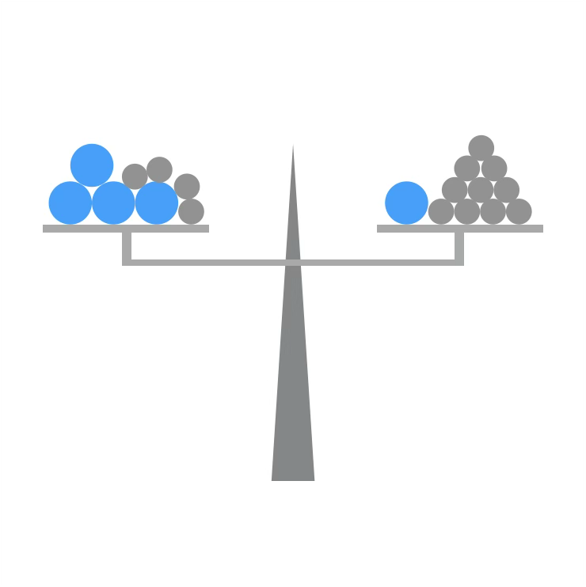
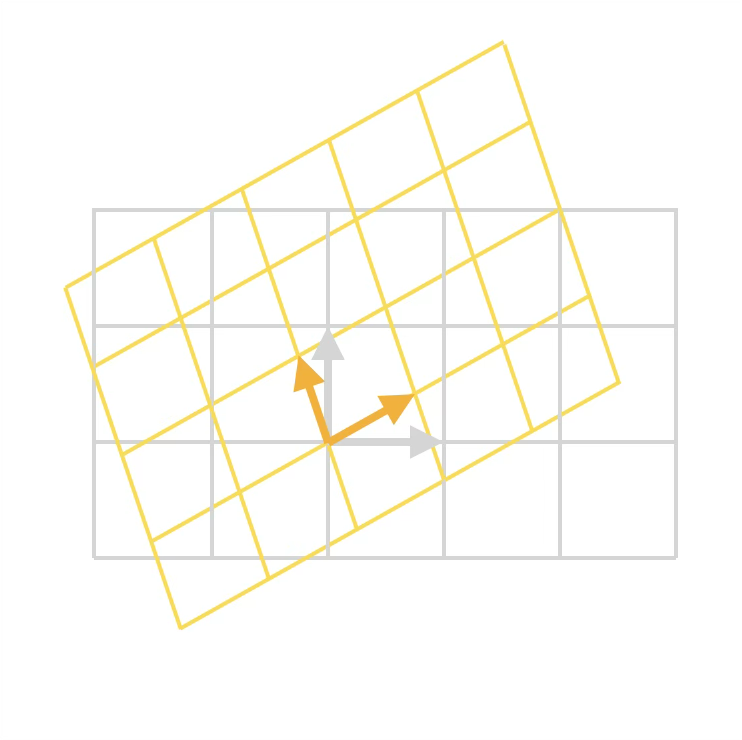
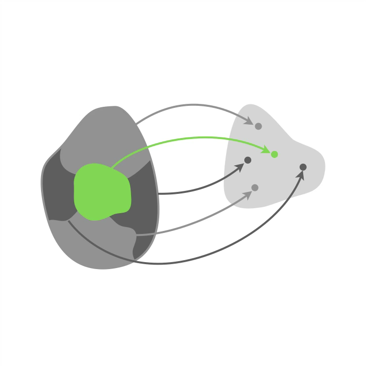
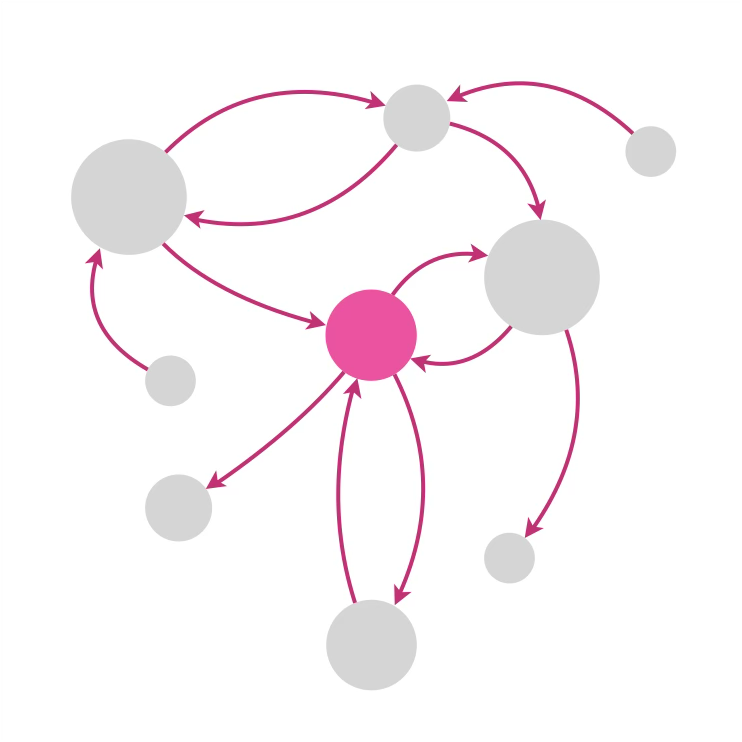
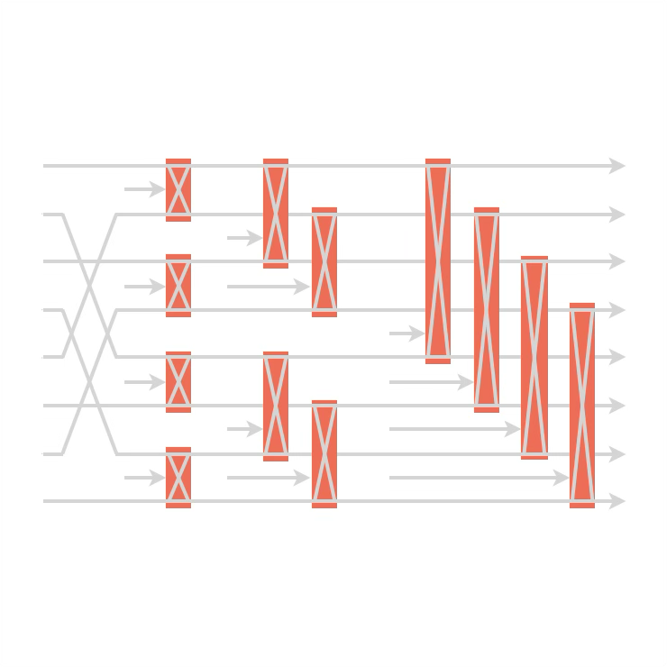

+++
title = "Algèbre"
date = 2021-03-06T14:20:50+01:00
weight = 3
chapter = true
+++

# Algèbre

L'algèbre (de l'arabe الجبر, al-jabr, signifiant reconstruction ou réunion) est l'étude des relations entre les objets mathématiques.

<h3><a href="./equations/">Équations</a></h3>

Ce que deviennent les équations polynomiales quand on laisse la variable se promener dans les complexes.

<h3><a href="./lineaire/">Algèbre linéaire</a></h3>

Des systèmes d'équations aux matrices de rotation, l'outil de base de la physique quantique.

  <a href="./lineaire/#codes-correcteurs" class="math-btn">Codes correcteurs</a>

<h3><a href="./groupes/">Théorie des groupes</a></h3>

Miettes de théorie des groupes pour physicien&nbsp;: symétries, rotations et représentations.

<h3><a href="./graphes/">Graphes</a></h3>

Jeux, dénombrements et chemins sur les graphes.

  <a href="./graphes/#jeu-de-nim" class="math-btn">Jeu de Nim</a>
  <a href="./graphes/#combinatoire" class="math-btn">Formule de Cayley et codage de Prüfer</a>
  <a href="./graphes/#chemin-hamiltonien" class="math-btn">Chemin hamiltonien</a>

<h3><a href="./fft/">Multiplication de polynômes et FFT</a></h3>

Comment multiplier efficacement deux polynômes&nbsp;? Les maths cachées derrière l'un des algorithmes les plus importants.

