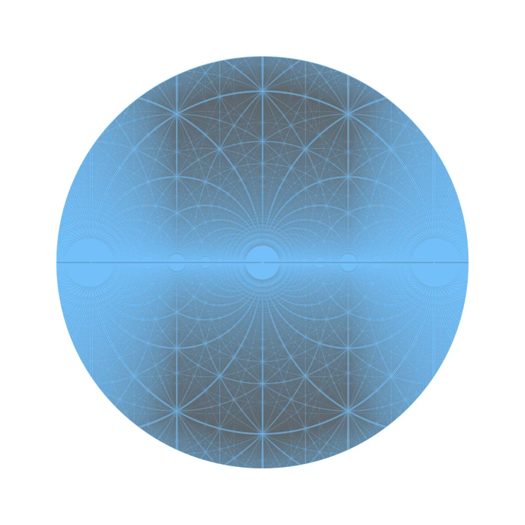

+++
title = "Arithmétique"
date = 2021-03-06T14:20:50+01:00
weight = 2
chapter = true
+++

# Arithmétique

L'arithmétique est la plus ancienne branche des mathématiques avec la géométrie. L'arithmétique (du grec ἀριθμός, nombre) étudie les nombres et leurs relations.

<h3><a href="./numeration/">Numération et bases</a></h3>

Compter autrement qu'en base dix&nbsp;: des systèmes anciens à l'informatique.

  <a href="./numeration/#la-base-3" class="math-btn">La base 3</a>

<h3><a href="./nombresapart/">Nombres particuliers</a></h3>

Nombres premiers, pgcd, fractions continues, nombre d'or… et le nombre $\mathrm{e}$.

  <a href="./nombresapart/#divisibilité-et-nombres-premiers" class="math-btn">Nombres premiers</a>
  <a href="./nombresapart/#algorithme-deuclide" class="math-btn">Algorithme d'Euclide</a>
  <a href="./nombresapart/#fractions-continues" class="math-btn">Fractions continues</a>
  <a href="./nombresapart/#nombre-dor" class="math-btn">Nombre d'or</a>
  <a href="./exponentielle/" class="math-btn">Le nombre e</a>

<h3><a href="./complexes/">Complexes</a></h3>

Les nombres complexes et quelques-unes de leurs surprises.

  <a href="./complexes/#entiers-algébriques" class="math-btn">Entiers algébriques</a>
  <a href="./complexes/#ensemble-de-mandelbrot" class="math-btn">Ensemble de Mandelbrot</a>
  <a href="./complexes/#triplets-pythagoriciens" class="math-btn">Triplets pythagoriciens</a>

