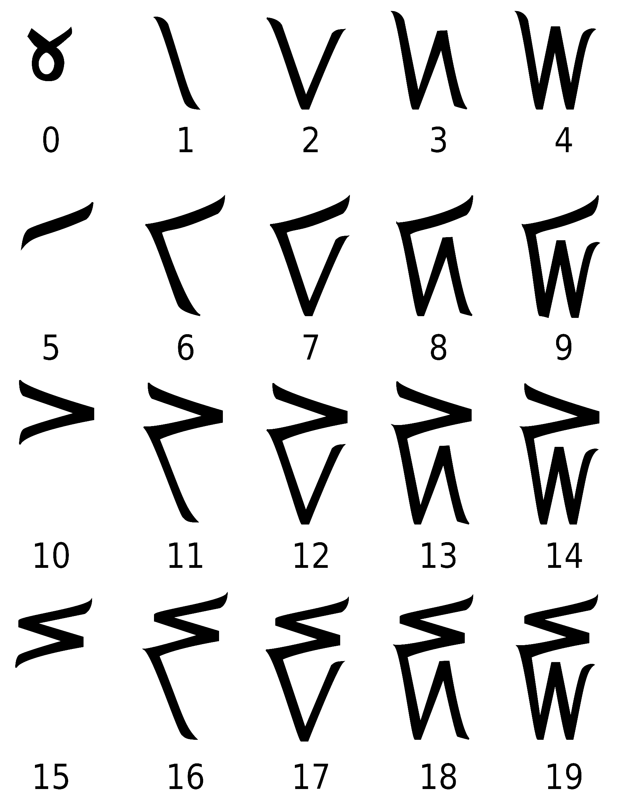
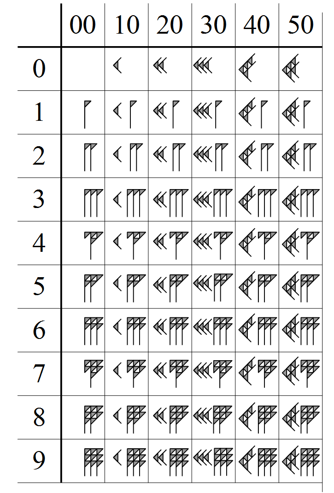

+++
title = "Numération"
date = 2021-03-06T14:20:50+01:00
weight = 2
+++

# Numération

Le système décimal nous est si familier qu'il nous paraît incongru de compter autrement. Pourtant, il tient à un choix, celui de regrouper les objets par paquets de dix, et d'autres choix ont été faits ailleurs, ou à d'autres époques&nbsp;: par deux, par cinq, par douze, par vingt, par soixante. Cette page décrit d'abord le principe commun à tous ces systèmes, puis fait le tour des bases les plus répandues, des fractions, et de la base qui minimise le coût d'écriture.

## Écrire un nombre {#principe}

Dans «&nbsp;2026&nbsp;», le chiffre 2 de gauche ne vaut pas la même chose que celui de droite. Celui de gauche compte des paquets de mille, celui de droite des paquets de dix&nbsp;:

$$2026 = 2 \times 1000 + 0 \times 100 + 2 \times 10 + 6.$$

C'est la **numération de position**&nbsp;: la valeur d'un chiffre dépend de sa place. Rien n'oblige à regrouper par dix. Si l'on regroupe par $b$, on obtient la numération en base $b$.

Écriture en base b

Soit $b \ge 2$ un entier. Tout entier naturel $n \ge 1$ s'écrit de manière unique sous la forme

$$n = a_k b^k + a_{k-1} b^{k-1} + \dots + a_1 b + a_0,$$

avec $a_i \in \lbrace 0, 1, \dots, b-1 \rbrace$ pour tout $i$, et $a_k \ne 0$. On note alors $n = \overline{a_k a_{k-1} \dots a_1 a_0}^{b}$.

Dans cette notation, les $a_i$ sont les **chiffres** de $n$ en base $b$, il y en a $k+1$, et la barre horizontale rappelle que $a_k a_{k-1} \dots a_0$ désigne une écriture, et non le produit des $a_i$. La condition $a_k \ne 0$ interdit les zéros en tête, qui feraient perdre l'unicité ($\overline{0042}^{10} = \overline{42}^{10}$). Ainsi, $2026 = \overline{2026}^{10}$ et $45 = \overline{101101}^{2}$.

L'existence et l'unicité viennent de la division euclidienne. Tous les termes de la somme, sauf $a_0$, sont multiples de $b$&nbsp;: $a_0$ est donc forcément le reste de la division de $n$ par $b$. Le quotient $q$ vaut $a_k b^{k-1} + \dots + a_1$, et l'on recommence avec lui pour trouver $a_1$, puis $a_2$, jusqu'à obtenir un quotient nul. Les chiffres sortent de droite à gauche. Pour 2026 en base 3&nbsp;:

| division | reste (le chiffre) |
|:---|:---:|
| $2026 = 3 \times 675 + 1$ | 1 |
| $675 = 3 \times 225 + 0$ | 0 |
| $225 = 3 \times 75 + 0$ | 0 |
| $75 = 3 \times 25 + 0$ | 0 |
| $25 = 3 \times 8 + 1$ | 1 |
| $8 = 3 \times 2 + 2$ | 2 |
| $2 = 3 \times 0 + 2$ | 2 |

En lisant les restes de bas en haut, on obtient $2026 = \overline{2210001}^{3}$. On le vérifie&nbsp;: $2 \times 729 + 2 \times 243 + 1 \times 81 + 1 = 2026$.

Le convertisseur suivant donne l'écriture d'un entier dans les bases rencontrées plus bas. Au-delà de 9, les chiffres s'écrivent avec des lettres (A = dix, B = onze, etc.) jusqu'en base 16, et entre parenthèses ensuite&nbsp;: $\overline{(5)(1)(6)}^{20}$ est le nombre $5 \times 20^2 + 1 \times 20 + 6$.

<label for="conv-n">Un entier&nbsp;:</label> <input id="conv-n" type="number" inputmode="numeric" min="1" max="999999999" step="1" value="2026">

<table class="conv-table"><tbody id="conv-out"></tbody></table>

## Un tour du monde des bases {#bases}

### Base 2 : le binaire {#binaire}

Le système binaire (base 2) est utilisé dans des langues d'Amérique du Sud et d'Océanie, et de nos jours en informatique, où un chiffre binaire (un *bit*) correspond à un interrupteur ouvert ou fermé. Leibniz lui a consacré un mémoire en 1703, l'*Explication de l'arithmétique binaire*. Avec $k$ chiffres, on écrit les entiers de $0$ à $2^k - 1$&nbsp;: de $0$ à $255$ avec 8 chiffres (un octet), de $0$ à $65535$ avec 16.

### Base 5 : le quinaire {#quinaire}

Le système quinaire (base 5), né du compte sur les doigts d'une main, a laissé des traces jusqu'au XXe siècle dans des langues africaines, mais aussi, partiellement, dans les notations tchouvache, suzhou, romaine et maya. Le nom des chiffres 6, 7, 8 et 9 dans de nombreuses langues en témoigne&nbsp;: ils se disent 5+1, 5+2, 5+3 et 5+4 en wolof (langue de la famille nigéro-congolaise), en khmer (langue austro-asiatique), en nahuatl (langue uto-aztèque), et, dans de nombreuses langues austronésiennes telles que le lote ou le ngadha (sous forme partielle). La base quinaire apparaît parfois comme base auxiliaire ou sous-base de la base décimale, comme dans le système romain, ou de la base vigésimale.

Les chiffres romains : une numération additive

Dans «&nbsp;MMXXVI&nbsp;», chaque symbole a une valeur fixe, et le nombre est la somme&nbsp;: $1000 + 1000 + 10 + 10 + 5 + 1 = 2026$. Seule exception, la règle de soustraction&nbsp;: un symbole placé avant un plus grand se retranche (IV vaut $5 - 1$, IX vaut $10 - 1$). La place d'un symbole ne multiplie pas sa valeur par une puissance de la base, ce qui distingue cette écriture d'une numération de position.

Il en résulte deux limites. Il n'y a pas de zéro, car aucune place n'est à tenir. Et les opérations s'écrivent mal&nbsp;: poser une multiplication comme XXXVII × XLIV demande de repasser par des symboles intermédiaires, alors que le calcul en colonnes de l'écriture décimale se déroule chiffre par chiffre. Les Romains calculaient sur un abaque et n'écrivaient que le résultat.

### Base 12 : le duodécimal {#duodecimal}

Le système duodécimal (base 12) était déjà utilisé par les Sumériens et les Assyro-Babyloniens pour des mesures de longueur et de temps. On le retrouve dans un certain nombre de monnaies et d'unités de compte courantes en Europe au Moyen Âge, notamment dans le système impérial d'unités (il faut 12 pouces pour faire un pied), et dans le commerce. Il sert encore, par exemple, pour compter les mois, les heures, les fleurs, les huîtres et les œufs. Son avantage est que 12 est divisible par 2, 3, 4 et 6&nbsp;: on partage une douzaine en moitiés, tiers, quarts et sixièmes sans reste (voir la section sur les fractions).

### Base 16 : l'hexadécimal {#hexadecimal}

Le système hexadécimal (base 16) est très couramment utilisé en électronique ainsi qu'en informatique. Son intérêt réside dans les conversions triviales avec la base 2, tout en permettant une écriture plus compacte des nombres. Une couleur de page web comme `#2A9D8F` donne l'intensité du rouge, du vert et du bleu sur un octet chacune, soit deux chiffres hexadécimaux de `00` à `FF` (de 0 à 255).

Binaire et hexadécimal : une conversion sans calcul

Comme $16 = 2^4$, un chiffre hexadécimal contient exactement quatre chiffres binaires. Pour convertir, on découpe l'écriture binaire en groupes de quatre en partant de la droite, et l'on remplace chaque groupe par son chiffre&nbsp;:

$2026 = \overline{111\,1110\,1010}^{2}$, soit les groupes $0111$, $1110$, $1010$, c'est-à-dire $7$, $\mathrm{E}$, $\mathrm{A}$&nbsp;: $\; 2026 = \overline{7\mathrm{EA}}^{16}$.

La raison est que le regroupement par quatre bits revient à regrouper par $2^4 = 16$. Plus généralement, passer de la base $b$ à la base $b^k$ se fait en regroupant les chiffres par paquets de $k$. L'octal (base 8 $= 2^3$) regroupe les bits par trois&nbsp;: $2026 = \overline{3752}^{8}$, et chaque chiffre octal se lit comme trois bits, par exemple $7 = 111$ et $5 = 101$.

### Base 20 : le vigésimal {#vigesimal}

Le système vigésimal (ou vicésimal, base 20) existe au Bhoutan en langue dzongkha, et était en usage chez les Aztèques vers 1200 et, quoique irrégulier, pour la numération maya. Il était aussi présent en vieux français, ce qui explique l'usage du mot quatre-vingts pour le nombre 80, ou encore le nom de l'hôpital des Quinze-Vingts, qui pouvait accueillir 300 patients ($15 \times 20$).

Quatre-vingts, septante et huitante

En français de France, 80 se dit «&nbsp;quatre-vingts&nbsp;» ($4 \times 20$) et 90 «&nbsp;quatre-vingt-dix&nbsp;» ($4 \times 20 + 10$), reste du compte par vingt. En Belgique et en Suisse, on dit «&nbsp;septante&nbsp;» et «&nbsp;nonante&nbsp;», et, dans plusieurs cantons suisses, «&nbsp;huitante&nbsp;». Le danois a gardé un système vigésimal plus marqué, où 60 se dit <i>tres</i> («&nbsp;trois fois vingt&nbsp;») et 80 <i>firs</i> («&nbsp;quatre fois vingt&nbsp;»).

Les chiffres de Kaktovik

Toutes les langues eskimo-aléoutes d'Alaska et du Canada utilisent un système vigésimal pour compter. Les chiffres arabes, qui ont été conçus pour un système décimal, sont inadéquats pour l'iñupiaq et les autres langues inuites. Pour remédier à ce problème, des élèves d'une école de Kaktovik, en Alaska, ont inventé en 1994 un système de chiffres en base 20, qui s'est répandu parmi les Iñupiat en Alaska et a été envisagé au Canada. Ces chiffres ont été ajoutés à la norme Unicode en 2022 (version 15).

La forme des chiffres reflète la structure quinaire-vigésimale. Chaque chiffre est formé de barres et de traits&nbsp;: une barre en haut vaut 5 et un trait vertical vaut 1. Les chiffres 1 à 4 sont de 1 à 4 traits, 5 est une barre, 6 à 9 une barre surmontant de 1 à 4 traits, 10 deux barres, 15 trois barres. Un chiffre se lit donc au premier coup d'œil comme «&nbsp;nombre de cinq, plus nombre d'unités&nbsp;».

### Base 60 : le sexagésimal {#sexagesimal}

Le système sexagésimal (base 60) était utilisé pour la numération babylonienne et en Mésopotamie vers 3300 av. J.-C., ainsi que par les Indiens et les Arabes en trigonométrie. Il sert encore actuellement dans la mesure du temps (1 h $= 60$ min, 1 min $= 60$ s) et dans la mesure de certains angles (1° $= 60'$).

Les chiffres et nombres mésopotamiens de 1 à 59&nbsp;:

> Source : Wikipédia

Chacun des 59 «&nbsp;chiffres&nbsp;» est lui-même écrit par addition, avec un clou vertical pour 1 et un chevron pour 10. Ainsi $2026 \text{ s} = 33 \text{ min } 46 \text{ s}$ s'écrit avec deux chiffres sexagésimaux, $\overline{(33)(46)}^{60}$, le premier composé de trois chevrons et trois clous, le second de quatre chevrons et six clous.

Le zéro, ce qui fait une vraie numération de position

Sans zéro, comment distinguer $\overline{25}^{10}$ de $\overline{205}^{10}$&nbsp;? Les scribes mésopotamiens ont longtemps laissé un blanc à la place vide, et le même signe pouvait désigner 1 ou 60, le contexte levant l'ambiguïté. Vers 300 av. J.-C., sous la domination séleucide, apparaît un signe de séparation formé de deux chevrons obliques, employé au milieu des nombres, mais pas à la fin&nbsp;: il ne joue donc pas pleinement le rôle d'un zéro.

Le zéro comme nombre à part entière, avec ses règles de calcul ($a + 0 = a$, $a \times 0 = 0$), apparaît en Inde chez Brahmagupta, en 628. Dans le calendrier maya, un glyphe en forme de coquillage tient la place du zéro.

## Et les fractions ? {#fractions}

La numération de position s'étend à droite de la virgule, avec des puissances négatives de la base&nbsp;: le chiffre qui suit la virgule compte des $b^{-1}$, le suivant des $b^{-2}$, etc. Par exemple, $\frac{5}{8} = 0{,}625$ en base 10, car $\frac{6}{10} + \frac{2}{100} + \frac{5}{1000}$, et $\frac{5}{8} = 0{,}101$ en base 2, car $\frac{1}{2} + \frac{1}{8}$.

Mais le développement s'arrête ou non selon la base. En base 10, $\frac{1}{3} = 0{,}333\dots$ ne s'arrête jamais, alors qu'en base 3, $\frac{1}{3} = 0{,}1$.

Développement fini d'une fraction

Soit $\frac{p}{q}$ une fraction irréductible et $b \ge 2$ un entier. Elle s'écrit avec un nombre fini de chiffres après la virgule en base $b$ si et seulement si tout facteur premier de $q$ divise $b$.

L'idée est que s'arrêter après $m$ chiffres signifie que $\frac{p}{q} b^m$ est un entier. Comme $p$ et $q$ n'ont pas de facteur commun, cela revient à demander que $q$ divise $b^m$, c'est-à-dire que chaque facteur premier de $q$ divise $b$ (avec un $m$ assez grand).

| fraction | base 2 | base 3 | base 10 | base 12 | base 60 |
|:---|:---:|:---:|:---:|:---:|:---:|
| $\frac{1}{2}$ | $0{,}1$ | périodique | $0{,}5$ | $0{,}6$ | $0{,}(30)$ |
| $\frac{1}{3}$ | périodique | $0{,}1$ | périodique | $0{,}4$ | $0{,}(20)$ |
| $\frac{1}{5}$ | périodique | périodique | $0{,}2$ | périodique | $0{,}(12)$ |
| $\frac{1}{6}$ | périodique | périodique | périodique | $0{,}2$ | $0{,}(10)$ |

Les bases 12 et 60 ont donc un avantage pratique. Les facteurs premiers de 12 sont 2 et 3, ceux de 60 sont 2, 3 et 5. Toute fraction dont le dénominateur n'a que ces facteurs premiers s'écrit avec un nombre fini de chiffres. Les tables d'inverses des Babyloniens ne contiennent d'ailleurs que de tels nombres (dits «&nbsp;réguliers&nbsp;»), et 7 ou 11 n'y figurent pas.

Pourquoi 0,1 + 0,2 ne fait pas tout à fait 0,3 sur un ordinateur

Le dénominateur de $\frac{1}{10}$ est $2 \times 5$, et 5 ne divise pas 2&nbsp;: en base 2, $\frac{1}{10}$ n'a pas de développement fini. On trouve, en doublant à chaque étape,

$0{,}1 = 0{,}0\,0011\,0011\,0011\,0011\,\dots$ en base 2

où le bloc $0011$ se répète indéfiniment. Un ordinateur ne conserve qu'un nombre fixe de chiffres binaires (53 pour un nombre «&nbsp;double&nbsp;» usuel), et arrondit donc $0{,}1$, $0{,}2$ et $0{,}3$ séparément. En Python, <code>0.1 + 0.2</code> donne <code>0.30000000000000004</code> et <code>0.1 + 0.2 == 0.3</code> vaut <code>False</code>.

## La base 3 {#base3}

Pourquoi la base 3 peut-elle être considérée comme la meilleure des bases&nbsp;?

Un modèle simple de «&nbsp;coût&nbsp;» d'écriture compte les choix à distinguer. Pour écrire les entiers jusqu'à $N$ en base $b$, il faut environ $\log_b N$ positions, et à chaque position il faut pouvoir choisir parmi $b$ valeurs. Le coût est donc le produit

$$C(b) = b \log_b N = \frac{b}{\ln b} \ln N.$$

Le facteur $\ln N$ ne dépend pas de la base. Il reste à rendre $f(b) = \frac{b}{\ln b}$ minimal. Sa dérivée, $f'(b) = \frac{\ln b - 1}{(\ln b)^2}$, s'annule en $b = \mathrm{e} \approx 2{,}718$. L'entier le plus proche est 3.

| base $b$ | 2 | 3 | 4 | 5 | 10 | 16 |
|:---|:---:|:---:|:---:|:---:|:---:|:---:|
| $\frac{b}{\ln b}$ | $2{,}885$ | $2{,}731$ | $2{,}885$ | $3{,}107$ | $4{,}343$ | $5{,}771$ |

La base 3 est donc la meilleure, 5&nbsp;% devant la base 2 (les bases 2 et 4 sont à égalité), et la base 10 coûte près de 60&nbsp;% de plus. Ce modèle ignore la réalité du matériel&nbsp;: en électronique, distinguer deux niveaux de tension est beaucoup plus robuste au bruit que d'en distinguer trois, ce qui explique que le binaire l'emporte. Il y a eu des exceptions&nbsp;: l'ordinateur Setun, construit à Moscou en 1958 par Nikolaï Brousentsov, fonctionnait en base 3.

Ternaire équilibré et pesées de Bachet

En base 3, on peut choisir pour chiffres $-1$, $0$ et $1$ au lieu de $0$, $1$ et $2$ (on note $\bar{1}$ pour $-1$). Dans ce système, dit <i>ternaire équilibré</i>, tout entier relatif s'écrit sans signe moins, le signe étant porté par les chiffres&nbsp;: $5 = 9 - 3 - 1 = \overline{1\bar{1}\bar{1}}$.

Le problème des pesées, posé par Bachet de Méziriac au XVIIe siècle, en est une version concrète. On dispose d'une balance à deux plateaux et de poids de $1$, $3$, $9$ et $27$ grammes. L'objet se place sur un plateau, et les poids se répartissent, chacun, sur l'un des plateaux ou nulle part. On peut ainsi peser tout objet d'une masse entière de 1 à 40 grammes. Pour 5 grammes, on met le poids de 9 grammes d'un côté, ceux de 3 et de 1 gramme du côté de l'objet&nbsp;: $5 + 3 + 1 = 9$. En général, la répartition des poids correspond aux chiffres $-1$, $0$, $1$ de la masse en base 3. Quatre chiffres donnent $3^4 = 81 = 2 \times 40 + 1$ combinaisons, soit les entiers de $-40$ à $40$, chacun écrit une seule fois.



## Exercices {#exercices}

Quatre exercices

<b>1.</b> Écrire 2026 en base 5.

Solution

$2026 = 5 \times 405 + 1$, $405 = 5 \times 81 + 0$, $81 = 5 \times 16 + 1$, $16 = 5 \times 3 + 1$, $3 = 5 \times 0 + 3$. Les restes, lus de bas en haut, donnent $2026 = \overline{31101}^{5}$. Vérification&nbsp;: $3 \times 625 + 125 + 25 + 0 + 1 = 2026$.

<b>2.</b> Quel est le nombre décimal $\overline{101101}^{2}$&nbsp;? Écrire ce nombre en hexadécimal sans passer par la base 10.

Solution

$\overline{101101}^{2} = 32 + 8 + 4 + 1 = 45$. Pour l'hexadécimal, on regroupe les bits par quatre en partant de la droite&nbsp;: $0010\,1101$, soit $2$ et $\mathrm{D}$ ($\mathrm{D} = 13$), donc $45 = \overline{2\mathrm{D}}^{16}$. On vérifie que $2 \times 16 + 13 = 45$.

<b>3.</b> (La preuve par neuf, généralisée.) Montrer qu'en base $b$, un entier est divisible par $b - 1$ si et seulement si la somme de ses chiffres l'est. Que donne cet énoncé en base 10 et en base 3&nbsp;?

Solution

Comme $b = (b - 1) + 1$, on a $b \equiv 1 \pmod{b - 1}$, donc $b^i \equiv 1 \pmod{b - 1}$ pour tout $i$. Pour $n = \sum a_i b^i$, on obtient $n \equiv \sum a_i \pmod{b - 1}$&nbsp;: $n$ et la somme de ses chiffres ont le même reste dans la division par $b - 1$. En base 10, c'est le critère de divisibilité par 9 (et la preuve par neuf). En base 3, $b - 1 = 2$&nbsp;: un entier est pair si et seulement si la somme de ses chiffres ternaires est paire. Par exemple, $2026 = \overline{2210001}^{3}$ a pour somme de chiffres $6$, et 2026 est pair.

<b>4.</b> Pour quelles bases $b \le 20$ la fraction $\frac{1}{6}$ s'écrit-elle avec un nombre fini de chiffres&nbsp;? Donner son écriture dans chacune d'elles.

Solution

Les facteurs premiers de 6 sont 2 et 3&nbsp;: il faut que $b$ soit multiple de 6, donc $b \in \lbrace 6, 12, 18 \rbrace$. On a $\frac{1}{6} = 0{,}1$ en base 6 (le chiffre 1 compte des $6^{-1}$), $\frac{1}{6} = \frac{2}{12} = 0{,}2$ en base 12, et $\frac{1}{6} = \frac{3}{18} = 0{,}3$ en base 18.

