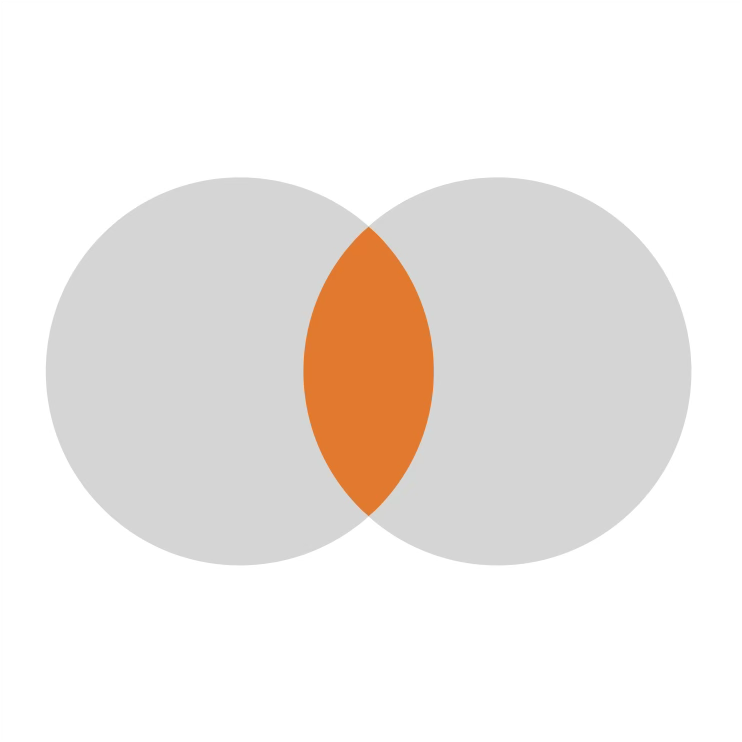
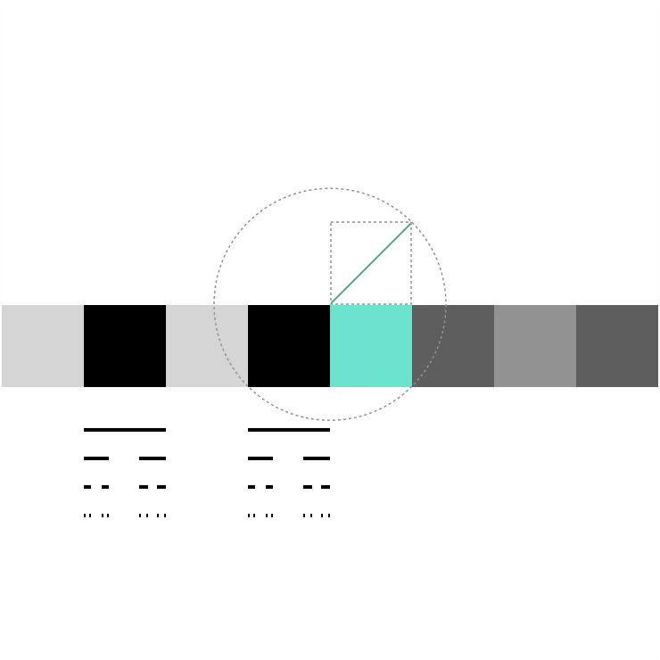
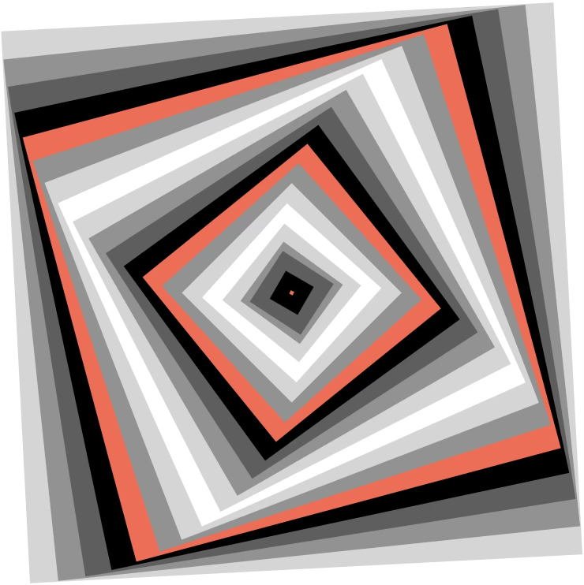

+++
title = "Fondements"
date = 2021-03-06T14:20:50+01:00
weight = 1
chapter = true
+++

# Fondements

Où l'on parle du langage de la logique (et des ensembles), des infinis dénombrables et indénombrables et des différents ensembles de nombres.

<h3><a href="./boole/">Langage logique</a></h3>

L'algèbre de Boole, brique élémentaire de la pensée mathématique&nbsp;: le «&nbsp;et&nbsp;» et le «&nbsp;ou&nbsp;» de la logique sont l'intersection et l'union des ensembles.

<h3><a href="./ensembles/">Échafaudage des nombres</a></h3>

Des entiers aux complexes&nbsp;: chaque nouvel ensemble de nombres comble un manque du précédent.

  <a href="./ensembles/#un-désir-de-symétrie" class="math-btn">Un désir de symétrie</a>
  <a href="./ensembles/#boucher-les-trous" class="math-btn">Boucher les trous</a>

<h3><a href="./infinis/">Les infinis</a></h3>

Cantor et la hiérarchie des infinis&nbsp;: autant d'entiers que de rationnels, mais strictement plus de réels.

