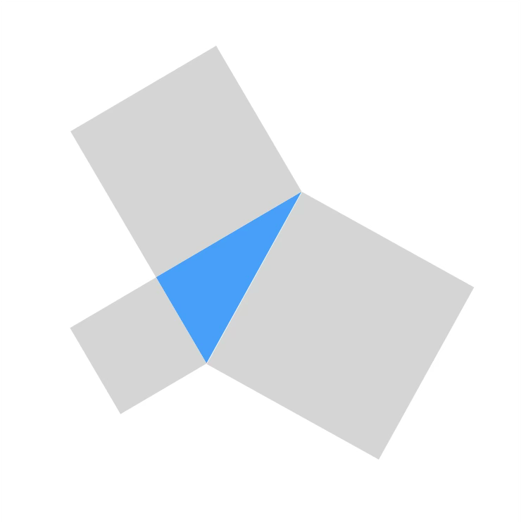
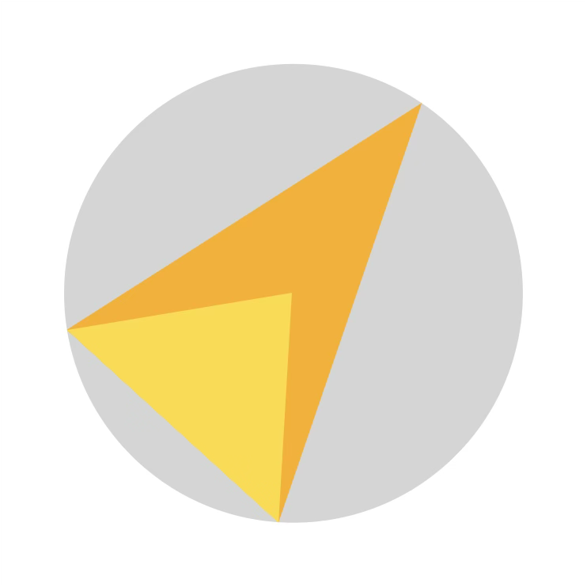
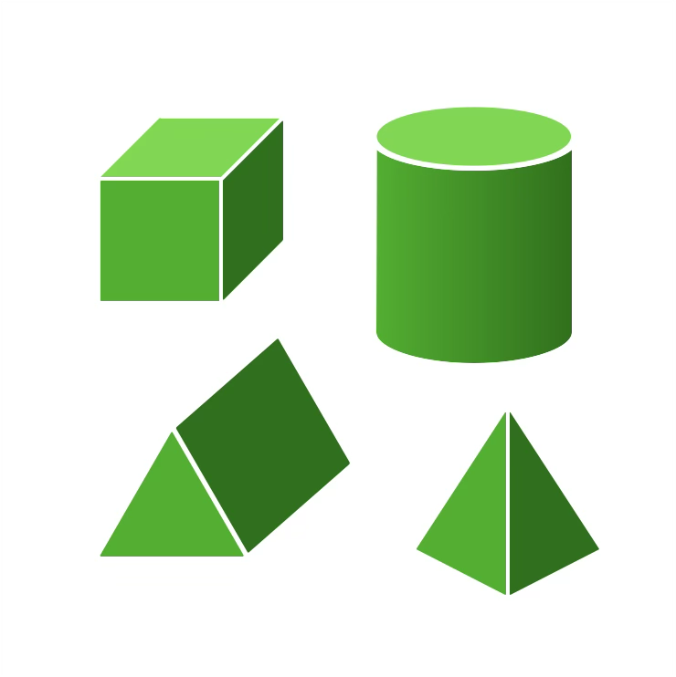
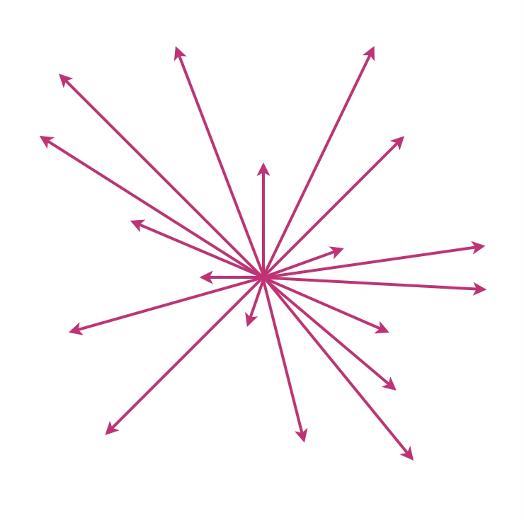
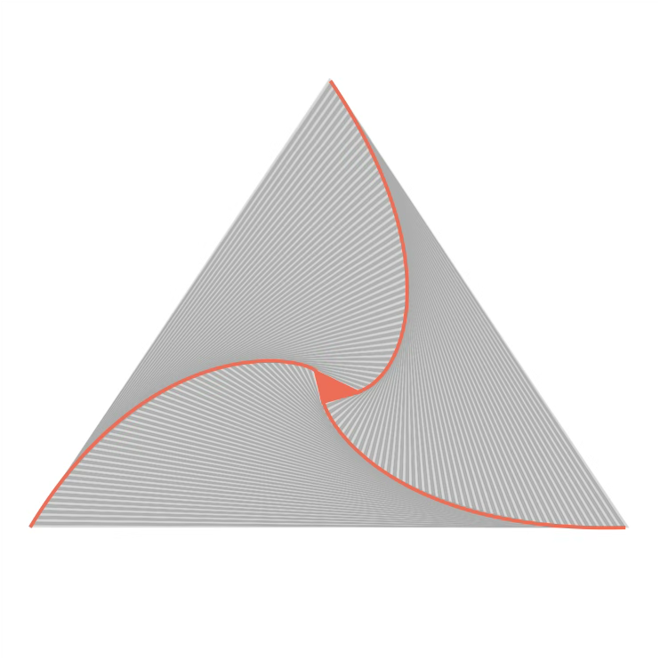

+++
title = "Géométrie"
date = 2021-03-06T14:20:50+01:00
weight = 2
chapter = false
+++

# Géométrie

La géométrie est avec l'arithmétique une des plus vieilles branches des mathématiques (l'arithmétique pour tenir les comptes et la géométrie pour mesurer les terres).

Géométrie et physique sont intimement liées. Le développement de la géométrie a en partie été poussé par les questionnements des astronomes (sur la position des astres, leur mouvement, leur taille, leur distance, etc.) et des ingénieurs (pour construire des trucs qui tiennent debout). Et une explication géométrique des lois fondamentales de l'univers attire toujours certains chercheurs, plus de 2000 ans après Platon.

<h3><a href="./geo1/">Triangle</a></h3>

Les grands classiques du triangle.

  <a href="./geo1/#pythagore" class="math-btn">Pythagore</a>
  <a href="./geo1/#escargot-de-pythagore" class="math-btn">Escargot de Pythagore</a>
  <a href="./geo1/#thalès" class="math-btn">Thalès</a>
  <a href="./geo1/#droite-deuler" class="math-btn">Droite d'Euler</a>

<h3><a href="./geo2/">Cercle et triangle</a></h3>

Trigonométrie, loi des sinus et mesure du méridien, angles inscrits.

  <a href="./geo2/#trigonométrie" class="math-btn">Trigonométrie</a>
  <a href="./geo2/#théorème-de-langle-inscrit-et-de-langle-au-centre" class="math-btn">Angle inscrit et angle au centre</a>

<h3><a href="./geo3/">Aires et volumes</a></h3>

Calculer des aires et des volumes, jusqu'au triangle tracé sur une sphère.

  <a href="./geo3/#calculs-daires" class="math-btn">Calculs d'aires</a>
  <a href="./geo3/#aires-et-identités-remarquables" class="math-btn">Identités remarquables</a>
  <a href="./geo3/#aire-du-triangle-sphérique" class="math-btn">Triangle sphérique</a>
  <a href="./geo3/#calculs-de-volumes" class="math-btn">Calculs de volumes</a>

<h3><a href="./geo4/">Curse of dimensionality</a></h3>

Le fléau de la dimension&nbsp;: en grande dimension, presque tout le volume se trouve près des bords.

  <a href="./geo4/#petite-énigme" class="math-btn">Petite énigme</a>
  <a href="./geo4/#the-average-man" class="math-btn">The «&nbsp;Average man&nbsp;»</a>

<h3><a href="./geo5/">Poursuites</a></h3>

Courbes de poursuite, interceptions et nuées d'oiseaux.

  <a href="./geo5/#paradoxe-dachille-et-de-la-tortue" class="math-btn">Achille et la tortue</a>
  <a href="./geo5/#courbe-de-poursuite" class="math-btn">Courbe de poursuite</a>
  <a href="./geo5/#interception" class="math-btn">Interception</a>
  <a href="./geo5/#manœuvre-dévitement-de-lenola-gay" class="math-btn">Enola Gay</a>
  <a href="./geo5/#poursuite-cyclique" class="math-btn">Poursuite cyclique</a>
  <a href="./geo5/#murmurations" class="math-btn">Murmurations</a>

<h3><a href="./simplexes/">Simplexes et flèche du temps</a></h3>

Le volume d'un simplexe, $\frac{1}{k!}$, et ce qu'il dit de l'irréversibilité.

  <a href="./simplexes/#le-volume-dun-simplexe" class="math-btn">Volume d'un simplexe</a>
  <a href="./simplexes/#lhypercube-dilaté" class="math-btn">L'hypercube dilaté</a>

<!--

    <canvas id="myCanvas"></canvas>

-->
