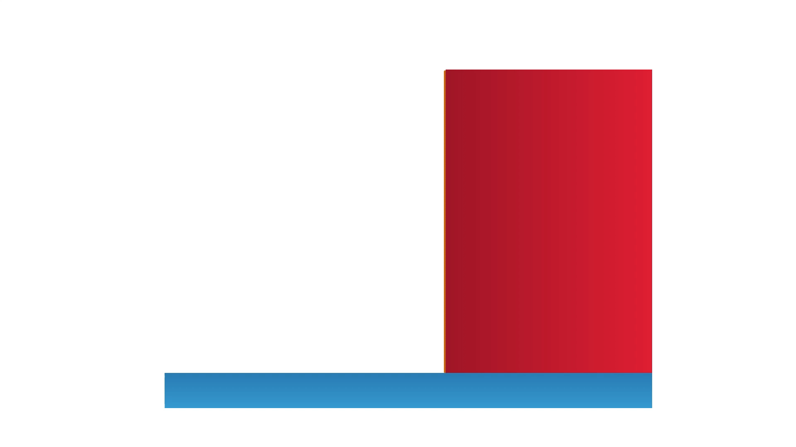
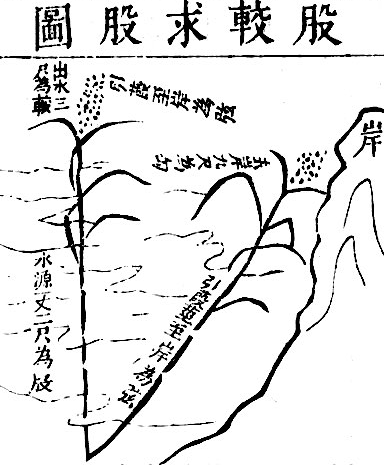
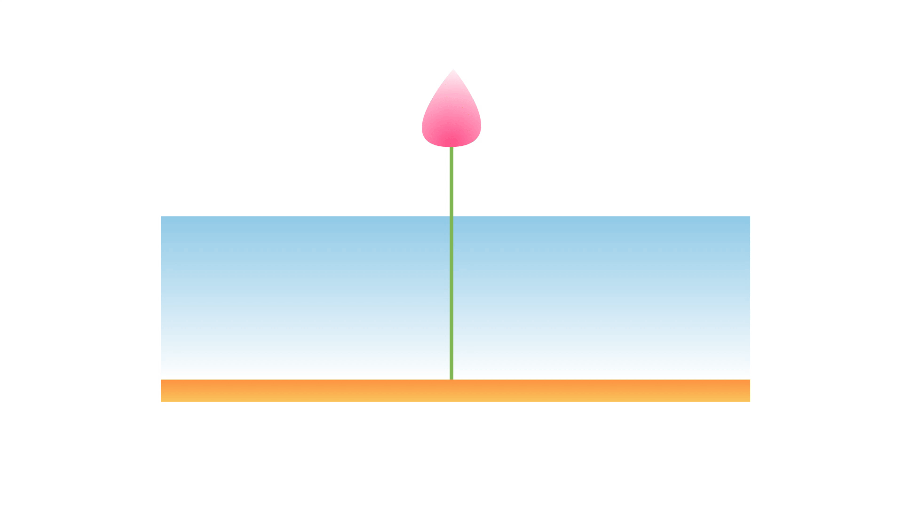
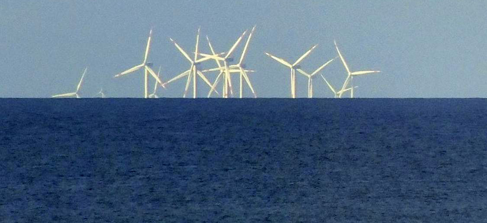
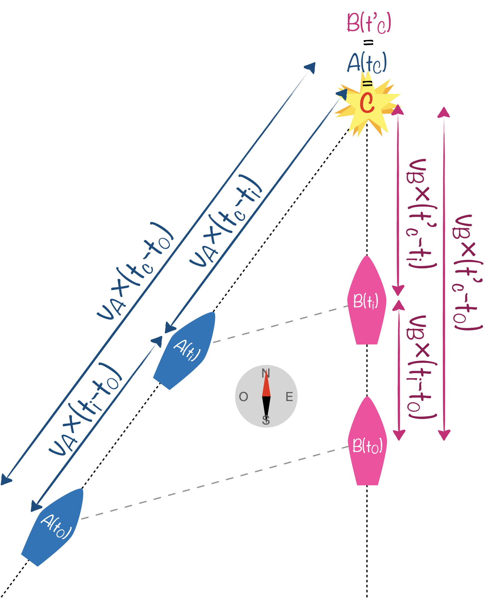

+++
title = "Triangle"
date = 2021-03-06T14:20:50+01:00
weight = 1
chapter = false
+++

# Le triangle

Trois résultats classiques structurent la géométrie du triangle. Pythagore relie les longueurs des côtés quand un angle est droit. Thalès relie les longueurs quand deux triangles ont un sommet commun et deux côtés parallèles. La droite d'Euler relie trois points remarquables du triangle, qui sont toujours alignés. Sur une sphère enfin, la somme des angles d'un triangle dépasse $180°$, et cet excès mesure l'aire. Chaque résultat s'accompagne d'une figure à manipuler, d'une démonstration ou d'une vidéo.

## Pythagore

Pythagore a vécu à Samos (une île grecque) au 6e siècle avant notre ère. Malgré le nom qu'on lui donne, le théorème de Pythagore était connu et utilisé par les Babyloniens et les Indiens des siècles avant Pythagore. Mais peut-être que Pythagore a été le premier à l'introduire en Grèce et cela a suffi à lui octroyer une reconnaissance éternelle.



Théorème de Pythagore

Si un triangle est rectangle, alors le carré de la longueur de l'hypoténuse est égal à la somme des carrés des longueurs des deux autres côtés. En notant $a$ et $b$ les côtés de l'angle droit et $c$ l'hypoténuse,
$$a^2 + b^2 = c^2.$$

Réciproque du théorème de Pythagore

Si dans un triangle le carré de la longueur du plus grand côté est égal à la somme des carrés des longueurs des deux autres côtés, alors ce triangle est rectangle.

Quatre énoncés, deux faits logiques

Écrivons le théorème $P \Rightarrow Q$, avec $P$&nbsp;: «&nbsp;le triangle est rectangle&nbsp;» et $Q$&nbsp;: «&nbsp;le carré du plus grand côté est la somme des carrés des deux autres&nbsp;». On rencontre quatre énoncés&nbsp;:

<ul>
<li><b>Théorème</b> ($P \Rightarrow Q$)&nbsp;: si un triangle est rectangle, alors le carré de la longueur de l'hypoténuse est égal à la somme des carrés des longueurs des deux autres côtés.</li>
<li><b>Réciproque</b> ($Q \Rightarrow P$)&nbsp;: si dans un triangle le carré de la longueur du plus grand côté est égal à la somme des carrés des longueurs des deux autres côtés, alors ce triangle est rectangle.</li>
<li><b>Contraposée du théorème</b> ($\text{non } Q \Rightarrow \text{non } P$)&nbsp;: si dans un triangle le carré de la longueur du plus grand côté n'est pas égal à la somme des carrés des longueurs des deux autres côtés, alors ce triangle n'est pas rectangle.</li>
<li><b>Contraposée de la réciproque</b> ($\text{non } P \Rightarrow \text{non } Q$)&nbsp;: si un triangle n'est pas rectangle, alors le carré de la longueur du plus grand côté n'est pas égal à la somme des carrés des longueurs des deux autres côtés.</li>
</ul>

Une implication et sa contraposée sont équivalentes&nbsp;: le théorème et sa contraposée disent la même chose, de même la réciproque et sa contraposée. En revanche, le théorème et sa réciproque sont deux énoncés indépendants, et il faut démontrer les deux pour obtenir l'équivalence «&nbsp;un triangle est rectangle si et seulement si $a^2 + b^2 = c^2$&nbsp;». En pratique, la contraposée sert à prouver qu'un triangle n'est pas rectangle&nbsp;: les côtés $4$, $5$ et $6$ donnent $4^2 + 5^2 = 41 \neq 36 = 6^2$, donc le triangle n'est pas rectangle.

### Une démonstration par les aires

Prenons un carré de côté $a + b$ et découpons-le de deux façons. Les deux figures ci-dessous contiennent les mêmes quatre triangles rectangles de côtés $a$, $b$ et $c$.

<label for="py-a">Longueur $a$ (avec $a + b = 10$)&nbsp;:</label> <input type="range" id="py-a" min="1" max="9" step="0.05" value="4">

<svg id="py-svg" viewBox="0 0 430 205" role="img" aria-label="Un carré de côté a plus b découpé de deux façons : en un carré de côté c et quatre triangles, ou en un carré de côté a, un carré de côté b et les mêmes quatre triangles"></svg>

Démonstration par les aires

Dans la disposition de gauche, le grand carré est formé de quatre triangles et du quadrilatère central, dont les quatre côtés valent $c$. Ses angles sont droits, car en chaque sommet les deux angles aigus du triangle sont complémentaires, et il reste $180° - 90° = 90°$. C'est donc un carré, d'aire $c^2$. Dans la disposition de droite, le grand carré est formé d'un carré de côté $a$, d'un carré de côté $b$ et des mêmes quatre triangles (regroupés deux à deux en rectangles de côtés $a$ et $b$). Les deux dispositions couvrent la même aire $(a+b)^2$ avec les mêmes quatre triangles, donc les aires restantes sont égales&nbsp;:
$$c^2 = a^2 + b^2.$$

### D'autres démonstrations

La démonstration historique par Euclide du théorème de Pythagore&nbsp;:



Deux démonstrations par découpage et réarrangement&nbsp;:





Ces deux démonstrations par découpage (et toutes leurs cousines) reposent sur la possibilité de paver le plan avec deux carrés de côtés différents.



Une démonstration plus «&nbsp;physique&nbsp;» (reposant sur ce qu'implique une relation de proportionnalité sur une surface)&nbsp;:



Triplets pythagoriciens

Un <b>triplet pythagoricien</b> est un triplet d'entiers $(a, b, c)$ tel que $a^2 + b^2 = c^2$, par exemple $(3, 4, 5)$, $(5, 12, 13)$ ou $(8, 15, 17)$. Pour deux entiers $m > n \ge 1$, le triplet
$$(m^2 - n^2,\ 2mn,\ m^2 + n^2)$$
est pythagoricien, car $(m^2 - n^2)^2 + (2mn)^2 = m^4 + 2m^2n^2 + n^4 = (m^2 + n^2)^2$. Quand $m$ et $n$ sont premiers entre eux et de parités différentes, on obtient ainsi tous les triplets sans diviseur commun. Avec $m = 12$ et $n = 5$, on trouve $(119, 120, 169)$, dont la tablette babylonienne Plimpton 322 (voir ci-dessous) donne les deux nombres $119$ et $169$ dans sa première ligne. D'autres triplets sont présentés dans la page sur les <a href="https://coursphychi.github.io/more/maths/arithmetique/#triplets-pythagoriciens">triplets pythagoriciens</a>.

### Histoire du théorème

Mésopotamie

Les historiens des mathématiques et assyriologues ont découvert à la fin des années 1920 que s'était forgée en Mésopotamie (l'ancien Irak), à l'époque paléo-babylonienne une culture mathématique dont l'objet n'était pas purement utilitariste.

Plusieurs des tablettes d'argile qui ont été retrouvées et analysées montrent que la relation entre les longueurs des côtés du rectangle et celle de sa diagonale (soit entre les longueurs des côtés d'un triangle rectangle) était connue et utilisée pour résoudre des problèmes calculatoires.

Des «&nbsp;tablettes cadastrales&nbsp;» (dont la plus ancienne date de -2340 à -2200) établies pour le commerce ou l'administration de parcelles exposent ainsi cette connaissance. La tablette Si427 datant de -1900 à -1600, découverte à Sippar (Irak), montre ainsi un terrain avec tour, aire de battage et marécage dont une des parcelles a été mise en vente par son propriétaire. Elle présente des découpes de trapèzes et de triangles rectangles ainsi que quelques <a href="https://coursphychi.github.io/more/maths/arithmetique/#triplets-pythagoriciens">triplets pythagoriciens</a>.

La tablette Plimpton 322 datant d'environ -1800 donne une liste ordonnée de nombres associés à des triplets pythagoriciens, soit des entiers $(a, b, c)$ satisfaisant la relation $a^2 + b^2 = c^2$. La tablette ne donne que deux nombres du triplet, mais les associe explicitement au plus petit côté et à la diagonale d'un rectangle. La première colonne ne contient pas un des 3 éléments du triplet mais une combinaison des 3 dont l'interprétation varie selon les hypothèses et les reconstitutions des parties manquantes. Ce pourrait être une tablette d'exercice pour étudiant mais la régularité des éléments laisse penser à une table. Les inscriptions sont en caractères cunéiformes, en <a href="../../arithmetique/numeration/#sexagesimal">base 60</a> avec numérotation de position.

Il n'y a pas trace de l'énoncé d'un théorème, et les historiens préfèrent souvent utiliser un autre mot, certains parlent par exemple de «&nbsp;règle de Pythagore&nbsp;». Ni celle-ci, ni le principe qui la sous-tend ne sont explicitement énoncés non plus, mais les exemples montrent bien qu'une règle générale est connue.

La datation et l'origine exacte des tablettes d'argile ne sont pas toujours évidentes, beaucoup de celles-ci ont été achetées sur le marché des antiquités comme la tablette Plimpton 322, mais les historiens peuvent s'appuyer sur des éléments linguistiques, et les similarités avec celles dont l'origine est connue, ayant été obtenues par des fouilles archéologiques régulières. Les traces que l'on a des cultures antérieures rendent peu vraisemblable la découverte de la «&nbsp;règle de Pythagore&nbsp;», avant -2300, celle-ci pourrait apparaître entre -2025 et -1825.

Inde

En Inde, un énoncé du théorème, sous sa forme la plus générale, apparaît dans l'Apastamba, l'un des Śulba-Sūtras, ces traités du cordeau qui codifient les règles des constructions destinées aux rituels védiques. Ceux-ci ont été rédigés entre le VIIIe et le IVe siècle avant notre ère (par ailleurs certains triplets pythagoriciens sont mentionnés dans des textes bien antérieurs). Les Sulbasutras parlent du rectangle et de sa diagonale, plutôt que de triangle.

Chine

Le théorème apparaît également en Chine dans le Zhoubi suanjing («&nbsp;Le Classique mathématique du Gnomon des Zhou&nbsp;»), un des plus anciens ouvrages mathématiques chinois. Ce dernier, écrit probablement durant la dynastie Han (206 av. J.-C. à 220), regroupe des techniques de calcul datant de la dynastie Zhou (Xe siècle av. J.-C. à -256). Le théorème ou procédure s'énonce de la manière suivante&nbsp;: «&nbsp;En réunissant l'aire (mi) de la base (gou) et l'aire de la hauteur (gu), on engendre l'aire de l'hypoténuse.&nbsp;»

Mais la question se pose de savoir si ce théorème, ou cette procédure, était muni ou non d'une démonstration. Sur ce point les avis sont partagés. Le théorème, sous le nom de Gougu (à partir des mots «&nbsp;base&nbsp;» et «&nbsp;altitude&nbsp;»), est repris dans le Jiuzhang suanshu (Les neuf chapitres sur l'art mathématique, 100 av. J.-C. à 50), avec une démonstration, utilisant un découpage et une reconstitution, qui ne ressemble pas à celle d'Euclide et qui illustre l'originalité du système démonstratif chinois.

<i>Source : <a href="https://fr.wikipedia.org/wiki/Théorème_de_Pythagore#Mésopotamie">Wikipédia</a></i>

### Deux vieux exercices

Un problème babylonien, un problème chinois, et deux triplets à tester

<b>1. Un problème babylonien.</b> Ce problème a été découvert sur des tablettes d'argile babyloniennes entre -2000 et -1600. Une perche de 30 unités de longueur est posée verticalement contre un mur. Si son extrémité haute glisse de 6 unités vers le bas contre le mur, de combien d'unités glisse horizontalement l'extrémité basse&nbsp;?

Solution

L'extrémité haute se trouve à $30 - 6 = 24$ unités du sol. Dans le triangle rectangle formé par la perche, le mur et le sol, l'hypoténuse vaut $30$, donc la distance de l'extrémité basse au mur est $\sqrt{30^2 - 24^2} = \sqrt{324} = 18$. Au départ, cette distance était nulle&nbsp;: l'extrémité basse a glissé de <b>18 unités</b>.

<b>2. Un problème chinois.</b> Un problème plus difficile datant d'entre -250 et +50 (en Chine, le théorème de Pythagore se nomme Gougu 勾股). Dans une mare, un lotus dépasse de 10 cm à la verticale. Un coup de vent le pousse de 60 cm à l'horizontale et la fleur touche alors la surface. Quelle est la profondeur de la mare&nbsp;?

Solution

Notons $p$ la profondeur (en cm). La tige du lotus mesure $p + 10$. Poussée de 60 cm, elle forme l'hypoténuse d'un triangle rectangle dont les côtés de l'angle droit sont $p$ (la profondeur) et $60$&nbsp;: $(p + 10)^2 = p^2 + 60^2$. Le terme $p^2$ disparaît, il reste $20p + 100 = 3600$, donc $p = 175$&nbsp;: la mare a <b>175 cm</b> de profondeur.

<b>3. Triplets à tester.</b> Les longueurs $20$, $21$ et $29$ forment-elles un triangle rectangle&nbsp;? Et les longueurs $7$, $8$ et $11$&nbsp;?

Solution

Le plus grand côté est $29$, avec $20^2 + 21^2 = 400 + 441 = 841 = 29^2$&nbsp;: la réciproque donne un triangle rectangle. Pour $7$, $8$ et $11$, $7^2 + 8^2 = 49 + 64 = 113$ alors que $11^2 = 121$&nbsp;: les deux nombres diffèrent, donc, par contraposée du théorème, le triangle n'est pas rectangle.

Jusqu'où voit-on&nbsp;? La distance de l'horizon

Soit $R \approx 6371$ km le rayon de la Terre et $h$ la hauteur de l'œil de l'observateur. La ligne de visée vers l'horizon est tangente à la Terre, donc perpendiculaire au rayon qui aboutit au point de tangence. Le triangle formé par le centre de la Terre, l'œil et l'horizon est rectangle, d'hypoténuse $R + h$&nbsp;:
$$(R + h)^2 = R^2 + d^2 \quad\Longrightarrow\quad d = \sqrt{2Rh + h^2} \approx \sqrt{2Rh}.$$
Pour $h = 1{,}7$ m, on trouve $d \approx 4{,}7$ km. Pour $h = 10$ m, $d \approx 11{,}3$ km, et pour $h = 100$ m, $d \approx 35{,}7$ km. Cette activité utilise le théorème de Pythagore pour calculer la distance de l'horizon&nbsp;: <a href="https://coursphychi.github.io/acthorizon.pdf">activité sur l'horizon</a>.

## Escargot de Pythagore

L'escargot de Pythagore, spirale de Théodore ou encore spirale d'Anderhub est une figure qui permet de construire géométriquement les racines carrées des entiers consécutifs.

Escargot de Pythagore

On part d'un triangle rectangle isocèle dont les côtés de l'angle droit valent $1$. On accole à son hypoténuse un second triangle rectangle, dont les côtés de l'angle droit valent $1$ et la longueur de cette hypoténuse. On recommence, en tournant toujours dans le même sens autour du sommet commun $O$. L'hypoténuse du $n$-ième triangle vaut $\sqrt{n+1}$.

La longueur vient du théorème de Pythagore. Si $h_n$ est l'hypoténuse du $n$-ième triangle, le suivant a pour côtés de l'angle droit $1$ et $h_n$, donc $h_{n+1}^2 = h_n^2 + 1$. Avec $h_1^2 = 1^2 + 1^2 = 2$, on obtient $h_n^2 = n + 1$.

<label for="sp-n">Nombre de triangles&nbsp;: </label><input type="range" id="sp-n" min="1" max="16" step="1" value="12">

<svg id="sp-svg" viewBox="-142 -108 351 286" role="img" aria-label="La spirale de Théodore formée de triangles rectangles successifs" style="max-width:420px;"></svg>



Pourquoi s'arrêter à $\sqrt{17}$&nbsp;?

Dans le <i>Théétète</i>, Platon fait dire à Théétète que son maître Théodore de Cyrène avait montré l'irrationalité des racines carrées de $3$, de $5$, et ainsi de suite jusqu'à $17$. La spirale illustre le début de cette liste&nbsp;: les triangles ont pour hypoténuses $\sqrt{2}$, $\sqrt{3}$, $\sqrt{4} = 2$, $\sqrt{5}$, etc. Les angles au sommet $O$ des triangles s'additionnent&nbsp;: après 16 triangles, dont le dernier a pour hypoténuse $\sqrt{17}$, la spirale a tourné de $351°$, et le 17e triangle ($\sqrt{18}$) recouvrirait le premier. C'est pourquoi la figure ci-dessus s'arrête à $\sqrt{17}$.

Cette construction est utilisée dans [la jolie preuve de la dépendance en $v^2$](../../../physique/meca/energie/#la-preuve-de-bernoulli-en-animation) de l'énergie cinétique par Johann Bernoulli.

## Thalès

Deux triangles semblables (ayant les mêmes angles) ont leurs côtés correspondants proportionnels. On parle de théorème de Thalès lorsque les deux triangles partagent un sommet.

Théorème de Thalès

Soit $ABC$ un triangle, $M$ un point de la droite $(AB)$ et $N$ un point de la droite $(AC)$. Si les droites $(MN)$ et $(BC)$ sont parallèles, alors
$$\frac{AM}{AB} = \frac{AN}{AC} = \frac{MN}{BC}.$$

Réciproque du théorème de Thalès

Soit $ABC$ un triangle, $M$ un point de la droite $(AB)$ et $N$ un point de la droite $(AC)$, les points $A$, $M$, $B$ d'une part et $A$, $N$, $C$ d'autre part étant alignés dans le même ordre. Si $\dfrac{AM}{AB} = \dfrac{AN}{AC}$, alors les droites $(MN)$ et $(BC)$ sont parallèles.

Dans la figure suivante, on déplace $M$ sur $[AB]$ et $N$ sur $[AC]$. Quand les rapports $\frac{AM}{AB}$ et $\frac{AN}{AC}$ sont égaux, $(MN)$ est parallèle à $(BC)$ et le troisième rapport $\frac{MN}{BC}$ prend la même valeur. Sinon, les trois rapports diffèrent.

<label for="th-m">Position de $M$&nbsp;:</label> <input type="range" id="th-m" min="0.1" max="0.95" step="0.01" value="0.45">

<label for="th-n">Position de $N$&nbsp;:</label> <input type="range" id="th-n" min="0.1" max="0.95" step="0.01" value="0.45">

<svg id="th-svg" viewBox="0 0 420 250" role="img" aria-label="Un triangle ABC et un segment MN, M sur AB et N sur AC"></svg>



L'histoire de Thalès et de la pyramide serait en fait une légende et Thalès de Milet n'aurait pas grand-chose à voir avec le théorème qui porte son nom.

Thalès et la pyramide, une légende

Certains textes de l'Antiquité grecque font référence aux travaux de Thalès de Milet au VIe siècle av. J.-C., dont aucun écrit ne nous est parvenu. Cependant, aucun texte ancien n'attribue la découverte du théorème de Thalès à celui-ci. L'attribution en France du théorème à Thalès semble associée à la mesure de la hauteur d'une pyramide égyptienne que celui-ci aurait effectuée.

Dans son commentaire sur les Éléments d'Euclide, Proclus affirme que la géométrie avait été découverte en Égypte, et transportée en Grèce par Thalès après son voyage dans cette contrée. Selon une anecdote rapportée par Pline l'Ancien, Plutarque et Diogène Laërce, lors de ce voyage Thalès aurait obtenu la hauteur d'une des pyramides en mesurant l'ombre de celle-ci. Pour Pline de même que pour Diogène Laërce (qui se réfère à Hieronymus de Rhodes, un auteur actif au IIIe siècle av. J.-C., ce qui est déjà autour de trois siècles après Thalès), Thalès attend que son ombre soit égale à sa taille pour mesurer l'ombre de la pyramide dont il déduit alors la hauteur.

<blockquote>« Hiéronyme dit que Thalès mesura les pyramides d'après leur ombre, ayant observé le temps où notre propre ombre égale notre hauteur.&nbsp;»</blockquote>

La version que donne Plutarque dans Le Banquet des Sept Sages est clairement romancée&nbsp;:

<blockquote>« Ainsi, vous, Thalès, le roi d'Égypte vous admire beaucoup, et, entre autres choses, il a été, au-delà de ce qu'on peut dire, ravi de la manière dont vous avez mesuré la pyramide sans le moindre embarras et sans avoir eu besoin d'aucun instrument. Après avoir dressé votre bâton à l'extrémité de l'ombre que projetait la pyramide, vous construisîtes deux triangles par la tangence d'un rayon, et vous démontrâtes qu'il y avait la même proportion entre la hauteur du bâton et la hauteur de la pyramide qu'entre la longueur des deux ombres. »</blockquote>

La version de Plutarque fait intervenir des rapports de proportionnalité, et donc peut renvoyer au théorème de Thalès. Ce n'est pas vraiment le cas de la version plus élémentaire rapportée par Pline et Diogène Laërce, qui correspond très probablement à la version originale de Hieronymus. De toute façon, comme le remarque Maurice Caveing, «&nbsp;il est peu vraisemblable que le souverain d'un pays qui, plus de 1 000 ans avant Thalès, connaissait le calcul du <a href="https://fr.wikipedia.org/wiki/Seqed">seqed</a>, ait ignoré comment mesurer la hauteur des pyramides&nbsp;».

<i>Source : <a href="https://fr.wikipedia.org/wiki/Théorème_de_Thalès#Le_calcul_de_la_hauteur_d'une_pyramide,_une_légende">Wikipédia</a></i>

La mesure de la pyramide, en une proportion

Au moment où l'ombre d'un bâton vertical de hauteur $b$ vaut $s_b$, la pyramide de hauteur $H$ projette une ombre $s_H$. Les rayons du Soleil sont parallèles, donc les deux triangles rectangles (objet, ombre, rayon) sont semblables et $\frac{H}{s_H} = \frac{b}{s_b}$, soit $H = b \cdot \frac{s_H}{s_b}$. Quand l'ombre du bâton est égale à sa hauteur ($s_b = b$), on trouve $H = s_H$, ce qui est la version de Pline et de Diogène Laërce. Il faut seulement mesurer l'ombre jusqu'au centre de la base de la pyramide, en ajoutant la moitié du côté de la base à l'ombre mesurée à partir du bord.

La vidéo suivante présente une démonstration du théorème de Thalès et de sa réciproque (permettant de s'assurer du parallélisme entre deux droites) à partir de calculs d'aires de triangles.



Grâce au théorème de Thalès, on peut partager de manière égale un segment sans faire la moindre mesure.



Présentation d'un petit problème posé à l'examen d'entrée au MIT (grande université scientifique américaine) en 1869&nbsp;:



### Faire route de collision

Grâce à Thalès, on peut aussi savoir si deux bateaux vont se rencontrer (on dit **faire route de collision**).

Supposons qu'un bateau A avance selon un cap fixe (direction constante) à vitesse constante et continue de voir dans la même direction un bateau B, lui aussi en mouvement rectiligne uniforme (il suffit de remarquer que le bateau B reste aligné avec un repère fixe pris sur le bateau A). Alors les droites joignant les deux bateaux à un instant donné sont parallèles.

Appelons C le point de croisement entre les deux trajectoires des bateaux et appelons $t_C$ et ${t'}_C$ les instants respectifs où les bateaux A et B arrivent en C.

Appliquons le théorème de Thalès&nbsp;:

$$\frac{A(t_C)A(t_i)}{A(t_C)A(t_0)}=\frac{B({t'}_C)B(t_i)}{B({t'}_C)B(t_0)} \Rightarrow\frac{v_A(t_C-t_i)}{v_A(t_C-t_0)}=\frac{v_B({t'}_C-t_i)}{v_B({t'}_C- t_0)}$$

On en déduit $t_C = {t'}_C$, ce qui implique que les deux bateaux arrivent ensemble en C. Il va y avoir collision&nbsp;! Donc si on voit un bateau toujours dans la même direction, la plus grande méfiance s'impose.

Le même résultat en vecteurs

Notons $\vec r(t) = \overrightarrow{AB}$ le vecteur qui va du bateau A au bateau B, et $\vec v = \vec v_B - \vec v_A$ la vitesse relative, constante puisque les deux mouvements sont rectilignes uniformes. Alors $\vec r(t) = \vec r(t_0) + \vec v\,(t - t_0)$&nbsp;: le bateau B décrit, vu depuis A, une droite à vitesse constante. Dire que A voit B toujours dans la même direction, c'est dire que $\vec r(t)$ garde une direction fixe, donc que la droite décrite passe par l'origine (le bateau A). Le vecteur $\vec r(t)$ s'annule alors à un instant $t_C$ commun aux deux bateaux&nbsp;: c'est la collision. Si au contraire la direction de visée tourne, la droite décrite par B dans le référentiel de A ne passe pas par l'origine, et les deux bateaux se croisent sans se toucher, à un instant différent pour chacun.

## Droite d'Euler

Centre de gravité, centre du cercle circonscrit, orthocentre

Dans un triangle $ABC$,

- les trois **médianes** (droites joignant un sommet au milieu du côté opposé) se coupent en un point $G$, le **centre de gravité**&nbsp;;
- les trois **médiatrices** des côtés se coupent en un point $O$, le centre du **cercle circonscrit** (le cercle qui passe par $A$, $B$ et $C$), de rayon $R$&nbsp;;
- les trois **hauteurs** (droites issues d'un sommet et perpendiculaires au côté opposé) se coupent en un point $H$, l'**orthocentre**.

Chacune de ces trois concurrences est un théorème. Ces trois points sont, en général, trois points distincts, et ils ont une propriété surprenante.

Droite d'Euler

Dans tout triangle, les points $O$, $G$ et $H$ sont alignés, et
$$\overrightarrow{OH} = 3\overrightarrow{OG}.$$
La droite qui les contient est la **droite d'Euler**. En particulier $G$ est situé entre $O$ et $H$, au tiers du segment $[OH]$ en partant de $O$&nbsp;: $GH = 2 OG$.

Dans la figure suivante, on peut déplacer les trois sommets. Le rapport $\frac{GH}{OG}$ reste égal à $2$.

<label><input type="checkbox" id="eu-np"> Cercle des neuf points</label>

<svg id="eu-svg" viewBox="0 0 420 290" role="img" aria-label="Un triangle dont on peut déplacer les sommets, avec son cercle circonscrit, ses points O, G, H et la droite d'Euler"></svg>

Démonstration vectorielle

Prenons $O$ pour origine. Les points $A$, $B$ et $C$ sont à la même distance $R$ de $O$, donc $\|\vec A\| = \|\vec B\| = \|\vec C\| = R$. Posons $\vec K = \vec A + \vec B + \vec C$ et calculons le produit scalaire
$$(\vec K - \vec A)\cdot(\vec B - \vec C) = (\vec B + \vec C)\cdot(\vec B - \vec C) = \|\vec B\|^2 - \|\vec C\|^2 = 0.$$
Le point $K$ est donc sur la hauteur issue de $A$ (la droite passant par $A$, perpendiculaire à $(BC)$). Par symétrie, il est aussi sur les hauteurs issues de $B$ et de $C$&nbsp;: $K = H$, soit $\overrightarrow{OH} = \vec A + \vec B + \vec C$. Or le centre de gravité vérifie $\overrightarrow{OG} = \frac{1}{3}(\vec A + \vec B + \vec C)$, donc $\overrightarrow{OH} = 3\overrightarrow{OG}$.

Le cercle des neuf points

Cochez la case de la figure pour le voir. Le cercle des neuf points d'un triangle passe par les milieux des trois côtés, par les pieds des trois hauteurs et par les milieux des segments $[AH]$, $[BH]$ et $[CH]$. Son centre est le milieu de $[OH]$, sur la droite d'Euler, et son rayon vaut $\frac{R}{2}$, la moitié de celui du cercle circonscrit. La droite d'Euler date de 1765. Le cercle des neuf points est attribué à Feuerbach (1822), qui a montré aussi qu'il est tangent au cercle inscrit et aux trois cercles exinscrits.

Deux vidéos sur la droite d'Euler&nbsp;:





## Triangle sphérique

Dans le plan, la somme des angles d'un triangle vaut $180°$. Que devient ce résultat quand on trace un triangle sur une sphère comme la Terre&nbsp;?

Triangle sphérique

Sur une sphère, les «&nbsp;droites&nbsp;» sont les **grands cercles** (les cercles dont le centre est celui de la sphère). Un **triangle sphérique** est formé de trois points joints deux à deux par des arcs de grand cercle, qui sont les plus courts chemins sur la sphère. Ses angles sont les angles entre ces arcs.

Un exemple suffit à voir que la somme des angles change&nbsp;: partons du pôle Nord, descendons le long du méridien $0°$ jusqu'à l'équateur, longeons l'équateur d'un quart de tour vers l'est, puis remontons le long du méridien $90°$ est jusqu'au pôle. Le triangle obtenu a **trois angles droits**, soit $270°$. Il couvre un huitième de la sphère.

Formule de Girard

Soit un triangle sphérique d'angles $\alpha$, $\beta$, $\gamma$ (en radians) tracé sur une sphère de rayon $R$. Sa somme d'angles dépasse $\pi$, et son aire est proportionnelle à cet **excès sphérique** $E = \alpha + \beta + \gamma - \pi$&nbsp;:
$$\mathcal{A} = R^2 (\alpha + \beta + \gamma - \pi).$$

Pour le triangle aux trois angles droits, $E = 3 \times \frac{\pi}{2} - \pi = \frac{\pi}{2}$, donc $\mathcal{A} = \frac{\pi R^2}{2}$, soit un huitième de l'aire $4\pi R^2$ de la sphère, comme attendu. Pour la Terre ($R \approx 6371$ km), cela fait environ $6{,}4 \times 10^7$ km$^2$.

La vidéo suivante démontre cette formule, qui est une incursion très jolie en géométrie non euclidienne.



Démonstration par les lunes

Une **lune** d'angle $\theta$ est la région de la sphère comprise entre deux demi-grands cercles qui joignent deux points antipodaux. Son aire est la fraction $\frac{\theta}{2\pi}$ de l'aire de la sphère, soit $2\theta R^2$. Les trois grands cercles qui portent les côtés du triangle $T$ découpent la sphère en huit triangles. Considérons les trois lunes d'angles $\alpha$, $\beta$, $\gamma$ qui contiennent $T$, et leurs trois images par antipodie, qui contiennent le triangle antipodal $T'$. Ces six lunes recouvrent chacun des six autres triangles une fois, et $T$ et $T'$ chacun trois fois. La somme de leurs aires vaut donc $4\pi R^2 + 2\mathcal{A} + 2\mathcal{A}$, puisque $T$ et $T'$ ont la même aire $\mathcal{A}$. Or cette somme vaut aussi $2 \times 2(\alpha + \beta + \gamma)R^2$, d'où $4(\alpha + \beta + \gamma)R^2 = 4\pi R^2 + 4\mathcal{A}$, c'est-à-dire la formule de Girard.

Trois géométries, trois sommes d'angles

Le signe de l'excès dit si la surface est courbée, et dans quel sens. Sur une surface de courbure constante $K$, un triangle d'angles $\alpha$, $\beta$, $\gamma$ a pour aire $\mathcal{A}$ avec
$$\alpha + \beta + \gamma - \pi = K\,\mathcal{A}.$$

<ul>
<li><b>Plan</b> ($K = 0$)&nbsp;: la somme des angles vaut exactement $\pi$, quelle que soit l'aire.</li>
<li><b>Sphère de rayon $R$</b> ($K = \frac{1}{R^2} > 0$)&nbsp;: la somme dépasse $\pi$, et l'excès est l'aire divisée par $R^2$&nbsp;: c'est la formule de Girard.</li>
<li><b>Plan hyperbolique</b> ($K < 0$)&nbsp;: la somme est inférieure à $\pi$, et le défaut $\pi - (\alpha + \beta + \gamma)$ est proportionnel à l'aire.</li>
</ul>

Pour un petit triangle, l'excès est minuscule&nbsp;: sur la Terre, un triangle de $1$ km$^2$ a un excès de $\frac{1}{R^2} \approx 2{,}5 \times 10^{-8}$ rad, soit $5$ millièmes de seconde d'arc. C'est pourquoi la géométrie du plan convient aux petites figures. Gauss a mesuré, dans le cadre de la triangulation du Hanovre, le triangle Hohenhagen–Brocken–Inselsberg, de côtés environ $69$, $85$ et $107$ km (environ $2900$ km$^2$), dont l'excès vaut environ $15$ secondes d'arc. On raconte souvent qu'il cherchait à tester si l'espace est euclidien&nbsp;; les historiens en doutent. Cette relation entre somme des angles et courbure est un cas particulier du théorème de Gauss-Bonnet.

