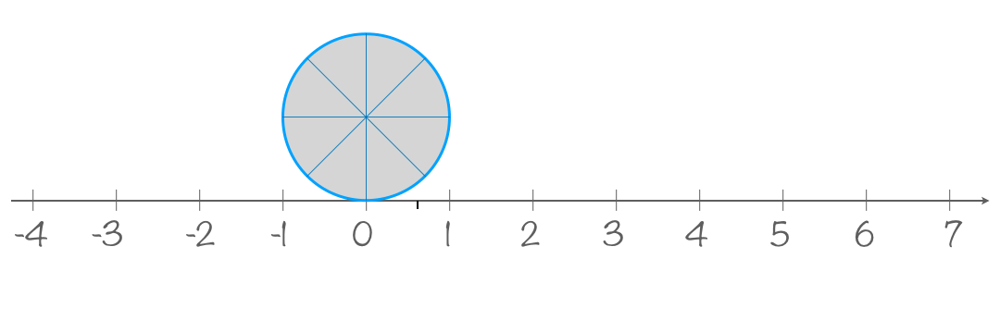
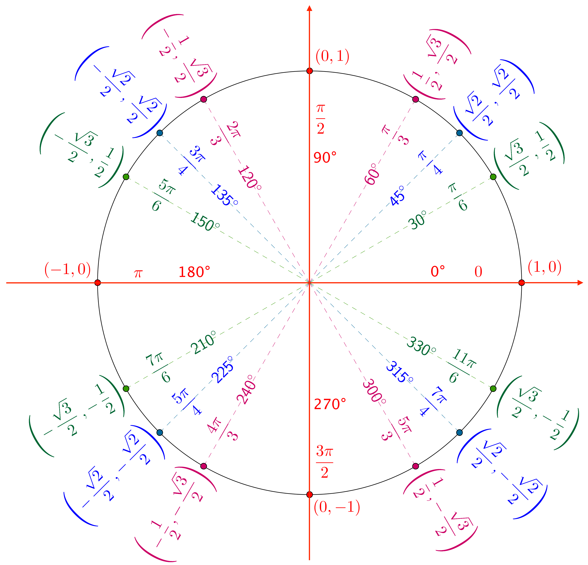
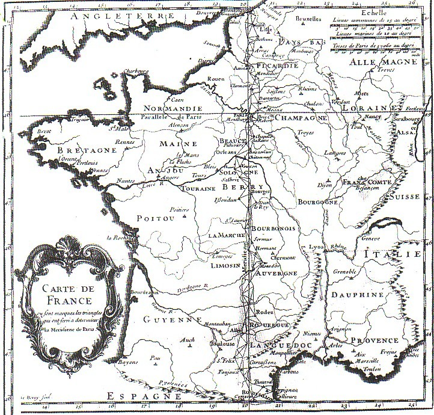
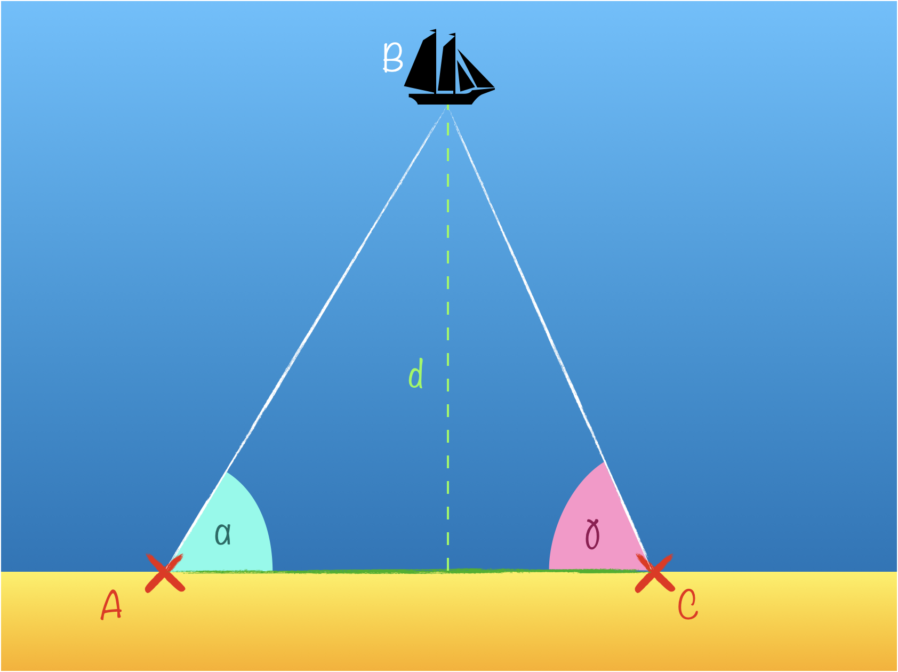
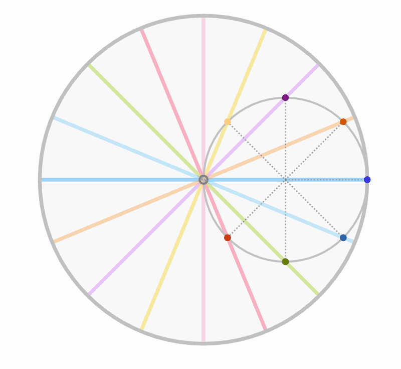

+++
title = "Cercle et Trigo"
date = 2021-03-06T14:20:50+01:00
weight = 2
chapter = false
hidden = false
+++

# Cercle et triangle

Un triangle et un cercle se rencontrent par les angles. Le cercle donne ses définitions au cosinus et au sinus, ce qui permet de calculer dans un triangle quelconque (lois des cosinus et des sinus). Et lorsqu'un triangle est inscrit dans un cercle, les angles du triangle et ceux du cercle sont liés par le théorème de l'angle inscrit.

## Trigonométrie

### Du radian au cercle trigonométrique

Radian

La mesure en **radians** d'un angle au centre d'un cercle est le rapport de la longueur $\ell$ de l'arc intercepté au rayon $R$&nbsp;:
$$\theta = \frac{\ell}{R}.$$
Ce rapport ne dépend pas du rayon. Un tour complet vaut $2\pi$ radians, soit $360°$, et $180° = \pi$ rad.

Un radian est donc l'angle pour lequel l'arc a la même longueur que le rayon. Pour le voir, on déroule un cercle de rayon $1$ sur une droite graduée&nbsp;: le point de contact avance exactement de la longueur de l'arc qui vient de toucher la droite.

Cosinus, sinus et tangente

Dans un plan muni d'un repère orthonormé d'origine $O$, soit $M$ le point du **cercle trigonométrique** (le cercle de centre $O$ et de rayon $1$) tel que l'angle orienté entre l'axe des abscisses et la demi-droite $[OM)$ vaut $\theta$. Le **cosinus** et le **sinus** de $\theta$ sont les coordonnées de $M$&nbsp;:
$$M = (\cos\theta,\ \sin\theta).$$
La **tangente** est $\tan\theta = \frac{\sin\theta}{\cos\theta}$ (pour $\cos\theta \neq 0$). C'est l'ordonnée du point où la droite $(OM)$ coupe la tangente au cercle en $(1, 0)$.

Dans la figure suivante, on fait tourner le point $M$.

<label for="tr-a">Angle&nbsp;: </label><input type="range" id="tr-a" min="0" max="360" step="1" value="30">

<button type="button" data-d="0">0</button><button type="button" data-d="30">π/6</button><button type="button" data-d="45">π/4</button><button type="button" data-d="60">π/3</button><button type="button" data-d="90">π/2</button><button type="button" data-d="135">3π/4</button><button type="button" data-d="180">π</button><button type="button" data-d="270">3π/2</button>

<svg id="tr-svg" viewBox="0 0 420 300" role="img" aria-label="Le cercle trigonométrique, un point M, son cosinus, son sinus et sa tangente"></svg>

Relation fondamentale

Pour tout angle $\theta$, $\cos^2\theta + \sin^2\theta = 1$.

C'est le théorème de Pythagore appliqué au triangle rectangle $O$, $(\cos\theta, 0)$, $M$, dont l'hypoténuse $OM$ vaut $1$. Les valeurs à retenir sont celles des angles remarquables&nbsp;:

| $\theta$ | $0$ | $\frac{\pi}{6}$ | $\frac{\pi}{4}$ | $\frac{\pi}{3}$ | $\frac{\pi}{2}$ |
|:---|:---:|:---:|:---:|:---:|:---:|
| $\sin\theta$ | $0$ | $\frac{1}{2}$ | $\frac{\sqrt{2}}{2}$ | $\frac{\sqrt{3}}{2}$ | $1$ |
| $\cos\theta$ | $1$ | $\frac{\sqrt{3}}{2}$ | $\frac{\sqrt{2}}{2}$ | $\frac{1}{2}$ | $0$ |

Le sinus de ces cinq angles s'écrit $\frac{\sqrt{0}}{2}, \frac{\sqrt{1}}{2}, \frac{\sqrt{2}}{2}, \frac{\sqrt{3}}{2}, \frac{\sqrt{4}}{2}$, et le cosinus s'obtient en lisant la ligne dans l'autre sens. Les symétries du cercle donnent ensuite les valeurs dans les autres quadrants&nbsp;:

L'animation suivante fait apparaître les courbes du cosinus, du sinus et de la tangente en déroulant le cercle.

Pourquoi des radians&nbsp;?

Un radian est un rapport de deux longueurs, donc un nombre sans dimension. C'est ce qui rend les formules du calcul différentiel simples. Pour $\theta$ en radians, $\sin\theta \approx \theta$ quand $\theta$ est petit&nbsp;: pour $\theta = 0{,}1$ rad, $\sin\theta = 0{,}0998$, soit $0{,}17\ \%$ d'écart. Les dérivées valent $(\sin)' = \cos$ et $(\cos)' = -\sin$. En degrés, ces formules traîneraient un facteur $\frac{\pi}{180}$ parasite. Le radian est l'unité naturelle des angles, comme l'exponentielle est la fonction naturelle de la croissance.

Formules d'addition&nbsp;: composer deux rotations

La rotation d'angle $\theta$ envoie le point $(1, 0)$ sur $(\cos\theta, \sin\theta)$ et le point $(0, 1)$ sur $(-\sin\theta, \cos\theta)$. Elle a donc pour matrice
$$R(\theta) = \begin{pmatrix} \cos\theta & -\sin\theta \\ \sin\theta & \cos\theta \end{pmatrix}.$$
Tourner de $a$ puis de $b$ revient à tourner de $a + b$, soit $R(a + b) = R(b)\,R(a)$. En développant le produit et en comparant la première colonne des deux membres, on obtient
$$\cos(a + b) = \cos a\cos b - \sin a\sin b, \qquad \sin(a + b) = \sin a\cos b + \cos a\sin b.$$
Avec $a = b$, on en déduit $\cos 2a = \cos^2 a - \sin^2 a$ et $\sin 2a = 2\sin a\cos a$.

## Loi des cosinus et loi des sinus

Le théorème de Pythagore ne vaut que pour un triangle rectangle. Les lois des cosinus et des sinus valent pour tous les triangles. On note $a$, $b$, $c$ les longueurs des côtés et $\alpha$, $\beta$, $\gamma$ les angles opposés, c'est-à-dire que $\alpha$ est l'angle en $A$, face au côté $BC = a$, et ainsi de suite.

### Loi des cosinus

Loi des cosinus (Al-Kashi)

Dans un triangle $ABC$,
$$c^2 = a^2 + b^2 - 2ab\cos\gamma.$$

Pour $\gamma = 90°$, $\cos\gamma = 0$ et l'on retrouve $c^2 = a^2 + b^2$&nbsp;: c'est le théorème de Pythagore, auquel la loi des cosinus ajoute une correction, le terme $-2ab\cos\gamma$. Cette correction dit même plus que la réciproque et la contraposée de Pythagore&nbsp;: si $\gamma$ est aigu, $\cos\gamma > 0$ et $c^2 < a^2 + b^2$&nbsp;; si $\gamma$ est obtus, $\cos\gamma < 0$ et $c^2 > a^2 + b^2$. Dans la figure suivante, les côtés $a = 3$ et $b = 4$ sont fixés et l'on fait varier l'angle $\gamma$ entre eux.

<label for="lc-g">Angle $\gamma$&nbsp;: </label><input type="range" id="lc-g" min="15" max="165" step="1" value="90">

<svg id="lc-svg" viewBox="0 0 420 220" role="img" aria-label="Un triangle de côtés 3 et 4 dont on fait varier l'angle compris, et le troisième côté"></svg>

Démonstration de la loi des cosinus

Plaçons $C$ à l'origine, $A$ en $(b, 0)$ et $B$ en $(a\cos\gamma, a\sin\gamma)$. Alors
$$c^2 = AB^2 = (a\cos\gamma - b)^2 + (a\sin\gamma)^2 = a^2(\cos^2\gamma + \sin^2\gamma) - 2ab\cos\gamma + b^2.$$
Comme $\cos^2\gamma + \sin^2\gamma = 1$, on obtient $c^2 = a^2 + b^2 - 2ab\cos\gamma$.

On l'appelle aussi théorème d'Al-Kashi, du nom du mathématicien et astronome persan du XVe siècle qui l'a utilisé pour ses calculs trigonométriques. Elle sert à trouver le troisième côté quand on connaît deux côtés et l'angle compris, et à trouver les angles quand on connaît les trois côtés, par $\cos\gamma = \frac{a^2 + b^2 - c^2}{2ab}$.

### Loi des sinus

Loi des sinus

Dans un triangle $ABC$ dont le cercle circonscrit a pour rayon $R$,
$$\frac{a}{\sin\alpha} = \frac{b}{\sin\beta} = \frac{c}{\sin\gamma} = 2R.$$

Démonstration de la loi des sinus

L'aire $\mathcal{S}$ du triangle s'écrit de trois façons, en prenant chaque fois deux côtés et l'angle compris&nbsp;: $\mathcal{S} = \frac{1}{2}ab\sin\gamma = \frac{1}{2}bc\sin\alpha = \frac{1}{2}ca\sin\beta$. En divisant par $\frac{1}{2}abc$, on obtient $\frac{\sin\gamma}{c} = \frac{\sin\alpha}{a} = \frac{\sin\beta}{b}$, c'est-à-dire l'égalité des trois rapports. Leur valeur commune est $2R$&nbsp;: le théorème de l'angle inscrit (voir plus bas) dit que l'angle au centre $\widehat{BOC}$ vaut $2\alpha$, et dans le triangle isocèle $OBC$, de côtés $R$, $R$ et $a$, la base vaut $a = 2R\sin\alpha$.

La loi des sinus sert à trouver les côtés quand on connaît un côté et deux angles (le troisième angle s'en déduit par $\alpha + \beta + \gamma = \pi$). C'est la situation de la triangulation, décrite ci-dessous. Une vidéo sur le sujet&nbsp;:



### Triangulation&nbsp;: la distance d'un navire et la mesure du mètre

La **loi des sinus** a contribué à la définition du **mètre**, la première unité «&nbsp;universelle&nbsp;» lors de la Révolution française. Delambre et Méchain furent missionnés pour mesurer le plus précisément possible un bout de méridien entre Dunkerque et Barcelone, la toute neuve définition du **mètre** étant&nbsp;:

> **un mètre est la dix-millionième partie d'un quart de méridien terrestre**

Le cercle répétiteur de Borda fut leur arme secrète. Il permettait alors de mesurer des angles avec une incertitude de quelques secondes seulement. Mesurer des distances avec cette précision est beaucoup plus difficile&nbsp;! L'idée fut alors de réaliser des triangulations&nbsp;: on vise des sommets faciles à repérer et on note les angles entre eux. Ils réalisèrent des dizaines de visées tout le long du bout de méridien étudié et le recouvrirent de triangles.

Une seule distance mesurée avec une grande précision permit alors de déterminer toutes les autres. En effet, grâce à la **loi des sinus**, la connaissance de la longueur d'un côté et de deux angles dans un triangle permet de déterminer les longueurs des deux autres côtés. Chaque triangle partage un côté avec le suivant, et le réseau se propage de proche en proche.

Thalès l'avait semble-t-il déjà réalisé puisqu'il aurait mis au point la méthode suivante pour connaître la distance entre un navire et la côte&nbsp;: deux observateurs $A$ et $C$ s'éloignent en direction opposée le long du trait de côte et mesurent les angles $\alpha = \widehat{CAB}$ et $\gamma = \widehat{ACB}$ entre la direction du bateau et la côte ainsi que la distance $AC$ qui les sépare l'un de l'autre. On a alors $d=AC\times\frac{\sin\left(\gamma\right)\sin\left(\alpha\right)}{\sin\left(\pi-(\alpha+\gamma)\right)}$&nbsp;!

Démonstration de la formule de la distance

$$\beta=180^\circ - (\alpha+\gamma)$$
$$AB = AC\times\frac{\sin\gamma}{\sin\beta}$$
$$d=AB\sin\alpha$$

La première ligne vient de la somme des angles du triangle, la deuxième de la loi des sinus ($\frac{AB}{\sin\gamma} = \frac{AC}{\sin\beta}$), et la troisième du triangle rectangle formé par $A$, $B$ et le pied de la perpendiculaire à la côte menée de $B$. Par exemple, avec $AC = 100$ m, $\alpha = 60°$ et $\gamma = 70°$, on trouve $\beta = 50°$, $AB = 100 \times \frac{\sin 70°}{\sin 50°} \approx 122{,}7$ m, puis $d = 122{,}7 \times \sin 60° \approx 106{,}2$ m.

Le mètre et la méridienne de Delambre et Méchain

Entre 1792 et 1798, Jean-Baptiste Delambre (de Dunkerque vers Rodez) et Pierre Méchain (de Barcelone vers Rodez) ont mesuré l'arc de méridien de Dunkerque à Barcelone. Seules deux longueurs ont été mesurées directement sur le terrain, deux «&nbsp;bases&nbsp;» d'une dizaine de kilomètres (près de Melun et près de Perpignan)&nbsp;; tout le reste de la longueur de l'arc a été déduit de visées d'angles, de triangle en triangle. Un arc de $9{,}7°$ de latitude a servi à extrapoler la longueur du quart de méridien, d'où la définition du mètre.

Le mètre obtenu est trop court d'environ $0{,}2$ mm par rapport à un dix-millionième du quart de méridien réel (près de $10\,002$ km). En 1799, un étalon en platine, le «&nbsp;mètre des Archives&nbsp;», a été déposé et est devenu la référence légale.

## Théorème de l'angle inscrit et de l'angle au centre

Angle inscrit et angle au centre

Soit $A$ et $B$ deux points d'un cercle de centre $O$ et $M$ un point du cercle distinct de $A$ et de $B$. Si $M$ est sur le grand arc $AB$, alors l'angle au centre $\widehat{AOB}$ est le double de l'angle inscrit $\widehat{AMB}$&nbsp;:
$$\widehat{AOB} = 2\widehat{AMB}.$$
Si $M$ est sur le petit arc, $\widehat{AMB} = 180° - \frac{1}{2}\widehat{AOB}$.

Dans la figure suivante, on peut déplacer les points $A$, $B$ et $M$ le long du cercle. L'angle inscrit ne change pas quand $M$ se déplace sur un même arc.

<svg id="ia-svg" viewBox="0 0 420 300" role="img" aria-label="Un cercle avec trois points A, B et M que l'on peut déplacer, et les angles au centre et inscrit"></svg>

Démonstration du théorème de l'angle inscrit

Plaçons-nous dans le cas où le centre $O$ est à l'intérieur de l'angle $\widehat{AMB}$ et notons $D$ le point diamétralement opposé à $M$. Le triangle $OMA$ est isocèle ($OM = OA = R$), donc $\widehat{OMA} = \widehat{OAM} = x$. L'angle $\widehat{AOD}$ est un angle extérieur de ce triangle, donc il vaut la somme des deux angles intérieurs non adjacents&nbsp;: $\widehat{AOD} = 2x$. De même, avec $y = \widehat{OMB}$, $\widehat{BOD} = 2y$. Ainsi $\widehat{AOB} = \widehat{AOD} + \widehat{DOB} = 2(x + y) = 2\widehat{AMB}$. Les autres positions de $O$ s'obtiennent par différence.

Conséquences

- Deux angles inscrits qui interceptent le même arc sont égaux.
- Un angle inscrit qui intercepte un demi-cercle (c'est-à-dire dont le côté $AB$ est un diamètre) est droit, puisque l'angle au centre vaut $180°$. Réciproquement, le cercle circonscrit à un triangle rectangle a pour diamètre son hypoténuse.



Pourquoi deux théorèmes portent-ils le nom de Thalès&nbsp;?

Les noms des théorèmes dépendent des systèmes éducatifs&nbsp;!

<blockquote>L'éducation secondaire se démocratise au cours du XIXe siècle. La géométrie, qui a souvent pour but d'exercer à la logique, en est un élément important. Les manuels se répandent, et leurs auteurs se mettent à introduire plus ou moins systématiquement des éléments historiques, en particulier en attribuant des noms de mathématicien aux théorèmes. L'époque est également au renouveau des recherches historiques sur les mathématiques de la Grèce antique. C'est dans ce contexte qu'à partir de la fin du XIXe siècle le nom de Thalès est attribué à deux théorèmes distincts. En France puis en Italie c'est à un théorème du livre VI des Éléments d'Euclide, soit celui sur la proportionnalité des segments découpés par une ligne parallèle à un côté dans un triangle, soit sa généralisation pour deux sécantes. En Allemagne c'est au théorème de l'angle inscrit dans un demi-cercle. Ces dénominations sont bien établies dans les années 1920, époque à laquelle d'autres pays adoptent l'une ou l'autre (mais pas l'Angleterre ni les États-Unis).  
Ces choix correspondent à des traditions différentes d'enseignement de la géométrie, plutôt fidèle à Euclide et à l'ordre d'exposition des Éléments en Allemagne, alors qu'une tradition plus anti-euclidienne s'est développée en France depuis La Ramée. Le choix s'est porté en France et en Italie, sur un théorème qui met en évidence un invariant de la géométrie affine, le rapport de mesures algébriques sur une droite, ce qui correspond au développement en Europe de la géométrie projective et affine au XIXe siècle. Ce théorème est mis en avant dans les débuts de l'apprentissage de la géométrie, alors que l'Allemagne privilégie le théorème de Pythagore, et choisit de donner le nom de Thalès à un théorème lié au triangle rectangle.  
Dans un cas comme dans l'autre, le choix du nom n'a finalement pas obéi à des considérations strictement historiques. L'histoire est instrumentalisée au service d'un choix didactique&nbsp;: il s'agit de mettre un théorème en avant, en lui attribuant le nom d'un mathématicien célèbre, d'où des choix différents dans des traditions d'enseignement différentes.</blockquote>

<i>Source : <a href="https://fr.wikipedia.org/wiki/Angle_inscrit_dans_un_demi-cercle#Appellation">Wikipédia</a></i>



Un cercle qui roule dans un cercle&nbsp;: le théorème de La Hire

Faisons rouler sans glisser un cercle de rayon $r$ à l'intérieur d'un cercle de rayon $2r$. Chaque point du petit cercle décrit alors un <b>diamètre</b> du grand cercle&nbsp;: un mouvement de rotation produit un mouvement rectiligne (on l'appelle aussi le couple de Tusi, ou la trajectoire d'une hypocycloïde dégénérée).

La démonstration est une application directe de l'angle inscrit. Soit $O$ le centre du grand cercle, $T$ le point de contact, $S$ sa position de départ, et $\varphi = \widehat{SOT}$. Le petit cercle a pour diamètre $[OT]$, donc $O$ est sur ce cercle. Soit $P$ le point du petit cercle qui coïncidait avec $S$ au départ. Le roulement sans glissement impose que l'arc $PT$ du petit cercle ait la même longueur que l'arc $ST$ du grand cercle, soit $2r\varphi$&nbsp;: l'angle au centre du petit cercle vaut donc $\frac{2r\varphi}{r} = 2\varphi$. Par le théorème de l'angle inscrit, $\widehat{POT} = \varphi$. La demi-droite $[OP)$ fait donc avec $[OT)$ le même angle que $[OS)$ fait avec $[OT)$&nbsp;: $P$ reste sur la demi-droite $[OS)$, c'est-à-dire sur le diamètre issu de $S$.

Trois exercices

<b>1.</b> Un triangle a pour côtés $a = 7$, $b = 5$ et $c = 8$. Calculer l'angle $\gamma$ opposé à $c$, puis le rayon du cercle circonscrit.

Solution

Par la loi des cosinus, $\cos\gamma = \frac{a^2 + b^2 - c^2}{2ab} = \frac{49 + 25 - 64}{70} = \frac{1}{7}$, donc $\gamma \approx 81{,}8°$. Par la loi des sinus, $2R = \frac{c}{\sin\gamma}$, avec $\sin\gamma = \sqrt{1 - \frac{1}{49}} = \frac{4\sqrt{3}}{7} \approx 0{,}990$, d'où $2R \approx 8{,}08$ et $R \approx 4{,}04$.

<b>2.</b> Montrer que la somme des angles d'un triangle vaut $180°$ à l'aide de l'angle inscrit, en supposant le triangle inscrit dans un cercle de centre $O$ à l'intérieur du triangle.

Solution

Les angles au centre associés aux trois côtés sont $2\alpha$, $2\beta$ et $2\gamma$ (angle inscrit et angle au centre), et ils font un tour complet autour de $O$&nbsp;: $2\alpha + 2\beta + 2\gamma = 360°$, d'où $\alpha + \beta + \gamma = 180°$.

<b>3.</b> Deux observateurs distants de $200$ m le long d'une côte voient un navire sous les angles $\alpha = 50°$ et $\gamma = 40°$ avec la côte. À quelle distance de la côte est-il&nbsp;?

Solution

Ici $\alpha + \gamma = 90°$ donc $\beta = 90°$, et la formule donne $d = 200 \times \frac{\sin 40°\sin 50°}{\sin 90°} = 200\sin 40°\cos 40° = 100\sin 80° \approx 98{,}5$ m. Le triangle est rectangle en $B$, et $d$ est la hauteur issue de $B$.

