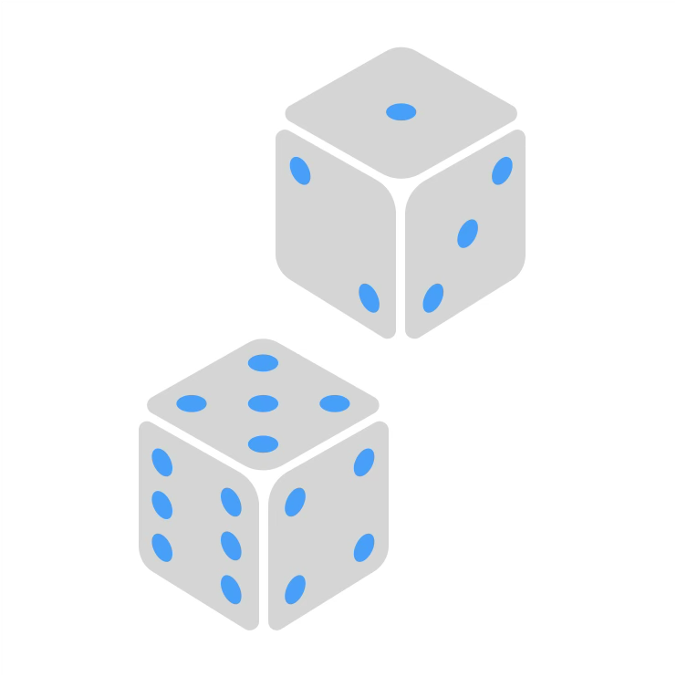
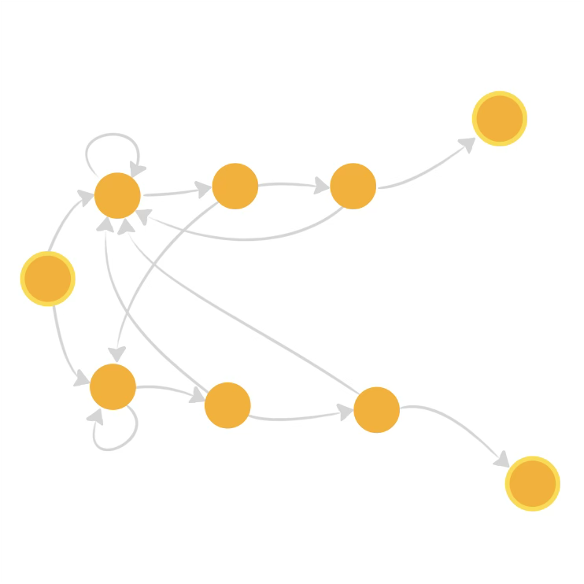

+++
title = "Probabilités"
date = 2021-03-06T14:20:50+01:00
weight = 5
chapter = true
+++

# Probabilités

Les **probabilités** sont des calculs a priori, visant à prédire les issues d’évènements n’ayant pas encore eu lieu.

<h3><a href="./lois/">Variables et lois</a></h3>

Les lois de probabilité usuelles, du discret au continu.

  <a href="./lois/#loi-binomiale" class="math-btn">Binomiale</a>
  <a href="./lois/#densité-de-probabilités" class="math-btn">Densité de probabilité</a>
  <a href="./lois/#loi-normale" class="math-btn">Normale</a>

<h3><a href="./markov/">Chaînes de Markov</a></h3>

Un jeton qui saute de case en case sans se souvenir d'où il vient.

  <a href="./markov/#une-promenade-au-hasard-sur-un-graphe" class="math-btn">Promenade au hasard</a>
  <a href="./markov/#le-jeu-de-penney" class="math-btn">Jeu de Penney</a>
  <a href="./markov/#revenir-chez-soi" class="math-btn">Revenir chez soi</a>

<h3><a href="./curiosites/">Curiosités et énigmes</a></h3>

Des problèmes de probabilités qui défient l'intuition.

  <a href="./curiosites/#anniversaires-simultanés" class="math-btn">Anniversaires simultanés</a>
  <a href="./curiosites/#spaghetti-et-inégalité-triangulaire" class="math-btn">Spaghetti et inégalité triangulaire</a>
  <a href="./curiosites/#paradoxe-des-deux-enfants" class="math-btn">Paradoxe des deux enfants</a>
  <a href="./curiosites/#paradoxe-de-cover" class="math-btn">Paradoxe de Cover</a>
  <a href="./curiosites/#problème-du-secrétaire" class="math-btn">Problème du secrétaire</a>

<h3><a href="./simplexes_proba/">Simplexes et probabilités</a></h3>

Deux problèmes où le nombre $\mathrm{e}$ surgit d'un volume de simplexe.

  <a href="./simplexes_proba/#rupture-de-monotonie" class="math-btn">Rupture de monotonie</a>
  <a href="./simplexes_proba/#seuil-de-gnedenko" class="math-btn">Seuil de Gnedenko</a>

