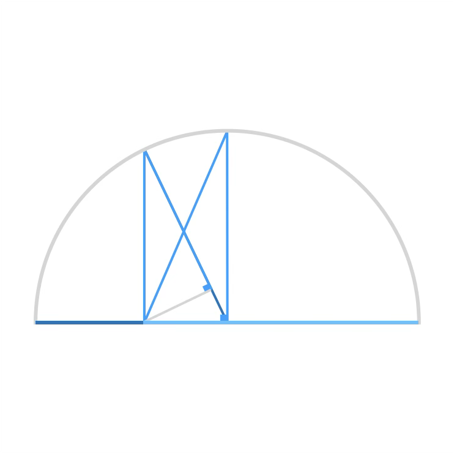
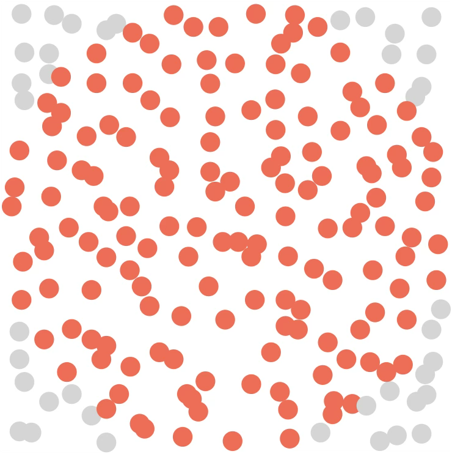
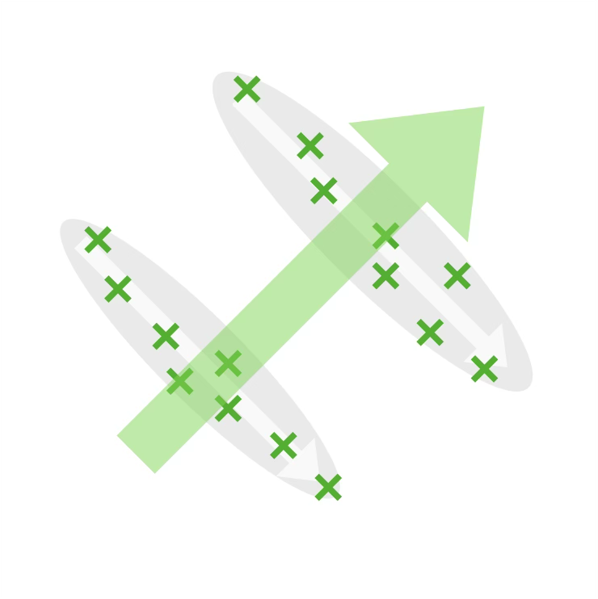
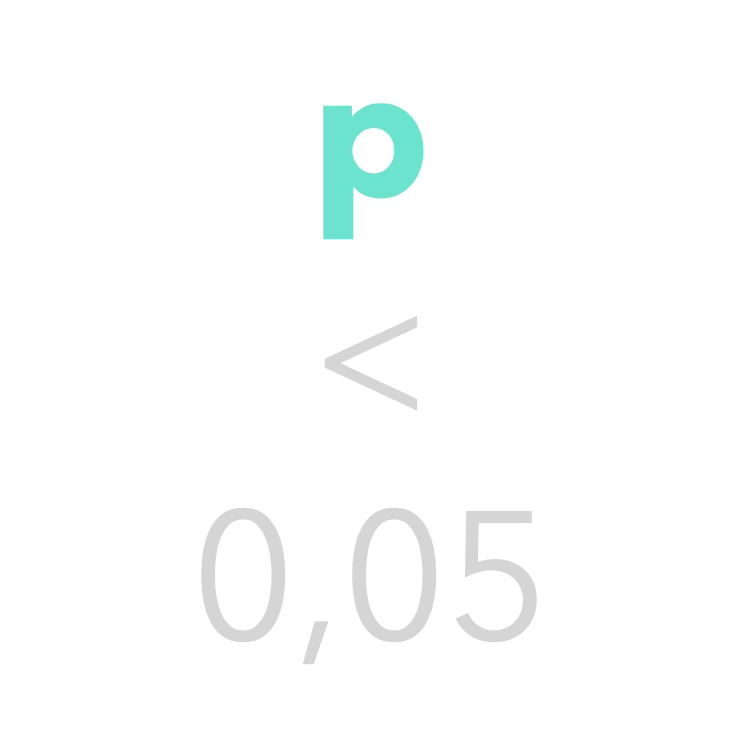
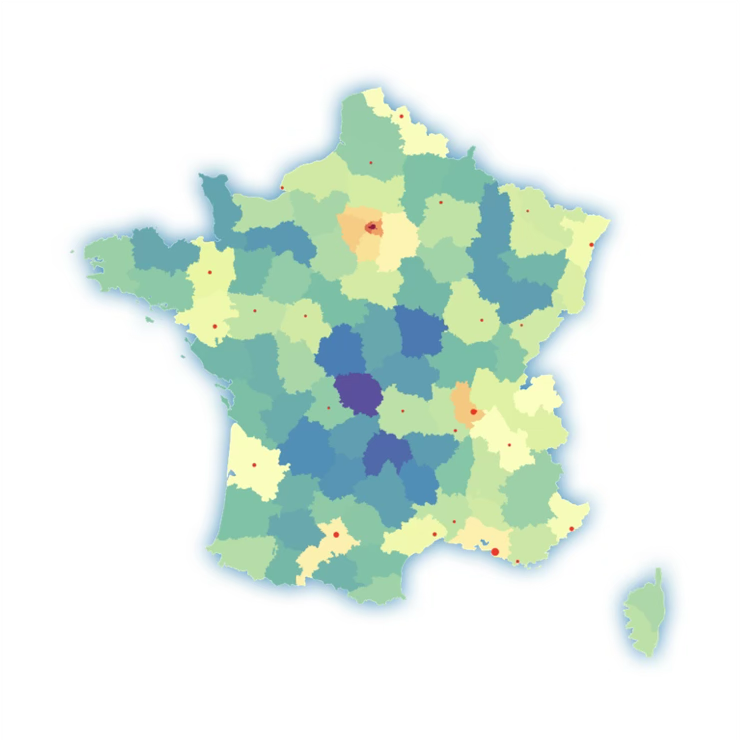
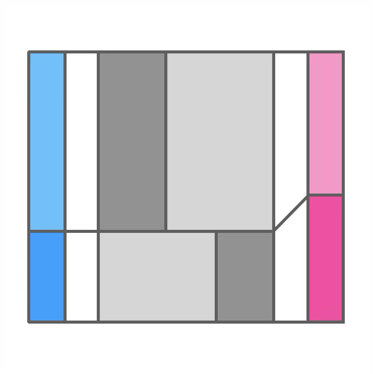
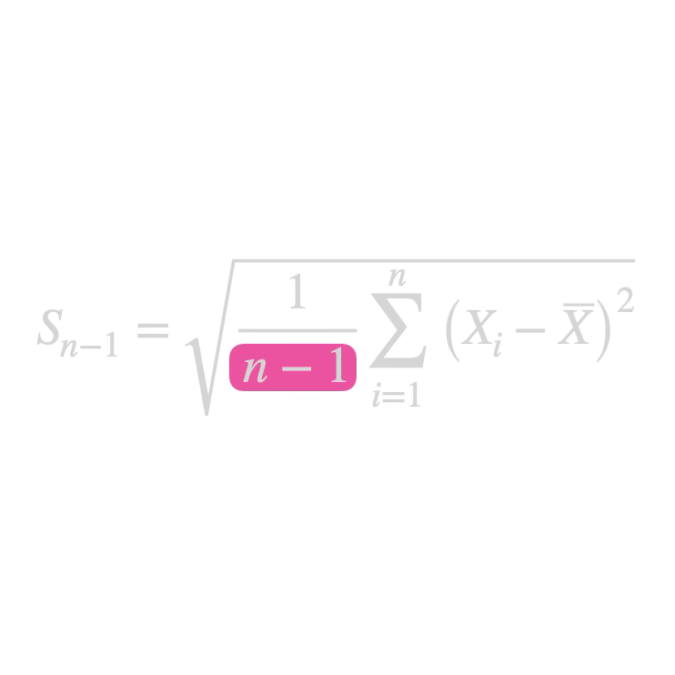

+++
title = "Statistiques"
date = 2021-03-06T14:20:50+01:00
weight = 6
chapter = true
+++

# Statistiques

Les **statistiques** sont des calculs a posteriori qui analysent les issues d’évènements déjà réalisés.

<h3><a href="./moyennes/">Différentes moyennes</a></h3>

Arithmétique, géométrique, harmonique, quadratique&nbsp;: une même famille de moyennes.

  <a href="./moyennes/#petite-énigme-avec-la-moyenne-harmonique" class="math-btn">Énigme de la moyenne harmonique</a>
  <a href="./moyennes/#estimation-de-fermi-et-moyennes" class="math-btn">Estimation de Fermi</a>

<h3><a href="./montecarlo/">Méthode de Monte Carlo</a></h3>

Calculer grâce au hasard&nbsp;: intégrales, espérances et incertitudes-types.

<h3><a href="./simpson/">Paradoxe de Simpson</a></h3>

Quand une tendance s'inverse en regroupant les données&nbsp;: l'exemple de la vaccination contre le Covid.

<h3><a href="./testhyp/">Test d'hypothèse</a></h3>

Les statistiques au service de la décision scientifique, et leurs dérives.

  <a href="./testhyp/#p-hacking" class="math-btn">p-hacking</a>

<h3><a href="./acp/">Analyse en composantes principales</a></h3>

Faire parler un jeu de données, de son secret le plus important au plus anodin.

  <a href="./acp/#les-axes-qui-tiraillent-territorialement-la-france" class="math-btn">Les axes de la France</a>

<h3><a href="./bayes/">Inférences bayésiennes</a></h3>

Raisonner à partir d'indices&nbsp;: la logique du théorème de Bayes.

  <a href="./bayes/#problème-de-monty-hall" class="math-btn">Monty Hall</a>
  <a href="./bayes/#largument-de-lapocalypse" class="math-btn">L'argument de l'Apocalypse</a>
  <a href="./bayes/#inférence-bayésienne-et-diagnostic-médical" class="math-btn">Diagnostic médical</a>

<h3><a href="./ecarttype/">Écart-type expérimental</a></h3>

Pourquoi divise-t-on par $n-1$ et non par $n$&nbsp;?

