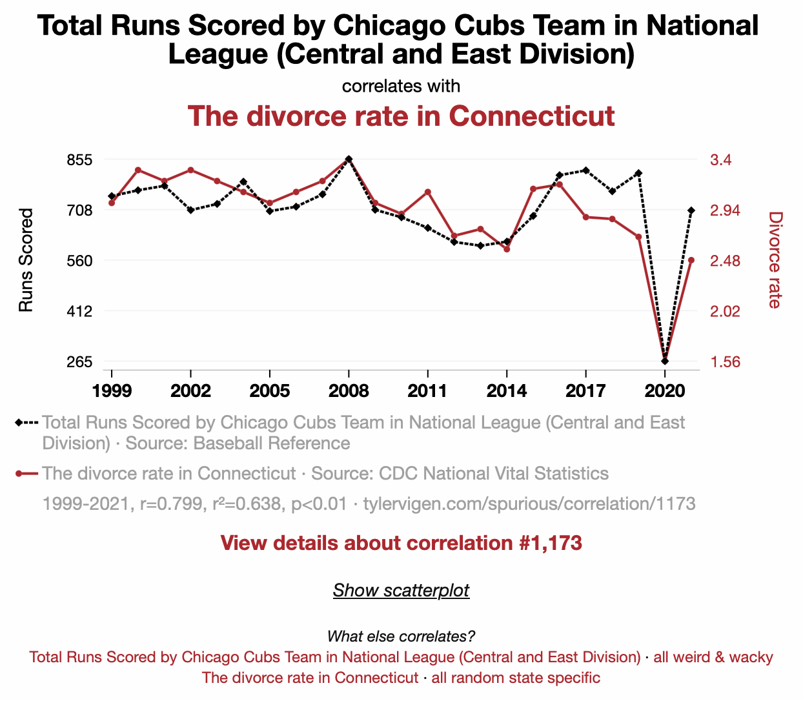

+++
title = "Test d'hypothèse"
date = 2021-03-06T14:20:50+01:00
weight = 4
+++

# Test d'hypothèse

Face à des données entachées de hasard, un écart observé peut venir de la seule fluctuation de l'échantillonnage, ou traduire un effet réel. Un test d'hypothèse est une procédure qui tranche, en contrôlant le risque de se tromper. C'est la forme prise par la décision en science expérimentale.

## Le principe d'un test

Les statistiques au service de la prise de décision en science.



### Un exemple : la pièce est-elle équilibrée ?

On lance 100 fois une pièce, et l'on obtient 62 fois face. La pièce est-elle truquée&nbsp;? Si elle était équilibrée, le nombre de faces suivrait la loi binomiale $\mathcal{B}(100, 0{,}5)$, centrée sur $50$ avec un écart-type de $5$. Obtenir $62$ est-il assez improbable pour douter de l'équilibre&nbsp;? Cela dépend du seuil de risque que l'on accepte, et de ce que l'on appelle «&nbsp;assez improbable&nbsp;».

Test d'hypothèse

Un **test d'hypothèse** oppose deux hypothèses&nbsp;: l'**hypothèse nulle** $H_0$ («&nbsp;il n'y a pas d'effet&nbsp;», par exemple $p = 0{,}5$) et l'**hypothèse alternative** $H_1$ («&nbsp;il y a un effet&nbsp;», par exemple $p \neq 0{,}5$). On se donne

1. un **seuil de risque** $\alpha$ (en général $0{,}05$), fixé **avant** de regarder les données&nbsp;;
2. une **statistique de test** $T$ (ici, le nombre de faces), dont on connaît la loi quand $H_0$ est vraie&nbsp;;
3. une **région de rejet**, ensemble de valeurs de $T$ dont la probabilité sous $H_0$ vaut au plus $\alpha$ (ici, les valeurs trop éloignées de $50$).

Si la valeur observée de $T$ est dans la région de rejet, on **rejette** $H_0$. Sinon, on **ne rejette pas** $H_0$.

p-valeur

La **p-valeur** d'un test est la probabilité, calculée en supposant $H_0$ vraie, d'obtenir une valeur de la statistique de test au moins aussi extrême que celle observée. On rejette $H_0$ au seuil $\alpha$ si et seulement si la p-valeur est inférieure ou égale à $\alpha$.

Dans la figure suivante, on teste l'hypothèse $H_0 : p = p_0$ sur un échantillon de $n$ lancers donnant $k$ succès. Les barres sont la loi du nombre de succès sous $H_0$, colorées en rose dans la région de rejet. La barre orange est la valeur observée.

<label for="te-n">Nombre de lancers $n$&nbsp;: </label><input type="range" id="te-n" min="10" max="200" step="1" value="100">

<label for="te-k">Nombre de succès observés $k$&nbsp;: </label><input type="range" id="te-k" min="0" max="100" step="1" value="62">

<label for="te-p">Hypothèse nulle $p_0$&nbsp;: </label><input type="range" id="te-p" min="0.05" max="0.95" step="0.01" value="0.5">

<label>Seuil $\alpha$&nbsp;: <select id="te-a"><option value="0.1">10 %</option><option value="0.05" selected>5 %</option><option value="0.01">1 %</option></select> &nbsp; Alternative&nbsp;: <select id="te-o"><option value="2" selected>p ≠ p₀ (bilatérale)</option><option value="1">p &gt; p₀ (unilatérale)</option></select></label>

<svg id="te-svg" viewBox="0 0 460 235" role="img" aria-label="Loi binomiale sous l'hypothèse nulle, région de rejet et valeur observée"></svg>

Avec $62$ faces sur $100$, la p-valeur bilatérale vaut environ $0{,}021$&nbsp;: on rejette l'équilibre de la pièce au seuil de $5$&nbsp;%, mais pas au seuil de $1$&nbsp;%. On retrouve ce que dit l'intervalle de fluctuation (voir [lois](../../proba/lois/#intervalle-de-fluctuation))&nbsp;: au seuil de $5$&nbsp;%, il vaut $[40; 60]$ pour une pièce équilibrée, et $62$ est à l'extérieur.

Ce que la p-valeur n'est pas

Une p-valeur de $0{,}02$ <b>ne signifie pas</b> qu'il y a $2$&nbsp;% de chances que l'hypothèse nulle soit vraie. C'est la probabilité des données (ou de données plus extrêmes) <b>si</b> $H_0$ est vraie, et non la probabilité de $H_0$ sachant les données. Passer de l'une à l'autre demande de connaître la probabilité a priori de $H_0$, ce que fait la <a href="../bayes/">règle de Bayes</a>. Si l'on teste mille hypothèses dont $999$ sont fausses, les $5$&nbsp;% de faux positifs de ces $999$ tests (environ $50$) noient le seul vrai positif.

Une petite p-valeur ne mesure pas non plus la taille de l'effet&nbsp;: avec assez de données, un effet minuscule devient «&nbsp;significatif&nbsp;». Et ne pas rejeter $H_0$ ne prouve pas qu'elle est vraie&nbsp;: on dit seulement que les données ne suffisent pas à l'écarter.

### Deux façons de se tromper

Un test peut se tromper dans deux sens. Il peut rejeter $H_0$ alors qu'elle est vraie (un faux positif), ou ne pas la rejeter alors qu'elle est fausse (un faux négatif).

Risques de première et de seconde espèce

Le **risque de première espèce** est $\alpha = P(\text{rejeter } H_0 \mid H_0 \text{ vraie})$, que l'on fixe. Le **risque de seconde espèce** est $\beta = P(\text{ne pas rejeter } H_0 \mid H_1 \text{ vraie})$. La **puissance** du test est $1 - \beta$, la probabilité de déceler un effet quand il existe.

<table class="tbl">
<tr><th></th><th>$H_0$ vraie</th><th>$H_1$ vraie</th></tr>
<tr><th>on rejette $H_0$</th><td>erreur de 1re espèce (probabilité $\alpha$)</td><td>bonne décision (puissance $1 - \beta$)</td></tr>
<tr><th>on ne rejette pas $H_0$</th><td>bonne décision</td><td>erreur de 2e espèce (probabilité $\beta$)</td></tr>
</table>

Le risque $\beta$ dépend de la taille de l'effet à déceler, du nombre de données et du seuil $\alpha$. La figure suivante illustre un test sur la moyenne d'un échantillon de $n$ mesures d'écart-type $\sigma$&nbsp;: sous $H_0$, la moyenne est centrée sur $0$&nbsp;; sous $H_1$, elle est centrée sur $d\sigma$ (l'effet est de $d$ écarts-types). Les deux courbes sont les lois de la moyenne, d'écart-type $\frac{\sigma}{\sqrt{n}}$. On rejette $H_0$ à droite du seuil $c$.

<label for="er-d">Taille de l'effet $d$ (en écarts-types)&nbsp;: </label><input type="range" id="er-d" min="0" max="1.5" step="0.05" value="0.5">

<label for="er-n">Nombre de mesures $n$&nbsp;: </label><input type="range" id="er-n" min="1" max="200" step="1" value="16">

<label>Seuil $\alpha$&nbsp;: <select id="er-a"><option value="0.1">10 %</option><option value="0.05" selected>5 %</option><option value="0.01">1 %</option></select></label>

<svg id="er-svg" viewBox="0 0 460 235" role="img" aria-label="Lois de la moyenne sous H0 et sous H1, risques alpha et beta et puissance"></svg>

Les trois aires colorées se lisent ainsi&nbsp;: l'aire rose (sous la courbe de $H_0$, à droite de $c$) est $\alpha$, l'aire orange (sous la courbe de $H_1$, à gauche de $c$) est $\beta$, et l'aire verte, qui est le reste de la courbe de $H_1$, est la puissance. En déplaçant les curseurs, on voit que&nbsp;:

- diminuer $\alpha$ pour se protéger des faux positifs fait augmenter $\beta$&nbsp;: on rate plus d'effets réels&nbsp;;
- un effet plus grand est plus facile à déceler&nbsp;;
- seule l'augmentation du nombre de mesures $n$ rapproche les courbes de leur séparation et réduit à la fois $\alpha$ et $\beta$, puisque la largeur des courbes décroît en $\frac{1}{\sqrt{n}}$.

C'est pourquoi on calcule, avant une expérience, le nombre de mesures nécessaire pour atteindre une puissance donnée (souvent $80$&nbsp;%) pour un effet donné.

### Quelques tests classiques

Test sur une moyenne (test de Student)

Pour savoir si la moyenne $\mu$ d'une population diffère d'une valeur de référence $\mu_0$, on calcule à partir de $n$ mesures de moyenne $\bar{x}$ et d'écart-type expérimental $s$ la statistique
$$t = \frac{\bar{x} - \mu_0}{s/\sqrt{n}}.$$
Sous $H_0 : \mu = \mu_0$ et pour des mesures de loi normale, $t$ suit la <b>loi de Student</b> à $n - 1$ degrés de liberté (voir le <a href="../../proba/lois/#autres-lois">bestiaire des lois</a>). On rejette $H_0$ au seuil de $5$&nbsp;% quand $|t|$ dépasse environ $2$ (valeur exacte $2{,}26$ pour $n = 10$, $1{,}96$ pour $n$ très grand). Le même principe permet de comparer les moyennes de deux échantillons.

Test du khi-deux d'adéquation&nbsp;: un dé est-il équilibré&nbsp;?

On lance $600$ fois un dé et l'on obtient les effectifs $90$, $110$, $95$, $85$, $120$, $100$ pour les faces $1$ à $6$. Si le dé est équilibré, l'effectif attendu est $E_i = 100$ pour chaque face. La statistique du khi-deux compare effectifs observés $O_i$ et attendus&nbsp;:
$$\chi^2 = \sum_{i=1}^{6}\frac{(O_i - E_i)^2}{E_i} = \frac{100 + 100 + 25 + 225 + 400 + 0}{100} = 8{,}5.$$
Sous $H_0$, elle suit approximativement la loi du khi-deux à $6 - 1 = 5$ degrés de liberté. Le seuil de rejet à $5$&nbsp;% est $11{,}07$. Comme $8{,}5 < 11{,}07$ (la p-valeur vaut environ $0{,}13$), on ne rejette pas l'hypothèse d'un dé équilibré. L'écart des effectifs à $100$ est de l'ordre de la fluctuation attendue, de $\sqrt{600 \times \frac{1}{6} \times \frac{5}{6}} \approx 9{,}1$.

Fisher, Neyman et Pearson&nbsp;: deux philosophies mélangées

La p-valeur est due à Ronald Fisher. Dans <i>Statistical Methods for Research Workers</i> (1925), il propose le seuil de $0{,}05$ comme repère «&nbsp;commode&nbsp;», non comme dogme. Dans une expérience célèbre, qu'il raconte en 1935, une dame prétend distinguer le thé versé sur le lait de celui où le lait est versé sur le thé. On lui présente $8$ tasses, dont $4$ de chaque sorte, dans le désordre. Si elle devine au hasard, la probabilité de tout identifier correctement est $\frac{1}{\binom{8}{4}} = \frac{1}{70} \approx 1{,}4$&nbsp;%&nbsp;: une réussite complète est assez improbable pour que l'on rejette le simple hasard.

Jerzy Neyman et Egon Pearson (1933) ont formalisé autrement&nbsp;: deux hypothèses explicites, un risque $\alpha$ fixé d'avance, un risque $\beta$ et une puissance. Leur lemme dit que, pour deux hypothèses simples, le test le plus puissant à $\alpha$ donné est celui qui rejette quand le rapport de vraisemblance est grand. L'usage actuel mélange les deux approches (une p-valeur comparée à un seuil fixé), ce que ni l'un ni l'autre n'aurait approuvé.

## p-hacking

> Extrait traduit de 'Everything is predictable' de Tom Chivers

Peut-être que l’exemple le plus célèbre est celui du scientifique de l'alimentation Brian Wansink, une star de l’Université Cornell qui a reçu des millions de dollars de financement du gouvernement fédéral américain sous l’administration Obama. Il a publié beaucoup d’études sur notre comportement alimentaire, notamment une sur la façon dont les hommes mangent plus en compagnie de femmes (probablement pour les impressionner) ; une autre sur comment donner des noms plus “attractifs” aux légumes (appeler les carottes “carottes à vision X-ray,” par exemple) permet que les enfants d’école primaire en mangent deux fois plus.
  
Puis, en 2016, il a commis l’erreur de publier un billet de blog intitulé "The Grad Student Who Never Said 'No.'".
  
L’étudiante en question était une doctorante turque. Lorsqu’elle est arrivée à Cornell, Wansink “lui a donné un ensemble de données d’une étude autofinancée, sans résultats probants” - une étude qui examinait le comportement alimentaire dans un buffet italien à volonté pendant un mois. Selon ses propres termes, il lui a dit : “Cela nous a coûté beaucoup de temps et  d'argent à collecter. Il doit y avoir quelque chose ici que nous pouvons sauver parce que cet ensemble de données est cool (riche et unique).” L’étudiante s’est donc mise au travail et a découpé l’ensemble de données de nombreuses façons différentes. Et, inévitablement, elle a trouvé de nombreuses corrélations p < 0,05 - suffisamment pour qu'elle et Wansink publient cinq articles (y compris l’article “les hommes mangent trop pour impressionner les femmes”).

Cela a éveillé la suspicion de certains scientifiques et journalistes scientifiques, et ils ont commencé à passer au crible les autres recherches de Wansink. De plus, Stephanie Lee, une journaliste scientifique de BuzzFeed, a mis la main sur ses emails, dans lesquels - il s’est avéré - il demanda à sa doctorante de découper les données en “mâles, femelles, mangeurs de déjeuner, mangeurs de dîner, personnes mangeant seules, personnes mangeant en groupe de 2, personnes mangeant en groupe de 2+, personnes commandant de l’alcool, personnes commandant des boissons non alcoolisées, personnes restant près du buffet, personnes s’asseyant loin, etc.” pour “essorer le jeu de données jusqu'à en extraire tous les résultats significatifs possibles” et faire en sorte que cela “devienne viral à grande échelle.”

En conséquence, dix-huit des articles de Wansink ont été rétractés ; sept ont reçu des “expressions of concern” que les revues ajoutent aux études qu’elles ne pensent pas pouvoir être totalement fiables, mais qu’elles ne sont pas prêtes à rétracter complètement ; et quinze ont été corrigés. Wansink, entre-temps, a démissionné de Cornell en 2019, après que l’université a conclu qu’il avait commis une faute scientifique et lui a interdit l’enseignement et la recherche.

C'est un exemple particulièrement frappant, mais d’une certaine manière Wansink a eu la malchance d’être détruit publiquement pour quelque chose qui était presque une pratique standard. Le p-hacking se produit tout le temps, de manière beaucoup moins dramatique - et beaucoup de scientifiques n’ont absolument aucune idée qu’ils font quelque chose de mal. Daryl Bem, dans un chapitre d'un livre de 1987 écrit comme un guide pour aider les étudiants à publier leurs recherches, a écrit qu’il “y a deux articles que vous pouvez écrire : l’article que vous aviez prévu d’écrire lorsque vous avez conçu votre étude ; l’article qui a le plus de sens maintenant que vous avez vu les résultats. La bonne réponse est le second.” Il a appelé les chercheurs à “analyser les sexes séparément, créer de nouveaux index composites… réorganiser les données pour les mettre en relief de manière plus audacieuse… Les données peuvent être suffisamment solides pour justifier de recentrer votre article autour des nouvelles découvertes et de subordonner ou même d’ignorer vos hypothèses originales."

Dans un [**espace de données à grande dimension**](../../geometrie/geo4/#the-average-man), plus on a d'axes (de catégories, d'entrées,...), plus on a de chances d'obtenir un résultat hors norme sur au moins l'un d'eux. 
Ce [**chouette site**](https://tylervigen.com/spurious-correlations) met le phénomène à profit pour débusquer des corrélations amusantes (avec pour chacune des p-values inférieures à 1%...)&nbsp;:

<a href="https://tylervigen.com/spurious-correlations">

</a>

### Quand on teste plusieurs hypothèses

Le p-hacking est un cas particulier d'un problème général&nbsp;: les **tests multiples**.

Tests multiples

Si l'on réalise $m$ tests indépendants au seuil $\alpha$ sur des données où aucun effet n'existe, la probabilité d'obtenir au moins un résultat «&nbsp;significatif&nbsp;» est
$$1 - (1 - \alpha)^m.$$
Pour $\alpha = 0{,}05$, elle vaut $64$&nbsp;% pour $m = 20$ et $99$&nbsp;% pour $m = 100$.

En effet, chaque test échoue à produire un faux positif avec la probabilité $1 - \alpha$, et les $m$ tests indépendants ensemble avec la probabilité $(1 - \alpha)^m$. L'expérience suivante reprend la bande dessinée ci-dessus&nbsp;: on teste $20$ couleurs de bonbons pour savoir si l'une d'elles provoque l'acné. Pour chaque couleur, on compare un groupe de $30$ personnes à un groupe témoin, mais **les données sont des nombres aléatoires purs&nbsp;: aucune couleur n'a d'effet.**

<button type="button" id="jb-1">Refaire l'expérience</button><button type="button" id="jb-2">Répéter 1 000 fois</button>

<label><input type="checkbox" id="jb-c"> Corriger par la méthode de Bonferroni (seuil $\frac{0{,}05}{20}$)</label>

<svg id="jb-svg" viewBox="0 0 460 224" role="img" aria-label="Vingt tests sur des données aléatoires, les p-valeurs et les résultats significatifs"></svg>

Sans correction, au moins une couleur sort «&nbsp;significative&nbsp;» dans $64$&nbsp;% des expériences, et un journal pourrait titrer «&nbsp;Les bonbons verts provoquent l'acné&nbsp;». Il suffit d'oublier de dire qu'on a testé vingt couleurs. Avec la correction de Bonferroni, le risque total retombe à environ $5$&nbsp;%.

Comment se prémunir&nbsp;: corrections, préenregistrement, réplication

La <b>correction de Bonferroni</b> consiste à tester chaque hypothèse au seuil $\frac{\alpha}{m}$&nbsp;: le risque d'obtenir au moins un faux positif parmi les $m$ tests reste au plus $\alpha$. Elle est simple, mais conservatrice. La procédure de Benjamini et Hochberg (1995) contrôle plutôt la proportion de faux positifs parmi les résultats déclarés significatifs (le taux de fausses découvertes), ce qui convient quand on teste des milliers d'hypothèses, comme en génomique.

Les remèdes les plus efficaces sont de méthode&nbsp;: <b>préenregistrer</b> l'hypothèse et l'analyse avant de voir les données, <b>déclarer</b> tous les tests faits, et <b>répliquer</b> les résultats sur de nouvelles données.

En physique des particules&nbsp;: cinq sigmas et l'effet de «&nbsp;regarder ailleurs&nbsp;»

Pour annoncer une découverte, la physique des particules exige une p-valeur de $2{,}9 \times 10^{-7}$, soit $5$ écarts-types d'une loi normale (cinq sigmas), au lieu de $0{,}05$. La raison est la même que pour les bonbons&nbsp;: un détecteur examine des milliers de régions du spectre, et une fluctuation de $3$ sigmas quelque part est attendue. On distingue la significativité <b>locale</b> d'un excès, et la significativité <b>globale</b>, corrigée de l'effet de «&nbsp;regarder ailleurs&nbsp;» (<i>look-elsewhere effect</i>). En 2015, un excès de photons autour de $750$ GeV avait une significativité locale d'environ $3{,}9$ sigmas, mais d'environ $2$ sigmas après correction, et il a disparu avec plus de données. Le boson de Higgs, lui, a franchi les cinq sigmas en 2012.

La crise de la reproductibilité

En 2005, John Ioannidis a publié un article intitulé «&nbsp;Why most published research findings are false&nbsp;», où il montre par un calcul de probabilités (de type bayésien) que, quand on teste beaucoup d'hypothèses peu plausibles avec des échantillons petits, la majorité des résultats «&nbsp;significatifs&nbsp;» peuvent être faux. En 2015, le projet Open Science Collaboration a tenté de reproduire $100$ études publiées de psychologie&nbsp;: $97$ des études originales avaient un résultat significatif, contre environ $36$ des réplications. Ces constats ont poussé de nombreuses revues à adopter le préenregistrement et à demander l'effet mesuré, avec son intervalle de confiance, plutôt qu'une seule p-valeur.

Trois exercices

<b>1.</b> Une pièce donne $62$ faces sur $100$ lancers. Calculer la p-valeur approchée du test bilatéral de l'équilibre avec l'approximation normale, et conclure à $5$&nbsp;%.

Solution

Sous $H_0$, le nombre de faces a pour espérance $50$ et pour écart-type $\sqrt{100 \times 0{,}5 \times 0{,}5} = 5$. La statistique centrée réduite vaut $z = \frac{62 - 50}{5} = 2{,}4$ (avec une correction de continuité, $\frac{61{,}5 - 50}{5} = 2{,}3$). La p-valeur bilatérale est $P(|Z| \ge 2{,}4) \approx 0{,}016$ (ou $0{,}021$ avec la correction, ce qui est la valeur exacte de la loi binomiale). Elle est inférieure à $0{,}05$&nbsp;: on rejette l'équilibre à $5$&nbsp;%.

<b>2.</b> On fait $40$ comparaisons indépendantes au seuil de $5$&nbsp;%, sans aucun effet réel. Quelle est la probabilité d'obtenir au moins un résultat significatif, et quel seuil de Bonferroni faut-il utiliser pour que ce risque reste inférieur à $5$&nbsp;%&nbsp;?

Solution

La probabilité d'au moins un faux positif est $1 - 0{,}95^{40} \approx 0{,}87$, soit $87$&nbsp;%. Avec le seuil de Bonferroni $\frac{0{,}05}{40} = 0{,}00125$ pour chaque test, le risque total est au plus $5$&nbsp;%.

<b>3.</b> Un test est réalisé au seuil de $5$&nbsp;% avec une puissance de $80$&nbsp;%. Sur $1000$ hypothèses testées, dont $100$ seulement sont vraies (un effet réel existe), combien de résultats significatifs obtient-on, et quelle proportion d'entre eux correspond à de vrais effets&nbsp;?

Solution

Parmi les $100$ effets réels, on en détecte $80$ (puissance). Parmi les $900$ hypothèses nulles vraies, $5$&nbsp;% donnent un faux positif, soit $45$. On obtient donc $80 + 45 = 125$ résultats significatifs, dont $80$, soit $64$&nbsp;%, sont de vrais effets. Plus d'un résultat «&nbsp;significatif&nbsp;» sur trois est un faux positif, bien que le seuil soit de $5$&nbsp;%.

