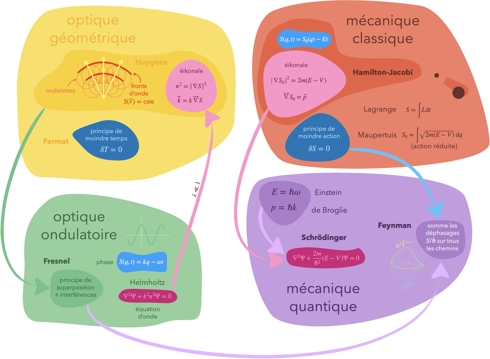
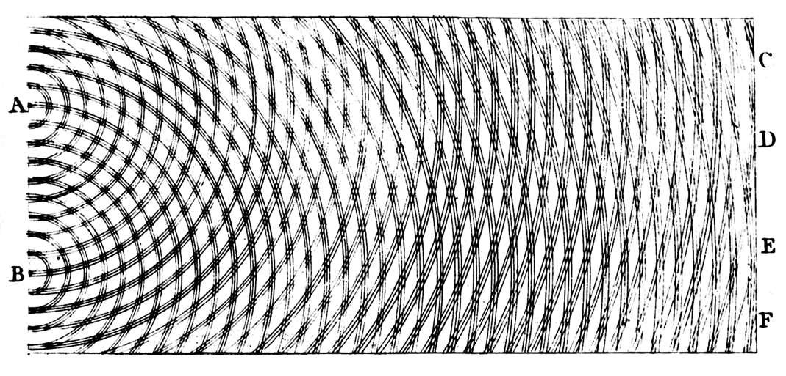
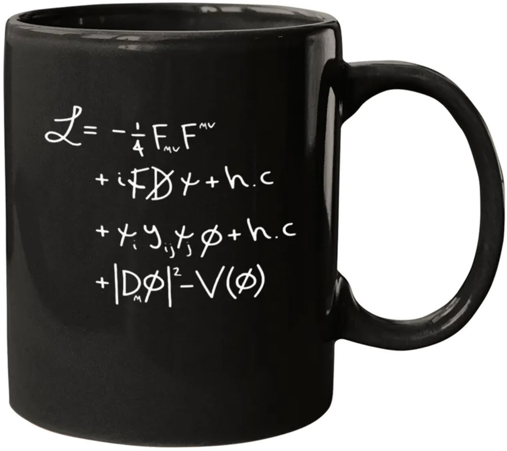

+++
title = "Moindre action"
date = 2021-03-06T14:20:50+01:00
weight = 3
+++

# Principe de moindre action

Maupertuis formule ainsi le principe de moindre action en 1744&nbsp;:

>  Lorsqu’il arrive quelque changement dans la nature, la quantité d’action, nécessaire pour ce changement, est la plus petite qui soit possible.

Dans sa version moderne, le principe dit que, parmi tous les mouvements imaginables entre deux configurations, la nature retient celui qui rend **stationnaire** l'action $\int (T-V)\\,\mathrm{d}t$, en quelque sorte l'écart cumulé, au fil du trajet, entre énergie cinétique et énergie potentielle.

Maupertuis reprenait ainsi le flambeau de Fermat qui avait introduit dès 1657 le principe de moindre temps pour expliquer les trajets des rayons lumineux en optique géométrique.

De tels principes sont dits **variationnels**&nbsp;: on compare un trajet à tous ses voisins (ses « variations ») et l'on retient celui qui rend la grandeur étudiée stationnaire. 
Leur motivation originelle était métaphysique&nbsp;: par sa perfection, la nature se devait d'être optimale. On trouva ensuite des justifications plus scientifiques...

Conceptuellement, il s'agit d'une démarche descendante (top-down) consistant à fixer un but global et à en déduire ensuite les équations locales qui ont été nécessaires pour l'atteindre. C'est l'inverse de la démarche ascendante (bottom-up) plus familière (car c'est celle enseignée au lycée) qui part des équations locales pour aboutir de proche en proche au global (par un processus itératif). 
En mécanique classique par exemple, le local, c'est Newton&nbsp;: on construit la trajectoire complète en intégrant une équation différentielle depuis une position et une vitesse initiales. Et le global, c'est Lagrange ou Hamilton&nbsp;: on fixe deux points et on cherche la bonne trajectoire parmi l'ensemble des trajectoires possibles (celle pour laquelle l'action est stationnaire).

Les théories mécaniques sont progressivement passées d'ascendantes à descendantes. Pour la lumière, c'est l'inverse.

L'évolution des idées en optique est passionnante en soi, mais si on s'y attarde ici, c'est surtout pour l'influence importante qu'elles ont eue sur certains architectes de la mécanique classique puis quantique. Des éléments propres aux théories optiques vont ainsi progressivement percoler en mécanique, au point que les deux disciplines finissent par se regarder **comme dans un miroir**&nbsp;: rayons et trajectoires, fronts d'onde et surfaces d'action, équation d'onde de la lumière et équation de Schrödinger. Le [tableau final](#le-miroir-en-un-tableau) récapitule ces correspondances.

## Optique

### Principe de moindre temps de Fermat

Pierre de Fermat1601 (ou 1607) – 1665 · Beaumont-de-Lomagne, Toulouse

Magistrat au parlement de Toulouse et mathématicien « amateur » de génie&nbsp;: géométrie analytique (en même temps que Descartes), méthode des maxima et minima, calcul des probabilités (avec Pascal), théorie des nombres (le fameux « grand théorème »). Il énonce en 1657 son principe de moindre temps et en tire en 1662 la loi de la réfraction, à rebours de l'explication de Descartes.

Reprenons l'idée de Fermat. L'idée clé de cette manière de calculer par minimisation est de se donner un point de départ et un point d'arrivée et de chercher, **parmi toutes les trajectoires possibles** les rejoignant, celle que la lumière parcourt le plus vite. Attention&nbsp;: le principe porte sur le *temps* de parcours, pas sur la longueur géométrique du trajet. Les deux ne coïncident que dans un milieu homogène.

Commençons par la réflexion sur un miroir. Dans l'air, la vitesse est partout la même&nbsp;: le trajet le plus rapide est aussi le plus court, et le principe de Fermat prédit donc d'emblée que la lumière se propage en ligne droite. Pour aller de A à B en touchant le miroir, chaque point de contact donne un trajet de durée différente, et le plus rapide est celui pour lequel l'angle d'incidence est égal à l'angle de réflexion.

<svg viewBox="0 0 600 405" role="img" aria-label="Principe de Fermat pour la réflexion : parmi tous les trajets qui rejoignent A à B en touchant le miroir, la lumière emprunte celui de durée minimale, pour lequel les angles d'incidence et de réflexion sont égaux. Sous le miroir, la durée du trajet en fonction du point de contact présente un minimum à tangente horizontale." style="width:100%;max-width:600px;height:auto;">
<polyline points="150.0,95.0 52.0,245.0 470.0,45.0" fill="none" stroke="#e6edf2" stroke-width="1" stroke-linejoin="round" stroke-linecap="round" />
<polyline points="150.0,95.0 538.0,245.0 470.0,45.0" fill="none" stroke="#e5edf2" stroke-width="1" stroke-linejoin="round" stroke-linecap="round" />
<polyline points="150.0,95.0 70.0,245.0 470.0,45.0" fill="none" stroke="#e5edf2" stroke-width="1" stroke-linejoin="round" stroke-linecap="round" />
<polyline points="150.0,95.0 520.0,245.0 470.0,45.0" fill="none" stroke="#e4ecf2" stroke-width="1" stroke-linejoin="round" stroke-linecap="round" />
<polyline points="150.0,95.0 88.0,245.0 470.0,45.0" fill="none" stroke="#e2ebf1" stroke-width="1" stroke-linejoin="round" stroke-linecap="round" />
<polyline points="150.0,95.0 502.0,245.0 470.0,45.0" fill="none" stroke="#e0e9f0" stroke-width="1" stroke-linejoin="round" stroke-linecap="round" />
<polyline points="150.0,95.0 106.0,245.0 470.0,45.0" fill="none" stroke="#dbe6ed" stroke-width="1" stroke-linejoin="round" stroke-linecap="round" />
<polyline points="150.0,95.0 484.0,245.0 470.0,45.0" fill="none" stroke="#d9e4ec" stroke-width="1" stroke-linejoin="round" stroke-linecap="round" />
<polyline points="150.0,95.0 124.0,245.0 470.0,45.0" fill="none" stroke="#d0dee7" stroke-width="1" stroke-linejoin="round" stroke-linecap="round" />
<polyline points="150.0,95.0 466.0,245.0 470.0,45.0" fill="none" stroke="#cedde7" stroke-width="1" stroke-linejoin="round" stroke-linecap="round" />
<polyline points="150.0,95.0 448.0,245.0 470.0,45.0" fill="none" stroke="#c1d4e0" stroke-width="1" stroke-linejoin="round" stroke-linecap="round" />
<polyline points="150.0,95.0 142.0,245.0 470.0,45.0" fill="none" stroke="#c0d3e0" stroke-width="1" stroke-linejoin="round" stroke-linecap="round" />
<polyline points="150.0,95.0 430.0,245.0 470.0,45.0" fill="none" stroke="#b1c9d8" stroke-width="1" stroke-linejoin="round" stroke-linecap="round" />
<polyline points="150.0,95.0 160.0,245.0 470.0,45.0" fill="none" stroke="#aec7d7" stroke-width="1" stroke-linejoin="round" stroke-linecap="round" />
<polyline points="150.0,95.0 412.0,245.0 470.0,45.0" fill="none" stroke="#a1bed0" stroke-width="1" stroke-linejoin="round" stroke-linecap="round" />
<polyline points="150.0,95.0 178.0,245.0 470.0,45.0" fill="none" stroke="#9bbacd" stroke-width="1" stroke-linejoin="round" stroke-linecap="round" />
<polyline points="150.0,95.0 394.0,245.0 470.0,45.0" fill="none" stroke="#91b2c8" stroke-width="1" stroke-linejoin="round" stroke-linecap="round" />
<polyline points="150.0,95.0 196.0,245.0 470.0,45.0" fill="none" stroke="#89adc4" stroke-width="1" stroke-linejoin="round" stroke-linecap="round" />
<polyline points="150.0,95.0 376.0,245.0 470.0,45.0" fill="none" stroke="#82a7c1" stroke-width="1" stroke-linejoin="round" stroke-linecap="round" />
<polyline points="150.0,95.0 214.0,245.0 470.0,45.0" fill="none" stroke="#79a1bc" stroke-width="1" stroke-linejoin="round" stroke-linecap="round" />
<polyline points="150.0,95.0 358.0,245.0 470.0,45.0" fill="none" stroke="#749eba" stroke-width="1" stroke-linejoin="round" stroke-linecap="round" />
<polyline points="150.0,95.0 232.0,245.0 470.0,45.0" fill="none" stroke="#6b98b5" stroke-width="1" stroke-linejoin="round" stroke-linecap="round" />
<polyline points="150.0,95.0 340.0,245.0 470.0,45.0" fill="none" stroke="#6996b4" stroke-width="1" stroke-linejoin="round" stroke-linecap="round" />
<polyline points="150.0,95.0 250.0,245.0 470.0,45.0" fill="none" stroke="#6191b1" stroke-width="1" stroke-linejoin="round" stroke-linecap="round" />
<polyline points="150.0,95.0 322.0,245.0 470.0,45.0" fill="none" stroke="#6090b0" stroke-width="1" stroke-linejoin="round" stroke-linecap="round" />
<polyline points="150.0,95.0 268.0,245.0 470.0,45.0" fill="none" stroke="#5b8dae" stroke-width="1" stroke-linejoin="round" stroke-linecap="round" />
<polyline points="150.0,95.0 304.0,245.0 470.0,45.0" fill="none" stroke="#5b8cad" stroke-width="1" stroke-linejoin="round" stroke-linecap="round" />
<polyline points="150.0,95.0 286.0,245.0 470.0,45.0" fill="none" stroke="#598bac" stroke-width="1" stroke-linejoin="round" stroke-linecap="round" />
<line x1="287.1" y1="245.0" x2="287.1" y2="125.0" stroke="#64748b" stroke-width="1" stroke-dasharray="4 3"/>
<path d="M310.1,219.9 A34,34 0 0 0 287.1,211.0" fill="none" stroke="#970E53" stroke-width="1.4" />
<path d="M287.1,207.0 A38,38 0 0 0 261.5,217.0" fill="none" stroke="#970E53" stroke-width="1.4" />
<polyline points="150.0,95.0 287.1,245.0 470.0,45.0" fill="none" stroke="#970E53" stroke-width="2.6" stroke-linejoin="round" stroke-linecap="round" />
<line x1="40.0" y1="245.0" x2="560.0" y2="245.0" stroke="#64748b" stroke-width="2.2" /><line x1="44.0" y1="246.5" x2="38.4" y2="254.5" stroke="#94a3b8" stroke-width="1" /><line x1="53.0" y1="246.5" x2="47.4" y2="254.5" stroke="#94a3b8" stroke-width="1" /><line x1="62.0" y1="246.5" x2="56.4" y2="254.5" stroke="#94a3b8" stroke-width="1" /><line x1="71.0" y1="246.5" x2="65.4" y2="254.5" stroke="#94a3b8" stroke-width="1" /><line x1="80.0" y1="246.5" x2="74.4" y2="254.5" stroke="#94a3b8" stroke-width="1" /><line x1="89.0" y1="246.5" x2="83.4" y2="254.5" stroke="#94a3b8" stroke-width="1" /><line x1="98.0" y1="246.5" x2="92.4" y2="254.5" stroke="#94a3b8" stroke-width="1" /><line x1="107.0" y1="246.5" x2="101.4" y2="254.5" stroke="#94a3b8" stroke-width="1" /><line x1="116.0" y1="246.5" x2="110.4" y2="254.5" stroke="#94a3b8" stroke-width="1" /><line x1="125.0" y1="246.5" x2="119.4" y2="254.5" stroke="#94a3b8" stroke-width="1" /><line x1="134.0" y1="246.5" x2="128.4" y2="254.5" stroke="#94a3b8" stroke-width="1" /><line x1="143.0" y1="246.5" x2="137.4" y2="254.5" stroke="#94a3b8" stroke-width="1" /><line x1="152.0" y1="246.5" x2="146.4" y2="254.5" stroke="#94a3b8" stroke-width="1" /><line x1="161.0" y1="246.5" x2="155.4" y2="254.5" stroke="#94a3b8" stroke-width="1" /><line x1="170.0" y1="246.5" x2="164.4" y2="254.5" stroke="#94a3b8" stroke-width="1" /><line x1="179.0" y1="246.5" x2="173.4" y2="254.5" stroke="#94a3b8" stroke-width="1" /><line x1="188.0" y1="246.5" x2="182.4" y2="254.5" stroke="#94a3b8" stroke-width="1" /><line x1="197.0" y1="246.5" x2="191.4" y2="254.5" stroke="#94a3b8" stroke-width="1" /><line x1="206.0" y1="246.5" x2="200.4" y2="254.5" stroke="#94a3b8" stroke-width="1" /><line x1="215.0" y1="246.5" x2="209.4" y2="254.5" stroke="#94a3b8" stroke-width="1" /><line x1="224.0" y1="246.5" x2="218.4" y2="254.5" stroke="#94a3b8" stroke-width="1" /><line x1="233.0" y1="246.5" x2="227.4" y2="254.5" stroke="#94a3b8" stroke-width="1" /><line x1="242.0" y1="246.5" x2="236.4" y2="254.5" stroke="#94a3b8" stroke-width="1" /><line x1="251.0" y1="246.5" x2="245.4" y2="254.5" stroke="#94a3b8" stroke-width="1" /><line x1="260.0" y1="246.5" x2="254.4" y2="254.5" stroke="#94a3b8" stroke-width="1" /><line x1="269.0" y1="246.5" x2="263.4" y2="254.5" stroke="#94a3b8" stroke-width="1" /><line x1="278.0" y1="246.5" x2="272.4" y2="254.5" stroke="#94a3b8" stroke-width="1" /><line x1="287.0" y1="246.5" x2="281.4" y2="254.5" stroke="#94a3b8" stroke-width="1" /><line x1="296.0" y1="246.5" x2="290.4" y2="254.5" stroke="#94a3b8" stroke-width="1" /><line x1="305.0" y1="246.5" x2="299.4" y2="254.5" stroke="#94a3b8" stroke-width="1" /><line x1="314.0" y1="246.5" x2="308.4" y2="254.5" stroke="#94a3b8" stroke-width="1" /><line x1="323.0" y1="246.5" x2="317.4" y2="254.5" stroke="#94a3b8" stroke-width="1" /><line x1="332.0" y1="246.5" x2="326.4" y2="254.5" stroke="#94a3b8" stroke-width="1" /><line x1="341.0" y1="246.5" x2="335.4" y2="254.5" stroke="#94a3b8" stroke-width="1" /><line x1="350.0" y1="246.5" x2="344.4" y2="254.5" stroke="#94a3b8" stroke-width="1" /><line x1="359.0" y1="246.5" x2="353.4" y2="254.5" stroke="#94a3b8" stroke-width="1" /><line x1="368.0" y1="246.5" x2="362.4" y2="254.5" stroke="#94a3b8" stroke-width="1" /><line x1="377.0" y1="246.5" x2="371.4" y2="254.5" stroke="#94a3b8" stroke-width="1" /><line x1="386.0" y1="246.5" x2="380.4" y2="254.5" stroke="#94a3b8" stroke-width="1" /><line x1="395.0" y1="246.5" x2="389.4" y2="254.5" stroke="#94a3b8" stroke-width="1" /><line x1="404.0" y1="246.5" x2="398.4" y2="254.5" stroke="#94a3b8" stroke-width="1" /><line x1="413.0" y1="246.5" x2="407.4" y2="254.5" stroke="#94a3b8" stroke-width="1" /><line x1="422.0" y1="246.5" x2="416.4" y2="254.5" stroke="#94a3b8" stroke-width="1" /><line x1="431.0" y1="246.5" x2="425.4" y2="254.5" stroke="#94a3b8" stroke-width="1" /><line x1="440.0" y1="246.5" x2="434.4" y2="254.5" stroke="#94a3b8" stroke-width="1" /><line x1="449.0" y1="246.5" x2="443.4" y2="254.5" stroke="#94a3b8" stroke-width="1" /><line x1="458.0" y1="246.5" x2="452.4" y2="254.5" stroke="#94a3b8" stroke-width="1" /><line x1="467.0" y1="246.5" x2="461.4" y2="254.5" stroke="#94a3b8" stroke-width="1" /><line x1="476.0" y1="246.5" x2="470.4" y2="254.5" stroke="#94a3b8" stroke-width="1" /><line x1="485.0" y1="246.5" x2="479.4" y2="254.5" stroke="#94a3b8" stroke-width="1" /><line x1="494.0" y1="246.5" x2="488.4" y2="254.5" stroke="#94a3b8" stroke-width="1" /><line x1="503.0" y1="246.5" x2="497.4" y2="254.5" stroke="#94a3b8" stroke-width="1" /><line x1="512.0" y1="246.5" x2="506.4" y2="254.5" stroke="#94a3b8" stroke-width="1" /><line x1="521.0" y1="246.5" x2="515.4" y2="254.5" stroke="#94a3b8" stroke-width="1" /><line x1="530.0" y1="246.5" x2="524.4" y2="254.5" stroke="#94a3b8" stroke-width="1" /><line x1="539.0" y1="246.5" x2="533.4" y2="254.5" stroke="#94a3b8" stroke-width="1" /><line x1="548.0" y1="246.5" x2="542.4" y2="254.5" stroke="#94a3b8" stroke-width="1" /><line x1="557.0" y1="246.5" x2="551.4" y2="254.5" stroke="#94a3b8" stroke-width="1" />
<circle cx="150.0" cy="95.0" r="5" fill="#004D80" />
<circle cx="470.0" cy="45.0" r="5" fill="#004D80" />
<text x="138.0" y="89.0" text-anchor="end" font-size="16" fill="#004D80" font-family="Georgia,'Times New Roman',serif" >A</text>
<text x="482.0" y="41.0" text-anchor="start" font-size="16" fill="#004D80" font-family="Georgia,'Times New Roman',serif" >B</text>
<text x="265.1" y="203.0" text-anchor="middle" font-size="15" fill="#970E53" font-family="Georgia,'Times New Roman',serif" font-style="italic" ><tspan font-style="italic">i</tspan></text>
<text x="312.1" y="199.0" text-anchor="middle" font-size="15" fill="#970E53" font-family="Georgia,'Times New Roman',serif" font-style="italic" ><tspan font-style="italic">i</tspan></text>
<text x="552.0" y="237.0" text-anchor="end" font-size="12.5" fill="#64748b" font-family="Georgia,'Times New Roman',serif" >miroir</text>
<line x1="40.0" y1="380.0" x2="560.0" y2="380.0" stroke="#94a3b8" stroke-width="1" />
<line x1="287.1" y1="257.0" x2="287.1" y2="354.8" stroke="#64748b" stroke-width="1" stroke-dasharray="4 3"/>
<polyline points="48.0,279.2 50.5,280.8 53.1,282.4 55.6,284.0 58.1,285.6 60.7,287.1 63.2,288.7 65.7,290.2 68.3,291.7 70.8,293.2 73.3,294.7 75.9,296.2 78.4,297.6 80.9,299.1 83.5,300.5 86.0,301.9 88.5,303.3 91.1,304.7 93.6,306.1 96.1,307.4 98.7,308.7 101.2,310.1 103.7,311.4 106.3,312.6 108.8,313.9 111.3,315.1 113.8,316.4 116.4,317.6 118.9,318.8 121.4,319.9 124.0,321.1 126.5,322.2 129.0,323.3 131.6,324.4 134.1,325.5 136.6,326.5 139.2,327.6 141.7,328.6 144.2,329.6 146.8,330.5 149.3,331.5 151.8,332.4 154.4,333.3 156.9,334.2 159.4,335.1 162.0,335.9 164.5,336.7 167.0,337.5 169.6,338.3 172.1,339.1 174.6,339.8 177.2,340.6 179.7,341.3 182.2,341.9 184.8,342.6 187.3,343.2 189.8,343.9 192.4,344.5 194.9,345.1 197.4,345.6 200.0,346.2 202.5,346.7 205.0,347.2 207.6,347.7 210.1,348.2 212.6,348.6 215.2,349.0 217.7,349.5 220.2,349.9 222.8,350.2 225.3,350.6 227.8,351.0 230.4,351.3 232.9,351.6 235.4,351.9 237.9,352.2 240.5,352.5 243.0,352.7 245.5,353.0 248.1,353.2 250.6,353.4 253.1,353.6 255.7,353.8 258.2,353.9 260.7,354.1 263.3,354.2 265.8,354.3 268.3,354.4 270.9,354.5 273.4,354.6 275.9,354.7 278.5,354.7 281.0,354.8 283.5,354.8 286.1,354.8 288.6,354.8 291.1,354.8 293.7,354.8 296.2,354.7 298.7,354.7 301.3,354.6 303.8,354.5 306.3,354.4 308.9,354.3 311.4,354.2 313.9,354.1 316.5,353.9 319.0,353.8 321.5,353.6 324.1,353.4 326.6,353.3 329.1,353.0 331.7,352.8 334.2,352.6 336.7,352.4 339.3,352.1 341.8,351.8 344.3,351.6 346.9,351.3 349.4,351.0 351.9,350.7 354.5,350.3 357.0,350.0 359.5,349.6 362.1,349.3 364.6,348.9 367.1,348.5 369.6,348.1 372.2,347.6 374.7,347.2 377.2,346.8 379.8,346.3 382.3,345.8 384.8,345.3 387.4,344.8 389.9,344.3 392.4,343.8 395.0,343.2 397.5,342.7 400.0,342.1 402.6,341.5 405.1,340.9 407.6,340.3 410.2,339.7 412.7,339.0 415.2,338.4 417.8,337.7 420.3,337.0 422.8,336.3 425.4,335.6 427.9,334.9 430.4,334.1 433.0,333.3 435.5,332.6 438.0,331.8 440.6,331.0 443.1,330.1 445.6,329.3 448.2,328.4 450.7,327.6 453.2,326.7 455.8,325.8 458.3,324.9 460.8,323.9 463.4,323.0 465.9,322.0 468.4,321.0 471.0,320.1 473.5,319.0 476.0,318.0 478.6,317.0 481.1,315.9 483.6,314.9 486.2,313.8 488.7,312.7 491.2,311.6 493.7,310.4 496.3,309.3 498.8,308.1 501.3,306.9 503.9,305.8 506.4,304.6 508.9,303.3 511.5,302.1 514.0,300.9 516.5,299.6 519.1,298.3 521.6,297.0 524.1,295.7 526.7,294.4 529.2,293.1 531.7,291.8 534.3,290.4 536.8,289.0 539.3,287.7 541.9,286.3 544.4,284.9 546.9,283.4 549.5,282.0 552.0,280.6" fill="none" stroke="#004D80" stroke-width="1.8" stroke-linejoin="round" stroke-linecap="round" />
<line x1="232.1" y1="354.8" x2="342.1" y2="354.8" stroke="#970E53" stroke-width="1.4" />
<circle cx="287.1" cy="354.8" r="4" fill="#970E53" />
<text x="89.9" y="300.0" text-anchor="start" font-size="12.5" fill="#004D80" font-family="Georgia,'Times New Roman',serif" >durée du trajet</text>
<text x="287.1" y="371.8" text-anchor="middle" font-size="12.5" fill="#970E53" font-family="Georgia,'Times New Roman',serif" paint-order="stroke" stroke="#fff" stroke-width="5" stroke-linejoin="round">minimum : tangente horizontale</text>
<text x="556.0" y="395.0" text-anchor="end" font-size="12" fill="#64748b" font-family="Georgia,'Times New Roman',serif" >position du point de contact</text>
</svg>

Tous les trajets de A à B passant par le miroir. Le plus rapide (en rouge) a des angles d'incidence et de réflexion égaux. Sous le miroir, la durée en fonction du point de contact&nbsp;: le minimum est un « fond de vallée » à tangente horizontale, si bien que les trajets voisins ont presque la même durée.

Ce dernier détail est plus profond qu'il n'y paraît. En toute rigueur, le principe de Fermat exige seulement que la durée soit **stationnaire**&nbsp;: une petite déformation du trajet ne la modifie pas au premier ordre. C'est le plus souvent un minimum, mais pas toujours (sur un miroir concave, la lumière peut suivre un maximum). Ce sont précisément ces trajets « entourés de voisins de même durée » qui seront au cœur de l'explication de Feynman, tout à la fin de cette page.

Et quand le point d'arrivée F est dans un autre milieu que le point de départ I, la prise en compte de l'effet du milieu comme un ralentissement apparent de la vitesse de la lumière (dans un milieu d'indice optique $n$, la lumière voyage à la vitesse $c/n$ où $c$ est sa célérité dans le vide, soit $300\\,000$ km/s) permet de retrouver le phénomène de réfraction&nbsp;: la lumière change de direction en passant d'un milieu à l'autre. La déviation est telle que la durée globale sera la plus courte possible&nbsp;: la portion parcourue dans le milieu d'indice supérieur, où la lumière avance moins vite, s'en trouve raccourcie par rapport à ce qu'elle serait sur un trajet rectiligne.

<svg id="fr-svg" viewBox="0 0 600 405" role="img" aria-label="Réfraction selon Fermat : on déplace le point où le trajet traverse la surface de l'eau ; la durée du trajet, tracée en dessous, est minimale exactement quand n₁ sin i₁ = n₂ sin i₂." style="width:100%;max-width:600px;height:auto;">
<defs><marker id="frax" viewBox="0 0 10 10" refX="9" refY="5" markerWidth="7" markerHeight="7" orient="auto-start-reverse"><path d="M0,1 L9,5 L0,9" fill="none" stroke="#94a3b8" stroke-width="1.6"/></marker></defs>
<rect id="fr-hit" x="20" y="0" width="560" height="405" fill="transparent" style="cursor:ew-resize;touch-action:pan-y"/>
<rect x="20" y="150" width="560" height="120" fill="#edf3f6"/>
<line x1="20.0" y1="150.0" x2="580.0" y2="150.0" stroke="#739db9" stroke-width="1.4" />
<polyline points="120.0,38.0 40.0,150.0 470.0,252.0" fill="none" stroke="#d6e3eb" stroke-width="0.8" stroke-linejoin="round" stroke-linecap="round" />
<polyline points="120.0,38.0 66.0,150.0 470.0,252.0" fill="none" stroke="#d6e3eb" stroke-width="0.8" stroke-linejoin="round" stroke-linecap="round" />
<polyline points="120.0,38.0 92.0,150.0 470.0,252.0" fill="none" stroke="#d6e3eb" stroke-width="0.8" stroke-linejoin="round" stroke-linecap="round" />
<polyline points="120.0,38.0 118.0,150.0 470.0,252.0" fill="none" stroke="#d6e3eb" stroke-width="0.8" stroke-linejoin="round" stroke-linecap="round" />
<polyline points="120.0,38.0 144.0,150.0 470.0,252.0" fill="none" stroke="#d6e3eb" stroke-width="0.8" stroke-linejoin="round" stroke-linecap="round" />
<polyline points="120.0,38.0 170.0,150.0 470.0,252.0" fill="none" stroke="#d6e3eb" stroke-width="0.8" stroke-linejoin="round" stroke-linecap="round" />
<polyline points="120.0,38.0 196.0,150.0 470.0,252.0" fill="none" stroke="#d6e3eb" stroke-width="0.8" stroke-linejoin="round" stroke-linecap="round" />
<polyline points="120.0,38.0 222.0,150.0 470.0,252.0" fill="none" stroke="#d6e3eb" stroke-width="0.8" stroke-linejoin="round" stroke-linecap="round" />
<polyline points="120.0,38.0 248.0,150.0 470.0,252.0" fill="none" stroke="#d6e3eb" stroke-width="0.8" stroke-linejoin="round" stroke-linecap="round" />
<polyline points="120.0,38.0 274.0,150.0 470.0,252.0" fill="none" stroke="#d6e3eb" stroke-width="0.8" stroke-linejoin="round" stroke-linecap="round" />
<polyline points="120.0,38.0 300.0,150.0 470.0,252.0" fill="none" stroke="#d6e3eb" stroke-width="0.8" stroke-linejoin="round" stroke-linecap="round" />
<polyline points="120.0,38.0 326.0,150.0 470.0,252.0" fill="none" stroke="#d6e3eb" stroke-width="0.8" stroke-linejoin="round" stroke-linecap="round" />
<polyline points="120.0,38.0 352.0,150.0 470.0,252.0" fill="none" stroke="#d6e3eb" stroke-width="0.8" stroke-linejoin="round" stroke-linecap="round" />
<polyline points="120.0,38.0 378.0,150.0 470.0,252.0" fill="none" stroke="#d6e3eb" stroke-width="0.8" stroke-linejoin="round" stroke-linecap="round" />
<polyline points="120.0,38.0 404.0,150.0 470.0,252.0" fill="none" stroke="#d6e3eb" stroke-width="0.8" stroke-linejoin="round" stroke-linecap="round" />
<polyline points="120.0,38.0 430.0,150.0 470.0,252.0" fill="none" stroke="#d6e3eb" stroke-width="0.8" stroke-linejoin="round" stroke-linecap="round" />
<polyline points="120.0,38.0 456.0,150.0 470.0,252.0" fill="none" stroke="#d6e3eb" stroke-width="0.8" stroke-linejoin="round" stroke-linecap="round" />
<polyline points="120.0,38.0 482.0,150.0 470.0,252.0" fill="none" stroke="#d6e3eb" stroke-width="0.8" stroke-linejoin="round" stroke-linecap="round" />
<polyline points="120.0,38.0 508.0,150.0 470.0,252.0" fill="none" stroke="#d6e3eb" stroke-width="0.8" stroke-linejoin="round" stroke-linecap="round" />
<polyline points="120.0,38.0 534.0,150.0 470.0,252.0" fill="none" stroke="#d6e3eb" stroke-width="0.8" stroke-linejoin="round" stroke-linecap="round" />
<polyline points="120.0,38.0 560.0,150.0 470.0,252.0" fill="none" stroke="#d6e3eb" stroke-width="0.8" stroke-linejoin="round" stroke-linecap="round" />
<text x="30.0" y="140.0" text-anchor="start" font-size="12.5" fill="#64748b" font-family="Georgia,'Times New Roman',serif" paint-order="stroke" stroke="#fff" stroke-width="5" stroke-linejoin="round">air  <tspan font-style="italic">n</tspan>₁ = 1,00</text>
<text x="30.0" y="170.0" text-anchor="start" font-size="12.5" fill="#004D80" font-family="Georgia,'Times New Roman',serif" paint-order="stroke" stroke="#eef3f7" stroke-width="5" stroke-linejoin="round">eau  <tspan font-style="italic">n</tspan>₂ = 1,33</text>
<line id="fr-norm" x1="0" y1="80" x2="0" y2="220" stroke="#64748b" stroke-width="1" stroke-dasharray="4 3"/>
<path id="fr-a1" d="" fill="none" stroke="#970E53" stroke-width="1.4"/>
<path id="fr-a2" d="" fill="none" stroke="#006C65" stroke-width="1.4"/>
<polyline id="fr-path" points="" fill="none" stroke="#970E53" stroke-width="2.6" stroke-linejoin="round" stroke-linecap="round"/>
<text id="fr-i1" x="0" y="0" font-size="15" fill="#970E53" text-anchor="middle" font-family="Georgia,'Times New Roman',serif" font-style="italic">i₁</text>
<text id="fr-i2" x="0" y="0" font-size="15" fill="#006C65" text-anchor="middle" font-family="Georgia,'Times New Roman',serif" font-style="italic">i₂</text>
<circle cx="120.0" cy="38.0" r="5" fill="#004D80" />
<circle cx="470.0" cy="252.0" r="5" fill="#004D80" />
<text x="108.0" y="43.0" text-anchor="end" font-size="16" fill="#004D80" font-family="Georgia,'Times New Roman',serif" >I</text>
<text x="482.0" y="257.0" text-anchor="start" font-size="16" fill="#004D80" font-family="Georgia,'Times New Roman',serif" >F</text>
<g id="fr-handle" tabindex="0" role="slider" aria-label="Point de traversée de la surface" style="cursor:ew-resize;outline:none"><circle r="15" fill="#970E53" fill-opacity="0.12"/><circle r="6.5" fill="#fff" stroke="#970E53" stroke-width="2.2"/></g>
<text id="fr-s1" x="575" y="114" font-size="16" fill="#970E53" text-anchor="end" font-family="Georgia,'Times New Roman',serif"></text>
<text id="fr-s2" x="575" y="194" font-size="16" fill="#006C65" text-anchor="end" font-family="Georgia,'Times New Roman',serif"></text>
<text id="fr-ok" x="575" y="138" font-size="14" fill="#334155" text-anchor="end" font-family="Georgia,'Times New Roman',serif" opacity="0">égalité : durée minimale</text>
<line x1="40" y1="392" x2="568" y2="392" stroke="#94a3b8" stroke-width="1" marker-end="url(#frax)"/>
<polyline id="fr-curve" points="" fill="none" stroke="#004D80" stroke-width="1.8"/>
<line id="fr-gl" x1="0" y1="164" x2="0" y2="392" stroke="#970E53" stroke-width="1" stroke-dasharray="3 3" opacity="0.6"/>
<circle id="fr-gd" r="5" fill="#970E53"/>
<text x="48.0" y="288.0" text-anchor="start" font-size="12.5" fill="#004D80" font-family="Georgia,'Times New Roman',serif" >durée du trajet</text>
<text id="fr-t" x="0" y="0" font-size="13" fill="#970E53" text-anchor="start" font-family="Georgia,'Times New Roman',serif" paint-order="stroke" stroke="#fff" stroke-width="5" stroke-linejoin="round"></text>
</svg>

Faites glisser le point où le trajet traverse la surface de l'eau. La durée du trajet, tracée en dessous avec la même abscisse, est minimale exactement quand $n_1\sin i_1=n_2\sin i_2$&nbsp;: la loi de Snell-Descartes sort toute seule du principe de Fermat.

C'est très élégant, mais n'est-ce que cela&nbsp;? un raffinement calculatoire&nbsp;? Comment la lumière pourrait-elle aller explorer les différents chemins avant de choisir le plus rapide&nbsp;? Cela paraît saugrenu... Du moins du côté particulaire de la description de la lumière, car pour une onde, ce n'est pas si bizarre. Une onde est en effet intrinsèquement la modélisation d'un comportement collectif. Considérer une onde, c'est donc bien considérer différents trajets pris « à la fois ».

### Ondelettes de Huygens

Pour apprivoiser ce mouvement collectif, Huygens a l'idée en 1678 de décrire tout point atteint par la lumière comme la source d'une nouvelle ondelette sphérique qui va se propager depuis ce point. Reconstituer le trajet de la lumière revient alors à regarder où les fronts d'onde de ces ondelettes s'accumulent pour former une enveloppe, le rayon perçant cette enveloppe perpendiculairement.

Christiaan Huygens1629 – 1695 · La Haye, Paris

Astronome, mathématicien et physicien néerlandais&nbsp;: satellite Titan (1655), anneau de Saturne (1659), horloge à pendule (1657), force centrifuge, lois des chocs. Il démontre que la cycloïde est <em>tautochrone</em>&nbsp;: une bille qui la dévale atteint le fond en un temps indépendant de son point de départ (la cycloïde reviendra plus bas&nbsp;!). Son <em>Traité de la lumière</em>, présenté à l'Académie des sciences en 1678 et publié en 1690, fonde la théorie ondulatoire.

Huygens parvient avec son **principe de superposition** à retrouver l'ensemble des prédictions de Fermat. L'optique géométrique tenait donc là deux explications alternatives&nbsp;: l'une variationnelle (les rayons) et l'autre à base de fronts d'onde.

Pour être plus précis et faciliter le parallèle avec Hamilton ensuite, explicitons les définitions.

Soit l'ensemble des points $q$ jusqu'où la lumière issue d'un point $q_0$ peut parvenir en un temps inférieur ou égal à $t$. La frontière de cet ensemble, $\Phi_{q_0}(t)$, est appelée le front d'onde du point $q_0$ après un temps $t$ et regroupe les points que la lumière peut atteindre en un temps $t$ mais pas avant.

Le principe de Huygens peut alors s'exprimer ainsi&nbsp;: 
soit $\Phi_{q_0}(t)$ le front d'onde issu du point $q_0$ après un temps $t$. Pour chaque point $q$ de ce front, on considère le front d'onde au temps $s$, $\Phi_{q}(s)$. Alors le front d'onde issu du point $q_0$ après le temps $t+s$, $\Phi_{q_0}(t+s)$, est l'enveloppe des fronts $\Phi_{q}(s),q\in \Phi_{q_0}(t)$.

<svg viewBox="0 0 600 352" role="img" aria-label="Principe de Huygens : chaque point du front d'onde au temps t émet une ondelette de rayon v s ; au temps t + s, le nouveau front est l'enveloppe de ces ondelettes. Les rayons sont perpendiculaires aux fronts." style="width:100%;max-width:600px;height:auto;">
<defs><marker id="hea" viewBox="0 0 10 10" refX="8" refY="5" markerWidth="6" markerHeight="6" orient="auto"><path d="M0,1 L9,5 L0,9 Z" fill="#006C65"/></marker></defs>
<line x1="205.0" y1="312.0" x2="146.8" y2="38.1" stroke="#73aeaa" stroke-width="1" stroke-dasharray="5 4"/>
<line x1="155.9" y1="81.2" x2="153.4" y2="69.4" stroke="#006C65" stroke-width="1.5" marker-end="url(#hea)"/>
<line x1="205.0" y1="312.0" x2="318.9" y2="56.2" stroke="#73aeaa" stroke-width="1" stroke-dasharray="5 4"/>
<line x1="301.0" y1="96.4" x2="305.9" y2="85.4" stroke="#006C65" stroke-width="1.5" marker-end="url(#hea)"/>
<line x1="205.0" y1="312.0" x2="447.5" y2="172.0" stroke="#73aeaa" stroke-width="1" stroke-dasharray="5 4"/>
<line x1="409.4" y1="194.0" x2="419.8" y2="188.0" stroke="#006C65" stroke-width="1.5" marker-end="url(#hea)"/>
<circle cx="160.4" cy="179.3" r="62" fill="none" stroke="#d39ab7" stroke-width="1"/>
<circle cx="186.1" cy="173.3" r="62" fill="none" stroke="#d39ab7" stroke-width="1"/>
<circle cx="212.4" cy="172.2" r="62" fill="none" stroke="#d39ab7" stroke-width="1"/>
<circle cx="238.4" cy="176.0" r="62" fill="none" stroke="#d39ab7" stroke-width="1"/>
<circle cx="263.3" cy="184.7" r="62" fill="none" stroke="#d39ab7" stroke-width="1"/>
<circle cx="286.1" cy="197.9" r="62" fill="none" stroke="#d39ab7" stroke-width="1"/>
<circle cx="306.0" cy="215.1" r="62" fill="none" stroke="#d39ab7" stroke-width="1"/>
<circle cx="322.4" cy="235.7" r="62" fill="none" stroke="#d39ab7" stroke-width="1"/>
<circle cx="334.6" cy="259.0" r="62" fill="none" stroke="#d39ab7" stroke-width="1"/>
<circle cx="342.2" cy="284.2" r="62" fill="none" stroke="#d39ab7" stroke-width="1"/>
<path d="M152.6,182.2 A140,140 0 0 1 343.6,292.5" fill="none" stroke="#004D80" stroke-width="2.2" />
<path d="M129.3,124.7 A202,202 0 0 1 405.0,283.9" fill="none" stroke="#004D80" stroke-width="2.6" />
<circle cx="160.4" cy="179.3" r="2.8" fill="#970E53" />
<circle cx="186.1" cy="173.3" r="2.8" fill="#970E53" />
<circle cx="212.4" cy="172.2" r="2.8" fill="#970E53" />
<circle cx="238.4" cy="176.0" r="2.8" fill="#970E53" />
<circle cx="263.3" cy="184.7" r="2.8" fill="#970E53" />
<circle cx="286.1" cy="197.9" r="2.8" fill="#970E53" />
<circle cx="306.0" cy="215.1" r="2.8" fill="#970E53" />
<circle cx="322.4" cy="235.7" r="2.8" fill="#970E53" />
<circle cx="334.6" cy="259.0" r="2.8" fill="#970E53" />
<circle cx="342.2" cy="284.2" r="2.8" fill="#970E53" />
<line x1="306.0" y1="215.1" x2="350.8" y2="172.2" stroke="#970E53" stroke-width="1.8" />
<text x="340.4" y="205.6" text-anchor="start" font-size="14" fill="#970E53" font-family="Georgia,'Times New Roman',serif" paint-order="stroke" stroke="#fff" stroke-width="5" stroke-linejoin="round"><tspan font-style="italic">v s</tspan></text>
<circle cx="205.0" cy="312.0" r="5" fill="#004D80" />
<text x="195.0" y="316.0" text-anchor="end" font-size="16" fill="#004D80" font-family="Georgia,'Times New Roman',serif" ><tspan font-style="italic">q</tspan>₀</text>
<text x="339.6" y="314.5" text-anchor="middle" font-size="15" fill="#004D80" font-family="Georgia,'Times New Roman',serif" >Φ(<tspan font-style="italic">t</tspan>)</text>
<text x="421.0" y="285.9" text-anchor="start" font-size="15" fill="#004D80" font-family="Georgia,'Times New Roman',serif" >Φ(<tspan font-style="italic">t</tspan> + <tspan font-style="italic">s</tspan>)</text>
<text x="421.0" y="303.9" text-anchor="start" font-size="12.5" fill="#004D80" font-family="Georgia,'Times New Roman',serif" >enveloppe des ondelettes</text>
<text x="90.4" y="183.3" text-anchor="end" font-size="12.5" fill="#970E53" font-family="Georgia,'Times New Roman',serif" >ondelettes</text>
<text x="455.5" y="176.0" text-anchor="start" font-size="12.5" fill="#006C65" font-family="Georgia,'Times New Roman',serif" >rayons</text>
</svg>

Le principe de Huygens&nbsp;: les ondelettes émises par le front $\Phi(t)$ ont pour enveloppe le front suivant $\Phi(t+s)$. Les rayons sont partout perpendiculaires aux fronts.

En fixant un point $q_0$, on appelle fonction caractéristique $S_{q_0}(q)$ la fonction qui associe à tout point $q$ la longueur du chemin optique de $q_0$ à $q$, c'est-à-dire $c$ fois la durée du trajet le plus rapide. 
Les courbes de niveau de la fonction caractéristique ne sont autres que les fronts d'onde. Retenez cette fonction&nbsp;: elle aura un sosie en mécanique.

Le schéma ci-dessous reprend la construction de Huygens lui-même (*Traité de la lumière*, chapitre III)&nbsp;: elle montre comment l'enveloppe des ondelettes est naturellement déviée lors d'un changement de milieu si la vitesse de propagation change, expliquant ainsi la réfraction.

<svg viewBox="0 0 600 400" role="img" aria-label="La construction de Huygens pour la réfraction : pendant que le front incident parcourt CB à la vitesse v1, l'ondelette émise en A parcourt AD à la vitesse v2 dans le second milieu. Le front réfracté BD est tangent à toutes les ondelettes ; les triangles rectangles ACB et ADB, d'hypoténuse commune AB, donnent sin i1 = v1 Δt / AB et sin i2 = v2 Δt / AB." style="width:100%;max-width:600px;height:auto;">
<defs><marker id="hsa" viewBox="0 0 10 10" refX="8" refY="5" markerWidth="6" markerHeight="6" orient="auto"><path d="M0,1 L9,5 L0,9 Z" fill="#006C65"/></marker></defs>
<defs><marker id="hsm" viewBox="0 0 10 10" refX="8" refY="5" markerWidth="6" markerHeight="6" orient="auto"><path d="M0,1 L9,5 L0,9 Z" fill="#970E53"/></marker></defs>
<defs><clipPath id="hs1"><rect x="0" y="0" width="600" height="205"/></clipPath><clipPath id="hs2"><rect x="0" y="205" width="600" height="195"/></clipPath></defs>
<rect x="0" y="205" width="600" height="195" fill="#edf3f6"/>
<line x1="132.5" y1="165.1" x2="256.5" y2="17.4" stroke="#8cafc6" stroke-width="1.6" stroke-linecap="round"/>
<line x1="501.1" y1="240.5" x2="279.4" y2="372.3" stroke="#8cafc6" stroke-width="1.6" stroke-linecap="round"/>
<line x1="85.0" y1="125.3" x2="209.0" y2="-22.4" stroke="#8cafc6" stroke-width="1.6" stroke-linecap="round"/>
<line x1="522.2" y1="276.1" x2="300.5" y2="407.8" stroke="#8cafc6" stroke-width="1.6" stroke-linecap="round"/>
<polyline points="45.9,92.5 180.0,205.0 256.6,334.0" fill="none" stroke="#006C65" stroke-width="1.3" stroke-linejoin="round" stroke-linecap="round" stroke-dasharray="6 4"/>
<line x1="110.5" y1="146.7" x2="119.7" y2="154.4" stroke="#006C65" stroke-width="1.5" marker-end="url(#hsa)"/>
<polyline points="345.9,92.5 480.0,205.0 556.6,334.0" fill="none" stroke="#006C65" stroke-width="1.3" stroke-linejoin="round" stroke-linecap="round" stroke-dasharray="6 4"/>
<line x1="535.2" y1="297.9" x2="541.3" y2="308.2" stroke="#006C65" stroke-width="1.5" marker-end="url(#hsa)"/>
<path d="M26.8,205 A153.2,153.2 0 0 0 333.2,205" fill="none" stroke="#970E53" stroke-width="1.3" stroke-opacity="0.8"/>
<path d="M177.9,205 A102.1,102.1 0 0 0 382.1,205" fill="none" stroke="#970E53" stroke-width="1.3" stroke-opacity="0.8"/>
<path d="M328.9,205 A51.1,51.1 0 0 0 431.1,205" fill="none" stroke="#970E53" stroke-width="1.3" stroke-opacity="0.8"/>
<line x1="0.0" y1="205.0" x2="600.0" y2="205.0" stroke="#6694b3" stroke-width="1.5" />
<line x1="180.0" y1="205.0" x2="304.0" y2="57.3" stroke="#004D80" stroke-width="2.6" stroke-linecap="round"/>
<line x1="480.0" y1="205.0" x2="258.2" y2="336.7" stroke="#004D80" stroke-width="2.6" stroke-linecap="round"/>
<line x1="280.0" y1="205.0" x2="362.6" y2="106.5" stroke="#6694b3" stroke-width="1.8" stroke-linecap="round"/>
<line x1="380.0" y1="205.0" x2="421.3" y2="155.8" stroke="#6694b3" stroke-width="1.8" stroke-linecap="round"/>
<line x1="180.0" y1="205.0" x2="258.2" y2="336.7" stroke="#970E53" stroke-width="2.2" />
<line x1="304.0" y1="57.3" x2="480.0" y2="205.0" stroke="#970E53" stroke-width="2.2" />
<line x1="235.2" y1="297.9" x2="241.3" y2="308.2" stroke="#970E53" stroke-width="1.5" marker-end="url(#hsm)"/>
<line x1="410.5" y1="146.7" x2="419.7" y2="154.4" stroke="#970E53" stroke-width="1.5" marker-end="url(#hsm)"/>
<polyline points="298.2,64.2 305.1,70.0 310.8,63.1" fill="none" stroke="#334155" stroke-width="1"/>
<polyline points="253.6,329.0 261.4,324.4 266.0,332.1" fill="none" stroke="#334155" stroke-width="1"/>
<path d="M208.3,171.3 A44,44 0 0 1 224.0,205.0" fill="none" stroke="#006C65" stroke-width="1.5" />
<path d="M435.3,231.6 A52,52 0 0 1 428.0,205.0" fill="none" stroke="#006C65" stroke-width="1.5" />
<text x="232.6" y="185.5" font-size="15" fill="#006C65" text-anchor="middle" font-family="Georgia,'Times New Roman',serif" ><tspan font-style="italic">i</tspan><tspan dy="4" font-size="10.5">1</tspan><tspan dy="-4"> </tspan></text>
<text x="414.4" y="229.0" font-size="15" fill="#006C65" text-anchor="middle" font-family="Georgia,'Times New Roman',serif" ><tspan font-style="italic">i</tspan><tspan dy="4" font-size="10.5">2</tspan><tspan dy="-4"> </tspan></text>
<circle cx="180.0" cy="205.0" r="4" fill="#004D80" />
<circle cx="480.0" cy="205.0" r="4" fill="#004D80" />
<circle cx="304.0" cy="57.3" r="4" fill="#004D80" />
<circle cx="258.2" cy="336.7" r="4" fill="#004D80" />
<circle cx="280.0" cy="205.0" r="3.4" fill="#970E53" />
<circle cx="380.0" cy="205.0" r="3.4" fill="#970E53" />
<text x="170.0" y="226.0" font-size="16" fill="#004D80" text-anchor="end" font-family="Georgia,'Times New Roman',serif" >A</text>
<text x="492.0" y="196.0" font-size="16" fill="#004D80" text-anchor="start" font-family="Georgia,'Times New Roman',serif" >B</text>
<text x="300.0" y="45.3" font-size="16" fill="#004D80" text-anchor="middle" font-family="Georgia,'Times New Roman',serif" >C</text>
<text x="254.2" y="362.7" font-size="16" fill="#004D80" text-anchor="middle" font-family="Georgia,'Times New Roman',serif" >D</text>
<text x="406.0" y="127.1" font-size="15" fill="#970E53" text-anchor="start" font-family="Georgia,'Times New Roman',serif" ><tspan font-style="italic">v</tspan><tspan dy="4" font-size="10.5">1</tspan><tspan dy="-4"> </tspan>Δ<tspan font-style="italic">t</tspan></text>
<text x="230.3" y="268.2" font-size="15" fill="#970E53" text-anchor="start" font-family="Georgia,'Times New Roman',serif" ><tspan font-style="italic">v</tspan><tspan dy="4" font-size="10.5">2</tspan><tspan dy="-4"> </tspan>Δ<tspan font-style="italic">t</tspan></text>
<text x="586.0" y="26.0" font-size="13.5" fill="#334155" text-anchor="end" font-family="Georgia,'Times New Roman',serif" >milieu 1 : vitesse <tspan font-style="italic">v</tspan><tspan dy="4" font-size="10.5">1</tspan><tspan dy="-4"> </tspan></text>
<text x="586.0" y="386.0" font-size="13.5" fill="#004D80" text-anchor="end" font-family="Georgia,'Times New Roman',serif" >milieu 2 : vitesse <tspan font-style="italic">v</tspan><tspan dy="4" font-size="10.5">2</tspan><tspan dy="-4"> </tspan>&lt; <tspan font-style="italic">v</tspan><tspan dy="4" font-size="10.5">1</tspan><tspan dy="-4"> </tspan></text>
<text x="254.2" y="141.4" font-size="13" fill="#004D80" text-anchor="middle" font-family="Georgia,'Times New Roman',serif" transform="rotate(-50.0 254.2 141.4)">front incident</text>
<text x="376.8" y="283.8" font-size="13" fill="#004D80" text-anchor="middle" font-family="Georgia,'Times New Roman',serif" transform="rotate(-30.7 376.8 283.8)">front réfracté</text>
</svg>

Le front incident AC atteint la surface en A. Pendant le temps $\Delta t$ qu'il met à parcourir CB, l'ondelette émise en A parcourt seulement $\mathrm{AD}=v_2\Delta t$ dans le second milieu, et chaque point touché entre A et B émet la sienne, de plus en plus tard. Le front réfracté est la tangente commune BD. L'angle entre un front et la surface est égal à l'angle entre le rayon et la normale (l'un est tourné de 90° par rapport à l'autre). Or les triangles ACB et ADB, rectangles en C et en D, ont la même hypoténuse AB&nbsp;: $\sin i_1=v_1\Delta t/\mathrm{AB}$ et $\sin i_2=v_2\Delta t/\mathrm{AB}$. D'où $\frac{\sin i_1}{v_1}=\frac{\sin i_2}{v_2}$, c'est-à-dire $n_1\sin i_1=n_2\sin i_2$&nbsp;: la loi de la réfraction, la même que celle de Fermat.

Même si ses « ondelettes » préfigurent évidemment de véritables ondes, Huygens se contente de modéliser l'optique géométrique avec sa théorie et il s'imagine d'ailleurs les ondelettes s'évanouir partout ailleurs que sur l'enveloppe.

## Vers l'optique ondulatoire

En 1803, Young présente à la Royal Society ses expériences d'interférences. Le dessin ci-dessous, tiré de ses *Lectures* de 1807, montre comment deux sources (par exemple deux fentes étroites éclairées par une même lumière) produisent sur un écran des franges alternativement brillantes et sombres.

On est encore très proche des ondelettes de Huygens sauf qu'on tourne notre attention sur l'ensemble du réseau plutôt qu'exclusivement sur les enveloppes.

<svg data-still="0.5" viewBox="0 0 600 330" role="img" aria-label="Animation : deux sources émettent des ondes de même longueur d'onde. Les crêtes se croisent ; là où elles se renforcent, l'écran est éclairé, là où une crête rencontre un creux, il reste sombre. À droite, l'éclairement de l'écran." style="width:100%;max-width:600px;height:auto;">
<defs><clipPath id="yg"><rect x="0" y="0" width="548" height="330"/></clipPath></defs>
<polyline points="112.9,192.2 120.0,196.4 126.2,200.6 132.0,204.7 137.5,208.9 142.8,213.1 148.0,217.3 153.2,221.5 158.2,225.7 163.2,229.9 168.2,234.0 173.1,238.2 178.0,242.4 182.8,246.6 187.7,250.8 192.5,255.0 197.3,259.1 202.1,263.3 206.9,267.5 211.7,271.7 216.5,275.9 221.3,280.1 226.0,284.2 230.8,288.4 235.5,292.6 240.3,296.8 245.0,301.0 249.8,305.2 254.5,309.4 259.2,313.5 264.0,317.7 268.7,321.9 273.4,326.1 278.1,330.3 282.9,334.5 287.6,338.6 292.3,342.8 297.0,347.0 301.7,351.2 306.4,355.4 311.1,359.6 315.8,363.7 320.5,367.9 325.2,372.1 330.0,376.3 334.7,380.5 339.4,384.7 344.1,388.8 348.8,393.0 353.5,397.2 358.2,401.4 362.9,405.6 367.6,409.8 372.3,414.0 376.9,418.1 381.6,422.3 386.3,426.5 391.0,430.7 395.7,434.9 400.4,439.1 405.1,443.2 409.8,447.4 414.5,451.6 419.2,455.8 423.9,460.0 428.6,464.2 433.3,468.3 437.9,472.5 442.6,476.7 447.3,480.9 452.0,485.1 456.7,489.3 461.4,493.5 466.1,497.6 470.8,501.8 475.5,506.0 480.1,510.2 484.8,514.4 489.5,518.6 494.2,522.7 498.9,526.9 503.6,531.1 508.3,535.3 513.0,539.5 517.6,543.7 522.3,547.8 527.0,552.0 531.7,556.2 536.4,560.4 541.1,564.6 545.8,568.8 550.4,572.9 555.1,577.1 559.8,581.3 564.5,585.5 569.2,589.7 573.9,593.9 578.5,598.1 583.2,602.2 587.9,606.4 592.6,610.6 597.3,614.8 602.0,619.0 606.6,623.2 611.3,627.3 616.0,631.5 620.7,635.7 625.4,639.9 630.1,644.1 634.7,648.3 639.4,652.4 644.1,656.6 648.8,660.8 653.5,665.0" fill="none" stroke="#40918c" stroke-width="1.2" stroke-linejoin="round" stroke-linecap="round" stroke-dasharray="7 5" clip-path="url(#yg)"/>
<polyline points="122.3,179.6 138.2,183.8 152.2,188.0 165.4,192.2 178.1,196.4 190.7,200.6 203.0,204.7 215.3,208.9 227.5,213.1 239.6,217.3 251.7,221.5 263.8,225.7 275.8,229.9 287.8,234.0 299.8,238.2 311.7,242.4 323.7,246.6 335.6,250.8 347.5,255.0 359.5,259.1 371.4,263.3 383.3,267.5 395.2,271.7 407.1,275.9 419.0,280.1 430.8,284.2 442.7,288.4 454.6,292.6 466.5,296.8 478.4,301.0 490.2,305.2 502.1,309.4 514.0,313.5 525.8,317.7 537.7,321.9 549.6,326.1 561.4,330.3 573.3,334.5 585.1,338.6 597.0,342.8 608.9,347.0 620.7,351.2 632.6,355.4 644.4,359.6 656.3,363.7 668.1,367.9 680.0,372.1 691.8,376.3 703.7,380.5 715.5,384.7 727.4,388.8 739.2,393.0 751.1,397.2 762.9,401.4 774.8,405.6 786.6,409.8 798.5,414.0 810.3,418.1 822.2,422.3 834.0,426.5 845.8,430.7 857.7,434.9 869.5,439.1 881.4,443.2 893.2,447.4 905.1,451.6 916.9,455.8 928.7,460.0 940.6,464.2 952.4,468.3 964.3,472.5 976.1,476.7 988.0,480.9" fill="none" stroke="#40918c" stroke-width="1.2" stroke-linejoin="round" stroke-linecap="round" stroke-dasharray="7 5" clip-path="url(#yg)"/>
<polyline points="" fill="none" stroke="#40918c" stroke-width="1.2" stroke-linejoin="round" stroke-linecap="round" stroke-dasharray="7 5" clip-path="url(#yg)"/>
<polyline points="988.0,-150.9 976.1,-146.7 964.3,-142.5 952.4,-138.3 940.6,-134.2 928.7,-130.0 916.9,-125.8 905.1,-121.6 893.2,-117.4 881.4,-113.2 869.5,-109.1 857.7,-104.9 845.8,-100.7 834.0,-96.5 822.2,-92.3 810.3,-88.1 798.5,-84.0 786.6,-79.8 774.8,-75.6 762.9,-71.4 751.1,-67.2 739.2,-63.0 727.4,-58.8 715.5,-54.7 703.7,-50.5 691.8,-46.3 680.0,-42.1 668.1,-37.9 656.3,-33.7 644.4,-29.6 632.6,-25.4 620.7,-21.2 608.9,-17.0 597.0,-12.8 585.1,-8.6 573.3,-4.5 561.4,-0.3 549.6,3.9 537.7,8.1 525.8,12.3 514.0,16.5 502.1,20.6 490.2,24.8 478.4,29.0 466.5,33.2 454.6,37.4 442.7,41.6 430.8,45.8 419.0,49.9 407.1,54.1 395.2,58.3 383.3,62.5 371.4,66.7 359.5,70.9 347.5,75.0 335.6,79.2 323.7,83.4 311.7,87.6 299.8,91.8 287.8,96.0 275.8,100.1 263.8,104.3 251.7,108.5 239.6,112.7 227.5,116.9 215.3,121.1 203.0,125.3 190.7,129.4 178.1,133.6 165.4,137.8 152.2,142.0 138.2,146.2 122.3,150.4" fill="none" stroke="#40918c" stroke-width="1.2" stroke-linejoin="round" stroke-linecap="round" stroke-dasharray="7 5" clip-path="url(#yg)"/>
<polyline points="653.5,-335.0 648.8,-330.8 644.1,-326.6 639.4,-322.4 634.7,-318.3 630.1,-314.1 625.4,-309.9 620.7,-305.7 616.0,-301.5 611.3,-297.3 606.6,-293.2 602.0,-289.0 597.3,-284.8 592.6,-280.6 587.9,-276.4 583.2,-272.2 578.5,-268.1 573.9,-263.9 569.2,-259.7 564.5,-255.5 559.8,-251.3 555.1,-247.1 550.4,-242.9 545.8,-238.8 541.1,-234.6 536.4,-230.4 531.7,-226.2 527.0,-222.0 522.3,-217.8 517.6,-213.7 513.0,-209.5 508.3,-205.3 503.6,-201.1 498.9,-196.9 494.2,-192.7 489.5,-188.6 484.8,-184.4 480.1,-180.2 475.5,-176.0 470.8,-171.8 466.1,-167.6 461.4,-163.5 456.7,-159.3 452.0,-155.1 447.3,-150.9 442.6,-146.7 437.9,-142.5 433.3,-138.3 428.6,-134.2 423.9,-130.0 419.2,-125.8 414.5,-121.6 409.8,-117.4 405.1,-113.2 400.4,-109.1 395.7,-104.9 391.0,-100.7 386.3,-96.5 381.6,-92.3 376.9,-88.1 372.3,-84.0 367.6,-79.8 362.9,-75.6 358.2,-71.4 353.5,-67.2 348.8,-63.0 344.1,-58.8 339.4,-54.7 334.7,-50.5 330.0,-46.3 325.2,-42.1 320.5,-37.9 315.8,-33.7 311.1,-29.6 306.4,-25.4 301.7,-21.2 297.0,-17.0 292.3,-12.8 287.6,-8.6 282.9,-4.5 278.1,-0.3 273.4,3.9 268.7,8.1 264.0,12.3 259.2,16.5 254.5,20.6 249.8,24.8 245.0,29.0 240.3,33.2 235.5,37.4 230.8,41.6 226.0,45.8 221.3,49.9 216.5,54.1 211.7,58.3 206.9,62.5 202.1,66.7 197.3,70.9 192.5,75.0 187.7,79.2 182.8,83.4 178.0,87.6 173.1,91.8 168.2,96.0 163.2,100.1 158.2,104.3 153.2,108.5 148.0,112.7 142.8,116.9 137.5,121.1 132.0,125.3 126.2,129.4 120.0,133.6 112.9,137.8" fill="none" stroke="#40918c" stroke-width="1.2" stroke-linejoin="round" stroke-linecap="round" stroke-dasharray="7 5" clip-path="url(#yg)"/>
<g clip-path="url(#yg)"><circle cx="95" cy="132.0" r="0.0" fill="none" stroke="#004D80" stroke-width="1.2" stroke-opacity="0.600"><animate attributeName="r" values="0.0;22.0" dur="1.4s" repeatCount="indefinite"/><animate attributeName="stroke-opacity" values="0.600;0.569" dur="1.4s" repeatCount="indefinite"/></circle><circle cx="95" cy="132.0" r="22.0" fill="none" stroke="#004D80" stroke-width="1.2" stroke-opacity="0.569"><animate attributeName="r" values="22.0;44.0" dur="1.4s" repeatCount="indefinite"/><animate attributeName="stroke-opacity" values="0.569;0.537" dur="1.4s" repeatCount="indefinite"/></circle><circle cx="95" cy="132.0" r="44.0" fill="none" stroke="#004D80" stroke-width="1.2" stroke-opacity="0.537"><animate attributeName="r" values="44.0;66.0" dur="1.4s" repeatCount="indefinite"/><animate attributeName="stroke-opacity" values="0.537;0.506" dur="1.4s" repeatCount="indefinite"/></circle><circle cx="95" cy="132.0" r="66.0" fill="none" stroke="#004D80" stroke-width="1.2" stroke-opacity="0.506"><animate attributeName="r" values="66.0;88.0" dur="1.4s" repeatCount="indefinite"/><animate attributeName="stroke-opacity" values="0.506;0.474" dur="1.4s" repeatCount="indefinite"/></circle><circle cx="95" cy="132.0" r="88.0" fill="none" stroke="#004D80" stroke-width="1.2" stroke-opacity="0.474"><animate attributeName="r" values="88.0;110.0" dur="1.4s" repeatCount="indefinite"/><animate attributeName="stroke-opacity" values="0.474;0.443" dur="1.4s" repeatCount="indefinite"/></circle><circle cx="95" cy="132.0" r="110.0" fill="none" stroke="#004D80" stroke-width="1.2" stroke-opacity="0.443"><animate attributeName="r" values="110.0;132.0" dur="1.4s" repeatCount="indefinite"/><animate attributeName="stroke-opacity" values="0.443;0.411" dur="1.4s" repeatCount="indefinite"/></circle><circle cx="95" cy="132.0" r="132.0" fill="none" stroke="#004D80" stroke-width="1.2" stroke-opacity="0.411"><animate attributeName="r" values="132.0;154.0" dur="1.4s" repeatCount="indefinite"/><animate attributeName="stroke-opacity" values="0.411;0.380" dur="1.4s" repeatCount="indefinite"/></circle><circle cx="95" cy="132.0" r="154.0" fill="none" stroke="#004D80" stroke-width="1.2" stroke-opacity="0.380"><animate attributeName="r" values="154.0;176.0" dur="1.4s" repeatCount="indefinite"/><animate attributeName="stroke-opacity" values="0.380;0.349" dur="1.4s" repeatCount="indefinite"/></circle><circle cx="95" cy="132.0" r="176.0" fill="none" stroke="#004D80" stroke-width="1.2" stroke-opacity="0.349"><animate attributeName="r" values="176.0;198.0" dur="1.4s" repeatCount="indefinite"/><animate attributeName="stroke-opacity" values="0.349;0.317" dur="1.4s" repeatCount="indefinite"/></circle><circle cx="95" cy="132.0" r="198.0" fill="none" stroke="#004D80" stroke-width="1.2" stroke-opacity="0.317"><animate attributeName="r" values="198.0;220.0" dur="1.4s" repeatCount="indefinite"/><animate attributeName="stroke-opacity" values="0.317;0.286" dur="1.4s" repeatCount="indefinite"/></circle><circle cx="95" cy="132.0" r="220.0" fill="none" stroke="#004D80" stroke-width="1.2" stroke-opacity="0.286"><animate attributeName="r" values="220.0;242.0" dur="1.4s" repeatCount="indefinite"/><animate attributeName="stroke-opacity" values="0.286;0.254" dur="1.4s" repeatCount="indefinite"/></circle><circle cx="95" cy="132.0" r="242.0" fill="none" stroke="#004D80" stroke-width="1.2" stroke-opacity="0.254"><animate attributeName="r" values="242.0;264.0" dur="1.4s" repeatCount="indefinite"/><animate attributeName="stroke-opacity" values="0.254;0.223" dur="1.4s" repeatCount="indefinite"/></circle><circle cx="95" cy="132.0" r="264.0" fill="none" stroke="#004D80" stroke-width="1.2" stroke-opacity="0.223"><animate attributeName="r" values="264.0;286.0" dur="1.4s" repeatCount="indefinite"/><animate attributeName="stroke-opacity" values="0.223;0.191" dur="1.4s" repeatCount="indefinite"/></circle><circle cx="95" cy="132.0" r="286.0" fill="none" stroke="#004D80" stroke-width="1.2" stroke-opacity="0.191"><animate attributeName="r" values="286.0;308.0" dur="1.4s" repeatCount="indefinite"/><animate attributeName="stroke-opacity" values="0.191;0.160" dur="1.4s" repeatCount="indefinite"/></circle><circle cx="95" cy="132.0" r="308.0" fill="none" stroke="#004D80" stroke-width="1.2" stroke-opacity="0.160"><animate attributeName="r" values="308.0;330.0" dur="1.4s" repeatCount="indefinite"/><animate attributeName="stroke-opacity" values="0.160;0.129" dur="1.4s" repeatCount="indefinite"/></circle><circle cx="95" cy="132.0" r="330.0" fill="none" stroke="#004D80" stroke-width="1.2" stroke-opacity="0.129"><animate attributeName="r" values="330.0;352.0" dur="1.4s" repeatCount="indefinite"/><animate attributeName="stroke-opacity" values="0.129;0.097" dur="1.4s" repeatCount="indefinite"/></circle><circle cx="95" cy="132.0" r="352.0" fill="none" stroke="#004D80" stroke-width="1.2" stroke-opacity="0.097"><animate attributeName="r" values="352.0;374.0" dur="1.4s" repeatCount="indefinite"/><animate attributeName="stroke-opacity" values="0.097;0.066" dur="1.4s" repeatCount="indefinite"/></circle><circle cx="95" cy="132.0" r="374.0" fill="none" stroke="#004D80" stroke-width="1.2" stroke-opacity="0.066"><animate attributeName="r" values="374.0;396.0" dur="1.4s" repeatCount="indefinite"/><animate attributeName="stroke-opacity" values="0.066;0.034" dur="1.4s" repeatCount="indefinite"/></circle><circle cx="95" cy="132.0" r="396.0" fill="none" stroke="#004D80" stroke-width="1.2" stroke-opacity="0.034"><animate attributeName="r" values="396.0;418.0" dur="1.4s" repeatCount="indefinite"/><animate attributeName="stroke-opacity" values="0.034;0.003" dur="1.4s" repeatCount="indefinite"/></circle><circle cx="95" cy="132.0" r="418.0" fill="none" stroke="#004D80" stroke-width="1.2" stroke-opacity="0.003"><animate attributeName="r" values="418.0;440.0" dur="1.4s" repeatCount="indefinite"/><animate attributeName="stroke-opacity" values="0.003;0.000" dur="1.4s" repeatCount="indefinite"/></circle><circle cx="95" cy="132.0" r="440.0" fill="none" stroke="#004D80" stroke-width="1.2" stroke-opacity="0.000"><animate attributeName="r" values="440.0;462.0" dur="1.4s" repeatCount="indefinite"/><animate attributeName="stroke-opacity" values="0.000;0.000" dur="1.4s" repeatCount="indefinite"/></circle><circle cx="95" cy="132.0" r="462.0" fill="none" stroke="#004D80" stroke-width="1.2" stroke-opacity="0.000"><animate attributeName="r" values="462.0;484.0" dur="1.4s" repeatCount="indefinite"/><animate attributeName="stroke-opacity" values="0.000;0.000" dur="1.4s" repeatCount="indefinite"/></circle><circle cx="95" cy="132.0" r="484.0" fill="none" stroke="#004D80" stroke-width="1.2" stroke-opacity="0.000"><animate attributeName="r" values="484.0;506.0" dur="1.4s" repeatCount="indefinite"/><animate attributeName="stroke-opacity" values="0.000;0.000" dur="1.4s" repeatCount="indefinite"/></circle><circle cx="95" cy="132.0" r="506.0" fill="none" stroke="#004D80" stroke-width="1.2" stroke-opacity="0.000"><animate attributeName="r" values="506.0;528.0" dur="1.4s" repeatCount="indefinite"/><animate attributeName="stroke-opacity" values="0.000;0.000" dur="1.4s" repeatCount="indefinite"/></circle><circle cx="95" cy="198.0" r="0.0" fill="none" stroke="#004D80" stroke-width="1.2" stroke-opacity="0.600"><animate attributeName="r" values="0.0;22.0" dur="1.4s" repeatCount="indefinite"/><animate attributeName="stroke-opacity" values="0.600;0.569" dur="1.4s" repeatCount="indefinite"/></circle><circle cx="95" cy="198.0" r="22.0" fill="none" stroke="#004D80" stroke-width="1.2" stroke-opacity="0.569"><animate attributeName="r" values="22.0;44.0" dur="1.4s" repeatCount="indefinite"/><animate attributeName="stroke-opacity" values="0.569;0.537" dur="1.4s" repeatCount="indefinite"/></circle><circle cx="95" cy="198.0" r="44.0" fill="none" stroke="#004D80" stroke-width="1.2" stroke-opacity="0.537"><animate attributeName="r" values="44.0;66.0" dur="1.4s" repeatCount="indefinite"/><animate attributeName="stroke-opacity" values="0.537;0.506" dur="1.4s" repeatCount="indefinite"/></circle><circle cx="95" cy="198.0" r="66.0" fill="none" stroke="#004D80" stroke-width="1.2" stroke-opacity="0.506"><animate attributeName="r" values="66.0;88.0" dur="1.4s" repeatCount="indefinite"/><animate attributeName="stroke-opacity" values="0.506;0.474" dur="1.4s" repeatCount="indefinite"/></circle><circle cx="95" cy="198.0" r="88.0" fill="none" stroke="#004D80" stroke-width="1.2" stroke-opacity="0.474"><animate attributeName="r" values="88.0;110.0" dur="1.4s" repeatCount="indefinite"/><animate attributeName="stroke-opacity" values="0.474;0.443" dur="1.4s" repeatCount="indefinite"/></circle><circle cx="95" cy="198.0" r="110.0" fill="none" stroke="#004D80" stroke-width="1.2" stroke-opacity="0.443"><animate attributeName="r" values="110.0;132.0" dur="1.4s" repeatCount="indefinite"/><animate attributeName="stroke-opacity" values="0.443;0.411" dur="1.4s" repeatCount="indefinite"/></circle><circle cx="95" cy="198.0" r="132.0" fill="none" stroke="#004D80" stroke-width="1.2" stroke-opacity="0.411"><animate attributeName="r" values="132.0;154.0" dur="1.4s" repeatCount="indefinite"/><animate attributeName="stroke-opacity" values="0.411;0.380" dur="1.4s" repeatCount="indefinite"/></circle><circle cx="95" cy="198.0" r="154.0" fill="none" stroke="#004D80" stroke-width="1.2" stroke-opacity="0.380"><animate attributeName="r" values="154.0;176.0" dur="1.4s" repeatCount="indefinite"/><animate attributeName="stroke-opacity" values="0.380;0.349" dur="1.4s" repeatCount="indefinite"/></circle><circle cx="95" cy="198.0" r="176.0" fill="none" stroke="#004D80" stroke-width="1.2" stroke-opacity="0.349"><animate attributeName="r" values="176.0;198.0" dur="1.4s" repeatCount="indefinite"/><animate attributeName="stroke-opacity" values="0.349;0.317" dur="1.4s" repeatCount="indefinite"/></circle><circle cx="95" cy="198.0" r="198.0" fill="none" stroke="#004D80" stroke-width="1.2" stroke-opacity="0.317"><animate attributeName="r" values="198.0;220.0" dur="1.4s" repeatCount="indefinite"/><animate attributeName="stroke-opacity" values="0.317;0.286" dur="1.4s" repeatCount="indefinite"/></circle><circle cx="95" cy="198.0" r="220.0" fill="none" stroke="#004D80" stroke-width="1.2" stroke-opacity="0.286"><animate attributeName="r" values="220.0;242.0" dur="1.4s" repeatCount="indefinite"/><animate attributeName="stroke-opacity" values="0.286;0.254" dur="1.4s" repeatCount="indefinite"/></circle><circle cx="95" cy="198.0" r="242.0" fill="none" stroke="#004D80" stroke-width="1.2" stroke-opacity="0.254"><animate attributeName="r" values="242.0;264.0" dur="1.4s" repeatCount="indefinite"/><animate attributeName="stroke-opacity" values="0.254;0.223" dur="1.4s" repeatCount="indefinite"/></circle><circle cx="95" cy="198.0" r="264.0" fill="none" stroke="#004D80" stroke-width="1.2" stroke-opacity="0.223"><animate attributeName="r" values="264.0;286.0" dur="1.4s" repeatCount="indefinite"/><animate attributeName="stroke-opacity" values="0.223;0.191" dur="1.4s" repeatCount="indefinite"/></circle><circle cx="95" cy="198.0" r="286.0" fill="none" stroke="#004D80" stroke-width="1.2" stroke-opacity="0.191"><animate attributeName="r" values="286.0;308.0" dur="1.4s" repeatCount="indefinite"/><animate attributeName="stroke-opacity" values="0.191;0.160" dur="1.4s" repeatCount="indefinite"/></circle><circle cx="95" cy="198.0" r="308.0" fill="none" stroke="#004D80" stroke-width="1.2" stroke-opacity="0.160"><animate attributeName="r" values="308.0;330.0" dur="1.4s" repeatCount="indefinite"/><animate attributeName="stroke-opacity" values="0.160;0.129" dur="1.4s" repeatCount="indefinite"/></circle><circle cx="95" cy="198.0" r="330.0" fill="none" stroke="#004D80" stroke-width="1.2" stroke-opacity="0.129"><animate attributeName="r" values="330.0;352.0" dur="1.4s" repeatCount="indefinite"/><animate attributeName="stroke-opacity" values="0.129;0.097" dur="1.4s" repeatCount="indefinite"/></circle><circle cx="95" cy="198.0" r="352.0" fill="none" stroke="#004D80" stroke-width="1.2" stroke-opacity="0.097"><animate attributeName="r" values="352.0;374.0" dur="1.4s" repeatCount="indefinite"/><animate attributeName="stroke-opacity" values="0.097;0.066" dur="1.4s" repeatCount="indefinite"/></circle><circle cx="95" cy="198.0" r="374.0" fill="none" stroke="#004D80" stroke-width="1.2" stroke-opacity="0.066"><animate attributeName="r" values="374.0;396.0" dur="1.4s" repeatCount="indefinite"/><animate attributeName="stroke-opacity" values="0.066;0.034" dur="1.4s" repeatCount="indefinite"/></circle><circle cx="95" cy="198.0" r="396.0" fill="none" stroke="#004D80" stroke-width="1.2" stroke-opacity="0.034"><animate attributeName="r" values="396.0;418.0" dur="1.4s" repeatCount="indefinite"/><animate attributeName="stroke-opacity" values="0.034;0.003" dur="1.4s" repeatCount="indefinite"/></circle><circle cx="95" cy="198.0" r="418.0" fill="none" stroke="#004D80" stroke-width="1.2" stroke-opacity="0.003"><animate attributeName="r" values="418.0;440.0" dur="1.4s" repeatCount="indefinite"/><animate attributeName="stroke-opacity" values="0.003;0.000" dur="1.4s" repeatCount="indefinite"/></circle><circle cx="95" cy="198.0" r="440.0" fill="none" stroke="#004D80" stroke-width="1.2" stroke-opacity="0.000"><animate attributeName="r" values="440.0;462.0" dur="1.4s" repeatCount="indefinite"/><animate attributeName="stroke-opacity" values="0.000;0.000" dur="1.4s" repeatCount="indefinite"/></circle><circle cx="95" cy="198.0" r="462.0" fill="none" stroke="#004D80" stroke-width="1.2" stroke-opacity="0.000"><animate attributeName="r" values="462.0;484.0" dur="1.4s" repeatCount="indefinite"/><animate attributeName="stroke-opacity" values="0.000;0.000" dur="1.4s" repeatCount="indefinite"/></circle><circle cx="95" cy="198.0" r="484.0" fill="none" stroke="#004D80" stroke-width="1.2" stroke-opacity="0.000"><animate attributeName="r" values="484.0;506.0" dur="1.4s" repeatCount="indefinite"/><animate attributeName="stroke-opacity" values="0.000;0.000" dur="1.4s" repeatCount="indefinite"/></circle><circle cx="95" cy="198.0" r="506.0" fill="none" stroke="#004D80" stroke-width="1.2" stroke-opacity="0.000"><animate attributeName="r" values="506.0;528.0" dur="1.4s" repeatCount="indefinite"/><animate attributeName="stroke-opacity" values="0.000;0.000" dur="1.4s" repeatCount="indefinite"/></circle></g>
<rect x="548" y="0" width="52" height="330" fill="#fff"/>
<circle cx="95.0" cy="132.0" r="4.5" fill="#970E53" />
<circle cx="95.0" cy="198.0" r="4.5" fill="#970E53" />
<text x="85.0" y="136.0" text-anchor="end" font-size="14" fill="#970E53" font-family="Georgia,'Times New Roman',serif" >S₁</text>
<text x="85.0" y="202.0" text-anchor="end" font-size="14" fill="#970E53" font-family="Georgia,'Times New Roman',serif" >S₂</text>
<line x1="548.0" y1="8.0" x2="548.0" y2="322.0" stroke="#64748b" stroke-width="2.2" />
<polygon points="548.0,8.0 591.8,8.0 591.7,9.1 591.6,10.1 591.5,11.2 591.3,12.2 591.1,13.3 590.8,14.3 590.5,15.4 590.3,16.4 589.9,17.5 589.6,18.5 589.2,19.6 588.8,20.6 588.4,21.7 588.0,22.7 587.5,23.8 587.0,24.8 586.5,25.9 586.0,26.9 585.4,28.0 584.8,29.0 584.2,30.1 583.6,31.1 583.0,32.2 582.3,33.2 581.6,34.3 581.0,35.3 580.3,36.4 579.5,37.4 578.8,38.5 578.1,39.5 577.3,40.6 576.6,41.6 575.8,42.7 575.0,43.7 574.2,44.8 573.5,45.8 572.7,46.9 571.9,47.9 571.1,49.0 570.3,50.0 569.5,51.1 568.7,52.1 567.9,53.2 567.2,54.2 566.4,55.3 565.6,56.3 564.9,57.4 564.1,58.4 563.4,59.5 562.7,60.5 562.0,61.6 561.3,62.6 560.6,63.7 559.9,64.7 559.3,65.8 558.7,66.8 558.1,67.9 557.5,68.9 557.0,70.0 556.4,71.0 555.9,72.1 555.5,73.1 555.0,74.2 554.6,75.2 554.2,76.3 553.8,77.3 553.5,78.4 553.2,79.4 552.9,80.5 552.7,81.5 552.5,82.6 552.3,83.6 552.2,84.7 552.1,85.7 552.0,86.8 552.0,87.8 552.0,88.9 552.0,89.9 552.1,91.0 552.2,92.0 552.4,93.1 552.5,94.1 552.8,95.2 553.0,96.2 553.3,97.3 553.6,98.3 554.0,99.4 554.3,100.4 554.7,101.5 555.2,102.5 555.7,103.6 556.2,104.6 556.7,105.7 557.3,106.7 557.9,107.8 558.5,108.8 559.1,109.9 559.8,110.9 560.5,112.0 561.2,113.0 561.9,114.1 562.6,115.1 563.4,116.2 564.2,117.2 565.0,118.3 565.8,119.3 566.6,120.4 567.4,121.4 568.3,122.5 569.1,123.5 570.0,124.6 570.9,125.6 571.7,126.7 572.6,127.7 573.4,128.8 574.3,129.8 575.2,130.9 576.0,131.9 576.8,133.0 577.7,134.0 578.5,135.1 579.3,136.1 580.1,137.2 580.9,138.2 581.7,139.3 582.4,140.3 583.2,141.4 583.9,142.4 584.6,143.5 585.2,144.5 585.9,145.6 586.5,146.6 587.1,147.7 587.6,148.7 588.1,149.8 588.6,150.8 589.1,151.9 589.5,152.9 589.9,154.0 590.3,155.0 590.6,156.1 590.9,157.1 591.2,158.2 591.4,159.2 591.6,160.3 591.8,161.3 591.9,162.4 592.0,163.4 592.0,164.5 592.0,165.5 592.0,166.6 591.9,167.6 591.8,168.7 591.6,169.7 591.4,170.8 591.2,171.8 590.9,172.9 590.6,173.9 590.3,175.0 589.9,176.0 589.5,177.1 589.1,178.1 588.6,179.2 588.1,180.2 587.6,181.3 587.1,182.3 586.5,183.4 585.9,184.4 585.2,185.5 584.6,186.5 583.9,187.6 583.2,188.6 582.4,189.7 581.7,190.7 580.9,191.8 580.1,192.8 579.3,193.9 578.5,194.9 577.7,196.0 576.8,197.0 576.0,198.1 575.2,199.1 574.3,200.2 573.4,201.2 572.6,202.3 571.7,203.3 570.9,204.4 570.0,205.4 569.1,206.5 568.3,207.5 567.4,208.6 566.6,209.6 565.8,210.7 565.0,211.7 564.2,212.8 563.4,213.8 562.6,214.9 561.9,215.9 561.2,217.0 560.5,218.0 559.8,219.1 559.1,220.1 558.5,221.2 557.9,222.2 557.3,223.3 556.7,224.3 556.2,225.4 555.7,226.4 555.2,227.5 554.7,228.5 554.3,229.6 554.0,230.6 553.6,231.7 553.3,232.7 553.0,233.8 552.8,234.8 552.5,235.9 552.4,236.9 552.2,238.0 552.1,239.0 552.0,240.1 552.0,241.1 552.0,242.2 552.0,243.2 552.1,244.3 552.2,245.3 552.3,246.4 552.5,247.4 552.7,248.5 552.9,249.5 553.2,250.6 553.5,251.6 553.8,252.7 554.2,253.7 554.6,254.8 555.0,255.8 555.5,256.9 555.9,257.9 556.4,259.0 557.0,260.0 557.5,261.1 558.1,262.1 558.7,263.2 559.3,264.2 559.9,265.3 560.6,266.3 561.3,267.4 562.0,268.4 562.7,269.5 563.4,270.5 564.1,271.6 564.9,272.6 565.6,273.7 566.4,274.7 567.2,275.8 567.9,276.8 568.7,277.9 569.5,278.9 570.3,280.0 571.1,281.0 571.9,282.1 572.7,283.1 573.5,284.2 574.2,285.2 575.0,286.3 575.8,287.3 576.6,288.4 577.3,289.4 578.1,290.5 578.8,291.5 579.5,292.6 580.3,293.6 581.0,294.7 581.6,295.7 582.3,296.8 583.0,297.8 583.6,298.9 584.2,299.9 584.8,301.0 585.4,302.0 586.0,303.1 586.5,304.1 587.0,305.2 587.5,306.2 588.0,307.3 588.4,308.3 588.8,309.4 589.2,310.4 589.6,311.5 589.9,312.5 590.3,313.6 590.5,314.6 590.8,315.7 591.1,316.7 591.3,317.8 591.5,318.8 591.6,319.9 591.7,320.9 591.8,322.0 548.0,322.0" fill="#ecd4e0" stroke="#970E53" stroke-width="1.2" stroke-linejoin="round"/>
<text x="542.0" y="318.0" text-anchor="end" font-size="12.5" fill="#64748b" font-family="Georgia,'Times New Roman',serif" paint-order="stroke" stroke="#fff" stroke-width="5" stroke-linejoin="round">écran</text>
<text x="300.0" y="22.0" text-anchor="middle" font-size="12.5" fill="#006C65" font-family="Georgia,'Times New Roman',serif" paint-order="stroke" stroke="#fff" stroke-width="5" stroke-linejoin="round">franges brillantes</text>
</svg>

Deux sources émettent en phase. Le long des lignes en tirets, les crêtes des deux réseaux se superposent toujours&nbsp;: l'onde y est renforcée. Entre elles, une crête rencontre toujours un creux. À droite, l'éclairement de l'écran.

La théorie de Huygens nécessite par ailleurs une superposition de suffisamment de sources pour clairement définir ses fronts d'onde. Avec quelques sources très rapprochées, l'enveloppe est quasi circulaire et l'onde s'étale dans toutes les directions&nbsp;: c'est un aperçu du phénomène de **diffraction**. En alignant beaucoup de sources, l'enveloppe devient plane au centre et l'on retrouve une propagation rectiligne (du moins autour de l'axe de symétrie perpendiculaire aux sources).

<svg viewBox="0 0 600 300" role="img" aria-label="À gauche, quelques sources très rapprochées : leurs ondelettes forment une enveloppe presque circulaire, l'onde s'étale dans toutes les directions (diffraction). À droite, de nombreuses sources alignées : au centre, l'enveloppe est plane et l'onde avance en ligne droite." style="width:100%;max-width:600px;height:auto;">
<defs><clipPath id="hs0"><rect x="60" y="6" width="260" height="268"/></clipPath></defs>
<circle cx="60" cy="131.0" r="130" fill="none" stroke="#dbabc3" stroke-width="0.9" clip-path="url(#hs0)"/>
<circle cx="60" cy="137.0" r="130" fill="none" stroke="#dbabc3" stroke-width="0.9" clip-path="url(#hs0)"/>
<circle cx="60" cy="143.0" r="130" fill="none" stroke="#dbabc3" stroke-width="0.9" clip-path="url(#hs0)"/>
<circle cx="60" cy="149.0" r="130" fill="none" stroke="#dbabc3" stroke-width="0.9" clip-path="url(#hs0)"/>
<path d="M60,81.0 L60.0,81.0 A50,50 0 0 1 110,131.0 L110,149.0 A50,50 0 0 1 60,199.0" fill="none" stroke="#004D80" stroke-width="1.6" stroke-opacity="0.55" clip-path="url(#hs0)"/>
<path d="M60,41.0 L60.0,41.0 A90,90 0 0 1 150,131.0 L150,149.0 A90,90 0 0 1 60,239.0" fill="none" stroke="#004D80" stroke-width="1.6" stroke-opacity="0.55" clip-path="url(#hs0)"/>
<path d="M60,1.0 L60.0,1.0 A130,130 0 0 1 190,131.0 L190,149.0 A130,130 0 0 1 60,279.0" fill="none" stroke="#004D80" stroke-width="2.4" stroke-opacity="1" clip-path="url(#hs0)"/>
<line x1="60.0" y1="128.0" x2="60.0" y2="152.0" stroke="#64748b" stroke-width="3" />
<circle cx="60.0" cy="131.0" r="2.2" fill="#970E53" />
<circle cx="60.0" cy="137.0" r="2.2" fill="#970E53" />
<circle cx="60.0" cy="143.0" r="2.2" fill="#970E53" />
<circle cx="60.0" cy="149.0" r="2.2" fill="#970E53" />
<defs><clipPath id="hs1"><rect x="345" y="6" width="260" height="268"/></clipPath></defs>
<circle cx="345" cy="70.0" r="130" fill="none" stroke="#dbabc3" stroke-width="0.9" clip-path="url(#hs1)"/>
<circle cx="345" cy="78.8" r="130" fill="none" stroke="#dbabc3" stroke-width="0.9" clip-path="url(#hs1)"/>
<circle cx="345" cy="87.5" r="130" fill="none" stroke="#dbabc3" stroke-width="0.9" clip-path="url(#hs1)"/>
<circle cx="345" cy="96.2" r="130" fill="none" stroke="#dbabc3" stroke-width="0.9" clip-path="url(#hs1)"/>
<circle cx="345" cy="105.0" r="130" fill="none" stroke="#dbabc3" stroke-width="0.9" clip-path="url(#hs1)"/>
<circle cx="345" cy="113.8" r="130" fill="none" stroke="#dbabc3" stroke-width="0.9" clip-path="url(#hs1)"/>
<circle cx="345" cy="122.5" r="130" fill="none" stroke="#dbabc3" stroke-width="0.9" clip-path="url(#hs1)"/>
<circle cx="345" cy="131.2" r="130" fill="none" stroke="#dbabc3" stroke-width="0.9" clip-path="url(#hs1)"/>
<circle cx="345" cy="140.0" r="130" fill="none" stroke="#dbabc3" stroke-width="0.9" clip-path="url(#hs1)"/>
<circle cx="345" cy="148.8" r="130" fill="none" stroke="#dbabc3" stroke-width="0.9" clip-path="url(#hs1)"/>
<circle cx="345" cy="157.5" r="130" fill="none" stroke="#dbabc3" stroke-width="0.9" clip-path="url(#hs1)"/>
<circle cx="345" cy="166.2" r="130" fill="none" stroke="#dbabc3" stroke-width="0.9" clip-path="url(#hs1)"/>
<circle cx="345" cy="175.0" r="130" fill="none" stroke="#dbabc3" stroke-width="0.9" clip-path="url(#hs1)"/>
<circle cx="345" cy="183.8" r="130" fill="none" stroke="#dbabc3" stroke-width="0.9" clip-path="url(#hs1)"/>
<circle cx="345" cy="192.5" r="130" fill="none" stroke="#dbabc3" stroke-width="0.9" clip-path="url(#hs1)"/>
<circle cx="345" cy="201.2" r="130" fill="none" stroke="#dbabc3" stroke-width="0.9" clip-path="url(#hs1)"/>
<circle cx="345" cy="210.0" r="130" fill="none" stroke="#dbabc3" stroke-width="0.9" clip-path="url(#hs1)"/>
<path d="M345,20.0 L345.0,20.0 A50,50 0 0 1 395,70.0 L395,210.0 A50,50 0 0 1 345,260.0" fill="none" stroke="#004D80" stroke-width="1.6" stroke-opacity="0.55" clip-path="url(#hs1)"/>
<path d="M345,-20.0 L345.0,-20.0 A90,90 0 0 1 435,70.0 L435,210.0 A90,90 0 0 1 345,300.0" fill="none" stroke="#004D80" stroke-width="1.6" stroke-opacity="0.55" clip-path="url(#hs1)"/>
<path d="M345,-60.0 L345.0,-60.0 A130,130 0 0 1 475,70.0 L475,210.0 A130,130 0 0 1 345,340.0" fill="none" stroke="#004D80" stroke-width="2.4" stroke-opacity="1" clip-path="url(#hs1)"/>
<line x1="345.0" y1="67.0" x2="345.0" y2="213.0" stroke="#64748b" stroke-width="3" />
<circle cx="345.0" cy="70.0" r="2.2" fill="#970E53" />
<circle cx="345.0" cy="78.8" r="2.2" fill="#970E53" />
<circle cx="345.0" cy="87.5" r="2.2" fill="#970E53" />
<circle cx="345.0" cy="96.2" r="2.2" fill="#970E53" />
<circle cx="345.0" cy="105.0" r="2.2" fill="#970E53" />
<circle cx="345.0" cy="113.8" r="2.2" fill="#970E53" />
<circle cx="345.0" cy="122.5" r="2.2" fill="#970E53" />
<circle cx="345.0" cy="131.2" r="2.2" fill="#970E53" />
<circle cx="345.0" cy="140.0" r="2.2" fill="#970E53" />
<circle cx="345.0" cy="148.8" r="2.2" fill="#970E53" />
<circle cx="345.0" cy="157.5" r="2.2" fill="#970E53" />
<circle cx="345.0" cy="166.2" r="2.2" fill="#970E53" />
<circle cx="345.0" cy="175.0" r="2.2" fill="#970E53" />
<circle cx="345.0" cy="183.8" r="2.2" fill="#970E53" />
<circle cx="345.0" cy="192.5" r="2.2" fill="#970E53" />
<circle cx="345.0" cy="201.2" r="2.2" fill="#970E53" />
<circle cx="345.0" cy="210.0" r="2.2" fill="#970E53" />
<text x="150.0" y="292.0" text-anchor="middle" font-size="12.5" fill="#334155" font-family="Georgia,'Times New Roman',serif" >quelques sources : l'onde s'étale</text>
<text x="445.0" y="292.0" text-anchor="middle" font-size="12.5" fill="#334155" font-family="Georgia,'Times New Roman',serif" >beaucoup de sources : front plan au centre</text>
</svg>

Les ondelettes (en rose) et leurs enveloppes successives (en bleu) pour quelques sources très rapprochées (à gauche) et pour une longue rangée de sources (à droite). Seule la moitié avant des ondelettes est dessinée.

Si on peut comprendre géométriquement l'apparition de zones brillantes par superposition des réseaux d'ondelettes, l'existence de zones parfaitement sombres est plus mystérieuse. Comment des zones éclairées plusieurs fois pourraient-elles se trouver obscurcies&nbsp;?

### Fresnel et la phase

L'ingrédient manquant pour expliquer les interférences est apporté en 1818 par Fresnel&nbsp;: il donne une **phase** aux ondelettes&nbsp;! Un traitement mathématique complet devenait possible et Fresnel fut ainsi capable de mettre au point la théorie de la diffraction.

Augustin Fresnel1788 – 1827 · Broglie (Eure), Paris, Ville-d'Avray

Polytechnicien, ingénieur des Ponts et Chaussées venu à l'optique en autodidacte, né dans la petite ville normande de… Broglie. Son mémoire sur la diffraction remporte le grand prix de l'Académie des sciences en 1819. Il comprend en 1821 que la lumière est une vibration <em>transversale</em> et invente pour les phares la lentille à échelons qui porte son nom. La tuberculose l'emporte à 39 ans.

Fresnel s'imagine que la lumière est une vibration transversale de l'éther analogue aux ondes mécaniques décrites au siècle précédent par d'Alembert (1747). 
Il donne alors aux ondelettes de Huygens le pouvoir d'interférer grâce à la phase <b style="color:#970E53;">$\phi=\vec{k}\cdot\vec{r}-\omega t$</b> (avec $\\|\vec{k}\\|=k=\frac{n \omega}{c}$). C'est la convention retenue dans toute cette page&nbsp;; l'autre signe, tout aussi légitime, se rencontre couramment.

Arago écrira&nbsp;:
> Quel est donc le procédé magique qui permet de transformer à volonté la lumière en ombre, le jour en nuit&nbsp;? Ce procédé excitera plus de surprise encore que le fait en lui-même&nbsp;; ce procédé consiste à diriger sur le papier, mais par une route légèrement différente, un second rayon lumineux qui, pris isolément aussi, l'aurait fortement éclairé. Les deux rayons en se mêlant semblaient devoir produire une illumination plus vive&nbsp;; le doute à cet égard ne semblait point permis&nbsp;; eh bien&nbsp;! ils se détruisent quelquefois tout à fait et l'on se trouve avoir créé les ténèbres en ajoutant de la lumière à la lumière. 
Un fait neuf exige un mot nouveau. Ce phénomène dans lequel des rayons, en se mêlant, se détruisent tout à fait ou seulement en partie, s'appelle une **interférence**.

Lumière ou obscurité se déduisent désormais du terme d'interférence entre les différentes sources secondaires en un endroit donné.
Et grâce aux interférences, le principe de superposition de Huygens peut maintenant expliquer la diffraction&nbsp;!
En sommant continûment les multiples déphasages des ondelettes sur les fronts d'onde[^1], Fresnel est capable de prédire précisément les figures de diffraction obtenues dans plusieurs situations.

Aujourd'hui, le principe de superposition moderne mis au point par Fresnel porte le nom de ses deux papas&nbsp;: **principe de Huygens-Fresnel**.

[^1]: Le calcul infinitésimal et intégral fut développé parallèlement par Newton et Leibniz à la fin du 17e siècle.

Fresnel est le grand artisan du basculement de paradigme d'une description corpusculaire de la lumière (dont le géant Newton était le fer de lance) vers une description ondulatoire. Un fervent partisan des particules, Poisson, joua aussi un rôle amusant... 
Lorsqu’il éplucha le mémoire de concours de Fresnel, Poisson reprit ses intégrales de diffraction et présenta ses résultats en 1819 devant la commission du « Grand Prix de la Diffraction » de l’Académie des sciences. Les calculs prédisent un point lumineux au centre de l’ombre d’un disque éclairé par une source ponctuelle. Totalement absurde pour un partisan des particules&nbsp;! Poisson est convaincu qu'il tient là l'argument définitif contre la théorie ondulatoire. Arago qui présidait la commission voulut en avoir le cœur net et monta l'expérience. Il observa alors bien ce qui sera désormais appelé tache de Fresnel (ou tache de Poisson)[^2]&nbsp;! L'argument définitif de Poisson fit finalement triompher les ondes[^3].

[^2]: Amusant ce partage des attributions suivant les pays entre théoricien et expérimentateur.

[^3]: Ce n'est pas sans rappeler comment Millikan confirma à son corps défendant l'idée du photon d'Einstein pour expliquer l'effet photoélectrique.

<svg viewBox="0 0 600 268" role="img" aria-label="Tache de Poisson calculée : au centre de l'ombre d'un disque opaque, un point brillant aussi lumineux que si le disque n'était pas là. À droite, l'éclairement le long d'un diamètre ; la zone grisée est l'ombre géométrique." style="width:100%;max-width:600px;height:auto;">
<defs><radialGradient id="pg" gradientUnits="userSpaceOnUse" cx="125" cy="130" r="161.2"><stop offset="0.0000" stop-color="#d5dee5"/><stop offset="0.0043" stop-color="#d2dbe2"/><stop offset="0.0086" stop-color="#c8d1da"/><stop offset="0.0129" stop-color="#b8c3cc"/><stop offset="0.0172" stop-color="#a3afba"/><stop offset="0.0215" stop-color="#8b99a5"/><stop offset="0.0258" stop-color="#71808e"/><stop offset="0.0300" stop-color="#576877"/><stop offset="0.0343" stop-color="#3e5061"/><stop offset="0.0386" stop-color="#283c4e"/><stop offset="0.0429" stop-color="#172c3f"/><stop offset="0.0472" stop-color="#0c2236"/><stop offset="0.0515" stop-color="#0e2437"/><stop offset="0.0558" stop-color="#172c40"/><stop offset="0.0601" stop-color="#23374a"/><stop offset="0.0644" stop-color="#2e4153"/><stop offset="0.0687" stop-color="#374a5b"/><stop offset="0.0730" stop-color="#3d5060"/><stop offset="0.0773" stop-color="#405263"/><stop offset="0.0815" stop-color="#3f5162"/><stop offset="0.0858" stop-color="#3a4d5e"/><stop offset="0.0901" stop-color="#334758"/><stop offset="0.0944" stop-color="#2b3f50"/><stop offset="0.0987" stop-color="#223648"/><stop offset="0.1030" stop-color="#192e41"/><stop offset="0.1073" stop-color="#12273b"/><stop offset="0.1116" stop-color="#0f2538"/><stop offset="0.1159" stop-color="#11273a"/><stop offset="0.1202" stop-color="#172c3f"/><stop offset="0.1245" stop-color="#1e3245"/><stop offset="0.1288" stop-color="#25394b"/><stop offset="0.1330" stop-color="#2b3f51"/><stop offset="0.1373" stop-color="#2f4354"/><stop offset="0.1416" stop-color="#314556"/><stop offset="0.1459" stop-color="#314456"/><stop offset="0.1502" stop-color="#2e4253"/><stop offset="0.1545" stop-color="#2a3e50"/><stop offset="0.1588" stop-color="#24384b"/><stop offset="0.1631" stop-color="#1e3345"/><stop offset="0.1674" stop-color="#182d40"/><stop offset="0.1717" stop-color="#152a3d"/><stop offset="0.1760" stop-color="#14293c"/><stop offset="0.1803" stop-color="#162b3e"/><stop offset="0.1845" stop-color="#1a2f42"/><stop offset="0.1888" stop-color="#203547"/><stop offset="0.1931" stop-color="#263a4c"/><stop offset="0.1974" stop-color="#2b3e50"/><stop offset="0.2017" stop-color="#2e4253"/><stop offset="0.2060" stop-color="#304355"/><stop offset="0.2103" stop-color="#304355"/><stop offset="0.2146" stop-color="#2e4153"/><stop offset="0.2189" stop-color="#2a3e50"/><stop offset="0.2232" stop-color="#263a4c"/><stop offset="0.2275" stop-color="#213548"/><stop offset="0.2318" stop-color="#1d3245"/><stop offset="0.2361" stop-color="#1b3043"/><stop offset="0.2403" stop-color="#1c3043"/><stop offset="0.2446" stop-color="#1e3345"/><stop offset="0.2489" stop-color="#233749"/><stop offset="0.2532" stop-color="#283c4e"/><stop offset="0.2575" stop-color="#2e4153"/><stop offset="0.2618" stop-color="#324557"/><stop offset="0.2661" stop-color="#35485a"/><stop offset="0.2704" stop-color="#374a5b"/><stop offset="0.2747" stop-color="#374a5b"/><stop offset="0.2790" stop-color="#354859"/><stop offset="0.2833" stop-color="#324556"/><stop offset="0.2876" stop-color="#2e4153"/><stop offset="0.2918" stop-color="#2b3e50"/><stop offset="0.2961" stop-color="#293c4e"/><stop offset="0.3004" stop-color="#283c4e"/><stop offset="0.3047" stop-color="#2a3e50"/><stop offset="0.3090" stop-color="#2e4253"/><stop offset="0.3133" stop-color="#334758"/><stop offset="0.3176" stop-color="#394c5d"/><stop offset="0.3219" stop-color="#3f5162"/><stop offset="0.3262" stop-color="#445666"/><stop offset="0.3305" stop-color="#475969"/><stop offset="0.3348" stop-color="#485a6a"/><stop offset="0.3391" stop-color="#485a6a"/><stop offset="0.3433" stop-color="#465868"/><stop offset="0.3476" stop-color="#445666"/><stop offset="0.3519" stop-color="#415464"/><stop offset="0.3562" stop-color="#405263"/><stop offset="0.3605" stop-color="#405263"/><stop offset="0.3648" stop-color="#425465"/><stop offset="0.3691" stop-color="#475969"/><stop offset="0.3734" stop-color="#4d5e6e"/><stop offset="0.3777" stop-color="#546574"/><stop offset="0.3820" stop-color="#5b6c7a"/><stop offset="0.3863" stop-color="#617180"/><stop offset="0.3906" stop-color="#667684"/><stop offset="0.3948" stop-color="#697987"/><stop offset="0.3991" stop-color="#6b7a88"/><stop offset="0.4034" stop-color="#6a7a88"/><stop offset="0.4077" stop-color="#697987"/><stop offset="0.4120" stop-color="#687886"/><stop offset="0.4163" stop-color="#687886"/><stop offset="0.4206" stop-color="#6a7987"/><stop offset="0.4249" stop-color="#6e7d8b"/><stop offset="0.4292" stop-color="#748390"/><stop offset="0.4335" stop-color="#7c8a97"/><stop offset="0.4378" stop-color="#85929f"/><stop offset="0.4421" stop-color="#8d9ba6"/><stop offset="0.4464" stop-color="#95a2ad"/><stop offset="0.4506" stop-color="#9ba8b3"/><stop offset="0.4549" stop-color="#a0acb6"/><stop offset="0.4592" stop-color="#a2aeb8"/><stop offset="0.4635" stop-color="#a2aeb9"/><stop offset="0.4678" stop-color="#a2aeb9"/><stop offset="0.4721" stop-color="#a3aeb9"/><stop offset="0.4764" stop-color="#a4b0ba"/><stop offset="0.4807" stop-color="#a8b4be"/><stop offset="0.4850" stop-color="#aebac3"/><stop offset="0.4893" stop-color="#b7c1cb"/><stop offset="0.4936" stop-color="#c1cad3"/><stop offset="0.4979" stop-color="#cbd4dc"/><stop offset="0.5021" stop-color="#d4dce4"/><stop offset="0.5064" stop-color="#dbe3ea"/><stop offset="0.5107" stop-color="#e0e8ee"/><stop offset="0.5150" stop-color="#e2eaf0"/><stop offset="0.5193" stop-color="#e3eaf1"/><stop offset="0.5236" stop-color="#e2eaf0"/><stop offset="0.5279" stop-color="#e1e9f0"/><stop offset="0.5322" stop-color="#e2eaf0"/><stop offset="0.5365" stop-color="#e4ecf2"/><stop offset="0.5408" stop-color="#e9f0f7"/><stop offset="0.5451" stop-color="#ecf3f9"/><stop offset="0.5494" stop-color="#ecf3f9"/><stop offset="0.5536" stop-color="#ecf3f9"/><stop offset="0.5579" stop-color="#ecf3f9"/><stop offset="0.5622" stop-color="#ecf3f9"/><stop offset="0.5665" stop-color="#ecf3f9"/><stop offset="0.5708" stop-color="#ecf3f9"/><stop offset="0.5751" stop-color="#ecf3f9"/><stop offset="0.5794" stop-color="#ecf3f9"/><stop offset="0.5837" stop-color="#ecf3f9"/><stop offset="0.5880" stop-color="#ecf3f9"/><stop offset="0.5923" stop-color="#ecf3f9"/><stop offset="0.5966" stop-color="#ecf3f9"/><stop offset="0.6009" stop-color="#ecf3f9"/><stop offset="0.6052" stop-color="#ecf3f9"/><stop offset="0.6094" stop-color="#ecf3f9"/><stop offset="0.6137" stop-color="#ecf3f9"/><stop offset="0.6180" stop-color="#ecf3f9"/><stop offset="0.6223" stop-color="#ecf3f9"/><stop offset="0.6266" stop-color="#e4ebf2"/><stop offset="0.6309" stop-color="#dbe3ea"/><stop offset="0.6352" stop-color="#d3dbe3"/><stop offset="0.6395" stop-color="#cdd6de"/><stop offset="0.6438" stop-color="#c9d3db"/><stop offset="0.6481" stop-color="#c8d2da"/><stop offset="0.6524" stop-color="#c9d2da"/><stop offset="0.6567" stop-color="#c9d2db"/><stop offset="0.6609" stop-color="#c8d2da"/><stop offset="0.6652" stop-color="#c6cfd8"/><stop offset="0.6695" stop-color="#c2cbd4"/><stop offset="0.6738" stop-color="#bcc6cf"/><stop offset="0.6781" stop-color="#b8c2cb"/><stop offset="0.6824" stop-color="#b5bfc9"/><stop offset="0.6867" stop-color="#b5bfc9"/><stop offset="0.6910" stop-color="#b8c3cc"/><stop offset="0.6953" stop-color="#bec8d1"/><stop offset="0.6996" stop-color="#c6cfd7"/><stop offset="0.7039" stop-color="#ccd6de"/><stop offset="0.7082" stop-color="#d2dbe2"/><stop offset="0.7124" stop-color="#d5dde5"/><stop offset="0.7167" stop-color="#d6dee6"/><stop offset="0.7210" stop-color="#d6dee6"/><stop offset="0.7253" stop-color="#d6dfe6"/><stop offset="0.7296" stop-color="#d8e1e8"/><stop offset="0.7339" stop-color="#dce4eb"/><stop offset="0.7382" stop-color="#e2eaf1"/><stop offset="0.7425" stop-color="#e9f0f6"/><stop offset="0.7468" stop-color="#ecf3f9"/><stop offset="0.7511" stop-color="#ecf3f9"/><stop offset="0.7554" stop-color="#ecf3f9"/><stop offset="0.7597" stop-color="#ecf3f9"/><stop offset="0.7639" stop-color="#e8eff6"/><stop offset="0.7682" stop-color="#e2e9f0"/><stop offset="0.7725" stop-color="#dce4eb"/><stop offset="0.7768" stop-color="#d8e1e8"/><stop offset="0.7811" stop-color="#d7dfe7"/><stop offset="0.7854" stop-color="#d7dfe6"/><stop offset="0.7897" stop-color="#d6dfe6"/><stop offset="0.7940" stop-color="#d5dde5"/><stop offset="0.7983" stop-color="#d1dae1"/><stop offset="0.8026" stop-color="#ccd5dd"/><stop offset="0.8069" stop-color="#c5cfd7"/><stop offset="0.8112" stop-color="#c0cad3"/><stop offset="0.8155" stop-color="#bec8d1"/><stop offset="0.8197" stop-color="#c0cad2"/><stop offset="0.8240" stop-color="#c4ced6"/><stop offset="0.8283" stop-color="#cbd4dc"/><stop offset="0.8326" stop-color="#d1dae2"/><stop offset="0.8369" stop-color="#d6dee6"/><stop offset="0.8412" stop-color="#d8e0e8"/><stop offset="0.8455" stop-color="#d9e1e8"/><stop offset="0.8498" stop-color="#d9e1e8"/><stop offset="0.8541" stop-color="#d9e2e9"/><stop offset="0.8584" stop-color="#dce4eb"/><stop offset="0.8627" stop-color="#e0e8ef"/><stop offset="0.8670" stop-color="#e5ecf3"/><stop offset="0.8712" stop-color="#e8eff6"/><stop offset="0.8755" stop-color="#e9f0f6"/><stop offset="0.8798" stop-color="#e6eef4"/><stop offset="0.8841" stop-color="#e0e8ef"/><stop offset="0.8884" stop-color="#d9e1e8"/><stop offset="0.8927" stop-color="#d2dbe2"/><stop offset="0.8970" stop-color="#ced7de"/><stop offset="0.9013" stop-color="#ccd5dd"/><stop offset="0.9056" stop-color="#ccd5dd"/><stop offset="0.9099" stop-color="#cdd6de"/><stop offset="0.9142" stop-color="#ced7df"/><stop offset="0.9185" stop-color="#cdd6de"/><stop offset="0.9227" stop-color="#cbd4dc"/><stop offset="0.9270" stop-color="#c9d2da"/><stop offset="0.9313" stop-color="#c9d2db"/><stop offset="0.9356" stop-color="#cdd6de"/><stop offset="0.9399" stop-color="#d3dbe3"/><stop offset="0.9442" stop-color="#dae2e9"/><stop offset="0.9485" stop-color="#e1e8ef"/><stop offset="0.9528" stop-color="#e4ecf2"/><stop offset="0.9571" stop-color="#e4ecf2"/><stop offset="0.9614" stop-color="#e2e9f0"/><stop offset="0.9657" stop-color="#dee5ec"/><stop offset="0.9700" stop-color="#dae2e9"/><stop offset="0.9742" stop-color="#d8e1e8"/><stop offset="0.9785" stop-color="#d8e0e8"/><stop offset="0.9828" stop-color="#d8e0e8"/><stop offset="0.9871" stop-color="#d7dfe6"/><stop offset="0.9914" stop-color="#d3dce3"/><stop offset="0.9957" stop-color="#ced7df"/><stop offset="1.0000" stop-color="#c9d2da"/></radialGradient><clipPath id="pc"><rect x="10" y="15" width="230" height="230" rx="10"/></clipPath></defs>
<rect x="10" y="15" width="230" height="230" rx="10" fill="url(#pg)"/>
<circle cx="125" cy="130" r="62.0" fill="none" stroke="#fff" stroke-opacity="0.35" stroke-width="1" stroke-dasharray="3 4"/>
<line x1="10.0" y1="130.0" x2="240.0" y2="130.0" stroke="#fff" stroke-width="0.8" stroke-opacity="0.35"/>
<rect x="364.0" y="30" width="106.0" height="180" fill="#EAEAEA" fill-opacity="0.7"/>
<polyline points="282.0,95.4 282.2,95.4 282.4,95.4 282.6,95.4 282.8,95.2 283.0,95.0 283.2,94.5 283.4,94.0 283.6,93.3 283.8,92.4 284.0,91.5 284.2,90.5 284.4,89.5 284.6,88.5 284.8,87.6 285.0,86.9 285.2,86.4 285.4,86.2 285.6,86.2 285.7,86.5 285.9,87.1 286.1,88.0 286.3,89.2 286.5,90.6 286.7,92.2 286.9,94.0 287.1,95.8 287.3,97.6 287.5,99.4 287.7,101.1 287.9,102.6 288.1,103.9 288.3,104.9 288.5,105.8 288.7,106.3 288.9,106.6 289.1,106.7 289.3,106.5 289.5,106.2 289.7,105.8 289.9,105.3 290.1,104.7 290.3,104.2 290.5,103.7 290.7,103.3 290.9,103.1 291.1,102.9 291.3,102.9 291.5,103.0 291.7,103.2 291.9,103.5 292.1,103.8 292.3,104.1 292.4,104.3 292.6,104.4 292.8,104.4 293.0,104.2 293.2,103.8 293.4,103.1 293.6,102.2 293.8,101.1 294.0,99.8 294.2,98.2 294.4,96.6 294.6,94.8 294.8,93.0 295.0,91.2 295.2,89.4 295.4,87.8 295.6,86.3 295.8,85.1 296.0,84.1 296.2,83.4 296.4,83.0 296.6,82.9 296.8,83.0 297.0,83.5 297.2,84.2 297.4,85.1 297.6,86.1 297.8,87.2 298.0,88.4 298.2,89.6 298.4,90.7 298.6,91.8 298.8,92.7 299.0,93.5 299.1,94.1 299.3,94.6 299.5,94.9 299.7,95.1 299.9,95.1 300.1,95.1 300.3,95.1 300.5,95.1 300.7,95.1 300.9,95.2 301.1,95.4 301.3,95.8 301.5,96.4 301.7,97.2 301.9,98.1 302.1,99.3 302.3,100.6 302.5,102.0 302.7,103.5 302.9,105.1 303.1,106.7 303.3,108.2 303.5,109.7 303.7,111.0 303.9,112.1 304.1,112.9 304.3,113.6 304.5,113.9 304.7,114.0 304.9,113.7 305.1,113.2 305.3,112.4 305.5,111.5 305.7,110.3 305.8,108.9 306.0,107.5 306.2,106.0 306.4,104.6 306.6,103.1 306.8,101.8 307.0,100.6 307.2,99.5 307.4,98.6 307.6,97.9 307.8,97.3 308.0,97.0 308.2,96.7 308.4,96.6 308.6,96.5 308.8,96.5 309.0,96.5 309.2,96.5 309.4,96.3 309.6,96.1 309.8,95.8 310.0,95.2 310.2,94.5 310.4,93.6 310.6,92.5 310.8,91.3 311.0,89.9 311.2,88.4 311.4,86.8 311.6,85.2 311.8,83.6 312.0,82.1 312.2,80.6 312.4,79.3 312.6,78.2 312.7,77.4 312.9,76.8 313.1,76.4 313.3,76.4 313.5,76.6 313.7,77.1 313.9,77.9 314.1,78.9 314.3,80.2 314.5,81.6 314.7,83.1 314.9,84.7 315.1,86.3 315.3,87.9 315.5,89.5 315.7,90.9 315.9,92.3 316.1,93.4 316.3,94.5 316.5,95.3 316.7,95.9 316.9,96.4 317.1,96.7 317.3,96.9 317.5,97.0 317.7,97.0 317.9,97.0 318.1,97.0 318.3,97.1 318.5,97.2 318.7,97.4 318.9,97.8 319.1,98.4 319.3,99.1 319.4,100.1 319.6,101.2 319.8,102.5 320.0,103.9 320.2,105.5 320.4,107.1 320.6,108.8 320.8,110.6 321.0,112.3 321.2,114.0 321.4,115.6 321.6,117.0 321.8,118.2 322.0,119.2 322.2,120.0 322.4,120.6 322.6,120.9 322.8,120.9 323.0,120.7 323.2,120.2 323.4,119.6 323.6,118.7 323.8,117.7 324.0,116.6 324.2,115.4 324.4,114.1 324.6,112.9 324.8,111.7 325.0,110.6 325.2,109.5 325.4,108.6 325.6,107.9 325.8,107.3 326.0,106.8 326.1,106.5 326.3,106.4 326.5,106.3 326.7,106.4 326.9,106.5 327.1,106.6 327.3,106.8 327.5,106.9 327.7,106.9 327.9,106.9 328.1,106.6 328.3,106.3 328.5,105.7 328.7,104.9 328.9,103.9 329.1,102.6 329.3,101.2 329.5,99.5 329.7,97.7 329.9,95.7 330.1,93.5 330.3,91.3 330.5,89.0 330.7,86.7 330.9,84.4 331.1,82.2 331.3,80.1 331.5,78.1 331.7,76.4 331.9,74.8 332.1,73.4 332.3,72.2 332.5,71.3 332.7,70.7 332.8,70.3 333.0,70.1 333.2,70.1 333.4,70.3 333.6,70.6 333.8,71.0 334.0,71.5 334.2,72.1 334.4,72.6 334.6,73.1 334.8,73.6 335.0,73.9 335.2,74.1 335.4,74.1 335.6,74.0 335.8,73.7 336.0,73.2 336.2,72.5 336.4,71.6 336.6,70.6 336.8,69.5 337.0,68.3 337.2,67.0 337.4,65.6 337.6,64.3 337.8,63.0 338.0,61.8 338.2,60.7 338.4,59.8 338.6,59.0 338.8,58.5 339.0,58.1 339.2,58.0 339.4,58.2 339.5,58.7 339.7,59.3 339.9,60.3 340.1,61.5 340.3,62.8 340.5,64.4 340.7,66.1 340.9,68.0 341.1,69.9 341.3,71.9 341.5,73.9 341.7,75.8 341.9,77.7 342.1,79.5 342.3,81.2 342.5,82.8 342.7,84.1 342.9,85.3 343.1,86.3 343.3,87.2 343.5,87.8 343.7,88.2 343.9,88.5 344.1,88.6 344.3,88.6 344.5,88.5 344.7,88.4 344.9,88.2 345.1,88.0 345.3,87.8 345.5,87.7 345.7,87.7 345.9,87.8 346.1,88.0 346.3,88.5 346.4,89.1 346.6,89.9 346.8,90.8 347.0,92.0 347.2,93.5 347.4,95.0 347.6,96.8 347.8,98.8 348.0,100.8 348.2,103.0 348.4,105.3 348.6,107.7 348.8,110.0 349.0,112.4 349.2,114.7 349.4,117.0 349.6,119.2 349.8,121.2 350.0,123.2 350.2,124.9 350.4,126.5 350.6,127.9 350.8,129.2 351.0,130.2 351.2,131.1 351.4,131.8 351.6,132.3 351.8,132.7 352.0,133.0 352.2,133.1 352.4,133.2 352.6,133.2 352.8,133.2 353.0,133.2 353.1,133.2 353.3,133.2 353.5,133.3 353.7,133.6 353.9,133.9 354.1,134.3 354.3,134.9 354.5,135.7 354.7,136.6 354.9,137.6 355.1,138.8 355.3,140.2 355.5,141.6 355.7,143.2 355.9,144.9 356.1,146.6 356.3,148.5 356.5,150.3 356.7,152.2 356.9,154.0 357.1,155.9 357.3,157.6 357.5,159.3 357.7,160.9 357.9,162.4 358.1,163.7 358.3,165.0 358.5,166.0 358.7,166.9 358.9,167.7 359.1,168.3 359.3,168.7 359.5,169.1 359.7,169.2 359.8,169.3 360.0,169.3 360.2,169.2 360.4,169.0 360.6,168.8 360.8,168.6 361.0,168.3 361.2,168.1 361.4,167.9 361.6,167.8 361.8,167.7 362.0,167.7 362.2,167.9 362.4,168.1 362.6,168.4 362.8,168.9 363.0,169.5 363.2,170.2 363.4,171.0 363.6,171.9 363.8,172.9 364.0,174.0 364.2,175.1 364.4,176.3 364.6,177.6 364.8,178.9 365.0,180.1 365.2,181.4 365.4,182.6 365.6,183.8 365.8,184.9 366.0,185.9 366.2,186.8 366.4,187.7 366.5,188.4 366.7,189.0 366.9,189.5 367.1,189.9 367.3,190.1 367.5,190.2 367.7,190.3 367.9,190.2 368.1,190.0 368.3,189.8 368.5,189.4 368.7,189.1 368.9,188.7 369.1,188.3 369.3,187.9 369.5,187.4 369.7,187.1 369.9,186.7 370.1,186.4 370.3,186.2 370.5,186.1 370.7,186.0 370.9,186.1 371.1,186.2 371.3,186.4 371.5,186.8 371.7,187.2 371.9,187.7 372.1,188.3 372.3,189.0 372.5,189.8 372.7,190.6 372.9,191.4 373.1,192.3 373.2,193.2 373.4,194.1 373.6,194.9 373.8,195.8 374.0,196.6 374.2,197.4 374.4,198.1 374.6,198.7 374.8,199.2 375.0,199.7 375.2,200.0 375.4,200.3 375.6,200.5 375.8,200.5 376.0,200.5 376.2,200.4 376.4,200.1 376.6,199.9 376.8,199.5 377.0,199.1 377.2,198.6 377.4,198.1 377.6,197.6 377.8,197.1 378.0,196.6 378.2,196.1 378.4,195.7 378.6,195.3 378.8,194.9 379.0,194.6 379.2,194.4 379.4,194.3 379.6,194.3 379.8,194.3 379.9,194.5 380.1,194.7 380.3,195.0 380.5,195.4 380.7,195.9 380.9,196.4 381.1,197.0 381.3,197.6 381.5,198.3 381.7,199.0 381.9,199.8 382.1,200.5 382.3,201.2 382.5,201.9 382.7,202.5 382.9,203.1 383.1,203.7 383.3,204.2 383.5,204.6 383.7,204.9 383.9,205.1 384.1,205.2 384.3,205.3 384.5,205.2 384.7,205.1 384.9,204.8 385.1,204.5 385.3,204.2 385.5,203.7 385.7,203.2 385.9,202.7 386.1,202.1 386.3,201.5 386.5,200.9 386.7,200.3 386.8,199.7 387.0,199.2 387.2,198.7 387.4,198.3 387.6,197.9 387.8,197.6 388.0,197.4 388.2,197.3 388.4,197.2 388.6,197.3 388.8,197.4 389.0,197.7 389.2,198.0 389.4,198.4 389.6,198.9 389.8,199.5 390.0,200.1 390.2,200.7 390.4,201.4 390.6,202.1 390.8,202.8 391.0,203.5 391.2,204.2 391.4,204.9 391.6,205.5 391.8,206.0 392.0,206.5 392.2,206.9 392.4,207.2 392.6,207.4 392.8,207.5 393.0,207.5 393.2,207.4 393.4,207.3 393.5,207.0 393.7,206.6 393.9,206.1 394.1,205.6 394.3,205.0 394.5,204.3 394.7,203.6 394.9,202.8 395.1,202.1 395.3,201.3 395.5,200.6 395.7,199.8 395.9,199.2 396.1,198.5 396.3,198.0 396.5,197.5 396.7,197.2 396.9,196.9 397.1,196.7 397.3,196.7 397.5,196.8 397.7,196.9 397.9,197.2 398.1,197.6 398.3,198.1 398.5,198.7 398.7,199.4 398.9,200.1 399.1,200.9 399.3,201.8 399.5,202.6 399.7,203.5 399.9,204.3 400.1,205.1 400.2,205.9 400.4,206.6 400.6,207.3 400.8,207.8 401.0,208.2 401.2,208.5 401.4,208.7 401.6,208.7 401.8,208.6 402.0,208.4 402.2,208.0 402.4,207.5 402.6,206.8 402.8,206.0 403.0,205.1 403.2,204.1 403.4,203.0 403.6,201.9 403.8,200.7 404.0,199.4 404.2,198.2 404.4,197.0 404.6,195.8 404.8,194.7 405.0,193.6 405.2,192.7 405.4,191.9 405.6,191.3 405.8,190.8 406.0,190.4 406.2,190.3 406.4,190.3 406.6,190.5 406.8,190.9 406.9,191.5 407.1,192.3 407.3,193.2 407.5,194.3 407.7,195.5 407.9,196.8 408.1,198.1 408.3,199.6 408.5,201.0 408.7,202.5 408.9,203.9 409.1,205.2 409.3,206.4 409.5,207.5 409.7,208.3 409.9,209.0 410.1,209.4 410.3,209.5 410.5,209.3 410.7,208.8 410.9,207.9 411.1,206.7 411.3,205.0 411.5,203.0 411.7,200.6 411.9,197.9 412.1,194.7 412.3,191.2 412.5,187.3 412.7,183.1 412.9,178.7 413.1,174.0 413.3,169.0 413.5,163.9 413.6,158.7 413.8,153.4 414.0,148.1 414.2,142.7 414.4,137.5 414.6,132.4 414.8,127.4 415.0,122.7 415.2,118.3 415.4,114.2 415.6,110.5 415.8,107.1 416.0,104.3 416.2,101.9 416.4,100.0 416.6,98.6 416.8,97.8 417.0,97.5 417.0,97.5 417.2,97.8 417.4,98.6 417.6,100.0 417.8,101.9 418.0,104.3 418.2,107.1 418.4,110.5 418.6,114.2 418.8,118.3 419.0,122.7 419.2,127.4 419.4,132.4 419.6,137.5 419.8,142.7 420.0,148.1 420.2,153.4 420.4,158.7 420.5,163.9 420.7,169.0 420.9,174.0 421.1,178.7 421.3,183.1 421.5,187.3 421.7,191.2 421.9,194.7 422.1,197.9 422.3,200.6 422.5,203.0 422.7,205.0 422.9,206.7 423.1,207.9 423.3,208.8 423.5,209.3 423.7,209.5 423.9,209.4 424.1,209.0 424.3,208.3 424.5,207.5 424.7,206.4 424.9,205.2 425.1,203.9 425.3,202.5 425.5,201.0 425.7,199.6 425.9,198.1 426.1,196.8 426.3,195.5 426.5,194.3 426.7,193.2 426.9,192.3 427.1,191.5 427.2,190.9 427.4,190.5 427.6,190.3 427.8,190.3 428.0,190.4 428.2,190.8 428.4,191.3 428.6,191.9 428.8,192.7 429.0,193.6 429.2,194.7 429.4,195.8 429.6,197.0 429.8,198.2 430.0,199.4 430.2,200.7 430.4,201.9 430.6,203.0 430.8,204.1 431.0,205.1 431.2,206.0 431.4,206.8 431.6,207.5 431.8,208.0 432.0,208.4 432.2,208.6 432.4,208.7 432.6,208.7 432.8,208.5 433.0,208.2 433.2,207.8 433.4,207.3 433.6,206.6 433.8,205.9 433.9,205.1 434.1,204.3 434.3,203.5 434.5,202.6 434.7,201.8 434.9,200.9 435.1,200.1 435.3,199.4 435.5,198.7 435.7,198.1 435.9,197.6 436.1,197.2 436.3,196.9 436.5,196.8 436.7,196.7 436.9,196.7 437.1,196.9 437.3,197.2 437.5,197.5 437.7,198.0 437.9,198.5 438.1,199.2 438.3,199.8 438.5,200.6 438.7,201.3 438.9,202.1 439.1,202.8 439.3,203.6 439.5,204.3 439.7,205.0 439.9,205.6 440.1,206.1 440.3,206.6 440.5,207.0 440.6,207.3 440.8,207.4 441.0,207.5 441.2,207.5 441.4,207.4 441.6,207.2 441.8,206.9 442.0,206.5 442.2,206.0 442.4,205.5 442.6,204.9 442.8,204.2 443.0,203.5 443.2,202.8 443.4,202.1 443.6,201.4 443.8,200.7 444.0,200.1 444.2,199.5 444.4,198.9 444.6,198.4 444.8,198.0 445.0,197.7 445.2,197.4 445.4,197.3 445.6,197.2 445.8,197.3 446.0,197.4 446.2,197.6 446.4,197.9 446.6,198.3 446.8,198.7 447.0,199.2 447.2,199.7 447.3,200.3 447.5,200.9 447.7,201.5 447.9,202.1 448.1,202.7 448.3,203.2 448.5,203.7 448.7,204.2 448.9,204.5 449.1,204.8 449.3,205.1 449.5,205.2 449.7,205.3 449.9,205.2 450.1,205.1 450.3,204.9 450.5,204.6 450.7,204.2 450.9,203.7 451.1,203.1 451.3,202.5 451.5,201.9 451.7,201.2 451.9,200.5 452.1,199.8 452.3,199.0 452.5,198.3 452.7,197.6 452.9,197.0 453.1,196.4 453.3,195.9 453.5,195.4 453.7,195.0 453.9,194.7 454.1,194.5 454.2,194.3 454.4,194.3 454.6,194.3 454.8,194.4 455.0,194.6 455.2,194.9 455.4,195.3 455.6,195.7 455.8,196.1 456.0,196.6 456.2,197.1 456.4,197.6 456.6,198.1 456.8,198.6 457.0,199.1 457.2,199.5 457.4,199.9 457.6,200.1 457.8,200.4 458.0,200.5 458.2,200.5 458.4,200.5 458.6,200.3 458.8,200.0 459.0,199.7 459.2,199.2 459.4,198.7 459.6,198.1 459.8,197.4 460.0,196.6 460.2,195.8 460.4,194.9 460.6,194.1 460.8,193.2 460.9,192.3 461.1,191.4 461.3,190.6 461.5,189.8 461.7,189.0 461.9,188.3 462.1,187.7 462.3,187.2 462.5,186.8 462.7,186.4 462.9,186.2 463.1,186.1 463.3,186.0 463.5,186.1 463.7,186.2 463.9,186.4 464.1,186.7 464.3,187.1 464.5,187.4 464.7,187.9 464.9,188.3 465.1,188.7 465.3,189.1 465.5,189.4 465.7,189.8 465.9,190.0 466.1,190.2 466.3,190.3 466.5,190.2 466.7,190.1 466.9,189.9 467.1,189.5 467.3,189.0 467.5,188.4 467.6,187.7 467.8,186.8 468.0,185.9 468.2,184.9 468.4,183.8 468.6,182.6 468.8,181.4 469.0,180.1 469.2,178.9 469.4,177.6 469.6,176.3 469.8,175.1 470.0,174.0 470.2,172.9 470.4,171.9 470.6,171.0 470.8,170.2 471.0,169.5 471.2,168.9 471.4,168.4 471.6,168.1 471.8,167.9 472.0,167.7 472.2,167.7 472.4,167.8 472.6,167.9 472.8,168.1 473.0,168.3 473.2,168.6 473.4,168.8 473.6,169.0 473.8,169.2 474.0,169.3 474.2,169.3 474.3,169.2 474.5,169.1 474.7,168.7 474.9,168.3 475.1,167.7 475.3,166.9 475.5,166.0 475.7,165.0 475.9,163.7 476.1,162.4 476.3,160.9 476.5,159.3 476.7,157.6 476.9,155.9 477.1,154.0 477.3,152.2 477.5,150.3 477.7,148.5 477.9,146.6 478.1,144.9 478.3,143.2 478.5,141.6 478.7,140.2 478.9,138.8 479.1,137.6 479.3,136.6 479.5,135.7 479.7,134.9 479.9,134.3 480.1,133.9 480.3,133.6 480.5,133.3 480.7,133.2 480.9,133.2 481.0,133.2 481.2,133.2 481.4,133.2 481.6,133.2 481.8,133.1 482.0,133.0 482.2,132.7 482.4,132.3 482.6,131.8 482.8,131.1 483.0,130.2 483.2,129.2 483.4,127.9 483.6,126.5 483.8,124.9 484.0,123.2 484.2,121.2 484.4,119.2 484.6,117.0 484.8,114.7 485.0,112.4 485.2,110.0 485.4,107.7 485.6,105.3 485.8,103.0 486.0,100.8 486.2,98.8 486.4,96.8 486.6,95.0 486.8,93.5 487.0,92.0 487.2,90.8 487.4,89.9 487.6,89.1 487.7,88.5 487.9,88.0 488.1,87.8 488.3,87.7 488.5,87.7 488.7,87.8 488.9,88.0 489.1,88.2 489.3,88.4 489.5,88.5 489.7,88.6 489.9,88.6 490.1,88.5 490.3,88.2 490.5,87.8 490.7,87.2 490.9,86.3 491.1,85.3 491.3,84.1 491.5,82.8 491.7,81.2 491.9,79.5 492.1,77.7 492.3,75.8 492.5,73.9 492.7,71.9 492.9,69.9 493.1,68.0 493.3,66.1 493.5,64.4 493.7,62.8 493.9,61.5 494.1,60.3 494.3,59.3 494.5,58.7 494.6,58.2 494.8,58.0 495.0,58.1 495.2,58.5 495.4,59.0 495.6,59.8 495.8,60.7 496.0,61.8 496.2,63.0 496.4,64.3 496.6,65.6 496.8,67.0 497.0,68.3 497.2,69.5 497.4,70.6 497.6,71.6 497.8,72.5 498.0,73.2 498.2,73.7 498.4,74.0 498.6,74.1 498.8,74.1 499.0,73.9 499.2,73.6 499.4,73.1 499.6,72.6 499.8,72.1 500.0,71.5 500.2,71.0 500.4,70.6 500.6,70.3 500.8,70.1 501.0,70.1 501.2,70.3 501.3,70.7 501.5,71.3 501.7,72.2 501.9,73.4 502.1,74.8 502.3,76.4 502.5,78.1 502.7,80.1 502.9,82.2 503.1,84.4 503.3,86.7 503.5,89.0 503.7,91.3 503.9,93.5 504.1,95.7 504.3,97.7 504.5,99.5 504.7,101.2 504.9,102.6 505.1,103.9 505.3,104.9 505.5,105.7 505.7,106.3 505.9,106.6 506.1,106.9 506.3,106.9 506.5,106.9 506.7,106.8 506.9,106.6 507.1,106.5 507.3,106.4 507.5,106.3 507.7,106.4 507.9,106.5 508.0,106.8 508.2,107.3 508.4,107.9 508.6,108.6 508.8,109.5 509.0,110.6 509.2,111.7 509.4,112.9 509.6,114.1 509.8,115.4 510.0,116.6 510.2,117.7 510.4,118.7 510.6,119.6 510.8,120.2 511.0,120.7 511.2,120.9 511.4,120.9 511.6,120.6 511.8,120.0 512.0,119.2 512.2,118.2 512.4,117.0 512.6,115.6 512.8,114.0 513.0,112.3 513.2,110.6 513.4,108.8 513.6,107.1 513.8,105.5 514.0,103.9 514.2,102.5 514.4,101.2 514.6,100.1 514.7,99.1 514.9,98.4 515.1,97.8 515.3,97.4 515.5,97.2 515.7,97.1 515.9,97.0 516.1,97.0 516.3,97.0 516.5,97.0 516.7,96.9 516.9,96.7 517.1,96.4 517.3,95.9 517.5,95.3 517.7,94.5 517.9,93.4 518.1,92.3 518.3,90.9 518.5,89.5 518.7,87.9 518.9,86.3 519.1,84.7 519.3,83.1 519.5,81.6 519.7,80.2 519.9,78.9 520.1,77.9 520.3,77.1 520.5,76.6 520.7,76.4 520.9,76.4 521.1,76.8 521.3,77.4 521.4,78.2 521.6,79.3 521.8,80.6 522.0,82.1 522.2,83.6 522.4,85.2 522.6,86.8 522.8,88.4 523.0,89.9 523.2,91.3 523.4,92.5 523.6,93.6 523.8,94.5 524.0,95.2 524.2,95.8 524.4,96.1 524.6,96.3 524.8,96.5 525.0,96.5 525.2,96.5 525.4,96.5 525.6,96.6 525.8,96.7 526.0,97.0 526.2,97.3 526.4,97.9 526.6,98.6 526.8,99.5 527.0,100.6 527.2,101.8 527.4,103.1 527.6,104.6 527.8,106.0 528.0,107.5 528.2,108.9 528.3,110.3 528.5,111.5 528.7,112.4 528.9,113.2 529.1,113.7 529.3,114.0 529.5,113.9 529.7,113.6 529.9,112.9 530.1,112.1 530.3,111.0 530.5,109.7 530.7,108.2 530.9,106.7 531.1,105.1 531.3,103.5 531.5,102.0 531.7,100.6 531.9,99.3 532.1,98.1 532.3,97.2 532.5,96.4 532.7,95.8 532.9,95.4 533.1,95.2 533.3,95.1 533.5,95.1 533.7,95.1 533.9,95.1 534.1,95.1 534.3,95.1 534.5,94.9 534.7,94.6 534.9,94.1 535.0,93.5 535.2,92.7 535.4,91.8 535.6,90.7 535.8,89.6 536.0,88.4 536.2,87.2 536.4,86.1 536.6,85.1 536.8,84.2 537.0,83.5 537.2,83.0 537.4,82.9 537.6,83.0 537.8,83.4 538.0,84.1 538.2,85.1 538.4,86.3 538.6,87.8 538.8,89.4 539.0,91.2 539.2,93.0 539.4,94.8 539.6,96.6 539.8,98.2 540.0,99.8 540.2,101.1 540.4,102.2 540.6,103.1 540.8,103.8 541.0,104.2 541.2,104.4 541.4,104.4 541.6,104.3 541.7,104.1 541.9,103.8 542.1,103.5 542.3,103.2 542.5,103.0 542.7,102.9 542.9,102.9 543.1,103.1 543.3,103.3 543.5,103.7 543.7,104.2 543.9,104.7 544.1,105.3 544.3,105.8 544.5,106.2 544.7,106.5 544.9,106.7 545.1,106.6 545.3,106.3 545.5,105.8 545.7,104.9 545.9,103.9 546.1,102.6 546.3,101.1 546.5,99.4 546.7,97.6 546.9,95.8 547.1,94.0 547.3,92.2 547.5,90.6 547.7,89.2 547.9,88.0 548.1,87.1 548.3,86.5 548.4,86.2 548.6,86.2 548.8,86.4 549.0,86.9 549.2,87.6 549.4,88.5 549.6,89.5 549.8,90.5 550.0,91.5 550.2,92.4 550.4,93.3 550.6,94.0 550.8,94.5 551.0,95.0 551.2,95.2 551.4,95.4 551.6,95.4 551.8,95.4 552.0,95.4" fill="none" stroke="#004D80" stroke-width="1.5" stroke-linejoin="round" stroke-linecap="round" />
<line x1="282.0" y1="210.0" x2="552.0" y2="210.0" stroke="#94a3b8" stroke-width="1" />
<line x1="282.0" y1="97.5" x2="552.0" y2="97.5" stroke="#cbd5e1" stroke-width="1" stroke-dasharray="3 3"/>
<text x="558.0" y="94.5" text-anchor="start" font-size="11.5" fill="#64748b" font-family="Georgia,'Times New Roman',serif" >sans</text>
<text x="558.0" y="108.5" text-anchor="start" font-size="11.5" fill="#64748b" font-family="Georgia,'Times New Roman',serif" >disque</text>
<text x="417.0" y="24.0" text-anchor="middle" font-size="12.5" fill="#970E53" font-family="Georgia,'Times New Roman',serif" >tache de Poisson</text>
<line x1="417.0" y1="28.0" x2="417.0" y2="93.5" stroke="#970E53" stroke-width="1" />
<text x="417.0" y="228.0" text-anchor="middle" font-size="12" fill="#64748b" font-family="Georgia,'Times New Roman',serif" >ombre géométrique</text>
<text x="125.0" y="260.0" text-anchor="middle" font-size="12" fill="#64748b" font-family="Georgia,'Times New Roman',serif" >ombre d'un disque (calcul de Fresnel)</text>
<text x="417.0" y="260.0" text-anchor="middle" font-size="12" fill="#64748b" font-family="Georgia,'Times New Roman',serif" >éclairement le long d'un diamètre</text>
</svg>

L'ombre d'un disque opaque calculée avec la théorie de Fresnel. Au centre, la tache de Poisson est exactement aussi lumineuse que si le disque n'était pas là&nbsp;: les ondelettes issues de tout le pourtour du disque y arrivent en phase.

### Helmholtz

En 1859, Helmholtz résume quasiment toute l'optique en une unique équation d'onde scalaire (d'abord pensée pour l'acoustique avant d'être adaptée à l'optique).

Hermann von Helmholtz1821 – 1894 · Potsdam, Berlin

Médecin militaire devenu l'un des physiciens les plus influents du XIXe siècle&nbsp;: formulation générale de la conservation de l'énergie (1847), première mesure de la vitesse de l'influx nerveux, invention de l'ophtalmoscope, théorie de la perception des sons et des couleurs. L'équation qui porte son nom naît de l'étude des tuyaux d'orgue (1859).

<b style="color:#970E53;">$\displaystyle \nabla^2 \Psi(\vec{r})+k_0^2\, n^2(\vec{r})\, \Psi(\vec{r})=0$</b>

où $k_0=2\pi/\lambda_0$ est le nombre d'onde dans le vide.

L'animation ci-dessous est calculée à partir de la seule équation d'onde dont celle de Helmholtz décrit le régime établi. Une rangée verticale de sources sur la gauche, un obstacle circulaire où l'onde vaut zéro, et on laisse la magie (ou la physique, c'est selon) opérer.

<video controls preload="metadata" poster="/helmholtz_obstacle.jpg">
  <source src="/helmholtz_obstacle.mp4" type="video/mp4">
  Votre navigateur ne prend pas en charge la balise <code>video</code>.
</video>

L'onde plane contourne l'obstacle (crêtes en rouge, creux en bleu)&nbsp;: une ombre se dessine, bordée de franges, et des ondes stationnaires apparaissent devant l'obstacle. À la fin, l'éclairement moyen&nbsp;: au milieu de l'ombre court une ligne brillante, version à deux dimensions de la tache de Poisson.

### De l'optique ondulatoire à l'optique géométrique

L'optique géométrique n'est maintenant plus que la limite aux courtes longueurs d'onde de l'optique ondulatoire.

En injectant dans l'équation de Helmholtz une solution de la forme $\Psi(\vec{r})=A(\vec{r}) e^{i k_0 S(\vec{r})}$ (où la phase réduite $S$ et l'amplitude $A$ changent peu sur des distances de l'ordre de $\lambda$) et en ne gardant que le plus grand ordre en $k_0$ (ordre 2), on obtient l'**équation éikonale**&nbsp;:

$\displaystyle
|\vec{\nabla} S|^2=n^2(\vec{r})
$

La phase totale étant $k_0S(\vec{r})$, on définit le vecteur d'onde $\vec{k}(\vec{r})=\vec{\nabla}\phi=k_0\vec{\nabla}S$. En prenant son carré $|\vec{k}|^2$, on obtient $k_0^2|\vec{\nabla} S|^2=k_0^2 n^2(\vec{r})$. Et donc $|\vec{k}|=\frac{2 \pi}{\lambda_0} n(\vec{r})=\frac{2 \pi}{\lambda(\vec{r})}$. C'est bien la norme attendue pour un vecteur d'onde dans un milieu d'indice $n$ (où la longueur d'onde locale vaut $\lambda=\lambda_0/n$).

Les surfaces de phase constante correspondent à $S(\vec{r})=\text{cste}$&nbsp;: ce sont les fronts d'onde, et $S$ n'est autre que la fonction caractéristique de Huygens. Comme le gradient d’une fonction scalaire est orthogonal aux surfaces de niveau, $\vec{\nabla} S$ est normal au front d’onde (on évite ici de le noter $\vec{n}$, lettre déjà prise par l'indice optique). 
Puisqu'on a défini $\vec{k}$ comme proportionnel à $\vec{\nabla} S$, le vecteur d'onde est colinéaire à la normale. Sa direction est celle du rayon en optique géométrique.

<svg viewBox="0 0 620 440" role="img" aria-label="Lumière issue d'une source ponctuelle dans un milieu dont l'indice croît vers le bas : les rayons se courbent vers les zones d'indice plus fort ; les fronts d'onde S = constante leur sont partout perpendiculaires, et le vecteur d'onde k, porté par les rayons, est plus long là où l'indice est plus fort." style="width:100%;max-width:620px;height:auto;">
<defs><linearGradient id="dgo" x1="0" y1="0" x2="0" y2="1"><stop offset="0" stop-color="#fbf5f8"/><stop offset="1" stop-color="#a7326d"/></linearGradient><clipPath id="dco"><rect x="0" y="0" width="550" height="440"/></clipPath></defs>
<defs><marker id="duao" viewBox="0 0 10 10" refX="8" refY="5" markerWidth="6" markerHeight="6" orient="auto"><path d="M0,1 L9,5 L0,9 Z" fill="#006C65"/></marker></defs>
<defs><marker id="duaov" viewBox="0 0 10 10" refX="8" refY="5" markerWidth="6" markerHeight="6" orient="auto"><path d="M0,1 L9,5 L0,9 Z" fill="#970E53"/></marker></defs>
<rect x="572" y="40" width="11" height="360" rx="5.5" fill="url(#dgo)"/>
<g clip-path="url(#dco)">
<polyline points="105.6,187.6 106.5,187.2 107.4,186.8 108.3,186.3 109.2,185.9 110.1,185.5 111.0,185.0 111.9,184.6 112.8,184.1 113.7,183.7 114.5,183.2 115.4,182.7 116.3,182.2 117.2,181.7 118.0,181.1 118.9,180.6 119.7,180.1 120.6,179.5 121.4,178.9 122.3,178.4 123.1,177.8 123.9,177.2 124.7,176.6 125.5,176.0 126.4,175.4 127.2,174.7 128.0,174.1 128.7,173.4 129.5,172.8 130.3,172.1 131.1,171.4 131.9,170.7 132.6,170.0 133.4,169.3 134.1,168.6 134.9,167.9 135.6,167.2 136.3,166.4 137.0,165.7 137.7,164.9 138.5,164.1 139.2,163.4 139.8,162.6 140.5,161.8 141.2,161.0 141.9,160.2 142.5,159.3 143.2,158.5 143.8,157.7 144.5,156.8 145.1,155.9 145.7,155.1 146.3,154.2 146.9,153.3 147.5,152.4 148.1,151.5 148.7,150.6 149.2,149.7 149.8,148.8 150.3,147.8 150.9,146.9 151.4,145.9 151.9,145.0 152.4,144.0 152.9,143.0 153.4,142.1 153.9,141.1 154.4,140.1 154.8,139.1 155.3,138.1 155.7,137.0 156.2,136.0 156.6,135.0 157.0,133.9 157.4,132.9 157.8,131.8 158.2,130.8 158.5,129.7 158.9,128.6 159.2,127.5 159.6,126.4 159.9,125.3 160.2,124.2 160.5,123.1 160.8,122.0 161.0,120.9 161.3,119.8 161.5,118.6 161.8,117.5 162.0,116.3 162.2,115.2 162.4,114.0 162.6,112.8 162.8,111.7 162.9,110.5 163.1,109.3 163.2,108.1 163.3,106.9 163.4,105.7 163.5,104.5 163.6,103.3 163.6,102.1 163.7,100.8 163.7,99.6 163.7,98.4 163.7,97.1 163.7,95.9 163.7,94.7 163.7,93.4 163.6,92.2 163.5,90.9 163.5,89.6 163.4,88.4 163.2,87.1 163.1,85.8 163.0,84.5 162.8,83.3 162.6,82.0 162.4,80.7 162.2,79.4 162.0,78.1 161.7,76.8 161.4,75.5 161.2,74.2 160.8,72.9 160.5,71.6 160.2,70.3 159.8,69.0 159.5,67.7 159.1,66.4 158.9,65.7" fill="none" stroke="#004D80" stroke-width="2.3" stroke-linejoin="round" stroke-linecap="round" />
<polyline points="131.8,254.4 133.4,253.8 135.0,253.1 136.6,252.5 138.2,251.9 139.8,251.2 141.4,250.5 143.0,249.8 144.5,249.1 146.1,248.4 147.7,247.7 149.2,246.9 150.8,246.1 152.4,245.3 153.9,244.5 155.4,243.7 157.0,242.9 158.5,242.0 160.0,241.2 161.6,240.3 163.1,239.4 164.6,238.5 166.1,237.6 167.6,236.6 169.0,235.7 170.5,234.7 172.0,233.7 173.4,232.7 174.9,231.7 176.4,230.7 177.8,229.6 179.2,228.6 180.7,227.5 182.1,226.4 183.5,225.3 184.9,224.2 186.3,223.0 187.7,221.9 189.0,220.7 190.4,219.5 191.8,218.3 193.1,217.1 194.5,215.9 195.8,214.7 197.1,213.4 198.4,212.2 199.7,210.9 201.0,209.6 202.3,208.3 203.6,206.9 204.9,205.6 206.1,204.3 207.4,202.9 208.6,201.5 209.8,200.1 211.1,198.7 212.3,197.3 213.5,195.8 214.7,194.4 215.8,192.9 217.0,191.5 218.2,190.0 219.3,188.5 220.4,186.9 221.6,185.4 222.7,183.9 223.8,182.3 224.9,180.7 226.0,179.1 227.0,177.5 228.1,175.9 229.1,174.3 230.2,172.7 231.2,171.0 232.2,169.4 233.2,167.7 234.2,166.0 235.2,164.3 236.1,162.6 237.1,160.8 238.0,159.1 239.0,157.3 239.9,155.6 240.8,153.8 241.7,152.0 242.6,150.2 243.4,148.4 244.3,146.5 245.1,144.7 246.0,142.8 246.8,141.0 247.6,139.1 248.4,137.2 249.2,135.3 249.9,133.4 250.7,131.5 251.4,129.5 252.2,127.6 252.9,125.6 253.6,123.7 254.3,121.7 255.0,119.7 255.7,117.7 256.3,115.7 257.0,113.6 257.6,111.6 258.2,109.6 258.9,107.5 259.5,105.4 260.1,103.4 260.6,101.3 261.2,99.2 261.8,97.1 262.3,95.0 262.9,92.9 263.4,90.7 263.9,88.6 264.4,86.5 264.9,84.3 265.4,82.2 265.9,80.0 266.4,77.8 266.9,75.7 267.3,73.5 267.8,71.3 268.2,69.1 268.7,67.0 269.1,64.8 269.6,62.6 270.0,60.4 270.2,59.3" fill="none" stroke="#004D80" stroke-width="2.3" stroke-linejoin="round" stroke-linecap="round" />
<polyline points="153.0,315.4 155.2,314.6 157.3,313.9 159.5,313.1 161.7,312.3 163.8,311.5 166.0,310.7 168.1,309.8 170.3,309.0 172.4,308.1 174.6,307.2 176.7,306.3 178.8,305.3 180.9,304.4 183.0,303.4 185.1,302.4 187.2,301.4 189.3,300.3 191.4,299.3 193.5,298.2 195.6,297.1 197.6,296.0 199.7,294.9 201.7,293.7 203.8,292.6 205.8,291.4 207.8,290.2 209.9,289.0 211.9,287.7 213.9,286.5 215.9,285.2 217.9,283.9 219.8,282.6 221.8,281.3 223.8,280.0 225.7,278.6 227.7,277.2 229.6,275.8 231.5,274.4 233.5,273.0 235.4,271.5 237.3,270.1 239.2,268.6 241.1,267.1 242.9,265.6 244.8,264.1 246.7,262.5 248.5,260.9 250.3,259.4 252.2,257.8 254.0,256.2 255.8,254.5 257.6,252.9 259.4,251.2 261.2,249.5 262.9,247.9 264.7,246.1 266.4,244.4 268.2,242.7 269.9,240.9 271.6,239.2 273.3,237.4 275.0,235.6 276.7,233.8 278.4,231.9 280.1,230.1 281.7,228.2 283.4,226.3 285.0,224.5 286.6,222.6 288.2,220.6 289.8,218.7 291.4,216.8 293.0,214.8 294.6,212.9 296.1,210.9 297.7,208.9 299.2,206.9 300.7,204.9 302.3,202.8 303.8,200.8 305.3,198.8 306.7,196.7 308.2,194.6 309.7,192.5 311.1,190.5 312.6,188.4 314.0,186.3 315.4,184.1 316.8,182.0 318.2,179.9 319.6,177.7 321.0,175.6 322.4,173.4 323.8,171.3 325.1,169.1 326.4,166.9 327.8,164.8 329.1,162.6 330.4,160.4 331.7,158.2 333.0,156.1 334.3,153.9 335.6,151.7 336.9,149.5 338.1,147.4 339.4,145.2 340.6,143.0 341.8,140.9 343.1,138.7 344.3,136.6 345.5,134.5 346.7,132.3 347.9,130.2 349.1,128.2 350.2,126.1 351.4,124.0 352.6,122.0 353.7,120.0 354.8,118.0 355.9,116.1 357.1,114.2 358.2,112.3 359.2,110.5 360.3,108.7 361.4,106.9 362.4,105.2 363.4,103.6 364.4,102.0 365.4,100.4 365.9,99.7" fill="none" stroke="#004D80" stroke-width="2.3" stroke-linejoin="round" stroke-linecap="round" />
<polyline points="171.0,372.2 173.7,371.3 176.4,370.5 179.0,369.6 181.7,368.7 184.3,367.8 186.9,366.9 189.6,365.9 192.2,365.0 194.8,364.0 197.4,362.9 200.0,361.9 202.6,360.8 205.2,359.8 207.8,358.7 210.4,357.5 213.0,356.4 215.6,355.2 218.1,354.1 220.7,352.8 223.2,351.6 225.8,350.4 228.3,349.1 230.8,347.8 233.3,346.5 235.8,345.2 238.3,343.9 240.8,342.5 243.3,341.1 245.8,339.7 248.3,338.3 250.7,336.8 253.2,335.4 255.6,333.9 258.0,332.4 260.5,330.9 262.9,329.4 265.3,327.8 267.7,326.2 270.1,324.6 272.5,323.0 274.8,321.4 277.2,319.8 279.5,318.1 281.9,316.4 284.2,314.7 286.5,313.0 288.8,311.3 291.1,309.5 293.4,307.7 295.7,306.0 298.0,304.2 300.2,302.4 302.5,300.5 304.7,298.7 306.9,296.8 309.2,294.9 311.4,293.0 313.6,291.1 315.7,289.2 317.9,287.3 320.1,285.3 322.2,283.4 324.4,281.4 326.5,279.4 328.6,277.4 330.7,275.4 332.8,273.3 334.9,271.3 337.0,269.3 339.1,267.2 341.1,265.1 343.1,263.0 345.2,260.9 347.2,258.8 349.2,256.7 351.2,254.6 353.2,252.5 355.1,250.3 357.1,248.2 359.1,246.0 361.0,243.9 362.9,241.7 364.8,239.6 366.7,237.4 368.6,235.2 370.5,233.0 372.4,230.9 374.2,228.7 376.1,226.5 377.9,224.3 379.7,222.1 381.5,220.0 383.3,217.8 385.1,215.6 386.8,213.5 388.6,211.3 390.3,209.2 392.1,207.0 393.8,204.9 395.5,202.8 397.1,200.7 398.8,198.6 400.5,196.5 402.1,194.5 403.7,192.5 405.3,190.5 406.9,188.5 408.5,186.5 410.0,184.6 411.5,182.7 413.0,180.8 414.5,179.0 416.0,177.2 417.4,175.4 418.8,173.7 420.2,172.0 421.5,170.4 422.9,168.8 424.1,167.3 425.4,165.8 426.6,164.4 427.8,163.0 428.9,161.7 430.0,160.5 431.0,159.4 432.0,158.3 432.9,157.3 433.8,156.4 434.6,155.5 434.9,155.2" fill="none" stroke="#004D80" stroke-width="2.3" stroke-linejoin="round" stroke-linecap="round" />
<polyline points="186.9,425.7 190.0,424.8 193.0,423.9 196.1,422.9 199.2,422.0 202.3,421.0 205.3,420.0 208.4,418.9 211.4,417.9 214.5,416.8 217.5,415.7 220.5,414.6 223.5,413.4 226.6,412.3 229.6,411.1 232.6,409.9 235.6,408.6 238.5,407.4 241.5,406.1 244.5,404.8 247.5,403.5 250.4,402.1 253.3,400.7 256.3,399.4 259.2,397.9 262.1,396.5 265.0,395.1 267.9,393.6 270.8,392.1 273.7,390.6 276.6,389.1 279.5,387.5 282.3,386.0 285.2,384.4 288.0,382.8 290.8,381.1 293.7,379.5 296.5,377.8 299.3,376.1 302.1,374.4 304.8,372.7 307.6,371.0 310.4,369.2 313.1,367.4 315.8,365.6 318.6,363.8 321.3,362.0 324.0,360.2 326.7,358.3 329.4,356.4 332.0,354.5 334.7,352.6 337.3,350.7 340.0,348.8 342.6,346.8 345.2,344.8 347.8,342.8 350.4,340.9 353.0,338.8 355.5,336.8 358.1,334.8 360.6,332.7 363.2,330.7 365.7,328.6 368.2,326.5 370.7,324.4 373.2,322.3 375.6,320.2 378.1,318.1 380.5,316.0 382.9,313.9 385.4,311.7 387.8,309.6 390.1,307.4 392.5,305.2 394.9,303.1 397.2,300.9 399.6,298.7 401.9,296.6 404.2,294.4 406.5,292.2 408.7,290.0 411.0,287.8 413.2,285.7 415.4,283.5 417.7,281.3 419.8,279.2 422.0,277.0 424.2,274.8 426.3,272.7 428.5,270.6 430.6,268.4 432.6,266.3 434.7,264.2 436.8,262.1 438.8,260.0 440.8,258.0 442.8,255.9 444.8,253.9 446.7,251.9 448.6,249.9 450.5,248.0 452.4,246.1 454.2,244.2 456.1,242.3 457.8,240.5 459.6,238.7 461.3,236.9 463.0,235.2 464.7,233.5 466.3,231.9 467.9,230.3 469.4,228.7 470.9,227.2 472.4,225.8 473.8,224.4 475.2,223.1 476.5,221.8 477.8,220.6 479.0,219.5 480.1,218.4 481.2,217.4 482.2,216.4 483.2,215.6 484.0,214.8 484.8,214.1 485.5,213.5 486.2,212.9 486.7,212.5 487.1,212.1 487.3,211.9" fill="none" stroke="#004D80" stroke-width="2.3" stroke-linejoin="round" stroke-linecap="round" />
<polyline points="70.0,112.0 72.3,115.3 74.5,118.5 76.7,121.8 78.9,125.1 81.1,128.4 83.2,131.7 85.4,135.1 87.5,138.4 89.6,141.8 91.7,145.1 93.7,148.5 95.8,151.9 97.8,155.3 99.8,158.7 101.8,162.1 103.8,165.6 105.8,169.0 107.7,172.4 109.7,175.9 111.6,179.4 113.5,182.8 115.4,186.3 117.3,189.8 119.1,193.3 121.0,196.8 122.8,200.3 124.7,203.8 126.5,207.3 128.3,210.9 130.1,214.4 131.8,217.9 133.6,221.5 135.4,225.0 137.1,228.6 138.8,232.1 140.6,235.7 142.3,239.3 144.0,242.8 145.7,246.4 147.3,250.0 149.0,253.6 150.7,257.2 152.3,260.8 154.0,264.4 155.6,268.0 157.2,271.6 158.8,275.2 160.4,278.9 162.0,282.5 163.6,286.1 165.2,289.7 166.8,293.4 168.4,297.0 169.9,300.6 171.5,304.3 173.0,307.9 174.5,311.6 176.0,315.2 177.6,318.9 179.1,322.6 180.6,326.2 182.1,329.9 183.6,333.6 185.0,337.2 186.5,340.9 188.0,344.6 189.4,348.3 190.9,352.0 192.3,355.6 193.8,359.3 195.2,363.0 196.6,366.7 198.1,370.4 199.5,374.1 200.9,377.8 202.3,381.5 203.7,385.2 205.1,388.9 206.5,392.6 207.8,396.4 209.2,400.1 210.6,403.8 211.9,407.5 213.3,411.2 214.7,414.9 216.0,418.7 217.3,422.4 218.7,426.1 220.0,429.9 221.3,433.6 222.6,437.3 224.0,441.1 225.3,444.8 226.6,448.5 227.9,452.3 229.2,456.0 230.5,459.8 231.8,463.5 233.0,467.3 234.3,471.0 235.6,474.7 236.9,478.5 238.1,482.3 239.4,486.0 240.6,489.8 241.3,491.6" fill="none" stroke="#006C65" stroke-width="1.4" stroke-linejoin="round" stroke-linecap="round" stroke-dasharray="6 4"/>
<line x1="93.1" y1="147.4" x2="94.1" y2="149.1" stroke="#006C65" stroke-width="1.5" marker-end="url(#duao)"/>
<line x1="159.6" y1="277.0" x2="160.4" y2="278.9" stroke="#006C65" stroke-width="1.5" marker-end="url(#duao)"/>
<line x1="205.1" y1="388.9" x2="205.8" y2="390.8" stroke="#006C65" stroke-width="1.5" marker-end="url(#duao)"/>
<polyline points="70.0,112.0 73.1,114.5 76.2,116.9 79.3,119.4 82.3,122.0 85.3,124.5 88.3,127.1 91.3,129.7 94.2,132.4 97.2,135.0 100.1,137.7 103.0,140.4 105.9,143.2 108.7,145.9 111.5,148.7 114.4,151.5 117.1,154.3 119.9,157.1 122.7,159.9 125.4,162.8 128.1,165.7 130.8,168.6 133.5,171.5 136.2,174.4 138.8,177.3 141.5,180.3 144.1,183.3 146.7,186.3 149.3,189.3 151.8,192.3 154.4,195.3 156.9,198.4 159.4,201.4 162.0,204.5 164.4,207.6 166.9,210.6 169.4,213.7 171.8,216.9 174.3,220.0 176.7,223.1 179.1,226.3 181.5,229.4 183.9,232.6 186.2,235.8 188.6,238.9 190.9,242.1 193.2,245.3 195.6,248.6 197.9,251.8 200.1,255.0 202.4,258.2 204.7,261.5 206.9,264.8 209.2,268.0 211.4,271.3 213.6,274.6 215.8,277.9 218.0,281.1 220.2,284.4 222.4,287.8 224.6,291.1 226.7,294.4 228.9,297.7 231.0,301.1 233.1,304.4 235.3,307.7 237.4,311.1 239.5,314.5 241.5,317.8 243.6,321.2 245.7,324.6 247.7,328.0 249.8,331.3 251.8,334.7 253.9,338.1 255.9,341.5 257.9,345.0 259.9,348.4 261.9,351.8 263.9,355.2 265.9,358.6 267.8,362.1 269.8,365.5 271.8,369.0 273.7,372.4 275.6,375.9 277.6,379.3 279.5,382.8 281.4,386.2 283.3,389.7 285.2,393.2 287.1,396.7 289.0,400.1 290.9,403.6 292.8,407.1 294.6,410.6 296.5,414.1 298.3,417.6 300.2,421.1 302.0,424.6 303.8,428.1 305.7,431.7 307.5,435.2 309.3,438.7 311.1,442.2 312.9,445.7 314.7,449.3 316.5,452.8 318.3,456.3 320.0,459.9 321.8,463.4 323.6,467.0 325.3,470.5 327.1,474.1 328.8,477.6 330.5,481.2 332.3,484.8 334.0,488.3 335.7,491.9 335.7,491.9" fill="none" stroke="#006C65" stroke-width="1.4" stroke-linejoin="round" stroke-linecap="round" stroke-dasharray="6 4"/>
<line x1="102.5" y1="140.0" x2="103.9" y2="141.3" stroke="#006C65" stroke-width="1.5" marker-end="url(#duao)"/>
<line x1="199.8" y1="254.5" x2="200.9" y2="256.1" stroke="#006C65" stroke-width="1.5" marker-end="url(#duao)"/>
<line x1="266.5" y1="359.8" x2="267.5" y2="361.5" stroke="#006C65" stroke-width="1.5" marker-end="url(#duao)"/>
<polyline points="70.0,112.0 73.7,113.4 77.4,114.9 81.0,116.4 84.7,118.0 88.3,119.6 91.9,121.2 95.5,122.9 99.0,124.6 102.6,126.4 106.1,128.1 109.7,130.0 113.2,131.8 116.6,133.7 120.1,135.6 123.6,137.5 127.0,139.5 130.4,141.5 133.8,143.6 137.2,145.6 140.5,147.7 143.9,149.9 147.2,152.0 150.5,154.2 153.8,156.4 157.1,158.6 160.3,160.9 163.6,163.1 166.8,165.4 170.0,167.8 173.2,170.1 176.4,172.5 179.5,174.9 182.7,177.3 185.8,179.7 188.9,182.2 192.0,184.7 195.0,187.2 198.1,189.7 201.1,192.2 204.2,194.8 207.2,197.4 210.2,200.0 213.1,202.6 216.1,205.2 219.1,207.8 222.0,210.5 224.9,213.2 227.8,215.9 230.7,218.6 233.6,221.3 236.4,224.0 239.3,226.8 242.1,229.6 244.9,232.3 247.7,235.1 250.5,237.9 253.3,240.8 256.1,243.6 258.8,246.5 261.6,249.3 264.3,252.2 267.0,255.1 269.7,258.0 272.4,260.9 275.0,263.8 277.7,266.7 280.4,269.7 283.0,272.6 285.6,275.6 288.2,278.6 290.8,281.6 293.4,284.6 296.0,287.6 298.6,290.6 301.1,293.6 303.7,296.6 306.2,299.7 308.7,302.7 311.2,305.8 313.8,308.9 316.2,311.9 318.7,315.0 321.2,318.1 323.7,321.2 326.1,324.3 328.5,327.4 331.0,330.6 333.4,333.7 335.8,336.9 338.2,340.0 340.6,343.2 343.0,346.3 345.3,349.5 347.7,352.7 350.1,355.9 352.4,359.0 354.7,362.2 357.1,365.5 359.4,368.7 361.7,371.9 364.0,375.1 366.3,378.3 368.6,381.6 370.8,384.8 373.1,388.1 375.4,391.3 377.6,394.6 379.8,397.8 382.1,401.1 384.3,404.4 386.5,407.7 388.7,411.0 390.9,414.2 393.1,417.5 395.3,420.8 397.5,424.2 399.7,427.5 401.8,430.8 404.0,434.1 406.1,437.4 408.3,440.8 410.4,444.1 412.5,447.4 414.6,450.8 416.8,454.1 418.9,457.5 421.0,460.8 423.1,464.2 425.1,467.6 427.2,470.9 429.3,474.3 431.4,477.7 433.4,481.1 435.5,484.5 437.5,487.9 439.5,491.3 439.9,491.8" fill="none" stroke="#006C65" stroke-width="1.4" stroke-linejoin="round" stroke-linecap="round" stroke-dasharray="6 4"/>
<line x1="109.7" y1="130.0" x2="111.4" y2="130.9" stroke="#006C65" stroke-width="1.5" marker-end="url(#duao)"/>
<line x1="236.0" y1="223.6" x2="237.4" y2="225.0" stroke="#006C65" stroke-width="1.5" marker-end="url(#duao)"/>
<line x1="323.7" y1="321.2" x2="324.9" y2="322.8" stroke="#006C65" stroke-width="1.5" marker-end="url(#duao)"/>
<polyline points="70.0,112.0 73.9,112.4 77.9,112.8 81.8,113.2 85.7,113.8 89.7,114.3 93.6,114.9 97.5,115.6 101.4,116.2 105.3,117.0 109.2,117.8 113.0,118.6 116.9,119.5 120.7,120.4 124.6,121.3 128.4,122.3 132.2,123.4 136.1,124.4 139.9,125.6 143.6,126.7 147.4,127.9 151.2,129.2 154.9,130.4 158.7,131.8 162.4,133.1 166.1,134.5 169.8,135.9 173.5,137.4 177.1,138.9 180.8,140.4 184.4,142.0 188.0,143.6 191.6,145.2 195.2,146.9 198.8,148.6 202.4,150.3 205.9,152.1 209.4,153.9 213.0,155.7 216.5,157.6 219.9,159.4 223.4,161.4 226.9,163.3 230.3,165.3 233.7,167.2 237.1,169.3 240.5,171.3 243.9,173.4 247.3,175.5 250.6,177.6 253.9,179.7 257.2,181.9 260.5,184.1 263.8,186.3 267.1,188.6 270.3,190.8 273.6,193.1 276.8,195.4 280.0,197.7 283.2,200.1 286.4,202.4 289.6,204.8 292.7,207.2 295.8,209.6 299.0,212.1 302.1,214.5 305.2,217.0 308.2,219.5 311.3,222.0 314.3,224.5 317.4,227.1 320.4,229.6 323.4,232.2 326.4,234.8 329.4,237.4 332.3,240.0 335.3,242.7 338.2,245.3 341.2,248.0 344.1,250.7 347.0,253.4 349.9,256.1 352.7,258.8 355.6,261.5 358.5,264.3 361.3,267.0 364.1,269.8 366.9,272.6 369.7,275.4 372.5,278.2 375.3,281.0 378.1,283.9 380.8,286.7 383.6,289.6 386.3,292.4 389.0,295.3 391.7,298.2 394.4,301.1 397.1,304.0 399.8,306.9 402.5,309.8 405.1,312.8 407.8,315.7 410.4,318.7 413.0,321.7 415.6,324.6 418.2,327.6 420.8,330.6 423.4,333.6 426.0,336.6 428.5,339.6 431.1,342.7 433.6,345.7 436.2,348.7 438.7,351.8 441.2,354.9 443.7,357.9 446.2,361.0 448.7,364.1 451.2,367.2 453.6,370.3 456.1,373.4 458.5,376.5 461.0,379.6 463.4,382.7 465.8,385.9 468.3,389.0 470.7,392.1 473.1,395.3 475.5,398.5 477.8,401.6 480.2,404.8 482.6,408.0 484.9,411.2 487.3,414.3 489.6,417.5 491.9,420.7 494.3,423.9 496.6,427.2 498.9,430.4 501.2,433.6 503.5,436.8 505.8,440.1 508.1,443.3 510.3,446.5 512.6,449.8 514.8,453.0 517.1,456.3 519.3,459.6 521.6,462.8 523.8,466.1 526.0,469.4 528.2,472.7 530.4,476.0 532.6,479.3 534.8,482.6 537.0,485.9 539.2,489.2 541.0,491.9" fill="none" stroke="#006C65" stroke-width="1.4" stroke-linejoin="round" stroke-linecap="round" stroke-dasharray="6 4"/>
<line x1="113.7" y1="118.7" x2="115.6" y2="119.2" stroke="#006C65" stroke-width="1.5" marker-end="url(#duao)"/>
<line x1="264.9" y1="187.1" x2="266.6" y2="188.2" stroke="#006C65" stroke-width="1.5" marker-end="url(#duao)"/>
<line x1="372.5" y1="278.2" x2="373.9" y2="279.6" stroke="#006C65" stroke-width="1.5" marker-end="url(#duao)"/>
<polyline points="70.0,112.0 73.9,111.3 77.8,110.7 81.7,110.1 85.7,109.6 89.6,109.1 93.5,108.7 97.5,108.3 101.4,108.0 105.4,107.7 109.3,107.5 113.3,107.3 117.2,107.2 121.2,107.1 125.1,107.0 129.1,107.0 133.1,107.1 137.0,107.2 141.0,107.4 144.9,107.6 148.9,107.8 152.8,108.1 156.8,108.5 160.7,108.9 164.7,109.3 168.6,109.8 172.5,110.3 176.4,110.9 180.3,111.6 184.2,112.2 188.1,113.0 192.0,113.7 195.9,114.6 199.8,115.4 203.6,116.3 207.5,117.3 211.3,118.3 215.1,119.3 218.9,120.4 222.7,121.5 226.5,122.7 230.3,123.9 234.0,125.1 237.8,126.4 241.5,127.7 245.2,129.1 248.9,130.5 252.6,131.9 256.3,133.4 260.0,134.9 263.6,136.4 267.2,138.0 270.9,139.6 274.5,141.3 278.1,142.9 281.6,144.7 285.2,146.4 288.7,148.2 292.2,150.0 295.8,151.8 299.2,153.7 302.7,155.6 306.2,157.5 309.6,159.5 313.1,161.4 316.5,163.4 319.9,165.5 323.2,167.5 326.6,169.6 330.0,171.7 333.3,173.9 336.6,176.0 339.9,178.2 343.2,180.4 346.5,182.7 349.7,184.9 353.0,187.2 356.2,189.5 359.4,191.8 362.6,194.2 365.8,196.5 368.9,198.9 372.1,201.3 375.2,203.7 378.3,206.2 381.4,208.6 384.5,211.1 387.6,213.6 390.7,216.1 393.7,218.6 396.8,221.2 399.8,223.7 402.8,226.3 405.8,228.9 408.7,231.5 411.7,234.2 414.7,236.8 417.6,239.5 420.5,242.1 423.4,244.8 426.3,247.5 429.2,250.2 432.1,253.0 434.9,255.7 437.8,258.5 440.6,261.2 443.4,264.0 446.2,266.8 449.0,269.6 451.8,272.4 454.6,275.3 457.3,278.1 460.1,280.9 462.8,283.8 465.5,286.7 468.3,289.6 471.0,292.5 473.6,295.4 476.3,298.3 479.0,301.2 481.7,304.1 484.3,307.1 486.9,310.1 489.6,313.0 492.2,316.0 494.8,319.0 497.4,322.0 499.9,325.0 502.5,328.0 505.1,331.0 507.6,334.0 510.2,337.1 512.7,340.1 515.2,343.2 517.7,346.2 520.2,349.3 522.7,352.4 525.2,355.5 527.7,358.6 530.2,361.7 532.6,364.8 535.1,367.9 537.5,371.0 539.9,374.1 542.3,377.3 544.7,380.4 547.2,383.5 548.7,385.7" fill="none" stroke="#006C65" stroke-width="1.4" stroke-linejoin="round" stroke-linecap="round" stroke-dasharray="6 4"/>
<line x1="114.6" y1="107.2" x2="116.6" y2="107.2" stroke="#006C65" stroke-width="1.5" marker-end="url(#duao)"/>
<line x1="288.1" y1="147.9" x2="289.9" y2="148.8" stroke="#006C65" stroke-width="1.5" marker-end="url(#duao)"/>
<line x1="412.7" y1="235.0" x2="414.2" y2="236.4" stroke="#006C65" stroke-width="1.5" marker-end="url(#duao)"/>
<polyline points="70.0,112.0 73.7,110.5 77.3,109.0 81.0,107.5 84.7,106.1 88.4,104.8 92.2,103.5 95.9,102.2 99.7,101.0 103.5,99.8 107.3,98.7 111.1,97.6 114.9,96.5 118.7,95.6 122.6,94.6 126.4,93.7 130.3,92.9 134.2,92.1 138.1,91.4 142.0,90.7 145.9,90.1 149.8,89.5 153.7,89.0 157.7,88.5 161.6,88.1 165.6,87.8 169.5,87.5 173.5,87.2 177.4,87.0 181.4,86.9 185.3,86.8 189.3,86.8 193.2,86.8 197.2,86.9 201.2,87.1 205.1,87.3 209.1,87.6 213.0,87.9 217.0,88.2 220.9,88.7 224.8,89.1 228.7,89.7 232.7,90.3 236.6,90.9 240.5,91.6 244.4,92.4 248.2,93.2 252.1,94.0 256.0,94.9 259.8,95.9 263.6,96.9 267.5,97.9 271.3,99.0 275.1,100.1 278.8,101.3 282.6,102.6 286.3,103.9 290.1,105.2 293.8,106.6 297.5,108.0 301.2,109.4 304.8,110.9 308.5,112.5 312.1,114.0 315.7,115.7 319.3,117.3 322.9,119.0 326.5,120.7 330.0,122.5 333.5,124.3 337.0,126.2 340.5,128.0 344.0,129.9 347.4,131.9 350.9,133.8 354.3,135.9 357.7,137.9 361.1,139.9 364.4,142.0 367.8,144.2 371.1,146.3 374.4,148.5 377.7,150.7 381.0,152.9 384.2,155.2 387.5,157.5 390.7,159.8 393.9,162.1 397.1,164.5 400.2,166.8 403.4,169.2 406.5,171.7 409.6,174.1 412.7,176.6 415.8,179.1 418.9,181.6 421.9,184.1 425.0,186.6 428.0,189.2 431.0,191.8 434.0,194.4 436.9,197.0 439.9,199.6 442.8,202.3 445.8,205.0 448.7,207.7 451.6,210.4 454.4,213.1 457.3,215.8 460.1,218.6 463.0,221.3 465.8,224.1 468.6,226.9 471.4,229.7 474.2,232.5 476.9,235.4 479.7,238.2 482.4,241.1 485.1,244.0 487.9,246.8 490.6,249.7 493.2,252.7 495.9,255.6 498.6,258.5 501.2,261.5 503.8,264.4 506.5,267.4 509.1,270.4 511.7,273.4 514.3,276.4 516.8,279.4 519.4,282.4 522.0,285.4 524.5,288.4 527.0,291.5 529.5,294.6 532.0,297.6 534.5,300.7 537.0,303.8 539.5,306.9 542.0,310.0 544.4,313.1 546.9,316.2 548.9,318.8" fill="none" stroke="#006C65" stroke-width="1.4" stroke-linejoin="round" stroke-linecap="round" stroke-dasharray="6 4"/>
<line x1="113.0" y1="97.1" x2="114.9" y2="96.5" stroke="#006C65" stroke-width="1.5" marker-end="url(#duao)"/>
<line x1="305.4" y1="111.2" x2="307.3" y2="111.9" stroke="#006C65" stroke-width="1.5" marker-end="url(#duao)"/>
<line x1="442.3" y1="201.9" x2="443.8" y2="203.2" stroke="#006C65" stroke-width="1.5" marker-end="url(#duao)"/>
<polyline points="70.0,112.0 73.3,109.7 76.5,107.5 79.8,105.3 83.2,103.2 86.5,101.1 89.9,99.0 93.3,96.9 96.7,94.9 100.1,93.0 103.6,91.0 107.1,89.2 110.6,87.3 114.1,85.5 117.6,83.8 121.2,82.1 124.8,80.4 128.4,78.8 132.1,77.2 135.7,75.7 139.4,74.3 143.1,72.9 146.8,71.5 150.6,70.2 154.4,69.0 158.1,67.8 161.9,66.7 165.8,65.7 169.6,64.7 173.4,63.7 177.3,62.9 181.2,62.1 185.1,61.3 189.0,60.7 192.9,60.1 196.8,59.5 200.7,59.1 204.7,58.7 208.6,58.3 212.6,58.1 216.5,57.9 220.5,57.8 224.4,57.7 228.4,57.7 232.4,57.8 236.3,58.0 240.3,58.2 244.2,58.5 248.2,58.9 252.1,59.4 256.0,59.9 259.9,60.5 263.9,61.1 267.7,61.8 271.6,62.6 275.5,63.5 279.4,64.4 283.2,65.3 287.0,66.4 290.8,67.5 294.6,68.6 298.4,69.9 302.1,71.1 305.9,72.5 309.6,73.8 313.2,75.3 316.9,76.8 320.6,78.3 324.2,79.9 327.8,81.6 331.4,83.2 334.9,85.0 338.5,86.8 342.0,88.6 345.5,90.5 348.9,92.4 352.4,94.3 355.8,96.3 359.2,98.4 362.6,100.4 365.9,102.5 369.3,104.7 372.6,106.9 375.9,109.1 379.1,111.3 382.4,113.6 385.6,115.9 388.8,118.2 391.9,120.6 395.1,123.0 398.2,125.4 401.3,127.9 404.4,130.4 407.5,132.9 410.5,135.4 413.6,138.0 416.6,140.5 419.5,143.1 422.5,145.8 425.5,148.4 428.4,151.1 431.3,153.8 434.2,156.5 437.0,159.2 439.9,161.9 442.7,164.7 445.5,167.5 448.3,170.3 451.1,173.1 453.9,176.0 456.6,178.8 459.4,181.7 462.1,184.6 464.8,187.5 467.4,190.4 470.1,193.3 472.8,196.3 475.4,199.2 478.0,202.2 480.6,205.2 483.2,208.2 485.8,211.2 488.3,214.2 490.9,217.3 493.4,220.3 495.9,223.4 498.4,226.4 500.9,229.5 503.4,232.6 505.8,235.7 508.3,238.8 510.7,242.0 513.1,245.1 515.5,248.2 517.9,251.4 520.3,254.6 522.7,257.7 525.0,260.9 527.4,264.1 529.7,267.3 532.0,270.5 534.3,273.7 536.6,276.9 538.9,280.2 541.2,283.4 543.5,286.7 545.7,289.9 548.0,293.2 548.7,294.3" fill="none" stroke="#006C65" stroke-width="1.4" stroke-linejoin="round" stroke-linecap="round" stroke-dasharray="6 4"/>
<line x1="109.4" y1="87.9" x2="111.1" y2="87.0" stroke="#006C65" stroke-width="1.5" marker-end="url(#duao)"/>
<line x1="319.4" y1="77.8" x2="321.2" y2="78.6" stroke="#006C65" stroke-width="1.5" marker-end="url(#duao)"/>
<line x1="460.7" y1="183.1" x2="462.1" y2="184.6" stroke="#006C65" stroke-width="1.5" marker-end="url(#duao)"/>
</g>
<line x1="383.1" y1="154.4" x2="428.7" y2="186.1" stroke="#970E53" stroke-width="2.6" marker-end="url(#duaov)"/>
<circle cx="383.1" cy="154.4" r="3" fill="#970E53" />
<text x="432.7" y="178.1" text-anchor="start" font-size="16" fill="#970E53" font-family="Georgia,'Times New Roman',serif" font-style="italic" ><tspan font-style="italic">k</tspan></text>
<line x1="236.7" y1="310.0" x2="275.7" y2="372.2" stroke="#970E53" stroke-width="2.6" marker-end="url(#duaov)"/>
<circle cx="236.7" cy="310.0" r="3" fill="#970E53" />
<text x="284.7" y="377.2" text-anchor="start" font-size="16" fill="#970E53" font-family="Georgia,'Times New Roman',serif" font-style="italic" ><tspan font-style="italic">k</tspan></text>
<circle cx="70.0" cy="112.0" r="6" fill="#004D80" />
<text x="58.0" y="117.0" text-anchor="end" font-size="13" fill="#004D80" font-family="Georgia,'Times New Roman',serif" >source</text>
<text x="163.0" y="378.2" text-anchor="end" font-size="15" fill="#004D80" font-family="Georgia,'Times New Roman',serif" ><tspan font-style="italic">S</tspan>(<tspan font-style="italic">r</tspan>) = cste</text>
<text x="235.0" y="32.0" text-anchor="middle" font-size="13" fill="#006C65" font-family="Georgia,'Times New Roman',serif" >rayons</text>
<text x="577.5" y="30.0" text-anchor="middle" font-size="12.5" fill="#64748b" font-family="Georgia,'Times New Roman',serif" ><tspan font-style="italic">n</tspan> faible</text>
<text x="577.5" y="418.0" text-anchor="middle" font-size="12.5" fill="#970E53" font-family="Georgia,'Times New Roman',serif" ><tspan font-style="italic">n</tspan> fort</text>
<text x="610.0" y="220.0" text-anchor="middle" font-size="12.5" fill="#334155" font-family="Georgia,'Times New Roman',serif" transform="rotate(90 610 220.0)">indice optique <tspan font-style="italic">n</tspan></text>
</svg>

Lumière issue d'une source ponctuelle dans un milieu dont l'indice augmente vers le bas (comme l'air au-dessus d'une mer froide). Les rayons se courbent vers les zones d'indice plus fort&nbsp;; les fronts $S=\text{cste}$ leur sont partout perpendiculaires et se resserrent là où l'indice est grand. Le vecteur d'onde $\vec{k}$, porté par les rayons, y est plus long.

En paramétrant le trajet par l'abscisse curviligne $s$, on obtient l'équation d'un rayon lumineux&nbsp;: $\frac{d \vec{r}}{d s}=\frac{\vec{k}}{|\vec{k}|}=\frac{\vec{\nabla} S}{n}$.

### Faraday et Maxwell

Dès 1845, Faraday a l'intuition que la lumière est une onde électromagnétique. Mais c'est 20 ans plus tard que Maxwell clôt définitivement le chapitre de l'optique classique dans un bouquet final.

James Clerk Maxwell1831 – 1879 · Édimbourg, Cambridge

Physicien écossais&nbsp;: théorie cinétique des gaz (la distribution des vitesses moléculaires, 1860), première photographie en couleurs (1861) et surtout la grande synthèse de l'électricité, du magnétisme et de la lumière (1865). Ses équations prédisent des ondes électromagnétiques se propageant précisément à la vitesse de la lumière.

Avec lui, la lumière est promue onde vectorielle et elle intègre officiellement le spectre du rayonnement du champ électromagnétique (dont elle ne constitue qu'une toute petite partie), et sa vitesse est maintenant déterminée théoriquement ($c=\frac{1}{\sqrt{\epsilon_0\mu_0}}$).

D'un point de vue théorique, la compréhension scientifique de la lumière est donc partie d'un principe variationnel global pour terminer sur des équations locales (celles de Helmholtz ou de Maxwell). 
La mécanique a fait le chemin inverse, on a d'abord eu les équations de Newton (locales) avant de se tourner vers les principes variationnels.

## Mécanique

### Bernoulli et la brachistochrone

En 1696, Jean Bernoulli utilise l'optique pour résoudre un problème de mécanique qui chiffonnait les physiciens de l'époque, le problème de la brachistochrone (du grec *brakhistos*, « le plus court », et *khronos*, « le temps »).

Quelle courbe dévalée par un point matériel pesant sans frottement ni vitesse initiale permet de relier le plus vite le point de départ à un point d'arrivée fixé (en aval par rapport au champ de pesanteur supposé uniforme)&nbsp;?

Jean (Johann) Bernoulli1667 – 1748 · Bâle, Groningue

Membre d'une dynastie de mathématiciens bâlois, frère cadet et rival acharné de Jacques. Il enseigne le tout jeune calcul différentiel au marquis de L'Hôpital, qui en tire le premier manuel du genre (1696), puis forme Euler. En juin 1696, il lance le défi de la brachistochrone aux mathématiciens d'Europe dans les <em>Acta Eruditorum</em>.

Bernoulli a en tête le principe de Fermat&nbsp;: la lumière suit toujours le trajet le plus rapide entre deux points. Et pour courber la trajectoire, il fait l'analogie avec les mirages&nbsp;: il découpe l'espace en fines strates horizontales d'indices variables correspondant chacune à une vitesse différente. La conservation de l'énergie lui donne une vitesse $v=\sqrt{2gy}$ à la profondeur $y$ sous le point de départ et la loi de la réfraction, appliquée d'une strate à la suivante, lui assure que $\frac{\sin\theta}{v}=\text{cste}$ et donc $\frac{\sin\theta}{\sqrt{y}}=\text{cste}$ où $\theta$ est l'angle par rapport à la verticale. Il réussit ainsi à démontrer que la courbe optimale est une cycloïde dont la tangente initiale est verticale au départ et qui est engendrée par un cercle dont le diamètre est la descente maximale du point.

C'est le premier reflet du miroir de cette page&nbsp;: un problème de mécanique résolu en faisant comme si la bille était un rayon lumineux.

Galilée, dès 1638, avait deviné qu'un peu de courbure aide (un arc de cercle bat la ligne droite), mais l'arc de cercle n'est pas la meilleure solution. Testez par vous-même&nbsp;:

<svg id="br-svg" viewBox="0 0 600 420" role="img" aria-label="Course entre quatre toboggans reliant A à B : une droite, un arc de cercle, une cycloïde et une courbe que l'on peut modeler en déplaçant ses poignées. La cycloïde gagne toujours." style="width:100%;max-width:600px;height:auto;">
<line x1="32.0" y1="40.0" x2="102.0" y2="40.0" stroke="#cbd5e1" stroke-width="1" stroke-dasharray="3 3"/>
<line x1="470.0" y1="219.2" x2="540.0" y2="219.2" stroke="#cbd5e1" stroke-width="1" stroke-dasharray="3 3"/>
<polyline id="br-user" points="" fill="none" stroke="#004D80" stroke-width="2.2" stroke-linejoin="round" stroke-linecap="round"/>
<polyline id="br-line" points="" fill="none" stroke="#64748b" stroke-width="2" stroke-linejoin="round" stroke-linecap="round"/>
<polyline id="br-circ" points="" fill="none" stroke="#006C65" stroke-width="2" stroke-linejoin="round" stroke-linecap="round"/>
<polyline id="br-cyc" points="" fill="none" stroke="#970E53" stroke-width="2.6" stroke-linejoin="round" stroke-linecap="round"/>
<g id="br-handles"></g>
<circle id="br-b-line" r="7.5" fill="#64748b" stroke="#fff" stroke-width="1.5" cx="62" cy="40"/>
<circle id="br-b-circ" r="7.5" fill="#006C65" stroke="#fff" stroke-width="1.5" cx="62" cy="40"/>
<circle id="br-b-cyc" r="7.5" fill="#970E53" stroke="#fff" stroke-width="1.5" cx="62" cy="40"/>
<circle id="br-b-user" r="7.5" fill="#004D80" stroke="#fff" stroke-width="1.5" cx="62" cy="40"/>
<circle cx="62.0" cy="40.0" r="4.5" fill="#334155" />
<circle cx="510.0" cy="219.2" r="4.5" fill="#334155" />
<text x="52.0" y="45.0" text-anchor="end" font-size="16" fill="#334155" font-family="Georgia,'Times New Roman',serif" >A</text>
<text x="522.0" y="224.2" text-anchor="start" font-size="16" fill="#334155" font-family="Georgia,'Times New Roman',serif" >B</text>
<text id="br-chrono" x="580" y="26" font-size="13" fill="#64748b" text-anchor="end" font-family="Georgia,'Times New Roman',serif"></text>
<line x1="40.0" y1="348.0" x2="66.0" y2="348.0" stroke="#64748b" stroke-width="3" />
<text x="74.0" y="352.0" text-anchor="start" font-size="15.5" fill="#334155" font-family="Georgia,'Times New Roman',serif" >droite</text>
<text id="br-t-line" x="290" y="352" font-size="15.5" fill="#64748b" text-anchor="end" font-family="Georgia,'Times New Roman',serif" font-weight="bold"></text>
<line x1="330.0" y1="348.0" x2="356.0" y2="348.0" stroke="#006C65" stroke-width="3" />
<text x="364.0" y="352.0" text-anchor="start" font-size="15.5" fill="#334155" font-family="Georgia,'Times New Roman',serif" >arc de cercle (Galilée)</text>
<text id="br-t-circ" x="580" y="352" font-size="15.5" fill="#006C65" text-anchor="end" font-family="Georgia,'Times New Roman',serif" font-weight="bold"></text>
<line x1="40.0" y1="378.0" x2="66.0" y2="378.0" stroke="#970E53" stroke-width="3.4" />
<text x="74.0" y="382.0" text-anchor="start" font-size="15.5" fill="#334155" font-family="Georgia,'Times New Roman',serif" >cycloïde</text>
<text id="br-t-cyc" x="290" y="382" font-size="15.5" fill="#970E53" text-anchor="end" font-family="Georgia,'Times New Roman',serif" font-weight="bold"></text>
<line x1="330.0" y1="378.0" x2="356.0" y2="378.0" stroke="#004D80" stroke-width="3" />
<text x="364.0" y="382.0" text-anchor="start" font-size="15.5" fill="#334155" font-family="Georgia,'Times New Roman',serif" >votre courbe</text>
<text id="br-t-user" x="580" y="382" font-size="15.5" fill="#004D80" text-anchor="end" font-family="Georgia,'Times New Roman',serif" font-weight="bold"></text>
</svg>

<button type="button" id="br-go">▶ Lancer la course</button> <button type="button" id="br-reset">Courbe d'origine</button>

Quatre toboggans relient A à B. La droite est le plus court chemin, mais la bille y prend de la vitesse trop lentement. Déplacez les poignées de la courbe bleue&nbsp;: vous ne battrez pas la cycloïde, qui descend même plus bas que B avant de remonter. Les durées sont exactes pour une descente de 1,6 m sur 4 m.

La raison pour laquelle $\frac{\sin \theta}{\sqrt{y}}=\text{cste}$ correspond à une cycloïde est exposée avec élégance par Steven Strogatz et Grant Sanderson dans [cette vidéo de 3Blue1Brown](https://www.youtube.com/watch?v=Cld0p3a43fU&t=660s), à partir d'un argument géométrique du mathématicien Mark Levi. Le voici en résumé.

Pourquoi $\sin\theta/\sqrt{y}=\text{cste}$ décrit une cycloïde

Faisons rouler une roue de diamètre $D$ sous un plafond&nbsp;: un point P de sa jante décrit une cycloïde.

<svg data-still="4.74" viewBox="0 0 600 236" role="img" aria-label="Animation : une roue roule sous un plafond ; un point P de sa jante décrit une cycloïde. À chaque instant, le point de contact C est le centre de rotation : la vitesse de P est perpendiculaire à PC, donc la tangente à la cycloïde passe par le point B diamétralement opposé à C. L'angle θ entre cette tangente et la verticale se retrouve en B ; on en déduit PC = D sin θ puis y = D sin²θ." style="width:100%;max-width:600px;height:auto;">
<defs><pattern id="lvh" width="8" height="8" patternUnits="userSpaceOnUse" patternTransform="rotate(45)"><line x1="0" y1="0" x2="0" y2="8" stroke="#94a3b8" stroke-width="1.2"/></pattern></defs>
<rect x="0" y="30" width="600" height="14" fill="url(#lvh)"/>
<line x1="0.0" y1="44.0" x2="600.0" y2="44.0" stroke="#64748b" stroke-width="2.2" />
<polyline points="76.0,44.0 76.0,44.0 76.0,44.1 76.0,44.1 76.0,44.2 76.0,44.4 76.0,44.6 76.0,44.8 76.1,45.0 76.1,45.2 76.1,45.5 76.1,45.9 76.2,46.2 76.2,46.6 76.3,47.0 76.4,47.4 76.4,47.9 76.5,48.4 76.6,48.9 76.7,49.5 76.9,50.1 77.0,50.7 77.1,51.3 77.3,52.0 77.5,52.7 77.7,53.4 77.9,54.2 78.1,55.0 78.3,55.8 78.6,56.6 78.9,57.5 79.2,58.3 79.5,59.2 79.8,60.2 80.1,61.1 80.5,62.1 80.9,63.1 81.3,64.1 81.8,65.2 82.2,66.2 82.7,67.3 83.2,68.4 83.7,69.5 84.3,70.7 84.8,71.9 85.4,73.0 86.1,74.2 86.7,75.5 87.4,76.7 88.1,77.9 88.8,79.2 89.6,80.5 90.3,81.8 91.1,83.1 92.0,84.4 92.8,85.8 93.7,87.1 94.7,88.5 95.6,89.9 96.6,91.3 97.6,92.6 98.6,94.1 99.7,95.5 100.8,96.9 101.9,98.3 103.1,99.8 104.3,101.2 105.5,102.7 106.7,104.1 108.0,105.6 109.3,107.0 110.7,108.5 112.0,110.0 113.4,111.4 114.9,112.9 116.3,114.4 117.8,115.8 119.3,117.3 120.9,118.8 122.5,120.2 124.1,121.7 125.8,123.2 127.4,124.6 129.1,126.1 130.9,127.5 132.7,129.0 134.5,130.4 136.3,131.8 138.1,133.2 140.0,134.6 142.0,136.1 143.9,137.4 145.9,138.8 147.9,140.2 149.9,141.6 152.0,142.9 154.1,144.2 156.2,145.5 158.3,146.9 160.5,148.1 162.7,149.4 165.0,150.7 167.2,151.9 169.5,153.2 171.8,154.4 174.1,155.6 176.5,156.7 178.9,157.9 181.3,159.0 183.7,160.1 186.2,161.2 188.6,162.3 191.1,163.4 193.6,164.4 196.2,165.4 198.7,166.4 201.3,167.4 203.9,168.3 206.6,169.2 209.2,170.1 211.9,171.0 214.5,171.8 217.2,172.6 219.9,173.4 222.7,174.2 225.4,174.9 228.2,175.6 230.9,176.3 233.7,177.0 236.5,177.6 239.3,178.2 242.2,178.8 245.0,179.3 247.9,179.8 250.7,180.3 253.6,180.8 256.5,181.2 259.3,181.6 262.2,182.0 265.1,182.3 268.1,182.6 271.0,182.9 273.9,183.1 276.8,183.3 279.7,183.5 282.7,183.7 285.6,183.8 288.6,183.9 291.5,184.0 294.4,184.0 297.4,184.0 300.3,184.0 303.3,183.9 306.2,183.8 309.1,183.7 312.1,183.5 315.0,183.3 317.9,183.1 320.9,182.9 323.8,182.6 326.7,182.3 329.6,182.0 332.5,181.6 335.4,181.2 338.2,180.8 341.1,180.3 344.0,179.8 346.8,179.3 349.7,178.8 352.5,178.2 355.3,177.6 358.1,177.0 360.9,176.3 363.7,175.6 366.4,174.9 369.2,174.2 371.9,173.4 374.6,172.6 377.3,171.8 380.0,171.0 382.6,170.1 385.3,169.2 387.9,168.3 390.5,167.4 393.1,166.4 395.6,165.4 398.2,164.4 400.7,163.4 403.2,162.3 405.7,161.2 408.1,160.1 410.6,159.0 413.0,157.9 415.3,156.7 417.7,155.6 420.0,154.4 422.3,153.2 424.6,151.9 426.9,150.7 429.1,149.4 431.3,148.1 433.5,146.9 435.6,145.5 437.7,144.2 439.8,142.9 441.9,141.6 443.9,140.2 445.9,138.8 447.9,137.4 449.9,136.1 451.8,134.6 453.7,133.2 455.5,131.8 457.4,130.4 459.2,129.0 460.9,127.5 462.7,126.1 464.4,124.6 466.1,123.2 467.7,121.7 469.3,120.2 470.9,118.8 472.5,117.3 474.0,115.8 475.5,114.4 477.0,112.9 478.4,111.4 479.8,110.0 481.2,108.5 482.5,107.0 483.8,105.6 485.1,104.1 486.3,102.7 487.6,101.2 488.7,99.8 489.9,98.3 491.0,96.9 492.1,95.5 493.2,94.1 494.2,92.6 495.2,91.3 496.2,89.9 497.2,88.5 498.1,87.1 499.0,85.8 499.8,84.4 500.7,83.1 501.5,81.8 502.3,80.5 503.0,79.2 503.7,77.9 504.4,76.7 505.1,75.5 505.8,74.2 506.4,73.0 507.0,71.9 507.6,70.7 508.1,69.5 508.6,68.4 509.1,67.3 509.6,66.2 510.1,65.2 510.5,64.1 510.9,63.1 511.3,62.1 511.7,61.1 512.0,60.2 512.4,59.2 512.7,58.3 513.0,57.5 513.2,56.6 513.5,55.8 513.7,55.0 513.9,54.2 514.2,53.4 514.3,52.7 514.5,52.0 514.7,51.3 514.8,50.7 515.0,50.1 515.1,49.5 515.2,48.9 515.3,48.4 515.4,47.9 515.5,47.4 515.5,47.0 515.6,46.6 515.6,46.2 515.7,45.9 515.7,45.5 515.7,45.2 515.8,45.0 515.8,44.8 515.8,44.6 515.8,44.4 515.8,44.2 515.8,44.1 515.8,44.1 515.8,44.0 515.8,44.0" fill="none" stroke="#c67aa0" stroke-width="1.6" stroke-linejoin="round" stroke-linecap="round" />
<circle cx="76.0" cy="114" r="70" fill="#004D80" fill-opacity="0.08" stroke="#004D80" stroke-width="1.8"><animate attributeName="cx" values="76.0;76.0;76.0;76.0;76.0;76.0;76.0;76.0;76.0;76.0;80.9;85.9;90.8;95.8;100.7;105.7;110.6;115.5;120.5;125.4;130.4;135.3;140.2;145.2;150.1;155.1;160.0;165.0;169.9;174.8;179.8;184.7;189.7;194.6;199.5;204.5;209.4;214.4;219.3;224.3;229.2;234.1;239.1;244.0;249.0;253.9;258.8;263.8;268.7;273.7;278.6;283.6;288.5;293.4;298.4;303.3;308.3;313.2;318.1;323.1;328.0;333.0;337.9;342.9;347.8;352.7;357.7;362.6;367.6;372.5;377.5;382.4;387.3;392.3;397.2;402.2;407.1;412.0;417.0;421.9;426.9;431.8;436.8;441.7;446.6;451.6;456.5;461.5;466.4;471.3;476.3;481.2;486.2;491.1;496.1;501.0;505.9;510.9;515.8;515.8;515.8;515.8;515.8;515.8;515.8;515.8;515.8;515.8;515.8;510.9;505.9;501.0;496.1;491.1;486.2;481.2;476.3;471.3;466.4;461.5;456.5;451.6;446.6;441.7;436.8;431.8;426.9;421.9;417.0;412.0;407.1;402.2;397.2;392.3;387.3;382.4;377.5;372.5;367.6;362.6;357.7;352.7;347.8;342.9;337.9;333.0;328.0;323.1;318.1;313.2;308.3;303.3;298.4;293.4;288.5;283.6;278.6;273.7;268.7;263.8;258.8;253.9;249.0;244.0;239.1;234.1;229.2;224.3;219.3;214.4;209.4;204.5;199.5;194.6;189.7;184.7;179.8;174.8;169.9;165.0;160.0;155.1;150.1;145.2;140.2;135.3;130.4;125.4;120.5;115.5;110.6;105.7;100.7;95.8;90.8;85.9;80.9;76.0" keyTimes="0.0000;0.0051;0.0102;0.0152;0.0203;0.0254;0.0305;0.0355;0.0406;0.0457;0.0508;0.0558;0.0609;0.0660;0.0711;0.0761;0.0812;0.0863;0.0914;0.0964;0.1015;0.1066;0.1117;0.1168;0.1218;0.1269;0.1320;0.1371;0.1421;0.1472;0.1523;0.1574;0.1624;0.1675;0.1726;0.1777;0.1827;0.1878;0.1929;0.1980;0.2030;0.2081;0.2132;0.2183;0.2234;0.2284;0.2335;0.2386;0.2437;0.2487;0.2538;0.2589;0.2640;0.2690;0.2741;0.2792;0.2843;0.2893;0.2944;0.2995;0.3046;0.3096;0.3147;0.3198;0.3249;0.3299;0.3350;0.3401;0.3452;0.3503;0.3553;0.3604;0.3655;0.3706;0.3756;0.3807;0.3858;0.3909;0.3959;0.4010;0.4061;0.4112;0.4162;0.4213;0.4264;0.4315;0.4365;0.4416;0.4467;0.4518;0.4569;0.4619;0.4670;0.4721;0.4772;0.4822;0.4873;0.4924;0.4975;0.5025;0.5076;0.5127;0.5178;0.5228;0.5279;0.5330;0.5381;0.5431;0.5482;0.5533;0.5584;0.5635;0.5685;0.5736;0.5787;0.5838;0.5888;0.5939;0.5990;0.6041;0.6091;0.6142;0.6193;0.6244;0.6294;0.6345;0.6396;0.6447;0.6497;0.6548;0.6599;0.6650;0.6701;0.6751;0.6802;0.6853;0.6904;0.6954;0.7005;0.7056;0.7107;0.7157;0.7208;0.7259;0.7310;0.7360;0.7411;0.7462;0.7513;0.7563;0.7614;0.7665;0.7716;0.7766;0.7817;0.7868;0.7919;0.7970;0.8020;0.8071;0.8122;0.8173;0.8223;0.8274;0.8325;0.8376;0.8426;0.8477;0.8528;0.8579;0.8629;0.8680;0.8731;0.8782;0.8832;0.8883;0.8934;0.8985;0.9036;0.9086;0.9137;0.9188;0.9239;0.9289;0.9340;0.9391;0.9442;0.9492;0.9543;0.9594;0.9645;0.9695;0.9746;0.9797;0.9848;0.9898;0.9949;1.0000" dur="26.0s" repeatCount="indefinite"/></circle>
<line x1="76.0" y1="114.0" x2="134.9" y2="80.0" stroke="#b2cad9" stroke-width="1.1" stroke-linecap="round"><animate attributeName="x1" values="76.0;76.0;76.0;76.0;76.0;76.0;76.0;76.0;76.0;76.0;80.9;85.9;90.8;95.8;100.7;105.7;110.6;115.5;120.5;125.4;130.4;135.3;140.2;145.2;150.1;155.1;160.0;165.0;169.9;174.8;179.8;184.7;189.7;194.6;199.5;204.5;209.4;214.4;219.3;224.3;229.2;234.1;239.1;244.0;249.0;253.9;258.8;263.8;268.7;273.7;278.6;283.6;288.5;293.4;298.4;303.3;308.3;313.2;318.1;323.1;328.0;333.0;337.9;342.9;347.8;352.7;357.7;362.6;367.6;372.5;377.5;382.4;387.3;392.3;397.2;402.2;407.1;412.0;417.0;421.9;426.9;431.8;436.8;441.7;446.6;451.6;456.5;461.5;466.4;471.3;476.3;481.2;486.2;491.1;496.1;501.0;505.9;510.9;515.8;515.8;515.8;515.8;515.8;515.8;515.8;515.8;515.8;515.8;515.8;510.9;505.9;501.0;496.1;491.1;486.2;481.2;476.3;471.3;466.4;461.5;456.5;451.6;446.6;441.7;436.8;431.8;426.9;421.9;417.0;412.0;407.1;402.2;397.2;392.3;387.3;382.4;377.5;372.5;367.6;362.6;357.7;352.7;347.8;342.9;337.9;333.0;328.0;323.1;318.1;313.2;308.3;303.3;298.4;293.4;288.5;283.6;278.6;273.7;268.7;263.8;258.8;253.9;249.0;244.0;239.1;234.1;229.2;224.3;219.3;214.4;209.4;204.5;199.5;194.6;189.7;184.7;179.8;174.8;169.9;165.0;160.0;155.1;150.1;145.2;140.2;135.3;130.4;125.4;120.5;115.5;110.6;105.7;100.7;95.8;90.8;85.9;80.9;76.0" keyTimes="0.0000;0.0051;0.0102;0.0152;0.0203;0.0254;0.0305;0.0355;0.0406;0.0457;0.0508;0.0558;0.0609;0.0660;0.0711;0.0761;0.0812;0.0863;0.0914;0.0964;0.1015;0.1066;0.1117;0.1168;0.1218;0.1269;0.1320;0.1371;0.1421;0.1472;0.1523;0.1574;0.1624;0.1675;0.1726;0.1777;0.1827;0.1878;0.1929;0.1980;0.2030;0.2081;0.2132;0.2183;0.2234;0.2284;0.2335;0.2386;0.2437;0.2487;0.2538;0.2589;0.2640;0.2690;0.2741;0.2792;0.2843;0.2893;0.2944;0.2995;0.3046;0.3096;0.3147;0.3198;0.3249;0.3299;0.3350;0.3401;0.3452;0.3503;0.3553;0.3604;0.3655;0.3706;0.3756;0.3807;0.3858;0.3909;0.3959;0.4010;0.4061;0.4112;0.4162;0.4213;0.4264;0.4315;0.4365;0.4416;0.4467;0.4518;0.4569;0.4619;0.4670;0.4721;0.4772;0.4822;0.4873;0.4924;0.4975;0.5025;0.5076;0.5127;0.5178;0.5228;0.5279;0.5330;0.5381;0.5431;0.5482;0.5533;0.5584;0.5635;0.5685;0.5736;0.5787;0.5838;0.5888;0.5939;0.5990;0.6041;0.6091;0.6142;0.6193;0.6244;0.6294;0.6345;0.6396;0.6447;0.6497;0.6548;0.6599;0.6650;0.6701;0.6751;0.6802;0.6853;0.6904;0.6954;0.7005;0.7056;0.7107;0.7157;0.7208;0.7259;0.7310;0.7360;0.7411;0.7462;0.7513;0.7563;0.7614;0.7665;0.7716;0.7766;0.7817;0.7868;0.7919;0.7970;0.8020;0.8071;0.8122;0.8173;0.8223;0.8274;0.8325;0.8376;0.8426;0.8477;0.8528;0.8579;0.8629;0.8680;0.8731;0.8782;0.8832;0.8883;0.8934;0.8985;0.9036;0.9086;0.9137;0.9188;0.9239;0.9289;0.9340;0.9391;0.9442;0.9492;0.9543;0.9594;0.9645;0.9695;0.9746;0.9797;0.9848;0.9898;0.9949;1.0000" dur="26.0s" repeatCount="indefinite"/><animate attributeName="y1" values="114.0;114.0;114.0;114.0;114.0;114.0;114.0;114.0;114.0;114.0;114.0;114.0;114.0;114.0;114.0;114.0;114.0;114.0;114.0;114.0;114.0;114.0;114.0;114.0;114.0;114.0;114.0;114.0;114.0;114.0;114.0;114.0;114.0;114.0;114.0;114.0;114.0;114.0;114.0;114.0;114.0;114.0;114.0;114.0;114.0;114.0;114.0;114.0;114.0;114.0;114.0;114.0;114.0;114.0;114.0;114.0;114.0;114.0;114.0;114.0;114.0;114.0;114.0;114.0;114.0;114.0;114.0;114.0;114.0;114.0;114.0;114.0;114.0;114.0;114.0;114.0;114.0;114.0;114.0;114.0;114.0;114.0;114.0;114.0;114.0;114.0;114.0;114.0;114.0;114.0;114.0;114.0;114.0;114.0;114.0;114.0;114.0;114.0;114.0;114.0;114.0;114.0;114.0;114.0;114.0;114.0;114.0;114.0;114.0;114.0;114.0;114.0;114.0;114.0;114.0;114.0;114.0;114.0;114.0;114.0;114.0;114.0;114.0;114.0;114.0;114.0;114.0;114.0;114.0;114.0;114.0;114.0;114.0;114.0;114.0;114.0;114.0;114.0;114.0;114.0;114.0;114.0;114.0;114.0;114.0;114.0;114.0;114.0;114.0;114.0;114.0;114.0;114.0;114.0;114.0;114.0;114.0;114.0;114.0;114.0;114.0;114.0;114.0;114.0;114.0;114.0;114.0;114.0;114.0;114.0;114.0;114.0;114.0;114.0;114.0;114.0;114.0;114.0;114.0;114.0;114.0;114.0;114.0;114.0;114.0;114.0;114.0;114.0;114.0;114.0;114.0;114.0;114.0;114.0;114.0;114.0;114.0;114.0" keyTimes="0.0000;0.0051;0.0102;0.0152;0.0203;0.0254;0.0305;0.0355;0.0406;0.0457;0.0508;0.0558;0.0609;0.0660;0.0711;0.0761;0.0812;0.0863;0.0914;0.0964;0.1015;0.1066;0.1117;0.1168;0.1218;0.1269;0.1320;0.1371;0.1421;0.1472;0.1523;0.1574;0.1624;0.1675;0.1726;0.1777;0.1827;0.1878;0.1929;0.1980;0.2030;0.2081;0.2132;0.2183;0.2234;0.2284;0.2335;0.2386;0.2437;0.2487;0.2538;0.2589;0.2640;0.2690;0.2741;0.2792;0.2843;0.2893;0.2944;0.2995;0.3046;0.3096;0.3147;0.3198;0.3249;0.3299;0.3350;0.3401;0.3452;0.3503;0.3553;0.3604;0.3655;0.3706;0.3756;0.3807;0.3858;0.3909;0.3959;0.4010;0.4061;0.4112;0.4162;0.4213;0.4264;0.4315;0.4365;0.4416;0.4467;0.4518;0.4569;0.4619;0.4670;0.4721;0.4772;0.4822;0.4873;0.4924;0.4975;0.5025;0.5076;0.5127;0.5178;0.5228;0.5279;0.5330;0.5381;0.5431;0.5482;0.5533;0.5584;0.5635;0.5685;0.5736;0.5787;0.5838;0.5888;0.5939;0.5990;0.6041;0.6091;0.6142;0.6193;0.6244;0.6294;0.6345;0.6396;0.6447;0.6497;0.6548;0.6599;0.6650;0.6701;0.6751;0.6802;0.6853;0.6904;0.6954;0.7005;0.7056;0.7107;0.7157;0.7208;0.7259;0.7310;0.7360;0.7411;0.7462;0.7513;0.7563;0.7614;0.7665;0.7716;0.7766;0.7817;0.7868;0.7919;0.7970;0.8020;0.8071;0.8122;0.8173;0.8223;0.8274;0.8325;0.8376;0.8426;0.8477;0.8528;0.8579;0.8629;0.8680;0.8731;0.8782;0.8832;0.8883;0.8934;0.8985;0.9036;0.9086;0.9137;0.9188;0.9239;0.9289;0.9340;0.9391;0.9442;0.9492;0.9543;0.9594;0.9645;0.9695;0.9746;0.9797;0.9848;0.9898;0.9949;1.0000" dur="26.0s" repeatCount="indefinite"/><animate attributeName="x2" values="134.9;134.9;134.9;134.9;134.9;134.9;134.9;134.9;134.9;134.9;137.3;139.4;141.3;142.9;144.2;145.4;146.3;147.1;147.7;148.2;148.5;148.8;149.0;149.2;149.3;149.5;149.7;149.9;150.2;150.6;151.1;151.8;152.6;153.6;154.8;156.3;157.9;159.9;162.1;164.6;167.4;170.5;173.9;177.6;181.7;186.1;190.8;195.9;201.4;207.1;213.2;219.6;226.3;233.4;240.7;248.4;256.3;264.4;272.8;281.5;290.3;299.3;308.5;317.9;327.3;336.9;346.5;356.2;366.0;375.7;385.4;395.1;404.7;414.3;423.7;433.0;442.1;451.1;459.9;468.4;476.8;484.8;492.6;500.2;507.4;514.4;521.0;527.3;533.3;538.9;544.2;549.2;553.8;558.1;562.1;565.7;569.0;572.0;574.7;574.7;574.7;574.7;574.7;574.7;574.7;574.7;574.7;574.7;574.7;572.0;569.0;565.7;562.1;558.1;553.8;549.2;544.2;538.9;533.3;527.3;521.0;514.4;507.4;500.2;492.6;484.8;476.8;468.4;459.9;451.1;442.1;433.0;423.7;414.3;404.7;395.1;385.4;375.7;366.0;356.2;346.5;336.9;327.3;317.9;308.5;299.3;290.3;281.5;272.8;264.4;256.3;248.4;240.7;233.4;226.3;219.6;213.2;207.1;201.4;195.9;190.8;186.1;181.7;177.6;173.9;170.5;167.4;164.6;162.1;159.9;157.9;156.3;154.8;153.6;152.6;151.8;151.1;150.6;150.2;149.9;149.7;149.5;149.3;149.2;149.0;148.8;148.5;148.2;147.7;147.1;146.3;145.4;144.2;142.9;141.3;139.4;137.3;134.9" keyTimes="0.0000;0.0051;0.0102;0.0152;0.0203;0.0254;0.0305;0.0355;0.0406;0.0457;0.0508;0.0558;0.0609;0.0660;0.0711;0.0761;0.0812;0.0863;0.0914;0.0964;0.1015;0.1066;0.1117;0.1168;0.1218;0.1269;0.1320;0.1371;0.1421;0.1472;0.1523;0.1574;0.1624;0.1675;0.1726;0.1777;0.1827;0.1878;0.1929;0.1980;0.2030;0.2081;0.2132;0.2183;0.2234;0.2284;0.2335;0.2386;0.2437;0.2487;0.2538;0.2589;0.2640;0.2690;0.2741;0.2792;0.2843;0.2893;0.2944;0.2995;0.3046;0.3096;0.3147;0.3198;0.3249;0.3299;0.3350;0.3401;0.3452;0.3503;0.3553;0.3604;0.3655;0.3706;0.3756;0.3807;0.3858;0.3909;0.3959;0.4010;0.4061;0.4112;0.4162;0.4213;0.4264;0.4315;0.4365;0.4416;0.4467;0.4518;0.4569;0.4619;0.4670;0.4721;0.4772;0.4822;0.4873;0.4924;0.4975;0.5025;0.5076;0.5127;0.5178;0.5228;0.5279;0.5330;0.5381;0.5431;0.5482;0.5533;0.5584;0.5635;0.5685;0.5736;0.5787;0.5838;0.5888;0.5939;0.5990;0.6041;0.6091;0.6142;0.6193;0.6244;0.6294;0.6345;0.6396;0.6447;0.6497;0.6548;0.6599;0.6650;0.6701;0.6751;0.6802;0.6853;0.6904;0.6954;0.7005;0.7056;0.7107;0.7157;0.7208;0.7259;0.7310;0.7360;0.7411;0.7462;0.7513;0.7563;0.7614;0.7665;0.7716;0.7766;0.7817;0.7868;0.7919;0.7970;0.8020;0.8071;0.8122;0.8173;0.8223;0.8274;0.8325;0.8376;0.8426;0.8477;0.8528;0.8579;0.8629;0.8680;0.8731;0.8782;0.8832;0.8883;0.8934;0.8985;0.9036;0.9086;0.9137;0.9188;0.9239;0.9289;0.9340;0.9391;0.9442;0.9492;0.9543;0.9594;0.9645;0.9695;0.9746;0.9797;0.9848;0.9898;0.9949;1.0000" dur="26.0s" repeatCount="indefinite"/><animate attributeName="y2" values="80.0;80.0;80.0;80.0;80.0;80.0;80.0;80.0;80.0;80.0;75.9;72.1;68.4;64.9;61.7;58.8;56.1;53.8;51.7;49.9;48.5;47.4;46.6;46.1;46.0;46.2;46.8;47.7;48.9;50.5;52.3;54.5;57.0;59.7;62.8;66.1;69.6;73.3;77.3;81.4;85.7;90.1;94.7;99.3;104.0;108.8;113.6;118.4;123.2;127.9;132.6;137.1;141.6;145.9;150.1;154.0;157.8;161.4;164.7;167.8;170.6;173.1;175.3;177.2;178.8;180.1;181.1;181.7;182.0;181.9;181.5;180.8;179.7;178.3;176.6;174.6;172.3;169.7;166.8;163.6;160.2;156.6;152.7;148.7;144.5;140.1;135.6;131.0;126.3;121.6;116.8;112.0;107.2;102.5;97.8;93.1;88.6;84.2;80.0;80.0;80.0;80.0;80.0;80.0;80.0;80.0;80.0;80.0;80.0;84.2;88.6;93.1;97.8;102.5;107.2;112.0;116.8;121.6;126.3;131.0;135.6;140.1;144.5;148.7;152.7;156.6;160.2;163.6;166.8;169.7;172.3;174.6;176.6;178.3;179.7;180.8;181.5;181.9;182.0;181.7;181.1;180.1;178.8;177.2;175.3;173.1;170.6;167.8;164.7;161.4;157.8;154.0;150.1;145.9;141.6;137.1;132.6;127.9;123.2;118.4;113.6;108.8;104.0;99.3;94.7;90.1;85.7;81.4;77.3;73.3;69.6;66.1;62.8;59.7;57.0;54.5;52.3;50.5;48.9;47.7;46.8;46.2;46.0;46.1;46.6;47.4;48.5;49.9;51.7;53.8;56.1;58.8;61.7;64.9;68.4;72.1;75.9;80.0" keyTimes="0.0000;0.0051;0.0102;0.0152;0.0203;0.0254;0.0305;0.0355;0.0406;0.0457;0.0508;0.0558;0.0609;0.0660;0.0711;0.0761;0.0812;0.0863;0.0914;0.0964;0.1015;0.1066;0.1117;0.1168;0.1218;0.1269;0.1320;0.1371;0.1421;0.1472;0.1523;0.1574;0.1624;0.1675;0.1726;0.1777;0.1827;0.1878;0.1929;0.1980;0.2030;0.2081;0.2132;0.2183;0.2234;0.2284;0.2335;0.2386;0.2437;0.2487;0.2538;0.2589;0.2640;0.2690;0.2741;0.2792;0.2843;0.2893;0.2944;0.2995;0.3046;0.3096;0.3147;0.3198;0.3249;0.3299;0.3350;0.3401;0.3452;0.3503;0.3553;0.3604;0.3655;0.3706;0.3756;0.3807;0.3858;0.3909;0.3959;0.4010;0.4061;0.4112;0.4162;0.4213;0.4264;0.4315;0.4365;0.4416;0.4467;0.4518;0.4569;0.4619;0.4670;0.4721;0.4772;0.4822;0.4873;0.4924;0.4975;0.5025;0.5076;0.5127;0.5178;0.5228;0.5279;0.5330;0.5381;0.5431;0.5482;0.5533;0.5584;0.5635;0.5685;0.5736;0.5787;0.5838;0.5888;0.5939;0.5990;0.6041;0.6091;0.6142;0.6193;0.6244;0.6294;0.6345;0.6396;0.6447;0.6497;0.6548;0.6599;0.6650;0.6701;0.6751;0.6802;0.6853;0.6904;0.6954;0.7005;0.7056;0.7107;0.7157;0.7208;0.7259;0.7310;0.7360;0.7411;0.7462;0.7513;0.7563;0.7614;0.7665;0.7716;0.7766;0.7817;0.7868;0.7919;0.7970;0.8020;0.8071;0.8122;0.8173;0.8223;0.8274;0.8325;0.8376;0.8426;0.8477;0.8528;0.8579;0.8629;0.8680;0.8731;0.8782;0.8832;0.8883;0.8934;0.8985;0.9036;0.9086;0.9137;0.9188;0.9239;0.9289;0.9340;0.9391;0.9442;0.9492;0.9543;0.9594;0.9645;0.9695;0.9746;0.9797;0.9848;0.9898;0.9949;1.0000" dur="26.0s" repeatCount="indefinite"/></line>
<line x1="76.0" y1="114.0" x2="134.9" y2="148.0" stroke="#b2cad9" stroke-width="1.1" stroke-linecap="round"><animate attributeName="x1" values="76.0;76.0;76.0;76.0;76.0;76.0;76.0;76.0;76.0;76.0;80.9;85.9;90.8;95.8;100.7;105.7;110.6;115.5;120.5;125.4;130.4;135.3;140.2;145.2;150.1;155.1;160.0;165.0;169.9;174.8;179.8;184.7;189.7;194.6;199.5;204.5;209.4;214.4;219.3;224.3;229.2;234.1;239.1;244.0;249.0;253.9;258.8;263.8;268.7;273.7;278.6;283.6;288.5;293.4;298.4;303.3;308.3;313.2;318.1;323.1;328.0;333.0;337.9;342.9;347.8;352.7;357.7;362.6;367.6;372.5;377.5;382.4;387.3;392.3;397.2;402.2;407.1;412.0;417.0;421.9;426.9;431.8;436.8;441.7;446.6;451.6;456.5;461.5;466.4;471.3;476.3;481.2;486.2;491.1;496.1;501.0;505.9;510.9;515.8;515.8;515.8;515.8;515.8;515.8;515.8;515.8;515.8;515.8;515.8;510.9;505.9;501.0;496.1;491.1;486.2;481.2;476.3;471.3;466.4;461.5;456.5;451.6;446.6;441.7;436.8;431.8;426.9;421.9;417.0;412.0;407.1;402.2;397.2;392.3;387.3;382.4;377.5;372.5;367.6;362.6;357.7;352.7;347.8;342.9;337.9;333.0;328.0;323.1;318.1;313.2;308.3;303.3;298.4;293.4;288.5;283.6;278.6;273.7;268.7;263.8;258.8;253.9;249.0;244.0;239.1;234.1;229.2;224.3;219.3;214.4;209.4;204.5;199.5;194.6;189.7;184.7;179.8;174.8;169.9;165.0;160.0;155.1;150.1;145.2;140.2;135.3;130.4;125.4;120.5;115.5;110.6;105.7;100.7;95.8;90.8;85.9;80.9;76.0" keyTimes="0.0000;0.0051;0.0102;0.0152;0.0203;0.0254;0.0305;0.0355;0.0406;0.0457;0.0508;0.0558;0.0609;0.0660;0.0711;0.0761;0.0812;0.0863;0.0914;0.0964;0.1015;0.1066;0.1117;0.1168;0.1218;0.1269;0.1320;0.1371;0.1421;0.1472;0.1523;0.1574;0.1624;0.1675;0.1726;0.1777;0.1827;0.1878;0.1929;0.1980;0.2030;0.2081;0.2132;0.2183;0.2234;0.2284;0.2335;0.2386;0.2437;0.2487;0.2538;0.2589;0.2640;0.2690;0.2741;0.2792;0.2843;0.2893;0.2944;0.2995;0.3046;0.3096;0.3147;0.3198;0.3249;0.3299;0.3350;0.3401;0.3452;0.3503;0.3553;0.3604;0.3655;0.3706;0.3756;0.3807;0.3858;0.3909;0.3959;0.4010;0.4061;0.4112;0.4162;0.4213;0.4264;0.4315;0.4365;0.4416;0.4467;0.4518;0.4569;0.4619;0.4670;0.4721;0.4772;0.4822;0.4873;0.4924;0.4975;0.5025;0.5076;0.5127;0.5178;0.5228;0.5279;0.5330;0.5381;0.5431;0.5482;0.5533;0.5584;0.5635;0.5685;0.5736;0.5787;0.5838;0.5888;0.5939;0.5990;0.6041;0.6091;0.6142;0.6193;0.6244;0.6294;0.6345;0.6396;0.6447;0.6497;0.6548;0.6599;0.6650;0.6701;0.6751;0.6802;0.6853;0.6904;0.6954;0.7005;0.7056;0.7107;0.7157;0.7208;0.7259;0.7310;0.7360;0.7411;0.7462;0.7513;0.7563;0.7614;0.7665;0.7716;0.7766;0.7817;0.7868;0.7919;0.7970;0.8020;0.8071;0.8122;0.8173;0.8223;0.8274;0.8325;0.8376;0.8426;0.8477;0.8528;0.8579;0.8629;0.8680;0.8731;0.8782;0.8832;0.8883;0.8934;0.8985;0.9036;0.9086;0.9137;0.9188;0.9239;0.9289;0.9340;0.9391;0.9442;0.9492;0.9543;0.9594;0.9645;0.9695;0.9746;0.9797;0.9848;0.9898;0.9949;1.0000" dur="26.0s" repeatCount="indefinite"/><animate attributeName="y1" values="114.0;114.0;114.0;114.0;114.0;114.0;114.0;114.0;114.0;114.0;114.0;114.0;114.0;114.0;114.0;114.0;114.0;114.0;114.0;114.0;114.0;114.0;114.0;114.0;114.0;114.0;114.0;114.0;114.0;114.0;114.0;114.0;114.0;114.0;114.0;114.0;114.0;114.0;114.0;114.0;114.0;114.0;114.0;114.0;114.0;114.0;114.0;114.0;114.0;114.0;114.0;114.0;114.0;114.0;114.0;114.0;114.0;114.0;114.0;114.0;114.0;114.0;114.0;114.0;114.0;114.0;114.0;114.0;114.0;114.0;114.0;114.0;114.0;114.0;114.0;114.0;114.0;114.0;114.0;114.0;114.0;114.0;114.0;114.0;114.0;114.0;114.0;114.0;114.0;114.0;114.0;114.0;114.0;114.0;114.0;114.0;114.0;114.0;114.0;114.0;114.0;114.0;114.0;114.0;114.0;114.0;114.0;114.0;114.0;114.0;114.0;114.0;114.0;114.0;114.0;114.0;114.0;114.0;114.0;114.0;114.0;114.0;114.0;114.0;114.0;114.0;114.0;114.0;114.0;114.0;114.0;114.0;114.0;114.0;114.0;114.0;114.0;114.0;114.0;114.0;114.0;114.0;114.0;114.0;114.0;114.0;114.0;114.0;114.0;114.0;114.0;114.0;114.0;114.0;114.0;114.0;114.0;114.0;114.0;114.0;114.0;114.0;114.0;114.0;114.0;114.0;114.0;114.0;114.0;114.0;114.0;114.0;114.0;114.0;114.0;114.0;114.0;114.0;114.0;114.0;114.0;114.0;114.0;114.0;114.0;114.0;114.0;114.0;114.0;114.0;114.0;114.0;114.0;114.0;114.0;114.0;114.0;114.0" keyTimes="0.0000;0.0051;0.0102;0.0152;0.0203;0.0254;0.0305;0.0355;0.0406;0.0457;0.0508;0.0558;0.0609;0.0660;0.0711;0.0761;0.0812;0.0863;0.0914;0.0964;0.1015;0.1066;0.1117;0.1168;0.1218;0.1269;0.1320;0.1371;0.1421;0.1472;0.1523;0.1574;0.1624;0.1675;0.1726;0.1777;0.1827;0.1878;0.1929;0.1980;0.2030;0.2081;0.2132;0.2183;0.2234;0.2284;0.2335;0.2386;0.2437;0.2487;0.2538;0.2589;0.2640;0.2690;0.2741;0.2792;0.2843;0.2893;0.2944;0.2995;0.3046;0.3096;0.3147;0.3198;0.3249;0.3299;0.3350;0.3401;0.3452;0.3503;0.3553;0.3604;0.3655;0.3706;0.3756;0.3807;0.3858;0.3909;0.3959;0.4010;0.4061;0.4112;0.4162;0.4213;0.4264;0.4315;0.4365;0.4416;0.4467;0.4518;0.4569;0.4619;0.4670;0.4721;0.4772;0.4822;0.4873;0.4924;0.4975;0.5025;0.5076;0.5127;0.5178;0.5228;0.5279;0.5330;0.5381;0.5431;0.5482;0.5533;0.5584;0.5635;0.5685;0.5736;0.5787;0.5838;0.5888;0.5939;0.5990;0.6041;0.6091;0.6142;0.6193;0.6244;0.6294;0.6345;0.6396;0.6447;0.6497;0.6548;0.6599;0.6650;0.6701;0.6751;0.6802;0.6853;0.6904;0.6954;0.7005;0.7056;0.7107;0.7157;0.7208;0.7259;0.7310;0.7360;0.7411;0.7462;0.7513;0.7563;0.7614;0.7665;0.7716;0.7766;0.7817;0.7868;0.7919;0.7970;0.8020;0.8071;0.8122;0.8173;0.8223;0.8274;0.8325;0.8376;0.8426;0.8477;0.8528;0.8579;0.8629;0.8680;0.8731;0.8782;0.8832;0.8883;0.8934;0.8985;0.9036;0.9086;0.9137;0.9188;0.9239;0.9289;0.9340;0.9391;0.9442;0.9492;0.9543;0.9594;0.9645;0.9695;0.9746;0.9797;0.9848;0.9898;0.9949;1.0000" dur="26.0s" repeatCount="indefinite"/><animate attributeName="x2" values="134.9;134.9;134.9;134.9;134.9;134.9;134.9;134.9;134.9;134.9;142.1;149.0;155.5;161.8;167.7;173.3;178.6;183.5;188.1;192.3;196.2;199.8;203.0;206.0;208.6;211.0;213.0;214.8;216.4;217.7;218.8;219.8;220.5;221.1;221.5;221.9;222.2;222.4;222.5;222.7;222.8;223.0;223.2;223.5;224.0;224.5;225.2;226.1;227.1;228.4;229.8;231.6;233.5;235.8;238.3;241.2;244.3;247.8;251.6;255.7;260.2;265.0;270.1;275.6;281.4;287.5;294.0;300.8;307.9;315.3;323.0;330.9;339.1;347.6;356.2;365.1;374.1;383.4;392.7;402.2;411.8;421.5;431.2;440.9;450.6;460.4;470.0;479.6;489.2;498.6;507.8;516.9;525.9;534.6;543.1;551.4;559.5;567.2;574.7;574.7;574.7;574.7;574.7;574.7;574.7;574.7;574.7;574.7;574.7;567.2;559.5;551.4;543.1;534.6;525.9;516.9;507.8;498.6;489.2;479.6;470.0;460.4;450.6;440.9;431.2;421.5;411.8;402.2;392.7;383.4;374.1;365.1;356.2;347.6;339.1;330.9;323.0;315.3;307.9;300.8;294.0;287.5;281.4;275.6;270.1;265.0;260.2;255.7;251.6;247.8;244.3;241.2;238.3;235.8;233.5;231.6;229.8;228.4;227.1;226.1;225.2;224.5;224.0;223.5;223.2;223.0;222.8;222.7;222.5;222.4;222.2;221.9;221.5;221.1;220.5;219.8;218.8;217.7;216.4;214.8;213.0;211.0;208.6;206.0;203.0;199.8;196.2;192.3;188.1;183.5;178.6;173.3;167.7;161.8;155.5;149.0;142.1;134.9" keyTimes="0.0000;0.0051;0.0102;0.0152;0.0203;0.0254;0.0305;0.0355;0.0406;0.0457;0.0508;0.0558;0.0609;0.0660;0.0711;0.0761;0.0812;0.0863;0.0914;0.0964;0.1015;0.1066;0.1117;0.1168;0.1218;0.1269;0.1320;0.1371;0.1421;0.1472;0.1523;0.1574;0.1624;0.1675;0.1726;0.1777;0.1827;0.1878;0.1929;0.1980;0.2030;0.2081;0.2132;0.2183;0.2234;0.2284;0.2335;0.2386;0.2437;0.2487;0.2538;0.2589;0.2640;0.2690;0.2741;0.2792;0.2843;0.2893;0.2944;0.2995;0.3046;0.3096;0.3147;0.3198;0.3249;0.3299;0.3350;0.3401;0.3452;0.3503;0.3553;0.3604;0.3655;0.3706;0.3756;0.3807;0.3858;0.3909;0.3959;0.4010;0.4061;0.4112;0.4162;0.4213;0.4264;0.4315;0.4365;0.4416;0.4467;0.4518;0.4569;0.4619;0.4670;0.4721;0.4772;0.4822;0.4873;0.4924;0.4975;0.5025;0.5076;0.5127;0.5178;0.5228;0.5279;0.5330;0.5381;0.5431;0.5482;0.5533;0.5584;0.5635;0.5685;0.5736;0.5787;0.5838;0.5888;0.5939;0.5990;0.6041;0.6091;0.6142;0.6193;0.6244;0.6294;0.6345;0.6396;0.6447;0.6497;0.6548;0.6599;0.6650;0.6701;0.6751;0.6802;0.6853;0.6904;0.6954;0.7005;0.7056;0.7107;0.7157;0.7208;0.7259;0.7310;0.7360;0.7411;0.7462;0.7513;0.7563;0.7614;0.7665;0.7716;0.7766;0.7817;0.7868;0.7919;0.7970;0.8020;0.8071;0.8122;0.8173;0.8223;0.8274;0.8325;0.8376;0.8426;0.8477;0.8528;0.8579;0.8629;0.8680;0.8731;0.8782;0.8832;0.8883;0.8934;0.8985;0.9036;0.9086;0.9137;0.9188;0.9239;0.9289;0.9340;0.9391;0.9442;0.9492;0.9543;0.9594;0.9645;0.9695;0.9746;0.9797;0.9848;0.9898;0.9949;1.0000" dur="26.0s" repeatCount="indefinite"/><animate attributeName="y2" values="148.0;148.0;148.0;148.0;148.0;148.0;148.0;148.0;148.0;148.0;143.8;139.4;134.9;130.2;125.5;120.8;116.0;111.2;106.4;101.7;97.0;92.4;87.9;83.5;79.3;75.3;71.4;67.8;64.4;61.2;58.3;55.7;53.4;51.4;49.7;48.3;47.2;46.5;46.1;46.0;46.3;46.9;47.9;49.2;50.8;52.7;54.9;57.4;60.2;63.3;66.6;70.2;74.0;77.9;82.1;86.4;90.9;95.4;100.1;104.8;109.6;114.4;119.2;124.0;128.7;133.3;137.9;142.3;146.6;150.7;154.7;158.4;161.9;165.2;168.3;171.0;173.5;175.7;177.5;179.1;180.3;181.2;181.8;182.0;181.9;181.4;180.6;179.5;178.1;176.3;174.2;171.9;169.2;166.3;163.1;159.6;155.9;152.1;148.0;148.0;148.0;148.0;148.0;148.0;148.0;148.0;148.0;148.0;148.0;152.1;155.9;159.6;163.1;166.3;169.2;171.9;174.2;176.3;178.1;179.5;180.6;181.4;181.9;182.0;181.8;181.2;180.3;179.1;177.5;175.7;173.5;171.0;168.3;165.2;161.9;158.4;154.7;150.7;146.6;142.3;137.9;133.3;128.7;124.0;119.2;114.4;109.6;104.8;100.1;95.4;90.9;86.4;82.1;77.9;74.0;70.2;66.6;63.3;60.2;57.4;54.9;52.7;50.8;49.2;47.9;46.9;46.3;46.0;46.1;46.5;47.2;48.3;49.7;51.4;53.4;55.7;58.3;61.2;64.4;67.8;71.4;75.3;79.3;83.5;87.9;92.4;97.0;101.7;106.4;111.2;116.0;120.8;125.5;130.2;134.9;139.4;143.8;148.0" keyTimes="0.0000;0.0051;0.0102;0.0152;0.0203;0.0254;0.0305;0.0355;0.0406;0.0457;0.0508;0.0558;0.0609;0.0660;0.0711;0.0761;0.0812;0.0863;0.0914;0.0964;0.1015;0.1066;0.1117;0.1168;0.1218;0.1269;0.1320;0.1371;0.1421;0.1472;0.1523;0.1574;0.1624;0.1675;0.1726;0.1777;0.1827;0.1878;0.1929;0.1980;0.2030;0.2081;0.2132;0.2183;0.2234;0.2284;0.2335;0.2386;0.2437;0.2487;0.2538;0.2589;0.2640;0.2690;0.2741;0.2792;0.2843;0.2893;0.2944;0.2995;0.3046;0.3096;0.3147;0.3198;0.3249;0.3299;0.3350;0.3401;0.3452;0.3503;0.3553;0.3604;0.3655;0.3706;0.3756;0.3807;0.3858;0.3909;0.3959;0.4010;0.4061;0.4112;0.4162;0.4213;0.4264;0.4315;0.4365;0.4416;0.4467;0.4518;0.4569;0.4619;0.4670;0.4721;0.4772;0.4822;0.4873;0.4924;0.4975;0.5025;0.5076;0.5127;0.5178;0.5228;0.5279;0.5330;0.5381;0.5431;0.5482;0.5533;0.5584;0.5635;0.5685;0.5736;0.5787;0.5838;0.5888;0.5939;0.5990;0.6041;0.6091;0.6142;0.6193;0.6244;0.6294;0.6345;0.6396;0.6447;0.6497;0.6548;0.6599;0.6650;0.6701;0.6751;0.6802;0.6853;0.6904;0.6954;0.7005;0.7056;0.7107;0.7157;0.7208;0.7259;0.7310;0.7360;0.7411;0.7462;0.7513;0.7563;0.7614;0.7665;0.7716;0.7766;0.7817;0.7868;0.7919;0.7970;0.8020;0.8071;0.8122;0.8173;0.8223;0.8274;0.8325;0.8376;0.8426;0.8477;0.8528;0.8579;0.8629;0.8680;0.8731;0.8782;0.8832;0.8883;0.8934;0.8985;0.9036;0.9086;0.9137;0.9188;0.9239;0.9289;0.9340;0.9391;0.9442;0.9492;0.9543;0.9594;0.9645;0.9695;0.9746;0.9797;0.9848;0.9898;0.9949;1.0000" dur="26.0s" repeatCount="indefinite"/></line>
<line x1="76.0" y1="114.0" x2="76.0" y2="182.0" stroke="#b2cad9" stroke-width="1.1" stroke-linecap="round"><animate attributeName="x1" values="76.0;76.0;76.0;76.0;76.0;76.0;76.0;76.0;76.0;76.0;80.9;85.9;90.8;95.8;100.7;105.7;110.6;115.5;120.5;125.4;130.4;135.3;140.2;145.2;150.1;155.1;160.0;165.0;169.9;174.8;179.8;184.7;189.7;194.6;199.5;204.5;209.4;214.4;219.3;224.3;229.2;234.1;239.1;244.0;249.0;253.9;258.8;263.8;268.7;273.7;278.6;283.6;288.5;293.4;298.4;303.3;308.3;313.2;318.1;323.1;328.0;333.0;337.9;342.9;347.8;352.7;357.7;362.6;367.6;372.5;377.5;382.4;387.3;392.3;397.2;402.2;407.1;412.0;417.0;421.9;426.9;431.8;436.8;441.7;446.6;451.6;456.5;461.5;466.4;471.3;476.3;481.2;486.2;491.1;496.1;501.0;505.9;510.9;515.8;515.8;515.8;515.8;515.8;515.8;515.8;515.8;515.8;515.8;515.8;510.9;505.9;501.0;496.1;491.1;486.2;481.2;476.3;471.3;466.4;461.5;456.5;451.6;446.6;441.7;436.8;431.8;426.9;421.9;417.0;412.0;407.1;402.2;397.2;392.3;387.3;382.4;377.5;372.5;367.6;362.6;357.7;352.7;347.8;342.9;337.9;333.0;328.0;323.1;318.1;313.2;308.3;303.3;298.4;293.4;288.5;283.6;278.6;273.7;268.7;263.8;258.8;253.9;249.0;244.0;239.1;234.1;229.2;224.3;219.3;214.4;209.4;204.5;199.5;194.6;189.7;184.7;179.8;174.8;169.9;165.0;160.0;155.1;150.1;145.2;140.2;135.3;130.4;125.4;120.5;115.5;110.6;105.7;100.7;95.8;90.8;85.9;80.9;76.0" keyTimes="0.0000;0.0051;0.0102;0.0152;0.0203;0.0254;0.0305;0.0355;0.0406;0.0457;0.0508;0.0558;0.0609;0.0660;0.0711;0.0761;0.0812;0.0863;0.0914;0.0964;0.1015;0.1066;0.1117;0.1168;0.1218;0.1269;0.1320;0.1371;0.1421;0.1472;0.1523;0.1574;0.1624;0.1675;0.1726;0.1777;0.1827;0.1878;0.1929;0.1980;0.2030;0.2081;0.2132;0.2183;0.2234;0.2284;0.2335;0.2386;0.2437;0.2487;0.2538;0.2589;0.2640;0.2690;0.2741;0.2792;0.2843;0.2893;0.2944;0.2995;0.3046;0.3096;0.3147;0.3198;0.3249;0.3299;0.3350;0.3401;0.3452;0.3503;0.3553;0.3604;0.3655;0.3706;0.3756;0.3807;0.3858;0.3909;0.3959;0.4010;0.4061;0.4112;0.4162;0.4213;0.4264;0.4315;0.4365;0.4416;0.4467;0.4518;0.4569;0.4619;0.4670;0.4721;0.4772;0.4822;0.4873;0.4924;0.4975;0.5025;0.5076;0.5127;0.5178;0.5228;0.5279;0.5330;0.5381;0.5431;0.5482;0.5533;0.5584;0.5635;0.5685;0.5736;0.5787;0.5838;0.5888;0.5939;0.5990;0.6041;0.6091;0.6142;0.6193;0.6244;0.6294;0.6345;0.6396;0.6447;0.6497;0.6548;0.6599;0.6650;0.6701;0.6751;0.6802;0.6853;0.6904;0.6954;0.7005;0.7056;0.7107;0.7157;0.7208;0.7259;0.7310;0.7360;0.7411;0.7462;0.7513;0.7563;0.7614;0.7665;0.7716;0.7766;0.7817;0.7868;0.7919;0.7970;0.8020;0.8071;0.8122;0.8173;0.8223;0.8274;0.8325;0.8376;0.8426;0.8477;0.8528;0.8579;0.8629;0.8680;0.8731;0.8782;0.8832;0.8883;0.8934;0.8985;0.9036;0.9086;0.9137;0.9188;0.9239;0.9289;0.9340;0.9391;0.9442;0.9492;0.9543;0.9594;0.9645;0.9695;0.9746;0.9797;0.9848;0.9898;0.9949;1.0000" dur="26.0s" repeatCount="indefinite"/><animate attributeName="y1" values="114.0;114.0;114.0;114.0;114.0;114.0;114.0;114.0;114.0;114.0;114.0;114.0;114.0;114.0;114.0;114.0;114.0;114.0;114.0;114.0;114.0;114.0;114.0;114.0;114.0;114.0;114.0;114.0;114.0;114.0;114.0;114.0;114.0;114.0;114.0;114.0;114.0;114.0;114.0;114.0;114.0;114.0;114.0;114.0;114.0;114.0;114.0;114.0;114.0;114.0;114.0;114.0;114.0;114.0;114.0;114.0;114.0;114.0;114.0;114.0;114.0;114.0;114.0;114.0;114.0;114.0;114.0;114.0;114.0;114.0;114.0;114.0;114.0;114.0;114.0;114.0;114.0;114.0;114.0;114.0;114.0;114.0;114.0;114.0;114.0;114.0;114.0;114.0;114.0;114.0;114.0;114.0;114.0;114.0;114.0;114.0;114.0;114.0;114.0;114.0;114.0;114.0;114.0;114.0;114.0;114.0;114.0;114.0;114.0;114.0;114.0;114.0;114.0;114.0;114.0;114.0;114.0;114.0;114.0;114.0;114.0;114.0;114.0;114.0;114.0;114.0;114.0;114.0;114.0;114.0;114.0;114.0;114.0;114.0;114.0;114.0;114.0;114.0;114.0;114.0;114.0;114.0;114.0;114.0;114.0;114.0;114.0;114.0;114.0;114.0;114.0;114.0;114.0;114.0;114.0;114.0;114.0;114.0;114.0;114.0;114.0;114.0;114.0;114.0;114.0;114.0;114.0;114.0;114.0;114.0;114.0;114.0;114.0;114.0;114.0;114.0;114.0;114.0;114.0;114.0;114.0;114.0;114.0;114.0;114.0;114.0;114.0;114.0;114.0;114.0;114.0;114.0;114.0;114.0;114.0;114.0;114.0;114.0" keyTimes="0.0000;0.0051;0.0102;0.0152;0.0203;0.0254;0.0305;0.0355;0.0406;0.0457;0.0508;0.0558;0.0609;0.0660;0.0711;0.0761;0.0812;0.0863;0.0914;0.0964;0.1015;0.1066;0.1117;0.1168;0.1218;0.1269;0.1320;0.1371;0.1421;0.1472;0.1523;0.1574;0.1624;0.1675;0.1726;0.1777;0.1827;0.1878;0.1929;0.1980;0.2030;0.2081;0.2132;0.2183;0.2234;0.2284;0.2335;0.2386;0.2437;0.2487;0.2538;0.2589;0.2640;0.2690;0.2741;0.2792;0.2843;0.2893;0.2944;0.2995;0.3046;0.3096;0.3147;0.3198;0.3249;0.3299;0.3350;0.3401;0.3452;0.3503;0.3553;0.3604;0.3655;0.3706;0.3756;0.3807;0.3858;0.3909;0.3959;0.4010;0.4061;0.4112;0.4162;0.4213;0.4264;0.4315;0.4365;0.4416;0.4467;0.4518;0.4569;0.4619;0.4670;0.4721;0.4772;0.4822;0.4873;0.4924;0.4975;0.5025;0.5076;0.5127;0.5178;0.5228;0.5279;0.5330;0.5381;0.5431;0.5482;0.5533;0.5584;0.5635;0.5685;0.5736;0.5787;0.5838;0.5888;0.5939;0.5990;0.6041;0.6091;0.6142;0.6193;0.6244;0.6294;0.6345;0.6396;0.6447;0.6497;0.6548;0.6599;0.6650;0.6701;0.6751;0.6802;0.6853;0.6904;0.6954;0.7005;0.7056;0.7107;0.7157;0.7208;0.7259;0.7310;0.7360;0.7411;0.7462;0.7513;0.7563;0.7614;0.7665;0.7716;0.7766;0.7817;0.7868;0.7919;0.7970;0.8020;0.8071;0.8122;0.8173;0.8223;0.8274;0.8325;0.8376;0.8426;0.8477;0.8528;0.8579;0.8629;0.8680;0.8731;0.8782;0.8832;0.8883;0.8934;0.8985;0.9036;0.9086;0.9137;0.9188;0.9239;0.9289;0.9340;0.9391;0.9442;0.9492;0.9543;0.9594;0.9645;0.9695;0.9746;0.9797;0.9848;0.9898;0.9949;1.0000" dur="26.0s" repeatCount="indefinite"/><animate attributeName="x2" values="76.0;76.0;76.0;76.0;76.0;76.0;76.0;76.0;76.0;76.0;85.7;95.5;105.1;114.7;124.2;133.6;142.8;151.9;160.8;169.5;178.0;186.3;194.3;202.0;209.4;216.6;223.4;229.9;236.1;242.0;247.5;252.7;257.6;262.1;266.3;270.1;273.6;276.8;279.7;282.3;284.6;286.7;288.4;289.9;291.2;292.3;293.2;293.9;294.5;294.9;295.2;295.5;295.7;295.8;296.0;296.1;296.3;296.6;296.9;297.3;297.9;298.6;299.5;300.6;301.9;303.4;305.2;307.2;309.5;312.1;315.0;318.2;321.7;325.6;329.7;334.3;339.1;344.3;349.8;355.7;361.9;368.4;375.3;382.4;389.8;397.6;405.6;413.8;422.3;431.0;439.9;449.0;458.2;467.6;477.1;486.7;496.4;506.1;515.8;515.8;515.8;515.8;515.8;515.8;515.8;515.8;515.8;515.8;515.8;506.1;496.4;486.7;477.1;467.6;458.2;449.0;439.9;431.0;422.3;413.8;405.6;397.6;389.8;382.4;375.3;368.4;361.9;355.7;349.8;344.3;339.1;334.3;329.7;325.6;321.7;318.2;315.0;312.1;309.5;307.2;305.2;303.4;301.9;300.6;299.5;298.6;297.9;297.3;296.9;296.6;296.3;296.1;296.0;295.8;295.7;295.5;295.2;294.9;294.5;293.9;293.2;292.3;291.2;289.9;288.4;286.7;284.6;282.3;279.7;276.8;273.6;270.1;266.3;262.1;257.6;252.7;247.5;242.0;236.1;229.9;223.4;216.6;209.4;202.0;194.3;186.3;178.0;169.5;160.8;151.9;142.8;133.6;124.2;114.7;105.1;95.5;85.7;76.0" keyTimes="0.0000;0.0051;0.0102;0.0152;0.0203;0.0254;0.0305;0.0355;0.0406;0.0457;0.0508;0.0558;0.0609;0.0660;0.0711;0.0761;0.0812;0.0863;0.0914;0.0964;0.1015;0.1066;0.1117;0.1168;0.1218;0.1269;0.1320;0.1371;0.1421;0.1472;0.1523;0.1574;0.1624;0.1675;0.1726;0.1777;0.1827;0.1878;0.1929;0.1980;0.2030;0.2081;0.2132;0.2183;0.2234;0.2284;0.2335;0.2386;0.2437;0.2487;0.2538;0.2589;0.2640;0.2690;0.2741;0.2792;0.2843;0.2893;0.2944;0.2995;0.3046;0.3096;0.3147;0.3198;0.3249;0.3299;0.3350;0.3401;0.3452;0.3503;0.3553;0.3604;0.3655;0.3706;0.3756;0.3807;0.3858;0.3909;0.3959;0.4010;0.4061;0.4112;0.4162;0.4213;0.4264;0.4315;0.4365;0.4416;0.4467;0.4518;0.4569;0.4619;0.4670;0.4721;0.4772;0.4822;0.4873;0.4924;0.4975;0.5025;0.5076;0.5127;0.5178;0.5228;0.5279;0.5330;0.5381;0.5431;0.5482;0.5533;0.5584;0.5635;0.5685;0.5736;0.5787;0.5838;0.5888;0.5939;0.5990;0.6041;0.6091;0.6142;0.6193;0.6244;0.6294;0.6345;0.6396;0.6447;0.6497;0.6548;0.6599;0.6650;0.6701;0.6751;0.6802;0.6853;0.6904;0.6954;0.7005;0.7056;0.7107;0.7157;0.7208;0.7259;0.7310;0.7360;0.7411;0.7462;0.7513;0.7563;0.7614;0.7665;0.7716;0.7766;0.7817;0.7868;0.7919;0.7970;0.8020;0.8071;0.8122;0.8173;0.8223;0.8274;0.8325;0.8376;0.8426;0.8477;0.8528;0.8579;0.8629;0.8680;0.8731;0.8782;0.8832;0.8883;0.8934;0.8985;0.9036;0.9086;0.9137;0.9188;0.9239;0.9289;0.9340;0.9391;0.9442;0.9492;0.9543;0.9594;0.9645;0.9695;0.9746;0.9797;0.9848;0.9898;0.9949;1.0000" dur="26.0s" repeatCount="indefinite"/><animate attributeName="y2" values="182.0;182.0;182.0;182.0;182.0;182.0;182.0;182.0;182.0;182.0;181.8;181.3;180.5;179.3;177.8;176.0;173.9;171.4;168.7;165.7;162.5;159.0;155.3;151.4;147.3;143.0;138.6;134.1;129.5;124.8;120.0;115.2;110.4;105.6;100.9;96.2;91.6;87.1;82.8;78.6;74.6;70.8;67.2;63.8;60.7;57.9;55.3;53.0;51.1;49.4;48.1;47.1;46.4;46.0;46.0;46.4;47.1;48.1;49.4;51.1;53.0;55.3;57.9;60.7;63.8;67.2;70.8;74.6;78.6;82.8;87.1;91.6;96.2;100.9;105.6;110.4;115.2;120.0;124.8;129.5;134.1;138.6;143.0;147.3;151.4;155.3;159.0;162.5;165.7;168.7;171.4;173.9;176.0;177.8;179.3;180.5;181.3;181.8;182.0;182.0;182.0;182.0;182.0;182.0;182.0;182.0;182.0;182.0;182.0;181.8;181.3;180.5;179.3;177.8;176.0;173.9;171.4;168.7;165.7;162.5;159.0;155.3;151.4;147.3;143.0;138.6;134.1;129.5;124.8;120.0;115.2;110.4;105.6;100.9;96.2;91.6;87.1;82.8;78.6;74.6;70.8;67.2;63.8;60.7;57.9;55.3;53.0;51.1;49.4;48.1;47.1;46.4;46.0;46.0;46.4;47.1;48.1;49.4;51.1;53.0;55.3;57.9;60.7;63.8;67.2;70.8;74.6;78.6;82.8;87.1;91.6;96.2;100.9;105.6;110.4;115.2;120.0;124.8;129.5;134.1;138.6;143.0;147.3;151.4;155.3;159.0;162.5;165.7;168.7;171.4;173.9;176.0;177.8;179.3;180.5;181.3;181.8;182.0" keyTimes="0.0000;0.0051;0.0102;0.0152;0.0203;0.0254;0.0305;0.0355;0.0406;0.0457;0.0508;0.0558;0.0609;0.0660;0.0711;0.0761;0.0812;0.0863;0.0914;0.0964;0.1015;0.1066;0.1117;0.1168;0.1218;0.1269;0.1320;0.1371;0.1421;0.1472;0.1523;0.1574;0.1624;0.1675;0.1726;0.1777;0.1827;0.1878;0.1929;0.1980;0.2030;0.2081;0.2132;0.2183;0.2234;0.2284;0.2335;0.2386;0.2437;0.2487;0.2538;0.2589;0.2640;0.2690;0.2741;0.2792;0.2843;0.2893;0.2944;0.2995;0.3046;0.3096;0.3147;0.3198;0.3249;0.3299;0.3350;0.3401;0.3452;0.3503;0.3553;0.3604;0.3655;0.3706;0.3756;0.3807;0.3858;0.3909;0.3959;0.4010;0.4061;0.4112;0.4162;0.4213;0.4264;0.4315;0.4365;0.4416;0.4467;0.4518;0.4569;0.4619;0.4670;0.4721;0.4772;0.4822;0.4873;0.4924;0.4975;0.5025;0.5076;0.5127;0.5178;0.5228;0.5279;0.5330;0.5381;0.5431;0.5482;0.5533;0.5584;0.5635;0.5685;0.5736;0.5787;0.5838;0.5888;0.5939;0.5990;0.6041;0.6091;0.6142;0.6193;0.6244;0.6294;0.6345;0.6396;0.6447;0.6497;0.6548;0.6599;0.6650;0.6701;0.6751;0.6802;0.6853;0.6904;0.6954;0.7005;0.7056;0.7107;0.7157;0.7208;0.7259;0.7310;0.7360;0.7411;0.7462;0.7513;0.7563;0.7614;0.7665;0.7716;0.7766;0.7817;0.7868;0.7919;0.7970;0.8020;0.8071;0.8122;0.8173;0.8223;0.8274;0.8325;0.8376;0.8426;0.8477;0.8528;0.8579;0.8629;0.8680;0.8731;0.8782;0.8832;0.8883;0.8934;0.8985;0.9036;0.9086;0.9137;0.9188;0.9239;0.9289;0.9340;0.9391;0.9442;0.9492;0.9543;0.9594;0.9645;0.9695;0.9746;0.9797;0.9848;0.9898;0.9949;1.0000" dur="26.0s" repeatCount="indefinite"/></line>
<line x1="76.0" y1="114.0" x2="17.1" y2="148.0" stroke="#b2cad9" stroke-width="1.1" stroke-linecap="round"><animate attributeName="x1" values="76.0;76.0;76.0;76.0;76.0;76.0;76.0;76.0;76.0;76.0;80.9;85.9;90.8;95.8;100.7;105.7;110.6;115.5;120.5;125.4;130.4;135.3;140.2;145.2;150.1;155.1;160.0;165.0;169.9;174.8;179.8;184.7;189.7;194.6;199.5;204.5;209.4;214.4;219.3;224.3;229.2;234.1;239.1;244.0;249.0;253.9;258.8;263.8;268.7;273.7;278.6;283.6;288.5;293.4;298.4;303.3;308.3;313.2;318.1;323.1;328.0;333.0;337.9;342.9;347.8;352.7;357.7;362.6;367.6;372.5;377.5;382.4;387.3;392.3;397.2;402.2;407.1;412.0;417.0;421.9;426.9;431.8;436.8;441.7;446.6;451.6;456.5;461.5;466.4;471.3;476.3;481.2;486.2;491.1;496.1;501.0;505.9;510.9;515.8;515.8;515.8;515.8;515.8;515.8;515.8;515.8;515.8;515.8;515.8;510.9;505.9;501.0;496.1;491.1;486.2;481.2;476.3;471.3;466.4;461.5;456.5;451.6;446.6;441.7;436.8;431.8;426.9;421.9;417.0;412.0;407.1;402.2;397.2;392.3;387.3;382.4;377.5;372.5;367.6;362.6;357.7;352.7;347.8;342.9;337.9;333.0;328.0;323.1;318.1;313.2;308.3;303.3;298.4;293.4;288.5;283.6;278.6;273.7;268.7;263.8;258.8;253.9;249.0;244.0;239.1;234.1;229.2;224.3;219.3;214.4;209.4;204.5;199.5;194.6;189.7;184.7;179.8;174.8;169.9;165.0;160.0;155.1;150.1;145.2;140.2;135.3;130.4;125.4;120.5;115.5;110.6;105.7;100.7;95.8;90.8;85.9;80.9;76.0" keyTimes="0.0000;0.0051;0.0102;0.0152;0.0203;0.0254;0.0305;0.0355;0.0406;0.0457;0.0508;0.0558;0.0609;0.0660;0.0711;0.0761;0.0812;0.0863;0.0914;0.0964;0.1015;0.1066;0.1117;0.1168;0.1218;0.1269;0.1320;0.1371;0.1421;0.1472;0.1523;0.1574;0.1624;0.1675;0.1726;0.1777;0.1827;0.1878;0.1929;0.1980;0.2030;0.2081;0.2132;0.2183;0.2234;0.2284;0.2335;0.2386;0.2437;0.2487;0.2538;0.2589;0.2640;0.2690;0.2741;0.2792;0.2843;0.2893;0.2944;0.2995;0.3046;0.3096;0.3147;0.3198;0.3249;0.3299;0.3350;0.3401;0.3452;0.3503;0.3553;0.3604;0.3655;0.3706;0.3756;0.3807;0.3858;0.3909;0.3959;0.4010;0.4061;0.4112;0.4162;0.4213;0.4264;0.4315;0.4365;0.4416;0.4467;0.4518;0.4569;0.4619;0.4670;0.4721;0.4772;0.4822;0.4873;0.4924;0.4975;0.5025;0.5076;0.5127;0.5178;0.5228;0.5279;0.5330;0.5381;0.5431;0.5482;0.5533;0.5584;0.5635;0.5685;0.5736;0.5787;0.5838;0.5888;0.5939;0.5990;0.6041;0.6091;0.6142;0.6193;0.6244;0.6294;0.6345;0.6396;0.6447;0.6497;0.6548;0.6599;0.6650;0.6701;0.6751;0.6802;0.6853;0.6904;0.6954;0.7005;0.7056;0.7107;0.7157;0.7208;0.7259;0.7310;0.7360;0.7411;0.7462;0.7513;0.7563;0.7614;0.7665;0.7716;0.7766;0.7817;0.7868;0.7919;0.7970;0.8020;0.8071;0.8122;0.8173;0.8223;0.8274;0.8325;0.8376;0.8426;0.8477;0.8528;0.8579;0.8629;0.8680;0.8731;0.8782;0.8832;0.8883;0.8934;0.8985;0.9036;0.9086;0.9137;0.9188;0.9239;0.9289;0.9340;0.9391;0.9442;0.9492;0.9543;0.9594;0.9645;0.9695;0.9746;0.9797;0.9848;0.9898;0.9949;1.0000" dur="26.0s" repeatCount="indefinite"/><animate attributeName="y1" values="114.0;114.0;114.0;114.0;114.0;114.0;114.0;114.0;114.0;114.0;114.0;114.0;114.0;114.0;114.0;114.0;114.0;114.0;114.0;114.0;114.0;114.0;114.0;114.0;114.0;114.0;114.0;114.0;114.0;114.0;114.0;114.0;114.0;114.0;114.0;114.0;114.0;114.0;114.0;114.0;114.0;114.0;114.0;114.0;114.0;114.0;114.0;114.0;114.0;114.0;114.0;114.0;114.0;114.0;114.0;114.0;114.0;114.0;114.0;114.0;114.0;114.0;114.0;114.0;114.0;114.0;114.0;114.0;114.0;114.0;114.0;114.0;114.0;114.0;114.0;114.0;114.0;114.0;114.0;114.0;114.0;114.0;114.0;114.0;114.0;114.0;114.0;114.0;114.0;114.0;114.0;114.0;114.0;114.0;114.0;114.0;114.0;114.0;114.0;114.0;114.0;114.0;114.0;114.0;114.0;114.0;114.0;114.0;114.0;114.0;114.0;114.0;114.0;114.0;114.0;114.0;114.0;114.0;114.0;114.0;114.0;114.0;114.0;114.0;114.0;114.0;114.0;114.0;114.0;114.0;114.0;114.0;114.0;114.0;114.0;114.0;114.0;114.0;114.0;114.0;114.0;114.0;114.0;114.0;114.0;114.0;114.0;114.0;114.0;114.0;114.0;114.0;114.0;114.0;114.0;114.0;114.0;114.0;114.0;114.0;114.0;114.0;114.0;114.0;114.0;114.0;114.0;114.0;114.0;114.0;114.0;114.0;114.0;114.0;114.0;114.0;114.0;114.0;114.0;114.0;114.0;114.0;114.0;114.0;114.0;114.0;114.0;114.0;114.0;114.0;114.0;114.0;114.0;114.0;114.0;114.0;114.0;114.0" keyTimes="0.0000;0.0051;0.0102;0.0152;0.0203;0.0254;0.0305;0.0355;0.0406;0.0457;0.0508;0.0558;0.0609;0.0660;0.0711;0.0761;0.0812;0.0863;0.0914;0.0964;0.1015;0.1066;0.1117;0.1168;0.1218;0.1269;0.1320;0.1371;0.1421;0.1472;0.1523;0.1574;0.1624;0.1675;0.1726;0.1777;0.1827;0.1878;0.1929;0.1980;0.2030;0.2081;0.2132;0.2183;0.2234;0.2284;0.2335;0.2386;0.2437;0.2487;0.2538;0.2589;0.2640;0.2690;0.2741;0.2792;0.2843;0.2893;0.2944;0.2995;0.3046;0.3096;0.3147;0.3198;0.3249;0.3299;0.3350;0.3401;0.3452;0.3503;0.3553;0.3604;0.3655;0.3706;0.3756;0.3807;0.3858;0.3909;0.3959;0.4010;0.4061;0.4112;0.4162;0.4213;0.4264;0.4315;0.4365;0.4416;0.4467;0.4518;0.4569;0.4619;0.4670;0.4721;0.4772;0.4822;0.4873;0.4924;0.4975;0.5025;0.5076;0.5127;0.5178;0.5228;0.5279;0.5330;0.5381;0.5431;0.5482;0.5533;0.5584;0.5635;0.5685;0.5736;0.5787;0.5838;0.5888;0.5939;0.5990;0.6041;0.6091;0.6142;0.6193;0.6244;0.6294;0.6345;0.6396;0.6447;0.6497;0.6548;0.6599;0.6650;0.6701;0.6751;0.6802;0.6853;0.6904;0.6954;0.7005;0.7056;0.7107;0.7157;0.7208;0.7259;0.7310;0.7360;0.7411;0.7462;0.7513;0.7563;0.7614;0.7665;0.7716;0.7766;0.7817;0.7868;0.7919;0.7970;0.8020;0.8071;0.8122;0.8173;0.8223;0.8274;0.8325;0.8376;0.8426;0.8477;0.8528;0.8579;0.8629;0.8680;0.8731;0.8782;0.8832;0.8883;0.8934;0.8985;0.9036;0.9086;0.9137;0.9188;0.9239;0.9289;0.9340;0.9391;0.9442;0.9492;0.9543;0.9594;0.9645;0.9695;0.9746;0.9797;0.9848;0.9898;0.9949;1.0000" dur="26.0s" repeatCount="indefinite"/><animate attributeName="x2" values="17.1;17.1;17.1;17.1;17.1;17.1;17.1;17.1;17.1;17.1;24.6;32.4;40.4;48.7;57.2;65.9;74.9;84.0;93.3;102.7;112.2;121.8;131.5;141.2;150.9;160.7;170.4;180.0;189.6;199.1;208.5;217.7;226.7;235.6;244.3;252.7;260.9;268.9;276.5;283.9;291.0;297.8;304.3;310.4;316.2;321.7;326.8;331.6;336.1;340.2;344.0;347.5;350.7;353.5;356.0;358.3;360.3;362.0;363.5;364.7;365.8;366.6;367.3;367.9;368.3;368.6;368.8;369.0;369.2;369.3;369.5;369.7;369.9;370.3;370.7;371.3;372.1;373.0;374.1;375.4;377.0;378.8;380.9;383.2;385.9;388.8;392.0;395.6;399.5;403.8;408.3;413.3;418.5;424.1;430.0;436.3;442.9;449.7;456.9;456.9;456.9;456.9;456.9;456.9;456.9;456.9;456.9;456.9;456.9;449.7;442.9;436.3;430.0;424.1;418.5;413.3;408.3;403.8;399.5;395.6;392.0;388.8;385.9;383.2;380.9;378.8;377.0;375.4;374.1;373.0;372.1;371.3;370.7;370.3;369.9;369.7;369.5;369.3;369.2;369.0;368.8;368.6;368.3;367.9;367.3;366.6;365.8;364.7;363.5;362.0;360.3;358.3;356.0;353.5;350.7;347.5;344.0;340.2;336.1;331.6;326.8;321.7;316.2;310.4;304.3;297.8;291.0;283.9;276.5;268.9;260.9;252.7;244.3;235.6;226.7;217.7;208.5;199.1;189.6;180.0;170.4;160.7;150.9;141.2;131.5;121.8;112.2;102.7;93.3;84.0;74.9;65.9;57.2;48.7;40.4;32.4;24.6;17.1" keyTimes="0.0000;0.0051;0.0102;0.0152;0.0203;0.0254;0.0305;0.0355;0.0406;0.0457;0.0508;0.0558;0.0609;0.0660;0.0711;0.0761;0.0812;0.0863;0.0914;0.0964;0.1015;0.1066;0.1117;0.1168;0.1218;0.1269;0.1320;0.1371;0.1421;0.1472;0.1523;0.1574;0.1624;0.1675;0.1726;0.1777;0.1827;0.1878;0.1929;0.1980;0.2030;0.2081;0.2132;0.2183;0.2234;0.2284;0.2335;0.2386;0.2437;0.2487;0.2538;0.2589;0.2640;0.2690;0.2741;0.2792;0.2843;0.2893;0.2944;0.2995;0.3046;0.3096;0.3147;0.3198;0.3249;0.3299;0.3350;0.3401;0.3452;0.3503;0.3553;0.3604;0.3655;0.3706;0.3756;0.3807;0.3858;0.3909;0.3959;0.4010;0.4061;0.4112;0.4162;0.4213;0.4264;0.4315;0.4365;0.4416;0.4467;0.4518;0.4569;0.4619;0.4670;0.4721;0.4772;0.4822;0.4873;0.4924;0.4975;0.5025;0.5076;0.5127;0.5178;0.5228;0.5279;0.5330;0.5381;0.5431;0.5482;0.5533;0.5584;0.5635;0.5685;0.5736;0.5787;0.5838;0.5888;0.5939;0.5990;0.6041;0.6091;0.6142;0.6193;0.6244;0.6294;0.6345;0.6396;0.6447;0.6497;0.6548;0.6599;0.6650;0.6701;0.6751;0.6802;0.6853;0.6904;0.6954;0.7005;0.7056;0.7107;0.7157;0.7208;0.7259;0.7310;0.7360;0.7411;0.7462;0.7513;0.7563;0.7614;0.7665;0.7716;0.7766;0.7817;0.7868;0.7919;0.7970;0.8020;0.8071;0.8122;0.8173;0.8223;0.8274;0.8325;0.8376;0.8426;0.8477;0.8528;0.8579;0.8629;0.8680;0.8731;0.8782;0.8832;0.8883;0.8934;0.8985;0.9036;0.9086;0.9137;0.9188;0.9239;0.9289;0.9340;0.9391;0.9442;0.9492;0.9543;0.9594;0.9645;0.9695;0.9746;0.9797;0.9848;0.9898;0.9949;1.0000" dur="26.0s" repeatCount="indefinite"/><animate attributeName="y2" values="148.0;148.0;148.0;148.0;148.0;148.0;148.0;148.0;148.0;148.0;152.1;155.9;159.6;163.1;166.3;169.2;171.9;174.2;176.3;178.1;179.5;180.6;181.4;181.9;182.0;181.8;181.2;180.3;179.1;177.5;175.7;173.5;171.0;168.3;165.2;161.9;158.4;154.7;150.7;146.6;142.3;137.9;133.3;128.7;124.0;119.2;114.4;109.6;104.8;100.1;95.4;90.9;86.4;82.1;77.9;74.0;70.2;66.6;63.3;60.2;57.4;54.9;52.7;50.8;49.2;47.9;46.9;46.3;46.0;46.1;46.5;47.2;48.3;49.7;51.4;53.4;55.7;58.3;61.2;64.4;67.8;71.4;75.3;79.3;83.5;87.9;92.4;97.0;101.7;106.4;111.2;116.0;120.8;125.5;130.2;134.9;139.4;143.8;148.0;148.0;148.0;148.0;148.0;148.0;148.0;148.0;148.0;148.0;148.0;143.8;139.4;134.9;130.2;125.5;120.8;116.0;111.2;106.4;101.7;97.0;92.4;87.9;83.5;79.3;75.3;71.4;67.8;64.4;61.2;58.3;55.7;53.4;51.4;49.7;48.3;47.2;46.5;46.1;46.0;46.3;46.9;47.9;49.2;50.8;52.7;54.9;57.4;60.2;63.3;66.6;70.2;74.0;77.9;82.1;86.4;90.9;95.4;100.1;104.8;109.6;114.4;119.2;124.0;128.7;133.3;137.9;142.3;146.6;150.7;154.7;158.4;161.9;165.2;168.3;171.0;173.5;175.7;177.5;179.1;180.3;181.2;181.8;182.0;181.9;181.4;180.6;179.5;178.1;176.3;174.2;171.9;169.2;166.3;163.1;159.6;155.9;152.1;148.0" keyTimes="0.0000;0.0051;0.0102;0.0152;0.0203;0.0254;0.0305;0.0355;0.0406;0.0457;0.0508;0.0558;0.0609;0.0660;0.0711;0.0761;0.0812;0.0863;0.0914;0.0964;0.1015;0.1066;0.1117;0.1168;0.1218;0.1269;0.1320;0.1371;0.1421;0.1472;0.1523;0.1574;0.1624;0.1675;0.1726;0.1777;0.1827;0.1878;0.1929;0.1980;0.2030;0.2081;0.2132;0.2183;0.2234;0.2284;0.2335;0.2386;0.2437;0.2487;0.2538;0.2589;0.2640;0.2690;0.2741;0.2792;0.2843;0.2893;0.2944;0.2995;0.3046;0.3096;0.3147;0.3198;0.3249;0.3299;0.3350;0.3401;0.3452;0.3503;0.3553;0.3604;0.3655;0.3706;0.3756;0.3807;0.3858;0.3909;0.3959;0.4010;0.4061;0.4112;0.4162;0.4213;0.4264;0.4315;0.4365;0.4416;0.4467;0.4518;0.4569;0.4619;0.4670;0.4721;0.4772;0.4822;0.4873;0.4924;0.4975;0.5025;0.5076;0.5127;0.5178;0.5228;0.5279;0.5330;0.5381;0.5431;0.5482;0.5533;0.5584;0.5635;0.5685;0.5736;0.5787;0.5838;0.5888;0.5939;0.5990;0.6041;0.6091;0.6142;0.6193;0.6244;0.6294;0.6345;0.6396;0.6447;0.6497;0.6548;0.6599;0.6650;0.6701;0.6751;0.6802;0.6853;0.6904;0.6954;0.7005;0.7056;0.7107;0.7157;0.7208;0.7259;0.7310;0.7360;0.7411;0.7462;0.7513;0.7563;0.7614;0.7665;0.7716;0.7766;0.7817;0.7868;0.7919;0.7970;0.8020;0.8071;0.8122;0.8173;0.8223;0.8274;0.8325;0.8376;0.8426;0.8477;0.8528;0.8579;0.8629;0.8680;0.8731;0.8782;0.8832;0.8883;0.8934;0.8985;0.9036;0.9086;0.9137;0.9188;0.9239;0.9289;0.9340;0.9391;0.9442;0.9492;0.9543;0.9594;0.9645;0.9695;0.9746;0.9797;0.9848;0.9898;0.9949;1.0000" dur="26.0s" repeatCount="indefinite"/></line>
<line x1="76.0" y1="114.0" x2="17.1" y2="80.0" stroke="#b2cad9" stroke-width="1.1" stroke-linecap="round"><animate attributeName="x1" values="76.0;76.0;76.0;76.0;76.0;76.0;76.0;76.0;76.0;76.0;80.9;85.9;90.8;95.8;100.7;105.7;110.6;115.5;120.5;125.4;130.4;135.3;140.2;145.2;150.1;155.1;160.0;165.0;169.9;174.8;179.8;184.7;189.7;194.6;199.5;204.5;209.4;214.4;219.3;224.3;229.2;234.1;239.1;244.0;249.0;253.9;258.8;263.8;268.7;273.7;278.6;283.6;288.5;293.4;298.4;303.3;308.3;313.2;318.1;323.1;328.0;333.0;337.9;342.9;347.8;352.7;357.7;362.6;367.6;372.5;377.5;382.4;387.3;392.3;397.2;402.2;407.1;412.0;417.0;421.9;426.9;431.8;436.8;441.7;446.6;451.6;456.5;461.5;466.4;471.3;476.3;481.2;486.2;491.1;496.1;501.0;505.9;510.9;515.8;515.8;515.8;515.8;515.8;515.8;515.8;515.8;515.8;515.8;515.8;510.9;505.9;501.0;496.1;491.1;486.2;481.2;476.3;471.3;466.4;461.5;456.5;451.6;446.6;441.7;436.8;431.8;426.9;421.9;417.0;412.0;407.1;402.2;397.2;392.3;387.3;382.4;377.5;372.5;367.6;362.6;357.7;352.7;347.8;342.9;337.9;333.0;328.0;323.1;318.1;313.2;308.3;303.3;298.4;293.4;288.5;283.6;278.6;273.7;268.7;263.8;258.8;253.9;249.0;244.0;239.1;234.1;229.2;224.3;219.3;214.4;209.4;204.5;199.5;194.6;189.7;184.7;179.8;174.8;169.9;165.0;160.0;155.1;150.1;145.2;140.2;135.3;130.4;125.4;120.5;115.5;110.6;105.7;100.7;95.8;90.8;85.9;80.9;76.0" keyTimes="0.0000;0.0051;0.0102;0.0152;0.0203;0.0254;0.0305;0.0355;0.0406;0.0457;0.0508;0.0558;0.0609;0.0660;0.0711;0.0761;0.0812;0.0863;0.0914;0.0964;0.1015;0.1066;0.1117;0.1168;0.1218;0.1269;0.1320;0.1371;0.1421;0.1472;0.1523;0.1574;0.1624;0.1675;0.1726;0.1777;0.1827;0.1878;0.1929;0.1980;0.2030;0.2081;0.2132;0.2183;0.2234;0.2284;0.2335;0.2386;0.2437;0.2487;0.2538;0.2589;0.2640;0.2690;0.2741;0.2792;0.2843;0.2893;0.2944;0.2995;0.3046;0.3096;0.3147;0.3198;0.3249;0.3299;0.3350;0.3401;0.3452;0.3503;0.3553;0.3604;0.3655;0.3706;0.3756;0.3807;0.3858;0.3909;0.3959;0.4010;0.4061;0.4112;0.4162;0.4213;0.4264;0.4315;0.4365;0.4416;0.4467;0.4518;0.4569;0.4619;0.4670;0.4721;0.4772;0.4822;0.4873;0.4924;0.4975;0.5025;0.5076;0.5127;0.5178;0.5228;0.5279;0.5330;0.5381;0.5431;0.5482;0.5533;0.5584;0.5635;0.5685;0.5736;0.5787;0.5838;0.5888;0.5939;0.5990;0.6041;0.6091;0.6142;0.6193;0.6244;0.6294;0.6345;0.6396;0.6447;0.6497;0.6548;0.6599;0.6650;0.6701;0.6751;0.6802;0.6853;0.6904;0.6954;0.7005;0.7056;0.7107;0.7157;0.7208;0.7259;0.7310;0.7360;0.7411;0.7462;0.7513;0.7563;0.7614;0.7665;0.7716;0.7766;0.7817;0.7868;0.7919;0.7970;0.8020;0.8071;0.8122;0.8173;0.8223;0.8274;0.8325;0.8376;0.8426;0.8477;0.8528;0.8579;0.8629;0.8680;0.8731;0.8782;0.8832;0.8883;0.8934;0.8985;0.9036;0.9086;0.9137;0.9188;0.9239;0.9289;0.9340;0.9391;0.9442;0.9492;0.9543;0.9594;0.9645;0.9695;0.9746;0.9797;0.9848;0.9898;0.9949;1.0000" dur="26.0s" repeatCount="indefinite"/><animate attributeName="y1" values="114.0;114.0;114.0;114.0;114.0;114.0;114.0;114.0;114.0;114.0;114.0;114.0;114.0;114.0;114.0;114.0;114.0;114.0;114.0;114.0;114.0;114.0;114.0;114.0;114.0;114.0;114.0;114.0;114.0;114.0;114.0;114.0;114.0;114.0;114.0;114.0;114.0;114.0;114.0;114.0;114.0;114.0;114.0;114.0;114.0;114.0;114.0;114.0;114.0;114.0;114.0;114.0;114.0;114.0;114.0;114.0;114.0;114.0;114.0;114.0;114.0;114.0;114.0;114.0;114.0;114.0;114.0;114.0;114.0;114.0;114.0;114.0;114.0;114.0;114.0;114.0;114.0;114.0;114.0;114.0;114.0;114.0;114.0;114.0;114.0;114.0;114.0;114.0;114.0;114.0;114.0;114.0;114.0;114.0;114.0;114.0;114.0;114.0;114.0;114.0;114.0;114.0;114.0;114.0;114.0;114.0;114.0;114.0;114.0;114.0;114.0;114.0;114.0;114.0;114.0;114.0;114.0;114.0;114.0;114.0;114.0;114.0;114.0;114.0;114.0;114.0;114.0;114.0;114.0;114.0;114.0;114.0;114.0;114.0;114.0;114.0;114.0;114.0;114.0;114.0;114.0;114.0;114.0;114.0;114.0;114.0;114.0;114.0;114.0;114.0;114.0;114.0;114.0;114.0;114.0;114.0;114.0;114.0;114.0;114.0;114.0;114.0;114.0;114.0;114.0;114.0;114.0;114.0;114.0;114.0;114.0;114.0;114.0;114.0;114.0;114.0;114.0;114.0;114.0;114.0;114.0;114.0;114.0;114.0;114.0;114.0;114.0;114.0;114.0;114.0;114.0;114.0;114.0;114.0;114.0;114.0;114.0;114.0" keyTimes="0.0000;0.0051;0.0102;0.0152;0.0203;0.0254;0.0305;0.0355;0.0406;0.0457;0.0508;0.0558;0.0609;0.0660;0.0711;0.0761;0.0812;0.0863;0.0914;0.0964;0.1015;0.1066;0.1117;0.1168;0.1218;0.1269;0.1320;0.1371;0.1421;0.1472;0.1523;0.1574;0.1624;0.1675;0.1726;0.1777;0.1827;0.1878;0.1929;0.1980;0.2030;0.2081;0.2132;0.2183;0.2234;0.2284;0.2335;0.2386;0.2437;0.2487;0.2538;0.2589;0.2640;0.2690;0.2741;0.2792;0.2843;0.2893;0.2944;0.2995;0.3046;0.3096;0.3147;0.3198;0.3249;0.3299;0.3350;0.3401;0.3452;0.3503;0.3553;0.3604;0.3655;0.3706;0.3756;0.3807;0.3858;0.3909;0.3959;0.4010;0.4061;0.4112;0.4162;0.4213;0.4264;0.4315;0.4365;0.4416;0.4467;0.4518;0.4569;0.4619;0.4670;0.4721;0.4772;0.4822;0.4873;0.4924;0.4975;0.5025;0.5076;0.5127;0.5178;0.5228;0.5279;0.5330;0.5381;0.5431;0.5482;0.5533;0.5584;0.5635;0.5685;0.5736;0.5787;0.5838;0.5888;0.5939;0.5990;0.6041;0.6091;0.6142;0.6193;0.6244;0.6294;0.6345;0.6396;0.6447;0.6497;0.6548;0.6599;0.6650;0.6701;0.6751;0.6802;0.6853;0.6904;0.6954;0.7005;0.7056;0.7107;0.7157;0.7208;0.7259;0.7310;0.7360;0.7411;0.7462;0.7513;0.7563;0.7614;0.7665;0.7716;0.7766;0.7817;0.7868;0.7919;0.7970;0.8020;0.8071;0.8122;0.8173;0.8223;0.8274;0.8325;0.8376;0.8426;0.8477;0.8528;0.8579;0.8629;0.8680;0.8731;0.8782;0.8832;0.8883;0.8934;0.8985;0.9036;0.9086;0.9137;0.9188;0.9239;0.9289;0.9340;0.9391;0.9442;0.9492;0.9543;0.9594;0.9645;0.9695;0.9746;0.9797;0.9848;0.9898;0.9949;1.0000" dur="26.0s" repeatCount="indefinite"/><animate attributeName="x2" values="17.1;17.1;17.1;17.1;17.1;17.1;17.1;17.1;17.1;17.1;19.8;22.8;26.1;29.7;33.7;38.0;42.6;47.6;52.9;58.5;64.5;70.8;77.5;84.4;91.6;99.2;107.0;115.1;123.4;131.9;140.7;149.7;158.8;168.1;177.5;187.1;196.7;206.4;216.1;225.9;235.6;245.3;254.9;264.5;274.0;283.3;292.5;301.5;310.4;319.0;327.4;335.6;343.5;351.1;358.4;365.5;372.2;378.6;384.7;390.5;395.9;401.0;405.7;410.1;414.2;417.9;421.4;424.5;427.2;429.7;431.9;433.9;435.6;437.0;438.2;439.2;440.1;440.7;441.2;441.6;441.9;442.2;442.3;442.5;442.6;442.8;443.0;443.3;443.6;444.1;444.7;445.5;446.5;447.6;449.0;450.6;452.4;454.5;456.9;456.9;456.9;456.9;456.9;456.9;456.9;456.9;456.9;456.9;456.9;454.5;452.4;450.6;449.0;447.6;446.5;445.5;444.7;444.1;443.6;443.3;443.0;442.8;442.6;442.5;442.3;442.2;441.9;441.6;441.2;440.7;440.1;439.2;438.2;437.0;435.6;433.9;431.9;429.7;427.2;424.5;421.4;417.9;414.2;410.1;405.7;401.0;395.9;390.5;384.7;378.6;372.2;365.5;358.4;351.1;343.5;335.6;327.4;319.0;310.4;301.5;292.5;283.3;274.0;264.5;254.9;245.3;235.6;225.9;216.1;206.4;196.7;187.1;177.5;168.1;158.8;149.7;140.7;131.9;123.4;115.1;107.0;99.2;91.6;84.4;77.5;70.8;64.5;58.5;52.9;47.6;42.6;38.0;33.7;29.7;26.1;22.8;19.8;17.1" keyTimes="0.0000;0.0051;0.0102;0.0152;0.0203;0.0254;0.0305;0.0355;0.0406;0.0457;0.0508;0.0558;0.0609;0.0660;0.0711;0.0761;0.0812;0.0863;0.0914;0.0964;0.1015;0.1066;0.1117;0.1168;0.1218;0.1269;0.1320;0.1371;0.1421;0.1472;0.1523;0.1574;0.1624;0.1675;0.1726;0.1777;0.1827;0.1878;0.1929;0.1980;0.2030;0.2081;0.2132;0.2183;0.2234;0.2284;0.2335;0.2386;0.2437;0.2487;0.2538;0.2589;0.2640;0.2690;0.2741;0.2792;0.2843;0.2893;0.2944;0.2995;0.3046;0.3096;0.3147;0.3198;0.3249;0.3299;0.3350;0.3401;0.3452;0.3503;0.3553;0.3604;0.3655;0.3706;0.3756;0.3807;0.3858;0.3909;0.3959;0.4010;0.4061;0.4112;0.4162;0.4213;0.4264;0.4315;0.4365;0.4416;0.4467;0.4518;0.4569;0.4619;0.4670;0.4721;0.4772;0.4822;0.4873;0.4924;0.4975;0.5025;0.5076;0.5127;0.5178;0.5228;0.5279;0.5330;0.5381;0.5431;0.5482;0.5533;0.5584;0.5635;0.5685;0.5736;0.5787;0.5838;0.5888;0.5939;0.5990;0.6041;0.6091;0.6142;0.6193;0.6244;0.6294;0.6345;0.6396;0.6447;0.6497;0.6548;0.6599;0.6650;0.6701;0.6751;0.6802;0.6853;0.6904;0.6954;0.7005;0.7056;0.7107;0.7157;0.7208;0.7259;0.7310;0.7360;0.7411;0.7462;0.7513;0.7563;0.7614;0.7665;0.7716;0.7766;0.7817;0.7868;0.7919;0.7970;0.8020;0.8071;0.8122;0.8173;0.8223;0.8274;0.8325;0.8376;0.8426;0.8477;0.8528;0.8579;0.8629;0.8680;0.8731;0.8782;0.8832;0.8883;0.8934;0.8985;0.9036;0.9086;0.9137;0.9188;0.9239;0.9289;0.9340;0.9391;0.9442;0.9492;0.9543;0.9594;0.9645;0.9695;0.9746;0.9797;0.9848;0.9898;0.9949;1.0000" dur="26.0s" repeatCount="indefinite"/><animate attributeName="y2" values="80.0;80.0;80.0;80.0;80.0;80.0;80.0;80.0;80.0;80.0;84.2;88.6;93.1;97.8;102.5;107.2;112.0;116.8;121.6;126.3;131.0;135.6;140.1;144.5;148.7;152.7;156.6;160.2;163.6;166.8;169.7;172.3;174.6;176.6;178.3;179.7;180.8;181.5;181.9;182.0;181.7;181.1;180.1;178.8;177.2;175.3;173.1;170.6;167.8;164.7;161.4;157.8;154.0;150.1;145.9;141.6;137.1;132.6;127.9;123.2;118.4;113.6;108.8;104.0;99.3;94.7;90.1;85.7;81.4;77.3;73.3;69.6;66.1;62.8;59.7;57.0;54.5;52.3;50.5;48.9;47.7;46.8;46.2;46.0;46.1;46.6;47.4;48.5;49.9;51.7;53.8;56.1;58.8;61.7;64.9;68.4;72.1;75.9;80.0;80.0;80.0;80.0;80.0;80.0;80.0;80.0;80.0;80.0;80.0;75.9;72.1;68.4;64.9;61.7;58.8;56.1;53.8;51.7;49.9;48.5;47.4;46.6;46.1;46.0;46.2;46.8;47.7;48.9;50.5;52.3;54.5;57.0;59.7;62.8;66.1;69.6;73.3;77.3;81.4;85.7;90.1;94.7;99.3;104.0;108.8;113.6;118.4;123.2;127.9;132.6;137.1;141.6;145.9;150.1;154.0;157.8;161.4;164.7;167.8;170.6;173.1;175.3;177.2;178.8;180.1;181.1;181.7;182.0;181.9;181.5;180.8;179.7;178.3;176.6;174.6;172.3;169.7;166.8;163.6;160.2;156.6;152.7;148.7;144.5;140.1;135.6;131.0;126.3;121.6;116.8;112.0;107.2;102.5;97.8;93.1;88.6;84.2;80.0" keyTimes="0.0000;0.0051;0.0102;0.0152;0.0203;0.0254;0.0305;0.0355;0.0406;0.0457;0.0508;0.0558;0.0609;0.0660;0.0711;0.0761;0.0812;0.0863;0.0914;0.0964;0.1015;0.1066;0.1117;0.1168;0.1218;0.1269;0.1320;0.1371;0.1421;0.1472;0.1523;0.1574;0.1624;0.1675;0.1726;0.1777;0.1827;0.1878;0.1929;0.1980;0.2030;0.2081;0.2132;0.2183;0.2234;0.2284;0.2335;0.2386;0.2437;0.2487;0.2538;0.2589;0.2640;0.2690;0.2741;0.2792;0.2843;0.2893;0.2944;0.2995;0.3046;0.3096;0.3147;0.3198;0.3249;0.3299;0.3350;0.3401;0.3452;0.3503;0.3553;0.3604;0.3655;0.3706;0.3756;0.3807;0.3858;0.3909;0.3959;0.4010;0.4061;0.4112;0.4162;0.4213;0.4264;0.4315;0.4365;0.4416;0.4467;0.4518;0.4569;0.4619;0.4670;0.4721;0.4772;0.4822;0.4873;0.4924;0.4975;0.5025;0.5076;0.5127;0.5178;0.5228;0.5279;0.5330;0.5381;0.5431;0.5482;0.5533;0.5584;0.5635;0.5685;0.5736;0.5787;0.5838;0.5888;0.5939;0.5990;0.6041;0.6091;0.6142;0.6193;0.6244;0.6294;0.6345;0.6396;0.6447;0.6497;0.6548;0.6599;0.6650;0.6701;0.6751;0.6802;0.6853;0.6904;0.6954;0.7005;0.7056;0.7107;0.7157;0.7208;0.7259;0.7310;0.7360;0.7411;0.7462;0.7513;0.7563;0.7614;0.7665;0.7716;0.7766;0.7817;0.7868;0.7919;0.7970;0.8020;0.8071;0.8122;0.8173;0.8223;0.8274;0.8325;0.8376;0.8426;0.8477;0.8528;0.8579;0.8629;0.8680;0.8731;0.8782;0.8832;0.8883;0.8934;0.8985;0.9036;0.9086;0.9137;0.9188;0.9239;0.9289;0.9340;0.9391;0.9442;0.9492;0.9543;0.9594;0.9645;0.9695;0.9746;0.9797;0.9848;0.9898;0.9949;1.0000" dur="26.0s" repeatCount="indefinite"/></line>
<line x1="76.0" y1="114.0" x2="76.0" y2="44.0" stroke="#739db9" stroke-width="1.5" stroke-linecap="round"><animate attributeName="x1" values="76.0;76.0;76.0;76.0;76.0;76.0;76.0;76.0;76.0;76.0;80.9;85.9;90.8;95.8;100.7;105.7;110.6;115.5;120.5;125.4;130.4;135.3;140.2;145.2;150.1;155.1;160.0;165.0;169.9;174.8;179.8;184.7;189.7;194.6;199.5;204.5;209.4;214.4;219.3;224.3;229.2;234.1;239.1;244.0;249.0;253.9;258.8;263.8;268.7;273.7;278.6;283.6;288.5;293.4;298.4;303.3;308.3;313.2;318.1;323.1;328.0;333.0;337.9;342.9;347.8;352.7;357.7;362.6;367.6;372.5;377.5;382.4;387.3;392.3;397.2;402.2;407.1;412.0;417.0;421.9;426.9;431.8;436.8;441.7;446.6;451.6;456.5;461.5;466.4;471.3;476.3;481.2;486.2;491.1;496.1;501.0;505.9;510.9;515.8;515.8;515.8;515.8;515.8;515.8;515.8;515.8;515.8;515.8;515.8;510.9;505.9;501.0;496.1;491.1;486.2;481.2;476.3;471.3;466.4;461.5;456.5;451.6;446.6;441.7;436.8;431.8;426.9;421.9;417.0;412.0;407.1;402.2;397.2;392.3;387.3;382.4;377.5;372.5;367.6;362.6;357.7;352.7;347.8;342.9;337.9;333.0;328.0;323.1;318.1;313.2;308.3;303.3;298.4;293.4;288.5;283.6;278.6;273.7;268.7;263.8;258.8;253.9;249.0;244.0;239.1;234.1;229.2;224.3;219.3;214.4;209.4;204.5;199.5;194.6;189.7;184.7;179.8;174.8;169.9;165.0;160.0;155.1;150.1;145.2;140.2;135.3;130.4;125.4;120.5;115.5;110.6;105.7;100.7;95.8;90.8;85.9;80.9;76.0" keyTimes="0.0000;0.0051;0.0102;0.0152;0.0203;0.0254;0.0305;0.0355;0.0406;0.0457;0.0508;0.0558;0.0609;0.0660;0.0711;0.0761;0.0812;0.0863;0.0914;0.0964;0.1015;0.1066;0.1117;0.1168;0.1218;0.1269;0.1320;0.1371;0.1421;0.1472;0.1523;0.1574;0.1624;0.1675;0.1726;0.1777;0.1827;0.1878;0.1929;0.1980;0.2030;0.2081;0.2132;0.2183;0.2234;0.2284;0.2335;0.2386;0.2437;0.2487;0.2538;0.2589;0.2640;0.2690;0.2741;0.2792;0.2843;0.2893;0.2944;0.2995;0.3046;0.3096;0.3147;0.3198;0.3249;0.3299;0.3350;0.3401;0.3452;0.3503;0.3553;0.3604;0.3655;0.3706;0.3756;0.3807;0.3858;0.3909;0.3959;0.4010;0.4061;0.4112;0.4162;0.4213;0.4264;0.4315;0.4365;0.4416;0.4467;0.4518;0.4569;0.4619;0.4670;0.4721;0.4772;0.4822;0.4873;0.4924;0.4975;0.5025;0.5076;0.5127;0.5178;0.5228;0.5279;0.5330;0.5381;0.5431;0.5482;0.5533;0.5584;0.5635;0.5685;0.5736;0.5787;0.5838;0.5888;0.5939;0.5990;0.6041;0.6091;0.6142;0.6193;0.6244;0.6294;0.6345;0.6396;0.6447;0.6497;0.6548;0.6599;0.6650;0.6701;0.6751;0.6802;0.6853;0.6904;0.6954;0.7005;0.7056;0.7107;0.7157;0.7208;0.7259;0.7310;0.7360;0.7411;0.7462;0.7513;0.7563;0.7614;0.7665;0.7716;0.7766;0.7817;0.7868;0.7919;0.7970;0.8020;0.8071;0.8122;0.8173;0.8223;0.8274;0.8325;0.8376;0.8426;0.8477;0.8528;0.8579;0.8629;0.8680;0.8731;0.8782;0.8832;0.8883;0.8934;0.8985;0.9036;0.9086;0.9137;0.9188;0.9239;0.9289;0.9340;0.9391;0.9442;0.9492;0.9543;0.9594;0.9645;0.9695;0.9746;0.9797;0.9848;0.9898;0.9949;1.0000" dur="26.0s" repeatCount="indefinite"/><animate attributeName="y1" values="114.0;114.0;114.0;114.0;114.0;114.0;114.0;114.0;114.0;114.0;114.0;114.0;114.0;114.0;114.0;114.0;114.0;114.0;114.0;114.0;114.0;114.0;114.0;114.0;114.0;114.0;114.0;114.0;114.0;114.0;114.0;114.0;114.0;114.0;114.0;114.0;114.0;114.0;114.0;114.0;114.0;114.0;114.0;114.0;114.0;114.0;114.0;114.0;114.0;114.0;114.0;114.0;114.0;114.0;114.0;114.0;114.0;114.0;114.0;114.0;114.0;114.0;114.0;114.0;114.0;114.0;114.0;114.0;114.0;114.0;114.0;114.0;114.0;114.0;114.0;114.0;114.0;114.0;114.0;114.0;114.0;114.0;114.0;114.0;114.0;114.0;114.0;114.0;114.0;114.0;114.0;114.0;114.0;114.0;114.0;114.0;114.0;114.0;114.0;114.0;114.0;114.0;114.0;114.0;114.0;114.0;114.0;114.0;114.0;114.0;114.0;114.0;114.0;114.0;114.0;114.0;114.0;114.0;114.0;114.0;114.0;114.0;114.0;114.0;114.0;114.0;114.0;114.0;114.0;114.0;114.0;114.0;114.0;114.0;114.0;114.0;114.0;114.0;114.0;114.0;114.0;114.0;114.0;114.0;114.0;114.0;114.0;114.0;114.0;114.0;114.0;114.0;114.0;114.0;114.0;114.0;114.0;114.0;114.0;114.0;114.0;114.0;114.0;114.0;114.0;114.0;114.0;114.0;114.0;114.0;114.0;114.0;114.0;114.0;114.0;114.0;114.0;114.0;114.0;114.0;114.0;114.0;114.0;114.0;114.0;114.0;114.0;114.0;114.0;114.0;114.0;114.0;114.0;114.0;114.0;114.0;114.0;114.0" keyTimes="0.0000;0.0051;0.0102;0.0152;0.0203;0.0254;0.0305;0.0355;0.0406;0.0457;0.0508;0.0558;0.0609;0.0660;0.0711;0.0761;0.0812;0.0863;0.0914;0.0964;0.1015;0.1066;0.1117;0.1168;0.1218;0.1269;0.1320;0.1371;0.1421;0.1472;0.1523;0.1574;0.1624;0.1675;0.1726;0.1777;0.1827;0.1878;0.1929;0.1980;0.2030;0.2081;0.2132;0.2183;0.2234;0.2284;0.2335;0.2386;0.2437;0.2487;0.2538;0.2589;0.2640;0.2690;0.2741;0.2792;0.2843;0.2893;0.2944;0.2995;0.3046;0.3096;0.3147;0.3198;0.3249;0.3299;0.3350;0.3401;0.3452;0.3503;0.3553;0.3604;0.3655;0.3706;0.3756;0.3807;0.3858;0.3909;0.3959;0.4010;0.4061;0.4112;0.4162;0.4213;0.4264;0.4315;0.4365;0.4416;0.4467;0.4518;0.4569;0.4619;0.4670;0.4721;0.4772;0.4822;0.4873;0.4924;0.4975;0.5025;0.5076;0.5127;0.5178;0.5228;0.5279;0.5330;0.5381;0.5431;0.5482;0.5533;0.5584;0.5635;0.5685;0.5736;0.5787;0.5838;0.5888;0.5939;0.5990;0.6041;0.6091;0.6142;0.6193;0.6244;0.6294;0.6345;0.6396;0.6447;0.6497;0.6548;0.6599;0.6650;0.6701;0.6751;0.6802;0.6853;0.6904;0.6954;0.7005;0.7056;0.7107;0.7157;0.7208;0.7259;0.7310;0.7360;0.7411;0.7462;0.7513;0.7563;0.7614;0.7665;0.7716;0.7766;0.7817;0.7868;0.7919;0.7970;0.8020;0.8071;0.8122;0.8173;0.8223;0.8274;0.8325;0.8376;0.8426;0.8477;0.8528;0.8579;0.8629;0.8680;0.8731;0.8782;0.8832;0.8883;0.8934;0.8985;0.9036;0.9086;0.9137;0.9188;0.9239;0.9289;0.9340;0.9391;0.9442;0.9492;0.9543;0.9594;0.9645;0.9695;0.9746;0.9797;0.9848;0.9898;0.9949;1.0000" dur="26.0s" repeatCount="indefinite"/><animate attributeName="x2" values="76.0;76.0;76.0;76.0;76.0;76.0;76.0;76.0;76.0;76.0;76.0;76.0;76.1;76.3;76.5;76.9;77.4;78.1;78.9;80.0;81.3;82.8;84.6;86.7;89.1;91.8;94.8;98.1;101.7;105.7;110.1;114.7;119.8;125.1;130.9;136.9;143.3;150.1;157.1;164.5;172.1;180.1;188.3;196.8;205.5;214.4;223.5;232.8;242.2;251.8;261.5;271.3;281.1;291.0;300.9;310.7;320.6;330.3;340.0;349.6;359.0;368.3;377.4;386.4;395.1;403.5;411.7;419.7;427.3;434.7;441.8;448.5;454.9;461.0;466.7;472.1;477.1;481.8;486.1;490.1;493.7;497.1;500.0;502.7;505.1;507.2;509.0;510.5;511.8;512.9;513.8;514.4;514.9;515.3;515.6;515.7;515.8;515.8;515.8;515.8;515.8;515.8;515.8;515.8;515.8;515.8;515.8;515.8;515.8;515.8;515.8;515.7;515.6;515.3;514.9;514.4;513.8;512.9;511.8;510.5;509.0;507.2;505.1;502.7;500.0;497.1;493.7;490.1;486.1;481.8;477.1;472.1;466.7;461.0;454.9;448.5;441.8;434.7;427.3;419.7;411.7;403.5;395.1;386.4;377.4;368.3;359.0;349.6;340.0;330.3;320.6;310.7;300.9;291.0;281.1;271.3;261.5;251.8;242.2;232.8;223.5;214.4;205.5;196.8;188.3;180.1;172.1;164.5;157.1;150.1;143.3;136.9;130.9;125.1;119.8;114.7;110.1;105.7;101.7;98.1;94.8;91.8;89.1;86.7;84.6;82.8;81.3;80.0;78.9;78.1;77.4;76.9;76.5;76.3;76.1;76.0;76.0;76.0" keyTimes="0.0000;0.0051;0.0102;0.0152;0.0203;0.0254;0.0305;0.0355;0.0406;0.0457;0.0508;0.0558;0.0609;0.0660;0.0711;0.0761;0.0812;0.0863;0.0914;0.0964;0.1015;0.1066;0.1117;0.1168;0.1218;0.1269;0.1320;0.1371;0.1421;0.1472;0.1523;0.1574;0.1624;0.1675;0.1726;0.1777;0.1827;0.1878;0.1929;0.1980;0.2030;0.2081;0.2132;0.2183;0.2234;0.2284;0.2335;0.2386;0.2437;0.2487;0.2538;0.2589;0.2640;0.2690;0.2741;0.2792;0.2843;0.2893;0.2944;0.2995;0.3046;0.3096;0.3147;0.3198;0.3249;0.3299;0.3350;0.3401;0.3452;0.3503;0.3553;0.3604;0.3655;0.3706;0.3756;0.3807;0.3858;0.3909;0.3959;0.4010;0.4061;0.4112;0.4162;0.4213;0.4264;0.4315;0.4365;0.4416;0.4467;0.4518;0.4569;0.4619;0.4670;0.4721;0.4772;0.4822;0.4873;0.4924;0.4975;0.5025;0.5076;0.5127;0.5178;0.5228;0.5279;0.5330;0.5381;0.5431;0.5482;0.5533;0.5584;0.5635;0.5685;0.5736;0.5787;0.5838;0.5888;0.5939;0.5990;0.6041;0.6091;0.6142;0.6193;0.6244;0.6294;0.6345;0.6396;0.6447;0.6497;0.6548;0.6599;0.6650;0.6701;0.6751;0.6802;0.6853;0.6904;0.6954;0.7005;0.7056;0.7107;0.7157;0.7208;0.7259;0.7310;0.7360;0.7411;0.7462;0.7513;0.7563;0.7614;0.7665;0.7716;0.7766;0.7817;0.7868;0.7919;0.7970;0.8020;0.8071;0.8122;0.8173;0.8223;0.8274;0.8325;0.8376;0.8426;0.8477;0.8528;0.8579;0.8629;0.8680;0.8731;0.8782;0.8832;0.8883;0.8934;0.8985;0.9036;0.9086;0.9137;0.9188;0.9239;0.9289;0.9340;0.9391;0.9442;0.9492;0.9543;0.9594;0.9645;0.9695;0.9746;0.9797;0.9848;0.9898;0.9949;1.0000" dur="26.0s" repeatCount="indefinite"/><animate attributeName="y2" values="44.0;44.0;44.0;44.0;44.0;44.0;44.0;44.0;44.0;44.0;44.2;44.7;45.6;46.8;48.3;50.2;52.4;54.9;57.7;60.7;64.1;67.7;71.5;75.5;79.7;84.1;88.6;93.3;98.1;102.9;107.8;112.8;117.7;122.6;127.5;132.3;137.0;141.6;146.1;150.4;154.5;158.5;162.2;165.6;168.8;171.8;174.4;176.8;178.8;180.5;181.9;182.9;183.6;184.0;184.0;183.6;182.9;181.9;180.5;178.8;176.8;174.4;171.8;168.8;165.6;162.2;158.5;154.5;150.4;146.1;141.6;137.0;132.3;127.5;122.6;117.7;112.8;107.8;102.9;98.1;93.3;88.6;84.1;79.7;75.5;71.5;67.7;64.1;60.7;57.7;54.9;52.4;50.2;48.3;46.8;45.6;44.7;44.2;44.0;44.0;44.0;44.0;44.0;44.0;44.0;44.0;44.0;44.0;44.0;44.2;44.7;45.6;46.8;48.3;50.2;52.4;54.9;57.7;60.7;64.1;67.7;71.5;75.5;79.7;84.1;88.6;93.3;98.1;102.9;107.8;112.8;117.7;122.6;127.5;132.3;137.0;141.6;146.1;150.4;154.5;158.5;162.2;165.6;168.8;171.8;174.4;176.8;178.8;180.5;181.9;182.9;183.6;184.0;184.0;183.6;182.9;181.9;180.5;178.8;176.8;174.4;171.8;168.8;165.6;162.2;158.5;154.5;150.4;146.1;141.6;137.0;132.3;127.5;122.6;117.7;112.8;107.8;102.9;98.1;93.3;88.6;84.1;79.7;75.5;71.5;67.7;64.1;60.7;57.7;54.9;52.4;50.2;48.3;46.8;45.6;44.7;44.2;44.0" keyTimes="0.0000;0.0051;0.0102;0.0152;0.0203;0.0254;0.0305;0.0355;0.0406;0.0457;0.0508;0.0558;0.0609;0.0660;0.0711;0.0761;0.0812;0.0863;0.0914;0.0964;0.1015;0.1066;0.1117;0.1168;0.1218;0.1269;0.1320;0.1371;0.1421;0.1472;0.1523;0.1574;0.1624;0.1675;0.1726;0.1777;0.1827;0.1878;0.1929;0.1980;0.2030;0.2081;0.2132;0.2183;0.2234;0.2284;0.2335;0.2386;0.2437;0.2487;0.2538;0.2589;0.2640;0.2690;0.2741;0.2792;0.2843;0.2893;0.2944;0.2995;0.3046;0.3096;0.3147;0.3198;0.3249;0.3299;0.3350;0.3401;0.3452;0.3503;0.3553;0.3604;0.3655;0.3706;0.3756;0.3807;0.3858;0.3909;0.3959;0.4010;0.4061;0.4112;0.4162;0.4213;0.4264;0.4315;0.4365;0.4416;0.4467;0.4518;0.4569;0.4619;0.4670;0.4721;0.4772;0.4822;0.4873;0.4924;0.4975;0.5025;0.5076;0.5127;0.5178;0.5228;0.5279;0.5330;0.5381;0.5431;0.5482;0.5533;0.5584;0.5635;0.5685;0.5736;0.5787;0.5838;0.5888;0.5939;0.5990;0.6041;0.6091;0.6142;0.6193;0.6244;0.6294;0.6345;0.6396;0.6447;0.6497;0.6548;0.6599;0.6650;0.6701;0.6751;0.6802;0.6853;0.6904;0.6954;0.7005;0.7056;0.7107;0.7157;0.7208;0.7259;0.7310;0.7360;0.7411;0.7462;0.7513;0.7563;0.7614;0.7665;0.7716;0.7766;0.7817;0.7868;0.7919;0.7970;0.8020;0.8071;0.8122;0.8173;0.8223;0.8274;0.8325;0.8376;0.8426;0.8477;0.8528;0.8579;0.8629;0.8680;0.8731;0.8782;0.8832;0.8883;0.8934;0.8985;0.9036;0.9086;0.9137;0.9188;0.9239;0.9289;0.9340;0.9391;0.9442;0.9492;0.9543;0.9594;0.9645;0.9695;0.9746;0.9797;0.9848;0.9898;0.9949;1.0000" dur="26.0s" repeatCount="indefinite"/></line>
<circle cx="76.0" cy="114" r="3" fill="#004D80"><animate attributeName="cx" values="76.0;76.0;76.0;76.0;76.0;76.0;76.0;76.0;76.0;76.0;80.9;85.9;90.8;95.8;100.7;105.7;110.6;115.5;120.5;125.4;130.4;135.3;140.2;145.2;150.1;155.1;160.0;165.0;169.9;174.8;179.8;184.7;189.7;194.6;199.5;204.5;209.4;214.4;219.3;224.3;229.2;234.1;239.1;244.0;249.0;253.9;258.8;263.8;268.7;273.7;278.6;283.6;288.5;293.4;298.4;303.3;308.3;313.2;318.1;323.1;328.0;333.0;337.9;342.9;347.8;352.7;357.7;362.6;367.6;372.5;377.5;382.4;387.3;392.3;397.2;402.2;407.1;412.0;417.0;421.9;426.9;431.8;436.8;441.7;446.6;451.6;456.5;461.5;466.4;471.3;476.3;481.2;486.2;491.1;496.1;501.0;505.9;510.9;515.8;515.8;515.8;515.8;515.8;515.8;515.8;515.8;515.8;515.8;515.8;510.9;505.9;501.0;496.1;491.1;486.2;481.2;476.3;471.3;466.4;461.5;456.5;451.6;446.6;441.7;436.8;431.8;426.9;421.9;417.0;412.0;407.1;402.2;397.2;392.3;387.3;382.4;377.5;372.5;367.6;362.6;357.7;352.7;347.8;342.9;337.9;333.0;328.0;323.1;318.1;313.2;308.3;303.3;298.4;293.4;288.5;283.6;278.6;273.7;268.7;263.8;258.8;253.9;249.0;244.0;239.1;234.1;229.2;224.3;219.3;214.4;209.4;204.5;199.5;194.6;189.7;184.7;179.8;174.8;169.9;165.0;160.0;155.1;150.1;145.2;140.2;135.3;130.4;125.4;120.5;115.5;110.6;105.7;100.7;95.8;90.8;85.9;80.9;76.0" keyTimes="0.0000;0.0051;0.0102;0.0152;0.0203;0.0254;0.0305;0.0355;0.0406;0.0457;0.0508;0.0558;0.0609;0.0660;0.0711;0.0761;0.0812;0.0863;0.0914;0.0964;0.1015;0.1066;0.1117;0.1168;0.1218;0.1269;0.1320;0.1371;0.1421;0.1472;0.1523;0.1574;0.1624;0.1675;0.1726;0.1777;0.1827;0.1878;0.1929;0.1980;0.2030;0.2081;0.2132;0.2183;0.2234;0.2284;0.2335;0.2386;0.2437;0.2487;0.2538;0.2589;0.2640;0.2690;0.2741;0.2792;0.2843;0.2893;0.2944;0.2995;0.3046;0.3096;0.3147;0.3198;0.3249;0.3299;0.3350;0.3401;0.3452;0.3503;0.3553;0.3604;0.3655;0.3706;0.3756;0.3807;0.3858;0.3909;0.3959;0.4010;0.4061;0.4112;0.4162;0.4213;0.4264;0.4315;0.4365;0.4416;0.4467;0.4518;0.4569;0.4619;0.4670;0.4721;0.4772;0.4822;0.4873;0.4924;0.4975;0.5025;0.5076;0.5127;0.5178;0.5228;0.5279;0.5330;0.5381;0.5431;0.5482;0.5533;0.5584;0.5635;0.5685;0.5736;0.5787;0.5838;0.5888;0.5939;0.5990;0.6041;0.6091;0.6142;0.6193;0.6244;0.6294;0.6345;0.6396;0.6447;0.6497;0.6548;0.6599;0.6650;0.6701;0.6751;0.6802;0.6853;0.6904;0.6954;0.7005;0.7056;0.7107;0.7157;0.7208;0.7259;0.7310;0.7360;0.7411;0.7462;0.7513;0.7563;0.7614;0.7665;0.7716;0.7766;0.7817;0.7868;0.7919;0.7970;0.8020;0.8071;0.8122;0.8173;0.8223;0.8274;0.8325;0.8376;0.8426;0.8477;0.8528;0.8579;0.8629;0.8680;0.8731;0.8782;0.8832;0.8883;0.8934;0.8985;0.9036;0.9086;0.9137;0.9188;0.9239;0.9289;0.9340;0.9391;0.9442;0.9492;0.9543;0.9594;0.9645;0.9695;0.9746;0.9797;0.9848;0.9898;0.9949;1.0000" dur="26.0s" repeatCount="indefinite"/></circle>
<text x="76.0" y="128.0" font-size="13" fill="#004D80" text-anchor="middle" font-family="Georgia,'Times New Roman',serif" >O<animate attributeName="x" values="76.0;76.0;76.0;76.0;76.0;76.0;76.0;76.0;76.0;76.0;81.6;87.3;92.9;98.6;104.2;109.8;115.3;120.9;126.4;131.9;137.4;142.8;148.2;153.5;158.8;164.1;169.3;174.5;179.6;184.7;189.7;194.7;199.6;204.5;209.4;214.1;218.9;223.6;228.2;232.8;237.3;241.9;246.3;250.8;255.2;259.6;263.9;268.2;272.5;276.8;281.1;285.3;289.6;293.8;298.0;302.3;306.5;310.8;315.0;319.3;323.6;327.9;332.3;336.6;341.0;345.5;350.0;354.5;359.0;363.6;368.3;373.0;377.7;382.5;387.3;392.2;397.1;402.1;407.1;412.2;417.3;422.5;427.7;433.0;438.3;443.6;449.0;454.5;459.9;465.4;470.9;476.5;482.1;487.7;493.3;498.9;504.5;510.2;515.8;515.8;515.8;515.8;515.8;515.8;515.8;515.8;515.8;515.8;515.8;510.2;504.5;498.9;493.3;487.7;482.1;476.5;470.9;465.4;459.9;454.5;449.0;443.6;438.3;433.0;427.7;422.5;417.3;412.2;407.1;402.1;397.1;392.2;387.3;382.5;377.7;373.0;368.3;363.6;359.0;354.5;350.0;345.5;341.0;336.6;332.3;327.9;323.6;319.3;315.0;310.8;306.5;302.3;298.0;293.8;289.6;285.3;281.1;276.8;272.5;268.2;263.9;259.6;255.2;250.8;246.3;241.9;237.3;232.8;228.2;223.6;218.9;214.1;209.4;204.5;199.6;194.7;189.7;184.7;179.6;174.5;169.3;164.1;158.8;153.5;148.2;142.8;137.4;131.9;126.4;120.9;115.3;109.8;104.2;98.6;92.9;87.3;81.6;76.0" keyTimes="0.0000;0.0051;0.0102;0.0152;0.0203;0.0254;0.0305;0.0355;0.0406;0.0457;0.0508;0.0558;0.0609;0.0660;0.0711;0.0761;0.0812;0.0863;0.0914;0.0964;0.1015;0.1066;0.1117;0.1168;0.1218;0.1269;0.1320;0.1371;0.1421;0.1472;0.1523;0.1574;0.1624;0.1675;0.1726;0.1777;0.1827;0.1878;0.1929;0.1980;0.2030;0.2081;0.2132;0.2183;0.2234;0.2284;0.2335;0.2386;0.2437;0.2487;0.2538;0.2589;0.2640;0.2690;0.2741;0.2792;0.2843;0.2893;0.2944;0.2995;0.3046;0.3096;0.3147;0.3198;0.3249;0.3299;0.3350;0.3401;0.3452;0.3503;0.3553;0.3604;0.3655;0.3706;0.3756;0.3807;0.3858;0.3909;0.3959;0.4010;0.4061;0.4112;0.4162;0.4213;0.4264;0.4315;0.4365;0.4416;0.4467;0.4518;0.4569;0.4619;0.4670;0.4721;0.4772;0.4822;0.4873;0.4924;0.4975;0.5025;0.5076;0.5127;0.5178;0.5228;0.5279;0.5330;0.5381;0.5431;0.5482;0.5533;0.5584;0.5635;0.5685;0.5736;0.5787;0.5838;0.5888;0.5939;0.5990;0.6041;0.6091;0.6142;0.6193;0.6244;0.6294;0.6345;0.6396;0.6447;0.6497;0.6548;0.6599;0.6650;0.6701;0.6751;0.6802;0.6853;0.6904;0.6954;0.7005;0.7056;0.7107;0.7157;0.7208;0.7259;0.7310;0.7360;0.7411;0.7462;0.7513;0.7563;0.7614;0.7665;0.7716;0.7766;0.7817;0.7868;0.7919;0.7970;0.8020;0.8071;0.8122;0.8173;0.8223;0.8274;0.8325;0.8376;0.8426;0.8477;0.8528;0.8579;0.8629;0.8680;0.8731;0.8782;0.8832;0.8883;0.8934;0.8985;0.9036;0.9086;0.9137;0.9188;0.9239;0.9289;0.9340;0.9391;0.9442;0.9492;0.9543;0.9594;0.9645;0.9695;0.9746;0.9797;0.9848;0.9898;0.9949;1.0000" dur="26.0s" repeatCount="indefinite"/><animate attributeName="y" values="128.0;128.0;128.0;128.0;128.0;128.0;128.0;128.0;128.0;128.0;128.0;127.9;127.8;127.6;127.4;127.1;126.8;126.4;126.0;125.6;125.1;124.6;124.1;123.5;122.9;122.3;121.6;121.0;120.3;119.6;118.9;118.2;117.5;116.8;116.1;115.4;114.7;114.1;113.4;112.8;112.2;111.6;111.1;110.6;110.2;109.7;109.4;109.0;108.7;108.5;108.3;108.2;108.1;108.0;108.0;108.1;108.2;108.3;108.5;108.7;109.0;109.4;109.7;110.2;110.6;111.1;111.6;112.2;112.8;113.4;114.1;114.7;115.4;116.1;116.8;117.5;118.2;118.9;119.6;120.3;121.0;121.6;122.3;122.9;123.5;124.1;124.6;125.1;125.6;126.0;126.4;126.8;127.1;127.4;127.6;127.8;127.9;128.0;128.0;128.0;128.0;128.0;128.0;128.0;128.0;128.0;128.0;128.0;128.0;128.0;127.9;127.8;127.6;127.4;127.1;126.8;126.4;126.0;125.6;125.1;124.6;124.1;123.5;122.9;122.3;121.6;121.0;120.3;119.6;118.9;118.2;117.5;116.8;116.1;115.4;114.7;114.1;113.4;112.8;112.2;111.6;111.1;110.6;110.2;109.7;109.4;109.0;108.7;108.5;108.3;108.2;108.1;108.0;108.0;108.1;108.2;108.3;108.5;108.7;109.0;109.4;109.7;110.2;110.6;111.1;111.6;112.2;112.8;113.4;114.1;114.7;115.4;116.1;116.8;117.5;118.2;118.9;119.6;120.3;121.0;121.6;122.3;122.9;123.5;124.1;124.6;125.1;125.6;126.0;126.4;126.8;127.1;127.4;127.6;127.8;127.9;128.0;128.0" keyTimes="0.0000;0.0051;0.0102;0.0152;0.0203;0.0254;0.0305;0.0355;0.0406;0.0457;0.0508;0.0558;0.0609;0.0660;0.0711;0.0761;0.0812;0.0863;0.0914;0.0964;0.1015;0.1066;0.1117;0.1168;0.1218;0.1269;0.1320;0.1371;0.1421;0.1472;0.1523;0.1574;0.1624;0.1675;0.1726;0.1777;0.1827;0.1878;0.1929;0.1980;0.2030;0.2081;0.2132;0.2183;0.2234;0.2284;0.2335;0.2386;0.2437;0.2487;0.2538;0.2589;0.2640;0.2690;0.2741;0.2792;0.2843;0.2893;0.2944;0.2995;0.3046;0.3096;0.3147;0.3198;0.3249;0.3299;0.3350;0.3401;0.3452;0.3503;0.3553;0.3604;0.3655;0.3706;0.3756;0.3807;0.3858;0.3909;0.3959;0.4010;0.4061;0.4112;0.4162;0.4213;0.4264;0.4315;0.4365;0.4416;0.4467;0.4518;0.4569;0.4619;0.4670;0.4721;0.4772;0.4822;0.4873;0.4924;0.4975;0.5025;0.5076;0.5127;0.5178;0.5228;0.5279;0.5330;0.5381;0.5431;0.5482;0.5533;0.5584;0.5635;0.5685;0.5736;0.5787;0.5838;0.5888;0.5939;0.5990;0.6041;0.6091;0.6142;0.6193;0.6244;0.6294;0.6345;0.6396;0.6447;0.6497;0.6548;0.6599;0.6650;0.6701;0.6751;0.6802;0.6853;0.6904;0.6954;0.7005;0.7056;0.7107;0.7157;0.7208;0.7259;0.7310;0.7360;0.7411;0.7462;0.7513;0.7563;0.7614;0.7665;0.7716;0.7766;0.7817;0.7868;0.7919;0.7970;0.8020;0.8071;0.8122;0.8173;0.8223;0.8274;0.8325;0.8376;0.8426;0.8477;0.8528;0.8579;0.8629;0.8680;0.8731;0.8782;0.8832;0.8883;0.8934;0.8985;0.9036;0.9086;0.9137;0.9188;0.9239;0.9289;0.9340;0.9391;0.9442;0.9492;0.9543;0.9594;0.9645;0.9695;0.9746;0.9797;0.9848;0.9898;0.9949;1.0000" dur="26.0s" repeatCount="indefinite"/></text>
<line x1="76.0" y1="44.0" x2="76.0" y2="184.0" stroke="#64748b" stroke-width="1.2" stroke-dasharray="4 3"><animate attributeName="x1" values="76.0;76.0;76.0;76.0;76.0;76.0;76.0;76.0;76.0;76.0;80.9;85.9;90.8;95.8;100.7;105.7;110.6;115.5;120.5;125.4;130.4;135.3;140.2;145.2;150.1;155.1;160.0;165.0;169.9;174.8;179.8;184.7;189.7;194.6;199.5;204.5;209.4;214.4;219.3;224.3;229.2;234.1;239.1;244.0;249.0;253.9;258.8;263.8;268.7;273.7;278.6;283.6;288.5;293.4;298.4;303.3;308.3;313.2;318.1;323.1;328.0;333.0;337.9;342.9;347.8;352.7;357.7;362.6;367.6;372.5;377.5;382.4;387.3;392.3;397.2;402.2;407.1;412.0;417.0;421.9;426.9;431.8;436.8;441.7;446.6;451.6;456.5;461.5;466.4;471.3;476.3;481.2;486.2;491.1;496.1;501.0;505.9;510.9;515.8;515.8;515.8;515.8;515.8;515.8;515.8;515.8;515.8;515.8;515.8;510.9;505.9;501.0;496.1;491.1;486.2;481.2;476.3;471.3;466.4;461.5;456.5;451.6;446.6;441.7;436.8;431.8;426.9;421.9;417.0;412.0;407.1;402.2;397.2;392.3;387.3;382.4;377.5;372.5;367.6;362.6;357.7;352.7;347.8;342.9;337.9;333.0;328.0;323.1;318.1;313.2;308.3;303.3;298.4;293.4;288.5;283.6;278.6;273.7;268.7;263.8;258.8;253.9;249.0;244.0;239.1;234.1;229.2;224.3;219.3;214.4;209.4;204.5;199.5;194.6;189.7;184.7;179.8;174.8;169.9;165.0;160.0;155.1;150.1;145.2;140.2;135.3;130.4;125.4;120.5;115.5;110.6;105.7;100.7;95.8;90.8;85.9;80.9;76.0" keyTimes="0.0000;0.0051;0.0102;0.0152;0.0203;0.0254;0.0305;0.0355;0.0406;0.0457;0.0508;0.0558;0.0609;0.0660;0.0711;0.0761;0.0812;0.0863;0.0914;0.0964;0.1015;0.1066;0.1117;0.1168;0.1218;0.1269;0.1320;0.1371;0.1421;0.1472;0.1523;0.1574;0.1624;0.1675;0.1726;0.1777;0.1827;0.1878;0.1929;0.1980;0.2030;0.2081;0.2132;0.2183;0.2234;0.2284;0.2335;0.2386;0.2437;0.2487;0.2538;0.2589;0.2640;0.2690;0.2741;0.2792;0.2843;0.2893;0.2944;0.2995;0.3046;0.3096;0.3147;0.3198;0.3249;0.3299;0.3350;0.3401;0.3452;0.3503;0.3553;0.3604;0.3655;0.3706;0.3756;0.3807;0.3858;0.3909;0.3959;0.4010;0.4061;0.4112;0.4162;0.4213;0.4264;0.4315;0.4365;0.4416;0.4467;0.4518;0.4569;0.4619;0.4670;0.4721;0.4772;0.4822;0.4873;0.4924;0.4975;0.5025;0.5076;0.5127;0.5178;0.5228;0.5279;0.5330;0.5381;0.5431;0.5482;0.5533;0.5584;0.5635;0.5685;0.5736;0.5787;0.5838;0.5888;0.5939;0.5990;0.6041;0.6091;0.6142;0.6193;0.6244;0.6294;0.6345;0.6396;0.6447;0.6497;0.6548;0.6599;0.6650;0.6701;0.6751;0.6802;0.6853;0.6904;0.6954;0.7005;0.7056;0.7107;0.7157;0.7208;0.7259;0.7310;0.7360;0.7411;0.7462;0.7513;0.7563;0.7614;0.7665;0.7716;0.7766;0.7817;0.7868;0.7919;0.7970;0.8020;0.8071;0.8122;0.8173;0.8223;0.8274;0.8325;0.8376;0.8426;0.8477;0.8528;0.8579;0.8629;0.8680;0.8731;0.8782;0.8832;0.8883;0.8934;0.8985;0.9036;0.9086;0.9137;0.9188;0.9239;0.9289;0.9340;0.9391;0.9442;0.9492;0.9543;0.9594;0.9645;0.9695;0.9746;0.9797;0.9848;0.9898;0.9949;1.0000" dur="26.0s" repeatCount="indefinite"/><animate attributeName="y1" values="44.0;44.0;44.0;44.0;44.0;44.0;44.0;44.0;44.0;44.0;44.0;44.0;44.0;44.0;44.0;44.0;44.0;44.0;44.0;44.0;44.0;44.0;44.0;44.0;44.0;44.0;44.0;44.0;44.0;44.0;44.0;44.0;44.0;44.0;44.0;44.0;44.0;44.0;44.0;44.0;44.0;44.0;44.0;44.0;44.0;44.0;44.0;44.0;44.0;44.0;44.0;44.0;44.0;44.0;44.0;44.0;44.0;44.0;44.0;44.0;44.0;44.0;44.0;44.0;44.0;44.0;44.0;44.0;44.0;44.0;44.0;44.0;44.0;44.0;44.0;44.0;44.0;44.0;44.0;44.0;44.0;44.0;44.0;44.0;44.0;44.0;44.0;44.0;44.0;44.0;44.0;44.0;44.0;44.0;44.0;44.0;44.0;44.0;44.0;44.0;44.0;44.0;44.0;44.0;44.0;44.0;44.0;44.0;44.0;44.0;44.0;44.0;44.0;44.0;44.0;44.0;44.0;44.0;44.0;44.0;44.0;44.0;44.0;44.0;44.0;44.0;44.0;44.0;44.0;44.0;44.0;44.0;44.0;44.0;44.0;44.0;44.0;44.0;44.0;44.0;44.0;44.0;44.0;44.0;44.0;44.0;44.0;44.0;44.0;44.0;44.0;44.0;44.0;44.0;44.0;44.0;44.0;44.0;44.0;44.0;44.0;44.0;44.0;44.0;44.0;44.0;44.0;44.0;44.0;44.0;44.0;44.0;44.0;44.0;44.0;44.0;44.0;44.0;44.0;44.0;44.0;44.0;44.0;44.0;44.0;44.0;44.0;44.0;44.0;44.0;44.0;44.0;44.0;44.0;44.0;44.0;44.0;44.0" keyTimes="0.0000;0.0051;0.0102;0.0152;0.0203;0.0254;0.0305;0.0355;0.0406;0.0457;0.0508;0.0558;0.0609;0.0660;0.0711;0.0761;0.0812;0.0863;0.0914;0.0964;0.1015;0.1066;0.1117;0.1168;0.1218;0.1269;0.1320;0.1371;0.1421;0.1472;0.1523;0.1574;0.1624;0.1675;0.1726;0.1777;0.1827;0.1878;0.1929;0.1980;0.2030;0.2081;0.2132;0.2183;0.2234;0.2284;0.2335;0.2386;0.2437;0.2487;0.2538;0.2589;0.2640;0.2690;0.2741;0.2792;0.2843;0.2893;0.2944;0.2995;0.3046;0.3096;0.3147;0.3198;0.3249;0.3299;0.3350;0.3401;0.3452;0.3503;0.3553;0.3604;0.3655;0.3706;0.3756;0.3807;0.3858;0.3909;0.3959;0.4010;0.4061;0.4112;0.4162;0.4213;0.4264;0.4315;0.4365;0.4416;0.4467;0.4518;0.4569;0.4619;0.4670;0.4721;0.4772;0.4822;0.4873;0.4924;0.4975;0.5025;0.5076;0.5127;0.5178;0.5228;0.5279;0.5330;0.5381;0.5431;0.5482;0.5533;0.5584;0.5635;0.5685;0.5736;0.5787;0.5838;0.5888;0.5939;0.5990;0.6041;0.6091;0.6142;0.6193;0.6244;0.6294;0.6345;0.6396;0.6447;0.6497;0.6548;0.6599;0.6650;0.6701;0.6751;0.6802;0.6853;0.6904;0.6954;0.7005;0.7056;0.7107;0.7157;0.7208;0.7259;0.7310;0.7360;0.7411;0.7462;0.7513;0.7563;0.7614;0.7665;0.7716;0.7766;0.7817;0.7868;0.7919;0.7970;0.8020;0.8071;0.8122;0.8173;0.8223;0.8274;0.8325;0.8376;0.8426;0.8477;0.8528;0.8579;0.8629;0.8680;0.8731;0.8782;0.8832;0.8883;0.8934;0.8985;0.9036;0.9086;0.9137;0.9188;0.9239;0.9289;0.9340;0.9391;0.9442;0.9492;0.9543;0.9594;0.9645;0.9695;0.9746;0.9797;0.9848;0.9898;0.9949;1.0000" dur="26.0s" repeatCount="indefinite"/><animate attributeName="x2" values="76.0;76.0;76.0;76.0;76.0;76.0;76.0;76.0;76.0;76.0;80.9;85.9;90.8;95.8;100.7;105.7;110.6;115.5;120.5;125.4;130.4;135.3;140.2;145.2;150.1;155.1;160.0;165.0;169.9;174.8;179.8;184.7;189.7;194.6;199.5;204.5;209.4;214.4;219.3;224.3;229.2;234.1;239.1;244.0;249.0;253.9;258.8;263.8;268.7;273.7;278.6;283.6;288.5;293.4;298.4;303.3;308.3;313.2;318.1;323.1;328.0;333.0;337.9;342.9;347.8;352.7;357.7;362.6;367.6;372.5;377.5;382.4;387.3;392.3;397.2;402.2;407.1;412.0;417.0;421.9;426.9;431.8;436.8;441.7;446.6;451.6;456.5;461.5;466.4;471.3;476.3;481.2;486.2;491.1;496.1;501.0;505.9;510.9;515.8;515.8;515.8;515.8;515.8;515.8;515.8;515.8;515.8;515.8;515.8;510.9;505.9;501.0;496.1;491.1;486.2;481.2;476.3;471.3;466.4;461.5;456.5;451.6;446.6;441.7;436.8;431.8;426.9;421.9;417.0;412.0;407.1;402.2;397.2;392.3;387.3;382.4;377.5;372.5;367.6;362.6;357.7;352.7;347.8;342.9;337.9;333.0;328.0;323.1;318.1;313.2;308.3;303.3;298.4;293.4;288.5;283.6;278.6;273.7;268.7;263.8;258.8;253.9;249.0;244.0;239.1;234.1;229.2;224.3;219.3;214.4;209.4;204.5;199.5;194.6;189.7;184.7;179.8;174.8;169.9;165.0;160.0;155.1;150.1;145.2;140.2;135.3;130.4;125.4;120.5;115.5;110.6;105.7;100.7;95.8;90.8;85.9;80.9;76.0" keyTimes="0.0000;0.0051;0.0102;0.0152;0.0203;0.0254;0.0305;0.0355;0.0406;0.0457;0.0508;0.0558;0.0609;0.0660;0.0711;0.0761;0.0812;0.0863;0.0914;0.0964;0.1015;0.1066;0.1117;0.1168;0.1218;0.1269;0.1320;0.1371;0.1421;0.1472;0.1523;0.1574;0.1624;0.1675;0.1726;0.1777;0.1827;0.1878;0.1929;0.1980;0.2030;0.2081;0.2132;0.2183;0.2234;0.2284;0.2335;0.2386;0.2437;0.2487;0.2538;0.2589;0.2640;0.2690;0.2741;0.2792;0.2843;0.2893;0.2944;0.2995;0.3046;0.3096;0.3147;0.3198;0.3249;0.3299;0.3350;0.3401;0.3452;0.3503;0.3553;0.3604;0.3655;0.3706;0.3756;0.3807;0.3858;0.3909;0.3959;0.4010;0.4061;0.4112;0.4162;0.4213;0.4264;0.4315;0.4365;0.4416;0.4467;0.4518;0.4569;0.4619;0.4670;0.4721;0.4772;0.4822;0.4873;0.4924;0.4975;0.5025;0.5076;0.5127;0.5178;0.5228;0.5279;0.5330;0.5381;0.5431;0.5482;0.5533;0.5584;0.5635;0.5685;0.5736;0.5787;0.5838;0.5888;0.5939;0.5990;0.6041;0.6091;0.6142;0.6193;0.6244;0.6294;0.6345;0.6396;0.6447;0.6497;0.6548;0.6599;0.6650;0.6701;0.6751;0.6802;0.6853;0.6904;0.6954;0.7005;0.7056;0.7107;0.7157;0.7208;0.7259;0.7310;0.7360;0.7411;0.7462;0.7513;0.7563;0.7614;0.7665;0.7716;0.7766;0.7817;0.7868;0.7919;0.7970;0.8020;0.8071;0.8122;0.8173;0.8223;0.8274;0.8325;0.8376;0.8426;0.8477;0.8528;0.8579;0.8629;0.8680;0.8731;0.8782;0.8832;0.8883;0.8934;0.8985;0.9036;0.9086;0.9137;0.9188;0.9239;0.9289;0.9340;0.9391;0.9442;0.9492;0.9543;0.9594;0.9645;0.9695;0.9746;0.9797;0.9848;0.9898;0.9949;1.0000" dur="26.0s" repeatCount="indefinite"/><animate attributeName="y2" values="184.0;184.0;184.0;184.0;184.0;184.0;184.0;184.0;184.0;184.0;184.0;184.0;184.0;184.0;184.0;184.0;184.0;184.0;184.0;184.0;184.0;184.0;184.0;184.0;184.0;184.0;184.0;184.0;184.0;184.0;184.0;184.0;184.0;184.0;184.0;184.0;184.0;184.0;184.0;184.0;184.0;184.0;184.0;184.0;184.0;184.0;184.0;184.0;184.0;184.0;184.0;184.0;184.0;184.0;184.0;184.0;184.0;184.0;184.0;184.0;184.0;184.0;184.0;184.0;184.0;184.0;184.0;184.0;184.0;184.0;184.0;184.0;184.0;184.0;184.0;184.0;184.0;184.0;184.0;184.0;184.0;184.0;184.0;184.0;184.0;184.0;184.0;184.0;184.0;184.0;184.0;184.0;184.0;184.0;184.0;184.0;184.0;184.0;184.0;184.0;184.0;184.0;184.0;184.0;184.0;184.0;184.0;184.0;184.0;184.0;184.0;184.0;184.0;184.0;184.0;184.0;184.0;184.0;184.0;184.0;184.0;184.0;184.0;184.0;184.0;184.0;184.0;184.0;184.0;184.0;184.0;184.0;184.0;184.0;184.0;184.0;184.0;184.0;184.0;184.0;184.0;184.0;184.0;184.0;184.0;184.0;184.0;184.0;184.0;184.0;184.0;184.0;184.0;184.0;184.0;184.0;184.0;184.0;184.0;184.0;184.0;184.0;184.0;184.0;184.0;184.0;184.0;184.0;184.0;184.0;184.0;184.0;184.0;184.0;184.0;184.0;184.0;184.0;184.0;184.0;184.0;184.0;184.0;184.0;184.0;184.0;184.0;184.0;184.0;184.0;184.0;184.0;184.0;184.0;184.0;184.0;184.0;184.0" keyTimes="0.0000;0.0051;0.0102;0.0152;0.0203;0.0254;0.0305;0.0355;0.0406;0.0457;0.0508;0.0558;0.0609;0.0660;0.0711;0.0761;0.0812;0.0863;0.0914;0.0964;0.1015;0.1066;0.1117;0.1168;0.1218;0.1269;0.1320;0.1371;0.1421;0.1472;0.1523;0.1574;0.1624;0.1675;0.1726;0.1777;0.1827;0.1878;0.1929;0.1980;0.2030;0.2081;0.2132;0.2183;0.2234;0.2284;0.2335;0.2386;0.2437;0.2487;0.2538;0.2589;0.2640;0.2690;0.2741;0.2792;0.2843;0.2893;0.2944;0.2995;0.3046;0.3096;0.3147;0.3198;0.3249;0.3299;0.3350;0.3401;0.3452;0.3503;0.3553;0.3604;0.3655;0.3706;0.3756;0.3807;0.3858;0.3909;0.3959;0.4010;0.4061;0.4112;0.4162;0.4213;0.4264;0.4315;0.4365;0.4416;0.4467;0.4518;0.4569;0.4619;0.4670;0.4721;0.4772;0.4822;0.4873;0.4924;0.4975;0.5025;0.5076;0.5127;0.5178;0.5228;0.5279;0.5330;0.5381;0.5431;0.5482;0.5533;0.5584;0.5635;0.5685;0.5736;0.5787;0.5838;0.5888;0.5939;0.5990;0.6041;0.6091;0.6142;0.6193;0.6244;0.6294;0.6345;0.6396;0.6447;0.6497;0.6548;0.6599;0.6650;0.6701;0.6751;0.6802;0.6853;0.6904;0.6954;0.7005;0.7056;0.7107;0.7157;0.7208;0.7259;0.7310;0.7360;0.7411;0.7462;0.7513;0.7563;0.7614;0.7665;0.7716;0.7766;0.7817;0.7868;0.7919;0.7970;0.8020;0.8071;0.8122;0.8173;0.8223;0.8274;0.8325;0.8376;0.8426;0.8477;0.8528;0.8579;0.8629;0.8680;0.8731;0.8782;0.8832;0.8883;0.8934;0.8985;0.9036;0.9086;0.9137;0.9188;0.9239;0.9289;0.9340;0.9391;0.9442;0.9492;0.9543;0.9594;0.9645;0.9695;0.9746;0.9797;0.9848;0.9898;0.9949;1.0000" dur="26.0s" repeatCount="indefinite"/></line>
<line x1="76.0" y1="44.0" x2="76.0" y2="90.0" stroke="#004D80" stroke-width="1.3" stroke-dasharray="2 3"><animate attributeName="x1" values="76.0;76.0;76.0;76.0;76.0;76.0;76.0;76.0;76.0;76.0;76.0;76.0;76.1;76.3;76.5;76.9;77.4;78.1;78.9;80.0;81.3;82.8;84.6;86.7;89.1;91.8;94.8;98.1;101.7;105.7;110.1;114.7;119.8;125.1;130.9;136.9;143.3;150.1;157.1;164.5;172.1;180.1;188.3;196.8;205.5;214.4;223.5;232.8;242.2;251.8;261.5;271.3;281.1;291.0;300.9;310.7;320.6;330.3;340.0;349.6;359.0;368.3;377.4;386.4;395.1;403.5;411.7;419.7;427.3;434.7;441.8;448.5;454.9;461.0;466.7;472.1;477.1;481.8;486.1;490.1;493.7;497.1;500.0;502.7;505.1;507.2;509.0;510.5;511.8;512.9;513.8;514.4;514.9;515.3;515.6;515.7;515.8;515.8;515.8;515.8;515.8;515.8;515.8;515.8;515.8;515.8;515.8;515.8;515.8;515.8;515.8;515.7;515.6;515.3;514.9;514.4;513.8;512.9;511.8;510.5;509.0;507.2;505.1;502.7;500.0;497.1;493.7;490.1;486.1;481.8;477.1;472.1;466.7;461.0;454.9;448.5;441.8;434.7;427.3;419.7;411.7;403.5;395.1;386.4;377.4;368.3;359.0;349.6;340.0;330.3;320.6;310.7;300.9;291.0;281.1;271.3;261.5;251.8;242.2;232.8;223.5;214.4;205.5;196.8;188.3;180.1;172.1;164.5;157.1;150.1;143.3;136.9;130.9;125.1;119.8;114.7;110.1;105.7;101.7;98.1;94.8;91.8;89.1;86.7;84.6;82.8;81.3;80.0;78.9;78.1;77.4;76.9;76.5;76.3;76.1;76.0;76.0;76.0" keyTimes="0.0000;0.0051;0.0102;0.0152;0.0203;0.0254;0.0305;0.0355;0.0406;0.0457;0.0508;0.0558;0.0609;0.0660;0.0711;0.0761;0.0812;0.0863;0.0914;0.0964;0.1015;0.1066;0.1117;0.1168;0.1218;0.1269;0.1320;0.1371;0.1421;0.1472;0.1523;0.1574;0.1624;0.1675;0.1726;0.1777;0.1827;0.1878;0.1929;0.1980;0.2030;0.2081;0.2132;0.2183;0.2234;0.2284;0.2335;0.2386;0.2437;0.2487;0.2538;0.2589;0.2640;0.2690;0.2741;0.2792;0.2843;0.2893;0.2944;0.2995;0.3046;0.3096;0.3147;0.3198;0.3249;0.3299;0.3350;0.3401;0.3452;0.3503;0.3553;0.3604;0.3655;0.3706;0.3756;0.3807;0.3858;0.3909;0.3959;0.4010;0.4061;0.4112;0.4162;0.4213;0.4264;0.4315;0.4365;0.4416;0.4467;0.4518;0.4569;0.4619;0.4670;0.4721;0.4772;0.4822;0.4873;0.4924;0.4975;0.5025;0.5076;0.5127;0.5178;0.5228;0.5279;0.5330;0.5381;0.5431;0.5482;0.5533;0.5584;0.5635;0.5685;0.5736;0.5787;0.5838;0.5888;0.5939;0.5990;0.6041;0.6091;0.6142;0.6193;0.6244;0.6294;0.6345;0.6396;0.6447;0.6497;0.6548;0.6599;0.6650;0.6701;0.6751;0.6802;0.6853;0.6904;0.6954;0.7005;0.7056;0.7107;0.7157;0.7208;0.7259;0.7310;0.7360;0.7411;0.7462;0.7513;0.7563;0.7614;0.7665;0.7716;0.7766;0.7817;0.7868;0.7919;0.7970;0.8020;0.8071;0.8122;0.8173;0.8223;0.8274;0.8325;0.8376;0.8426;0.8477;0.8528;0.8579;0.8629;0.8680;0.8731;0.8782;0.8832;0.8883;0.8934;0.8985;0.9036;0.9086;0.9137;0.9188;0.9239;0.9289;0.9340;0.9391;0.9442;0.9492;0.9543;0.9594;0.9645;0.9695;0.9746;0.9797;0.9848;0.9898;0.9949;1.0000" dur="26.0s" repeatCount="indefinite"/><animate attributeName="y1" values="44.0;44.0;44.0;44.0;44.0;44.0;44.0;44.0;44.0;44.0;44.0;44.0;44.0;44.0;44.0;44.0;44.0;44.0;44.0;44.0;44.0;44.0;44.0;44.0;44.0;44.0;44.0;44.0;44.0;44.0;44.0;44.0;44.0;44.0;44.0;44.0;44.0;44.0;44.0;44.0;44.0;44.0;44.0;44.0;44.0;44.0;44.0;44.0;44.0;44.0;44.0;44.0;44.0;44.0;44.0;44.0;44.0;44.0;44.0;44.0;44.0;44.0;44.0;44.0;44.0;44.0;44.0;44.0;44.0;44.0;44.0;44.0;44.0;44.0;44.0;44.0;44.0;44.0;44.0;44.0;44.0;44.0;44.0;44.0;44.0;44.0;44.0;44.0;44.0;44.0;44.0;44.0;44.0;44.0;44.0;44.0;44.0;44.0;44.0;44.0;44.0;44.0;44.0;44.0;44.0;44.0;44.0;44.0;44.0;44.0;44.0;44.0;44.0;44.0;44.0;44.0;44.0;44.0;44.0;44.0;44.0;44.0;44.0;44.0;44.0;44.0;44.0;44.0;44.0;44.0;44.0;44.0;44.0;44.0;44.0;44.0;44.0;44.0;44.0;44.0;44.0;44.0;44.0;44.0;44.0;44.0;44.0;44.0;44.0;44.0;44.0;44.0;44.0;44.0;44.0;44.0;44.0;44.0;44.0;44.0;44.0;44.0;44.0;44.0;44.0;44.0;44.0;44.0;44.0;44.0;44.0;44.0;44.0;44.0;44.0;44.0;44.0;44.0;44.0;44.0;44.0;44.0;44.0;44.0;44.0;44.0;44.0;44.0;44.0;44.0;44.0;44.0;44.0;44.0;44.0;44.0;44.0;44.0" keyTimes="0.0000;0.0051;0.0102;0.0152;0.0203;0.0254;0.0305;0.0355;0.0406;0.0457;0.0508;0.0558;0.0609;0.0660;0.0711;0.0761;0.0812;0.0863;0.0914;0.0964;0.1015;0.1066;0.1117;0.1168;0.1218;0.1269;0.1320;0.1371;0.1421;0.1472;0.1523;0.1574;0.1624;0.1675;0.1726;0.1777;0.1827;0.1878;0.1929;0.1980;0.2030;0.2081;0.2132;0.2183;0.2234;0.2284;0.2335;0.2386;0.2437;0.2487;0.2538;0.2589;0.2640;0.2690;0.2741;0.2792;0.2843;0.2893;0.2944;0.2995;0.3046;0.3096;0.3147;0.3198;0.3249;0.3299;0.3350;0.3401;0.3452;0.3503;0.3553;0.3604;0.3655;0.3706;0.3756;0.3807;0.3858;0.3909;0.3959;0.4010;0.4061;0.4112;0.4162;0.4213;0.4264;0.4315;0.4365;0.4416;0.4467;0.4518;0.4569;0.4619;0.4670;0.4721;0.4772;0.4822;0.4873;0.4924;0.4975;0.5025;0.5076;0.5127;0.5178;0.5228;0.5279;0.5330;0.5381;0.5431;0.5482;0.5533;0.5584;0.5635;0.5685;0.5736;0.5787;0.5838;0.5888;0.5939;0.5990;0.6041;0.6091;0.6142;0.6193;0.6244;0.6294;0.6345;0.6396;0.6447;0.6497;0.6548;0.6599;0.6650;0.6701;0.6751;0.6802;0.6853;0.6904;0.6954;0.7005;0.7056;0.7107;0.7157;0.7208;0.7259;0.7310;0.7360;0.7411;0.7462;0.7513;0.7563;0.7614;0.7665;0.7716;0.7766;0.7817;0.7868;0.7919;0.7970;0.8020;0.8071;0.8122;0.8173;0.8223;0.8274;0.8325;0.8376;0.8426;0.8477;0.8528;0.8579;0.8629;0.8680;0.8731;0.8782;0.8832;0.8883;0.8934;0.8985;0.9036;0.9086;0.9137;0.9188;0.9239;0.9289;0.9340;0.9391;0.9442;0.9492;0.9543;0.9594;0.9645;0.9695;0.9746;0.9797;0.9848;0.9898;0.9949;1.0000" dur="26.0s" repeatCount="indefinite"/><animate attributeName="x2" values="76.0;76.0;76.0;76.0;76.0;76.0;76.0;76.0;76.0;76.0;76.0;76.0;76.1;76.3;76.5;76.9;77.4;78.1;78.9;80.0;81.3;82.8;84.6;86.7;89.1;91.8;94.8;98.1;101.7;105.7;110.1;114.7;119.8;125.1;130.9;136.9;143.3;150.1;157.1;164.5;172.1;180.1;188.3;196.8;205.5;214.4;223.5;232.8;242.2;251.8;261.5;271.3;281.1;291.0;300.9;310.7;320.6;330.3;340.0;349.6;359.0;368.3;377.4;386.4;395.1;403.5;411.7;419.7;427.3;434.7;441.8;448.5;454.9;461.0;466.7;472.1;477.1;481.8;486.1;490.1;493.7;497.1;500.0;502.7;505.1;507.2;509.0;510.5;511.8;512.9;513.8;514.4;514.9;515.3;515.6;515.7;515.8;515.8;515.8;515.8;515.8;515.8;515.8;515.8;515.8;515.8;515.8;515.8;515.8;515.8;515.8;515.7;515.6;515.3;514.9;514.4;513.8;512.9;511.8;510.5;509.0;507.2;505.1;502.7;500.0;497.1;493.7;490.1;486.1;481.8;477.1;472.1;466.7;461.0;454.9;448.5;441.8;434.7;427.3;419.7;411.7;403.5;395.1;386.4;377.4;368.3;359.0;349.6;340.0;330.3;320.6;310.7;300.9;291.0;281.1;271.3;261.5;251.8;242.2;232.8;223.5;214.4;205.5;196.8;188.3;180.1;172.1;164.5;157.1;150.1;143.3;136.9;130.9;125.1;119.8;114.7;110.1;105.7;101.7;98.1;94.8;91.8;89.1;86.7;84.6;82.8;81.3;80.0;78.9;78.1;77.4;76.9;76.5;76.3;76.1;76.0;76.0;76.0" keyTimes="0.0000;0.0051;0.0102;0.0152;0.0203;0.0254;0.0305;0.0355;0.0406;0.0457;0.0508;0.0558;0.0609;0.0660;0.0711;0.0761;0.0812;0.0863;0.0914;0.0964;0.1015;0.1066;0.1117;0.1168;0.1218;0.1269;0.1320;0.1371;0.1421;0.1472;0.1523;0.1574;0.1624;0.1675;0.1726;0.1777;0.1827;0.1878;0.1929;0.1980;0.2030;0.2081;0.2132;0.2183;0.2234;0.2284;0.2335;0.2386;0.2437;0.2487;0.2538;0.2589;0.2640;0.2690;0.2741;0.2792;0.2843;0.2893;0.2944;0.2995;0.3046;0.3096;0.3147;0.3198;0.3249;0.3299;0.3350;0.3401;0.3452;0.3503;0.3553;0.3604;0.3655;0.3706;0.3756;0.3807;0.3858;0.3909;0.3959;0.4010;0.4061;0.4112;0.4162;0.4213;0.4264;0.4315;0.4365;0.4416;0.4467;0.4518;0.4569;0.4619;0.4670;0.4721;0.4772;0.4822;0.4873;0.4924;0.4975;0.5025;0.5076;0.5127;0.5178;0.5228;0.5279;0.5330;0.5381;0.5431;0.5482;0.5533;0.5584;0.5635;0.5685;0.5736;0.5787;0.5838;0.5888;0.5939;0.5990;0.6041;0.6091;0.6142;0.6193;0.6244;0.6294;0.6345;0.6396;0.6447;0.6497;0.6548;0.6599;0.6650;0.6701;0.6751;0.6802;0.6853;0.6904;0.6954;0.7005;0.7056;0.7107;0.7157;0.7208;0.7259;0.7310;0.7360;0.7411;0.7462;0.7513;0.7563;0.7614;0.7665;0.7716;0.7766;0.7817;0.7868;0.7919;0.7970;0.8020;0.8071;0.8122;0.8173;0.8223;0.8274;0.8325;0.8376;0.8426;0.8477;0.8528;0.8579;0.8629;0.8680;0.8731;0.8782;0.8832;0.8883;0.8934;0.8985;0.9036;0.9086;0.9137;0.9188;0.9239;0.9289;0.9340;0.9391;0.9442;0.9492;0.9543;0.9594;0.9645;0.9695;0.9746;0.9797;0.9848;0.9898;0.9949;1.0000" dur="26.0s" repeatCount="indefinite"/><animate attributeName="y2" values="90.0;90.0;90.0;90.0;90.0;90.0;90.0;90.0;90.0;90.0;90.2;90.7;91.6;92.8;94.3;96.2;98.4;100.9;103.7;106.7;110.1;113.7;117.5;121.5;125.7;130.1;134.6;139.3;144.1;148.9;153.8;158.8;163.7;168.6;173.5;178.3;183.0;187.6;192.1;196.4;200.5;204.5;208.2;211.6;214.8;217.8;220.4;222.8;224.8;226.5;227.9;228.9;229.6;230.0;230.0;229.6;228.9;227.9;226.5;224.8;222.8;220.4;217.8;214.8;211.6;208.2;204.5;200.5;196.4;192.1;187.6;183.0;178.3;173.5;168.6;163.7;158.8;153.8;148.9;144.1;139.3;134.6;130.1;125.7;121.5;117.5;113.7;110.1;106.7;103.7;100.9;98.4;96.2;94.3;92.8;91.6;90.7;90.2;90.0;90.0;90.0;90.0;90.0;90.0;90.0;90.0;90.0;90.0;90.0;90.2;90.7;91.6;92.8;94.3;96.2;98.4;100.9;103.7;106.7;110.1;113.7;117.5;121.5;125.7;130.1;134.6;139.3;144.1;148.9;153.8;158.8;163.7;168.6;173.5;178.3;183.0;187.6;192.1;196.4;200.5;204.5;208.2;211.6;214.8;217.8;220.4;222.8;224.8;226.5;227.9;228.9;229.6;230.0;230.0;229.6;228.9;227.9;226.5;224.8;222.8;220.4;217.8;214.8;211.6;208.2;204.5;200.5;196.4;192.1;187.6;183.0;178.3;173.5;168.6;163.7;158.8;153.8;148.9;144.1;139.3;134.6;130.1;125.7;121.5;117.5;113.7;110.1;106.7;103.7;100.9;98.4;96.2;94.3;92.8;91.6;90.7;90.2;90.0" keyTimes="0.0000;0.0051;0.0102;0.0152;0.0203;0.0254;0.0305;0.0355;0.0406;0.0457;0.0508;0.0558;0.0609;0.0660;0.0711;0.0761;0.0812;0.0863;0.0914;0.0964;0.1015;0.1066;0.1117;0.1168;0.1218;0.1269;0.1320;0.1371;0.1421;0.1472;0.1523;0.1574;0.1624;0.1675;0.1726;0.1777;0.1827;0.1878;0.1929;0.1980;0.2030;0.2081;0.2132;0.2183;0.2234;0.2284;0.2335;0.2386;0.2437;0.2487;0.2538;0.2589;0.2640;0.2690;0.2741;0.2792;0.2843;0.2893;0.2944;0.2995;0.3046;0.3096;0.3147;0.3198;0.3249;0.3299;0.3350;0.3401;0.3452;0.3503;0.3553;0.3604;0.3655;0.3706;0.3756;0.3807;0.3858;0.3909;0.3959;0.4010;0.4061;0.4112;0.4162;0.4213;0.4264;0.4315;0.4365;0.4416;0.4467;0.4518;0.4569;0.4619;0.4670;0.4721;0.4772;0.4822;0.4873;0.4924;0.4975;0.5025;0.5076;0.5127;0.5178;0.5228;0.5279;0.5330;0.5381;0.5431;0.5482;0.5533;0.5584;0.5635;0.5685;0.5736;0.5787;0.5838;0.5888;0.5939;0.5990;0.6041;0.6091;0.6142;0.6193;0.6244;0.6294;0.6345;0.6396;0.6447;0.6497;0.6548;0.6599;0.6650;0.6701;0.6751;0.6802;0.6853;0.6904;0.6954;0.7005;0.7056;0.7107;0.7157;0.7208;0.7259;0.7310;0.7360;0.7411;0.7462;0.7513;0.7563;0.7614;0.7665;0.7716;0.7766;0.7817;0.7868;0.7919;0.7970;0.8020;0.8071;0.8122;0.8173;0.8223;0.8274;0.8325;0.8376;0.8426;0.8477;0.8528;0.8579;0.8629;0.8680;0.8731;0.8782;0.8832;0.8883;0.8934;0.8985;0.9036;0.9086;0.9137;0.9188;0.9239;0.9289;0.9340;0.9391;0.9442;0.9492;0.9543;0.9594;0.9645;0.9695;0.9746;0.9797;0.9848;0.9898;0.9949;1.0000" dur="26.0s" repeatCount="indefinite"/></line>
<line x1="76.0" y1="4.0" x2="76.0" y2="184.0" stroke="#970E53" stroke-width="2" ><animate attributeName="x1" values="76.0;76.0;76.0;76.0;76.0;76.0;76.0;76.0;76.0;76.0;74.6;73.2;71.9;70.6;69.5;68.5;67.6;66.9;66.4;66.2;66.2;66.4;66.9;67.8;68.9;70.4;72.2;74.3;76.9;79.8;83.0;86.7;90.7;95.2;100.0;105.2;110.7;116.7;123.0;129.6;136.6;143.9;151.5;159.5;167.7;176.2;184.9;193.8;203.0;212.3;221.8;231.4;241.2;251.0;340.8;350.7;360.4;370.0;379.5;388.8;398.0;406.9;415.7;424.1;432.4;440.3;447.9;455.2;462.2;468.9;475.2;481.1;486.7;491.9;496.7;501.1;505.1;508.8;512.1;515.0;517.5;519.6;521.5;522.9;524.1;524.9;525.4;525.7;525.6;525.4;524.9;524.2;523.4;522.3;521.2;519.9;518.6;517.2;515.8;515.8;515.8;515.8;515.8;515.8;515.8;515.8;515.8;515.8;515.8;517.2;518.6;519.9;521.2;522.3;523.4;524.2;524.9;525.4;525.6;525.7;525.4;524.9;524.1;522.9;521.5;519.6;517.5;515.0;512.1;508.8;505.1;501.1;496.7;491.9;486.7;481.1;475.2;468.9;462.2;455.2;447.9;440.3;432.4;424.1;415.7;406.9;398.0;388.8;379.5;370.0;360.4;350.7;340.8;251.0;241.2;231.4;221.8;212.3;203.0;193.8;184.9;176.2;167.7;159.5;151.5;143.9;136.6;129.6;123.0;116.7;110.7;105.2;100.0;95.2;90.7;86.7;83.0;79.8;76.9;74.3;72.2;70.4;68.9;67.8;66.9;66.4;66.2;66.2;66.4;66.9;67.6;68.5;69.5;70.6;71.9;73.2;74.6;76.0" keyTimes="0.0000;0.0051;0.0102;0.0152;0.0203;0.0254;0.0305;0.0355;0.0406;0.0457;0.0508;0.0558;0.0609;0.0660;0.0711;0.0761;0.0812;0.0863;0.0914;0.0964;0.1015;0.1066;0.1117;0.1168;0.1218;0.1269;0.1320;0.1371;0.1421;0.1472;0.1523;0.1574;0.1624;0.1675;0.1726;0.1777;0.1827;0.1878;0.1929;0.1980;0.2030;0.2081;0.2132;0.2183;0.2234;0.2284;0.2335;0.2386;0.2437;0.2487;0.2538;0.2589;0.2640;0.2690;0.2741;0.2792;0.2843;0.2893;0.2944;0.2995;0.3046;0.3096;0.3147;0.3198;0.3249;0.3299;0.3350;0.3401;0.3452;0.3503;0.3553;0.3604;0.3655;0.3706;0.3756;0.3807;0.3858;0.3909;0.3959;0.4010;0.4061;0.4112;0.4162;0.4213;0.4264;0.4315;0.4365;0.4416;0.4467;0.4518;0.4569;0.4619;0.4670;0.4721;0.4772;0.4822;0.4873;0.4924;0.4975;0.5025;0.5076;0.5127;0.5178;0.5228;0.5279;0.5330;0.5381;0.5431;0.5482;0.5533;0.5584;0.5635;0.5685;0.5736;0.5787;0.5838;0.5888;0.5939;0.5990;0.6041;0.6091;0.6142;0.6193;0.6244;0.6294;0.6345;0.6396;0.6447;0.6497;0.6548;0.6599;0.6650;0.6701;0.6751;0.6802;0.6853;0.6904;0.6954;0.7005;0.7056;0.7107;0.7157;0.7208;0.7259;0.7310;0.7360;0.7411;0.7462;0.7513;0.7563;0.7614;0.7665;0.7716;0.7766;0.7817;0.7868;0.7919;0.7970;0.8020;0.8071;0.8122;0.8173;0.8223;0.8274;0.8325;0.8376;0.8426;0.8477;0.8528;0.8579;0.8629;0.8680;0.8731;0.8782;0.8832;0.8883;0.8934;0.8985;0.9036;0.9086;0.9137;0.9188;0.9239;0.9289;0.9340;0.9391;0.9442;0.9492;0.9543;0.9594;0.9645;0.9695;0.9746;0.9797;0.9848;0.9898;0.9949;1.0000" dur="26.0s" repeatCount="indefinite"/><animate attributeName="y1" values="4.0;4.0;4.0;4.0;4.0;4.0;4.0;4.0;4.0;4.0;4.2;4.8;5.8;7.2;8.9;11.1;13.6;16.5;19.7;23.2;27.0;31.2;35.6;40.3;45.2;50.3;55.6;61.1;66.7;72.5;78.3;84.2;90.2;96.1;102.1;108.0;113.9;119.6;125.3;130.8;136.2;141.4;146.4;151.1;155.7;159.9;163.9;167.7;171.1;174.2;176.9;179.4;181.5;183.3;183.3;181.5;179.4;176.9;174.2;171.1;167.7;163.9;159.9;155.7;151.1;146.4;141.4;136.2;130.8;125.3;119.6;113.9;108.0;102.1;96.1;90.2;84.2;78.3;72.5;66.7;61.1;55.6;50.3;45.2;40.3;35.6;31.2;27.0;23.2;19.7;16.5;13.6;11.1;8.9;7.2;5.8;4.8;4.2;4.0;4.0;4.0;4.0;4.0;4.0;4.0;4.0;4.0;4.0;4.0;4.2;4.8;5.8;7.2;8.9;11.1;13.6;16.5;19.7;23.2;27.0;31.2;35.6;40.3;45.2;50.3;55.6;61.1;66.7;72.5;78.3;84.2;90.2;96.1;102.1;108.0;113.9;119.6;125.3;130.8;136.2;141.4;146.4;151.1;155.7;159.9;163.9;167.7;171.1;174.2;176.9;179.4;181.5;183.3;183.3;181.5;179.4;176.9;174.2;171.1;167.7;163.9;159.9;155.7;151.1;146.4;141.4;136.2;130.8;125.3;119.6;113.9;108.0;102.1;96.1;90.2;84.2;78.3;72.5;66.7;61.1;55.6;50.3;45.2;40.3;35.6;31.2;27.0;23.2;19.7;16.5;13.6;11.1;8.9;7.2;5.8;4.8;4.2;4.0" keyTimes="0.0000;0.0051;0.0102;0.0152;0.0203;0.0254;0.0305;0.0355;0.0406;0.0457;0.0508;0.0558;0.0609;0.0660;0.0711;0.0761;0.0812;0.0863;0.0914;0.0964;0.1015;0.1066;0.1117;0.1168;0.1218;0.1269;0.1320;0.1371;0.1421;0.1472;0.1523;0.1574;0.1624;0.1675;0.1726;0.1777;0.1827;0.1878;0.1929;0.1980;0.2030;0.2081;0.2132;0.2183;0.2234;0.2284;0.2335;0.2386;0.2437;0.2487;0.2538;0.2589;0.2640;0.2690;0.2741;0.2792;0.2843;0.2893;0.2944;0.2995;0.3046;0.3096;0.3147;0.3198;0.3249;0.3299;0.3350;0.3401;0.3452;0.3503;0.3553;0.3604;0.3655;0.3706;0.3756;0.3807;0.3858;0.3909;0.3959;0.4010;0.4061;0.4112;0.4162;0.4213;0.4264;0.4315;0.4365;0.4416;0.4467;0.4518;0.4569;0.4619;0.4670;0.4721;0.4772;0.4822;0.4873;0.4924;0.4975;0.5025;0.5076;0.5127;0.5178;0.5228;0.5279;0.5330;0.5381;0.5431;0.5482;0.5533;0.5584;0.5635;0.5685;0.5736;0.5787;0.5838;0.5888;0.5939;0.5990;0.6041;0.6091;0.6142;0.6193;0.6244;0.6294;0.6345;0.6396;0.6447;0.6497;0.6548;0.6599;0.6650;0.6701;0.6751;0.6802;0.6853;0.6904;0.6954;0.7005;0.7056;0.7107;0.7157;0.7208;0.7259;0.7310;0.7360;0.7411;0.7462;0.7513;0.7563;0.7614;0.7665;0.7716;0.7766;0.7817;0.7868;0.7919;0.7970;0.8020;0.8071;0.8122;0.8173;0.8223;0.8274;0.8325;0.8376;0.8426;0.8477;0.8528;0.8579;0.8629;0.8680;0.8731;0.8782;0.8832;0.8883;0.8934;0.8985;0.9036;0.9086;0.9137;0.9188;0.9239;0.9289;0.9340;0.9391;0.9442;0.9492;0.9543;0.9594;0.9645;0.9695;0.9746;0.9797;0.9848;0.9898;0.9949;1.0000" dur="26.0s" repeatCount="indefinite"/><animate attributeName="x2" values="76.0;76.0;76.0;76.0;76.0;76.0;76.0;76.0;76.0;76.0;80.9;85.9;90.8;95.8;100.7;105.7;110.6;115.5;120.5;125.4;130.4;135.3;140.2;145.2;150.1;155.1;160.0;165.0;169.9;174.8;179.8;184.7;189.7;194.6;199.5;204.5;209.4;214.4;219.3;224.3;229.2;234.1;239.1;244.0;249.0;253.9;258.8;263.8;268.7;273.7;278.6;283.6;288.5;293.4;298.4;303.3;308.3;313.2;318.1;323.1;328.0;333.0;337.9;342.9;347.8;352.7;357.7;362.6;367.6;372.5;377.5;382.4;387.3;392.3;397.2;402.2;407.1;412.0;417.0;421.9;426.9;431.8;436.8;441.7;446.6;451.6;456.5;461.5;466.4;471.3;476.3;481.2;486.2;491.1;496.1;501.0;505.9;510.9;515.8;515.8;515.8;515.8;515.8;515.8;515.8;515.8;515.8;515.8;515.8;510.9;505.9;501.0;496.1;491.1;486.2;481.2;476.3;471.3;466.4;461.5;456.5;451.6;446.6;441.7;436.8;431.8;426.9;421.9;417.0;412.0;407.1;402.2;397.2;392.3;387.3;382.4;377.5;372.5;367.6;362.6;357.7;352.7;347.8;342.9;337.9;333.0;328.0;323.1;318.1;313.2;308.3;303.3;298.4;293.4;288.5;283.6;278.6;273.7;268.7;263.8;258.8;253.9;249.0;244.0;239.1;234.1;229.2;224.3;219.3;214.4;209.4;204.5;199.5;194.6;189.7;184.7;179.8;174.8;169.9;165.0;160.0;155.1;150.1;145.2;140.2;135.3;130.4;125.4;120.5;115.5;110.6;105.7;100.7;95.8;90.8;85.9;80.9;76.0" keyTimes="0.0000;0.0051;0.0102;0.0152;0.0203;0.0254;0.0305;0.0355;0.0406;0.0457;0.0508;0.0558;0.0609;0.0660;0.0711;0.0761;0.0812;0.0863;0.0914;0.0964;0.1015;0.1066;0.1117;0.1168;0.1218;0.1269;0.1320;0.1371;0.1421;0.1472;0.1523;0.1574;0.1624;0.1675;0.1726;0.1777;0.1827;0.1878;0.1929;0.1980;0.2030;0.2081;0.2132;0.2183;0.2234;0.2284;0.2335;0.2386;0.2437;0.2487;0.2538;0.2589;0.2640;0.2690;0.2741;0.2792;0.2843;0.2893;0.2944;0.2995;0.3046;0.3096;0.3147;0.3198;0.3249;0.3299;0.3350;0.3401;0.3452;0.3503;0.3553;0.3604;0.3655;0.3706;0.3756;0.3807;0.3858;0.3909;0.3959;0.4010;0.4061;0.4112;0.4162;0.4213;0.4264;0.4315;0.4365;0.4416;0.4467;0.4518;0.4569;0.4619;0.4670;0.4721;0.4772;0.4822;0.4873;0.4924;0.4975;0.5025;0.5076;0.5127;0.5178;0.5228;0.5279;0.5330;0.5381;0.5431;0.5482;0.5533;0.5584;0.5635;0.5685;0.5736;0.5787;0.5838;0.5888;0.5939;0.5990;0.6041;0.6091;0.6142;0.6193;0.6244;0.6294;0.6345;0.6396;0.6447;0.6497;0.6548;0.6599;0.6650;0.6701;0.6751;0.6802;0.6853;0.6904;0.6954;0.7005;0.7056;0.7107;0.7157;0.7208;0.7259;0.7310;0.7360;0.7411;0.7462;0.7513;0.7563;0.7614;0.7665;0.7716;0.7766;0.7817;0.7868;0.7919;0.7970;0.8020;0.8071;0.8122;0.8173;0.8223;0.8274;0.8325;0.8376;0.8426;0.8477;0.8528;0.8579;0.8629;0.8680;0.8731;0.8782;0.8832;0.8883;0.8934;0.8985;0.9036;0.9086;0.9137;0.9188;0.9239;0.9289;0.9340;0.9391;0.9442;0.9492;0.9543;0.9594;0.9645;0.9695;0.9746;0.9797;0.9848;0.9898;0.9949;1.0000" dur="26.0s" repeatCount="indefinite"/><animate attributeName="y2" values="184.0;184.0;184.0;184.0;184.0;184.0;184.0;184.0;184.0;184.0;184.0;184.0;184.0;184.0;184.0;184.0;184.0;184.0;184.0;184.0;184.0;184.0;184.0;184.0;184.0;184.0;184.0;184.0;184.0;184.0;184.0;184.0;184.0;184.0;184.0;184.0;184.0;184.0;184.0;184.0;184.0;184.0;184.0;184.0;184.0;184.0;184.0;184.0;184.0;184.0;184.0;184.0;184.0;184.0;184.0;184.0;184.0;184.0;184.0;184.0;184.0;184.0;184.0;184.0;184.0;184.0;184.0;184.0;184.0;184.0;184.0;184.0;184.0;184.0;184.0;184.0;184.0;184.0;184.0;184.0;184.0;184.0;184.0;184.0;184.0;184.0;184.0;184.0;184.0;184.0;184.0;184.0;184.0;184.0;184.0;184.0;184.0;184.0;184.0;184.0;184.0;184.0;184.0;184.0;184.0;184.0;184.0;184.0;184.0;184.0;184.0;184.0;184.0;184.0;184.0;184.0;184.0;184.0;184.0;184.0;184.0;184.0;184.0;184.0;184.0;184.0;184.0;184.0;184.0;184.0;184.0;184.0;184.0;184.0;184.0;184.0;184.0;184.0;184.0;184.0;184.0;184.0;184.0;184.0;184.0;184.0;184.0;184.0;184.0;184.0;184.0;184.0;184.0;184.0;184.0;184.0;184.0;184.0;184.0;184.0;184.0;184.0;184.0;184.0;184.0;184.0;184.0;184.0;184.0;184.0;184.0;184.0;184.0;184.0;184.0;184.0;184.0;184.0;184.0;184.0;184.0;184.0;184.0;184.0;184.0;184.0;184.0;184.0;184.0;184.0;184.0;184.0;184.0;184.0;184.0;184.0;184.0;184.0" keyTimes="0.0000;0.0051;0.0102;0.0152;0.0203;0.0254;0.0305;0.0355;0.0406;0.0457;0.0508;0.0558;0.0609;0.0660;0.0711;0.0761;0.0812;0.0863;0.0914;0.0964;0.1015;0.1066;0.1117;0.1168;0.1218;0.1269;0.1320;0.1371;0.1421;0.1472;0.1523;0.1574;0.1624;0.1675;0.1726;0.1777;0.1827;0.1878;0.1929;0.1980;0.2030;0.2081;0.2132;0.2183;0.2234;0.2284;0.2335;0.2386;0.2437;0.2487;0.2538;0.2589;0.2640;0.2690;0.2741;0.2792;0.2843;0.2893;0.2944;0.2995;0.3046;0.3096;0.3147;0.3198;0.3249;0.3299;0.3350;0.3401;0.3452;0.3503;0.3553;0.3604;0.3655;0.3706;0.3756;0.3807;0.3858;0.3909;0.3959;0.4010;0.4061;0.4112;0.4162;0.4213;0.4264;0.4315;0.4365;0.4416;0.4467;0.4518;0.4569;0.4619;0.4670;0.4721;0.4772;0.4822;0.4873;0.4924;0.4975;0.5025;0.5076;0.5127;0.5178;0.5228;0.5279;0.5330;0.5381;0.5431;0.5482;0.5533;0.5584;0.5635;0.5685;0.5736;0.5787;0.5838;0.5888;0.5939;0.5990;0.6041;0.6091;0.6142;0.6193;0.6244;0.6294;0.6345;0.6396;0.6447;0.6497;0.6548;0.6599;0.6650;0.6701;0.6751;0.6802;0.6853;0.6904;0.6954;0.7005;0.7056;0.7107;0.7157;0.7208;0.7259;0.7310;0.7360;0.7411;0.7462;0.7513;0.7563;0.7614;0.7665;0.7716;0.7766;0.7817;0.7868;0.7919;0.7970;0.8020;0.8071;0.8122;0.8173;0.8223;0.8274;0.8325;0.8376;0.8426;0.8477;0.8528;0.8579;0.8629;0.8680;0.8731;0.8782;0.8832;0.8883;0.8934;0.8985;0.9036;0.9086;0.9137;0.9188;0.9239;0.9289;0.9340;0.9391;0.9442;0.9492;0.9543;0.9594;0.9645;0.9695;0.9746;0.9797;0.9848;0.9898;0.9949;1.0000" dur="26.0s" repeatCount="indefinite"/></line>
<line x1="76.0" y1="44.0" x2="76.0" y2="44.0" stroke="#006C65" stroke-width="2" ><animate attributeName="x1" values="76.0;76.0;76.0;76.0;76.0;76.0;76.0;76.0;76.0;76.0;76.0;76.0;76.1;76.3;76.5;76.9;77.4;78.1;78.9;80.0;81.3;82.8;84.6;86.7;89.1;91.8;94.8;98.1;101.7;105.7;110.1;114.7;119.8;125.1;130.9;136.9;143.3;150.1;157.1;164.5;172.1;180.1;188.3;196.8;205.5;214.4;223.5;232.8;242.2;251.8;261.5;271.3;281.1;291.0;300.9;310.7;320.6;330.3;340.0;349.6;359.0;368.3;377.4;386.4;395.1;403.5;411.7;419.7;427.3;434.7;441.8;448.5;454.9;461.0;466.7;472.1;477.1;481.8;486.1;490.1;493.7;497.1;500.0;502.7;505.1;507.2;509.0;510.5;511.8;512.9;513.8;514.4;514.9;515.3;515.6;515.7;515.8;515.8;515.8;515.8;515.8;515.8;515.8;515.8;515.8;515.8;515.8;515.8;515.8;515.8;515.8;515.7;515.6;515.3;514.9;514.4;513.8;512.9;511.8;510.5;509.0;507.2;505.1;502.7;500.0;497.1;493.7;490.1;486.1;481.8;477.1;472.1;466.7;461.0;454.9;448.5;441.8;434.7;427.3;419.7;411.7;403.5;395.1;386.4;377.4;368.3;359.0;349.6;340.0;330.3;320.6;310.7;300.9;291.0;281.1;271.3;261.5;251.8;242.2;232.8;223.5;214.4;205.5;196.8;188.3;180.1;172.1;164.5;157.1;150.1;143.3;136.9;130.9;125.1;119.8;114.7;110.1;105.7;101.7;98.1;94.8;91.8;89.1;86.7;84.6;82.8;81.3;80.0;78.9;78.1;77.4;76.9;76.5;76.3;76.1;76.0;76.0;76.0" keyTimes="0.0000;0.0051;0.0102;0.0152;0.0203;0.0254;0.0305;0.0355;0.0406;0.0457;0.0508;0.0558;0.0609;0.0660;0.0711;0.0761;0.0812;0.0863;0.0914;0.0964;0.1015;0.1066;0.1117;0.1168;0.1218;0.1269;0.1320;0.1371;0.1421;0.1472;0.1523;0.1574;0.1624;0.1675;0.1726;0.1777;0.1827;0.1878;0.1929;0.1980;0.2030;0.2081;0.2132;0.2183;0.2234;0.2284;0.2335;0.2386;0.2437;0.2487;0.2538;0.2589;0.2640;0.2690;0.2741;0.2792;0.2843;0.2893;0.2944;0.2995;0.3046;0.3096;0.3147;0.3198;0.3249;0.3299;0.3350;0.3401;0.3452;0.3503;0.3553;0.3604;0.3655;0.3706;0.3756;0.3807;0.3858;0.3909;0.3959;0.4010;0.4061;0.4112;0.4162;0.4213;0.4264;0.4315;0.4365;0.4416;0.4467;0.4518;0.4569;0.4619;0.4670;0.4721;0.4772;0.4822;0.4873;0.4924;0.4975;0.5025;0.5076;0.5127;0.5178;0.5228;0.5279;0.5330;0.5381;0.5431;0.5482;0.5533;0.5584;0.5635;0.5685;0.5736;0.5787;0.5838;0.5888;0.5939;0.5990;0.6041;0.6091;0.6142;0.6193;0.6244;0.6294;0.6345;0.6396;0.6447;0.6497;0.6548;0.6599;0.6650;0.6701;0.6751;0.6802;0.6853;0.6904;0.6954;0.7005;0.7056;0.7107;0.7157;0.7208;0.7259;0.7310;0.7360;0.7411;0.7462;0.7513;0.7563;0.7614;0.7665;0.7716;0.7766;0.7817;0.7868;0.7919;0.7970;0.8020;0.8071;0.8122;0.8173;0.8223;0.8274;0.8325;0.8376;0.8426;0.8477;0.8528;0.8579;0.8629;0.8680;0.8731;0.8782;0.8832;0.8883;0.8934;0.8985;0.9036;0.9086;0.9137;0.9188;0.9239;0.9289;0.9340;0.9391;0.9442;0.9492;0.9543;0.9594;0.9645;0.9695;0.9746;0.9797;0.9848;0.9898;0.9949;1.0000" dur="26.0s" repeatCount="indefinite"/><animate attributeName="y1" values="44.0;44.0;44.0;44.0;44.0;44.0;44.0;44.0;44.0;44.0;44.2;44.7;45.6;46.8;48.3;50.2;52.4;54.9;57.7;60.7;64.1;67.7;71.5;75.5;79.7;84.1;88.6;93.3;98.1;102.9;107.8;112.8;117.7;122.6;127.5;132.3;137.0;141.6;146.1;150.4;154.5;158.5;162.2;165.6;168.8;171.8;174.4;176.8;178.8;180.5;181.9;182.9;183.6;184.0;184.0;183.6;182.9;181.9;180.5;178.8;176.8;174.4;171.8;168.8;165.6;162.2;158.5;154.5;150.4;146.1;141.6;137.0;132.3;127.5;122.6;117.7;112.8;107.8;102.9;98.1;93.3;88.6;84.1;79.7;75.5;71.5;67.7;64.1;60.7;57.7;54.9;52.4;50.2;48.3;46.8;45.6;44.7;44.2;44.0;44.0;44.0;44.0;44.0;44.0;44.0;44.0;44.0;44.0;44.0;44.2;44.7;45.6;46.8;48.3;50.2;52.4;54.9;57.7;60.7;64.1;67.7;71.5;75.5;79.7;84.1;88.6;93.3;98.1;102.9;107.8;112.8;117.7;122.6;127.5;132.3;137.0;141.6;146.1;150.4;154.5;158.5;162.2;165.6;168.8;171.8;174.4;176.8;178.8;180.5;181.9;182.9;183.6;184.0;184.0;183.6;182.9;181.9;180.5;178.8;176.8;174.4;171.8;168.8;165.6;162.2;158.5;154.5;150.4;146.1;141.6;137.0;132.3;127.5;122.6;117.7;112.8;107.8;102.9;98.1;93.3;88.6;84.1;79.7;75.5;71.5;67.7;64.1;60.7;57.7;54.9;52.4;50.2;48.3;46.8;45.6;44.7;44.2;44.0" keyTimes="0.0000;0.0051;0.0102;0.0152;0.0203;0.0254;0.0305;0.0355;0.0406;0.0457;0.0508;0.0558;0.0609;0.0660;0.0711;0.0761;0.0812;0.0863;0.0914;0.0964;0.1015;0.1066;0.1117;0.1168;0.1218;0.1269;0.1320;0.1371;0.1421;0.1472;0.1523;0.1574;0.1624;0.1675;0.1726;0.1777;0.1827;0.1878;0.1929;0.1980;0.2030;0.2081;0.2132;0.2183;0.2234;0.2284;0.2335;0.2386;0.2437;0.2487;0.2538;0.2589;0.2640;0.2690;0.2741;0.2792;0.2843;0.2893;0.2944;0.2995;0.3046;0.3096;0.3147;0.3198;0.3249;0.3299;0.3350;0.3401;0.3452;0.3503;0.3553;0.3604;0.3655;0.3706;0.3756;0.3807;0.3858;0.3909;0.3959;0.4010;0.4061;0.4112;0.4162;0.4213;0.4264;0.4315;0.4365;0.4416;0.4467;0.4518;0.4569;0.4619;0.4670;0.4721;0.4772;0.4822;0.4873;0.4924;0.4975;0.5025;0.5076;0.5127;0.5178;0.5228;0.5279;0.5330;0.5381;0.5431;0.5482;0.5533;0.5584;0.5635;0.5685;0.5736;0.5787;0.5838;0.5888;0.5939;0.5990;0.6041;0.6091;0.6142;0.6193;0.6244;0.6294;0.6345;0.6396;0.6447;0.6497;0.6548;0.6599;0.6650;0.6701;0.6751;0.6802;0.6853;0.6904;0.6954;0.7005;0.7056;0.7107;0.7157;0.7208;0.7259;0.7310;0.7360;0.7411;0.7462;0.7513;0.7563;0.7614;0.7665;0.7716;0.7766;0.7817;0.7868;0.7919;0.7970;0.8020;0.8071;0.8122;0.8173;0.8223;0.8274;0.8325;0.8376;0.8426;0.8477;0.8528;0.8579;0.8629;0.8680;0.8731;0.8782;0.8832;0.8883;0.8934;0.8985;0.9036;0.9086;0.9137;0.9188;0.9239;0.9289;0.9340;0.9391;0.9442;0.9492;0.9543;0.9594;0.9645;0.9695;0.9746;0.9797;0.9848;0.9898;0.9949;1.0000" dur="26.0s" repeatCount="indefinite"/><animate attributeName="x2" values="76.0;76.0;76.0;76.0;76.0;76.0;76.0;76.0;76.0;76.0;80.9;85.9;90.8;95.8;100.7;105.7;110.6;115.5;120.5;125.4;130.4;135.3;140.2;145.2;150.1;155.1;160.0;165.0;169.9;174.8;179.8;184.7;189.7;194.6;199.5;204.5;209.4;214.4;219.3;224.3;229.2;234.1;239.1;244.0;249.0;253.9;258.8;263.8;268.7;273.7;278.6;283.6;288.5;293.4;298.4;303.3;308.3;313.2;318.1;323.1;328.0;333.0;337.9;342.9;347.8;352.7;357.7;362.6;367.6;372.5;377.5;382.4;387.3;392.3;397.2;402.2;407.1;412.0;417.0;421.9;426.9;431.8;436.8;441.7;446.6;451.6;456.5;461.5;466.4;471.3;476.3;481.2;486.2;491.1;496.1;501.0;505.9;510.9;515.8;515.8;515.8;515.8;515.8;515.8;515.8;515.8;515.8;515.8;515.8;510.9;505.9;501.0;496.1;491.1;486.2;481.2;476.3;471.3;466.4;461.5;456.5;451.6;446.6;441.7;436.8;431.8;426.9;421.9;417.0;412.0;407.1;402.2;397.2;392.3;387.3;382.4;377.5;372.5;367.6;362.6;357.7;352.7;347.8;342.9;337.9;333.0;328.0;323.1;318.1;313.2;308.3;303.3;298.4;293.4;288.5;283.6;278.6;273.7;268.7;263.8;258.8;253.9;249.0;244.0;239.1;234.1;229.2;224.3;219.3;214.4;209.4;204.5;199.5;194.6;189.7;184.7;179.8;174.8;169.9;165.0;160.0;155.1;150.1;145.2;140.2;135.3;130.4;125.4;120.5;115.5;110.6;105.7;100.7;95.8;90.8;85.9;80.9;76.0" keyTimes="0.0000;0.0051;0.0102;0.0152;0.0203;0.0254;0.0305;0.0355;0.0406;0.0457;0.0508;0.0558;0.0609;0.0660;0.0711;0.0761;0.0812;0.0863;0.0914;0.0964;0.1015;0.1066;0.1117;0.1168;0.1218;0.1269;0.1320;0.1371;0.1421;0.1472;0.1523;0.1574;0.1624;0.1675;0.1726;0.1777;0.1827;0.1878;0.1929;0.1980;0.2030;0.2081;0.2132;0.2183;0.2234;0.2284;0.2335;0.2386;0.2437;0.2487;0.2538;0.2589;0.2640;0.2690;0.2741;0.2792;0.2843;0.2893;0.2944;0.2995;0.3046;0.3096;0.3147;0.3198;0.3249;0.3299;0.3350;0.3401;0.3452;0.3503;0.3553;0.3604;0.3655;0.3706;0.3756;0.3807;0.3858;0.3909;0.3959;0.4010;0.4061;0.4112;0.4162;0.4213;0.4264;0.4315;0.4365;0.4416;0.4467;0.4518;0.4569;0.4619;0.4670;0.4721;0.4772;0.4822;0.4873;0.4924;0.4975;0.5025;0.5076;0.5127;0.5178;0.5228;0.5279;0.5330;0.5381;0.5431;0.5482;0.5533;0.5584;0.5635;0.5685;0.5736;0.5787;0.5838;0.5888;0.5939;0.5990;0.6041;0.6091;0.6142;0.6193;0.6244;0.6294;0.6345;0.6396;0.6447;0.6497;0.6548;0.6599;0.6650;0.6701;0.6751;0.6802;0.6853;0.6904;0.6954;0.7005;0.7056;0.7107;0.7157;0.7208;0.7259;0.7310;0.7360;0.7411;0.7462;0.7513;0.7563;0.7614;0.7665;0.7716;0.7766;0.7817;0.7868;0.7919;0.7970;0.8020;0.8071;0.8122;0.8173;0.8223;0.8274;0.8325;0.8376;0.8426;0.8477;0.8528;0.8579;0.8629;0.8680;0.8731;0.8782;0.8832;0.8883;0.8934;0.8985;0.9036;0.9086;0.9137;0.9188;0.9239;0.9289;0.9340;0.9391;0.9442;0.9492;0.9543;0.9594;0.9645;0.9695;0.9746;0.9797;0.9848;0.9898;0.9949;1.0000" dur="26.0s" repeatCount="indefinite"/><animate attributeName="y2" values="44.0;44.0;44.0;44.0;44.0;44.0;44.0;44.0;44.0;44.0;44.0;44.0;44.0;44.0;44.0;44.0;44.0;44.0;44.0;44.0;44.0;44.0;44.0;44.0;44.0;44.0;44.0;44.0;44.0;44.0;44.0;44.0;44.0;44.0;44.0;44.0;44.0;44.0;44.0;44.0;44.0;44.0;44.0;44.0;44.0;44.0;44.0;44.0;44.0;44.0;44.0;44.0;44.0;44.0;44.0;44.0;44.0;44.0;44.0;44.0;44.0;44.0;44.0;44.0;44.0;44.0;44.0;44.0;44.0;44.0;44.0;44.0;44.0;44.0;44.0;44.0;44.0;44.0;44.0;44.0;44.0;44.0;44.0;44.0;44.0;44.0;44.0;44.0;44.0;44.0;44.0;44.0;44.0;44.0;44.0;44.0;44.0;44.0;44.0;44.0;44.0;44.0;44.0;44.0;44.0;44.0;44.0;44.0;44.0;44.0;44.0;44.0;44.0;44.0;44.0;44.0;44.0;44.0;44.0;44.0;44.0;44.0;44.0;44.0;44.0;44.0;44.0;44.0;44.0;44.0;44.0;44.0;44.0;44.0;44.0;44.0;44.0;44.0;44.0;44.0;44.0;44.0;44.0;44.0;44.0;44.0;44.0;44.0;44.0;44.0;44.0;44.0;44.0;44.0;44.0;44.0;44.0;44.0;44.0;44.0;44.0;44.0;44.0;44.0;44.0;44.0;44.0;44.0;44.0;44.0;44.0;44.0;44.0;44.0;44.0;44.0;44.0;44.0;44.0;44.0;44.0;44.0;44.0;44.0;44.0;44.0;44.0;44.0;44.0;44.0;44.0;44.0;44.0;44.0;44.0;44.0;44.0;44.0" keyTimes="0.0000;0.0051;0.0102;0.0152;0.0203;0.0254;0.0305;0.0355;0.0406;0.0457;0.0508;0.0558;0.0609;0.0660;0.0711;0.0761;0.0812;0.0863;0.0914;0.0964;0.1015;0.1066;0.1117;0.1168;0.1218;0.1269;0.1320;0.1371;0.1421;0.1472;0.1523;0.1574;0.1624;0.1675;0.1726;0.1777;0.1827;0.1878;0.1929;0.1980;0.2030;0.2081;0.2132;0.2183;0.2234;0.2284;0.2335;0.2386;0.2437;0.2487;0.2538;0.2589;0.2640;0.2690;0.2741;0.2792;0.2843;0.2893;0.2944;0.2995;0.3046;0.3096;0.3147;0.3198;0.3249;0.3299;0.3350;0.3401;0.3452;0.3503;0.3553;0.3604;0.3655;0.3706;0.3756;0.3807;0.3858;0.3909;0.3959;0.4010;0.4061;0.4112;0.4162;0.4213;0.4264;0.4315;0.4365;0.4416;0.4467;0.4518;0.4569;0.4619;0.4670;0.4721;0.4772;0.4822;0.4873;0.4924;0.4975;0.5025;0.5076;0.5127;0.5178;0.5228;0.5279;0.5330;0.5381;0.5431;0.5482;0.5533;0.5584;0.5635;0.5685;0.5736;0.5787;0.5838;0.5888;0.5939;0.5990;0.6041;0.6091;0.6142;0.6193;0.6244;0.6294;0.6345;0.6396;0.6447;0.6497;0.6548;0.6599;0.6650;0.6701;0.6751;0.6802;0.6853;0.6904;0.6954;0.7005;0.7056;0.7107;0.7157;0.7208;0.7259;0.7310;0.7360;0.7411;0.7462;0.7513;0.7563;0.7614;0.7665;0.7716;0.7766;0.7817;0.7868;0.7919;0.7970;0.8020;0.8071;0.8122;0.8173;0.8223;0.8274;0.8325;0.8376;0.8426;0.8477;0.8528;0.8579;0.8629;0.8680;0.8731;0.8782;0.8832;0.8883;0.8934;0.8985;0.9036;0.9086;0.9137;0.9188;0.9239;0.9289;0.9340;0.9391;0.9442;0.9492;0.9543;0.9594;0.9645;0.9695;0.9746;0.9797;0.9848;0.9898;0.9949;1.0000" dur="26.0s" repeatCount="indefinite"/></line>
<path d="M76.0,44.0 L76.0,44.0 L76.0,44.0" fill="none" stroke="#334155" stroke-width="1" ><animate attributeName="d" values="M76.0,44.0 L76.0,44.0 L76.0,44.0;M76.0,44.0 L76.0,44.0 L76.0,44.0;M76.0,44.0 L76.0,44.0 L76.0,44.0;M76.0,44.0 L76.0,44.0 L76.0,44.0;M76.0,44.0 L76.0,44.0 L76.0,44.0;M76.0,44.0 L76.0,44.0 L76.0,44.0;M76.0,44.0 L76.0,44.0 L76.0,44.0;M76.0,44.0 L76.0,44.0 L76.0,44.0;M76.0,44.0 L76.0,44.0 L76.0,44.0;M76.0,44.0 L76.0,44.0 L76.0,44.0;M76.0,44.2 L76.0,44.2 L76.0,44.2;M76.0,44.7 L76.0,44.7 L76.0,44.7;M85.1,44.6 L86.0,53.6 L77.1,54.5;M85.2,45.5 L86.4,54.4 L77.5,55.7;M85.4,46.7 L87.0,55.6 L78.1,57.2;M85.7,48.3 L87.6,57.1 L78.8,59.0;M86.1,50.2 L88.3,58.9 L79.6,61.1;M86.7,52.4 L89.2,61.0 L80.6,63.5;M87.5,54.8 L90.3,63.4 L81.7,66.2;M88.4,57.6 L91.6,66.1 L83.1,69.2;M89.6,60.7 L93.0,69.0 L84.7,72.4;M91.0,64.0 L94.7,72.2 L86.5,75.9;M92.7,67.5 L96.7,75.6 L88.6,79.5;M94.6,71.2 L98.9,79.2 L91.0,83.4;M96.9,75.2 L101.4,82.9 L93.6,87.5;M99.4,79.3 L104.2,86.9 L96.6,91.7;M102.2,83.6 L107.3,91.0 L99.8,96.1;M105.3,88.0 L110.7,95.2 L103.4,100.6;M108.8,92.5 L114.4,99.5 L107.3,105.1;M112.6,97.1 L118.4,103.9 L111.6,109.8;M116.7,101.8 L122.8,108.4 L116.1,114.5;M121.2,106.5 L127.5,112.9 L121.0,119.2;M126.0,111.2 L132.5,117.4 L126.3,123.9;M131.1,115.9 L137.8,121.8 L131.9,128.6;M136.6,120.6 L143.5,126.3 L137.8,133.2;M142.4,125.2 L149.5,130.6 L144.1,137.8;M148.5,129.7 L155.9,134.9 L150.7,142.2;M155.0,134.1 L162.5,139.1 L157.6,146.6;M161.8,138.4 L169.5,143.1 L164.8,150.8;M168.9,142.6 L176.7,147.0 L172.3,154.8;M176.3,146.5 L184.3,150.7 L180.1,158.7;M183.9,150.3 L192.1,154.2 L188.2,162.3;M191.8,153.9 L200.1,157.5 L196.6,165.7;M200.0,157.2 L208.4,160.5 L205.1,168.9;M208.4,160.3 L216.9,163.3 L214.0,171.8;M217.0,163.2 L225.6,165.8 L223.0,174.4;M225.8,165.7 L234.5,168.1 L232.2,176.8;M234.8,168.0 L243.6,170.0 L241.5,178.8;M244.0,170.0 L252.8,171.7 L251.1,180.5;M253.2,171.6 L262.1,173.0 L260.7,181.9;M262.6,172.9 L271.5,174.1 L270.4,183.0;M272.1,173.9 L281.0,174.7 L280.2,183.7;M281.1,183.6 L281.1,183.6 L281.1,183.6;M291.0,184.0 L291.0,184.0 L291.0,184.0;M300.9,184.0 L300.9,184.0 L300.9,184.0;M310.7,183.6 L310.7,183.6 L310.7,183.6;M319.8,173.9 L310.8,174.7 L311.6,183.7;M329.2,172.9 L320.3,174.1 L321.4,183.0;M338.6,171.6 L329.7,173.0 L331.1,181.9;M347.9,170.0 L339.0,171.7 L340.8,180.5;M357.0,168.0 L348.2,170.0 L350.3,178.8;M366.0,165.7 L357.3,168.1 L359.6,176.8;M374.8,163.2 L366.2,165.8 L368.8,174.4;M383.4,160.3 L374.9,163.3 L377.9,171.8;M391.8,157.2 L383.4,160.5 L386.7,168.9;M400.0,153.9 L391.7,157.5 L395.3,165.7;M407.9,150.3 L399.8,154.2 L403.6,162.3;M415.6,146.5 L407.6,150.7 L411.7,158.7;M422.9,142.6 L415.1,147.0 L419.5,154.8;M430.0,138.4 L422.3,143.1 L427.0,150.8;M436.8,134.1 L429.3,139.1 L434.2,146.6;M443.3,129.7 L435.9,134.9 L441.2,142.2;M449.4,125.2 L442.3,130.6 L447.7,137.8;M455.2,120.6 L448.3,126.3 L454.0,133.2;M460.7,115.9 L454.0,121.8 L459.9,128.6;M465.9,111.2 L459.3,117.4 L465.5,123.9;M470.7,106.5 L464.4,112.9 L470.8,119.2;M475.1,101.8 L469.1,108.4 L475.7,114.5;M479.3,97.1 L473.4,103.9 L480.3,109.8;M483.0,92.5 L477.4,99.5 L484.5,105.1;M486.5,88.0 L481.2,95.2 L488.4,100.6;M489.6,83.6 L484.5,91.0 L492.0,96.1;M492.4,79.3 L487.6,86.9 L495.2,91.7;M495.0,75.2 L490.4,82.9 L498.2,87.5;M497.2,71.2 L492.9,79.2 L500.8,83.4;M499.1,67.5 L495.1,75.6 L503.2,79.5;M500.8,64.0 L497.1,72.2 L505.3,75.9;M502.2,60.7 L498.8,69.0 L507.1,72.4;M503.4,57.6 L500.3,66.1 L508.7,69.2;M504.3,54.8 L501.5,63.4 L510.1,66.2;M505.1,52.4 L502.6,61.0 L511.2,63.5;M505.7,50.2 L503.5,58.9 L512.2,61.1;M506.1,48.3 L504.3,57.1 L513.1,59.0;M506.5,46.7 L504.9,55.6 L513.7,57.2;M506.7,45.5 L505.4,54.4 L514.3,55.7;M506.8,44.6 L505.8,53.6 L514.8,54.5;M515.8,44.7 L515.8,44.7 L515.8,44.7;M515.8,44.2 L515.8,44.2 L515.8,44.2;M515.8,44.0 L515.8,44.0 L515.8,44.0;M515.8,44.0 L515.8,44.0 L515.8,44.0;M515.8,44.0 L515.8,44.0 L515.8,44.0;M515.8,44.0 L515.8,44.0 L515.8,44.0;M515.8,44.0 L515.8,44.0 L515.8,44.0;M515.8,44.0 L515.8,44.0 L515.8,44.0;M515.8,44.0 L515.8,44.0 L515.8,44.0;M515.8,44.0 L515.8,44.0 L515.8,44.0;M515.8,44.0 L515.8,44.0 L515.8,44.0;M515.8,44.0 L515.8,44.0 L515.8,44.0;M515.8,44.0 L515.8,44.0 L515.8,44.0;M515.8,44.2 L515.8,44.2 L515.8,44.2;M515.8,44.7 L515.8,44.7 L515.8,44.7;M506.8,44.6 L505.8,53.6 L514.8,54.5;M506.7,45.5 L505.4,54.4 L514.3,55.7;M506.5,46.7 L504.9,55.6 L513.7,57.2;M506.1,48.3 L504.3,57.1 L513.1,59.0;M505.7,50.2 L503.5,58.9 L512.2,61.1;M505.1,52.4 L502.6,61.0 L511.2,63.5;M504.3,54.8 L501.5,63.4 L510.1,66.2;M503.4,57.6 L500.3,66.1 L508.7,69.2;M502.2,60.7 L498.8,69.0 L507.1,72.4;M500.8,64.0 L497.1,72.2 L505.3,75.9;M499.1,67.5 L495.1,75.6 L503.2,79.5;M497.2,71.2 L492.9,79.2 L500.8,83.4;M495.0,75.2 L490.4,82.9 L498.2,87.5;M492.4,79.3 L487.6,86.9 L495.2,91.7;M489.6,83.6 L484.5,91.0 L492.0,96.1;M486.5,88.0 L481.2,95.2 L488.4,100.6;M483.0,92.5 L477.4,99.5 L484.5,105.1;M479.3,97.1 L473.4,103.9 L480.3,109.8;M475.1,101.8 L469.1,108.4 L475.7,114.5;M470.7,106.5 L464.4,112.9 L470.8,119.2;M465.9,111.2 L459.3,117.4 L465.5,123.9;M460.7,115.9 L454.0,121.8 L459.9,128.6;M455.2,120.6 L448.3,126.3 L454.0,133.2;M449.4,125.2 L442.3,130.6 L447.7,137.8;M443.3,129.7 L435.9,134.9 L441.2,142.2;M436.8,134.1 L429.3,139.1 L434.2,146.6;M430.0,138.4 L422.3,143.1 L427.0,150.8;M422.9,142.6 L415.1,147.0 L419.5,154.8;M415.6,146.5 L407.6,150.7 L411.7,158.7;M407.9,150.3 L399.8,154.2 L403.6,162.3;M400.0,153.9 L391.7,157.5 L395.3,165.7;M391.8,157.2 L383.4,160.5 L386.7,168.9;M383.4,160.3 L374.9,163.3 L377.9,171.8;M374.8,163.2 L366.2,165.8 L368.8,174.4;M366.0,165.7 L357.3,168.1 L359.6,176.8;M357.0,168.0 L348.2,170.0 L350.3,178.8;M347.9,170.0 L339.0,171.7 L340.8,180.5;M338.6,171.6 L329.7,173.0 L331.1,181.9;M329.2,172.9 L320.3,174.1 L321.4,183.0;M319.8,173.9 L310.8,174.7 L311.6,183.7;M310.7,183.6 L310.7,183.6 L310.7,183.6;M300.9,184.0 L300.9,184.0 L300.9,184.0;M291.0,184.0 L291.0,184.0 L291.0,184.0;M281.1,183.6 L281.1,183.6 L281.1,183.6;M272.1,173.9 L281.0,174.7 L280.2,183.7;M262.6,172.9 L271.5,174.1 L270.4,183.0;M253.2,171.6 L262.1,173.0 L260.7,181.9;M244.0,170.0 L252.8,171.7 L251.1,180.5;M234.8,168.0 L243.6,170.0 L241.5,178.8;M225.8,165.7 L234.5,168.1 L232.2,176.8;M217.0,163.2 L225.6,165.8 L223.0,174.4;M208.4,160.3 L216.9,163.3 L214.0,171.8;M200.0,157.2 L208.4,160.5 L205.1,168.9;M191.8,153.9 L200.1,157.5 L196.6,165.7;M183.9,150.3 L192.1,154.2 L188.2,162.3;M176.3,146.5 L184.3,150.7 L180.1,158.7;M168.9,142.6 L176.7,147.0 L172.3,154.8;M161.8,138.4 L169.5,143.1 L164.8,150.8;M155.0,134.1 L162.5,139.1 L157.6,146.6;M148.5,129.7 L155.9,134.9 L150.7,142.2;M142.4,125.2 L149.5,130.6 L144.1,137.8;M136.6,120.6 L143.5,126.3 L137.8,133.2;M131.1,115.9 L137.8,121.8 L131.9,128.6;M126.0,111.2 L132.5,117.4 L126.3,123.9;M121.2,106.5 L127.5,112.9 L121.0,119.2;M116.7,101.8 L122.8,108.4 L116.1,114.5;M112.6,97.1 L118.4,103.9 L111.6,109.8;M108.8,92.5 L114.4,99.5 L107.3,105.1;M105.3,88.0 L110.7,95.2 L103.4,100.6;M102.2,83.6 L107.3,91.0 L99.8,96.1;M99.4,79.3 L104.2,86.9 L96.6,91.7;M96.9,75.2 L101.4,82.9 L93.6,87.5;M94.6,71.2 L98.9,79.2 L91.0,83.4;M92.7,67.5 L96.7,75.6 L88.6,79.5;M91.0,64.0 L94.7,72.2 L86.5,75.9;M89.6,60.7 L93.0,69.0 L84.7,72.4;M88.4,57.6 L91.6,66.1 L83.1,69.2;M87.5,54.8 L90.3,63.4 L81.7,66.2;M86.7,52.4 L89.2,61.0 L80.6,63.5;M86.1,50.2 L88.3,58.9 L79.6,61.1;M85.7,48.3 L87.6,57.1 L78.8,59.0;M85.4,46.7 L87.0,55.6 L78.1,57.2;M85.2,45.5 L86.4,54.4 L77.5,55.7;M85.1,44.6 L86.0,53.6 L77.1,54.5;M76.0,44.7 L76.0,44.7 L76.0,44.7;M76.0,44.2 L76.0,44.2 L76.0,44.2;M76.0,44.0 L76.0,44.0 L76.0,44.0" keyTimes="0.0000;0.0051;0.0102;0.0152;0.0203;0.0254;0.0305;0.0355;0.0406;0.0457;0.0508;0.0558;0.0609;0.0660;0.0711;0.0761;0.0812;0.0863;0.0914;0.0964;0.1015;0.1066;0.1117;0.1168;0.1218;0.1269;0.1320;0.1371;0.1421;0.1472;0.1523;0.1574;0.1624;0.1675;0.1726;0.1777;0.1827;0.1878;0.1929;0.1980;0.2030;0.2081;0.2132;0.2183;0.2234;0.2284;0.2335;0.2386;0.2437;0.2487;0.2538;0.2589;0.2640;0.2690;0.2741;0.2792;0.2843;0.2893;0.2944;0.2995;0.3046;0.3096;0.3147;0.3198;0.3249;0.3299;0.3350;0.3401;0.3452;0.3503;0.3553;0.3604;0.3655;0.3706;0.3756;0.3807;0.3858;0.3909;0.3959;0.4010;0.4061;0.4112;0.4162;0.4213;0.4264;0.4315;0.4365;0.4416;0.4467;0.4518;0.4569;0.4619;0.4670;0.4721;0.4772;0.4822;0.4873;0.4924;0.4975;0.5025;0.5076;0.5127;0.5178;0.5228;0.5279;0.5330;0.5381;0.5431;0.5482;0.5533;0.5584;0.5635;0.5685;0.5736;0.5787;0.5838;0.5888;0.5939;0.5990;0.6041;0.6091;0.6142;0.6193;0.6244;0.6294;0.6345;0.6396;0.6447;0.6497;0.6548;0.6599;0.6650;0.6701;0.6751;0.6802;0.6853;0.6904;0.6954;0.7005;0.7056;0.7107;0.7157;0.7208;0.7259;0.7310;0.7360;0.7411;0.7462;0.7513;0.7563;0.7614;0.7665;0.7716;0.7766;0.7817;0.7868;0.7919;0.7970;0.8020;0.8071;0.8122;0.8173;0.8223;0.8274;0.8325;0.8376;0.8426;0.8477;0.8528;0.8579;0.8629;0.8680;0.8731;0.8782;0.8832;0.8883;0.8934;0.8985;0.9036;0.9086;0.9137;0.9188;0.9239;0.9289;0.9340;0.9391;0.9442;0.9492;0.9543;0.9594;0.9645;0.9695;0.9746;0.9797;0.9848;0.9898;0.9949;1.0000" dur="26.0s" repeatCount="indefinite"/></path>
<path d="M76.0,68.0 A24,24 0 0 0 76.0,68.0" fill="none" stroke="#970E53" stroke-width="1.4" ><animate attributeName="d" values="M76.0,68.0 A24,24 0 0 0 76.0,68.0;M76.0,68.0 A24,24 0 0 0 76.0,68.0;M76.0,68.0 A24,24 0 0 0 76.0,68.0;M76.0,68.0 A24,24 0 0 0 76.0,68.0;M76.0,68.0 A24,24 0 0 0 76.0,68.0;M76.0,68.0 A24,24 0 0 0 76.0,68.0;M76.0,68.0 A24,24 0 0 0 76.0,68.0;M76.0,68.0 A24,24 0 0 0 76.0,68.0;M76.0,68.0 A24,24 0 0 0 76.0,68.0;M76.0,68.0 A24,24 0 0 0 76.0,68.0;M76.9,68.2 A24,24 0 0 1 76.0,68.2;M77.7,68.6 A24,24 0 0 1 76.0,68.7;M78.6,69.4 A24,24 0 0 1 76.1,69.6;M79.6,70.5 A24,24 0 0 1 76.3,70.8;M80.7,71.9 A24,24 0 0 1 76.5,72.3;M81.9,73.7 A24,24 0 0 1 76.9,74.2;M83.3,75.6 A24,24 0 0 1 77.4,76.4;M84.8,77.9 A24,24 0 0 1 78.1,78.9;M86.4,80.5 A24,24 0 0 1 78.9,81.7;M88.3,83.3 A24,24 0 0 1 80.0,84.7;M90.4,86.3 A24,24 0 0 1 81.3,88.1;M92.7,89.5 A24,24 0 0 1 82.8,91.7;M95.3,93.0 A24,24 0 0 1 84.6,95.5;M98.1,96.6 A24,24 0 0 1 86.7,99.5;M101.2,100.4 A24,24 0 0 1 89.1,103.7;M104.6,104.4 A24,24 0 0 1 91.8,108.1;M108.3,108.5 A24,24 0 0 1 94.8,112.6;M112.3,112.6 A24,24 0 0 1 98.1,117.3;M116.6,116.9 A24,24 0 0 1 101.7,122.1;M121.3,121.2 A24,24 0 0 1 105.7,126.9;M126.3,125.5 A24,24 0 0 1 110.1,131.8;M131.6,129.9 A24,24 0 0 1 114.7,136.8;M137.2,134.2 A24,24 0 0 1 119.8,141.7;M143.1,138.5 A24,24 0 0 1 125.1,146.6;M149.4,142.8 A24,24 0 0 1 130.9,151.5;M156.0,146.9 A24,24 0 0 1 136.9,156.3;M162.9,150.9 A24,24 0 0 1 143.3,161.0;M170.1,154.8 A24,24 0 0 1 150.1,165.6;M177.6,158.6 A24,24 0 0 1 157.1,170.1;M185.4,162.2 A24,24 0 0 1 164.5,174.4;M193.5,165.6 A24,24 0 0 1 172.1,178.5;M201.8,168.7 A24,24 0 0 1 180.1,182.5;M210.3,171.6 A24,24 0 0 1 188.3,186.2;M219.1,174.3 A24,24 0 0 1 196.8,189.6;M228.1,176.7 A24,24 0 0 1 205.5,192.8;M237.3,178.9 A24,24 0 0 1 214.4,195.8;M246.7,180.7 A24,24 0 0 1 223.5,198.4;M256.2,182.2 A24,24 0 0 1 232.8,200.8;M265.8,183.4 A24,24 0 0 1 242.2,202.8;M275.5,184.3 A24,24 0 0 1 251.8,204.5;M285.3,184.8 A24,24 0 0 1 261.5,205.9;M295.2,185.0 A24,24 0 0 1 271.3,206.9;M305.1,184.9 A24,24 0 0 1 281.1,207.6;M315.0,184.4 A24,24 0 0 1 291.0,208.0;M276.9,184.4 A24,24 0 0 0 300.9,208.0;M286.8,184.9 A24,24 0 0 0 310.7,207.6;M296.6,185.0 A24,24 0 0 0 320.6,206.9;M306.5,184.8 A24,24 0 0 0 330.3,205.9;M316.3,184.3 A24,24 0 0 0 340.0,204.5;M326.0,183.4 A24,24 0 0 0 349.6,202.8;M335.7,182.2 A24,24 0 0 0 359.0,200.8;M345.2,180.7 A24,24 0 0 0 368.3,198.4;M354.5,178.9 A24,24 0 0 0 377.4,195.8;M363.7,176.7 A24,24 0 0 0 386.4,192.8;M372.7,174.3 A24,24 0 0 0 395.1,189.6;M381.5,171.6 A24,24 0 0 0 403.5,186.2;M390.0,168.7 A24,24 0 0 0 411.7,182.5;M398.4,165.6 A24,24 0 0 0 419.7,178.5;M406.4,162.2 A24,24 0 0 0 427.3,174.4;M414.2,158.6 A24,24 0 0 0 434.7,170.1;M421.7,154.8 A24,24 0 0 0 441.8,165.6;M428.9,150.9 A24,24 0 0 0 448.5,161.0;M435.8,146.9 A24,24 0 0 0 454.9,156.3;M442.4,142.8 A24,24 0 0 0 461.0,151.5;M448.7,138.5 A24,24 0 0 0 466.7,146.6;M454.6,134.2 A24,24 0 0 0 472.1,141.7;M460.3,129.9 A24,24 0 0 0 477.1,136.8;M465.6,125.5 A24,24 0 0 0 481.8,131.8;M470.5,121.2 A24,24 0 0 0 486.1,126.9;M475.2,116.9 A24,24 0 0 0 490.1,122.1;M479.5,112.6 A24,24 0 0 0 493.7,117.3;M483.5,108.5 A24,24 0 0 0 497.1,112.6;M487.2,104.4 A24,24 0 0 0 500.0,108.1;M490.6,100.4 A24,24 0 0 0 502.7,103.7;M493.7,96.6 A24,24 0 0 0 505.1,99.5;M496.5,93.0 A24,24 0 0 0 507.2,95.5;M499.1,89.5 A24,24 0 0 0 509.0,91.7;M501.4,86.3 A24,24 0 0 0 510.5,88.1;M503.5,83.3 A24,24 0 0 0 511.8,84.7;M505.4,80.5 A24,24 0 0 0 512.9,81.7;M507.1,77.9 A24,24 0 0 0 513.8,78.9;M508.6,75.6 A24,24 0 0 0 514.4,76.4;M509.9,73.7 A24,24 0 0 0 514.9,74.2;M511.1,71.9 A24,24 0 0 0 515.3,72.3;M512.2,70.5 A24,24 0 0 0 515.6,70.8;M513.2,69.4 A24,24 0 0 0 515.7,69.6;M514.1,68.6 A24,24 0 0 0 515.8,68.7;M515.0,68.2 A24,24 0 0 0 515.8,68.2;M515.8,68.0 A24,24 0 0 0 515.8,68.0;M515.8,68.0 A24,24 0 0 0 515.8,68.0;M515.8,68.0 A24,24 0 0 0 515.8,68.0;M515.8,68.0 A24,24 0 0 0 515.8,68.0;M515.8,68.0 A24,24 0 0 0 515.8,68.0;M515.8,68.0 A24,24 0 0 0 515.8,68.0;M515.8,68.0 A24,24 0 0 0 515.8,68.0;M515.8,68.0 A24,24 0 0 0 515.8,68.0;M515.8,68.0 A24,24 0 0 0 515.8,68.0;M515.8,68.0 A24,24 0 0 0 515.8,68.0;M515.8,68.0 A24,24 0 0 0 515.8,68.0;M515.0,68.2 A24,24 0 0 0 515.8,68.2;M514.1,68.6 A24,24 0 0 0 515.8,68.7;M513.2,69.4 A24,24 0 0 0 515.7,69.6;M512.2,70.5 A24,24 0 0 0 515.6,70.8;M511.1,71.9 A24,24 0 0 0 515.3,72.3;M509.9,73.7 A24,24 0 0 0 514.9,74.2;M508.6,75.6 A24,24 0 0 0 514.4,76.4;M507.1,77.9 A24,24 0 0 0 513.8,78.9;M505.4,80.5 A24,24 0 0 0 512.9,81.7;M503.5,83.3 A24,24 0 0 0 511.8,84.7;M501.4,86.3 A24,24 0 0 0 510.5,88.1;M499.1,89.5 A24,24 0 0 0 509.0,91.7;M496.5,93.0 A24,24 0 0 0 507.2,95.5;M493.7,96.6 A24,24 0 0 0 505.1,99.5;M490.6,100.4 A24,24 0 0 0 502.7,103.7;M487.2,104.4 A24,24 0 0 0 500.0,108.1;M483.5,108.5 A24,24 0 0 0 497.1,112.6;M479.5,112.6 A24,24 0 0 0 493.7,117.3;M475.2,116.9 A24,24 0 0 0 490.1,122.1;M470.5,121.2 A24,24 0 0 0 486.1,126.9;M465.6,125.5 A24,24 0 0 0 481.8,131.8;M460.3,129.9 A24,24 0 0 0 477.1,136.8;M454.6,134.2 A24,24 0 0 0 472.1,141.7;M448.7,138.5 A24,24 0 0 0 466.7,146.6;M442.4,142.8 A24,24 0 0 0 461.0,151.5;M435.8,146.9 A24,24 0 0 0 454.9,156.3;M428.9,150.9 A24,24 0 0 0 448.5,161.0;M421.7,154.8 A24,24 0 0 0 441.8,165.6;M414.2,158.6 A24,24 0 0 0 434.7,170.1;M406.4,162.2 A24,24 0 0 0 427.3,174.4;M398.4,165.6 A24,24 0 0 0 419.7,178.5;M390.0,168.7 A24,24 0 0 0 411.7,182.5;M381.5,171.6 A24,24 0 0 0 403.5,186.2;M372.7,174.3 A24,24 0 0 0 395.1,189.6;M363.7,176.7 A24,24 0 0 0 386.4,192.8;M354.5,178.9 A24,24 0 0 0 377.4,195.8;M345.2,180.7 A24,24 0 0 0 368.3,198.4;M335.7,182.2 A24,24 0 0 0 359.0,200.8;M326.0,183.4 A24,24 0 0 0 349.6,202.8;M316.3,184.3 A24,24 0 0 0 340.0,204.5;M306.5,184.8 A24,24 0 0 0 330.3,205.9;M296.6,185.0 A24,24 0 0 0 320.6,206.9;M286.8,184.9 A24,24 0 0 0 310.7,207.6;M276.9,184.4 A24,24 0 0 0 300.9,208.0;M315.0,184.4 A24,24 0 0 1 291.0,208.0;M305.1,184.9 A24,24 0 0 1 281.1,207.6;M295.2,185.0 A24,24 0 0 1 271.3,206.9;M285.3,184.8 A24,24 0 0 1 261.5,205.9;M275.5,184.3 A24,24 0 0 1 251.8,204.5;M265.8,183.4 A24,24 0 0 1 242.2,202.8;M256.2,182.2 A24,24 0 0 1 232.8,200.8;M246.7,180.7 A24,24 0 0 1 223.5,198.4;M237.3,178.9 A24,24 0 0 1 214.4,195.8;M228.1,176.7 A24,24 0 0 1 205.5,192.8;M219.1,174.3 A24,24 0 0 1 196.8,189.6;M210.3,171.6 A24,24 0 0 1 188.3,186.2;M201.8,168.7 A24,24 0 0 1 180.1,182.5;M193.5,165.6 A24,24 0 0 1 172.1,178.5;M185.4,162.2 A24,24 0 0 1 164.5,174.4;M177.6,158.6 A24,24 0 0 1 157.1,170.1;M170.1,154.8 A24,24 0 0 1 150.1,165.6;M162.9,150.9 A24,24 0 0 1 143.3,161.0;M156.0,146.9 A24,24 0 0 1 136.9,156.3;M149.4,142.8 A24,24 0 0 1 130.9,151.5;M143.1,138.5 A24,24 0 0 1 125.1,146.6;M137.2,134.2 A24,24 0 0 1 119.8,141.7;M131.6,129.9 A24,24 0 0 1 114.7,136.8;M126.3,125.5 A24,24 0 0 1 110.1,131.8;M121.3,121.2 A24,24 0 0 1 105.7,126.9;M116.6,116.9 A24,24 0 0 1 101.7,122.1;M112.3,112.6 A24,24 0 0 1 98.1,117.3;M108.3,108.5 A24,24 0 0 1 94.8,112.6;M104.6,104.4 A24,24 0 0 1 91.8,108.1;M101.2,100.4 A24,24 0 0 1 89.1,103.7;M98.1,96.6 A24,24 0 0 1 86.7,99.5;M95.3,93.0 A24,24 0 0 1 84.6,95.5;M92.7,89.5 A24,24 0 0 1 82.8,91.7;M90.4,86.3 A24,24 0 0 1 81.3,88.1;M88.3,83.3 A24,24 0 0 1 80.0,84.7;M86.4,80.5 A24,24 0 0 1 78.9,81.7;M84.8,77.9 A24,24 0 0 1 78.1,78.9;M83.3,75.6 A24,24 0 0 1 77.4,76.4;M81.9,73.7 A24,24 0 0 1 76.9,74.2;M80.7,71.9 A24,24 0 0 1 76.5,72.3;M79.6,70.5 A24,24 0 0 1 76.3,70.8;M78.6,69.4 A24,24 0 0 1 76.1,69.6;M77.7,68.6 A24,24 0 0 1 76.0,68.7;M76.9,68.2 A24,24 0 0 1 76.0,68.2;M76.0,68.0 A24,24 0 0 0 76.0,68.0" keyTimes="0.0000;0.0051;0.0102;0.0152;0.0203;0.0254;0.0305;0.0355;0.0406;0.0457;0.0508;0.0558;0.0609;0.0660;0.0711;0.0761;0.0812;0.0863;0.0914;0.0964;0.1015;0.1066;0.1117;0.1168;0.1218;0.1269;0.1320;0.1371;0.1421;0.1472;0.1523;0.1574;0.1624;0.1675;0.1726;0.1777;0.1827;0.1878;0.1929;0.1980;0.2030;0.2081;0.2132;0.2183;0.2234;0.2284;0.2335;0.2386;0.2437;0.2487;0.2538;0.2589;0.2640;0.2690;0.2741;0.2792;0.2843;0.2893;0.2944;0.2995;0.3046;0.3096;0.3147;0.3198;0.3249;0.3299;0.3350;0.3401;0.3452;0.3503;0.3553;0.3604;0.3655;0.3706;0.3756;0.3807;0.3858;0.3909;0.3959;0.4010;0.4061;0.4112;0.4162;0.4213;0.4264;0.4315;0.4365;0.4416;0.4467;0.4518;0.4569;0.4619;0.4670;0.4721;0.4772;0.4822;0.4873;0.4924;0.4975;0.5025;0.5076;0.5127;0.5178;0.5228;0.5279;0.5330;0.5381;0.5431;0.5482;0.5533;0.5584;0.5635;0.5685;0.5736;0.5787;0.5838;0.5888;0.5939;0.5990;0.6041;0.6091;0.6142;0.6193;0.6244;0.6294;0.6345;0.6396;0.6447;0.6497;0.6548;0.6599;0.6650;0.6701;0.6751;0.6802;0.6853;0.6904;0.6954;0.7005;0.7056;0.7107;0.7157;0.7208;0.7259;0.7310;0.7360;0.7411;0.7462;0.7513;0.7563;0.7614;0.7665;0.7716;0.7766;0.7817;0.7868;0.7919;0.7970;0.8020;0.8071;0.8122;0.8173;0.8223;0.8274;0.8325;0.8376;0.8426;0.8477;0.8528;0.8579;0.8629;0.8680;0.8731;0.8782;0.8832;0.8883;0.8934;0.8985;0.9036;0.9086;0.9137;0.9188;0.9239;0.9289;0.9340;0.9391;0.9442;0.9492;0.9543;0.9594;0.9645;0.9695;0.9746;0.9797;0.9848;0.9898;0.9949;1.0000" dur="26.0s" repeatCount="indefinite"/></path>
<path d="M76.0,154.0 A30,30 0 0 0 76.0,154.0" fill="none" stroke="#970E53" stroke-width="1.4" ><animate attributeName="d" values="M76.0,154.0 A30,30 0 0 0 76.0,154.0;M76.0,154.0 A30,30 0 0 0 76.0,154.0;M76.0,154.0 A30,30 0 0 0 76.0,154.0;M76.0,154.0 A30,30 0 0 0 76.0,154.0;M76.0,154.0 A30,30 0 0 0 76.0,154.0;M76.0,154.0 A30,30 0 0 0 76.0,154.0;M76.0,154.0 A30,30 0 0 0 76.0,154.0;M76.0,154.0 A30,30 0 0 0 76.0,154.0;M76.0,154.0 A30,30 0 0 0 76.0,154.0;M76.0,154.0 A30,30 0 0 0 76.0,154.0;M79.9,154.0 A30,30 0 0 1 80.9,154.0;M83.8,154.1 A30,30 0 0 1 85.9,154.0;M87.7,154.2 A30,30 0 0 1 90.8,154.0;M91.5,154.3 A30,30 0 0 1 95.8,154.0;M95.4,154.5 A30,30 0 0 1 100.7,154.0;M99.3,154.7 A30,30 0 0 1 105.7,154.0;M103.3,154.9 A30,30 0 0 1 110.6,154.0;M107.2,155.2 A30,30 0 0 1 115.5,154.0;M111.1,155.5 A30,30 0 0 1 120.5,154.0;M115.0,155.8 A30,30 0 0 1 125.4,154.0;M119.0,156.2 A30,30 0 0 1 130.4,154.0;M123.0,156.7 A30,30 0 0 1 135.3,154.0;M127.0,157.1 A30,30 0 0 1 140.2,154.0;M131.0,157.6 A30,30 0 0 1 145.2,154.0;M135.0,158.1 A30,30 0 0 1 150.1,154.0;M139.0,158.7 A30,30 0 0 1 155.1,154.0;M143.1,159.2 A30,30 0 0 1 160.0,154.0;M147.1,159.9 A30,30 0 0 1 165.0,154.0;M151.2,160.5 A30,30 0 0 1 169.9,154.0;M155.4,161.2 A30,30 0 0 1 174.8,154.0;M159.5,161.9 A30,30 0 0 1 179.8,154.0;M163.7,162.6 A30,30 0 0 1 184.7,154.0;M167.9,163.4 A30,30 0 0 1 189.7,154.0;M172.1,164.1 A30,30 0 0 1 194.6,154.0;M176.4,164.9 A30,30 0 0 1 199.5,154.0;M180.7,165.8 A30,30 0 0 1 204.5,154.0;M185.0,166.6 A30,30 0 0 1 209.4,154.0;M189.3,167.5 A30,30 0 0 1 214.4,154.0;M193.7,168.4 A30,30 0 0 1 219.3,154.0;M198.1,169.3 A30,30 0 0 1 224.3,154.0;M202.5,170.2 A30,30 0 0 1 229.2,154.0;M207.0,171.2 A30,30 0 0 1 234.1,154.0;M211.5,172.2 A30,30 0 0 1 239.1,154.0;M216.1,173.1 A30,30 0 0 1 244.0,154.0;M220.6,174.1 A30,30 0 0 1 249.0,154.0;M225.2,175.1 A30,30 0 0 1 253.9,154.0;M229.9,176.2 A30,30 0 0 1 258.8,154.0;M234.6,177.2 A30,30 0 0 1 263.8,154.0;M239.3,178.2 A30,30 0 0 1 268.7,154.0;M244.1,179.3 A30,30 0 0 1 273.7,154.0;M248.8,180.3 A30,30 0 0 1 278.6,154.0;M253.7,181.4 A30,30 0 0 1 283.6,154.0;M258.5,182.4 A30,30 0 0 1 288.5,154.0;M263.4,183.5 A30,30 0 0 1 293.4,154.0;M328.4,183.5 A30,30 0 0 0 298.4,154.0;M333.3,182.4 A30,30 0 0 0 303.3,154.0;M338.1,181.4 A30,30 0 0 0 308.3,154.0;M343.0,180.3 A30,30 0 0 0 313.2,154.0;M347.8,179.3 A30,30 0 0 0 318.1,154.0;M352.5,178.2 A30,30 0 0 0 323.1,154.0;M357.2,177.2 A30,30 0 0 0 328.0,154.0;M361.9,176.2 A30,30 0 0 0 333.0,154.0;M366.6,175.1 A30,30 0 0 0 337.9,154.0;M371.2,174.1 A30,30 0 0 0 342.9,154.0;M375.8,173.1 A30,30 0 0 0 347.8,154.0;M380.3,172.2 A30,30 0 0 0 352.7,154.0;M384.8,171.2 A30,30 0 0 0 357.7,154.0;M389.3,170.2 A30,30 0 0 0 362.6,154.0;M393.7,169.3 A30,30 0 0 0 367.6,154.0;M398.1,168.4 A30,30 0 0 0 372.5,154.0;M402.5,167.5 A30,30 0 0 0 377.5,154.0;M406.8,166.6 A30,30 0 0 0 382.4,154.0;M411.2,165.8 A30,30 0 0 0 387.3,154.0;M415.4,164.9 A30,30 0 0 0 392.3,154.0;M419.7,164.1 A30,30 0 0 0 397.2,154.0;M423.9,163.4 A30,30 0 0 0 402.2,154.0;M428.1,162.6 A30,30 0 0 0 407.1,154.0;M432.3,161.9 A30,30 0 0 0 412.0,154.0;M436.4,161.2 A30,30 0 0 0 417.0,154.0;M440.6,160.5 A30,30 0 0 0 421.9,154.0;M444.7,159.9 A30,30 0 0 0 426.9,154.0;M448.8,159.2 A30,30 0 0 0 431.8,154.0;M452.8,158.7 A30,30 0 0 0 436.8,154.0;M456.8,158.1 A30,30 0 0 0 441.7,154.0;M460.9,157.6 A30,30 0 0 0 446.6,154.0;M464.9,157.1 A30,30 0 0 0 451.6,154.0;M468.9,156.7 A30,30 0 0 0 456.5,154.0;M472.8,156.2 A30,30 0 0 0 461.5,154.0;M476.8,155.8 A30,30 0 0 0 466.4,154.0;M480.7,155.5 A30,30 0 0 0 471.3,154.0;M484.6,155.2 A30,30 0 0 0 476.3,154.0;M488.6,154.9 A30,30 0 0 0 481.2,154.0;M492.5,154.7 A30,30 0 0 0 486.2,154.0;M496.4,154.5 A30,30 0 0 0 491.1,154.0;M500.3,154.3 A30,30 0 0 0 496.1,154.0;M504.2,154.2 A30,30 0 0 0 501.0,154.0;M508.1,154.1 A30,30 0 0 0 505.9,154.0;M511.9,154.0 A30,30 0 0 0 510.9,154.0;M515.8,154.0 A30,30 0 0 0 515.8,154.0;M515.8,154.0 A30,30 0 0 0 515.8,154.0;M515.8,154.0 A30,30 0 0 0 515.8,154.0;M515.8,154.0 A30,30 0 0 0 515.8,154.0;M515.8,154.0 A30,30 0 0 0 515.8,154.0;M515.8,154.0 A30,30 0 0 0 515.8,154.0;M515.8,154.0 A30,30 0 0 0 515.8,154.0;M515.8,154.0 A30,30 0 0 0 515.8,154.0;M515.8,154.0 A30,30 0 0 0 515.8,154.0;M515.8,154.0 A30,30 0 0 0 515.8,154.0;M515.8,154.0 A30,30 0 0 0 515.8,154.0;M511.9,154.0 A30,30 0 0 0 510.9,154.0;M508.1,154.1 A30,30 0 0 0 505.9,154.0;M504.2,154.2 A30,30 0 0 0 501.0,154.0;M500.3,154.3 A30,30 0 0 0 496.1,154.0;M496.4,154.5 A30,30 0 0 0 491.1,154.0;M492.5,154.7 A30,30 0 0 0 486.2,154.0;M488.6,154.9 A30,30 0 0 0 481.2,154.0;M484.6,155.2 A30,30 0 0 0 476.3,154.0;M480.7,155.5 A30,30 0 0 0 471.3,154.0;M476.8,155.8 A30,30 0 0 0 466.4,154.0;M472.8,156.2 A30,30 0 0 0 461.5,154.0;M468.9,156.7 A30,30 0 0 0 456.5,154.0;M464.9,157.1 A30,30 0 0 0 451.6,154.0;M460.9,157.6 A30,30 0 0 0 446.6,154.0;M456.8,158.1 A30,30 0 0 0 441.7,154.0;M452.8,158.7 A30,30 0 0 0 436.8,154.0;M448.8,159.2 A30,30 0 0 0 431.8,154.0;M444.7,159.9 A30,30 0 0 0 426.9,154.0;M440.6,160.5 A30,30 0 0 0 421.9,154.0;M436.4,161.2 A30,30 0 0 0 417.0,154.0;M432.3,161.9 A30,30 0 0 0 412.0,154.0;M428.1,162.6 A30,30 0 0 0 407.1,154.0;M423.9,163.4 A30,30 0 0 0 402.2,154.0;M419.7,164.1 A30,30 0 0 0 397.2,154.0;M415.4,164.9 A30,30 0 0 0 392.3,154.0;M411.2,165.8 A30,30 0 0 0 387.3,154.0;M406.8,166.6 A30,30 0 0 0 382.4,154.0;M402.5,167.5 A30,30 0 0 0 377.5,154.0;M398.1,168.4 A30,30 0 0 0 372.5,154.0;M393.7,169.3 A30,30 0 0 0 367.6,154.0;M389.3,170.2 A30,30 0 0 0 362.6,154.0;M384.8,171.2 A30,30 0 0 0 357.7,154.0;M380.3,172.2 A30,30 0 0 0 352.7,154.0;M375.8,173.1 A30,30 0 0 0 347.8,154.0;M371.2,174.1 A30,30 0 0 0 342.9,154.0;M366.6,175.1 A30,30 0 0 0 337.9,154.0;M361.9,176.2 A30,30 0 0 0 333.0,154.0;M357.2,177.2 A30,30 0 0 0 328.0,154.0;M352.5,178.2 A30,30 0 0 0 323.1,154.0;M347.8,179.3 A30,30 0 0 0 318.1,154.0;M343.0,180.3 A30,30 0 0 0 313.2,154.0;M338.1,181.4 A30,30 0 0 0 308.3,154.0;M333.3,182.4 A30,30 0 0 0 303.3,154.0;M328.4,183.5 A30,30 0 0 0 298.4,154.0;M263.4,183.5 A30,30 0 0 1 293.4,154.0;M258.5,182.4 A30,30 0 0 1 288.5,154.0;M253.7,181.4 A30,30 0 0 1 283.6,154.0;M248.8,180.3 A30,30 0 0 1 278.6,154.0;M244.1,179.3 A30,30 0 0 1 273.7,154.0;M239.3,178.2 A30,30 0 0 1 268.7,154.0;M234.6,177.2 A30,30 0 0 1 263.8,154.0;M229.9,176.2 A30,30 0 0 1 258.8,154.0;M225.2,175.1 A30,30 0 0 1 253.9,154.0;M220.6,174.1 A30,30 0 0 1 249.0,154.0;M216.1,173.1 A30,30 0 0 1 244.0,154.0;M211.5,172.2 A30,30 0 0 1 239.1,154.0;M207.0,171.2 A30,30 0 0 1 234.1,154.0;M202.5,170.2 A30,30 0 0 1 229.2,154.0;M198.1,169.3 A30,30 0 0 1 224.3,154.0;M193.7,168.4 A30,30 0 0 1 219.3,154.0;M189.3,167.5 A30,30 0 0 1 214.4,154.0;M185.0,166.6 A30,30 0 0 1 209.4,154.0;M180.7,165.8 A30,30 0 0 1 204.5,154.0;M176.4,164.9 A30,30 0 0 1 199.5,154.0;M172.1,164.1 A30,30 0 0 1 194.6,154.0;M167.9,163.4 A30,30 0 0 1 189.7,154.0;M163.7,162.6 A30,30 0 0 1 184.7,154.0;M159.5,161.9 A30,30 0 0 1 179.8,154.0;M155.4,161.2 A30,30 0 0 1 174.8,154.0;M151.2,160.5 A30,30 0 0 1 169.9,154.0;M147.1,159.9 A30,30 0 0 1 165.0,154.0;M143.1,159.2 A30,30 0 0 1 160.0,154.0;M139.0,158.7 A30,30 0 0 1 155.1,154.0;M135.0,158.1 A30,30 0 0 1 150.1,154.0;M131.0,157.6 A30,30 0 0 1 145.2,154.0;M127.0,157.1 A30,30 0 0 1 140.2,154.0;M123.0,156.7 A30,30 0 0 1 135.3,154.0;M119.0,156.2 A30,30 0 0 1 130.4,154.0;M115.0,155.8 A30,30 0 0 1 125.4,154.0;M111.1,155.5 A30,30 0 0 1 120.5,154.0;M107.2,155.2 A30,30 0 0 1 115.5,154.0;M103.3,154.9 A30,30 0 0 1 110.6,154.0;M99.3,154.7 A30,30 0 0 1 105.7,154.0;M95.4,154.5 A30,30 0 0 1 100.7,154.0;M91.5,154.3 A30,30 0 0 1 95.8,154.0;M87.7,154.2 A30,30 0 0 1 90.8,154.0;M83.8,154.1 A30,30 0 0 1 85.9,154.0;M79.9,154.0 A30,30 0 0 1 80.9,154.0;M76.0,154.0 A30,30 0 0 0 76.0,154.0" keyTimes="0.0000;0.0051;0.0102;0.0152;0.0203;0.0254;0.0305;0.0355;0.0406;0.0457;0.0508;0.0558;0.0609;0.0660;0.0711;0.0761;0.0812;0.0863;0.0914;0.0964;0.1015;0.1066;0.1117;0.1168;0.1218;0.1269;0.1320;0.1371;0.1421;0.1472;0.1523;0.1574;0.1624;0.1675;0.1726;0.1777;0.1827;0.1878;0.1929;0.1980;0.2030;0.2081;0.2132;0.2183;0.2234;0.2284;0.2335;0.2386;0.2437;0.2487;0.2538;0.2589;0.2640;0.2690;0.2741;0.2792;0.2843;0.2893;0.2944;0.2995;0.3046;0.3096;0.3147;0.3198;0.3249;0.3299;0.3350;0.3401;0.3452;0.3503;0.3553;0.3604;0.3655;0.3706;0.3756;0.3807;0.3858;0.3909;0.3959;0.4010;0.4061;0.4112;0.4162;0.4213;0.4264;0.4315;0.4365;0.4416;0.4467;0.4518;0.4569;0.4619;0.4670;0.4721;0.4772;0.4822;0.4873;0.4924;0.4975;0.5025;0.5076;0.5127;0.5178;0.5228;0.5279;0.5330;0.5381;0.5431;0.5482;0.5533;0.5584;0.5635;0.5685;0.5736;0.5787;0.5838;0.5888;0.5939;0.5990;0.6041;0.6091;0.6142;0.6193;0.6244;0.6294;0.6345;0.6396;0.6447;0.6497;0.6548;0.6599;0.6650;0.6701;0.6751;0.6802;0.6853;0.6904;0.6954;0.7005;0.7056;0.7107;0.7157;0.7208;0.7259;0.7310;0.7360;0.7411;0.7462;0.7513;0.7563;0.7614;0.7665;0.7716;0.7766;0.7817;0.7868;0.7919;0.7970;0.8020;0.8071;0.8122;0.8173;0.8223;0.8274;0.8325;0.8376;0.8426;0.8477;0.8528;0.8579;0.8629;0.8680;0.8731;0.8782;0.8832;0.8883;0.8934;0.8985;0.9036;0.9086;0.9137;0.9188;0.9239;0.9289;0.9340;0.9391;0.9442;0.9492;0.9543;0.9594;0.9645;0.9695;0.9746;0.9797;0.9848;0.9898;0.9949;1.0000" dur="26.0s" repeatCount="indefinite"/></path>
<text x="76.0" y="86.0" font-size="15" fill="#970E53" text-anchor="middle" font-family="Georgia,'Times New Roman',serif" font-style="italic" >θ<animate attributeName="x" values="76.0;76.0;76.0;76.0;76.0;76.0;76.0;76.0;76.0;76.0;76.7;77.3;78.1;78.9;79.8;80.8;82.0;83.3;84.8;86.5;88.4;90.6;93.1;95.8;98.8;102.1;105.7;109.6;113.9;118.5;123.5;128.7;134.4;140.3;146.7;153.3;160.3;167.6;175.2;183.2;191.4;199.9;208.6;217.7;226.9;236.3;246.0;255.8;265.7;275.8;286.0;296.2;306.6;316.9;274.9;285.3;295.6;305.8;316.0;326.1;336.0;345.9;355.5;364.9;374.2;383.2;391.9;400.4;408.7;416.6;424.2;431.5;438.5;445.2;451.5;457.5;463.1;468.4;473.3;477.9;482.2;486.1;489.7;493.0;496.0;498.8;501.2;503.4;505.3;507.0;508.5;509.9;511.0;512.1;513.0;513.8;514.5;515.2;515.8;515.8;515.8;515.8;515.8;515.8;515.8;515.8;515.8;515.8;515.8;515.2;514.5;513.8;513.0;512.1;511.0;509.9;508.5;507.0;505.3;503.4;501.2;498.8;496.0;493.0;489.7;486.1;482.2;477.9;473.3;468.4;463.1;457.5;451.5;445.2;438.5;431.5;424.2;416.6;408.7;400.4;391.9;383.2;374.2;364.9;355.5;345.9;336.0;326.1;316.0;305.8;295.6;285.3;274.9;316.9;306.6;296.2;286.0;275.8;265.7;255.8;246.0;236.3;226.9;217.7;208.6;199.9;191.4;183.2;175.2;167.6;160.3;153.3;146.7;140.3;134.4;128.7;123.5;118.5;113.9;109.6;105.7;102.1;98.8;95.8;93.1;90.6;88.4;86.5;84.8;83.3;82.0;80.8;79.8;78.9;78.1;77.3;76.7;76.0" keyTimes="0.0000;0.0051;0.0102;0.0152;0.0203;0.0254;0.0305;0.0355;0.0406;0.0457;0.0508;0.0558;0.0609;0.0660;0.0711;0.0761;0.0812;0.0863;0.0914;0.0964;0.1015;0.1066;0.1117;0.1168;0.1218;0.1269;0.1320;0.1371;0.1421;0.1472;0.1523;0.1574;0.1624;0.1675;0.1726;0.1777;0.1827;0.1878;0.1929;0.1980;0.2030;0.2081;0.2132;0.2183;0.2234;0.2284;0.2335;0.2386;0.2437;0.2487;0.2538;0.2589;0.2640;0.2690;0.2741;0.2792;0.2843;0.2893;0.2944;0.2995;0.3046;0.3096;0.3147;0.3198;0.3249;0.3299;0.3350;0.3401;0.3452;0.3503;0.3553;0.3604;0.3655;0.3706;0.3756;0.3807;0.3858;0.3909;0.3959;0.4010;0.4061;0.4112;0.4162;0.4213;0.4264;0.4315;0.4365;0.4416;0.4467;0.4518;0.4569;0.4619;0.4670;0.4721;0.4772;0.4822;0.4873;0.4924;0.4975;0.5025;0.5076;0.5127;0.5178;0.5228;0.5279;0.5330;0.5381;0.5431;0.5482;0.5533;0.5584;0.5635;0.5685;0.5736;0.5787;0.5838;0.5888;0.5939;0.5990;0.6041;0.6091;0.6142;0.6193;0.6244;0.6294;0.6345;0.6396;0.6447;0.6497;0.6548;0.6599;0.6650;0.6701;0.6751;0.6802;0.6853;0.6904;0.6954;0.7005;0.7056;0.7107;0.7157;0.7208;0.7259;0.7310;0.7360;0.7411;0.7462;0.7513;0.7563;0.7614;0.7665;0.7716;0.7766;0.7817;0.7868;0.7919;0.7970;0.8020;0.8071;0.8122;0.8173;0.8223;0.8274;0.8325;0.8376;0.8426;0.8477;0.8528;0.8579;0.8629;0.8680;0.8731;0.8782;0.8832;0.8883;0.8934;0.8985;0.9036;0.9086;0.9137;0.9188;0.9239;0.9289;0.9340;0.9391;0.9442;0.9492;0.9543;0.9594;0.9645;0.9695;0.9746;0.9797;0.9848;0.9898;0.9949;1.0000" dur="26.0s" repeatCount="indefinite"/><animate attributeName="y" values="86.0;86.0;86.0;86.0;86.0;86.0;86.0;86.0;86.0;86.0;86.2;86.7;87.5;88.7;90.2;92.0;94.1;96.5;99.2;102.2;105.4;108.8;112.5;116.4;120.4;124.6;129.0;133.5;138.0;142.6;147.3;152.0;156.7;161.4;166.0;170.5;174.9;179.2;183.4;187.4;191.1;194.7;198.1;201.2;204.0;206.5;208.8;210.7;212.4;213.7;214.6;215.2;215.5;215.3;215.3;215.5;215.2;214.6;213.7;212.4;210.7;208.8;206.5;204.0;201.2;198.1;194.7;191.1;187.4;183.4;179.2;174.9;170.5;166.0;161.4;156.7;152.0;147.3;142.6;138.0;133.5;129.0;124.6;120.4;116.4;112.5;108.8;105.4;102.2;99.2;96.5;94.1;92.0;90.2;88.7;87.5;86.7;86.2;86.0;86.0;86.0;86.0;86.0;86.0;86.0;86.0;86.0;86.0;86.0;86.2;86.7;87.5;88.7;90.2;92.0;94.1;96.5;99.2;102.2;105.4;108.8;112.5;116.4;120.4;124.6;129.0;133.5;138.0;142.6;147.3;152.0;156.7;161.4;166.0;170.5;174.9;179.2;183.4;187.4;191.1;194.7;198.1;201.2;204.0;206.5;208.8;210.7;212.4;213.7;214.6;215.2;215.5;215.3;215.3;215.5;215.2;214.6;213.7;212.4;210.7;208.8;206.5;204.0;201.2;198.1;194.7;191.1;187.4;183.4;179.2;174.9;170.5;166.0;161.4;156.7;152.0;147.3;142.6;138.0;133.5;129.0;124.6;120.4;116.4;112.5;108.8;105.4;102.2;99.2;96.5;94.1;92.0;90.2;88.7;87.5;86.7;86.2;86.0" keyTimes="0.0000;0.0051;0.0102;0.0152;0.0203;0.0254;0.0305;0.0355;0.0406;0.0457;0.0508;0.0558;0.0609;0.0660;0.0711;0.0761;0.0812;0.0863;0.0914;0.0964;0.1015;0.1066;0.1117;0.1168;0.1218;0.1269;0.1320;0.1371;0.1421;0.1472;0.1523;0.1574;0.1624;0.1675;0.1726;0.1777;0.1827;0.1878;0.1929;0.1980;0.2030;0.2081;0.2132;0.2183;0.2234;0.2284;0.2335;0.2386;0.2437;0.2487;0.2538;0.2589;0.2640;0.2690;0.2741;0.2792;0.2843;0.2893;0.2944;0.2995;0.3046;0.3096;0.3147;0.3198;0.3249;0.3299;0.3350;0.3401;0.3452;0.3503;0.3553;0.3604;0.3655;0.3706;0.3756;0.3807;0.3858;0.3909;0.3959;0.4010;0.4061;0.4112;0.4162;0.4213;0.4264;0.4315;0.4365;0.4416;0.4467;0.4518;0.4569;0.4619;0.4670;0.4721;0.4772;0.4822;0.4873;0.4924;0.4975;0.5025;0.5076;0.5127;0.5178;0.5228;0.5279;0.5330;0.5381;0.5431;0.5482;0.5533;0.5584;0.5635;0.5685;0.5736;0.5787;0.5838;0.5888;0.5939;0.5990;0.6041;0.6091;0.6142;0.6193;0.6244;0.6294;0.6345;0.6396;0.6447;0.6497;0.6548;0.6599;0.6650;0.6701;0.6751;0.6802;0.6853;0.6904;0.6954;0.7005;0.7056;0.7107;0.7157;0.7208;0.7259;0.7310;0.7360;0.7411;0.7462;0.7513;0.7563;0.7614;0.7665;0.7716;0.7766;0.7817;0.7868;0.7919;0.7970;0.8020;0.8071;0.8122;0.8173;0.8223;0.8274;0.8325;0.8376;0.8426;0.8477;0.8528;0.8579;0.8629;0.8680;0.8731;0.8782;0.8832;0.8883;0.8934;0.8985;0.9036;0.9086;0.9137;0.9188;0.9239;0.9289;0.9340;0.9391;0.9442;0.9492;0.9543;0.9594;0.9645;0.9695;0.9746;0.9797;0.9848;0.9898;0.9949;1.0000" dur="26.0s" repeatCount="indefinite"/></text>
<text x="76.0" y="146.0" font-size="15" fill="#970E53" text-anchor="middle" font-family="Georgia,'Times New Roman',serif" font-style="italic" >θ<animate attributeName="x" values="76.0;76.0;76.0;76.0;76.0;76.0;76.0;76.0;76.0;76.0;80.2;84.4;88.5;92.7;96.9;101.1;105.3;109.5;113.7;117.9;122.1;126.3;130.5;134.7;138.9;143.1;147.3;151.5;155.7;160.0;164.2;168.4;172.7;176.9;181.2;185.4;189.7;194.0;198.3;202.5;206.8;211.1;215.4;219.7;224.1;228.4;232.7;237.1;241.4;245.8;250.1;254.5;258.9;263.3;328.5;332.9;337.3;341.7;346.0;350.4;354.8;359.1;363.4;367.8;372.1;376.4;380.7;385.0;389.3;393.6;397.8;402.1;406.4;410.6;414.9;419.1;423.4;427.6;431.9;436.1;440.3;444.5;448.7;452.9;457.2;461.4;465.6;469.8;474.0;478.1;482.3;486.5;490.7;494.9;499.1;503.3;507.5;511.6;515.8;515.8;515.8;515.8;515.8;515.8;515.8;515.8;515.8;515.8;515.8;511.6;507.5;503.3;499.1;494.9;490.7;486.5;482.3;478.1;474.0;469.8;465.6;461.4;457.2;452.9;448.7;444.5;440.3;436.1;431.9;427.6;423.4;419.1;414.9;410.6;406.4;402.1;397.8;393.6;389.3;385.0;380.7;376.4;372.1;367.8;363.4;359.1;354.8;350.4;346.0;341.7;337.3;332.9;328.5;263.3;258.9;254.5;250.1;245.8;241.4;237.1;232.7;228.4;224.1;219.7;215.4;211.1;206.8;202.5;198.3;194.0;189.7;185.4;181.2;176.9;172.7;168.4;164.2;160.0;155.7;151.5;147.3;143.1;138.9;134.7;130.5;126.3;122.1;117.9;113.7;109.5;105.3;101.1;96.9;92.7;88.5;84.4;80.2;76.0" keyTimes="0.0000;0.0051;0.0102;0.0152;0.0203;0.0254;0.0305;0.0355;0.0406;0.0457;0.0508;0.0558;0.0609;0.0660;0.0711;0.0761;0.0812;0.0863;0.0914;0.0964;0.1015;0.1066;0.1117;0.1168;0.1218;0.1269;0.1320;0.1371;0.1421;0.1472;0.1523;0.1574;0.1624;0.1675;0.1726;0.1777;0.1827;0.1878;0.1929;0.1980;0.2030;0.2081;0.2132;0.2183;0.2234;0.2284;0.2335;0.2386;0.2437;0.2487;0.2538;0.2589;0.2640;0.2690;0.2741;0.2792;0.2843;0.2893;0.2944;0.2995;0.3046;0.3096;0.3147;0.3198;0.3249;0.3299;0.3350;0.3401;0.3452;0.3503;0.3553;0.3604;0.3655;0.3706;0.3756;0.3807;0.3858;0.3909;0.3959;0.4010;0.4061;0.4112;0.4162;0.4213;0.4264;0.4315;0.4365;0.4416;0.4467;0.4518;0.4569;0.4619;0.4670;0.4721;0.4772;0.4822;0.4873;0.4924;0.4975;0.5025;0.5076;0.5127;0.5178;0.5228;0.5279;0.5330;0.5381;0.5431;0.5482;0.5533;0.5584;0.5635;0.5685;0.5736;0.5787;0.5838;0.5888;0.5939;0.5990;0.6041;0.6091;0.6142;0.6193;0.6244;0.6294;0.6345;0.6396;0.6447;0.6497;0.6548;0.6599;0.6650;0.6701;0.6751;0.6802;0.6853;0.6904;0.6954;0.7005;0.7056;0.7107;0.7157;0.7208;0.7259;0.7310;0.7360;0.7411;0.7462;0.7513;0.7563;0.7614;0.7665;0.7716;0.7766;0.7817;0.7868;0.7919;0.7970;0.8020;0.8071;0.8122;0.8173;0.8223;0.8274;0.8325;0.8376;0.8426;0.8477;0.8528;0.8579;0.8629;0.8680;0.8731;0.8782;0.8832;0.8883;0.8934;0.8985;0.9036;0.9086;0.9137;0.9188;0.9239;0.9289;0.9340;0.9391;0.9442;0.9492;0.9543;0.9594;0.9645;0.9695;0.9746;0.9797;0.9848;0.9898;0.9949;1.0000" dur="26.0s" repeatCount="indefinite"/><animate attributeName="y" values="146.0;146.0;146.0;146.0;146.0;146.0;146.0;146.0;146.0;146.0;146.0;146.0;146.1;146.1;146.2;146.2;146.3;146.4;146.5;146.7;146.8;147.0;147.1;147.3;147.5;147.7;147.9;148.2;148.4;148.7;148.9;149.2;149.5;149.8;150.1;150.4;150.8;151.1;151.5;151.9;152.3;152.7;153.1;153.5;153.9;154.4;154.8;155.3;155.8;156.3;156.8;157.3;157.8;158.3;158.3;157.8;157.3;156.8;156.3;155.8;155.3;154.8;154.4;153.9;153.5;153.1;152.7;152.3;151.9;151.5;151.1;150.8;150.4;150.1;149.8;149.5;149.2;148.9;148.7;148.4;148.2;147.9;147.7;147.5;147.3;147.1;147.0;146.8;146.7;146.5;146.4;146.3;146.2;146.2;146.1;146.1;146.0;146.0;146.0;146.0;146.0;146.0;146.0;146.0;146.0;146.0;146.0;146.0;146.0;146.0;146.0;146.1;146.1;146.2;146.2;146.3;146.4;146.5;146.7;146.8;147.0;147.1;147.3;147.5;147.7;147.9;148.2;148.4;148.7;148.9;149.2;149.5;149.8;150.1;150.4;150.8;151.1;151.5;151.9;152.3;152.7;153.1;153.5;153.9;154.4;154.8;155.3;155.8;156.3;156.8;157.3;157.8;158.3;158.3;157.8;157.3;156.8;156.3;155.8;155.3;154.8;154.4;153.9;153.5;153.1;152.7;152.3;151.9;151.5;151.1;150.8;150.4;150.1;149.8;149.5;149.2;148.9;148.7;148.4;148.2;147.9;147.7;147.5;147.3;147.1;147.0;146.8;146.7;146.5;146.4;146.3;146.2;146.2;146.1;146.1;146.0;146.0;146.0" keyTimes="0.0000;0.0051;0.0102;0.0152;0.0203;0.0254;0.0305;0.0355;0.0406;0.0457;0.0508;0.0558;0.0609;0.0660;0.0711;0.0761;0.0812;0.0863;0.0914;0.0964;0.1015;0.1066;0.1117;0.1168;0.1218;0.1269;0.1320;0.1371;0.1421;0.1472;0.1523;0.1574;0.1624;0.1675;0.1726;0.1777;0.1827;0.1878;0.1929;0.1980;0.2030;0.2081;0.2132;0.2183;0.2234;0.2284;0.2335;0.2386;0.2437;0.2487;0.2538;0.2589;0.2640;0.2690;0.2741;0.2792;0.2843;0.2893;0.2944;0.2995;0.3046;0.3096;0.3147;0.3198;0.3249;0.3299;0.3350;0.3401;0.3452;0.3503;0.3553;0.3604;0.3655;0.3706;0.3756;0.3807;0.3858;0.3909;0.3959;0.4010;0.4061;0.4112;0.4162;0.4213;0.4264;0.4315;0.4365;0.4416;0.4467;0.4518;0.4569;0.4619;0.4670;0.4721;0.4772;0.4822;0.4873;0.4924;0.4975;0.5025;0.5076;0.5127;0.5178;0.5228;0.5279;0.5330;0.5381;0.5431;0.5482;0.5533;0.5584;0.5635;0.5685;0.5736;0.5787;0.5838;0.5888;0.5939;0.5990;0.6041;0.6091;0.6142;0.6193;0.6244;0.6294;0.6345;0.6396;0.6447;0.6497;0.6548;0.6599;0.6650;0.6701;0.6751;0.6802;0.6853;0.6904;0.6954;0.7005;0.7056;0.7107;0.7157;0.7208;0.7259;0.7310;0.7360;0.7411;0.7462;0.7513;0.7563;0.7614;0.7665;0.7716;0.7766;0.7817;0.7868;0.7919;0.7970;0.8020;0.8071;0.8122;0.8173;0.8223;0.8274;0.8325;0.8376;0.8426;0.8477;0.8528;0.8579;0.8629;0.8680;0.8731;0.8782;0.8832;0.8883;0.8934;0.8985;0.9036;0.9086;0.9137;0.9188;0.9239;0.9289;0.9340;0.9391;0.9442;0.9492;0.9543;0.9594;0.9645;0.9695;0.9746;0.9797;0.9848;0.9898;0.9949;1.0000" dur="26.0s" repeatCount="indefinite"/></text>
<circle cx="76.0" cy="44.0" r="5" fill="#004D80"><animate attributeName="cx" values="76.0;76.0;76.0;76.0;76.0;76.0;76.0;76.0;76.0;76.0;76.0;76.0;76.1;76.3;76.5;76.9;77.4;78.1;78.9;80.0;81.3;82.8;84.6;86.7;89.1;91.8;94.8;98.1;101.7;105.7;110.1;114.7;119.8;125.1;130.9;136.9;143.3;150.1;157.1;164.5;172.1;180.1;188.3;196.8;205.5;214.4;223.5;232.8;242.2;251.8;261.5;271.3;281.1;291.0;300.9;310.7;320.6;330.3;340.0;349.6;359.0;368.3;377.4;386.4;395.1;403.5;411.7;419.7;427.3;434.7;441.8;448.5;454.9;461.0;466.7;472.1;477.1;481.8;486.1;490.1;493.7;497.1;500.0;502.7;505.1;507.2;509.0;510.5;511.8;512.9;513.8;514.4;514.9;515.3;515.6;515.7;515.8;515.8;515.8;515.8;515.8;515.8;515.8;515.8;515.8;515.8;515.8;515.8;515.8;515.8;515.8;515.7;515.6;515.3;514.9;514.4;513.8;512.9;511.8;510.5;509.0;507.2;505.1;502.7;500.0;497.1;493.7;490.1;486.1;481.8;477.1;472.1;466.7;461.0;454.9;448.5;441.8;434.7;427.3;419.7;411.7;403.5;395.1;386.4;377.4;368.3;359.0;349.6;340.0;330.3;320.6;310.7;300.9;291.0;281.1;271.3;261.5;251.8;242.2;232.8;223.5;214.4;205.5;196.8;188.3;180.1;172.1;164.5;157.1;150.1;143.3;136.9;130.9;125.1;119.8;114.7;110.1;105.7;101.7;98.1;94.8;91.8;89.1;86.7;84.6;82.8;81.3;80.0;78.9;78.1;77.4;76.9;76.5;76.3;76.1;76.0;76.0;76.0" keyTimes="0.0000;0.0051;0.0102;0.0152;0.0203;0.0254;0.0305;0.0355;0.0406;0.0457;0.0508;0.0558;0.0609;0.0660;0.0711;0.0761;0.0812;0.0863;0.0914;0.0964;0.1015;0.1066;0.1117;0.1168;0.1218;0.1269;0.1320;0.1371;0.1421;0.1472;0.1523;0.1574;0.1624;0.1675;0.1726;0.1777;0.1827;0.1878;0.1929;0.1980;0.2030;0.2081;0.2132;0.2183;0.2234;0.2284;0.2335;0.2386;0.2437;0.2487;0.2538;0.2589;0.2640;0.2690;0.2741;0.2792;0.2843;0.2893;0.2944;0.2995;0.3046;0.3096;0.3147;0.3198;0.3249;0.3299;0.3350;0.3401;0.3452;0.3503;0.3553;0.3604;0.3655;0.3706;0.3756;0.3807;0.3858;0.3909;0.3959;0.4010;0.4061;0.4112;0.4162;0.4213;0.4264;0.4315;0.4365;0.4416;0.4467;0.4518;0.4569;0.4619;0.4670;0.4721;0.4772;0.4822;0.4873;0.4924;0.4975;0.5025;0.5076;0.5127;0.5178;0.5228;0.5279;0.5330;0.5381;0.5431;0.5482;0.5533;0.5584;0.5635;0.5685;0.5736;0.5787;0.5838;0.5888;0.5939;0.5990;0.6041;0.6091;0.6142;0.6193;0.6244;0.6294;0.6345;0.6396;0.6447;0.6497;0.6548;0.6599;0.6650;0.6701;0.6751;0.6802;0.6853;0.6904;0.6954;0.7005;0.7056;0.7107;0.7157;0.7208;0.7259;0.7310;0.7360;0.7411;0.7462;0.7513;0.7563;0.7614;0.7665;0.7716;0.7766;0.7817;0.7868;0.7919;0.7970;0.8020;0.8071;0.8122;0.8173;0.8223;0.8274;0.8325;0.8376;0.8426;0.8477;0.8528;0.8579;0.8629;0.8680;0.8731;0.8782;0.8832;0.8883;0.8934;0.8985;0.9036;0.9086;0.9137;0.9188;0.9239;0.9289;0.9340;0.9391;0.9442;0.9492;0.9543;0.9594;0.9645;0.9695;0.9746;0.9797;0.9848;0.9898;0.9949;1.0000" dur="26.0s" repeatCount="indefinite"/><animate attributeName="cy" values="44.0;44.0;44.0;44.0;44.0;44.0;44.0;44.0;44.0;44.0;44.2;44.7;45.6;46.8;48.3;50.2;52.4;54.9;57.7;60.7;64.1;67.7;71.5;75.5;79.7;84.1;88.6;93.3;98.1;102.9;107.8;112.8;117.7;122.6;127.5;132.3;137.0;141.6;146.1;150.4;154.5;158.5;162.2;165.6;168.8;171.8;174.4;176.8;178.8;180.5;181.9;182.9;183.6;184.0;184.0;183.6;182.9;181.9;180.5;178.8;176.8;174.4;171.8;168.8;165.6;162.2;158.5;154.5;150.4;146.1;141.6;137.0;132.3;127.5;122.6;117.7;112.8;107.8;102.9;98.1;93.3;88.6;84.1;79.7;75.5;71.5;67.7;64.1;60.7;57.7;54.9;52.4;50.2;48.3;46.8;45.6;44.7;44.2;44.0;44.0;44.0;44.0;44.0;44.0;44.0;44.0;44.0;44.0;44.0;44.2;44.7;45.6;46.8;48.3;50.2;52.4;54.9;57.7;60.7;64.1;67.7;71.5;75.5;79.7;84.1;88.6;93.3;98.1;102.9;107.8;112.8;117.7;122.6;127.5;132.3;137.0;141.6;146.1;150.4;154.5;158.5;162.2;165.6;168.8;171.8;174.4;176.8;178.8;180.5;181.9;182.9;183.6;184.0;184.0;183.6;182.9;181.9;180.5;178.8;176.8;174.4;171.8;168.8;165.6;162.2;158.5;154.5;150.4;146.1;141.6;137.0;132.3;127.5;122.6;117.7;112.8;107.8;102.9;98.1;93.3;88.6;84.1;79.7;75.5;71.5;67.7;64.1;60.7;57.7;54.9;52.4;50.2;48.3;46.8;45.6;44.7;44.2;44.0" keyTimes="0.0000;0.0051;0.0102;0.0152;0.0203;0.0254;0.0305;0.0355;0.0406;0.0457;0.0508;0.0558;0.0609;0.0660;0.0711;0.0761;0.0812;0.0863;0.0914;0.0964;0.1015;0.1066;0.1117;0.1168;0.1218;0.1269;0.1320;0.1371;0.1421;0.1472;0.1523;0.1574;0.1624;0.1675;0.1726;0.1777;0.1827;0.1878;0.1929;0.1980;0.2030;0.2081;0.2132;0.2183;0.2234;0.2284;0.2335;0.2386;0.2437;0.2487;0.2538;0.2589;0.2640;0.2690;0.2741;0.2792;0.2843;0.2893;0.2944;0.2995;0.3046;0.3096;0.3147;0.3198;0.3249;0.3299;0.3350;0.3401;0.3452;0.3503;0.3553;0.3604;0.3655;0.3706;0.3756;0.3807;0.3858;0.3909;0.3959;0.4010;0.4061;0.4112;0.4162;0.4213;0.4264;0.4315;0.4365;0.4416;0.4467;0.4518;0.4569;0.4619;0.4670;0.4721;0.4772;0.4822;0.4873;0.4924;0.4975;0.5025;0.5076;0.5127;0.5178;0.5228;0.5279;0.5330;0.5381;0.5431;0.5482;0.5533;0.5584;0.5635;0.5685;0.5736;0.5787;0.5838;0.5888;0.5939;0.5990;0.6041;0.6091;0.6142;0.6193;0.6244;0.6294;0.6345;0.6396;0.6447;0.6497;0.6548;0.6599;0.6650;0.6701;0.6751;0.6802;0.6853;0.6904;0.6954;0.7005;0.7056;0.7107;0.7157;0.7208;0.7259;0.7310;0.7360;0.7411;0.7462;0.7513;0.7563;0.7614;0.7665;0.7716;0.7766;0.7817;0.7868;0.7919;0.7970;0.8020;0.8071;0.8122;0.8173;0.8223;0.8274;0.8325;0.8376;0.8426;0.8477;0.8528;0.8579;0.8629;0.8680;0.8731;0.8782;0.8832;0.8883;0.8934;0.8985;0.9036;0.9086;0.9137;0.9188;0.9239;0.9289;0.9340;0.9391;0.9442;0.9492;0.9543;0.9594;0.9645;0.9695;0.9746;0.9797;0.9848;0.9898;0.9949;1.0000" dur="26.0s" repeatCount="indefinite"/></circle>
<circle cx="76.0" cy="44.0" r="3.5" fill="#006C65"><animate attributeName="cx" values="76.0;76.0;76.0;76.0;76.0;76.0;76.0;76.0;76.0;76.0;80.9;85.9;90.8;95.8;100.7;105.7;110.6;115.5;120.5;125.4;130.4;135.3;140.2;145.2;150.1;155.1;160.0;165.0;169.9;174.8;179.8;184.7;189.7;194.6;199.5;204.5;209.4;214.4;219.3;224.3;229.2;234.1;239.1;244.0;249.0;253.9;258.8;263.8;268.7;273.7;278.6;283.6;288.5;293.4;298.4;303.3;308.3;313.2;318.1;323.1;328.0;333.0;337.9;342.9;347.8;352.7;357.7;362.6;367.6;372.5;377.5;382.4;387.3;392.3;397.2;402.2;407.1;412.0;417.0;421.9;426.9;431.8;436.8;441.7;446.6;451.6;456.5;461.5;466.4;471.3;476.3;481.2;486.2;491.1;496.1;501.0;505.9;510.9;515.8;515.8;515.8;515.8;515.8;515.8;515.8;515.8;515.8;515.8;515.8;510.9;505.9;501.0;496.1;491.1;486.2;481.2;476.3;471.3;466.4;461.5;456.5;451.6;446.6;441.7;436.8;431.8;426.9;421.9;417.0;412.0;407.1;402.2;397.2;392.3;387.3;382.4;377.5;372.5;367.6;362.6;357.7;352.7;347.8;342.9;337.9;333.0;328.0;323.1;318.1;313.2;308.3;303.3;298.4;293.4;288.5;283.6;278.6;273.7;268.7;263.8;258.8;253.9;249.0;244.0;239.1;234.1;229.2;224.3;219.3;214.4;209.4;204.5;199.5;194.6;189.7;184.7;179.8;174.8;169.9;165.0;160.0;155.1;150.1;145.2;140.2;135.3;130.4;125.4;120.5;115.5;110.6;105.7;100.7;95.8;90.8;85.9;80.9;76.0" keyTimes="0.0000;0.0051;0.0102;0.0152;0.0203;0.0254;0.0305;0.0355;0.0406;0.0457;0.0508;0.0558;0.0609;0.0660;0.0711;0.0761;0.0812;0.0863;0.0914;0.0964;0.1015;0.1066;0.1117;0.1168;0.1218;0.1269;0.1320;0.1371;0.1421;0.1472;0.1523;0.1574;0.1624;0.1675;0.1726;0.1777;0.1827;0.1878;0.1929;0.1980;0.2030;0.2081;0.2132;0.2183;0.2234;0.2284;0.2335;0.2386;0.2437;0.2487;0.2538;0.2589;0.2640;0.2690;0.2741;0.2792;0.2843;0.2893;0.2944;0.2995;0.3046;0.3096;0.3147;0.3198;0.3249;0.3299;0.3350;0.3401;0.3452;0.3503;0.3553;0.3604;0.3655;0.3706;0.3756;0.3807;0.3858;0.3909;0.3959;0.4010;0.4061;0.4112;0.4162;0.4213;0.4264;0.4315;0.4365;0.4416;0.4467;0.4518;0.4569;0.4619;0.4670;0.4721;0.4772;0.4822;0.4873;0.4924;0.4975;0.5025;0.5076;0.5127;0.5178;0.5228;0.5279;0.5330;0.5381;0.5431;0.5482;0.5533;0.5584;0.5635;0.5685;0.5736;0.5787;0.5838;0.5888;0.5939;0.5990;0.6041;0.6091;0.6142;0.6193;0.6244;0.6294;0.6345;0.6396;0.6447;0.6497;0.6548;0.6599;0.6650;0.6701;0.6751;0.6802;0.6853;0.6904;0.6954;0.7005;0.7056;0.7107;0.7157;0.7208;0.7259;0.7310;0.7360;0.7411;0.7462;0.7513;0.7563;0.7614;0.7665;0.7716;0.7766;0.7817;0.7868;0.7919;0.7970;0.8020;0.8071;0.8122;0.8173;0.8223;0.8274;0.8325;0.8376;0.8426;0.8477;0.8528;0.8579;0.8629;0.8680;0.8731;0.8782;0.8832;0.8883;0.8934;0.8985;0.9036;0.9086;0.9137;0.9188;0.9239;0.9289;0.9340;0.9391;0.9442;0.9492;0.9543;0.9594;0.9645;0.9695;0.9746;0.9797;0.9848;0.9898;0.9949;1.0000" dur="26.0s" repeatCount="indefinite"/><animate attributeName="cy" values="44.0;44.0;44.0;44.0;44.0;44.0;44.0;44.0;44.0;44.0;44.0;44.0;44.0;44.0;44.0;44.0;44.0;44.0;44.0;44.0;44.0;44.0;44.0;44.0;44.0;44.0;44.0;44.0;44.0;44.0;44.0;44.0;44.0;44.0;44.0;44.0;44.0;44.0;44.0;44.0;44.0;44.0;44.0;44.0;44.0;44.0;44.0;44.0;44.0;44.0;44.0;44.0;44.0;44.0;44.0;44.0;44.0;44.0;44.0;44.0;44.0;44.0;44.0;44.0;44.0;44.0;44.0;44.0;44.0;44.0;44.0;44.0;44.0;44.0;44.0;44.0;44.0;44.0;44.0;44.0;44.0;44.0;44.0;44.0;44.0;44.0;44.0;44.0;44.0;44.0;44.0;44.0;44.0;44.0;44.0;44.0;44.0;44.0;44.0;44.0;44.0;44.0;44.0;44.0;44.0;44.0;44.0;44.0;44.0;44.0;44.0;44.0;44.0;44.0;44.0;44.0;44.0;44.0;44.0;44.0;44.0;44.0;44.0;44.0;44.0;44.0;44.0;44.0;44.0;44.0;44.0;44.0;44.0;44.0;44.0;44.0;44.0;44.0;44.0;44.0;44.0;44.0;44.0;44.0;44.0;44.0;44.0;44.0;44.0;44.0;44.0;44.0;44.0;44.0;44.0;44.0;44.0;44.0;44.0;44.0;44.0;44.0;44.0;44.0;44.0;44.0;44.0;44.0;44.0;44.0;44.0;44.0;44.0;44.0;44.0;44.0;44.0;44.0;44.0;44.0;44.0;44.0;44.0;44.0;44.0;44.0;44.0;44.0;44.0;44.0;44.0;44.0;44.0;44.0;44.0;44.0;44.0;44.0" keyTimes="0.0000;0.0051;0.0102;0.0152;0.0203;0.0254;0.0305;0.0355;0.0406;0.0457;0.0508;0.0558;0.0609;0.0660;0.0711;0.0761;0.0812;0.0863;0.0914;0.0964;0.1015;0.1066;0.1117;0.1168;0.1218;0.1269;0.1320;0.1371;0.1421;0.1472;0.1523;0.1574;0.1624;0.1675;0.1726;0.1777;0.1827;0.1878;0.1929;0.1980;0.2030;0.2081;0.2132;0.2183;0.2234;0.2284;0.2335;0.2386;0.2437;0.2487;0.2538;0.2589;0.2640;0.2690;0.2741;0.2792;0.2843;0.2893;0.2944;0.2995;0.3046;0.3096;0.3147;0.3198;0.3249;0.3299;0.3350;0.3401;0.3452;0.3503;0.3553;0.3604;0.3655;0.3706;0.3756;0.3807;0.3858;0.3909;0.3959;0.4010;0.4061;0.4112;0.4162;0.4213;0.4264;0.4315;0.4365;0.4416;0.4467;0.4518;0.4569;0.4619;0.4670;0.4721;0.4772;0.4822;0.4873;0.4924;0.4975;0.5025;0.5076;0.5127;0.5178;0.5228;0.5279;0.5330;0.5381;0.5431;0.5482;0.5533;0.5584;0.5635;0.5685;0.5736;0.5787;0.5838;0.5888;0.5939;0.5990;0.6041;0.6091;0.6142;0.6193;0.6244;0.6294;0.6345;0.6396;0.6447;0.6497;0.6548;0.6599;0.6650;0.6701;0.6751;0.6802;0.6853;0.6904;0.6954;0.7005;0.7056;0.7107;0.7157;0.7208;0.7259;0.7310;0.7360;0.7411;0.7462;0.7513;0.7563;0.7614;0.7665;0.7716;0.7766;0.7817;0.7868;0.7919;0.7970;0.8020;0.8071;0.8122;0.8173;0.8223;0.8274;0.8325;0.8376;0.8426;0.8477;0.8528;0.8579;0.8629;0.8680;0.8731;0.8782;0.8832;0.8883;0.8934;0.8985;0.9036;0.9086;0.9137;0.9188;0.9239;0.9289;0.9340;0.9391;0.9442;0.9492;0.9543;0.9594;0.9645;0.9695;0.9746;0.9797;0.9848;0.9898;0.9949;1.0000" dur="26.0s" repeatCount="indefinite"/></circle>
<circle cx="76.0" cy="184.0" r="3.5" fill="#970E53"><animate attributeName="cx" values="76.0;76.0;76.0;76.0;76.0;76.0;76.0;76.0;76.0;76.0;80.9;85.9;90.8;95.8;100.7;105.7;110.6;115.5;120.5;125.4;130.4;135.3;140.2;145.2;150.1;155.1;160.0;165.0;169.9;174.8;179.8;184.7;189.7;194.6;199.5;204.5;209.4;214.4;219.3;224.3;229.2;234.1;239.1;244.0;249.0;253.9;258.8;263.8;268.7;273.7;278.6;283.6;288.5;293.4;298.4;303.3;308.3;313.2;318.1;323.1;328.0;333.0;337.9;342.9;347.8;352.7;357.7;362.6;367.6;372.5;377.5;382.4;387.3;392.3;397.2;402.2;407.1;412.0;417.0;421.9;426.9;431.8;436.8;441.7;446.6;451.6;456.5;461.5;466.4;471.3;476.3;481.2;486.2;491.1;496.1;501.0;505.9;510.9;515.8;515.8;515.8;515.8;515.8;515.8;515.8;515.8;515.8;515.8;515.8;510.9;505.9;501.0;496.1;491.1;486.2;481.2;476.3;471.3;466.4;461.5;456.5;451.6;446.6;441.7;436.8;431.8;426.9;421.9;417.0;412.0;407.1;402.2;397.2;392.3;387.3;382.4;377.5;372.5;367.6;362.6;357.7;352.7;347.8;342.9;337.9;333.0;328.0;323.1;318.1;313.2;308.3;303.3;298.4;293.4;288.5;283.6;278.6;273.7;268.7;263.8;258.8;253.9;249.0;244.0;239.1;234.1;229.2;224.3;219.3;214.4;209.4;204.5;199.5;194.6;189.7;184.7;179.8;174.8;169.9;165.0;160.0;155.1;150.1;145.2;140.2;135.3;130.4;125.4;120.5;115.5;110.6;105.7;100.7;95.8;90.8;85.9;80.9;76.0" keyTimes="0.0000;0.0051;0.0102;0.0152;0.0203;0.0254;0.0305;0.0355;0.0406;0.0457;0.0508;0.0558;0.0609;0.0660;0.0711;0.0761;0.0812;0.0863;0.0914;0.0964;0.1015;0.1066;0.1117;0.1168;0.1218;0.1269;0.1320;0.1371;0.1421;0.1472;0.1523;0.1574;0.1624;0.1675;0.1726;0.1777;0.1827;0.1878;0.1929;0.1980;0.2030;0.2081;0.2132;0.2183;0.2234;0.2284;0.2335;0.2386;0.2437;0.2487;0.2538;0.2589;0.2640;0.2690;0.2741;0.2792;0.2843;0.2893;0.2944;0.2995;0.3046;0.3096;0.3147;0.3198;0.3249;0.3299;0.3350;0.3401;0.3452;0.3503;0.3553;0.3604;0.3655;0.3706;0.3756;0.3807;0.3858;0.3909;0.3959;0.4010;0.4061;0.4112;0.4162;0.4213;0.4264;0.4315;0.4365;0.4416;0.4467;0.4518;0.4569;0.4619;0.4670;0.4721;0.4772;0.4822;0.4873;0.4924;0.4975;0.5025;0.5076;0.5127;0.5178;0.5228;0.5279;0.5330;0.5381;0.5431;0.5482;0.5533;0.5584;0.5635;0.5685;0.5736;0.5787;0.5838;0.5888;0.5939;0.5990;0.6041;0.6091;0.6142;0.6193;0.6244;0.6294;0.6345;0.6396;0.6447;0.6497;0.6548;0.6599;0.6650;0.6701;0.6751;0.6802;0.6853;0.6904;0.6954;0.7005;0.7056;0.7107;0.7157;0.7208;0.7259;0.7310;0.7360;0.7411;0.7462;0.7513;0.7563;0.7614;0.7665;0.7716;0.7766;0.7817;0.7868;0.7919;0.7970;0.8020;0.8071;0.8122;0.8173;0.8223;0.8274;0.8325;0.8376;0.8426;0.8477;0.8528;0.8579;0.8629;0.8680;0.8731;0.8782;0.8832;0.8883;0.8934;0.8985;0.9036;0.9086;0.9137;0.9188;0.9239;0.9289;0.9340;0.9391;0.9442;0.9492;0.9543;0.9594;0.9645;0.9695;0.9746;0.9797;0.9848;0.9898;0.9949;1.0000" dur="26.0s" repeatCount="indefinite"/><animate attributeName="cy" values="184.0;184.0;184.0;184.0;184.0;184.0;184.0;184.0;184.0;184.0;184.0;184.0;184.0;184.0;184.0;184.0;184.0;184.0;184.0;184.0;184.0;184.0;184.0;184.0;184.0;184.0;184.0;184.0;184.0;184.0;184.0;184.0;184.0;184.0;184.0;184.0;184.0;184.0;184.0;184.0;184.0;184.0;184.0;184.0;184.0;184.0;184.0;184.0;184.0;184.0;184.0;184.0;184.0;184.0;184.0;184.0;184.0;184.0;184.0;184.0;184.0;184.0;184.0;184.0;184.0;184.0;184.0;184.0;184.0;184.0;184.0;184.0;184.0;184.0;184.0;184.0;184.0;184.0;184.0;184.0;184.0;184.0;184.0;184.0;184.0;184.0;184.0;184.0;184.0;184.0;184.0;184.0;184.0;184.0;184.0;184.0;184.0;184.0;184.0;184.0;184.0;184.0;184.0;184.0;184.0;184.0;184.0;184.0;184.0;184.0;184.0;184.0;184.0;184.0;184.0;184.0;184.0;184.0;184.0;184.0;184.0;184.0;184.0;184.0;184.0;184.0;184.0;184.0;184.0;184.0;184.0;184.0;184.0;184.0;184.0;184.0;184.0;184.0;184.0;184.0;184.0;184.0;184.0;184.0;184.0;184.0;184.0;184.0;184.0;184.0;184.0;184.0;184.0;184.0;184.0;184.0;184.0;184.0;184.0;184.0;184.0;184.0;184.0;184.0;184.0;184.0;184.0;184.0;184.0;184.0;184.0;184.0;184.0;184.0;184.0;184.0;184.0;184.0;184.0;184.0;184.0;184.0;184.0;184.0;184.0;184.0;184.0;184.0;184.0;184.0;184.0;184.0;184.0;184.0;184.0;184.0;184.0;184.0" keyTimes="0.0000;0.0051;0.0102;0.0152;0.0203;0.0254;0.0305;0.0355;0.0406;0.0457;0.0508;0.0558;0.0609;0.0660;0.0711;0.0761;0.0812;0.0863;0.0914;0.0964;0.1015;0.1066;0.1117;0.1168;0.1218;0.1269;0.1320;0.1371;0.1421;0.1472;0.1523;0.1574;0.1624;0.1675;0.1726;0.1777;0.1827;0.1878;0.1929;0.1980;0.2030;0.2081;0.2132;0.2183;0.2234;0.2284;0.2335;0.2386;0.2437;0.2487;0.2538;0.2589;0.2640;0.2690;0.2741;0.2792;0.2843;0.2893;0.2944;0.2995;0.3046;0.3096;0.3147;0.3198;0.3249;0.3299;0.3350;0.3401;0.3452;0.3503;0.3553;0.3604;0.3655;0.3706;0.3756;0.3807;0.3858;0.3909;0.3959;0.4010;0.4061;0.4112;0.4162;0.4213;0.4264;0.4315;0.4365;0.4416;0.4467;0.4518;0.4569;0.4619;0.4670;0.4721;0.4772;0.4822;0.4873;0.4924;0.4975;0.5025;0.5076;0.5127;0.5178;0.5228;0.5279;0.5330;0.5381;0.5431;0.5482;0.5533;0.5584;0.5635;0.5685;0.5736;0.5787;0.5838;0.5888;0.5939;0.5990;0.6041;0.6091;0.6142;0.6193;0.6244;0.6294;0.6345;0.6396;0.6447;0.6497;0.6548;0.6599;0.6650;0.6701;0.6751;0.6802;0.6853;0.6904;0.6954;0.7005;0.7056;0.7107;0.7157;0.7208;0.7259;0.7310;0.7360;0.7411;0.7462;0.7513;0.7563;0.7614;0.7665;0.7716;0.7766;0.7817;0.7868;0.7919;0.7970;0.8020;0.8071;0.8122;0.8173;0.8223;0.8274;0.8325;0.8376;0.8426;0.8477;0.8528;0.8579;0.8629;0.8680;0.8731;0.8782;0.8832;0.8883;0.8934;0.8985;0.9036;0.9086;0.9137;0.9188;0.9239;0.9289;0.9340;0.9391;0.9442;0.9492;0.9543;0.9594;0.9645;0.9695;0.9746;0.9797;0.9848;0.9898;0.9949;1.0000" dur="26.0s" repeatCount="indefinite"/></circle>
<text x="76.0" y="32.0" font-size="15" fill="#004D80" text-anchor="middle" font-family="Georgia,'Times New Roman',serif" >P<animate attributeName="x" values="76.0;76.0;76.0;76.0;76.0;76.0;76.0;76.0;76.0;76.0;74.8;73.6;72.5;71.5;70.6;69.9;69.3;69.0;68.8;69.0;69.4;70.1;71.1;72.5;74.3;76.4;78.9;81.8;85.2;88.9;93.1;97.7;102.8;108.3;114.2;120.5;127.3;134.4;142.0;150.0;158.3;166.9;176.0;185.3;194.9;204.8;214.9;225.3;235.8;246.5;257.3;268.3;279.3;290.4;301.5;312.5;323.5;334.5;345.3;356.0;366.6;376.9;387.0;396.9;406.5;415.9;424.9;433.5;441.9;449.8;457.4;464.5;471.3;477.6;483.6;489.0;494.1;498.7;502.9;506.6;510.0;512.9;515.4;517.5;519.3;520.7;521.7;522.4;522.8;523.0;522.9;522.5;521.9;521.2;520.3;519.3;518.2;517.0;515.8;515.8;515.8;515.8;515.8;515.8;515.8;515.8;515.8;515.8;515.8;517.0;518.2;519.3;520.3;521.2;521.9;522.5;522.9;523.0;522.8;522.4;521.7;520.7;519.3;517.5;515.4;512.9;510.0;506.6;502.9;498.7;494.1;489.0;483.6;477.6;471.3;464.5;457.4;449.8;441.9;433.5;424.9;415.9;406.5;396.9;387.0;376.9;366.6;356.0;345.3;334.5;323.5;312.5;301.5;290.4;279.3;268.3;257.3;246.5;235.8;225.3;214.9;204.8;194.9;185.3;176.0;166.9;158.3;150.0;142.0;134.4;127.3;120.5;114.2;108.3;102.8;97.7;93.1;88.9;85.2;81.8;78.9;76.4;74.3;72.5;71.1;70.1;69.4;69.0;68.8;69.0;69.3;69.9;70.6;71.5;72.5;73.6;74.8;76.0" keyTimes="0.0000;0.0051;0.0102;0.0152;0.0203;0.0254;0.0305;0.0355;0.0406;0.0457;0.0508;0.0558;0.0609;0.0660;0.0711;0.0761;0.0812;0.0863;0.0914;0.0964;0.1015;0.1066;0.1117;0.1168;0.1218;0.1269;0.1320;0.1371;0.1421;0.1472;0.1523;0.1574;0.1624;0.1675;0.1726;0.1777;0.1827;0.1878;0.1929;0.1980;0.2030;0.2081;0.2132;0.2183;0.2234;0.2284;0.2335;0.2386;0.2437;0.2487;0.2538;0.2589;0.2640;0.2690;0.2741;0.2792;0.2843;0.2893;0.2944;0.2995;0.3046;0.3096;0.3147;0.3198;0.3249;0.3299;0.3350;0.3401;0.3452;0.3503;0.3553;0.3604;0.3655;0.3706;0.3756;0.3807;0.3858;0.3909;0.3959;0.4010;0.4061;0.4112;0.4162;0.4213;0.4264;0.4315;0.4365;0.4416;0.4467;0.4518;0.4569;0.4619;0.4670;0.4721;0.4772;0.4822;0.4873;0.4924;0.4975;0.5025;0.5076;0.5127;0.5178;0.5228;0.5279;0.5330;0.5381;0.5431;0.5482;0.5533;0.5584;0.5635;0.5685;0.5736;0.5787;0.5838;0.5888;0.5939;0.5990;0.6041;0.6091;0.6142;0.6193;0.6244;0.6294;0.6345;0.6396;0.6447;0.6497;0.6548;0.6599;0.6650;0.6701;0.6751;0.6802;0.6853;0.6904;0.6954;0.7005;0.7056;0.7107;0.7157;0.7208;0.7259;0.7310;0.7360;0.7411;0.7462;0.7513;0.7563;0.7614;0.7665;0.7716;0.7766;0.7817;0.7868;0.7919;0.7970;0.8020;0.8071;0.8122;0.8173;0.8223;0.8274;0.8325;0.8376;0.8426;0.8477;0.8528;0.8579;0.8629;0.8680;0.8731;0.8782;0.8832;0.8883;0.8934;0.8985;0.9036;0.9086;0.9137;0.9188;0.9239;0.9289;0.9340;0.9391;0.9442;0.9492;0.9543;0.9594;0.9645;0.9695;0.9746;0.9797;0.9848;0.9898;0.9949;1.0000" dur="26.0s" repeatCount="indefinite"/><animate attributeName="y" values="32.0;32.0;32.0;32.0;32.0;32.0;32.0;32.0;32.0;32.0;32.2;32.9;33.9;35.4;37.4;39.7;42.4;45.5;49.0;52.8;56.9;61.4;66.1;71.1;76.4;81.8;87.5;93.3;99.2;105.2;111.3;117.5;123.6;129.7;135.8;141.8;147.6;153.4;158.9;164.3;169.4;174.3;178.9;183.2;187.2;190.8;194.1;197.0;199.5;201.6;203.4;204.6;205.5;205.9;205.9;205.5;204.6;203.4;201.6;199.5;197.0;194.1;190.8;187.2;183.2;178.9;174.3;169.4;164.3;158.9;153.4;147.6;141.8;135.8;129.7;123.6;117.5;111.3;105.2;99.2;93.3;87.5;81.8;76.4;71.1;66.1;61.4;56.9;52.8;49.0;45.5;42.4;39.7;37.4;35.4;33.9;32.9;32.2;32.0;32.0;32.0;32.0;32.0;32.0;32.0;32.0;32.0;32.0;32.0;32.2;32.9;33.9;35.4;37.4;39.7;42.4;45.5;49.0;52.8;56.9;61.4;66.1;71.1;76.4;81.8;87.5;93.3;99.2;105.2;111.3;117.5;123.6;129.7;135.8;141.8;147.6;153.4;158.9;164.3;169.4;174.3;178.9;183.2;187.2;190.8;194.1;197.0;199.5;201.6;203.4;204.6;205.5;205.9;205.9;205.5;204.6;203.4;201.6;199.5;197.0;194.1;190.8;187.2;183.2;178.9;174.3;169.4;164.3;158.9;153.4;147.6;141.8;135.8;129.7;123.6;117.5;111.3;105.2;99.2;93.3;87.5;81.8;76.4;71.1;66.1;61.4;56.9;52.8;49.0;45.5;42.4;39.7;37.4;35.4;33.9;32.9;32.2;32.0" keyTimes="0.0000;0.0051;0.0102;0.0152;0.0203;0.0254;0.0305;0.0355;0.0406;0.0457;0.0508;0.0558;0.0609;0.0660;0.0711;0.0761;0.0812;0.0863;0.0914;0.0964;0.1015;0.1066;0.1117;0.1168;0.1218;0.1269;0.1320;0.1371;0.1421;0.1472;0.1523;0.1574;0.1624;0.1675;0.1726;0.1777;0.1827;0.1878;0.1929;0.1980;0.2030;0.2081;0.2132;0.2183;0.2234;0.2284;0.2335;0.2386;0.2437;0.2487;0.2538;0.2589;0.2640;0.2690;0.2741;0.2792;0.2843;0.2893;0.2944;0.2995;0.3046;0.3096;0.3147;0.3198;0.3249;0.3299;0.3350;0.3401;0.3452;0.3503;0.3553;0.3604;0.3655;0.3706;0.3756;0.3807;0.3858;0.3909;0.3959;0.4010;0.4061;0.4112;0.4162;0.4213;0.4264;0.4315;0.4365;0.4416;0.4467;0.4518;0.4569;0.4619;0.4670;0.4721;0.4772;0.4822;0.4873;0.4924;0.4975;0.5025;0.5076;0.5127;0.5178;0.5228;0.5279;0.5330;0.5381;0.5431;0.5482;0.5533;0.5584;0.5635;0.5685;0.5736;0.5787;0.5838;0.5888;0.5939;0.5990;0.6041;0.6091;0.6142;0.6193;0.6244;0.6294;0.6345;0.6396;0.6447;0.6497;0.6548;0.6599;0.6650;0.6701;0.6751;0.6802;0.6853;0.6904;0.6954;0.7005;0.7056;0.7107;0.7157;0.7208;0.7259;0.7310;0.7360;0.7411;0.7462;0.7513;0.7563;0.7614;0.7665;0.7716;0.7766;0.7817;0.7868;0.7919;0.7970;0.8020;0.8071;0.8122;0.8173;0.8223;0.8274;0.8325;0.8376;0.8426;0.8477;0.8528;0.8579;0.8629;0.8680;0.8731;0.8782;0.8832;0.8883;0.8934;0.8985;0.9036;0.9086;0.9137;0.9188;0.9239;0.9289;0.9340;0.9391;0.9442;0.9492;0.9543;0.9594;0.9645;0.9695;0.9746;0.9797;0.9848;0.9898;0.9949;1.0000" dur="26.0s" repeatCount="indefinite"/></text>
<text x="89.0" y="62.0" font-size="15" fill="#006C65" text-anchor="middle" font-family="Georgia,'Times New Roman',serif" >C<animate attributeName="x" values="89.0;89.0;89.0;89.0;89.0;89.0;89.0;89.0;89.0;89.0;93.9;98.9;103.8;108.8;113.7;118.7;123.6;128.5;133.5;138.4;143.4;148.3;153.2;158.2;163.1;168.1;173.0;178.0;182.9;187.8;192.8;197.7;202.7;207.6;212.5;217.5;222.4;227.4;232.3;237.3;242.2;247.1;252.1;257.0;262.0;266.9;271.8;276.8;281.7;286.7;291.6;296.6;301.5;306.4;311.4;316.3;321.3;326.2;331.1;336.1;341.0;346.0;350.9;355.9;360.8;365.7;370.7;375.6;380.6;385.5;390.5;395.4;400.3;405.3;410.2;415.2;420.1;425.0;430.0;434.9;439.9;444.8;449.8;454.7;459.6;464.6;469.5;474.5;479.4;484.3;489.3;494.2;499.2;504.1;509.1;514.0;518.9;523.9;528.8;528.8;528.8;528.8;528.8;528.8;528.8;528.8;528.8;528.8;528.8;523.9;518.9;514.0;509.1;504.1;499.2;494.2;489.3;484.3;479.4;474.5;469.5;464.6;459.6;454.7;449.8;444.8;439.9;434.9;430.0;425.0;420.1;415.2;410.2;405.3;400.3;395.4;390.5;385.5;380.6;375.6;370.7;365.7;360.8;355.9;350.9;346.0;341.0;336.1;331.1;326.2;321.3;316.3;311.4;306.4;301.5;296.6;291.6;286.7;281.7;276.8;271.8;266.9;262.0;257.0;252.1;247.1;242.2;237.3;232.3;227.4;222.4;217.5;212.5;207.6;202.7;197.7;192.8;187.8;182.9;178.0;173.0;168.1;163.1;158.2;153.2;148.3;143.4;138.4;133.5;128.5;123.6;118.7;113.7;108.8;103.8;98.9;93.9;89.0" keyTimes="0.0000;0.0051;0.0102;0.0152;0.0203;0.0254;0.0305;0.0355;0.0406;0.0457;0.0508;0.0558;0.0609;0.0660;0.0711;0.0761;0.0812;0.0863;0.0914;0.0964;0.1015;0.1066;0.1117;0.1168;0.1218;0.1269;0.1320;0.1371;0.1421;0.1472;0.1523;0.1574;0.1624;0.1675;0.1726;0.1777;0.1827;0.1878;0.1929;0.1980;0.2030;0.2081;0.2132;0.2183;0.2234;0.2284;0.2335;0.2386;0.2437;0.2487;0.2538;0.2589;0.2640;0.2690;0.2741;0.2792;0.2843;0.2893;0.2944;0.2995;0.3046;0.3096;0.3147;0.3198;0.3249;0.3299;0.3350;0.3401;0.3452;0.3503;0.3553;0.3604;0.3655;0.3706;0.3756;0.3807;0.3858;0.3909;0.3959;0.4010;0.4061;0.4112;0.4162;0.4213;0.4264;0.4315;0.4365;0.4416;0.4467;0.4518;0.4569;0.4619;0.4670;0.4721;0.4772;0.4822;0.4873;0.4924;0.4975;0.5025;0.5076;0.5127;0.5178;0.5228;0.5279;0.5330;0.5381;0.5431;0.5482;0.5533;0.5584;0.5635;0.5685;0.5736;0.5787;0.5838;0.5888;0.5939;0.5990;0.6041;0.6091;0.6142;0.6193;0.6244;0.6294;0.6345;0.6396;0.6447;0.6497;0.6548;0.6599;0.6650;0.6701;0.6751;0.6802;0.6853;0.6904;0.6954;0.7005;0.7056;0.7107;0.7157;0.7208;0.7259;0.7310;0.7360;0.7411;0.7462;0.7513;0.7563;0.7614;0.7665;0.7716;0.7766;0.7817;0.7868;0.7919;0.7970;0.8020;0.8071;0.8122;0.8173;0.8223;0.8274;0.8325;0.8376;0.8426;0.8477;0.8528;0.8579;0.8629;0.8680;0.8731;0.8782;0.8832;0.8883;0.8934;0.8985;0.9036;0.9086;0.9137;0.9188;0.9239;0.9289;0.9340;0.9391;0.9442;0.9492;0.9543;0.9594;0.9645;0.9695;0.9746;0.9797;0.9848;0.9898;0.9949;1.0000" dur="26.0s" repeatCount="indefinite"/><animate attributeName="y" values="62.0;62.0;62.0;62.0;62.0;62.0;62.0;62.0;62.0;62.0;62.0;62.0;62.0;62.0;62.0;62.0;62.0;62.0;62.0;62.0;62.0;62.0;62.0;62.0;62.0;62.0;62.0;62.0;62.0;62.0;62.0;62.0;62.0;62.0;62.0;62.0;62.0;62.0;62.0;62.0;62.0;62.0;62.0;62.0;62.0;62.0;62.0;62.0;62.0;62.0;62.0;62.0;62.0;62.0;62.0;62.0;62.0;62.0;62.0;62.0;62.0;62.0;62.0;62.0;62.0;62.0;62.0;62.0;62.0;62.0;62.0;62.0;62.0;62.0;62.0;62.0;62.0;62.0;62.0;62.0;62.0;62.0;62.0;62.0;62.0;62.0;62.0;62.0;62.0;62.0;62.0;62.0;62.0;62.0;62.0;62.0;62.0;62.0;62.0;62.0;62.0;62.0;62.0;62.0;62.0;62.0;62.0;62.0;62.0;62.0;62.0;62.0;62.0;62.0;62.0;62.0;62.0;62.0;62.0;62.0;62.0;62.0;62.0;62.0;62.0;62.0;62.0;62.0;62.0;62.0;62.0;62.0;62.0;62.0;62.0;62.0;62.0;62.0;62.0;62.0;62.0;62.0;62.0;62.0;62.0;62.0;62.0;62.0;62.0;62.0;62.0;62.0;62.0;62.0;62.0;62.0;62.0;62.0;62.0;62.0;62.0;62.0;62.0;62.0;62.0;62.0;62.0;62.0;62.0;62.0;62.0;62.0;62.0;62.0;62.0;62.0;62.0;62.0;62.0;62.0;62.0;62.0;62.0;62.0;62.0;62.0;62.0;62.0;62.0;62.0;62.0;62.0;62.0;62.0;62.0;62.0;62.0;62.0" keyTimes="0.0000;0.0051;0.0102;0.0152;0.0203;0.0254;0.0305;0.0355;0.0406;0.0457;0.0508;0.0558;0.0609;0.0660;0.0711;0.0761;0.0812;0.0863;0.0914;0.0964;0.1015;0.1066;0.1117;0.1168;0.1218;0.1269;0.1320;0.1371;0.1421;0.1472;0.1523;0.1574;0.1624;0.1675;0.1726;0.1777;0.1827;0.1878;0.1929;0.1980;0.2030;0.2081;0.2132;0.2183;0.2234;0.2284;0.2335;0.2386;0.2437;0.2487;0.2538;0.2589;0.2640;0.2690;0.2741;0.2792;0.2843;0.2893;0.2944;0.2995;0.3046;0.3096;0.3147;0.3198;0.3249;0.3299;0.3350;0.3401;0.3452;0.3503;0.3553;0.3604;0.3655;0.3706;0.3756;0.3807;0.3858;0.3909;0.3959;0.4010;0.4061;0.4112;0.4162;0.4213;0.4264;0.4315;0.4365;0.4416;0.4467;0.4518;0.4569;0.4619;0.4670;0.4721;0.4772;0.4822;0.4873;0.4924;0.4975;0.5025;0.5076;0.5127;0.5178;0.5228;0.5279;0.5330;0.5381;0.5431;0.5482;0.5533;0.5584;0.5635;0.5685;0.5736;0.5787;0.5838;0.5888;0.5939;0.5990;0.6041;0.6091;0.6142;0.6193;0.6244;0.6294;0.6345;0.6396;0.6447;0.6497;0.6548;0.6599;0.6650;0.6701;0.6751;0.6802;0.6853;0.6904;0.6954;0.7005;0.7056;0.7107;0.7157;0.7208;0.7259;0.7310;0.7360;0.7411;0.7462;0.7513;0.7563;0.7614;0.7665;0.7716;0.7766;0.7817;0.7868;0.7919;0.7970;0.8020;0.8071;0.8122;0.8173;0.8223;0.8274;0.8325;0.8376;0.8426;0.8477;0.8528;0.8579;0.8629;0.8680;0.8731;0.8782;0.8832;0.8883;0.8934;0.8985;0.9036;0.9086;0.9137;0.9188;0.9239;0.9289;0.9340;0.9391;0.9442;0.9492;0.9543;0.9594;0.9645;0.9695;0.9746;0.9797;0.9848;0.9898;0.9949;1.0000" dur="26.0s" repeatCount="indefinite"/></text>
<text x="78.0" y="204.0" font-size="15" fill="#970E53" text-anchor="middle" font-family="Georgia,'Times New Roman',serif" >B<animate attributeName="x" values="78.0;78.0;78.0;78.0;78.0;78.0;78.0;78.0;78.0;78.0;82.9;87.9;92.8;97.8;102.7;107.7;112.6;117.5;122.5;127.4;132.4;137.3;142.2;147.2;152.1;157.1;162.0;167.0;171.9;176.8;181.8;186.7;191.7;196.6;201.5;206.5;211.4;216.4;221.3;226.3;231.2;236.1;241.1;246.0;251.0;255.9;260.8;265.8;270.7;275.7;280.6;285.6;290.5;295.4;300.4;305.3;310.3;315.2;320.1;325.1;330.0;335.0;339.9;344.9;349.8;354.7;359.7;364.6;369.6;374.5;379.5;384.4;389.3;394.3;399.2;404.2;409.1;414.0;419.0;423.9;428.9;433.8;438.8;443.7;448.6;453.6;458.5;463.5;468.4;473.3;478.3;483.2;488.2;493.1;498.1;503.0;507.9;512.9;517.8;517.8;517.8;517.8;517.8;517.8;517.8;517.8;517.8;517.8;517.8;512.9;507.9;503.0;498.1;493.1;488.2;483.2;478.3;473.3;468.4;463.5;458.5;453.6;448.6;443.7;438.8;433.8;428.9;423.9;419.0;414.0;409.1;404.2;399.2;394.3;389.3;384.4;379.5;374.5;369.6;364.6;359.7;354.7;349.8;344.9;339.9;335.0;330.0;325.1;320.1;315.2;310.3;305.3;300.4;295.4;290.5;285.6;280.6;275.7;270.7;265.8;260.8;255.9;251.0;246.0;241.1;236.1;231.2;226.3;221.3;216.4;211.4;206.5;201.5;196.6;191.7;186.7;181.8;176.8;171.9;167.0;162.0;157.1;152.1;147.2;142.2;137.3;132.4;127.4;122.5;117.5;112.6;107.7;102.7;97.8;92.8;87.9;82.9;78.0" keyTimes="0.0000;0.0051;0.0102;0.0152;0.0203;0.0254;0.0305;0.0355;0.0406;0.0457;0.0508;0.0558;0.0609;0.0660;0.0711;0.0761;0.0812;0.0863;0.0914;0.0964;0.1015;0.1066;0.1117;0.1168;0.1218;0.1269;0.1320;0.1371;0.1421;0.1472;0.1523;0.1574;0.1624;0.1675;0.1726;0.1777;0.1827;0.1878;0.1929;0.1980;0.2030;0.2081;0.2132;0.2183;0.2234;0.2284;0.2335;0.2386;0.2437;0.2487;0.2538;0.2589;0.2640;0.2690;0.2741;0.2792;0.2843;0.2893;0.2944;0.2995;0.3046;0.3096;0.3147;0.3198;0.3249;0.3299;0.3350;0.3401;0.3452;0.3503;0.3553;0.3604;0.3655;0.3706;0.3756;0.3807;0.3858;0.3909;0.3959;0.4010;0.4061;0.4112;0.4162;0.4213;0.4264;0.4315;0.4365;0.4416;0.4467;0.4518;0.4569;0.4619;0.4670;0.4721;0.4772;0.4822;0.4873;0.4924;0.4975;0.5025;0.5076;0.5127;0.5178;0.5228;0.5279;0.5330;0.5381;0.5431;0.5482;0.5533;0.5584;0.5635;0.5685;0.5736;0.5787;0.5838;0.5888;0.5939;0.5990;0.6041;0.6091;0.6142;0.6193;0.6244;0.6294;0.6345;0.6396;0.6447;0.6497;0.6548;0.6599;0.6650;0.6701;0.6751;0.6802;0.6853;0.6904;0.6954;0.7005;0.7056;0.7107;0.7157;0.7208;0.7259;0.7310;0.7360;0.7411;0.7462;0.7513;0.7563;0.7614;0.7665;0.7716;0.7766;0.7817;0.7868;0.7919;0.7970;0.8020;0.8071;0.8122;0.8173;0.8223;0.8274;0.8325;0.8376;0.8426;0.8477;0.8528;0.8579;0.8629;0.8680;0.8731;0.8782;0.8832;0.8883;0.8934;0.8985;0.9036;0.9086;0.9137;0.9188;0.9239;0.9289;0.9340;0.9391;0.9442;0.9492;0.9543;0.9594;0.9645;0.9695;0.9746;0.9797;0.9848;0.9898;0.9949;1.0000" dur="26.0s" repeatCount="indefinite"/><animate attributeName="y" values="204.0;204.0;204.0;204.0;204.0;204.0;204.0;204.0;204.0;204.0;204.0;204.0;204.0;204.0;204.0;204.0;204.0;204.0;204.0;204.0;204.0;204.0;204.0;204.0;204.0;204.0;204.0;204.0;204.0;204.0;204.0;204.0;204.0;204.0;204.0;204.0;204.0;204.0;204.0;204.0;204.0;204.0;204.0;204.0;204.0;204.0;204.0;204.0;204.0;204.0;204.0;204.0;204.0;204.0;204.0;204.0;204.0;204.0;204.0;204.0;204.0;204.0;204.0;204.0;204.0;204.0;204.0;204.0;204.0;204.0;204.0;204.0;204.0;204.0;204.0;204.0;204.0;204.0;204.0;204.0;204.0;204.0;204.0;204.0;204.0;204.0;204.0;204.0;204.0;204.0;204.0;204.0;204.0;204.0;204.0;204.0;204.0;204.0;204.0;204.0;204.0;204.0;204.0;204.0;204.0;204.0;204.0;204.0;204.0;204.0;204.0;204.0;204.0;204.0;204.0;204.0;204.0;204.0;204.0;204.0;204.0;204.0;204.0;204.0;204.0;204.0;204.0;204.0;204.0;204.0;204.0;204.0;204.0;204.0;204.0;204.0;204.0;204.0;204.0;204.0;204.0;204.0;204.0;204.0;204.0;204.0;204.0;204.0;204.0;204.0;204.0;204.0;204.0;204.0;204.0;204.0;204.0;204.0;204.0;204.0;204.0;204.0;204.0;204.0;204.0;204.0;204.0;204.0;204.0;204.0;204.0;204.0;204.0;204.0;204.0;204.0;204.0;204.0;204.0;204.0;204.0;204.0;204.0;204.0;204.0;204.0;204.0;204.0;204.0;204.0;204.0;204.0;204.0;204.0;204.0;204.0;204.0;204.0" keyTimes="0.0000;0.0051;0.0102;0.0152;0.0203;0.0254;0.0305;0.0355;0.0406;0.0457;0.0508;0.0558;0.0609;0.0660;0.0711;0.0761;0.0812;0.0863;0.0914;0.0964;0.1015;0.1066;0.1117;0.1168;0.1218;0.1269;0.1320;0.1371;0.1421;0.1472;0.1523;0.1574;0.1624;0.1675;0.1726;0.1777;0.1827;0.1878;0.1929;0.1980;0.2030;0.2081;0.2132;0.2183;0.2234;0.2284;0.2335;0.2386;0.2437;0.2487;0.2538;0.2589;0.2640;0.2690;0.2741;0.2792;0.2843;0.2893;0.2944;0.2995;0.3046;0.3096;0.3147;0.3198;0.3249;0.3299;0.3350;0.3401;0.3452;0.3503;0.3553;0.3604;0.3655;0.3706;0.3756;0.3807;0.3858;0.3909;0.3959;0.4010;0.4061;0.4112;0.4162;0.4213;0.4264;0.4315;0.4365;0.4416;0.4467;0.4518;0.4569;0.4619;0.4670;0.4721;0.4772;0.4822;0.4873;0.4924;0.4975;0.5025;0.5076;0.5127;0.5178;0.5228;0.5279;0.5330;0.5381;0.5431;0.5482;0.5533;0.5584;0.5635;0.5685;0.5736;0.5787;0.5838;0.5888;0.5939;0.5990;0.6041;0.6091;0.6142;0.6193;0.6244;0.6294;0.6345;0.6396;0.6447;0.6497;0.6548;0.6599;0.6650;0.6701;0.6751;0.6802;0.6853;0.6904;0.6954;0.7005;0.7056;0.7107;0.7157;0.7208;0.7259;0.7310;0.7360;0.7411;0.7462;0.7513;0.7563;0.7614;0.7665;0.7716;0.7766;0.7817;0.7868;0.7919;0.7970;0.8020;0.8071;0.8122;0.8173;0.8223;0.8274;0.8325;0.8376;0.8426;0.8477;0.8528;0.8579;0.8629;0.8680;0.8731;0.8782;0.8832;0.8883;0.8934;0.8985;0.9036;0.9086;0.9137;0.9188;0.9239;0.9289;0.9340;0.9391;0.9442;0.9492;0.9543;0.9594;0.9645;0.9695;0.9746;0.9797;0.9848;0.9898;0.9949;1.0000" dur="26.0s" repeatCount="indefinite"/></text>
<text x="65.0" y="68.0" font-size="15" fill="#004D80" text-anchor="middle" font-family="Georgia,'Times New Roman',serif" font-style="italic" >y<animate attributeName="x" values="65.0;65.0;65.0;65.0;65.0;65.0;65.0;65.0;65.0;65.0;65.0;65.0;65.1;65.3;65.5;65.9;66.4;67.1;67.9;69.0;70.3;71.8;73.6;75.7;78.1;80.8;83.8;87.1;90.7;94.7;99.1;103.7;108.8;114.1;119.9;125.9;132.3;139.1;146.1;153.5;161.1;169.1;177.3;185.8;194.5;203.4;212.5;221.8;231.2;240.8;250.5;260.3;270.1;280.0;289.9;299.7;309.6;319.3;329.0;338.6;348.0;357.3;366.4;375.4;384.1;392.5;400.7;408.7;416.3;423.7;430.8;437.5;443.9;450.0;455.7;461.1;466.1;470.8;475.1;479.1;482.7;486.1;489.0;491.7;494.1;496.2;498.0;499.5;500.8;501.9;502.8;503.4;503.9;504.3;504.6;504.7;504.8;504.8;504.8;504.8;504.8;504.8;504.8;504.8;504.8;504.8;504.8;504.8;504.8;504.8;504.8;504.7;504.6;504.3;503.9;503.4;502.8;501.9;500.8;499.5;498.0;496.2;494.1;491.7;489.0;486.1;482.7;479.1;475.1;470.8;466.1;461.1;455.7;450.0;443.9;437.5;430.8;423.7;416.3;408.7;400.7;392.5;384.1;375.4;366.4;357.3;348.0;338.6;329.0;319.3;309.6;299.7;289.9;280.0;270.1;260.3;250.5;240.8;231.2;221.8;212.5;203.4;194.5;185.8;177.3;169.1;161.1;153.5;146.1;139.1;132.3;125.9;119.9;114.1;108.8;103.7;99.1;94.7;90.7;87.1;83.8;80.8;78.1;75.7;73.6;71.8;70.3;69.0;67.9;67.1;66.4;65.9;65.5;65.3;65.1;65.0;65.0;65.0" keyTimes="0.0000;0.0051;0.0102;0.0152;0.0203;0.0254;0.0305;0.0355;0.0406;0.0457;0.0508;0.0558;0.0609;0.0660;0.0711;0.0761;0.0812;0.0863;0.0914;0.0964;0.1015;0.1066;0.1117;0.1168;0.1218;0.1269;0.1320;0.1371;0.1421;0.1472;0.1523;0.1574;0.1624;0.1675;0.1726;0.1777;0.1827;0.1878;0.1929;0.1980;0.2030;0.2081;0.2132;0.2183;0.2234;0.2284;0.2335;0.2386;0.2437;0.2487;0.2538;0.2589;0.2640;0.2690;0.2741;0.2792;0.2843;0.2893;0.2944;0.2995;0.3046;0.3096;0.3147;0.3198;0.3249;0.3299;0.3350;0.3401;0.3452;0.3503;0.3553;0.3604;0.3655;0.3706;0.3756;0.3807;0.3858;0.3909;0.3959;0.4010;0.4061;0.4112;0.4162;0.4213;0.4264;0.4315;0.4365;0.4416;0.4467;0.4518;0.4569;0.4619;0.4670;0.4721;0.4772;0.4822;0.4873;0.4924;0.4975;0.5025;0.5076;0.5127;0.5178;0.5228;0.5279;0.5330;0.5381;0.5431;0.5482;0.5533;0.5584;0.5635;0.5685;0.5736;0.5787;0.5838;0.5888;0.5939;0.5990;0.6041;0.6091;0.6142;0.6193;0.6244;0.6294;0.6345;0.6396;0.6447;0.6497;0.6548;0.6599;0.6650;0.6701;0.6751;0.6802;0.6853;0.6904;0.6954;0.7005;0.7056;0.7107;0.7157;0.7208;0.7259;0.7310;0.7360;0.7411;0.7462;0.7513;0.7563;0.7614;0.7665;0.7716;0.7766;0.7817;0.7868;0.7919;0.7970;0.8020;0.8071;0.8122;0.8173;0.8223;0.8274;0.8325;0.8376;0.8426;0.8477;0.8528;0.8579;0.8629;0.8680;0.8731;0.8782;0.8832;0.8883;0.8934;0.8985;0.9036;0.9086;0.9137;0.9188;0.9239;0.9289;0.9340;0.9391;0.9442;0.9492;0.9543;0.9594;0.9645;0.9695;0.9746;0.9797;0.9848;0.9898;0.9949;1.0000" dur="26.0s" repeatCount="indefinite"/><animate attributeName="y" values="68.0;68.0;68.0;68.0;68.0;68.0;68.0;68.0;68.0;68.0;68.0;68.0;68.0;68.0;68.0;68.0;68.0;68.0;68.0;68.0;68.0;68.0;68.0;68.0;68.0;68.0;68.0;68.0;68.0;68.0;68.0;68.0;68.0;68.0;68.0;68.0;68.0;68.0;68.0;68.0;68.0;68.0;68.0;68.0;68.0;68.0;68.0;68.0;68.0;68.0;68.0;68.0;68.0;68.0;68.0;68.0;68.0;68.0;68.0;68.0;68.0;68.0;68.0;68.0;68.0;68.0;68.0;68.0;68.0;68.0;68.0;68.0;68.0;68.0;68.0;68.0;68.0;68.0;68.0;68.0;68.0;68.0;68.0;68.0;68.0;68.0;68.0;68.0;68.0;68.0;68.0;68.0;68.0;68.0;68.0;68.0;68.0;68.0;68.0;68.0;68.0;68.0;68.0;68.0;68.0;68.0;68.0;68.0;68.0;68.0;68.0;68.0;68.0;68.0;68.0;68.0;68.0;68.0;68.0;68.0;68.0;68.0;68.0;68.0;68.0;68.0;68.0;68.0;68.0;68.0;68.0;68.0;68.0;68.0;68.0;68.0;68.0;68.0;68.0;68.0;68.0;68.0;68.0;68.0;68.0;68.0;68.0;68.0;68.0;68.0;68.0;68.0;68.0;68.0;68.0;68.0;68.0;68.0;68.0;68.0;68.0;68.0;68.0;68.0;68.0;68.0;68.0;68.0;68.0;68.0;68.0;68.0;68.0;68.0;68.0;68.0;68.0;68.0;68.0;68.0;68.0;68.0;68.0;68.0;68.0;68.0;68.0;68.0;68.0;68.0;68.0;68.0;68.0;68.0;68.0;68.0;68.0;68.0" keyTimes="0.0000;0.0051;0.0102;0.0152;0.0203;0.0254;0.0305;0.0355;0.0406;0.0457;0.0508;0.0558;0.0609;0.0660;0.0711;0.0761;0.0812;0.0863;0.0914;0.0964;0.1015;0.1066;0.1117;0.1168;0.1218;0.1269;0.1320;0.1371;0.1421;0.1472;0.1523;0.1574;0.1624;0.1675;0.1726;0.1777;0.1827;0.1878;0.1929;0.1980;0.2030;0.2081;0.2132;0.2183;0.2234;0.2284;0.2335;0.2386;0.2437;0.2487;0.2538;0.2589;0.2640;0.2690;0.2741;0.2792;0.2843;0.2893;0.2944;0.2995;0.3046;0.3096;0.3147;0.3198;0.3249;0.3299;0.3350;0.3401;0.3452;0.3503;0.3553;0.3604;0.3655;0.3706;0.3756;0.3807;0.3858;0.3909;0.3959;0.4010;0.4061;0.4112;0.4162;0.4213;0.4264;0.4315;0.4365;0.4416;0.4467;0.4518;0.4569;0.4619;0.4670;0.4721;0.4772;0.4822;0.4873;0.4924;0.4975;0.5025;0.5076;0.5127;0.5178;0.5228;0.5279;0.5330;0.5381;0.5431;0.5482;0.5533;0.5584;0.5635;0.5685;0.5736;0.5787;0.5838;0.5888;0.5939;0.5990;0.6041;0.6091;0.6142;0.6193;0.6244;0.6294;0.6345;0.6396;0.6447;0.6497;0.6548;0.6599;0.6650;0.6701;0.6751;0.6802;0.6853;0.6904;0.6954;0.7005;0.7056;0.7107;0.7157;0.7208;0.7259;0.7310;0.7360;0.7411;0.7462;0.7513;0.7563;0.7614;0.7665;0.7716;0.7766;0.7817;0.7868;0.7919;0.7970;0.8020;0.8071;0.8122;0.8173;0.8223;0.8274;0.8325;0.8376;0.8426;0.8477;0.8528;0.8579;0.8629;0.8680;0.8731;0.8782;0.8832;0.8883;0.8934;0.8985;0.9036;0.9086;0.9137;0.9188;0.9239;0.9289;0.9340;0.9391;0.9442;0.9492;0.9543;0.9594;0.9645;0.9695;0.9746;0.9797;0.9848;0.9898;0.9949;1.0000" dur="26.0s" repeatCount="indefinite"/></text>
<text x="594.0" y="24.0" text-anchor="end" font-size="12.5" fill="#64748b" font-family="Georgia,'Times New Roman',serif" >plafond</text>
</svg>

<ol>
<li>Comme la roue roule sans glisser, son point de contact C avec le plafond est immobile à chaque instant&nbsp;: la roue pivote autour de lui. P se déplace donc perpendiculairement à PC, comme au bout d'un pendule attaché en C.</li>
<li>La tangente à la cycloïde en P est ainsi perpendiculaire à PC. Or un angle droit inscrit dans un cercle s'appuie toujours sur un diamètre&nbsp;: la tangente passe par le point B diamétralement opposé à C.</li>
<li>Soit $\theta$ l'angle entre la tangente et la verticale. On le retrouve en B, entre BP et le diamètre vertical BC. Dans le triangle rectangle CPB, $\mathrm{PC}=D\sin\theta$. Et la hauteur de C au-dessus de P vaut $y=\mathrm{PC}\sin\theta=D\sin^2\theta$.</li>
</ol>

D'où $\frac{\sin\theta}{\sqrt{y}}=\frac{1}{\sqrt{D}}$&nbsp;: c'est une constante, et c'est exactement la loi de Bernoulli. La cycloïde porte la loi de la réfraction dans sa géométrie même.

Bonus relevé dans la vidéo&nbsp;: la bille qui dévale la cycloïde suit exactement le point P d'une roue qui tournerait à vitesse **constante**. Autrement dit, l'angle $\theta$ de sa trajectoire croît proportionnellement au temps.

La formulation de ce problème est typiquement variationnelle et cela en fait un tremplin (cycloïdique) vers les théories à venir (surtout que toutes les stars du moment s'y confrontent et proposent une solution&nbsp;: le frère de Jean, Jacques Bernoulli, L'Hôpital, Leibniz et Newton, qui le résout en une nuit et l'envoie anonymement, ce qui fera dire à Jean Bernoulli qu'il reconnaît « le lion à sa griffe »).

En jetant un pont entre l'optique et la mécanique pour résoudre la brachistochrone, Bernoulli préfigure les futurs travaux de Hamilton.

### Maupertuis

En 1744, Maupertuis adapte le principe variationnel de Fermat à la mécanique. Il s'agit maintenant d'obtenir la trajectoire d'un système entre deux points en extrémisant une nouvelle grandeur&nbsp;: l'**action**.

Pierre-Louis Moreau de Maupertuis1698 – 1759 · Saint-Malo, Berlin, Bâle

Mathématicien et astronome, propagateur des idées de Newton en France. Il dirige l'expédition de Laponie (1736-1737) qui confirme l'aplatissement de la Terre aux pôles, puis préside l'Académie de Berlin à l'invitation de Frédéric II. Son principe de moindre action lui vaut une querelle de priorité et les sarcasmes de Voltaire (<em>Diatribe du docteur Akakia</em>, 1752). Il meurt à Bâle, chez les Bernoulli.

Pour Maupertuis, l'action est l'intégrale (une somme continue) de la quantité de mouvement le long de la trajectoire&nbsp;: <b style="color:#970E53;">$S_M=\int_{A\rightarrow B}mv\\,\mathrm{d}s$</b> (où $s$ est l'abscisse curviligne le long de la trajectoire). 
Comparez avec Fermat, qui rendait stationnaire $\int n\\,\mathrm{d}s$&nbsp;: la quantité de mouvement $mv$ joue ici le rôle de l'indice optique $n$. Retenez ce reflet, il va nous guider jusqu'à la mécanique quantique. 
Anachroniquement, on peut transformer $S_M$ en <b style="color:#970E53;">$\int_{A\rightarrow B}2T\mathrm{d}t$</b> où $T$ est l'énergie cinétique. Minimiser l'action de Maupertuis revient alors à minimiser l'énergie cinétique au cours du temps, à énergie totale fixée. 
L'action trouve déjà là sa dimension définitive d'une énergie multipliée par une durée, ou d'une quantité de mouvement multipliée par une distance.

Mais l'action de Maupertuis est plus une jolie intuition métaphysique qu'un véritable outil permettant de déduire les trajectoires des systèmes en mouvement. Pour cela, il faut attendre l'avènement du calcul variationnel.

### Lagrange

Un élève de Jean Bernoulli, Euler (le 🐐 des mathématiques), met au point le **calcul des variations** à partir de considérations géométriques et généralise ainsi les méthodes mises au point pour résoudre le problème de la brachistochrone.

Lagrange donne sa forme actuelle à ce nouveau type de calcul avec une approche purement analytique. Il introduit les coordonnées généralisées $q_i$ (qui en plus des positions habituelles peuvent être des positions relatives, des angles, etc.) ainsi que la variable temps que n'utilisait pas Maupertuis.

Joseph-Louis Lagrange1736 – 1813 · Turin, Berlin, Paris

Né Giuseppe Lodovico Lagrangia à Turin, il invente à 19 ans la méthode des variations, succède à Euler à Berlin (1766) puis s'installe à Paris (1787). Sa <em>Mécanique analytique</em> (1788) refonde toute la mécanique sans une seule figure, ce dont il est fier. Il participe à la création du système métrique.

La définition lagrangienne de l'action généralise celle de Maupertuis tout en s'en écartant quelque peu&nbsp;: <b style="color:#970E53;">$S_L=\int_{t_1}^{t_2} L(q, \dot{q}, t) \mathrm{d} t$</b> où $L$, le lagrangien, vaut <b style="color:#970E53;">$T-V$</b>, la différence entre l'énergie cinétique et l'énergie potentielle.

Le principe de stationnarité $\delta S_L= 0$ pour des extrémités fixées en temps conduit aux équations d'Euler-Lagrange&nbsp;:

$\displaystyle
\frac{\mathrm{d}}{\mathrm{d} t}\frac{\partial L}{\partial \dot{q}_i} - \frac{\partial L}{\partial q_i} = 0
$

Le lagrangien se fera dès lors progressivement une place de plus en plus centrale en physique. Et depuis le cœur du 20e siècle, toute théorie digne de ce nom commence par se chercher un lagrangien duquel tout découle. Un des plus grands achèvements humains est ainsi l'établissement du lagrangien du modèle standard qui réunit toute la physique hormis la gravité.

### Le lagrangien de l'optique géométrique

Le principe de moindre temps et le principe de moindre action sont deux principes variationnels. Le miroir fonctionne-t-il aussi dans l'autre sens&nbsp;: peut-on écrire l'optique géométrique dans le langage de Lagrange&nbsp;? Dans l'optique de Fermat, l'action correspond à la durée du trajet entre le point de départ et le point d'arrivée. Mais qui joue le rôle du temps&nbsp;? Répondre revient à déterminer le « lagrangien » de l'optique géométrique.

Supposons que le rayon se déplace dans un plan $(x,z)$ où $z$ serait l'axe optique ou l'axe de propagation. La durée du parcours vaut alors&nbsp;:

$$\Delta t=\frac1c \int_1^2 n(x,z)\\,\mathrm{d}\ell=\frac1c \int_1^2 n(x,z)\sqrt{\mathrm{d}x^2+\mathrm{d}z^2}=\frac1c \int_1^2 n(x,z)\sqrt{1+\left(\frac{\mathrm{d}x}{\mathrm{d}z}\right)^2}\\,\mathrm{d}z=\int_1^2\mathcal{L}(x,\tilde{x},z)\\,\mathrm{d}z$$

où l'on note $\tilde{x}\equiv\frac{\mathrm{d}x}{\mathrm{d}z}$.

Le rôle du temps de la mécanique est donc joué par la coordonnée $z$ selon l'axe de propagation, $x$ garde son rôle et la vitesse $\dot{x}$ devient l'inclinaison du rayon par rapport à la direction de propagation $\mathrm{d}x/\mathrm{d}z$. Notons que le lagrangien de l'optique a la dimension de l'inverse d'une vitesse plutôt que d'une énergie.

L'équation d'Euler-Lagrange s'écrit $\frac{\mathrm{d}}{\mathrm{d}z}\left(\frac{\partial\mathcal{L}}{\partial \tilde{x}}\right)=\frac{\partial\mathcal{L}}{\partial x}$ et on tire du lagrangien $\frac{\partial\mathcal{L}}{\partial \tilde{x}}=\frac{n(x,z)\tilde{x}}{c\sqrt{1+\tilde{x}^2}}$. 
Supposons que l'indice ne dépende pas de $x$&nbsp;: $n(x,z)=n(z)$. On a alors $\frac{\partial\mathcal{L}}{\partial x}=0$ et donc $\frac{\partial\mathcal{L}}{\partial \tilde{x}}$ est une constante en $z$ conservée le long de l'axe de propagation.

<svg viewBox="0 0 600 250" role="img" aria-label="Un rayon traverse la surface de séparation de deux milieux d'indices n₁ et n₂. Le long de l'axe z, la pente dx/dz du rayon est la tangente de l'angle θ qu'il fait avec l'axe." style="width:100%;max-width:600px;height:auto;">
<defs><marker id="rlx" viewBox="0 0 10 10" refX="9" refY="5" markerWidth="7" markerHeight="7" orient="auto-start-reverse"><path d="M0,1 L9,5 L0,9" fill="none" stroke="#94a3b8" stroke-width="1.6"/></marker></defs>
<defs><marker id="rla" viewBox="0 0 10 10" refX="8" refY="5" markerWidth="6" markerHeight="6" orient="auto"><path d="M0,1 L9,5 L0,9 Z" fill="#970E53"/></marker></defs>
<defs><clipPath id="rlc"><rect x="20" y="30" width="560" height="190" rx="10"/></clipPath></defs>
<g clip-path="url(#rlc)">
<rect x="20" y="30" width="310" height="190" fill="#f6f9fb"/>
<rect x="330" y="30" width="250" height="190" fill="#e0eaf0"/>
<line x1="20.0" y1="128.0" x2="580.0" y2="128.0" stroke="#94a3b8" stroke-width="1" stroke-dasharray="5 4"/>
<polygon points="212.0,67.9 212.0,128.0 330.0,128.0" fill="#e6f0f0" stroke="none"/>
<polyline points="0.0,-40.1 330.0,128.0 630.0,223.3" fill="none" stroke="#970E53" stroke-width="2.4" stroke-linejoin="round" stroke-linecap="round" />
</g>
<rect x="20" y="30" width="560" height="190" rx="10" fill="none" stroke="#cbd5e1" stroke-width="1"/>
<line x1="330.0" y1="30.0" x2="330.0" y2="220.0" stroke="#6694b3" stroke-width="1.6" />
<line x1="163.0" y1="42.9" x2="175.0" y2="49.0" stroke="#970E53" stroke-width="2" marker-end="url(#rla)"/>
<line x1="468.0" y1="171.8" x2="480.0" y2="175.6" stroke="#970E53" stroke-width="2" marker-end="url(#rla)"/>
<line x1="582.0" y1="128.0" x2="594.0" y2="128.0" stroke="#94a3b8" stroke-width="1" marker-end="url(#rlx)"/>
<text x="590.0" y="148.0" text-anchor="end" font-size="15" fill="#334155" font-family="Georgia,'Times New Roman',serif" ><tspan font-style="italic">z</tspan></text>
<line x1="44.0" y1="212.0" x2="44.0" y2="40.0" stroke="#94a3b8" stroke-width="1" marker-end="url(#rlx)"/>
<text x="56.0" y="50.0" text-anchor="start" font-size="15" fill="#334155" font-family="Georgia,'Times New Roman',serif" ><tspan font-style="italic">x</tspan></text>
<line x1="212.0" y1="128.0" x2="330.0" y2="128.0" stroke="#006C65" stroke-width="2" />
<line x1="212.0" y1="67.9" x2="212.0" y2="128.0" stroke="#006C65" stroke-width="2" />
<polyline points="212.0,119.0 221.0,119.0 221.0,128.0" fill="none" stroke="#006C65" stroke-width="1"/>
<text x="271.0" y="149.0" text-anchor="middle" font-size="15" fill="#006C65" font-family="Georgia,'Times New Roman',serif" >d<tspan font-style="italic">z</tspan></text>
<text x="203.0" y="102.9" text-anchor="end" font-size="15" fill="#006C65" font-family="Georgia,'Times New Roman',serif" >d<tspan font-style="italic">x</tspan></text>
<path d="M272.0,128.0 A58,58 0 0 1 278.3,101.7" fill="none" stroke="#970E53" stroke-width="1.5" />
<text x="260.0" y="116.0" text-anchor="middle" font-size="16" fill="#970E53" font-family="Georgia,'Times New Roman',serif" font-style="italic" >θ</text>
<text x="195" y="20" font-size="14" fill="#64748b" text-anchor="middle" font-family="Georgia,'Times New Roman',serif">milieu d'indice <tspan font-style="italic">n</tspan><tspan dy="4" font-size="10.1">1</tspan><tspan dy="-4"> </tspan></text>
<text x="455" y="20" font-size="14" fill="#004D80" text-anchor="middle" font-family="Georgia,'Times New Roman',serif">milieu d'indice <tspan font-style="italic">n</tspan><tspan dy="4" font-size="10.1">2</tspan><tspan dy="-4"> </tspan>&gt; <tspan font-style="italic">n</tspan><tspan dy="4" font-size="10.1">1</tspan><tspan dy="-4"> </tspan></text>
<text x="338.0" y="240.0" text-anchor="start" font-size="12" fill="#64748b" font-family="Georgia,'Times New Roman',serif" >surface de séparation</text>
</svg>

Un rayon traverse la surface de séparation de deux milieux. Le long de l'axe $z$, qui joue le rôle du temps, la « vitesse » $\tilde{x}=\mathrm{d}x/\mathrm{d}z$ du rayon est la tangente de l'angle $\theta$ qu'il fait avec l'axe.

On constate sur le schéma que $\tilde{x}=\tan\theta$ et donc $\frac{\tilde{x}}{\sqrt{1+\tilde{x}^2}}=\sin\theta$. La constance de $\frac{\partial\mathcal{L}}{\partial \tilde{x}}$ selon $z$ implique donc celle de $n(z)\sin\theta$. On a retrouvé la loi de Snell-Descartes de la réfraction, comme une simple **loi de conservation**&nbsp;: c'est l'analogue exact de la conservation de l'impulsion quand le lagrangien ne dépend pas d'une coordonnée.

### Hamilton

Hamilton a pavé la voie pour la transition de la mécanique classique à la mécanique quantique avec une formulation variationnelle de la mécanique plus géométrique que la version de Lagrange. Et il y est arrivé… par l'optique.

William Rowan Hamilton1805 – 1865 · Dublin

Enfant prodige irlandais, nommé astronome royal d'Irlande à 21 ans, alors qu'il est encore étudiant. Sa théorie des systèmes de rayons (1827-1832) prédit la réfraction conique, aussitôt observée&nbsp;; il en transpose les méthodes à la mécanique en 1834-1835. En 1843, il invente les quaternions et en grave la formule sur un pont de Dublin.

On passe de la formulation de Lagrange à celle d'Hamilton en définissant les moments $p_i=\partial L / \partial \dot{q}\_i$ et en utilisant la transformée de Legendre $H(q, p, t)=\sum\_i p\_i \dot{q}\_i-L$. Cela permet de remplacer la variable $\dot{q}$ par le moment conjugué $p$ (ou impulsion).

L'espace des configurations (l'espace des coordonnées $\\{q\\}$) où prend racine la mécanique lagrangienne est ainsi déménagé vers l'**espace des phases** $(q,p)$ où l'impulsion $p$ est considérée comme une coordonnée libre au même titre que $q$ (ce qui ne pouvait pas être le cas de $\dot{q}=\frac{\mathrm{d}q}{\mathrm{d}t}$)[^4]. La page [Bypass vers Hamilton](../hamilton/) explore en détail la géométrie de cet espace.

[^4]: La dynamique lagrangienne prend place dans le fibré tangent à l'espace des configurations $(q,\dot{q})$, celle d'Hamilton est très bien dans l'espace des phases $(q,p)$ qui est donc l'unique cadre géométrique (techniquement il s'agit du fibré cotangent de l'espace des configurations).

L'action devient pour Hamilton&nbsp;:

$\displaystyle
S_H=\int_{t_1}^{t_2}\left(\sum_i p_i \dot{q}_i-H\right) \mathrm{d} t
$

La stationnarité $\delta S_H = 0$, pour des extrémités fixes en $(q,t)$ fournit les équations canoniques&nbsp;: 

$\displaystyle
\dot{q}_i=\frac{\partial H}{\partial p_i}
$

$\displaystyle
\dot{p}_i=-\frac{\partial H}{\partial q_i}
$

L'espace des phases est déjà « quantum-ready »&nbsp;: les transformations canoniques entre $q$ et $p$ seront les mêmes, les crochets de Poisson (oui, le même que la tache) préfigurent les commutateurs, les symétries d'évolution à la Noether s'y expriment naturellement, etc.

### Ondelettes mécaniques

Le principe de moindre action à la Lagrange consistant à chercher un chemin dans l'espace des configurations qui rende stationnaire l'action est tout à fait analogue au principe de Fermat.

Huygens ayant réussi à reproduire les résultats de Fermat avec ses ondelettes, Hamilton se demande si on ne pourrait pas trouver une formulation équivalente en mécanique. Une mécanique à base d'ondelettes et de fronts d'onde&nbsp;!

Hamilton y parvient en envisageant l'action sous un nouvel aspect. Plutôt que de fixer les points de départ ($q_0,t_0$) et d'arrivée ($q_F,t_F$), il laisse ce dernier libre ($q,t$)&nbsp;: l'action calculée le long de la vraie trajectoire devient alors une **fonction** $S(q,t)$ du point d'arrivée, exactement comme la fonction caractéristique de Huygens était une fonction du point atteint par la lumière. Il obtient alors&nbsp;:

$\displaystyle
\begin{aligned}
\frac{\partial S}{\partial q} &= p\\
\frac{\partial S}{\partial t}&=-H\quad\text{équation de Hamilton-Jacobi}
\end{aligned}
$

 

démonstration&nbsp;:

Imaginons qu'on fasse varier la position finale en gardant $t$ fixé&nbsp;: 
$q(t) \rightarrow q(t)+\delta q$ et $\delta t =0$

On obtient $\delta S =\delta \int_{t_0}^t L d t=\int_{t_0}^t \delta L d t$.

Avec $L=p \dot{q}-H(q,p)$, $\delta L=\delta p \dot{q}+p \delta \dot{q}-\frac{\partial H}{\partial q} \delta q -\frac{\partial H}{\partial p} \delta p$. 
Regroupons les termes en $\delta p$&nbsp;:  
$\delta L=\left(\cancel{\dot{q}-\frac{\partial H}{\partial p}}\right) \delta p  + p \delta \dot{q} - \frac{\partial H}{\partial q} \delta q= p \delta \dot{q} + \dot{p} \delta q$  car $\dot{q}=\frac{\partial H}{\partial p}$ et $\dot{p}=-\frac{\partial H}{\partial q}$ d'après les équations canoniques.

Et comme $p \delta \dot{q}=\frac{d}{d t}\left(p \delta q\right)-\dot{p} \delta q$, $\delta L = \frac{d}{d t}\left(p \delta q\right)$. D'où $\int_{t_0}^t \delta L d t=\left[p \delta q\right]\_{t_0}^t$. 
Et comme on ne touche pas aux conditions initiales ($\delta q(t_0)=0$)&nbsp;: $\int_{t_0}^t \delta L d t=p(t) \delta q(t)$. 
Or, on peut aussi écrire que $\delta S = \frac{\partial S}{\partial q} \delta q$.

Par identification, $\frac{\partial S}{\partial q}=p(t)$.

Pour déterminer la variation de $S$ en fonction du temps d'arrivée, laissons la trajectoire évoluer sur son chemin optimal. On a alors $\mathrm{d}S=L\\,\mathrm{d}t$.

D'autre part, $\mathrm{d}S=L\\,\mathrm{d}t=\frac{\partial S}{\partial q}\mathrm{d}q+\frac{\partial S}{\partial t}\mathrm{d}t$. 
Or on a vu que $\frac{\partial S}{\partial q}=p$, d'où $L\\,\mathrm{d}t=\left(p \dot{q}+\frac{\partial S}{\partial t}\right) \mathrm{d} t$.

On en déduit donc que $\frac{\partial S}{\partial t}=L-p \dot{q}=-H$.

En combinant les deux relations, on obtient l'équation de Hamilton-Jacobi proprement dite, $\frac{\partial S}{\partial t}+H\left(q,\frac{\partial S}{\partial q}\right)=0$&nbsp;: une équation aux dérivées partielles pour une seule fonction $S$, qui remplace toutes les trajectoires d'un coup.

Dans le cas d'un système conservatif, on en déduit&nbsp;:

$\displaystyle
S(q, t)=S_{0}(q)-E t
$

Hamilton a alors l'intuition géniale d'y voir une phase $\phi(\vec{r},t) = \vec{k} \cdot\vec{r}-\omega t$. Mais sa quête n'est pas celle d'une mécanique purement ondulatoire (il faudra attendre Schrödinger pour ça), il souhaite obtenir la « forme Huygens » de l'équivalence entre la mécanique et l'optique géométrique.

Par analogie avec la limite de l'optique ondulatoire aux petites longueurs d'onde et le principe de Huygens, on peut identifier $S_{0}(q)$ avec la fonction caractéristique donnant la longueur du chemin optique de $q_0$ à $q$. 
Comme $\partial S_0(q) / \partial q=p$, le vecteur normal à la surface $S_0(q)=\text{cste}$, $\vec{\nabla} S_0(q)$, n'est autre que le vecteur impulsion $\vec{p}$. Et l'équation de Hamilton-Jacobi devient $|\vec{\nabla} S_0|^2=2m(E-V)$&nbsp;: c'est l'équation éikonale, avec $p=\sqrt{2m(E-V)}$ dans le rôle de l'indice.

**La trajectoire mécanique suit les rayons (donnés par l'impulsion) normaux aux fronts d'onde constitués par les surfaces d'action réduite constante&nbsp;!**

<svg viewBox="0 0 620 440" role="img" aria-label="Particules lancées depuis q₀ avec la même énergie dans toutes les directions, dans la pesanteur : les trajectoires sont des paraboles ; les surfaces d'action réduite S₀ = constante leur sont partout perpendiculaires, et l'impulsion p, portée par les trajectoires, est plus grande là où l'énergie potentielle est plus faible." style="width:100%;max-width:620px;height:auto;">
<defs><linearGradient id="dgm" x1="0" y1="0" x2="0" y2="1"><stop offset="0" stop-color="#fbf5f8"/><stop offset="1" stop-color="#a7326d"/></linearGradient><clipPath id="dcm"><rect x="0" y="0" width="550" height="440"/></clipPath></defs>
<defs><marker id="duam" viewBox="0 0 10 10" refX="8" refY="5" markerWidth="6" markerHeight="6" orient="auto"><path d="M0,1 L9,5 L0,9 Z" fill="#006C65"/></marker></defs>
<defs><marker id="duamv" viewBox="0 0 10 10" refX="8" refY="5" markerWidth="6" markerHeight="6" orient="auto"><path d="M0,1 L9,5 L0,9 Z" fill="#970E53"/></marker></defs>
<rect x="572" y="40" width="11" height="360" rx="5.5" fill="url(#dgm)"/>
<g clip-path="url(#dcm)">
<polyline points="105.6,187.6 106.5,187.2 107.4,186.8 108.3,186.3 109.2,185.9 110.1,185.5 111.0,185.0 111.9,184.6 112.8,184.1 113.7,183.7 114.5,183.2 115.4,182.7 116.3,182.2 117.2,181.7 118.0,181.1 118.9,180.6 119.7,180.1 120.6,179.5 121.4,178.9 122.3,178.4 123.1,177.8 123.9,177.2 124.7,176.6 125.5,176.0 126.4,175.4 127.2,174.7 128.0,174.1 128.7,173.4 129.5,172.8 130.3,172.1 131.1,171.4 131.9,170.7 132.6,170.0 133.4,169.3 134.1,168.6 134.9,167.9 135.6,167.2 136.3,166.4 137.0,165.7 137.7,164.9 138.5,164.1 139.2,163.4 139.8,162.6 140.5,161.8 141.2,161.0 141.9,160.2 142.5,159.3 143.2,158.5 143.8,157.7 144.5,156.8 145.1,155.9 145.7,155.1 146.3,154.2 146.9,153.3 147.5,152.4 148.1,151.5 148.7,150.6 149.2,149.7 149.8,148.8 150.3,147.8 150.9,146.9 151.4,145.9 151.9,145.0 152.4,144.0 152.9,143.0 153.4,142.1 153.9,141.1 154.4,140.1 154.8,139.1 155.3,138.1 155.7,137.0 156.2,136.0 156.6,135.0 157.0,133.9 157.4,132.9 157.8,131.8 158.2,130.8 158.5,129.7 158.9,128.6 159.2,127.5 159.6,126.4 159.9,125.3 160.2,124.2 160.5,123.1 160.8,122.0 161.0,120.9 161.3,119.8 161.5,118.6 161.8,117.5 162.0,116.3 162.2,115.2 162.4,114.0 162.6,112.8 162.8,111.7 162.9,110.5 163.1,109.3 163.2,108.1 163.3,106.9 163.4,105.7 163.5,104.5 163.6,103.3 163.6,102.1 163.7,100.8 163.7,99.6 163.7,98.4 163.7,97.1 163.7,95.9 163.7,94.7 163.7,93.4 163.6,92.2 163.5,90.9 163.5,89.6 163.4,88.4 163.2,87.1 163.1,85.8 163.0,84.5 162.8,83.3 162.6,82.0 162.4,80.7 162.2,79.4 162.0,78.1 161.7,76.8 161.4,75.5 161.2,74.2 160.8,72.9 160.5,71.6 160.2,70.3 159.8,69.0 159.5,67.7 159.1,66.4 158.9,65.7" fill="none" stroke="#004D80" stroke-width="2.3" stroke-linejoin="round" stroke-linecap="round" />
<polyline points="131.8,254.4 133.4,253.8 135.0,253.1 136.6,252.5 138.2,251.9 139.8,251.2 141.4,250.5 143.0,249.8 144.5,249.1 146.1,248.4 147.7,247.7 149.2,246.9 150.8,246.1 152.4,245.3 153.9,244.5 155.4,243.7 157.0,242.9 158.5,242.0 160.0,241.2 161.6,240.3 163.1,239.4 164.6,238.5 166.1,237.6 167.6,236.6 169.0,235.7 170.5,234.7 172.0,233.7 173.4,232.7 174.9,231.7 176.4,230.7 177.8,229.6 179.2,228.6 180.7,227.5 182.1,226.4 183.5,225.3 184.9,224.2 186.3,223.0 187.7,221.9 189.0,220.7 190.4,219.5 191.8,218.3 193.1,217.1 194.5,215.9 195.8,214.7 197.1,213.4 198.4,212.2 199.7,210.9 201.0,209.6 202.3,208.3 203.6,206.9 204.9,205.6 206.1,204.3 207.4,202.9 208.6,201.5 209.8,200.1 211.1,198.7 212.3,197.3 213.5,195.8 214.7,194.4 215.8,192.9 217.0,191.5 218.2,190.0 219.3,188.5 220.4,186.9 221.6,185.4 222.7,183.9 223.8,182.3 224.9,180.7 226.0,179.1 227.0,177.5 228.1,175.9 229.1,174.3 230.2,172.7 231.2,171.0 232.2,169.4 233.2,167.7 234.2,166.0 235.2,164.3 236.1,162.6 237.1,160.8 238.0,159.1 239.0,157.3 239.9,155.6 240.8,153.8 241.7,152.0 242.6,150.2 243.4,148.4 244.3,146.5 245.1,144.7 246.0,142.8 246.8,141.0 247.6,139.1 248.4,137.2 249.2,135.3 249.9,133.4 250.7,131.5 251.4,129.5 252.2,127.6 252.9,125.6 253.6,123.7 254.3,121.7 255.0,119.7 255.7,117.7 256.3,115.7 257.0,113.6 257.6,111.6 258.2,109.6 258.9,107.5 259.5,105.4 260.1,103.4 260.6,101.3 261.2,99.2 261.8,97.1 262.3,95.0 262.9,92.9 263.4,90.7 263.9,88.6 264.4,86.5 264.9,84.3 265.4,82.2 265.9,80.0 266.4,77.8 266.9,75.7 267.3,73.5 267.8,71.3 268.2,69.1 268.7,67.0 269.1,64.8 269.6,62.6 270.0,60.4 270.2,59.3" fill="none" stroke="#004D80" stroke-width="2.3" stroke-linejoin="round" stroke-linecap="round" />
<polyline points="153.0,315.4 155.2,314.6 157.3,313.9 159.5,313.1 161.7,312.3 163.8,311.5 166.0,310.7 168.1,309.8 170.3,309.0 172.4,308.1 174.6,307.2 176.7,306.3 178.8,305.3 180.9,304.4 183.0,303.4 185.1,302.4 187.2,301.4 189.3,300.3 191.4,299.3 193.5,298.2 195.6,297.1 197.6,296.0 199.7,294.9 201.7,293.7 203.8,292.6 205.8,291.4 207.8,290.2 209.9,289.0 211.9,287.7 213.9,286.5 215.9,285.2 217.9,283.9 219.8,282.6 221.8,281.3 223.8,280.0 225.7,278.6 227.7,277.2 229.6,275.8 231.5,274.4 233.5,273.0 235.4,271.5 237.3,270.1 239.2,268.6 241.1,267.1 242.9,265.6 244.8,264.1 246.7,262.5 248.5,260.9 250.3,259.4 252.2,257.8 254.0,256.2 255.8,254.5 257.6,252.9 259.4,251.2 261.2,249.5 262.9,247.9 264.7,246.1 266.4,244.4 268.2,242.7 269.9,240.9 271.6,239.2 273.3,237.4 275.0,235.6 276.7,233.8 278.4,231.9 280.1,230.1 281.7,228.2 283.4,226.3 285.0,224.5 286.6,222.6 288.2,220.6 289.8,218.7 291.4,216.8 293.0,214.8 294.6,212.9 296.1,210.9 297.7,208.9 299.2,206.9 300.7,204.9 302.3,202.8 303.8,200.8 305.3,198.8 306.7,196.7 308.2,194.6 309.7,192.5 311.1,190.5 312.6,188.4 314.0,186.3 315.4,184.1 316.8,182.0 318.2,179.9 319.6,177.7 321.0,175.6 322.4,173.4 323.8,171.3 325.1,169.1 326.4,166.9 327.8,164.8 329.1,162.6 330.4,160.4 331.7,158.2 333.0,156.1 334.3,153.9 335.6,151.7 336.9,149.5 338.1,147.4 339.4,145.2 340.6,143.0 341.8,140.9 343.1,138.7 344.3,136.6 345.5,134.5 346.7,132.3 347.9,130.2 349.1,128.2 350.2,126.1 351.4,124.0 352.6,122.0 353.7,120.0 354.8,118.0 355.9,116.1 357.1,114.2 358.2,112.3 359.2,110.5 360.3,108.7 361.4,106.9 362.4,105.2 363.4,103.6 364.4,102.0 365.4,100.4 365.9,99.7" fill="none" stroke="#004D80" stroke-width="2.3" stroke-linejoin="round" stroke-linecap="round" />
<polyline points="171.0,372.2 173.7,371.3 176.4,370.5 179.0,369.6 181.7,368.7 184.3,367.8 186.9,366.9 189.6,365.9 192.2,365.0 194.8,364.0 197.4,362.9 200.0,361.9 202.6,360.8 205.2,359.8 207.8,358.7 210.4,357.5 213.0,356.4 215.6,355.2 218.1,354.1 220.7,352.8 223.2,351.6 225.8,350.4 228.3,349.1 230.8,347.8 233.3,346.5 235.8,345.2 238.3,343.9 240.8,342.5 243.3,341.1 245.8,339.7 248.3,338.3 250.7,336.8 253.2,335.4 255.6,333.9 258.0,332.4 260.5,330.9 262.9,329.4 265.3,327.8 267.7,326.2 270.1,324.6 272.5,323.0 274.8,321.4 277.2,319.8 279.5,318.1 281.9,316.4 284.2,314.7 286.5,313.0 288.8,311.3 291.1,309.5 293.4,307.7 295.7,306.0 298.0,304.2 300.2,302.4 302.5,300.5 304.7,298.7 306.9,296.8 309.2,294.9 311.4,293.0 313.6,291.1 315.7,289.2 317.9,287.3 320.1,285.3 322.2,283.4 324.4,281.4 326.5,279.4 328.6,277.4 330.7,275.4 332.8,273.3 334.9,271.3 337.0,269.3 339.1,267.2 341.1,265.1 343.1,263.0 345.2,260.9 347.2,258.8 349.2,256.7 351.2,254.6 353.2,252.5 355.1,250.3 357.1,248.2 359.1,246.0 361.0,243.9 362.9,241.7 364.8,239.6 366.7,237.4 368.6,235.2 370.5,233.0 372.4,230.9 374.2,228.7 376.1,226.5 377.9,224.3 379.7,222.1 381.5,220.0 383.3,217.8 385.1,215.6 386.8,213.5 388.6,211.3 390.3,209.2 392.1,207.0 393.8,204.9 395.5,202.8 397.1,200.7 398.8,198.6 400.5,196.5 402.1,194.5 403.7,192.5 405.3,190.5 406.9,188.5 408.5,186.5 410.0,184.6 411.5,182.7 413.0,180.8 414.5,179.0 416.0,177.2 417.4,175.4 418.8,173.7 420.2,172.0 421.5,170.4 422.9,168.8 424.1,167.3 425.4,165.8 426.6,164.4 427.8,163.0 428.9,161.7 430.0,160.5 431.0,159.4 432.0,158.3 432.9,157.3 433.8,156.4 434.6,155.5 434.9,155.2" fill="none" stroke="#004D80" stroke-width="2.3" stroke-linejoin="round" stroke-linecap="round" />
<polyline points="186.9,425.7 190.0,424.8 193.0,423.9 196.1,422.9 199.2,422.0 202.3,421.0 205.3,420.0 208.4,418.9 211.4,417.9 214.5,416.8 217.5,415.7 220.5,414.6 223.5,413.4 226.6,412.3 229.6,411.1 232.6,409.9 235.6,408.6 238.5,407.4 241.5,406.1 244.5,404.8 247.5,403.5 250.4,402.1 253.3,400.7 256.3,399.4 259.2,397.9 262.1,396.5 265.0,395.1 267.9,393.6 270.8,392.1 273.7,390.6 276.6,389.1 279.5,387.5 282.3,386.0 285.2,384.4 288.0,382.8 290.8,381.1 293.7,379.5 296.5,377.8 299.3,376.1 302.1,374.4 304.8,372.7 307.6,371.0 310.4,369.2 313.1,367.4 315.8,365.6 318.6,363.8 321.3,362.0 324.0,360.2 326.7,358.3 329.4,356.4 332.0,354.5 334.7,352.6 337.3,350.7 340.0,348.8 342.6,346.8 345.2,344.8 347.8,342.8 350.4,340.9 353.0,338.8 355.5,336.8 358.1,334.8 360.6,332.7 363.2,330.7 365.7,328.6 368.2,326.5 370.7,324.4 373.2,322.3 375.6,320.2 378.1,318.1 380.5,316.0 382.9,313.9 385.4,311.7 387.8,309.6 390.1,307.4 392.5,305.2 394.9,303.1 397.2,300.9 399.6,298.7 401.9,296.6 404.2,294.4 406.5,292.2 408.7,290.0 411.0,287.8 413.2,285.7 415.4,283.5 417.7,281.3 419.8,279.2 422.0,277.0 424.2,274.8 426.3,272.7 428.5,270.6 430.6,268.4 432.6,266.3 434.7,264.2 436.8,262.1 438.8,260.0 440.8,258.0 442.8,255.9 444.8,253.9 446.7,251.9 448.6,249.9 450.5,248.0 452.4,246.1 454.2,244.2 456.1,242.3 457.8,240.5 459.6,238.7 461.3,236.9 463.0,235.2 464.7,233.5 466.3,231.9 467.9,230.3 469.4,228.7 470.9,227.2 472.4,225.8 473.8,224.4 475.2,223.1 476.5,221.8 477.8,220.6 479.0,219.5 480.1,218.4 481.2,217.4 482.2,216.4 483.2,215.6 484.0,214.8 484.8,214.1 485.5,213.5 486.2,212.9 486.7,212.5 487.1,212.1 487.3,211.9" fill="none" stroke="#004D80" stroke-width="2.3" stroke-linejoin="round" stroke-linecap="round" />
<polyline points="70.0,112.0 72.3,115.3 74.5,118.5 76.7,121.8 78.9,125.1 81.1,128.4 83.2,131.7 85.4,135.1 87.5,138.4 89.6,141.8 91.7,145.1 93.7,148.5 95.8,151.9 97.8,155.3 99.8,158.7 101.8,162.1 103.8,165.6 105.8,169.0 107.7,172.4 109.7,175.9 111.6,179.4 113.5,182.8 115.4,186.3 117.3,189.8 119.1,193.3 121.0,196.8 122.8,200.3 124.7,203.8 126.5,207.3 128.3,210.9 130.1,214.4 131.8,217.9 133.6,221.5 135.4,225.0 137.1,228.6 138.8,232.1 140.6,235.7 142.3,239.3 144.0,242.8 145.7,246.4 147.3,250.0 149.0,253.6 150.7,257.2 152.3,260.8 154.0,264.4 155.6,268.0 157.2,271.6 158.8,275.2 160.4,278.9 162.0,282.5 163.6,286.1 165.2,289.7 166.8,293.4 168.4,297.0 169.9,300.6 171.5,304.3 173.0,307.9 174.5,311.6 176.0,315.2 177.6,318.9 179.1,322.6 180.6,326.2 182.1,329.9 183.6,333.6 185.0,337.2 186.5,340.9 188.0,344.6 189.4,348.3 190.9,352.0 192.3,355.6 193.8,359.3 195.2,363.0 196.6,366.7 198.1,370.4 199.5,374.1 200.9,377.8 202.3,381.5 203.7,385.2 205.1,388.9 206.5,392.6 207.8,396.4 209.2,400.1 210.6,403.8 211.9,407.5 213.3,411.2 214.7,414.9 216.0,418.7 217.3,422.4 218.7,426.1 220.0,429.9 221.3,433.6 222.6,437.3 224.0,441.1 225.3,444.8 226.6,448.5 227.9,452.3 229.2,456.0 230.5,459.8 231.8,463.5 233.0,467.3 234.3,471.0 235.6,474.7 236.9,478.5 238.1,482.3 239.4,486.0 240.6,489.8 241.3,491.6" fill="none" stroke="#006C65" stroke-width="1.4" stroke-linejoin="round" stroke-linecap="round" stroke-dasharray="6 4"/>
<line x1="93.1" y1="147.4" x2="94.1" y2="149.1" stroke="#006C65" stroke-width="1.5" marker-end="url(#duam)"/>
<line x1="159.6" y1="277.0" x2="160.4" y2="278.9" stroke="#006C65" stroke-width="1.5" marker-end="url(#duam)"/>
<line x1="205.1" y1="388.9" x2="205.8" y2="390.8" stroke="#006C65" stroke-width="1.5" marker-end="url(#duam)"/>
<polyline points="70.0,112.0 73.1,114.5 76.2,116.9 79.3,119.4 82.3,122.0 85.3,124.5 88.3,127.1 91.3,129.7 94.2,132.4 97.2,135.0 100.1,137.7 103.0,140.4 105.9,143.2 108.7,145.9 111.5,148.7 114.4,151.5 117.1,154.3 119.9,157.1 122.7,159.9 125.4,162.8 128.1,165.7 130.8,168.6 133.5,171.5 136.2,174.4 138.8,177.3 141.5,180.3 144.1,183.3 146.7,186.3 149.3,189.3 151.8,192.3 154.4,195.3 156.9,198.4 159.4,201.4 162.0,204.5 164.4,207.6 166.9,210.6 169.4,213.7 171.8,216.9 174.3,220.0 176.7,223.1 179.1,226.3 181.5,229.4 183.9,232.6 186.2,235.8 188.6,238.9 190.9,242.1 193.2,245.3 195.6,248.6 197.9,251.8 200.1,255.0 202.4,258.2 204.7,261.5 206.9,264.8 209.2,268.0 211.4,271.3 213.6,274.6 215.8,277.9 218.0,281.1 220.2,284.4 222.4,287.8 224.6,291.1 226.7,294.4 228.9,297.7 231.0,301.1 233.1,304.4 235.3,307.7 237.4,311.1 239.5,314.5 241.5,317.8 243.6,321.2 245.7,324.6 247.7,328.0 249.8,331.3 251.8,334.7 253.9,338.1 255.9,341.5 257.9,345.0 259.9,348.4 261.9,351.8 263.9,355.2 265.9,358.6 267.8,362.1 269.8,365.5 271.8,369.0 273.7,372.4 275.6,375.9 277.6,379.3 279.5,382.8 281.4,386.2 283.3,389.7 285.2,393.2 287.1,396.7 289.0,400.1 290.9,403.6 292.8,407.1 294.6,410.6 296.5,414.1 298.3,417.6 300.2,421.1 302.0,424.6 303.8,428.1 305.7,431.7 307.5,435.2 309.3,438.7 311.1,442.2 312.9,445.7 314.7,449.3 316.5,452.8 318.3,456.3 320.0,459.9 321.8,463.4 323.6,467.0 325.3,470.5 327.1,474.1 328.8,477.6 330.5,481.2 332.3,484.8 334.0,488.3 335.7,491.9 335.7,491.9" fill="none" stroke="#006C65" stroke-width="1.4" stroke-linejoin="round" stroke-linecap="round" stroke-dasharray="6 4"/>
<line x1="102.5" y1="140.0" x2="103.9" y2="141.3" stroke="#006C65" stroke-width="1.5" marker-end="url(#duam)"/>
<line x1="199.8" y1="254.5" x2="200.9" y2="256.1" stroke="#006C65" stroke-width="1.5" marker-end="url(#duam)"/>
<line x1="266.5" y1="359.8" x2="267.5" y2="361.5" stroke="#006C65" stroke-width="1.5" marker-end="url(#duam)"/>
<polyline points="70.0,112.0 73.7,113.4 77.4,114.9 81.0,116.4 84.7,118.0 88.3,119.6 91.9,121.2 95.5,122.9 99.0,124.6 102.6,126.4 106.1,128.1 109.7,130.0 113.2,131.8 116.6,133.7 120.1,135.6 123.6,137.5 127.0,139.5 130.4,141.5 133.8,143.6 137.2,145.6 140.5,147.7 143.9,149.9 147.2,152.0 150.5,154.2 153.8,156.4 157.1,158.6 160.3,160.9 163.6,163.1 166.8,165.4 170.0,167.8 173.2,170.1 176.4,172.5 179.5,174.9 182.7,177.3 185.8,179.7 188.9,182.2 192.0,184.7 195.0,187.2 198.1,189.7 201.1,192.2 204.2,194.8 207.2,197.4 210.2,200.0 213.1,202.6 216.1,205.2 219.1,207.8 222.0,210.5 224.9,213.2 227.8,215.9 230.7,218.6 233.6,221.3 236.4,224.0 239.3,226.8 242.1,229.6 244.9,232.3 247.7,235.1 250.5,237.9 253.3,240.8 256.1,243.6 258.8,246.5 261.6,249.3 264.3,252.2 267.0,255.1 269.7,258.0 272.4,260.9 275.0,263.8 277.7,266.7 280.4,269.7 283.0,272.6 285.6,275.6 288.2,278.6 290.8,281.6 293.4,284.6 296.0,287.6 298.6,290.6 301.1,293.6 303.7,296.6 306.2,299.7 308.7,302.7 311.2,305.8 313.8,308.9 316.2,311.9 318.7,315.0 321.2,318.1 323.7,321.2 326.1,324.3 328.5,327.4 331.0,330.6 333.4,333.7 335.8,336.9 338.2,340.0 340.6,343.2 343.0,346.3 345.3,349.5 347.7,352.7 350.1,355.9 352.4,359.0 354.7,362.2 357.1,365.5 359.4,368.7 361.7,371.9 364.0,375.1 366.3,378.3 368.6,381.6 370.8,384.8 373.1,388.1 375.4,391.3 377.6,394.6 379.8,397.8 382.1,401.1 384.3,404.4 386.5,407.7 388.7,411.0 390.9,414.2 393.1,417.5 395.3,420.8 397.5,424.2 399.7,427.5 401.8,430.8 404.0,434.1 406.1,437.4 408.3,440.8 410.4,444.1 412.5,447.4 414.6,450.8 416.8,454.1 418.9,457.5 421.0,460.8 423.1,464.2 425.1,467.6 427.2,470.9 429.3,474.3 431.4,477.7 433.4,481.1 435.5,484.5 437.5,487.9 439.5,491.3 439.9,491.8" fill="none" stroke="#006C65" stroke-width="1.4" stroke-linejoin="round" stroke-linecap="round" stroke-dasharray="6 4"/>
<line x1="109.7" y1="130.0" x2="111.4" y2="130.9" stroke="#006C65" stroke-width="1.5" marker-end="url(#duam)"/>
<line x1="236.0" y1="223.6" x2="237.4" y2="225.0" stroke="#006C65" stroke-width="1.5" marker-end="url(#duam)"/>
<line x1="323.7" y1="321.2" x2="324.9" y2="322.8" stroke="#006C65" stroke-width="1.5" marker-end="url(#duam)"/>
<polyline points="70.0,112.0 73.9,112.4 77.9,112.8 81.8,113.2 85.7,113.8 89.7,114.3 93.6,114.9 97.5,115.6 101.4,116.2 105.3,117.0 109.2,117.8 113.0,118.6 116.9,119.5 120.7,120.4 124.6,121.3 128.4,122.3 132.2,123.4 136.1,124.4 139.9,125.6 143.6,126.7 147.4,127.9 151.2,129.2 154.9,130.4 158.7,131.8 162.4,133.1 166.1,134.5 169.8,135.9 173.5,137.4 177.1,138.9 180.8,140.4 184.4,142.0 188.0,143.6 191.6,145.2 195.2,146.9 198.8,148.6 202.4,150.3 205.9,152.1 209.4,153.9 213.0,155.7 216.5,157.6 219.9,159.4 223.4,161.4 226.9,163.3 230.3,165.3 233.7,167.2 237.1,169.3 240.5,171.3 243.9,173.4 247.3,175.5 250.6,177.6 253.9,179.7 257.2,181.9 260.5,184.1 263.8,186.3 267.1,188.6 270.3,190.8 273.6,193.1 276.8,195.4 280.0,197.7 283.2,200.1 286.4,202.4 289.6,204.8 292.7,207.2 295.8,209.6 299.0,212.1 302.1,214.5 305.2,217.0 308.2,219.5 311.3,222.0 314.3,224.5 317.4,227.1 320.4,229.6 323.4,232.2 326.4,234.8 329.4,237.4 332.3,240.0 335.3,242.7 338.2,245.3 341.2,248.0 344.1,250.7 347.0,253.4 349.9,256.1 352.7,258.8 355.6,261.5 358.5,264.3 361.3,267.0 364.1,269.8 366.9,272.6 369.7,275.4 372.5,278.2 375.3,281.0 378.1,283.9 380.8,286.7 383.6,289.6 386.3,292.4 389.0,295.3 391.7,298.2 394.4,301.1 397.1,304.0 399.8,306.9 402.5,309.8 405.1,312.8 407.8,315.7 410.4,318.7 413.0,321.7 415.6,324.6 418.2,327.6 420.8,330.6 423.4,333.6 426.0,336.6 428.5,339.6 431.1,342.7 433.6,345.7 436.2,348.7 438.7,351.8 441.2,354.9 443.7,357.9 446.2,361.0 448.7,364.1 451.2,367.2 453.6,370.3 456.1,373.4 458.5,376.5 461.0,379.6 463.4,382.7 465.8,385.9 468.3,389.0 470.7,392.1 473.1,395.3 475.5,398.5 477.8,401.6 480.2,404.8 482.6,408.0 484.9,411.2 487.3,414.3 489.6,417.5 491.9,420.7 494.3,423.9 496.6,427.2 498.9,430.4 501.2,433.6 503.5,436.8 505.8,440.1 508.1,443.3 510.3,446.5 512.6,449.8 514.8,453.0 517.1,456.3 519.3,459.6 521.6,462.8 523.8,466.1 526.0,469.4 528.2,472.7 530.4,476.0 532.6,479.3 534.8,482.6 537.0,485.9 539.2,489.2 541.0,491.9" fill="none" stroke="#006C65" stroke-width="1.4" stroke-linejoin="round" stroke-linecap="round" stroke-dasharray="6 4"/>
<line x1="113.7" y1="118.7" x2="115.6" y2="119.2" stroke="#006C65" stroke-width="1.5" marker-end="url(#duam)"/>
<line x1="264.9" y1="187.1" x2="266.6" y2="188.2" stroke="#006C65" stroke-width="1.5" marker-end="url(#duam)"/>
<line x1="372.5" y1="278.2" x2="373.9" y2="279.6" stroke="#006C65" stroke-width="1.5" marker-end="url(#duam)"/>
<polyline points="70.0,112.0 73.9,111.3 77.8,110.7 81.7,110.1 85.7,109.6 89.6,109.1 93.5,108.7 97.5,108.3 101.4,108.0 105.4,107.7 109.3,107.5 113.3,107.3 117.2,107.2 121.2,107.1 125.1,107.0 129.1,107.0 133.1,107.1 137.0,107.2 141.0,107.4 144.9,107.6 148.9,107.8 152.8,108.1 156.8,108.5 160.7,108.9 164.7,109.3 168.6,109.8 172.5,110.3 176.4,110.9 180.3,111.6 184.2,112.2 188.1,113.0 192.0,113.7 195.9,114.6 199.8,115.4 203.6,116.3 207.5,117.3 211.3,118.3 215.1,119.3 218.9,120.4 222.7,121.5 226.5,122.7 230.3,123.9 234.0,125.1 237.8,126.4 241.5,127.7 245.2,129.1 248.9,130.5 252.6,131.9 256.3,133.4 260.0,134.9 263.6,136.4 267.2,138.0 270.9,139.6 274.5,141.3 278.1,142.9 281.6,144.7 285.2,146.4 288.7,148.2 292.2,150.0 295.8,151.8 299.2,153.7 302.7,155.6 306.2,157.5 309.6,159.5 313.1,161.4 316.5,163.4 319.9,165.5 323.2,167.5 326.6,169.6 330.0,171.7 333.3,173.9 336.6,176.0 339.9,178.2 343.2,180.4 346.5,182.7 349.7,184.9 353.0,187.2 356.2,189.5 359.4,191.8 362.6,194.2 365.8,196.5 368.9,198.9 372.1,201.3 375.2,203.7 378.3,206.2 381.4,208.6 384.5,211.1 387.6,213.6 390.7,216.1 393.7,218.6 396.8,221.2 399.8,223.7 402.8,226.3 405.8,228.9 408.7,231.5 411.7,234.2 414.7,236.8 417.6,239.5 420.5,242.1 423.4,244.8 426.3,247.5 429.2,250.2 432.1,253.0 434.9,255.7 437.8,258.5 440.6,261.2 443.4,264.0 446.2,266.8 449.0,269.6 451.8,272.4 454.6,275.3 457.3,278.1 460.1,280.9 462.8,283.8 465.5,286.7 468.3,289.6 471.0,292.5 473.6,295.4 476.3,298.3 479.0,301.2 481.7,304.1 484.3,307.1 486.9,310.1 489.6,313.0 492.2,316.0 494.8,319.0 497.4,322.0 499.9,325.0 502.5,328.0 505.1,331.0 507.6,334.0 510.2,337.1 512.7,340.1 515.2,343.2 517.7,346.2 520.2,349.3 522.7,352.4 525.2,355.5 527.7,358.6 530.2,361.7 532.6,364.8 535.1,367.9 537.5,371.0 539.9,374.1 542.3,377.3 544.7,380.4 547.2,383.5 548.7,385.7" fill="none" stroke="#006C65" stroke-width="1.4" stroke-linejoin="round" stroke-linecap="round" stroke-dasharray="6 4"/>
<line x1="114.6" y1="107.2" x2="116.6" y2="107.2" stroke="#006C65" stroke-width="1.5" marker-end="url(#duam)"/>
<line x1="288.1" y1="147.9" x2="289.9" y2="148.8" stroke="#006C65" stroke-width="1.5" marker-end="url(#duam)"/>
<line x1="412.7" y1="235.0" x2="414.2" y2="236.4" stroke="#006C65" stroke-width="1.5" marker-end="url(#duam)"/>
<polyline points="70.0,112.0 73.7,110.5 77.3,109.0 81.0,107.5 84.7,106.1 88.4,104.8 92.2,103.5 95.9,102.2 99.7,101.0 103.5,99.8 107.3,98.7 111.1,97.6 114.9,96.5 118.7,95.6 122.6,94.6 126.4,93.7 130.3,92.9 134.2,92.1 138.1,91.4 142.0,90.7 145.9,90.1 149.8,89.5 153.7,89.0 157.7,88.5 161.6,88.1 165.6,87.8 169.5,87.5 173.5,87.2 177.4,87.0 181.4,86.9 185.3,86.8 189.3,86.8 193.2,86.8 197.2,86.9 201.2,87.1 205.1,87.3 209.1,87.6 213.0,87.9 217.0,88.2 220.9,88.7 224.8,89.1 228.7,89.7 232.7,90.3 236.6,90.9 240.5,91.6 244.4,92.4 248.2,93.2 252.1,94.0 256.0,94.9 259.8,95.9 263.6,96.9 267.5,97.9 271.3,99.0 275.1,100.1 278.8,101.3 282.6,102.6 286.3,103.9 290.1,105.2 293.8,106.6 297.5,108.0 301.2,109.4 304.8,110.9 308.5,112.5 312.1,114.0 315.7,115.7 319.3,117.3 322.9,119.0 326.5,120.7 330.0,122.5 333.5,124.3 337.0,126.2 340.5,128.0 344.0,129.9 347.4,131.9 350.9,133.8 354.3,135.9 357.7,137.9 361.1,139.9 364.4,142.0 367.8,144.2 371.1,146.3 374.4,148.5 377.7,150.7 381.0,152.9 384.2,155.2 387.5,157.5 390.7,159.8 393.9,162.1 397.1,164.5 400.2,166.8 403.4,169.2 406.5,171.7 409.6,174.1 412.7,176.6 415.8,179.1 418.9,181.6 421.9,184.1 425.0,186.6 428.0,189.2 431.0,191.8 434.0,194.4 436.9,197.0 439.9,199.6 442.8,202.3 445.8,205.0 448.7,207.7 451.6,210.4 454.4,213.1 457.3,215.8 460.1,218.6 463.0,221.3 465.8,224.1 468.6,226.9 471.4,229.7 474.2,232.5 476.9,235.4 479.7,238.2 482.4,241.1 485.1,244.0 487.9,246.8 490.6,249.7 493.2,252.7 495.9,255.6 498.6,258.5 501.2,261.5 503.8,264.4 506.5,267.4 509.1,270.4 511.7,273.4 514.3,276.4 516.8,279.4 519.4,282.4 522.0,285.4 524.5,288.4 527.0,291.5 529.5,294.6 532.0,297.6 534.5,300.7 537.0,303.8 539.5,306.9 542.0,310.0 544.4,313.1 546.9,316.2 548.9,318.8" fill="none" stroke="#006C65" stroke-width="1.4" stroke-linejoin="round" stroke-linecap="round" stroke-dasharray="6 4"/>
<line x1="113.0" y1="97.1" x2="114.9" y2="96.5" stroke="#006C65" stroke-width="1.5" marker-end="url(#duam)"/>
<line x1="305.4" y1="111.2" x2="307.3" y2="111.9" stroke="#006C65" stroke-width="1.5" marker-end="url(#duam)"/>
<line x1="442.3" y1="201.9" x2="443.8" y2="203.2" stroke="#006C65" stroke-width="1.5" marker-end="url(#duam)"/>
<polyline points="70.0,112.0 73.3,109.7 76.5,107.5 79.8,105.3 83.2,103.2 86.5,101.1 89.9,99.0 93.3,96.9 96.7,94.9 100.1,93.0 103.6,91.0 107.1,89.2 110.6,87.3 114.1,85.5 117.6,83.8 121.2,82.1 124.8,80.4 128.4,78.8 132.1,77.2 135.7,75.7 139.4,74.3 143.1,72.9 146.8,71.5 150.6,70.2 154.4,69.0 158.1,67.8 161.9,66.7 165.8,65.7 169.6,64.7 173.4,63.7 177.3,62.9 181.2,62.1 185.1,61.3 189.0,60.7 192.9,60.1 196.8,59.5 200.7,59.1 204.7,58.7 208.6,58.3 212.6,58.1 216.5,57.9 220.5,57.8 224.4,57.7 228.4,57.7 232.4,57.8 236.3,58.0 240.3,58.2 244.2,58.5 248.2,58.9 252.1,59.4 256.0,59.9 259.9,60.5 263.9,61.1 267.7,61.8 271.6,62.6 275.5,63.5 279.4,64.4 283.2,65.3 287.0,66.4 290.8,67.5 294.6,68.6 298.4,69.9 302.1,71.1 305.9,72.5 309.6,73.8 313.2,75.3 316.9,76.8 320.6,78.3 324.2,79.9 327.8,81.6 331.4,83.2 334.9,85.0 338.5,86.8 342.0,88.6 345.5,90.5 348.9,92.4 352.4,94.3 355.8,96.3 359.2,98.4 362.6,100.4 365.9,102.5 369.3,104.7 372.6,106.9 375.9,109.1 379.1,111.3 382.4,113.6 385.6,115.9 388.8,118.2 391.9,120.6 395.1,123.0 398.2,125.4 401.3,127.9 404.4,130.4 407.5,132.9 410.5,135.4 413.6,138.0 416.6,140.5 419.5,143.1 422.5,145.8 425.5,148.4 428.4,151.1 431.3,153.8 434.2,156.5 437.0,159.2 439.9,161.9 442.7,164.7 445.5,167.5 448.3,170.3 451.1,173.1 453.9,176.0 456.6,178.8 459.4,181.7 462.1,184.6 464.8,187.5 467.4,190.4 470.1,193.3 472.8,196.3 475.4,199.2 478.0,202.2 480.6,205.2 483.2,208.2 485.8,211.2 488.3,214.2 490.9,217.3 493.4,220.3 495.9,223.4 498.4,226.4 500.9,229.5 503.4,232.6 505.8,235.7 508.3,238.8 510.7,242.0 513.1,245.1 515.5,248.2 517.9,251.4 520.3,254.6 522.7,257.7 525.0,260.9 527.4,264.1 529.7,267.3 532.0,270.5 534.3,273.7 536.6,276.9 538.9,280.2 541.2,283.4 543.5,286.7 545.7,289.9 548.0,293.2 548.7,294.3" fill="none" stroke="#006C65" stroke-width="1.4" stroke-linejoin="round" stroke-linecap="round" stroke-dasharray="6 4"/>
<line x1="109.4" y1="87.9" x2="111.1" y2="87.0" stroke="#006C65" stroke-width="1.5" marker-end="url(#duam)"/>
<line x1="319.4" y1="77.8" x2="321.2" y2="78.6" stroke="#006C65" stroke-width="1.5" marker-end="url(#duam)"/>
<line x1="460.7" y1="183.1" x2="462.1" y2="184.6" stroke="#006C65" stroke-width="1.5" marker-end="url(#duam)"/>
</g>
<line x1="383.1" y1="154.4" x2="428.7" y2="186.1" stroke="#970E53" stroke-width="2.6" marker-end="url(#duamv)"/>
<circle cx="383.1" cy="154.4" r="3" fill="#970E53" />
<text x="432.7" y="178.1" text-anchor="start" font-size="16" fill="#970E53" font-family="Georgia,'Times New Roman',serif" font-style="italic" ><tspan font-style="italic">p</tspan></text>
<line x1="236.7" y1="310.0" x2="275.7" y2="372.2" stroke="#970E53" stroke-width="2.6" marker-end="url(#duamv)"/>
<circle cx="236.7" cy="310.0" r="3" fill="#970E53" />
<text x="284.7" y="377.2" text-anchor="start" font-size="16" fill="#970E53" font-family="Georgia,'Times New Roman',serif" font-style="italic" ><tspan font-style="italic">p</tspan></text>
<circle cx="70.0" cy="112.0" r="6" fill="#004D80" />
<text x="58.0" y="117.0" text-anchor="end" font-size="15" fill="#004D80" font-family="Georgia,'Times New Roman',serif" ><tspan font-style="italic">q</tspan>₀, <tspan font-style="italic">t</tspan>₀</text>
<text x="163.0" y="378.2" text-anchor="end" font-size="15" fill="#004D80" font-family="Georgia,'Times New Roman',serif" ><tspan font-style="italic">S</tspan>₀(<tspan font-style="italic">q</tspan>) = cste</text>
<text x="235.0" y="32.0" text-anchor="middle" font-size="13" fill="#006C65" font-family="Georgia,'Times New Roman',serif" >trajectoires</text>
<text x="577.5" y="30.0" text-anchor="middle" font-size="12.5" fill="#64748b" font-family="Georgia,'Times New Roman',serif" ><tspan font-style="italic">p</tspan> faible</text>
<text x="577.5" y="418.0" text-anchor="middle" font-size="12.5" fill="#970E53" font-family="Georgia,'Times New Roman',serif" ><tspan font-style="italic">p</tspan> forte</text>
<text x="610.0" y="220.0" text-anchor="middle" font-size="12.5" fill="#334155" font-family="Georgia,'Times New Roman',serif" transform="rotate(90 610 220.0)">impulsion <tspan font-style="italic">p</tspan> = √(2<tspan font-style="italic">m</tspan>(<tspan font-style="italic">E</tspan> − <tspan font-style="italic">V</tspan>))</text>
</svg>

Le reflet mécanique de la <a href="#fig-rayons">figure des rayons lumineux</a>&nbsp;: des particules lancées depuis $q_0$ avec la même énergie dans toutes les directions, dans la pesanteur. Les trajectoires sont des paraboles, les surfaces $S_0=\text{cste}$ leur sont perpendiculaires et l'impulsion $\vec{p}$ est plus grande en bas, là où l'énergie potentielle est plus faible. Le dessin est rigoureusement le même&nbsp;: seules les étiquettes ont changé.

On peut pousser le parallèle jusqu'au bout. L'optique géométrique possède une **équation du rayon**, qui dit comment un rayon se courbe dans un milieu inhomogène&nbsp;:

$\displaystyle
\frac{\mathrm{d}}{\mathrm{d}\ell}\left(n\,\frac{\mathrm{d}\vec{r}}{\mathrm{d}\ell}\right)=\vec{\nabla}n
$

où $\ell$ est l'abscisse curviligne. Un indice uniforme ne dévie donc rien du tout&nbsp;: seul son **gradient** réfracte. Injectons-y l'indice mécanique&nbsp;; on retombe exactement sur la deuxième loi de Newton.

<b style="color:#970E53;">$\displaystyle \dot{\vec{p}}=-\vec{\nabla}V$</b>

démonstration&nbsp;:

Prenons pour indice $n=p=\sqrt{2m(E-V)}$. Le facteur constant qui le sépare du $n=pc/E$ obtenu plus loin n'a ici aucune importance&nbsp;: l'équation du rayon est homogène de degré 1 en $n$, donc toute constante multiplicative se simplifie de part et d'autre.

<b>Membre de gauche</b> 
Le vecteur $\mathrm{d}\vec{r}/\mathrm{d}\ell$ est le vecteur tangent unitaire, donc $n\\,\mathrm{d}\vec{r}/\mathrm{d}\ell$ n'est autre que $\vec{p}$. Et comme $\mathrm{d}\ell=v\\,\mathrm{d}t$&nbsp;:

$\displaystyle
\frac{\mathrm{d}}{\mathrm{d}\ell}\left(n\,\frac{\mathrm{d}\vec{r}}{\mathrm{d}\ell}\right)=\frac{\mathrm{d}\vec{p}}{\mathrm{d}\ell}=\frac{1}{v}\frac{\mathrm{d}\vec{p}}{\mathrm{d}t}=\frac{\dot{\vec{p}}}{v}
$

<b>Membre de droite</b> 
En prenant le gradient de $p^2=2m(E-V)$ à énergie fixée, il vient $2p\\,\vec{\nabla}p=-2m\vec{\nabla}V$, d'où&nbsp;:

$\displaystyle
\vec{\nabla}n=\vec{\nabla}p=-\frac{m\vec{\nabla}V}{p}=-\frac{m\vec{\nabla}V}{mv}=-\frac{\vec{\nabla}V}{v}
$

<b>Bilan</b> 
Les deux membres portent le même facteur $1/v$, qui se simplifie. Il reste $\dot{\vec{p}}=-\vec{\nabla}V$.

L'équation du rayon lumineux et la deuxième loi de Newton sont donc la même équation écrite deux fois. Sur la figure ci-dessus, les paraboles de la pesanteur sont littéralement des rayons lumineux dans un « milieu » dont l'indice diminue avec l'altitude.

Le calcul révèle au passage un partage des rôles très net entre les deux énergies. L'indice $n=p=\sqrt{2mT}$ est **purement cinétique** et fixe l'échelle locale du rayon, donc sa longueur d'onde $\lambda=h/p$. Son gradient $\vec{\nabla}n=-m\vec{\nabla}V/p$ est **purement potentiel** et fixe la courbure. Autrement dit&nbsp;: $T$ règle la finesse de l'onde, $V$ règle sa déviation. Les deux énergies ne se coordonnent pas mystérieusement, elles se partagent le travail.

{}
Avec $S_0$, on retrouve finalement l'action de Maupertuis, renommée <b>action réduite</b> $W=\int\_{q\_A}^q p \\,\mathrm dq$. En effet, $S_M=\int\_{A\rightarrow B}mv\\,\mathrm{d}s=\int\_{A\rightarrow B}p\\,\mathrm{d}q=\int\_{A\rightarrow B}(p\dot{q} - H +H)\\,\mathrm{d}t=S_H+E(t_B-t_A)=S_0(q)$ ($E$ est fixe ici).
{}

Schrödinger résume les travaux d'Hamilton ainsi&nbsp;:
> Le principe variationnel de Hamilton se trouve correspondre au principe de Fermat pour la propagation d’une onde dans l’espace des configurations (espace des q), et l’équation de Hamilton–Jacobi exprime le principe de Huygens pour cette propagation. Malheureusement, cette conception puissante et d’une importance majeure de Hamilton est, dans la plupart des relectures modernes, dépouillée de son magnifique habit — jugé superflu — au profit d’une représentation plus terne de la correspondance analytique.

L'admiration que vouait Schrödinger à Hamilton joua un rôle clé dans l'établissement de sa fameuse équation d'onde quantique...

### Jacobi

Si Hamilton jette les bases de la révolution quantique, les lubies géométriques de Jacobi préfigurent une autre révolution du 20e siècle, celle de la relativité générale.

Carl Gustav Jacob Jacobi1804 – 1851 · Potsdam, Königsberg, Berlin

Mathématicien prussien, professeur à Königsberg puis à Berlin&nbsp;: fonctions elliptiques (1829), déterminants (le « jacobien »), dynamique. Il complète la théorie d'Hamilton (d'où l'équation de Hamilton-Jacobi) et ramène le principe de moindre action à un problème de plus courts chemins. La variole l'emporte à 46 ans.

Il transforme en effet la recherche d'une trajectoire minimisant l'action en la recherche d'une géodésique dans l'espace des configurations&nbsp;! Pour un système à énergie fixée, il réécrit ainsi l'action réduite $W=\int_{q_1}^{q_2}p_i\\,\mathrm{d}q^i$ en <b style="color:#970E53;">$\int_{q_1}^{q_2}\mathrm{d}s_J$</b> en introduisant la métrique de Jacobi&nbsp;: $\mathrm{d}s_J^2 = 2\big(E-V(q)\big) g_{i j}(q)\\, \mathrm{d} q^i \mathrm{d} q^j$, où $g_{ij}$ est la métrique cinétique, celle définie par $T=\frac{1}{2}g_{ij}\dot{q}^i\dot{q}^j$ et qui porte donc les masses du système. <b>Le principe de Maupertuis devient alors un théorème géométrique</b>.

Le reflet optique est immédiat&nbsp;: un rayon lumineux suit lui aussi une géodésique, celle de la « métrique optique » $n^2\\,(\mathrm{d}x^2+\mathrm{d}y^2+\mathrm{d}z^2)$, puisque Fermat rend stationnaire $\int n\\,\mathrm{d}\ell$.

 

## L'avènement de la mécanique quantique

### Planck

À la fin du 19e siècle, réussir à modéliser l'énergie libérée par un corps noir (une cavité dont les seules émissions de rayonnement sont thermiques) en fonction de la fréquence est une énigme qui résiste aux physiciens.

Le nombre de modes de vibration augmente avec la fréquence et à l'équilibre thermique, chaque mode doit recevoir la même énergie, proportionnelle à la température. Moralité, la densité d'énergie aux grandes fréquences explose, c'est la catastrophe ultraviolette&nbsp;! Bien sûr, la théorie est en violente contradiction avec l'expérience qui présente zéro catastrophe.

<svg viewBox="0 0 600 280" role="img" aria-label="Densité d'énergie du rayonnement du corps noir en fonction de la fréquence : la courbe mesurée (loi de Planck) passe par un maximum puis retombe, tandis que la prédiction classique (Rayleigh-Jeans) coïncide aux basses fréquences puis s'envole : c'est la catastrophe ultraviolette." style="width:100%;max-width:600px;height:auto;">
<defs><marker id="pkx" viewBox="0 0 10 10" refX="9" refY="5" markerWidth="7" markerHeight="7" orient="auto-start-reverse"><path d="M0,1 L9,5 L0,9" fill="none" stroke="#94a3b8" stroke-width="1.6"/></marker></defs>
<line x1="55.0" y1="250.0" x2="578.0" y2="250.0" stroke="#94a3b8" stroke-width="1" marker-end="url(#pkx)"/><line x1="55.0" y1="250.0" x2="55.0" y2="12.0" stroke="#94a3b8" stroke-width="1" marker-end="url(#pkx)"/><text x="582.0" y="268.0" text-anchor="end" font-size="13.5" fill="#334155" font-family="Georgia,'Times New Roman',serif" >fréquence <tspan font-style="italic">ν</tspan></text><text x="47.0" y="18.0" text-anchor="end" font-size="13.5" fill="#334155" font-family="Georgia,'Times New Roman',serif" ></text>
<text x="40.0" y="135.0" text-anchor="middle" font-size="13" fill="#334155" font-family="Georgia,'Times New Roman',serif" transform="rotate(-90 40 135)">densité d'énergie</text>
<polyline points="55.0,250.0 56.3,249.9 57.6,249.5 58.9,248.9 60.2,248.1 61.5,247.0 62.8,245.7 64.1,244.1 65.4,242.3 66.7,240.3 67.9,238.0 69.2,235.5 70.5,232.8 71.8,229.8 73.1,226.6 74.4,223.1 75.7,219.4 77.0,215.5 78.3,211.3 79.6,206.9 80.9,202.3 82.1,197.4 83.4,192.3 84.7,186.9 86.0,181.3 87.3,175.5 88.6,169.4 89.9,163.1 91.2,156.6 92.5,149.8 93.8,142.8 95.1,135.5 96.3,128.0 97.6,120.3 98.9,112.3 100.2,104.1 101.5,95.7 102.8,87.0 104.1,78.1 105.4,68.9 106.7,59.5 108.0,49.9 109.2,40.0 110.5,29.9" fill="none" stroke="#970E53" stroke-width="2" stroke-linejoin="round" stroke-linecap="round" stroke-dasharray="7 5"/>
<polyline points="55.0,250.0 56.3,249.9 57.6,249.5 58.9,249.0 60.2,248.2 61.5,247.2 62.8,246.1 64.1,244.7 65.4,243.2 66.7,241.6 67.9,239.7 69.2,237.8 70.5,235.7 71.8,233.5 73.1,231.2 74.4,228.8 75.7,226.2 77.0,223.6 78.3,220.9 79.6,218.1 80.9,215.2 82.1,212.3 83.4,209.3 84.7,206.3 86.0,203.2 87.3,200.1 88.6,196.9 89.9,193.7 91.2,190.5 92.5,187.3 93.8,184.0 95.1,180.8 96.3,177.5 97.6,174.2 98.9,171.0 100.2,167.7 101.5,164.5 102.8,161.3 104.1,158.0 105.4,154.9 106.7,151.7 108.0,148.6 109.2,145.5 110.5,142.4 111.8,139.4 113.1,136.4 114.4,133.5 115.7,130.6 117.0,127.7 118.3,124.9 119.6,122.2 120.9,119.5 122.2,116.8 123.4,114.3 124.7,111.7 126.0,109.3 127.3,106.8 128.6,104.5 129.9,102.2 131.2,100.0 132.5,97.8 133.8,95.7 135.1,93.7 136.4,91.7 137.6,89.8 138.9,88.0 140.2,86.2 141.5,84.5 142.8,82.9 144.1,81.4 145.4,79.9 146.7,78.4 148.0,77.1 149.3,75.8 150.5,74.5 151.8,73.4 153.1,72.3 154.4,71.3 155.7,70.3 157.0,69.4 158.3,68.5 159.6,67.8 160.9,67.1 162.2,66.4 163.5,65.8 164.7,65.3 166.0,64.8 167.3,64.4 168.6,64.1 169.9,63.8 171.2,63.6 172.5,63.4 173.8,63.3 175.1,63.2 176.4,63.2 177.7,63.2 178.9,63.3 180.2,63.4 181.5,63.6 182.8,63.9 184.1,64.2 185.4,64.5 186.7,64.9 188.0,65.3 189.3,65.7 190.6,66.2 191.8,66.8 193.1,67.4 194.4,68.0 195.7,68.6 197.0,69.3 198.3,70.1 199.6,70.8 200.9,71.6 202.2,72.5 203.5,73.3 204.8,74.2 206.0,75.1 207.3,76.1 208.6,77.1 209.9,78.1 211.2,79.1 212.5,80.2 213.8,81.2 215.1,82.3 216.4,83.5 217.7,84.6 219.0,85.8 220.2,86.9 221.5,88.1 222.8,89.4 224.1,90.6 225.4,91.8 226.7,93.1 228.0,94.4 229.3,95.7 230.6,97.0 231.9,98.3 233.1,99.6 234.4,100.9 235.7,102.3 237.0,103.6 238.3,105.0 239.6,106.3 240.9,107.7 242.2,109.1 243.5,110.5 244.8,111.8 246.1,113.2 247.3,114.6 248.6,116.0 249.9,117.4 251.2,118.8 252.5,120.2 253.8,121.6 255.1,123.0 256.4,124.4 257.7,125.8 259.0,127.2 260.3,128.6 261.5,130.0 262.8,131.4 264.1,132.7 265.4,134.1 266.7,135.5 268.0,136.9 269.3,138.2 270.6,139.6 271.9,141.0 273.2,142.3 274.4,143.7 275.7,145.0 277.0,146.3 278.3,147.6 279.6,149.0 280.9,150.3 282.2,151.6 283.5,152.9 284.8,154.2 286.1,155.4 287.4,156.7 288.6,158.0 289.9,159.2 291.2,160.4 292.5,161.7 293.8,162.9 295.1,164.1 296.4,165.3 297.7,166.5 299.0,167.7 300.3,168.9 301.6,170.0 302.8,171.2 304.1,172.3 305.4,173.4 306.7,174.6 308.0,175.7 309.3,176.8 310.6,177.9 311.9,178.9 313.2,180.0 314.5,181.1 315.7,182.1 317.0,183.1 318.3,184.2 319.6,185.2 320.9,186.2 322.2,187.2 323.5,188.1 324.8,189.1 326.1,190.1 327.4,191.0 328.7,191.9 329.9,192.9 331.2,193.8 332.5,194.7 333.8,195.6 335.1,196.4 336.4,197.3 337.7,198.2 339.0,199.0 340.3,199.8 341.6,200.7 342.9,201.5 344.1,202.3 345.4,203.1 346.7,203.9 348.0,204.6 349.3,205.4 350.6,206.1 351.9,206.9 353.2,207.6 354.5,208.3 355.8,209.0 357.0,209.7 358.3,210.4 359.6,211.1 360.9,211.8 362.2,212.4 363.5,213.1 364.8,213.7 366.1,214.4 367.4,215.0 368.7,215.6 370.0,216.2 371.2,216.8 372.5,217.4 373.8,218.0 375.1,218.6 376.4,219.1 377.7,219.7 379.0,220.2 380.3,220.7 381.6,221.3 382.9,221.8 384.2,222.3 385.4,222.8 386.7,223.3 388.0,223.8 389.3,224.3 390.6,224.7 391.9,225.2 393.2,225.7 394.5,226.1 395.8,226.6 397.1,227.0 398.3,227.4 399.6,227.8 400.9,228.3 402.2,228.7 403.5,229.1 404.8,229.5 406.1,229.8 407.4,230.2 408.7,230.6 410.0,231.0 411.3,231.3 412.5,231.7 413.8,232.0 415.1,232.4 416.4,232.7 417.7,233.1 419.0,233.4 420.3,233.7 421.6,234.0 422.9,234.3 424.2,234.6 425.5,234.9 426.7,235.2 428.0,235.5 429.3,235.8 430.6,236.1 431.9,236.3 433.2,236.6 434.5,236.9 435.8,237.1 437.1,237.4 438.4,237.6 439.6,237.9 440.9,238.1 442.2,238.4 443.5,238.6 444.8,238.8 446.1,239.0 447.4,239.3 448.7,239.5 450.0,239.7 451.3,239.9 452.6,240.1 453.8,240.3 455.1,240.5 456.4,240.7 457.7,240.9 459.0,241.1 460.3,241.2 461.6,241.4 462.9,241.6 464.2,241.8 465.5,241.9 466.8,242.1 468.0,242.3 469.3,242.4 470.6,242.6 471.9,242.7 473.2,242.9 474.5,243.0 475.8,243.2 477.1,243.3 478.4,243.4 479.7,243.6 480.9,243.7 482.2,243.8 483.5,244.0 484.8,244.1 486.1,244.2 487.4,244.3 488.7,244.5 490.0,244.6 491.3,244.7 492.6,244.8 493.9,244.9 495.1,245.0 496.4,245.1 497.7,245.2 499.0,245.3 500.3,245.4 501.6,245.5 502.9,245.6 504.2,245.7 505.5,245.8 506.8,245.9 508.1,246.0 509.3,246.1 510.6,246.1 511.9,246.2 513.2,246.3 514.5,246.4 515.8,246.5 517.1,246.5 518.4,246.6 519.7,246.7 521.0,246.8 522.2,246.8 523.5,246.9 524.8,247.0 526.1,247.0 527.4,247.1 528.7,247.2 530.0,247.2 531.3,247.3 532.6,247.3 533.9,247.4 535.2,247.5 536.4,247.5 537.7,247.6 539.0,247.6 540.3,247.7 541.6,247.7 542.9,247.8 544.2,247.8 545.5,247.9 546.8,247.9 548.1,248.0 549.4,248.0 550.6,248.0 551.9,248.1 553.2,248.1 554.5,248.2 555.8,248.2 557.1,248.3 558.4,248.3 559.7,248.3 561.0,248.4 562.3,248.4 563.5,248.4 564.8,248.5 566.1,248.5 567.4,248.5 568.7,248.6 570.0,248.6" fill="none" stroke="#004D80" stroke-width="2.4" stroke-linejoin="round" stroke-linecap="round" />
<text x="121.7" y="31.9" text-anchor="start" font-size="13" fill="#970E53" font-family="Georgia,'Times New Roman',serif" >prédiction classique : la catastrophe ultraviolette</text>
<text x="190.0" y="61.4" text-anchor="start" font-size="13" fill="#004D80" font-family="Georgia,'Times New Roman',serif" >mesure (et loi de Planck)</text>
</svg>

Densité d'énergie du rayonnement d'un corps noir en fonction de la fréquence. La prédiction classique colle aux mesures aux basses fréquences, puis s'envole.

Pour tenter de résoudre le problème, Planck utilise ce qu'il pense être un expédient provisoire&nbsp;: il introduit une discrétisation, un pas $h$ dont il compte bien se débarrasser ensuite en le faisant tendre vers zéro.

Max Planck1858 – 1947 · Kiel, Berlin, Göttingen

Spécialiste de thermodynamique, réputé pour sa rigueur et sa prudence. En décembre 1900, dans ce qu'il appellera plus tard « un acte de désespoir », il introduit le quantum d'action $h$ pour rendre compte du rayonnement du corps noir, sans croire lui-même à sa portée. Prix Nobel 1918.

Et ça marche&nbsp;! Il obtient la courbe attendue du corps noir. Mais à son grand désarroi, il n'arrive pas à se débarrasser de $h$. En le faisant tendre vers zéro, il perd la courbe. Et l'accord avec les résultats expérimentaux lui fixe même une valeur pour son petit pas&nbsp;: $\pu{6,63E-34 J*s}$. Car oui, ce pas de discrétisation (qui deviendra la constante de Planck $h$) a la dimension d'une action, c'est un quantum d'action&nbsp;!

Pour la première fois, une modélisation de la nature s'avère fondamentalement discontinue et c'est l'action qui refuse de se faire découper infiniment.

### de Broglie

Dans son élan fabuleux de 1905, Einstein explique l'effet photoélectrique en discrétisant la lumière en photons d'énergie <b style="color:#970E53;">$E=h\nu$</b>, généralisant l'idée de Planck au rayonnement.

De Broglie comprend alors que la formule $E=h\nu$ n'est pas réservée aux photons puisque le rayonnement échange de l'énergie avec la matière.

Louis de Broglie1892 – 1987 · Dieppe, Paris

D'abord licencié en histoire, il se tourne vers la physique sous l'influence de son frère Maurice, physicien expérimentateur. Sa thèse (1924) associe une onde à toute particule&nbsp;; la diffraction des électrons la confirme dès 1927. Prix Nobel 1929, élu à l'Académie française en 1944.

Il écrira&nbsp;:
> Après une longue méditation et réflexion solitaire, j’ai subitement eu l’idée durant l’année 1923, que la découverte faite par Einstein en 1905 doit être généralisée par extension à toute particule de matière et singulièrement l’électron.

Avec ce quantum d'énergie proportionnel à la fréquence, on associe de fait une caractéristique ondulatoire à la matière. De Broglie pousse cette dualité onde-corpuscule un cran plus loin en lui donnant aussi une longueur d'onde qu'il relie à la quantité de mouvement&nbsp;: <b style="color:#970E53;">$\lambda=\frac{h}{p}$</b>.

On a maintenant un lien direct entre le $\int n\\,\mathrm{d}q$ de Fermat et le $\int p\\,\mathrm{d}q$ de Maupertuis (l'action réduite d'Hamilton)&nbsp;: en appelant $v$ la vitesse de l'onde dans le milieu, $n=\frac{c}{v}=\frac{c}{\lambda\nu}=\frac{c}{\frac{h}{p}\frac{E}{h}}=\frac{pc}{E}$. Et donc $\int n\\,\mathrm{d}q=\frac{c}{E}\int p\\,\mathrm{d}q$. Le reflet entre l'indice et l'impulsion, deviné par Maupertuis et exploité par Hamilton, devient une identité physique.

De Broglie parvient avec sa relation à donner du sens aux orbites quantifiées de l'atome de Bohr&nbsp;: l'électron en orbite évolue sur une trajectoire fermée et maintenant qu'on peut lui associer une longueur d'onde, un système d'ondes stationnaires se met en place.

<svg data-still="0" viewBox="0 0 600 270" role="img" aria-label="À gauche, une orbite qui contient un nombre entier de longueurs d'onde (ici 5) : l'onde se referme sur elle-même et vibre en onde stationnaire. À droite, avec 4,6 longueurs d'onde, le deuxième tour ne retombe pas sur le premier : l'onde se brouille elle-même." style="width:100%;max-width:600px;height:auto;">
<circle cx="150" cy="120" r="92" fill="none" stroke="#cbd5e1" stroke-width="1" stroke-dasharray="4 4"/>
<circle cx="150.0" cy="120.0" r="6" fill="#970E53" />
<circle cx="450" cy="120" r="92" fill="none" stroke="#cbd5e1" stroke-width="1" stroke-dasharray="4 4"/>
<circle cx="450.0" cy="120.0" r="6" fill="#970E53" />
<polyline points="150.0,28.0 153.7,25.9 157.6,24.1 161.6,22.5 165.7,21.4 169.9,20.8 174.0,20.7 178.1,21.1 182.0,22.1 185.8,23.7 189.3,25.8 192.6,28.3 195.5,31.3 198.1,34.7 200.5,38.3 202.5,42.1 204.2,46.0 205.8,49.8 207.2,53.7 208.5,57.4 209.7,60.9 211.0,64.2 212.4,67.3 214.0,70.1 215.8,72.8 217.9,75.3 220.2,77.6 222.7,79.9 225.5,82.2 228.6,84.5 231.7,86.9 234.9,89.4 238.1,92.1 241.2,95.1 244.1,98.2 246.8,101.6 249.0,105.2 250.8,109.0 252.1,112.9 252.8,117.0 253.0,121.0 252.5,125.1 251.5,129.1 250.0,132.9 247.9,136.6 245.5,140.1 242.7,143.4 239.7,146.4 236.5,149.3 233.3,151.9 230.1,154.4 227.0,156.7 224.1,159.0 221.4,161.2 219.0,163.5 216.8,166.0 214.9,168.5 213.2,171.3 211.7,174.3 210.4,177.4 209.1,180.9 207.8,184.5 206.5,188.2 205.0,192.1 203.4,196.0 201.5,199.8 199.3,203.5 196.9,207.0 194.1,210.2 191.0,213.0 187.6,215.4 183.9,217.2 180.1,218.5 176.1,219.2 171.9,219.3 167.8,219.0 163.7,218.1 159.6,216.7 155.6,215.0 151.8,213.1 148.2,210.9 144.7,208.6 141.4,206.4 138.3,204.2 135.2,202.1 132.3,200.3 129.3,198.8 126.3,197.5 123.3,196.5 120.1,195.8 116.8,195.4 113.3,195.1 109.6,195.0 105.8,194.9 101.8,194.8 97.6,194.6 93.4,194.2 89.1,193.5 85.0,192.5 80.9,191.2 77.1,189.4 73.5,187.2 70.3,184.7 67.5,181.7 65.2,178.3 63.4,174.7 62.1,170.8 61.3,166.7 60.9,162.4 61.0,158.2 61.5,153.9 62.2,149.7 63.2,145.6 64.3,141.6 65.4,137.8 66.5,134.2 67.5,130.7 68.3,127.3 68.8,124.0 69.0,120.8 68.9,117.6 68.5,114.4 67.9,111.0 67.0,107.6 66.0,104.0 64.9,100.3 63.7,96.4 62.7,92.4 61.8,88.2 61.2,84.0 60.9,79.7 61.0,75.4 61.6,71.3 62.7,67.3 64.2,63.5 66.3,60.0 68.9,56.8 71.9,54.0 75.3,51.6 79.0,49.7 82.9,48.1 87.0,46.9 91.3,46.1 95.5,45.6 99.7,45.3 103.8,45.2 107.7,45.1 111.5,45.0 115.1,44.8 118.5,44.4 121.7,43.8 124.8,43.0 127.8,41.9 130.8,40.5 133.7,38.8 136.7,36.9 139.8,34.7 143.1,32.5 146.5,30.2 150.0,28.0" fill="none" stroke="#004D80" stroke-width="2.2" stroke-linejoin="round"><animate attributeName="points" values="150.0,28.0 153.7,25.9 157.6,24.1 161.6,22.5 165.7,21.4 169.9,20.8 174.0,20.7 178.1,21.1 182.0,22.1 185.8,23.7 189.3,25.8 192.6,28.3 195.5,31.3 198.1,34.7 200.5,38.3 202.5,42.1 204.2,46.0 205.8,49.8 207.2,53.7 208.5,57.4 209.7,60.9 211.0,64.2 212.4,67.3 214.0,70.1 215.8,72.8 217.9,75.3 220.2,77.6 222.7,79.9 225.5,82.2 228.6,84.5 231.7,86.9 234.9,89.4 238.1,92.1 241.2,95.1 244.1,98.2 246.8,101.6 249.0,105.2 250.8,109.0 252.1,112.9 252.8,117.0 253.0,121.0 252.5,125.1 251.5,129.1 250.0,132.9 247.9,136.6 245.5,140.1 242.7,143.4 239.7,146.4 236.5,149.3 233.3,151.9 230.1,154.4 227.0,156.7 224.1,159.0 221.4,161.2 219.0,163.5 216.8,166.0 214.9,168.5 213.2,171.3 211.7,174.3 210.4,177.4 209.1,180.9 207.8,184.5 206.5,188.2 205.0,192.1 203.4,196.0 201.5,199.8 199.3,203.5 196.9,207.0 194.1,210.2 191.0,213.0 187.6,215.4 183.9,217.2 180.1,218.5 176.1,219.2 171.9,219.3 167.8,219.0 163.7,218.1 159.6,216.7 155.6,215.0 151.8,213.1 148.2,210.9 144.7,208.6 141.4,206.4 138.3,204.2 135.2,202.1 132.3,200.3 129.3,198.8 126.3,197.5 123.3,196.5 120.1,195.8 116.8,195.4 113.3,195.1 109.6,195.0 105.8,194.9 101.8,194.8 97.6,194.6 93.4,194.2 89.1,193.5 85.0,192.5 80.9,191.2 77.1,189.4 73.5,187.2 70.3,184.7 67.5,181.7 65.2,178.3 63.4,174.7 62.1,170.8 61.3,166.7 60.9,162.4 61.0,158.2 61.5,153.9 62.2,149.7 63.2,145.6 64.3,141.6 65.4,137.8 66.5,134.2 67.5,130.7 68.3,127.3 68.8,124.0 69.0,120.8 68.9,117.6 68.5,114.4 67.9,111.0 67.0,107.6 66.0,104.0 64.9,100.3 63.7,96.4 62.7,92.4 61.8,88.2 61.2,84.0 60.9,79.7 61.0,75.4 61.6,71.3 62.7,67.3 64.2,63.5 66.3,60.0 68.9,56.8 71.9,54.0 75.3,51.6 79.0,49.7 82.9,48.1 87.0,46.9 91.3,46.1 95.5,45.6 99.7,45.3 103.8,45.2 107.7,45.1 111.5,45.0 115.1,44.8 118.5,44.4 121.7,43.8 124.8,43.0 127.8,41.9 130.8,40.5 133.7,38.8 136.7,36.9 139.8,34.7 143.1,32.5 146.5,30.2 150.0,28.0;150.0,28.0 153.7,26.2 157.6,24.6 161.5,23.4 165.5,22.5 169.6,22.0 173.7,22.0 177.7,22.5 181.6,23.5 185.3,25.0 188.8,27.0 192.0,29.4 195.0,32.2 197.7,35.4 200.2,38.8 202.3,42.3 204.3,45.9 206.0,49.6 207.6,53.2 209.0,56.7 210.5,60.1 211.9,63.3 213.5,66.4 215.2,69.2 217.0,71.9 219.1,74.5 221.3,76.9 223.8,79.3 226.4,81.7 229.3,84.1 232.2,86.7 235.1,89.3 238.1,92.1 240.9,95.2 243.5,98.4 245.9,101.8 247.9,105.4 249.6,109.1 250.7,113.0 251.4,117.0 251.5,121.0 251.1,125.0 250.2,128.9 248.8,132.8 247.0,136.4 244.8,139.9 242.3,143.3 239.5,146.4 236.6,149.3 233.7,152.0 230.7,154.6 227.8,157.1 225.1,159.5 222.5,161.9 220.2,164.3 218.0,166.8 216.1,169.4 214.3,172.2 212.7,175.1 211.2,178.2 209.8,181.5 208.3,185.0 206.8,188.6 205.1,192.2 203.3,195.9 201.3,199.5 199.0,203.0 196.4,206.2 193.6,209.2 190.5,211.8 187.1,214.0 183.4,215.8 179.6,217.1 175.7,217.8 171.7,218.1 167.6,217.8 163.5,217.1 159.5,216.0 155.6,214.6 151.8,212.9 148.2,211.0 144.7,209.1 141.4,207.1 138.2,205.1 135.0,203.3 132.0,201.6 128.9,200.1 125.9,198.9 122.8,197.9 119.6,197.1 116.3,196.6 112.8,196.1 109.2,195.8 105.4,195.5 101.5,195.1 97.5,194.7 93.5,194.0 89.4,193.1 85.4,192.0 81.6,190.5 77.9,188.6 74.5,186.4 71.4,183.8 68.7,180.8 66.4,177.5 64.6,173.9 63.2,170.1 62.2,166.1 61.7,162.1 61.6,157.9 61.8,153.8 62.3,149.6 63.0,145.6 63.8,141.7 64.7,138.0 65.6,134.3 66.3,130.8 66.9,127.4 67.3,124.1 67.5,120.8 67.5,117.6 67.2,114.3 66.6,110.9 66.0,107.5 65.1,103.9 64.3,100.2 63.4,96.3 62.6,92.4 62.0,88.3 61.7,84.2 61.6,80.0 61.9,75.9 62.7,71.8 63.8,67.9 65.4,64.3 67.5,60.8 70.0,57.7 72.9,54.9 76.2,52.5 79.7,50.4 83.5,48.7 87.4,47.4 91.5,46.4 95.5,45.6 99.5,45.1 103.5,44.7 107.3,44.4 111.0,44.1 114.6,43.7 118.0,43.2 121.2,42.5 124.4,41.6 127.4,40.5 130.5,39.2 133.5,37.6 136.6,35.8 139.7,33.9 143.0,31.9 146.4,29.9 150.0,28.0;150.0,28.0 153.7,27.0 157.4,26.2 161.2,25.6 165.1,25.3 169.0,25.3 172.8,25.6 176.6,26.3 180.3,27.3 183.9,28.7 187.4,30.4 190.7,32.4 193.8,34.7 196.7,37.3 199.4,40.0 201.9,42.9 204.3,45.9 206.5,48.9 208.6,52.0 210.6,55.0 212.5,58.1 214.4,61.0 216.4,63.9 218.3,66.8 220.3,69.6 222.3,72.3 224.5,75.0 226.7,77.7 228.9,80.5 231.2,83.3 233.5,86.1 235.7,89.1 237.9,92.2 240.0,95.4 241.9,98.8 243.6,102.2 245.0,105.8 246.1,109.5 246.9,113.3 247.4,117.1 247.5,121.0 247.2,124.8 246.6,128.6 245.6,132.3 244.3,136.0 242.8,139.5 241.0,142.9 239.0,146.2 236.8,149.4 234.6,152.4 232.3,155.3 230.0,158.1 227.8,160.9 225.5,163.6 223.4,166.3 221.3,169.1 219.3,171.8 217.3,174.6 215.4,177.5 213.5,180.4 211.6,183.4 209.6,186.5 207.6,189.5 205.4,192.6 203.1,195.6 200.7,198.6 198.1,201.4 195.2,204.0 192.2,206.4 189.0,208.6 185.7,210.5 182.1,212.0 178.5,213.2 174.7,214.1 170.9,214.6 167.0,214.8 163.2,214.6 159.3,214.1 155.5,213.4 151.8,212.5 148.2,211.4 144.6,210.2 141.2,209.0 137.8,207.6 134.5,206.3 131.2,205.1 128.0,203.9 124.7,202.7 121.5,201.7 118.2,200.7 114.9,199.8 111.5,198.9 108.0,198.0 104.5,197.1 100.9,196.0 97.4,194.9 93.8,193.6 90.2,192.2 86.8,190.5 83.4,188.6 80.2,186.4 77.2,184.0 74.4,181.3 71.9,178.4 69.7,175.2 67.8,171.9 66.2,168.4 64.9,164.7 63.9,161.0 63.2,157.2 62.8,153.4 62.5,149.6 62.5,145.8 62.5,142.0 62.7,138.4 62.9,134.8 63.1,131.2 63.3,127.7 63.4,124.3 63.5,120.9 63.5,117.4 63.4,114.0 63.2,110.5 63.0,107.0 62.8,103.4 62.6,99.8 62.5,96.1 62.5,92.3 62.6,88.5 63.0,84.7 63.5,80.9 64.4,77.1 65.5,73.4 67.0,69.8 68.7,66.4 70.8,63.2 73.2,60.1 75.8,57.3 78.7,54.8 81.8,52.5 85.1,50.4 88.5,48.6 92.0,47.1 95.6,45.7 99.1,44.5 102.7,43.4 106.3,42.5 109.7,41.6 113.2,40.7 116.5,39.8 119.8,38.8 123.1,37.8 126.4,36.7 129.6,35.5 132.8,34.3 136.1,33.0 139.5,31.7 142.9,30.4 146.4,29.2 150.0,28.0;150.0,28.0 153.6,28.1 157.3,28.3 160.9,28.6 164.5,29.1 168.1,29.8 171.6,30.6 175.1,31.5 178.6,32.6 182.0,33.8 185.4,35.1 188.7,36.6 192.0,38.2 195.2,39.9 198.3,41.7 201.4,43.7 204.4,45.8 207.3,48.0 210.1,50.3 212.8,52.7 215.4,55.3 217.9,57.9 220.3,60.6 222.6,63.5 224.7,66.4 226.8,69.4 228.7,72.4 230.6,75.6 232.3,78.8 233.8,82.1 235.3,85.4 236.6,88.8 237.7,92.3 238.7,95.7 239.6,99.3 240.4,102.8 241.0,106.4 241.5,110.0 241.8,113.6 242.0,117.3 242.0,120.9 241.9,124.5 241.6,128.2 241.2,131.8 240.7,135.4 240.0,139.0 239.2,142.5 238.3,146.0 237.2,149.5 235.9,152.9 234.6,156.3 233.1,159.6 231.4,162.8 229.7,166.0 227.8,169.1 225.8,172.1 223.7,175.1 221.4,178.0 219.1,180.7 216.6,183.4 214.1,186.0 211.4,188.5 208.7,190.9 205.8,193.1 202.9,195.3 199.9,197.3 196.8,199.2 193.6,201.0 190.4,202.7 187.1,204.2 183.7,205.6 180.3,206.9 176.9,208.0 173.4,209.0 169.8,209.8 166.3,210.5 162.7,211.1 159.1,211.6 155.5,211.8 151.8,212.0 148.2,212.0 144.5,211.8 140.9,211.6 137.3,211.1 133.7,210.5 130.2,209.8 126.6,209.0 123.1,208.0 119.7,206.9 116.3,205.6 112.9,204.2 109.6,202.7 106.4,201.0 103.2,199.2 100.1,197.3 97.1,195.3 94.2,193.1 91.3,190.9 88.6,188.5 85.9,186.0 83.4,183.4 80.9,180.7 78.6,178.0 76.3,175.1 74.2,172.1 72.2,169.1 70.3,166.0 68.6,162.8 66.9,159.6 65.4,156.3 64.1,152.9 62.8,149.5 61.7,146.0 60.8,142.5 60.0,139.0 59.3,135.4 58.8,131.8 58.4,128.2 58.1,124.5 58.0,120.9 58.0,117.3 58.2,113.6 58.5,110.0 59.0,106.4 59.6,102.8 60.4,99.3 61.3,95.7 62.3,92.3 63.4,88.8 64.7,85.4 66.2,82.1 67.7,78.8 69.4,75.6 71.3,72.4 73.2,69.4 75.3,66.4 77.4,63.5 79.7,60.6 82.1,57.9 84.6,55.3 87.2,52.7 89.9,50.3 92.7,48.0 95.6,45.8 98.6,43.7 101.7,41.7 104.8,39.9 108.0,38.2 111.3,36.6 114.6,35.1 118.0,33.8 121.4,32.6 124.9,31.5 128.4,30.6 131.9,29.8 135.5,29.1 139.1,28.6 142.7,28.3 146.4,28.1 150.0,28.0;150.0,28.0 153.6,29.2 157.1,30.4 160.5,31.7 163.9,33.0 167.2,34.3 170.4,35.5 173.6,36.7 176.9,37.8 180.2,38.8 183.5,39.8 186.8,40.7 190.3,41.6 193.7,42.5 197.3,43.4 200.9,44.5 204.4,45.7 208.0,47.1 211.5,48.6 214.9,50.4 218.2,52.5 221.3,54.8 224.2,57.3 226.8,60.1 229.2,63.2 231.3,66.4 233.0,69.8 234.5,73.4 235.6,77.1 236.5,80.9 237.0,84.7 237.4,88.5 237.5,92.3 237.5,96.1 237.4,99.8 237.2,103.4 237.0,107.0 236.8,110.5 236.6,114.0 236.5,117.4 236.5,120.9 236.6,124.3 236.7,127.7 236.9,131.2 237.1,134.8 237.3,138.4 237.5,142.0 237.5,145.8 237.5,149.6 237.2,153.4 236.8,157.2 236.1,161.0 235.1,164.7 233.8,168.4 232.2,171.9 230.3,175.2 228.1,178.4 225.6,181.3 222.8,184.0 219.8,186.4 216.6,188.6 213.2,190.5 209.8,192.2 206.2,193.6 202.6,194.9 199.1,196.0 195.5,197.1 192.0,198.0 188.5,198.9 185.1,199.8 181.8,200.7 178.5,201.7 175.3,202.7 172.0,203.9 168.8,205.1 165.5,206.3 162.2,207.6 158.8,209.0 155.4,210.2 151.8,211.4 148.2,212.5 144.5,213.4 140.7,214.1 136.8,214.6 133.0,214.8 129.1,214.6 125.3,214.1 121.5,213.2 117.9,212.0 114.3,210.5 111.0,208.6 107.8,206.4 104.8,204.0 101.9,201.4 99.3,198.6 96.9,195.6 94.6,192.6 92.4,189.5 90.4,186.5 88.4,183.4 86.5,180.4 84.6,177.5 82.7,174.6 80.7,171.8 78.7,169.1 76.6,166.3 74.5,163.6 72.2,160.9 70.0,158.1 67.7,155.3 65.4,152.4 63.2,149.4 61.0,146.2 59.0,142.9 57.2,139.5 55.7,136.0 54.4,132.3 53.4,128.6 52.8,124.8 52.5,121.0 52.6,117.1 53.1,113.3 53.9,109.5 55.0,105.8 56.4,102.2 58.1,98.8 60.0,95.4 62.1,92.2 64.3,89.1 66.5,86.1 68.8,83.3 71.1,80.5 73.3,77.7 75.5,75.0 77.7,72.3 79.7,69.6 81.7,66.8 83.6,63.9 85.6,61.0 87.5,58.1 89.4,55.0 91.4,52.0 93.5,48.9 95.7,45.9 98.1,42.9 100.6,40.0 103.3,37.3 106.2,34.7 109.3,32.4 112.6,30.4 116.1,28.7 119.7,27.3 123.4,26.3 127.2,25.6 131.0,25.3 134.9,25.3 138.8,25.6 142.6,26.2 146.3,27.0 150.0,28.0;150.0,28.0 153.6,29.9 157.0,31.9 160.3,33.9 163.4,35.8 166.5,37.6 169.5,39.2 172.6,40.5 175.6,41.6 178.8,42.5 182.0,43.2 185.4,43.7 189.0,44.1 192.7,44.4 196.5,44.7 200.5,45.1 204.5,45.6 208.5,46.4 212.6,47.4 216.5,48.7 220.3,50.4 223.8,52.5 227.1,54.9 230.0,57.7 232.5,60.8 234.6,64.3 236.2,67.9 237.3,71.8 238.1,75.9 238.4,80.0 238.3,84.2 238.0,88.3 237.4,92.4 236.6,96.3 235.7,100.2 234.9,103.9 234.0,107.5 233.4,110.9 232.8,114.3 232.5,117.6 232.5,120.8 232.7,124.1 233.1,127.4 233.7,130.8 234.4,134.3 235.3,138.0 236.2,141.7 237.0,145.6 237.7,149.6 238.2,153.8 238.4,157.9 238.3,162.1 237.8,166.1 236.8,170.1 235.4,173.9 233.6,177.5 231.3,180.8 228.6,183.8 225.5,186.4 222.1,188.6 218.4,190.5 214.6,192.0 210.6,193.1 206.5,194.0 202.5,194.7 198.5,195.1 194.6,195.5 190.8,195.8 187.2,196.1 183.7,196.6 180.4,197.1 177.2,197.9 174.1,198.9 171.1,200.1 168.0,201.6 165.0,203.3 161.8,205.1 158.6,207.1 155.3,209.1 151.8,211.0 148.2,212.9 144.4,214.6 140.5,216.0 136.5,217.1 132.4,217.8 128.3,218.1 124.3,217.8 120.4,217.1 116.6,215.8 112.9,214.0 109.5,211.8 106.4,209.2 103.6,206.2 101.0,203.0 98.7,199.5 96.7,195.9 94.9,192.2 93.2,188.6 91.7,185.0 90.2,181.5 88.8,178.2 87.3,175.1 85.7,172.2 83.9,169.4 82.0,166.8 79.8,164.3 77.5,161.9 74.9,159.5 72.2,157.1 69.3,154.6 66.3,152.0 63.4,149.3 60.5,146.4 57.7,143.3 55.2,139.9 53.0,136.4 51.2,132.8 49.8,128.9 48.9,125.0 48.5,121.0 48.6,117.0 49.3,113.0 50.4,109.1 52.1,105.4 54.1,101.8 56.5,98.4 59.1,95.2 61.9,92.1 64.9,89.3 67.8,86.7 70.7,84.1 73.6,81.7 76.2,79.3 78.7,76.9 80.9,74.5 83.0,71.9 84.8,69.2 86.5,66.4 88.1,63.3 89.5,60.1 91.0,56.7 92.4,53.2 94.0,49.6 95.7,45.9 97.7,42.3 99.8,38.8 102.3,35.4 105.0,32.2 108.0,29.4 111.2,27.0 114.7,25.0 118.4,23.5 122.3,22.5 126.3,22.0 130.4,22.0 134.5,22.5 138.5,23.4 142.4,24.6 146.3,26.2 150.0,28.0;150.0,28.0 153.5,30.2 156.9,32.5 160.2,34.7 163.3,36.9 166.3,38.8 169.2,40.5 172.2,41.9 175.2,43.0 178.3,43.8 181.5,44.4 184.9,44.8 188.5,45.0 192.3,45.1 196.2,45.2 200.3,45.3 204.5,45.6 208.7,46.1 213.0,46.9 217.1,48.1 221.0,49.7 224.7,51.6 228.1,54.0 231.1,56.8 233.7,60.0 235.8,63.5 237.3,67.3 238.4,71.3 239.0,75.4 239.1,79.7 238.8,84.0 238.2,88.2 237.3,92.4 236.3,96.4 235.1,100.3 234.0,104.0 233.0,107.6 232.1,111.0 231.5,114.4 231.1,117.6 231.0,120.8 231.2,124.0 231.7,127.3 232.5,130.7 233.5,134.2 234.6,137.8 235.7,141.6 236.8,145.6 237.8,149.7 238.5,153.9 239.0,158.2 239.1,162.4 238.7,166.7 237.9,170.8 236.6,174.7 234.8,178.3 232.5,181.7 229.7,184.7 226.5,187.2 222.9,189.4 219.1,191.2 215.0,192.5 210.9,193.5 206.6,194.2 202.4,194.6 198.2,194.8 194.2,194.9 190.4,195.0 186.7,195.1 183.2,195.4 179.9,195.8 176.7,196.5 173.7,197.5 170.7,198.8 167.7,200.3 164.8,202.1 161.7,204.2 158.6,206.4 155.3,208.6 151.8,210.9 148.2,213.1 144.4,215.0 140.4,216.7 136.3,218.1 132.2,219.0 128.1,219.3 123.9,219.2 119.9,218.5 116.1,217.2 112.4,215.4 109.0,213.0 105.9,210.2 103.1,207.0 100.7,203.5 98.5,199.8 96.6,196.0 95.0,192.1 93.5,188.2 92.2,184.5 90.9,180.9 89.6,177.4 88.3,174.3 86.8,171.3 85.1,168.5 83.2,166.0 81.0,163.5 78.6,161.2 75.9,159.0 73.0,156.7 69.9,154.4 66.7,151.9 63.5,149.3 60.3,146.4 57.3,143.4 54.5,140.1 52.1,136.6 50.0,132.9 48.5,129.1 47.5,125.1 47.0,121.0 47.2,117.0 47.9,112.9 49.2,109.0 51.0,105.2 53.2,101.6 55.9,98.2 58.8,95.1 61.9,92.1 65.1,89.4 68.3,86.9 71.4,84.5 74.5,82.2 77.3,79.9 79.8,77.6 82.1,75.3 84.2,72.8 86.0,70.1 87.6,67.3 89.0,64.2 90.3,60.9 91.5,57.4 92.8,53.7 94.2,49.8 95.8,46.0 97.5,42.1 99.5,38.3 101.9,34.7 104.5,31.3 107.4,28.3 110.7,25.8 114.2,23.7 118.0,22.1 121.9,21.1 126.0,20.7 130.1,20.8 134.3,21.4 138.4,22.5 142.4,24.1 146.3,25.9 150.0,28.0;150.0,28.0 153.6,29.9 157.0,31.9 160.3,33.9 163.4,35.8 166.5,37.6 169.5,39.2 172.6,40.5 175.6,41.6 178.8,42.5 182.0,43.2 185.4,43.7 189.0,44.1 192.7,44.4 196.5,44.7 200.5,45.1 204.5,45.6 208.5,46.4 212.6,47.4 216.5,48.7 220.3,50.4 223.8,52.5 227.1,54.9 230.0,57.7 232.5,60.8 234.6,64.3 236.2,67.9 237.3,71.8 238.1,75.9 238.4,80.0 238.3,84.2 238.0,88.3 237.4,92.4 236.6,96.3 235.7,100.2 234.9,103.9 234.0,107.5 233.4,110.9 232.8,114.3 232.5,117.6 232.5,120.8 232.7,124.1 233.1,127.4 233.7,130.8 234.4,134.3 235.3,138.0 236.2,141.7 237.0,145.6 237.7,149.6 238.2,153.8 238.4,157.9 238.3,162.1 237.8,166.1 236.8,170.1 235.4,173.9 233.6,177.5 231.3,180.8 228.6,183.8 225.5,186.4 222.1,188.6 218.4,190.5 214.6,192.0 210.6,193.1 206.5,194.0 202.5,194.7 198.5,195.1 194.6,195.5 190.8,195.8 187.2,196.1 183.7,196.6 180.4,197.1 177.2,197.9 174.1,198.9 171.1,200.1 168.0,201.6 165.0,203.3 161.8,205.1 158.6,207.1 155.3,209.1 151.8,211.0 148.2,212.9 144.4,214.6 140.5,216.0 136.5,217.1 132.4,217.8 128.3,218.1 124.3,217.8 120.4,217.1 116.6,215.8 112.9,214.0 109.5,211.8 106.4,209.2 103.6,206.2 101.0,203.0 98.7,199.5 96.7,195.9 94.9,192.2 93.2,188.6 91.7,185.0 90.2,181.5 88.8,178.2 87.3,175.1 85.7,172.2 83.9,169.4 82.0,166.8 79.8,164.3 77.5,161.9 74.9,159.5 72.2,157.1 69.3,154.6 66.3,152.0 63.4,149.3 60.5,146.4 57.7,143.3 55.2,139.9 53.0,136.4 51.2,132.8 49.8,128.9 48.9,125.0 48.5,121.0 48.6,117.0 49.3,113.0 50.4,109.1 52.1,105.4 54.1,101.8 56.5,98.4 59.1,95.2 61.9,92.1 64.9,89.3 67.8,86.7 70.7,84.1 73.6,81.7 76.2,79.3 78.7,76.9 80.9,74.5 83.0,71.9 84.8,69.2 86.5,66.4 88.1,63.3 89.5,60.1 91.0,56.7 92.4,53.2 94.0,49.6 95.7,45.9 97.7,42.3 99.8,38.8 102.3,35.4 105.0,32.2 108.0,29.4 111.2,27.0 114.7,25.0 118.4,23.5 122.3,22.5 126.3,22.0 130.4,22.0 134.5,22.5 138.5,23.4 142.4,24.6 146.3,26.2 150.0,28.0;150.0,28.0 153.6,29.2 157.1,30.4 160.5,31.7 163.9,33.0 167.2,34.3 170.4,35.5 173.6,36.7 176.9,37.8 180.2,38.8 183.5,39.8 186.8,40.7 190.3,41.6 193.7,42.5 197.3,43.4 200.9,44.5 204.4,45.7 208.0,47.1 211.5,48.6 214.9,50.4 218.2,52.5 221.3,54.8 224.2,57.3 226.8,60.1 229.2,63.2 231.3,66.4 233.0,69.8 234.5,73.4 235.6,77.1 236.5,80.9 237.0,84.7 237.4,88.5 237.5,92.3 237.5,96.1 237.4,99.8 237.2,103.4 237.0,107.0 236.8,110.5 236.6,114.0 236.5,117.4 236.5,120.9 236.6,124.3 236.7,127.7 236.9,131.2 237.1,134.8 237.3,138.4 237.5,142.0 237.5,145.8 237.5,149.6 237.2,153.4 236.8,157.2 236.1,161.0 235.1,164.7 233.8,168.4 232.2,171.9 230.3,175.2 228.1,178.4 225.6,181.3 222.8,184.0 219.8,186.4 216.6,188.6 213.2,190.5 209.8,192.2 206.2,193.6 202.6,194.9 199.1,196.0 195.5,197.1 192.0,198.0 188.5,198.9 185.1,199.8 181.8,200.7 178.5,201.7 175.3,202.7 172.0,203.9 168.8,205.1 165.5,206.3 162.2,207.6 158.8,209.0 155.4,210.2 151.8,211.4 148.2,212.5 144.5,213.4 140.7,214.1 136.8,214.6 133.0,214.8 129.1,214.6 125.3,214.1 121.5,213.2 117.9,212.0 114.3,210.5 111.0,208.6 107.8,206.4 104.8,204.0 101.9,201.4 99.3,198.6 96.9,195.6 94.6,192.6 92.4,189.5 90.4,186.5 88.4,183.4 86.5,180.4 84.6,177.5 82.7,174.6 80.7,171.8 78.7,169.1 76.6,166.3 74.5,163.6 72.2,160.9 70.0,158.1 67.7,155.3 65.4,152.4 63.2,149.4 61.0,146.2 59.0,142.9 57.2,139.5 55.7,136.0 54.4,132.3 53.4,128.6 52.8,124.8 52.5,121.0 52.6,117.1 53.1,113.3 53.9,109.5 55.0,105.8 56.4,102.2 58.1,98.8 60.0,95.4 62.1,92.2 64.3,89.1 66.5,86.1 68.8,83.3 71.1,80.5 73.3,77.7 75.5,75.0 77.7,72.3 79.7,69.6 81.7,66.8 83.6,63.9 85.6,61.0 87.5,58.1 89.4,55.0 91.4,52.0 93.5,48.9 95.7,45.9 98.1,42.9 100.6,40.0 103.3,37.3 106.2,34.7 109.3,32.4 112.6,30.4 116.1,28.7 119.7,27.3 123.4,26.3 127.2,25.6 131.0,25.3 134.9,25.3 138.8,25.6 142.6,26.2 146.3,27.0 150.0,28.0;150.0,28.0 153.6,28.1 157.3,28.3 160.9,28.6 164.5,29.1 168.1,29.8 171.6,30.6 175.1,31.5 178.6,32.6 182.0,33.8 185.4,35.1 188.7,36.6 192.0,38.2 195.2,39.9 198.3,41.7 201.4,43.7 204.4,45.8 207.3,48.0 210.1,50.3 212.8,52.7 215.4,55.3 217.9,57.9 220.3,60.6 222.6,63.5 224.7,66.4 226.8,69.4 228.7,72.4 230.6,75.6 232.3,78.8 233.8,82.1 235.3,85.4 236.6,88.8 237.7,92.3 238.7,95.7 239.6,99.3 240.4,102.8 241.0,106.4 241.5,110.0 241.8,113.6 242.0,117.3 242.0,120.9 241.9,124.5 241.6,128.2 241.2,131.8 240.7,135.4 240.0,139.0 239.2,142.5 238.3,146.0 237.2,149.5 235.9,152.9 234.6,156.3 233.1,159.6 231.4,162.8 229.7,166.0 227.8,169.1 225.8,172.1 223.7,175.1 221.4,178.0 219.1,180.7 216.6,183.4 214.1,186.0 211.4,188.5 208.7,190.9 205.8,193.1 202.9,195.3 199.9,197.3 196.8,199.2 193.6,201.0 190.4,202.7 187.1,204.2 183.7,205.6 180.3,206.9 176.9,208.0 173.4,209.0 169.8,209.8 166.3,210.5 162.7,211.1 159.1,211.6 155.5,211.8 151.8,212.0 148.2,212.0 144.5,211.8 140.9,211.6 137.3,211.1 133.7,210.5 130.2,209.8 126.6,209.0 123.1,208.0 119.7,206.9 116.3,205.6 112.9,204.2 109.6,202.7 106.4,201.0 103.2,199.2 100.1,197.3 97.1,195.3 94.2,193.1 91.3,190.9 88.6,188.5 85.9,186.0 83.4,183.4 80.9,180.7 78.6,178.0 76.3,175.1 74.2,172.1 72.2,169.1 70.3,166.0 68.6,162.8 66.9,159.6 65.4,156.3 64.1,152.9 62.8,149.5 61.7,146.0 60.8,142.5 60.0,139.0 59.3,135.4 58.8,131.8 58.4,128.2 58.1,124.5 58.0,120.9 58.0,117.3 58.2,113.6 58.5,110.0 59.0,106.4 59.6,102.8 60.4,99.3 61.3,95.7 62.3,92.3 63.4,88.8 64.7,85.4 66.2,82.1 67.7,78.8 69.4,75.6 71.3,72.4 73.2,69.4 75.3,66.4 77.4,63.5 79.7,60.6 82.1,57.9 84.6,55.3 87.2,52.7 89.9,50.3 92.7,48.0 95.6,45.8 98.6,43.7 101.7,41.7 104.8,39.9 108.0,38.2 111.3,36.6 114.6,35.1 118.0,33.8 121.4,32.6 124.9,31.5 128.4,30.6 131.9,29.8 135.5,29.1 139.1,28.6 142.7,28.3 146.4,28.1 150.0,28.0;150.0,28.0 153.7,27.0 157.4,26.2 161.2,25.6 165.1,25.3 169.0,25.3 172.8,25.6 176.6,26.3 180.3,27.3 183.9,28.7 187.4,30.4 190.7,32.4 193.8,34.7 196.7,37.3 199.4,40.0 201.9,42.9 204.3,45.9 206.5,48.9 208.6,52.0 210.6,55.0 212.5,58.1 214.4,61.0 216.4,63.9 218.3,66.8 220.3,69.6 222.3,72.3 224.5,75.0 226.7,77.7 228.9,80.5 231.2,83.3 233.5,86.1 235.7,89.1 237.9,92.2 240.0,95.4 241.9,98.8 243.6,102.2 245.0,105.8 246.1,109.5 246.9,113.3 247.4,117.1 247.5,121.0 247.2,124.8 246.6,128.6 245.6,132.3 244.3,136.0 242.8,139.5 241.0,142.9 239.0,146.2 236.8,149.4 234.6,152.4 232.3,155.3 230.0,158.1 227.8,160.9 225.5,163.6 223.4,166.3 221.3,169.1 219.3,171.8 217.3,174.6 215.4,177.5 213.5,180.4 211.6,183.4 209.6,186.5 207.6,189.5 205.4,192.6 203.1,195.6 200.7,198.6 198.1,201.4 195.2,204.0 192.2,206.4 189.0,208.6 185.7,210.5 182.1,212.0 178.5,213.2 174.7,214.1 170.9,214.6 167.0,214.8 163.2,214.6 159.3,214.1 155.5,213.4 151.8,212.5 148.2,211.4 144.6,210.2 141.2,209.0 137.8,207.6 134.5,206.3 131.2,205.1 128.0,203.9 124.7,202.7 121.5,201.7 118.2,200.7 114.9,199.8 111.5,198.9 108.0,198.0 104.5,197.1 100.9,196.0 97.4,194.9 93.8,193.6 90.2,192.2 86.8,190.5 83.4,188.6 80.2,186.4 77.2,184.0 74.4,181.3 71.9,178.4 69.7,175.2 67.8,171.9 66.2,168.4 64.9,164.7 63.9,161.0 63.2,157.2 62.8,153.4 62.5,149.6 62.5,145.8 62.5,142.0 62.7,138.4 62.9,134.8 63.1,131.2 63.3,127.7 63.4,124.3 63.5,120.9 63.5,117.4 63.4,114.0 63.2,110.5 63.0,107.0 62.8,103.4 62.6,99.8 62.5,96.1 62.5,92.3 62.6,88.5 63.0,84.7 63.5,80.9 64.4,77.1 65.5,73.4 67.0,69.8 68.7,66.4 70.8,63.2 73.2,60.1 75.8,57.3 78.7,54.8 81.8,52.5 85.1,50.4 88.5,48.6 92.0,47.1 95.6,45.7 99.1,44.5 102.7,43.4 106.3,42.5 109.7,41.6 113.2,40.7 116.5,39.8 119.8,38.8 123.1,37.8 126.4,36.7 129.6,35.5 132.8,34.3 136.1,33.0 139.5,31.7 142.9,30.4 146.4,29.2 150.0,28.0;150.0,28.0 153.7,26.2 157.6,24.6 161.5,23.4 165.5,22.5 169.6,22.0 173.7,22.0 177.7,22.5 181.6,23.5 185.3,25.0 188.8,27.0 192.0,29.4 195.0,32.2 197.7,35.4 200.2,38.8 202.3,42.3 204.3,45.9 206.0,49.6 207.6,53.2 209.0,56.7 210.5,60.1 211.9,63.3 213.5,66.4 215.2,69.2 217.0,71.9 219.1,74.5 221.3,76.9 223.8,79.3 226.4,81.7 229.3,84.1 232.2,86.7 235.1,89.3 238.1,92.1 240.9,95.2 243.5,98.4 245.9,101.8 247.9,105.4 249.6,109.1 250.7,113.0 251.4,117.0 251.5,121.0 251.1,125.0 250.2,128.9 248.8,132.8 247.0,136.4 244.8,139.9 242.3,143.3 239.5,146.4 236.6,149.3 233.7,152.0 230.7,154.6 227.8,157.1 225.1,159.5 222.5,161.9 220.2,164.3 218.0,166.8 216.1,169.4 214.3,172.2 212.7,175.1 211.2,178.2 209.8,181.5 208.3,185.0 206.8,188.6 205.1,192.2 203.3,195.9 201.3,199.5 199.0,203.0 196.4,206.2 193.6,209.2 190.5,211.8 187.1,214.0 183.4,215.8 179.6,217.1 175.7,217.8 171.7,218.1 167.6,217.8 163.5,217.1 159.5,216.0 155.6,214.6 151.8,212.9 148.2,211.0 144.7,209.1 141.4,207.1 138.2,205.1 135.0,203.3 132.0,201.6 128.9,200.1 125.9,198.9 122.8,197.9 119.6,197.1 116.3,196.6 112.8,196.1 109.2,195.8 105.4,195.5 101.5,195.1 97.5,194.7 93.5,194.0 89.4,193.1 85.4,192.0 81.6,190.5 77.9,188.6 74.5,186.4 71.4,183.8 68.7,180.8 66.4,177.5 64.6,173.9 63.2,170.1 62.2,166.1 61.7,162.1 61.6,157.9 61.8,153.8 62.3,149.6 63.0,145.6 63.8,141.7 64.7,138.0 65.6,134.3 66.3,130.8 66.9,127.4 67.3,124.1 67.5,120.8 67.5,117.6 67.2,114.3 66.6,110.9 66.0,107.5 65.1,103.9 64.3,100.2 63.4,96.3 62.6,92.4 62.0,88.3 61.7,84.2 61.6,80.0 61.9,75.9 62.7,71.8 63.8,67.9 65.4,64.3 67.5,60.8 70.0,57.7 72.9,54.9 76.2,52.5 79.7,50.4 83.5,48.7 87.4,47.4 91.5,46.4 95.5,45.6 99.5,45.1 103.5,44.7 107.3,44.4 111.0,44.1 114.6,43.7 118.0,43.2 121.2,42.5 124.4,41.6 127.4,40.5 130.5,39.2 133.5,37.6 136.6,35.8 139.7,33.9 143.0,31.9 146.4,29.9 150.0,28.0;150.0,28.0 153.7,25.9 157.6,24.1 161.6,22.5 165.7,21.4 169.9,20.8 174.0,20.7 178.1,21.1 182.0,22.1 185.8,23.7 189.3,25.8 192.6,28.3 195.5,31.3 198.1,34.7 200.5,38.3 202.5,42.1 204.2,46.0 205.8,49.8 207.2,53.7 208.5,57.4 209.7,60.9 211.0,64.2 212.4,67.3 214.0,70.1 215.8,72.8 217.9,75.3 220.2,77.6 222.7,79.9 225.5,82.2 228.6,84.5 231.7,86.9 234.9,89.4 238.1,92.1 241.2,95.1 244.1,98.2 246.8,101.6 249.0,105.2 250.8,109.0 252.1,112.9 252.8,117.0 253.0,121.0 252.5,125.1 251.5,129.1 250.0,132.9 247.9,136.6 245.5,140.1 242.7,143.4 239.7,146.4 236.5,149.3 233.3,151.9 230.1,154.4 227.0,156.7 224.1,159.0 221.4,161.2 219.0,163.5 216.8,166.0 214.9,168.5 213.2,171.3 211.7,174.3 210.4,177.4 209.1,180.9 207.8,184.5 206.5,188.2 205.0,192.1 203.4,196.0 201.5,199.8 199.3,203.5 196.9,207.0 194.1,210.2 191.0,213.0 187.6,215.4 183.9,217.2 180.1,218.5 176.1,219.2 171.9,219.3 167.8,219.0 163.7,218.1 159.6,216.7 155.6,215.0 151.8,213.1 148.2,210.9 144.7,208.6 141.4,206.4 138.3,204.2 135.2,202.1 132.3,200.3 129.3,198.8 126.3,197.5 123.3,196.5 120.1,195.8 116.8,195.4 113.3,195.1 109.6,195.0 105.8,194.9 101.8,194.8 97.6,194.6 93.4,194.2 89.1,193.5 85.0,192.5 80.9,191.2 77.1,189.4 73.5,187.2 70.3,184.7 67.5,181.7 65.2,178.3 63.4,174.7 62.1,170.8 61.3,166.7 60.9,162.4 61.0,158.2 61.5,153.9 62.2,149.7 63.2,145.6 64.3,141.6 65.4,137.8 66.5,134.2 67.5,130.7 68.3,127.3 68.8,124.0 69.0,120.8 68.9,117.6 68.5,114.4 67.9,111.0 67.0,107.6 66.0,104.0 64.9,100.3 63.7,96.4 62.7,92.4 61.8,88.2 61.2,84.0 60.9,79.7 61.0,75.4 61.6,71.3 62.7,67.3 64.2,63.5 66.3,60.0 68.9,56.8 71.9,54.0 75.3,51.6 79.0,49.7 82.9,48.1 87.0,46.9 91.3,46.1 95.5,45.6 99.7,45.3 103.8,45.2 107.7,45.1 111.5,45.0 115.1,44.8 118.5,44.4 121.7,43.8 124.8,43.0 127.8,41.9 130.8,40.5 133.7,38.8 136.7,36.9 139.8,34.7 143.1,32.5 146.5,30.2 150.0,28.0" dur="2.4s" repeatCount="indefinite"/></polyline>
<polyline points="450.0,28.0 451.2,27.4 452.3,26.8 453.5,26.2 454.8,25.6 456.0,25.0 457.2,24.5 458.5,24.0 459.7,23.6 461.0,23.1 462.3,22.8 463.6,22.4 464.9,22.1 466.2,21.8 467.5,21.6 468.9,21.4 470.2,21.2 471.5,21.1 472.8,21.1 474.1,21.1 475.4,21.1 476.7,21.2 478.0,21.4 479.3,21.6 480.6,21.8 481.9,22.1 483.1,22.5 484.3,22.9 485.6,23.3 486.8,23.9 487.9,24.4 489.1,25.0 490.2,25.7 491.3,26.3 492.4,27.1 493.5,27.9 494.5,28.7 495.5,29.5 496.5,30.4 497.4,31.4 498.3,32.3 499.2,33.4 500.0,34.4 500.8,35.4 501.6,36.5 502.4,37.6 503.1,38.8 503.8,39.9 504.5,41.1 505.1,42.3 505.7,43.5 506.3,44.7 506.9,45.9 507.4,47.1 507.9,48.3 508.4,49.6 508.9,50.8 509.4,52.0 509.8,53.2 510.2,54.4 510.6,55.7 511.0,56.8 511.4,58.0 511.8,59.2 512.1,60.4 512.5,61.5 512.8,62.7 513.2,63.8 513.6,64.9 513.9,66.0 514.3,67.0 514.6,68.1 515.0,69.1 515.4,70.1 515.8,71.1 516.2,72.1 516.6,73.0 517.1,74.0 517.5,74.9 518.0,75.8 518.5,76.7 519.0,77.6 519.6,78.5 520.1,79.3 520.7,80.2 521.3,81.0 521.9,81.8 522.5,82.7 523.2,83.5 523.9,84.3 524.6,85.1 525.3,85.9 526.1,86.7 526.8,87.5 527.6,88.4 528.4,89.2 529.2,90.0 530.1,90.8 530.9,91.7 531.8,92.5 532.6,93.4 533.5,94.3 534.4,95.1 535.3,96.0 536.2,97.0 537.0,97.9 537.9,98.8 538.8,99.8 539.7,100.8 540.5,101.8 541.4,102.8 542.2,103.9 543.0,104.9 543.8,106.0 544.6,107.1 545.3,108.2 546.1,109.4 546.7,110.5 547.4,111.7 548.0,112.9 548.6,114.1 549.2,115.3 549.7,116.5 550.2,117.8 550.6,119.0 551.0,120.3 551.3,121.6 551.6,122.9 551.9,124.2 552.1,125.5 552.2,126.8 552.3,128.1 552.3,129.4 552.3,130.7 552.3,132.0 552.1,133.3 552.0,134.5 551.7,135.8 551.5,137.1 551.1,138.3 550.8,139.6 550.3,140.8 549.8,142.0 549.3,143.2 548.7,144.4 548.1,145.6 547.5,146.7 546.8,147.8 546.0,148.9 545.2,150.0 544.4,151.1 543.6,152.1 542.7,153.1 541.7,154.1 540.8,155.0 539.8,156.0 538.8,156.9 537.8,157.8 536.8,158.6 535.7,159.4 534.6,160.2 533.6,161.0 532.5,161.8 531.4,162.5 530.3,163.3 529.2,164.0 528.1,164.6 527.0,165.3 525.9,165.9 524.8,166.6 523.7,167.2 522.6,167.8 521.5,168.4 520.5,169.0 519.4,169.6 518.4,170.2 517.4,170.7 516.4,171.3 515.4,171.9 514.5,172.5 513.5,173.0 512.6,173.6 511.7,174.2 510.8,174.8 509.9,175.4 509.1,176.0 508.3,176.6 507.5,177.3 506.7,177.9 505.9,178.6 505.2,179.3 504.4,180.0 503.7,180.7 503.0,181.5 502.3,182.3 501.6,183.0 501.0,183.8 500.3,184.7 499.6,185.5 499.0,186.4 498.4,187.3 497.7,188.2 497.1,189.1 496.4,190.0 495.8,191.0 495.2,192.0 494.5,193.0 493.9,194.0 493.2,195.0 492.5,196.0 491.8,197.1 491.1,198.1 490.4,199.2 489.7,200.2 489.0,201.3 488.2,202.3 487.4,203.4 486.6,204.4 485.8,205.5 485.0,206.5 484.1,207.5 483.2,208.5 482.3,209.5 481.4,210.5 480.4,211.4 479.4,212.4 478.4,213.3 477.4,214.1 476.4,215.0 475.3,215.8 474.2,216.6 473.1,217.3 471.9,218.0 470.8,218.6 469.6,219.3 468.4,219.8 467.2,220.4 466.0,220.8 464.8,221.3 463.5,221.6 462.3,222.0 461.0,222.2 459.7,222.5 458.4,222.6 457.1,222.8 455.8,222.8 454.5,222.8 453.2,222.8 451.9,222.7 450.6,222.6 449.4,222.4 448.1,222.1 446.8,221.8 445.5,221.5 444.3,221.1 443.0,220.6 441.8,220.1 440.6,219.6 439.4,219.0 438.2,218.4 437.0,217.8 435.8,217.1 434.7,216.4 433.6,215.6 432.5,214.8 431.4,214.0 430.4,213.2 429.3,212.4 428.3,211.5 427.3,210.6 426.3,209.7 425.4,208.8 424.4,207.8 423.5,206.9 422.6,206.0 421.7,205.0 420.9,204.1 420.0,203.1 419.2,202.2 418.4,201.2 417.5,200.3 416.7,199.4 416.0,198.5 415.2,197.6 414.4,196.7 413.6,195.8 412.9,195.0 412.1,194.2 411.4,193.4 410.6,192.6 409.8,191.8 409.1,191.0 408.3,190.3 407.5,189.6 406.8,188.9 406.0,188.2 405.2,187.6 404.4,187.0 403.6,186.4 402.7,185.8 401.9,185.2 401.0,184.7 400.1,184.1 399.2,183.6 398.3,183.1 397.4,182.6 396.4,182.2 395.4,181.7 394.5,181.2 393.4,180.8 392.4,180.4 391.4,179.9 390.3,179.5 389.2,179.1 388.1,178.6 387.0,178.2 385.9,177.8 384.8,177.3 383.6,176.9 382.5,176.4 381.3,175.9 380.1,175.4 378.9,174.9 377.7,174.4 376.5,173.9 375.4,173.3 374.2,172.7 373.0,172.1 371.8,171.5 370.6,170.8 369.5,170.2 368.3,169.5 367.2,168.7 366.1,168.0 365.0,167.2 363.9,166.4 362.9,165.5 361.8,164.7 360.9,163.8 359.9,162.8 359.0,161.9 358.1,160.9 357.2,159.9 356.4,158.9 355.6,157.8 354.9,156.7 354.2,155.6 353.5,154.5 352.9,153.3 352.4,152.1 351.9,150.9 351.4,149.7 351.0,148.5 350.7,147.2 350.4,146.0 350.1,144.7 349.9,143.4 349.8,142.1 349.7,140.8 349.6,139.5 349.6,138.2 349.7,136.9 349.8,135.6 350.0,134.3 350.2,133.0 350.4,131.7 350.7,130.4 351.0,129.1 351.4,127.8 351.8,126.5 352.3,125.2 352.8,124.0 353.3,122.7 353.9,121.5 354.5,120.3 355.1,119.1 355.7,117.9 356.4,116.8 357.0,115.6 357.7,114.5 358.4,113.4 359.2,112.3 359.9,111.2 360.7,110.1 361.4,109.1 362.2,108.0 362.9,107.0 363.7,106.0 364.4,105.0 365.1,104.1 365.9,103.1 366.6,102.1 367.3,101.2 368.0,100.3 368.7,99.4 369.4,98.4 370.0,97.5 370.6,96.6 371.3,95.7 371.9,94.8 372.4,93.9 373.0,93.0 373.5,92.1 374.0,91.2 374.5,90.3 374.9,89.4 375.4,88.5 375.8,87.5 376.2,86.6 376.5,85.6 376.9,84.7 377.2,83.7 377.5,82.7 377.8,81.7 378.1,80.7 378.4,79.6 378.6,78.6 378.9,77.5 379.1,76.4 379.3,75.3 379.5,74.2 379.7,73.1 379.9,71.9 380.1,70.8 380.3,69.6 380.5,68.4 380.7,67.2 380.9,65.9 381.2,64.7 381.4,63.4 381.6,62.2 381.9,60.9 382.2,59.7 382.5,58.4 382.8,57.1 383.1,55.8 383.5,54.5 383.9,53.2 384.3,52.0 384.7,50.7 385.2,49.4 385.7,48.2 386.2,47.0 386.8,45.7 387.4,44.5 388.0,43.3 388.7,42.2 389.4,41.0 390.1,39.9 390.9,38.8 391.7,37.8 392.5,36.7 393.4,35.7 394.3,34.8 395.2,33.9 396.2,33.0 397.2,32.1 398.2,31.3 399.2,30.6 400.3,29.9 401.4,29.2 402.6,28.6 403.7,28.0 404.9,27.5 406.1,27.0 407.4,26.6 408.6,26.2 409.9,25.8 411.1,25.6 412.4,25.3 413.7,25.1 415.0,25.0 416.4,24.9 417.7,24.9 419.0,24.9 420.4,24.9 421.7,25.0 423.0,25.1 424.4,25.3 425.7,25.5 427.0,25.8 428.3,26.0 429.6,26.3 430.9,26.7 432.2,27.1 433.5,27.5 434.8,27.9 436.0,28.3 437.3,28.8 438.5,29.3 439.7,29.8 440.9,30.3 442.1,30.8 443.3,31.3 444.4,31.8 445.6,32.4 446.7,32.9 447.8,33.4 448.9,33.9 450.0,34.5" fill="none" stroke="#004D80" stroke-width="2.2" stroke-linejoin="round" stroke-linecap="round" />
<polyline points="450.0,34.5 451.1,35.0 452.1,35.5 453.2,36.0 454.2,36.4 455.2,36.9 456.3,37.3 457.3,37.8 458.3,38.2 459.3,38.6 460.3,38.9 461.3,39.3 462.2,39.6 463.2,39.9 464.2,40.2 465.2,40.4 466.2,40.6 467.2,40.8 468.2,41.0 469.2,41.2 470.2,41.3 471.3,41.4 472.3,41.5 473.4,41.6 474.4,41.6 475.5,41.7 476.6,41.7 477.7,41.7 478.8,41.7 479.9,41.7 481.1,41.6 482.3,41.6 483.4,41.6 484.6,41.5 485.8,41.5 487.1,41.4 488.3,41.4 489.5,41.4 490.8,41.3 492.1,41.3 493.4,41.3 494.7,41.3 496.0,41.3 497.3,41.4 498.6,41.4 499.9,41.5 501.3,41.6 502.6,41.8 503.9,41.9 505.3,42.1 506.6,42.3 507.9,42.6 509.2,42.9 510.5,43.2 511.8,43.5 513.1,43.9 514.4,44.4 515.6,44.8 516.9,45.3 518.1,45.9 519.3,46.5 520.4,47.1 521.6,47.8 522.7,48.5 523.7,49.2 524.8,50.0 525.8,50.8 526.8,51.7 527.7,52.6 528.6,53.5 529.5,54.5 530.3,55.5 531.1,56.5 531.8,57.6 532.5,58.7 533.1,59.8 533.7,61.0 534.3,62.2 534.8,63.4 535.3,64.6 535.7,65.9 536.1,67.1 536.4,68.4 536.7,69.7 537.0,71.0 537.2,72.3 537.3,73.7 537.4,75.0 537.5,76.3 537.6,77.7 537.6,79.0 537.6,80.4 537.5,81.7 537.4,83.1 537.3,84.4 537.2,85.7 537.0,87.1 536.8,88.4 536.6,89.7 536.4,91.0 536.1,92.3 535.9,93.5 535.6,94.8 535.3,96.0 535.0,97.3 534.8,98.5 534.5,99.7 534.2,100.9 533.9,102.0 533.6,103.2 533.3,104.3 533.0,105.5 532.8,106.6 532.5,107.7 532.3,108.8 532.1,109.9 531.9,110.9 531.7,112.0 531.5,113.1 531.4,114.1 531.3,115.1 531.2,116.2 531.1,117.2 531.0,118.2 531.0,119.2 531.0,120.3 531.0,121.3 531.1,122.3 531.1,123.3 531.2,124.4 531.3,125.4 531.5,126.4 531.6,127.5 531.8,128.5 532.0,129.6 532.2,130.7 532.4,131.8 532.7,132.9 532.9,134.0 533.2,135.1 533.5,136.2 533.7,137.4 534.0,138.5 534.3,139.7 534.6,140.9 534.9,142.1 535.2,143.4 535.5,144.6 535.7,145.8 536.0,147.1 536.3,148.4 536.5,149.7 536.7,151.0 536.9,152.3 537.1,153.6 537.2,154.9 537.4,156.3 537.5,157.6 537.5,159.0 537.6,160.3 537.6,161.6 537.6,163.0 537.5,164.3 537.4,165.7 537.2,167.0 537.1,168.3 536.8,169.7 536.6,171.0 536.3,172.2 535.9,173.5 535.5,174.8 535.1,176.0 534.6,177.2 534.0,178.4 533.5,179.6 532.8,180.7 532.2,181.9 531.4,182.9 530.7,184.0 529.9,185.0 529.0,186.0 528.2,187.0 527.3,187.9 526.3,188.8 525.3,189.6 524.3,190.4 523.2,191.2 522.1,191.9 521.0,192.6 519.9,193.2 518.7,193.8 517.5,194.4 516.3,194.9 515.0,195.4 513.8,195.9 512.5,196.3 511.2,196.7 509.9,197.0 508.6,197.3 507.3,197.6 505.9,197.8 504.6,198.0 503.3,198.2 501.9,198.3 500.6,198.4 499.3,198.5 497.9,198.6 496.6,198.6 495.3,198.7 494.0,198.7 492.7,198.7 491.4,198.7 490.2,198.7 488.9,198.6 487.7,198.6 486.4,198.5 485.2,198.5 484.0,198.5 482.8,198.4 481.7,198.4 480.5,198.3 479.4,198.3 478.3,198.3 477.1,198.3 476.0,198.3 475.0,198.3 473.9,198.4 472.8,198.5 471.8,198.5 470.8,198.6 469.7,198.8 468.7,198.9 467.7,199.1 466.7,199.3 465.7,199.5 464.7,199.7 463.7,200.0 462.7,200.3 461.7,200.6 460.8,200.9 459.8,201.3 458.8,201.6 457.8,202.0 456.8,202.4 455.7,202.9 454.7,203.3 453.7,203.8 452.7,204.3 451.6,204.8 450.5,205.3 449.5,205.8 448.4,206.3 447.3,206.8 446.1,207.4 445.0,207.9 443.9,208.4 442.7,209.0 441.5,209.5 440.3,210.0 439.1,210.5 437.9,211.0 436.7,211.4 435.4,211.9 434.2,212.3 432.9,212.7 431.6,213.1 430.3,213.5 429.0,213.8 427.7,214.1 426.4,214.4 425.0,214.6 423.7,214.8 422.4,214.9 421.0,215.0 419.7,215.1 418.4,215.1 417.0,215.1 415.7,215.0 414.4,214.9 413.1,214.8 411.8,214.6 410.5,214.3 409.2,214.0 408.0,213.6 406.7,213.2 405.5,212.8 404.3,212.3 403.2,211.7 402.0,211.1 400.9,210.5 399.8,209.8 398.7,209.1 397.7,208.3 396.7,207.5 395.7,206.6 394.7,205.7 393.8,204.7 392.9,203.8 392.1,202.8 391.3,201.7 390.5,200.6 389.7,199.5 389.0,198.4 388.3,197.2 387.7,196.1 387.1,194.9 386.5,193.7 386.0,192.4 385.4,191.2 385.0,189.9 384.5,188.7 384.1,187.4 383.7,186.1 383.3,184.8 383.0,183.5 382.6,182.3 382.3,181.0 382.0,179.7 381.8,178.4 381.5,177.2 381.3,175.9 381.0,174.7 380.8,173.5 380.6,172.2 380.4,171.0 380.2,169.8 380.0,168.7 379.8,167.5 379.6,166.4 379.4,165.2 379.2,164.1 379.0,163.0 378.7,161.9 378.5,160.9 378.2,159.8 378.0,158.8 377.7,157.8 377.4,156.8 377.1,155.8 376.7,154.8 376.4,153.9 376.0,152.9 375.6,152.0 375.2,151.1 374.7,150.1 374.2,149.2 373.8,148.3 373.2,147.4 372.7,146.5 372.1,145.6 371.6,144.7 371.0,143.8 370.3,142.9 369.7,142.0 369.0,141.1 368.4,140.2 367.7,139.3 367.0,138.3 366.2,137.4 365.5,136.4 364.8,135.5 364.0,134.5 363.3,133.5 362.5,132.5 361.8,131.5 361.0,130.4 360.3,129.4 359.5,128.3 358.8,127.2 358.1,126.1 357.4,125.0 356.7,123.8 356.0,122.7 355.4,121.5 354.8,120.3 354.2,119.1 353.6,117.9 353.0,116.6 352.5,115.4 352.1,114.1 351.6,112.9 351.2,111.6 350.9,110.3 350.6,109.0 350.3,107.7 350.1,106.4 349.9,105.1 349.7,103.8 349.7,102.5 349.6,101.1 349.7,99.8 349.7,98.5 349.8,97.2 350.0,95.9 350.2,94.7 350.5,93.4 350.8,92.1 351.2,90.9 351.6,89.7 352.1,88.5 352.7,87.3 353.2,86.1 353.9,85.0 354.5,83.8 355.2,82.7 356.0,81.7 356.8,80.6 357.6,79.6 358.5,78.6 359.4,77.6 360.4,76.7 361.3,75.8 362.4,74.9 363.4,74.0 364.4,73.2 365.5,72.4 366.6,71.6 367.8,70.9 368.9,70.2 370.1,69.5 371.2,68.8 372.4,68.2 373.6,67.6 374.8,67.0 376.0,66.4 377.1,65.9 378.3,65.3 379.5,64.8 380.7,64.3 381.9,63.8 383.0,63.4 384.2,62.9 385.3,62.5 386.5,62.0 387.6,61.6 388.7,61.1 389.8,60.7 390.8,60.3 391.9,59.9 392.9,59.4 394.0,59.0 395.0,58.5 395.9,58.1 396.9,57.6 397.8,57.1 398.8,56.6 399.7,56.1 400.6,55.6 401.4,55.1 402.3,54.5 403.1,53.9 404.0,53.3 404.8,52.7 405.6,52.1 406.4,51.4 407.2,50.8 407.9,50.1 408.7,49.3 409.5,48.6 410.2,47.8 411.0,47.0 411.7,46.2 412.5,45.4 413.3,44.6 414.0,43.7 414.8,42.8 415.6,42.0 416.3,41.1 417.1,40.1 417.9,39.2 418.8,38.3 419.6,37.3 420.4,36.4 421.3,35.5 422.2,34.5 423.1,33.6 424.0,32.6 424.9,31.7 425.8,30.8 426.8,29.9 427.8,29.0 428.8,28.1 429.8,27.2 430.9,26.4 431.9,25.6 433.0,24.8 434.1,24.0 435.3,23.3 436.4,22.6 437.6,21.9 438.8,21.3 440.0,20.7 441.2,20.1 442.4,19.6 443.6,19.1 444.9,18.7 446.2,18.4 447.4,18.0 448.7,17.8 450.0,17.5" fill="none" stroke="#970E53" stroke-width="1.8" stroke-linejoin="round" stroke-linecap="round" stroke-dasharray="5 4"/>
<text x="150.0" y="248.0" text-anchor="middle" font-size="12.5" fill="#004D80" font-family="Georgia,'Times New Roman',serif" >5 longueurs d'onde : l'onde se referme</text>
<text x="450.0" y="248.0" text-anchor="middle" font-size="12.5" fill="#334155" font-family="Georgia,'Times New Roman',serif" >4,6 longueurs d'onde : le 2ᵉ tour (tirets)</text>
<text x="450.0" y="264.0" text-anchor="middle" font-size="12.5" fill="#334155" font-family="Georgia,'Times New Roman',serif" >ne retombe pas sur le 1ᵉʳ</text>
</svg>

Une onde qui fait le tour d'une orbite ne peut s'y maintenir que si elle se referme sur elle-même après un tour&nbsp;: la circonférence doit contenir un nombre entier de longueurs d'onde.

En supposant que la longueur d'onde reste la même sur l'orbite, on doit avoir&nbsp;: $n=\oint\frac{\mathrm{d}\ell}{\lambda}=\oint\frac{p}{h}\mathrm{d}\ell$ (où $n$ est un entier, plus rien à voir avec l'indice optique). Et en supposant une orbite circulaire de rayon $r$, on obtient un moment cinétique valant&nbsp;: $\sigma=mvr=\frac{nh}{2\pi}=n\hbar$, ce qui est exactement la relation *ad hoc* introduite par Bohr.

Il ne restait plus qu'à faire le même pas pour la mécanique qu'entre Huygens et Fresnel pour l'optique. Ou comme le dit de Broglie&nbsp;:
> La nouvelle dynamique du point matériel (incluant le photon d’Einstein) est à l’ancienne (dynamique classique) ce que l’optique ondulatoire est à l’optique géométrique.

### Schrödinger

C'est Schrödinger qui franchira le cap et il va suivre pour cela les pas d'Hamilton.

Erwin Schrödinger1887 – 1961 · Vienne, Zurich, Dublin

Physicien autrichien. C'est à Zurich qu'il publie, en quelques mois de l'année 1926, les articles fondateurs de la mécanique ondulatoire. Prix Nobel 1933 (avec Dirac). Exilé pendant la guerre à Dublin, la ville d'Hamilton, il y écrit <em>Qu'est-ce que la vie&nbsp;?</em> (1944). On lui doit aussi le plus célèbre chat de la physique (1935).

L'équation de Hamilton-Jacobi peut s'écrire $\frac{\partial S}{\partial t}+H(q, \nabla S)=0$ en notant $\nabla S = \frac{\partial S}{\partial q}$.

Pour une particule libre, $H=p^2 / 2 m$ et on obtient&nbsp;: $\frac{\partial S}{\partial t}+\frac{1}{2 m}|\nabla S|^2=0$ (car $\frac{\partial S}{\partial q}$ vaut aussi l'impulsion $p$).

Pour trouver l’équation qui régit la « phase » d’une onde mécanique, l'idée-clé de Schrödinger est de remplacer, dans l’équation de Helmholtz $\nabla^2 \Psi+k_0^2 n^2 \Psi=0$, l’indice optique $n$ par une fonction liée à l’énergie potentielle $V(q)$. Pour cela, il va s'aider du travail d'Hamilton sur l'éikonale.

Rappelons-nous qu'en optique géométrique, l'équation éikonale $|\nabla S|^2=n^2(\mathbf{r})$ est l'approximation aux petites longueurs d'onde de l'équation de Helmholtz pour une solution scalaire $\Psi \propto e^{i k_0 S}$. En faisant la même chose avec une onde mécanique de phase $S_0(q)$, Schrödinger va trouver l'équivalent de l'indice optique. Autrement dit, il remonte le miroir à l'envers&nbsp;: puisque la mécanique classique ressemble à l'optique géométrique, il cherche l'« optique ondulatoire » dont elle serait la limite.

<i><b>Équation stationnaire</b></i>&nbsp;: 
Cherchons une fonction d'onde $\Psi(q)$ de la forme $\Psi(q)=A(q) \mathrm{e}^{i S_0(q) / \hbar}$ où $S_0$ est l'action réduite liée à l'énergie $E$ du système par $H(q, \nabla S_0)=E $. 
En substituant dans Helmholtz, on impose une relation du type $\nabla^2 \Psi+K(q) \Psi=0$ et on identifie $K(q)$ pour que la limite $\hbar\rightarrow 0$ redonne le bon $|\nabla S|^2$.

Pour une particule soumise à un potentiel $V(q)$, on obtient&nbsp;:

$\displaystyle
{\color{#970E53}-\frac{\hbar^2}{2 m} \nabla^2 \Psi(q)+V(q) \Psi(q)=E \Psi(q)}
$

 

démonstration&nbsp;:

Calcul de $\nabla^2\Psi$&nbsp;: 

$\nabla \Psi=\mathrm{e}^{\frac{\mathrm{i}}{\hbar} S_0}\left(\nabla A+\frac{\mathrm{i}}{\hbar} A \nabla S_0\right)$ 
$\nabla^2 \Psi=\nabla \cdot\left[\mathrm{e}^{\frac{\mathrm{i}}{\hbar} S_0}\left(\nabla A+\frac{\mathrm{i}}{\hbar} A \nabla S_0\right)\right]=\mathrm{e}^{\frac{\mathrm{i}}{\hbar} S_0}\left[\nabla^2 A+\frac{2 \mathrm{i}}{\hbar} \nabla A \cdot \nabla S_0+\frac{\mathrm{i}}{\hbar} A \nabla^2 S_0-\frac{1}{\hbar^2} A|\nabla S_0|^2\right]$

 En ne conservant que le terme d'ordre dominant en $\hbar^{-1}$, on obtient $\nabla^2 \Psi=-\mathrm{e}^{\frac{\mathrm{i}}{\hbar} S_0}A \frac{|\nabla S_0|^2}{\hbar^2}$.

En substituant dans $\nabla^2 \Psi+K(q) \Psi=0$ et après factorisation par $\mathrm{e}^{\frac{\mathrm{i}}{\hbar} S_0}$, on a&nbsp;:

$-A \frac{|\nabla S_0|^2}{\hbar^2}+K(q) A=0 \quad \Longrightarrow \quad K(q)=\frac{|\nabla S_0(q)|^2}{\hbar^2}$

Or pour une particule soumise à un potentiel $V(q)$, on a classiquement $H(q,p)=\frac{1}{2 m}|\nabla S_0(q)|^2+V(q)=E$, d'où $|\nabla S_0(q)|^2=2 m(E-V(q))$.

Pour que dans la limite des petites longueurs d'onde, on retrouve $|\nabla S_0(q)|^2=2 m(E-V(q))$, il faut donc poser $K(q)=\frac{2 m}{\hbar^2}(E-V(q))$.

Cette équation est l’analogue direct de l’équation de Helmholtz pour la lumière, où c'est $\frac{2m}{\hbar^2}(E-V)$ qui joue le rôle de $k_0^2n^2$. Bien sûr, cette « dérivation » n'est pas une démonstration&nbsp;: on ne déduit pas une théorie plus fine de sa limite. C'est une conjecture inspirée par le miroir, que seule l'expérience pouvait valider. Elle le fut&nbsp;: l'équation redonne d'emblée les niveaux d'énergie de l'atome d'hydrogène.

<i><b>Équation dépendant du temps</b></i>&nbsp;: 
Schrödinger remarque que pour décrire les états non stationnaires, il suffit de remplacer dans l’équation stationnaire $E$ par $\mathrm{i} \hbar \frac{\partial}{\partial t}$. En effet, pour une onde monochromatique classique de pulsation $\omega$, l’amplitude évolue dans le temps comme $\mathrm{e}^{-\mathrm{i}\omega t}$. Et avec $E=h\nu=\hbar\omega$, on peut écrire $\Psi(q,t)=\Psi(q)\mathrm{e}^{-\frac{\mathrm{i}}{\hbar}E t}$ (le signe est imposé par $S=S_0-Et$ vu plus haut). 
En dérivant temporellement cette solution, on obtient&nbsp;: $\frac{\partial}{\partial t} \Psi(q, t)=-\frac{i E}{\hbar} \Psi(q, t) \Longrightarrow E \Psi=i \hbar \frac{\partial \Psi}{\partial t}$. 
Par identification, on voit que l'énergie $E$ agit sur la fonction d'onde comme un opérateur de dérivation.

On obtient alors l’équation de Schrödinger dépendant du temps&nbsp;: 

$\displaystyle
{\color{#970E53}\mathrm{i} \hbar \frac{\partial}{\partial t} \Psi(q, t)=\left(-\frac{\hbar^2}{2 m} \nabla^2+V(q)\right) \Psi(q, t)}
$

Voyons-la à l'œuvre. Ci-dessous, elle est résolue en direct dans votre navigateur&nbsp;: un paquet d'ondes gaussien arrive sur une marche de potentiel (un potentiel uniforme $V_0$ règne à droite alors qu'il est nul à gauche).

<svg id="sc-svg" viewBox="0 0 600 320" role="img" aria-label="Animation calculée en direct : un paquet d'ondes arrive sur une marche de potentiel. En bleu, la densité de probabilité ; en rouge, la partie réelle de la fonction d'onde. Une partie du paquet est réfléchie, une partie transmise ; si la marche dépasse l'énergie, tout est réfléchi." style="width:100%;max-width:600px;height:auto;">
<polygon id="sc-step" points="" fill="#EAEAEA" stroke="#94a3b8" stroke-width="1"/>
<line id="sc-E" x1="20" x2="580" y1="0" y2="0" stroke="#64748b" stroke-width="1" stroke-dasharray="5 4"/>
<text id="sc-Elab" x="24" y="0" font-size="14" fill="#64748b" font-family="Georgia,'Times New Roman',serif">énergie <tspan font-style="italic">E</tspan> du paquet</text>
<text id="sc-Vlab" x="574" y="0" font-size="14" fill="#334155" text-anchor="end" font-family="Georgia,'Times New Roman',serif">marche <tspan font-style="italic">V</tspan><tspan dy="4" font-size="9">0</tspan></text>
<polygon id="sc-rho" points="" fill="#c7d8e3" stroke="#004D80" stroke-width="1.8" stroke-linejoin="round"/>
<polyline id="sc-re" points="" fill="none" stroke="#970E53" stroke-width="1.3" stroke-opacity="0.9"/>
<text id="sc-R" x="30" y="24" font-size="15" fill="#004D80" font-family="Georgia,'Times New Roman',serif"></text>
<text id="sc-T" x="570" y="24" font-size="15" fill="#004D80" text-anchor="end" font-family="Georgia,'Times New Roman',serif"></text>
</svg>

hauteur de la marche : V0 = 0,60 E <input type="range" id="sc-ratio" min="0" max="1.6" step="0.05" value="0.6" aria-label="Hauteur de la marche de potentiel, en fraction de l'énergie du paquet"> <button type="button" id="sc-go">↺ Relancer</button>

En bleu, la densité de probabilité $|\Psi|^2$&nbsp;; en rouge, la partie réelle de $\Psi$, dessinées au niveau de l'énergie du paquet. Réglez la hauteur de la marche&nbsp;: tant qu'elle reste sous l'énergie, une partie du paquet est tout de même réfléchie&nbsp;; nettement au-dessus, tout repart en arrière, après une brève incursion dans la marche.

Aucun de ces deux comportements n'existe en mécanique classique&nbsp;: une bille d'énergie suffisante franchit toujours la marche, et une bille trop lente ne pénètre jamais dedans. Mais tous deux sont familiers en optique&nbsp;! Une vitre réfléchit toujours un peu de lumière (c'est la réflexion partielle sur un dioptre, calculée par Fresnel), et la réflexion totale s'accompagne d'une onde évanescente qui pénètre sur une fraction de longueur d'onde dans le milieu moins réfringent. Le miroir est parfait.

Et si la marche dépasse **à peine** l'énergie (essayez $V_0=1{,}05\,E$), une petite partie du paquet passe quand même. Ce n'est pas un effet tunnel&nbsp;: une marche n'a pas de « bout » de l'autre côté, et l'onde évanescente seule s'éteint dans la marche sans rien transmettre. L'explication est qu'un paquet d'ondes n'a pas **une** énergie mais une petite plage d'énergies, puisqu'il est localisé&nbsp;: c'est la contrepartie de sa largeur finie (la relation d'incertitude en action). Ici, la plage s'étend à quelques pourcents de part et d'autre de $E$. Les composantes les plus énergétiques passent au-dessus de la marche et forment un petit paquet transmis, lent et étiré, tandis que les autres sont réfléchies. L'optique connaît exactement la même chose&nbsp;: une lumière qui n'est pas parfaitement monochromatique, envoyée près de l'angle limite, voit ses couleurs se partager entre réflexion totale et transmission.

Passons à deux dimensions avec un paquet qui arrive en biais.

<video controls preload="metadata" poster="/refraction_quantique.jpg">
  <source src="/refraction_quantique.mp4" type="video/mp4">
  Votre navigateur ne prend pas en charge la balise <code>video</code>.
</video>

Partie réelle de la fonction d'onde (crêtes en rouge, creux en bleu)&nbsp;: les rayures sont les fronts d'onde, l'enveloppe est le paquet. Les tirets indiquent la trajectoire classique, réfractée selon la loi de Snell-Descartes avec $p$ pour indice.

Le paquet réfracté s'éloigne de la normale au dioptre comme le ferait un rayon dans un milieu d'indice optique inférieur (et une petite partie est réfléchie). On voit aussi les fronts d'onde s'espacer à droite&nbsp;: la longueur d'onde $\lambda=h/p$ y est plus grande. On pourrait s'inquiéter que le paquet aille moins vite dans ce milieu (alors qu'en optique, un indice plus faible correspond à une vitesse supérieure). Mais non, tout va bien. L'« indice optique » de la mécanique est donné par $\sqrt{2m(E-V)}$ (qui n'est autre que $p$). Comme $E-V$ est plus faible à droite vu que le potentiel y est plus grand, l'indice est effectivement plus faible à droite. 
L'inquiétude sur la vitesse se dissipe en distinguant les deux vitesses de l'onde. Le $v$ de $n=c/v$ est la vitesse de **phase**&nbsp;:

$\displaystyle
v_\varphi=\lambda\nu=\frac{h}{p}\frac{E}{h}=\frac{E}{p}
$

Quand $n$ diminue, $v_\varphi=c/n$ augmente. Mais le paquet, lui, se déplace à la vitesse de **groupe** donnée par&nbsp;:

$\displaystyle
v_g=\frac{\mathrm{d}\omega}{\mathrm{d}k}=\frac{\mathrm{d}E}{\mathrm{d}p}=\frac{p}{m}
$

La vitesse de groupe est la vitesse classique de la particule et elle diminue bien dans le milieu de droite d'indice plus faible.

### Feynman

La contribution de Feynman à la physique est à la confluence de cette longue évolution de l'optique et de la mécanique. Le prix Nobel vient en effet récompenser son travail sur l'électrodynamique quantique, théorie décrivant l'interaction entre la matière et le rayonnement, où il a en particulier remis l'action au centre du jeu.

Richard Feynman1918 – 1988 · New York, Pasadena

Physicien américain. Sa thèse (1942) reformule la mécanique quantique comme une somme sur tous les chemins. Après le projet Manhattan, il bâtit l'électrodynamique quantique et ses célèbres diagrammes&nbsp;: prix Nobel 1965 (avec Schwinger et Tomonaga). Pédagogue hors pair (les <em>Feynman Lectures</em>), il montre en 1986, avec un verre d'eau glacée, la cause de l'accident de la navette Challenger.

Feynman semble pourtant à contre-courant du lent cheminement des particules vers les ondes. En effet, pour lui, tout est particule, même la lumière. Il écrit ainsi dans *QED: The Strange Theory of Light and Matter* (une introduction tout public à l'électrodynamique quantique de laquelle j'ai tiré [ce texte](../../tqc/qed-light/) il y a très longtemps)&nbsp;:
> I want to emphasize to you that light comes in this form – particles. It is very important to know light behaves like particles, especially for those of you who have gone to school where you were probably told something about light behaving like waves. I’m going to tell you the way it does behave like particles.

 Néanmoins, ses particules ont des propriétés essentiellement ondulatoires. Selon Feynman, lorsqu'une particule emprunte un chemin pour aller d'un point I à un point F, elle emporte avec elle une phase qui oscille tout le long du chemin. Que vaut la phase finale pour un chemin entier&nbsp;? $\frac{S}{\hbar}$ où l'action $S$ est calculée sur le chemin considéré&nbsp;!

 On peut retrouver ce $\frac{S}{\hbar}$ à partir de la formule de la phase de l'optique ondulatoire $kq-\omega t$ et des relations d'Einstein $E=\hbar\omega$ et de de Broglie $p=\hbar k$. 
 Découpons le chemin en tronçons infinitésimaux&nbsp;: sur un de ces intervalles, la phase $\phi$ varie de $\mathrm{d}\phi=k \mathrm{d}q - \omega\mathrm{d}t$. En utilisant les équivalences avec l'énergie et l'impulsion, la petite variation de phase devient $\mathrm{d}\phi=\frac{1}{\hbar}(p\mathrm{d}q-E\mathrm{d}t)$. 
 On force ensuite $\mathrm{d}t$ en facteur&nbsp;: $\mathrm{d}\phi=\frac{1}{\hbar} ( p \frac{ \mathrm{d} q }{ \mathrm{d} t } - E ) \mathrm{d}t=\frac{1}{\hbar}(p\dot{q}-E)\mathrm{d}t$. Plus qu'à substituer $E$ par l'hamiltonien $H$ pour retrouver la formule du lagrangien&nbsp;: $\mathrm{d}\phi=\frac{1}{\hbar}L\\,\mathrm{d}t$. 
Et pour obtenir la variation de phase sur l'entièreté du chemin, on somme les petits déphasages de chaque tronçon infinitésimal, ce qui revient à intégrer le lagrangien le long du chemin&nbsp;: $\Delta\phi=\frac{1}{\hbar}\int_\text{chemin}L\\,\mathrm{d}t$. C'est bien l'action qu'on retrouve ici et la variation de phase sur le chemin s'écrit finalement $\Delta\phi=\frac{1}{\hbar}S_\text{chemin}$.

Mais pour Feynman, la particule n'emprunte pas qu'un seul chemin pour aller de I à F, elle emprunte tous les chemins possibles&nbsp;! Chaque chemin contribue à la probabilité finale de retrouver la particule au point F après être partie du point I. 
Pour obtenir la probabilité totale, on se retrouve à additionner entre eux les déphasages obtenus sur chacun des chemins (cela revient à additionner des termes $\mathrm{e}^{\mathrm{i}\frac{S_\text{chemin}}{\hbar}}$). Cela ressemble pas mal au principe de superposition de Huygens-Fresnel... 
Feynman aime décrire cette opération comme une somme de petites flèches dans un plan (l'angle de la flèche représente le déphasage). La grande majorité des chemins fournissent des déphasages variant largement les uns par rapport aux autres (la division par $\hbar$ fait gigoter ça très très vite) et sommer des flèches dont l'angle varie quasi aléatoirement ne mène pas très loin... Seuls les chemins où la phase varie très peu de l'un à l'autre vont contribuer efficacement, constructivement, à la somme finale. Or les chemins où la phase varie peu sont les chemins où l'action varie peu&nbsp;: ceux qui entourent un chemin d'action **stationnaire**, comme le fond de vallée de la figure du miroir, tout en haut de la page. On se retrouve à chercher les trajectoires où l'action est stationnaire, redécouvrant le principe de moindre action via le principe de superposition&nbsp;!

<svg viewBox="0 0 600 300" role="img" aria-label="À gauche, une famille de chemins de I à F, déformés plus ou moins loin du chemin classique. À droite, leurs flèches mises bout à bout : celles des chemins proches du chemin classique, de phases presque égales, s'alignent et font l'essentiel de la somme ; les autres s'enroulent sur place." style="width:100%;max-width:600px;height:auto;">
<defs><marker id="chA" viewBox="0 0 10 10" refX="8" refY="5" markerWidth="6" markerHeight="6" orient="auto"><path d="M0,1 L9,5 L0,9 Z" fill="#970E53"/></marker></defs>
<polyline points="40.0,150.0 48.3,161.2 56.6,172.3 64.9,183.3 73.1,193.9 81.4,204.2 89.7,214.1 98.0,223.5 106.3,232.2 114.6,240.3 122.9,247.7 131.1,254.3 139.4,260.1 147.7,264.9 156.0,268.9 164.3,271.9 172.6,273.9 180.9,274.9 189.1,274.9 197.4,273.9 205.7,271.9 214.0,268.9 222.3,264.9 230.6,260.1 238.9,254.3 247.1,247.7 255.4,240.3 263.7,232.2 272.0,223.5 280.3,214.1 288.6,204.2 296.9,193.9 305.1,183.3 313.4,172.3 321.7,161.2 330.0,150.0" fill="none" stroke="#b8cddb" stroke-width="1.1" stroke-linejoin="round" stroke-linecap="round" />
<polyline points="40.0,150.0 48.3,138.8 56.6,127.7 64.9,116.7 73.1,106.1 81.4,95.8 89.7,85.9 98.0,76.5 106.3,67.8 114.6,59.7 122.9,52.3 131.1,45.7 139.4,39.9 147.7,35.1 156.0,31.1 164.3,28.1 172.6,26.1 180.9,25.1 189.1,25.1 197.4,26.1 205.7,28.1 214.0,31.1 222.3,35.1 230.6,39.9 238.9,45.7 247.1,52.3 255.4,59.7 263.7,67.8 272.0,76.5 280.3,85.9 288.6,95.8 296.9,106.1 305.1,116.7 313.4,127.7 321.7,138.8 330.0,150.0" fill="none" stroke="#b8cddb" stroke-width="1.1" stroke-linejoin="round" stroke-linecap="round" />
<polyline points="40.0,150.0 48.3,160.8 56.6,171.6 64.9,182.1 73.1,192.5 81.4,202.4 89.7,212.0 98.0,221.0 106.3,229.5 114.6,237.3 122.9,244.5 131.1,250.8 139.4,256.4 147.7,261.1 156.0,264.9 164.3,267.8 172.6,269.7 180.9,270.7 189.1,270.7 197.4,269.7 205.7,267.8 214.0,264.9 222.3,261.1 230.6,256.4 238.9,250.8 247.1,244.5 255.4,237.3 263.7,229.5 272.0,221.0 280.3,212.0 288.6,202.4 296.9,192.5 305.1,182.1 313.4,171.6 321.7,160.8 330.0,150.0" fill="none" stroke="#b8cddb" stroke-width="1.1" stroke-linejoin="round" stroke-linecap="round" />
<polyline points="40.0,150.0 48.3,139.2 56.6,128.4 64.9,117.9 73.1,107.5 81.4,97.6 89.7,88.0 98.0,79.0 106.3,70.5 114.6,62.7 122.9,55.5 131.1,49.2 139.4,43.6 147.7,38.9 156.0,35.1 164.3,32.2 172.6,30.3 180.9,29.3 189.1,29.3 197.4,30.3 205.7,32.2 214.0,35.1 222.3,38.9 230.6,43.6 238.9,49.2 247.1,55.5 255.4,62.7 263.7,70.5 272.0,79.0 280.3,88.0 288.6,97.6 296.9,107.5 305.1,117.9 313.4,128.4 321.7,139.2 330.0,150.0" fill="none" stroke="#b8cddb" stroke-width="1.1" stroke-linejoin="round" stroke-linecap="round" />
<polyline points="40.0,150.0 48.3,160.5 56.6,170.8 64.9,181.0 73.1,191.0 81.4,200.6 89.7,209.8 98.0,218.6 106.3,226.8 114.6,234.3 122.9,241.2 131.1,247.4 139.4,252.7 147.7,257.3 156.0,261.0 164.3,263.7 172.6,265.6 180.9,266.5 189.1,266.5 197.4,265.6 205.7,263.7 214.0,261.0 222.3,257.3 230.6,252.7 238.9,247.4 247.1,241.2 255.4,234.3 263.7,226.8 272.0,218.6 280.3,209.8 288.6,200.6 296.9,191.0 305.1,181.0 313.4,170.8 321.7,160.5 330.0,150.0" fill="none" stroke="#b8cddb" stroke-width="1.1" stroke-linejoin="round" stroke-linecap="round" />
<polyline points="40.0,150.0 48.3,139.5 56.6,129.2 64.9,119.0 73.1,109.0 81.4,99.4 89.7,90.2 98.0,81.4 106.3,73.2 114.6,65.7 122.9,58.8 131.1,52.6 139.4,47.3 147.7,42.7 156.0,39.0 164.3,36.3 172.6,34.4 180.9,33.5 189.1,33.5 197.4,34.4 205.7,36.3 214.0,39.0 222.3,42.7 230.6,47.3 238.9,52.6 247.1,58.8 255.4,65.7 263.7,73.2 272.0,81.4 280.3,90.2 288.6,99.4 296.9,109.0 305.1,119.0 313.4,129.2 321.7,139.5 330.0,150.0" fill="none" stroke="#b8cddb" stroke-width="1.1" stroke-linejoin="round" stroke-linecap="round" />
<polyline points="40.0,150.0 48.3,160.1 56.6,170.1 64.9,179.9 73.1,189.5 81.4,198.8 89.7,207.7 98.0,216.1 106.3,224.0 114.6,231.3 122.9,238.0 131.1,243.9 139.4,249.1 147.7,253.4 156.0,257.0 164.3,259.7 172.6,261.5 180.9,262.4 189.1,262.4 197.4,261.5 205.7,259.7 214.0,257.0 222.3,253.4 230.6,249.1 238.9,243.9 247.1,238.0 255.4,231.3 263.7,224.0 272.0,216.1 280.3,207.7 288.6,198.8 296.9,189.5 305.1,179.9 313.4,170.1 321.7,160.1 330.0,150.0" fill="none" stroke="#b8cddb" stroke-width="1.1" stroke-linejoin="round" stroke-linecap="round" />
<polyline points="40.0,150.0 48.3,139.9 56.6,129.9 64.9,120.1 73.1,110.5 81.4,101.2 89.7,92.3 98.0,83.9 106.3,76.0 114.6,68.7 122.9,62.0 131.1,56.1 139.4,50.9 147.7,46.6 156.0,43.0 164.3,40.3 172.6,38.5 180.9,37.6 189.1,37.6 197.4,38.5 205.7,40.3 214.0,43.0 222.3,46.6 230.6,50.9 238.9,56.1 247.1,62.0 255.4,68.7 263.7,76.0 272.0,83.9 280.3,92.3 288.6,101.2 296.9,110.5 305.1,120.1 313.4,129.9 321.7,139.9 330.0,150.0" fill="none" stroke="#b8cddb" stroke-width="1.1" stroke-linejoin="round" stroke-linecap="round" />
<polyline points="40.0,150.0 48.3,159.7 56.6,169.3 64.9,178.8 73.1,188.1 81.4,197.0 89.7,205.6 98.0,213.7 106.3,221.3 114.6,228.3 122.9,234.7 131.1,240.4 139.4,245.4 147.7,249.6 156.0,253.0 164.3,255.6 172.6,257.4 180.9,258.2 189.1,258.2 197.4,257.4 205.7,255.6 214.0,253.0 222.3,249.6 230.6,245.4 238.9,240.4 247.1,234.7 255.4,228.3 263.7,221.3 272.0,213.7 280.3,205.6 288.6,197.0 296.9,188.1 305.1,178.8 313.4,169.3 321.7,159.7 330.0,150.0" fill="none" stroke="#b8cddb" stroke-width="1.1" stroke-linejoin="round" stroke-linecap="round" />
<polyline points="40.0,150.0 48.3,140.3 56.6,130.7 64.9,121.2 73.1,111.9 81.4,103.0 89.7,94.4 98.0,86.3 106.3,78.7 114.6,71.7 122.9,65.3 131.1,59.6 139.4,54.6 147.7,50.4 156.0,47.0 164.3,44.4 172.6,42.6 180.9,41.8 189.1,41.8 197.4,42.6 205.7,44.4 214.0,47.0 222.3,50.4 230.6,54.6 238.9,59.6 247.1,65.3 255.4,71.7 263.7,78.7 272.0,86.3 280.3,94.4 288.6,103.0 296.9,111.9 305.1,121.2 313.4,130.7 321.7,140.3 330.0,150.0" fill="none" stroke="#b8cddb" stroke-width="1.1" stroke-linejoin="round" stroke-linecap="round" />
<polyline points="40.0,150.0 48.3,159.3 56.6,168.6 64.9,177.7 73.1,186.6 81.4,195.2 89.7,203.4 98.0,211.2 106.3,218.5 114.6,225.3 122.9,231.4 131.1,236.9 139.4,241.7 147.7,245.8 156.0,249.1 164.3,251.6 172.6,253.2 180.9,254.1 189.1,254.1 197.4,253.2 205.7,251.6 214.0,249.1 222.3,245.8 230.6,241.7 238.9,236.9 247.1,231.4 255.4,225.3 263.7,218.5 272.0,211.2 280.3,203.4 288.6,195.2 296.9,186.6 305.1,177.7 313.4,168.6 321.7,159.3 330.0,150.0" fill="none" stroke="#b8cddb" stroke-width="1.1" stroke-linejoin="round" stroke-linecap="round" />
<polyline points="40.0,150.0 48.3,140.7 56.6,131.4 64.9,122.3 73.1,113.4 81.4,104.8 89.7,96.6 98.0,88.8 106.3,81.5 114.6,74.7 122.9,68.6 131.1,63.1 139.4,58.3 147.7,54.2 156.0,50.9 164.3,48.4 172.6,46.8 180.9,45.9 189.1,45.9 197.4,46.8 205.7,48.4 214.0,50.9 222.3,54.2 230.6,58.3 238.9,63.1 247.1,68.6 255.4,74.7 263.7,81.5 272.0,88.8 280.3,96.6 288.6,104.8 296.9,113.4 305.1,122.3 313.4,131.4 321.7,140.7 330.0,150.0" fill="none" stroke="#b8cddb" stroke-width="1.1" stroke-linejoin="round" stroke-linecap="round" />
<polyline points="40.0,150.0 48.3,159.0 56.6,167.9 64.9,176.6 73.1,185.1 81.4,193.4 89.7,201.3 98.0,208.8 106.3,215.8 114.6,222.3 122.9,228.2 131.1,233.5 139.4,238.1 147.7,242.0 156.0,245.1 164.3,247.5 172.6,249.1 180.9,249.9 189.1,249.9 197.4,249.1 205.7,247.5 214.0,245.1 222.3,242.0 230.6,238.1 238.9,233.5 247.1,228.2 255.4,222.3 263.7,215.8 272.0,208.8 280.3,201.3 288.6,193.4 296.9,185.1 305.1,176.6 313.4,167.9 321.7,159.0 330.0,150.0" fill="none" stroke="#b8cddb" stroke-width="1.1" stroke-linejoin="round" stroke-linecap="round" />
<polyline points="40.0,150.0 48.3,141.0 56.6,132.1 64.9,123.4 73.1,114.9 81.4,106.6 89.7,98.7 98.0,91.2 106.3,84.2 114.6,77.7 122.9,71.8 131.1,66.5 139.4,61.9 147.7,58.0 156.0,54.9 164.3,52.5 172.6,50.9 180.9,50.1 189.1,50.1 197.4,50.9 205.7,52.5 214.0,54.9 222.3,58.0 230.6,61.9 238.9,66.5 247.1,71.8 255.4,77.7 263.7,84.2 272.0,91.2 280.3,98.7 288.6,106.6 296.9,114.9 305.1,123.4 313.4,132.1 321.7,141.0 330.0,150.0" fill="none" stroke="#b8cddb" stroke-width="1.1" stroke-linejoin="round" stroke-linecap="round" />
<polyline points="40.0,150.0 48.3,158.6 56.6,167.1 64.9,175.5 73.1,183.7 81.4,191.6 89.7,199.2 98.0,206.3 106.3,213.1 114.6,219.3 122.9,224.9 131.1,230.0 139.4,234.4 147.7,238.1 156.0,241.1 164.3,243.4 172.6,245.0 180.9,245.7 189.1,245.7 197.4,245.0 205.7,243.4 214.0,241.1 222.3,238.1 230.6,234.4 238.9,230.0 247.1,224.9 255.4,219.3 263.7,213.1 272.0,206.3 280.3,199.2 288.6,191.6 296.9,183.7 305.1,175.5 313.4,167.1 321.7,158.6 330.0,150.0" fill="none" stroke="#b8cddb" stroke-width="1.1" stroke-linejoin="round" stroke-linecap="round" />
<polyline points="40.0,150.0 48.3,141.4 56.6,132.9 64.9,124.5 73.1,116.3 81.4,108.4 89.7,100.8 98.0,93.7 106.3,86.9 114.6,80.7 122.9,75.1 131.1,70.0 139.4,65.6 147.7,61.9 156.0,58.9 164.3,56.6 172.6,55.0 180.9,54.3 189.1,54.3 197.4,55.0 205.7,56.6 214.0,58.9 222.3,61.9 230.6,65.6 238.9,70.0 247.1,75.1 255.4,80.7 263.7,86.9 272.0,93.7 280.3,100.8 288.6,108.4 296.9,116.3 305.1,124.5 313.4,132.9 321.7,141.4 330.0,150.0" fill="none" stroke="#b8cddb" stroke-width="1.1" stroke-linejoin="round" stroke-linecap="round" />
<polyline points="40.0,150.0 48.3,158.2 56.6,166.4 64.9,174.4 73.1,182.2 81.4,189.8 89.7,197.0 98.0,203.9 106.3,210.3 114.6,216.3 122.9,221.7 131.1,226.5 139.4,230.7 147.7,234.3 156.0,237.2 164.3,239.4 172.6,240.8 180.9,241.6 189.1,241.6 197.4,240.8 205.7,239.4 214.0,237.2 222.3,234.3 230.6,230.7 238.9,226.5 247.1,221.7 255.4,216.3 263.7,210.3 272.0,203.9 280.3,197.0 288.6,189.8 296.9,182.2 305.1,174.4 313.4,166.4 321.7,158.2 330.0,150.0" fill="none" stroke="#b8cddb" stroke-width="1.1" stroke-linejoin="round" stroke-linecap="round" />
<polyline points="40.0,150.0 48.3,141.8 56.6,133.6 64.9,125.6 73.1,117.8 81.4,110.2 89.7,103.0 98.0,96.1 106.3,89.7 114.6,83.7 122.9,78.3 131.1,73.5 139.4,69.3 147.7,65.7 156.0,62.8 164.3,60.6 172.6,59.2 180.9,58.4 189.1,58.4 197.4,59.2 205.7,60.6 214.0,62.8 222.3,65.7 230.6,69.3 238.9,73.5 247.1,78.3 255.4,83.7 263.7,89.7 272.0,96.1 280.3,103.0 288.6,110.2 296.9,117.8 305.1,125.6 313.4,133.6 321.7,141.8 330.0,150.0" fill="none" stroke="#b8cddb" stroke-width="1.1" stroke-linejoin="round" stroke-linecap="round" />
<polyline points="40.0,150.0 48.3,157.8 56.6,165.6 64.9,173.3 73.1,180.7 81.4,188.0 89.7,194.9 98.0,201.4 106.3,207.6 114.6,213.2 122.9,218.4 131.1,223.0 139.4,227.1 147.7,230.5 156.0,233.2 164.3,235.3 172.6,236.7 180.9,237.4 189.1,237.4 197.4,236.7 205.7,235.3 214.0,233.2 222.3,230.5 230.6,227.1 238.9,223.0 247.1,218.4 255.4,213.2 263.7,207.6 272.0,201.4 280.3,194.9 288.6,188.0 296.9,180.7 305.1,173.3 313.4,165.6 321.7,157.8 330.0,150.0" fill="none" stroke="#b8cddb" stroke-width="1.1" stroke-linejoin="round" stroke-linecap="round" />
<polyline points="40.0,150.0 48.3,142.2 56.6,134.4 64.9,126.7 73.1,119.3 81.4,112.0 89.7,105.1 98.0,98.6 106.3,92.4 114.6,86.8 122.9,81.6 131.1,77.0 139.4,72.9 147.7,69.5 156.0,66.8 164.3,64.7 172.6,63.3 180.9,62.6 189.1,62.6 197.4,63.3 205.7,64.7 214.0,66.8 222.3,69.5 230.6,72.9 238.9,77.0 247.1,81.6 255.4,86.8 263.7,92.4 272.0,98.6 280.3,105.1 288.6,112.0 296.9,119.3 305.1,126.7 313.4,134.4 321.7,142.2 330.0,150.0" fill="none" stroke="#b8cddb" stroke-width="1.1" stroke-linejoin="round" stroke-linecap="round" />
<polyline points="40.0,150.0 48.3,157.5 56.6,164.9 64.9,172.2 73.1,179.3 81.4,186.2 89.7,192.7 98.0,199.0 106.3,204.8 114.6,210.2 122.9,215.2 131.1,219.5 139.4,223.4 147.7,226.6 156.0,229.3 164.3,231.2 172.6,232.6 180.9,233.2 189.1,233.2 197.4,232.6 205.7,231.2 214.0,229.3 222.3,226.6 230.6,223.4 238.9,219.5 247.1,215.2 255.4,210.2 263.7,204.8 272.0,199.0 280.3,192.7 288.6,186.2 296.9,179.3 305.1,172.2 313.4,164.9 321.7,157.5 330.0,150.0" fill="none" stroke="#b8cddb" stroke-width="1.1" stroke-linejoin="round" stroke-linecap="round" />
<polyline points="40.0,150.0 48.3,142.5 56.6,135.1 64.9,127.8 73.1,120.7 81.4,113.8 89.7,107.3 98.0,101.0 106.3,95.2 114.6,89.8 122.9,84.8 131.1,80.5 139.4,76.6 147.7,73.4 156.0,70.7 164.3,68.8 172.6,67.4 180.9,66.8 189.1,66.8 197.4,67.4 205.7,68.8 214.0,70.7 222.3,73.4 230.6,76.6 238.9,80.5 247.1,84.8 255.4,89.8 263.7,95.2 272.0,101.0 280.3,107.3 288.6,113.8 296.9,120.7 305.1,127.8 313.4,135.1 321.7,142.5 330.0,150.0" fill="none" stroke="#b8cddb" stroke-width="1.1" stroke-linejoin="round" stroke-linecap="round" />
<polyline points="40.0,150.0 48.3,157.1 56.6,164.1 64.9,171.1 73.1,177.8 81.4,184.3 89.7,190.6 98.0,196.5 106.3,202.1 114.6,207.2 122.9,211.9 131.1,216.1 139.4,219.7 147.7,222.8 156.0,225.3 164.3,227.2 172.6,228.5 180.9,229.1 189.1,229.1 197.4,228.5 205.7,227.2 214.0,225.3 222.3,222.8 230.6,219.7 238.9,216.1 247.1,211.9 255.4,207.2 263.7,202.1 272.0,196.5 280.3,190.6 288.6,184.3 296.9,177.8 305.1,171.1 313.4,164.1 321.7,157.1 330.0,150.0" fill="none" stroke="#b8cddb" stroke-width="1.1" stroke-linejoin="round" stroke-linecap="round" />
<polyline points="40.0,150.0 48.3,142.9 56.6,135.9 64.9,128.9 73.1,122.2 81.4,115.7 89.7,109.4 98.0,103.5 106.3,97.9 114.6,92.8 122.9,88.1 131.1,83.9 139.4,80.3 147.7,77.2 156.0,74.7 164.3,72.8 172.6,71.5 180.9,70.9 189.1,70.9 197.4,71.5 205.7,72.8 214.0,74.7 222.3,77.2 230.6,80.3 238.9,83.9 247.1,88.1 255.4,92.8 263.7,97.9 272.0,103.5 280.3,109.4 288.6,115.7 296.9,122.2 305.1,128.9 313.4,135.9 321.7,142.9 330.0,150.0" fill="none" stroke="#b8cddb" stroke-width="1.1" stroke-linejoin="round" stroke-linecap="round" />
<polyline points="40.0,150.0 48.3,143.3 56.6,136.6 64.9,130.0 73.1,123.6 81.4,117.5 89.7,111.5 98.0,105.9 106.3,100.7 114.6,95.8 122.9,91.4 131.1,87.4 139.4,84.0 147.7,81.0 156.0,78.7 164.3,76.9 172.6,75.7 180.9,75.1 189.1,75.1 197.4,75.7 205.7,76.9 214.0,78.7 222.3,81.0 230.6,84.0 238.9,87.4 247.1,91.4 255.4,95.8 263.7,100.7 272.0,105.9 280.3,111.5 288.6,117.5 296.9,123.6 305.1,130.0 313.4,136.6 321.7,143.3 330.0,150.0" fill="none" stroke="#b8cddb" stroke-width="1.1" stroke-linejoin="round" stroke-linecap="round" />
<polyline points="40.0,150.0 48.3,156.7 56.6,163.4 64.9,170.0 73.1,176.4 81.4,182.5 89.7,188.5 98.0,194.1 106.3,199.3 114.6,204.2 122.9,208.6 131.1,212.6 139.4,216.0 147.7,219.0 156.0,221.3 164.3,223.1 172.6,224.3 180.9,224.9 189.1,224.9 197.4,224.3 205.7,223.1 214.0,221.3 222.3,219.0 230.6,216.0 238.9,212.6 247.1,208.6 255.4,204.2 263.7,199.3 272.0,194.1 280.3,188.5 288.6,182.5 296.9,176.4 305.1,170.0 313.4,163.4 321.7,156.7 330.0,150.0" fill="none" stroke="#b8cddb" stroke-width="1.1" stroke-linejoin="round" stroke-linecap="round" />
<polyline points="40.0,150.0 48.3,156.3 56.6,162.6 64.9,168.8 73.1,174.9 81.4,180.7 89.7,186.3 98.0,191.6 106.3,196.6 114.6,201.2 122.9,205.4 131.1,209.1 139.4,212.4 147.7,215.1 156.0,217.4 164.3,219.1 172.6,220.2 180.9,220.8 189.1,220.8 197.4,220.2 205.7,219.1 214.0,217.4 222.3,215.1 230.6,212.4 238.9,209.1 247.1,205.4 255.4,201.2 263.7,196.6 272.0,191.6 280.3,186.3 288.6,180.7 296.9,174.9 305.1,168.8 313.4,162.6 321.7,156.3 330.0,150.0" fill="none" stroke="#b8cddb" stroke-width="1.1" stroke-linejoin="round" stroke-linecap="round" />
<polyline points="40.0,150.0 48.3,143.7 56.6,137.4 64.9,131.2 73.1,125.1 81.4,119.3 89.7,113.7 98.0,108.4 106.3,103.4 114.6,98.8 122.9,94.6 131.1,90.9 139.4,87.6 147.7,84.9 156.0,82.6 164.3,80.9 172.6,79.8 180.9,79.2 189.1,79.2 197.4,79.8 205.7,80.9 214.0,82.6 222.3,84.9 230.6,87.6 238.9,90.9 247.1,94.6 255.4,98.8 263.7,103.4 272.0,108.4 280.3,113.7 288.6,119.3 296.9,125.1 305.1,131.2 313.4,137.4 321.7,143.7 330.0,150.0" fill="none" stroke="#b8cddb" stroke-width="1.1" stroke-linejoin="round" stroke-linecap="round" />
<polyline points="40.0,150.0 48.3,156.0 56.6,161.9 64.9,167.7 73.1,173.4 81.4,178.9 89.7,184.2 98.0,189.2 106.3,193.9 114.6,198.2 122.9,202.1 131.1,205.6 139.4,208.7 147.7,211.3 156.0,213.4 164.3,215.0 172.6,216.1 180.9,216.6 189.1,216.6 197.4,216.1 205.7,215.0 214.0,213.4 222.3,211.3 230.6,208.7 238.9,205.6 247.1,202.1 255.4,198.2 263.7,193.9 272.0,189.2 280.3,184.2 288.6,178.9 296.9,173.4 305.1,167.7 313.4,161.9 321.7,156.0 330.0,150.0" fill="none" stroke="#b8cddb" stroke-width="1.1" stroke-linejoin="round" stroke-linecap="round" />
<polyline points="40.0,150.0 48.3,144.0 56.6,138.1 64.9,132.3 73.1,126.6 81.4,121.1 89.7,115.8 98.0,110.8 106.3,106.1 114.6,101.8 122.9,97.9 131.1,94.4 139.4,91.3 147.7,88.7 156.0,86.6 164.3,85.0 172.6,83.9 180.9,83.4 189.1,83.4 197.4,83.9 205.7,85.0 214.0,86.6 222.3,88.7 230.6,91.3 238.9,94.4 247.1,97.9 255.4,101.8 263.7,106.1 272.0,110.8 280.3,115.8 288.6,121.1 296.9,126.6 305.1,132.3 313.4,138.1 321.7,144.0 330.0,150.0" fill="none" stroke="#b8cddb" stroke-width="1.1" stroke-linejoin="round" stroke-linecap="round" />
<polyline points="40.0,150.0 48.3,155.6 56.6,161.2 64.9,166.6 73.1,172.0 81.4,177.1 89.7,182.1 98.0,186.7 106.3,191.1 114.6,195.2 122.9,198.9 131.1,202.2 139.4,205.0 147.7,207.5 156.0,209.4 164.3,210.9 172.6,211.9 180.9,212.4 189.1,212.4 197.4,211.9 205.7,210.9 214.0,209.4 222.3,207.5 230.6,205.0 238.9,202.2 247.1,198.9 255.4,195.2 263.7,191.1 272.0,186.7 280.3,182.1 288.6,177.1 296.9,172.0 305.1,166.6 313.4,161.2 321.7,155.6 330.0,150.0" fill="none" stroke="#b8cddb" stroke-width="1.1" stroke-linejoin="round" stroke-linecap="round" />
<polyline points="40.0,150.0 48.3,144.4 56.6,138.8 64.9,133.4 73.1,128.0 81.4,122.9 89.7,117.9 98.0,113.3 106.3,108.9 114.6,104.8 122.9,101.1 131.1,97.8 139.4,95.0 147.7,92.5 156.0,90.6 164.3,89.1 172.6,88.1 180.9,87.6 189.1,87.6 197.4,88.1 205.7,89.1 214.0,90.6 222.3,92.5 230.6,95.0 238.9,97.8 247.1,101.1 255.4,104.8 263.7,108.9 272.0,113.3 280.3,117.9 288.6,122.9 296.9,128.0 305.1,133.4 313.4,138.8 321.7,144.4 330.0,150.0" fill="none" stroke="#b8cddb" stroke-width="1.1" stroke-linejoin="round" stroke-linecap="round" />
<polyline points="40.0,150.0 48.3,155.2 56.6,160.4 64.9,165.5 73.1,170.5 81.4,175.3 89.7,179.9 98.0,184.3 106.3,188.4 114.6,192.2 122.9,195.6 131.1,198.7 139.4,201.4 147.7,203.6 156.0,205.5 164.3,206.9 172.6,207.8 180.9,208.3 189.1,208.3 197.4,207.8 205.7,206.9 214.0,205.5 222.3,203.6 230.6,201.4 238.9,198.7 247.1,195.6 255.4,192.2 263.7,188.4 272.0,184.3 280.3,179.9 288.6,175.3 296.9,170.5 305.1,165.5 313.4,160.4 321.7,155.2 330.0,150.0" fill="none" stroke="#b8cddb" stroke-width="1.1" stroke-linejoin="round" stroke-linecap="round" />
<polyline points="40.0,150.0 48.3,144.8 56.6,139.6 64.9,134.5 73.1,129.5 81.4,124.7 89.7,120.1 98.0,115.7 106.3,111.6 114.6,107.8 122.9,104.4 131.1,101.3 139.4,98.6 147.7,96.4 156.0,94.5 164.3,93.1 172.6,92.2 180.9,91.7 189.1,91.7 197.4,92.2 205.7,93.1 214.0,94.5 222.3,96.4 230.6,98.6 238.9,101.3 247.1,104.4 255.4,107.8 263.7,111.6 272.0,115.7 280.3,120.1 288.6,124.7 296.9,129.5 305.1,134.5 313.4,139.6 321.7,144.8 330.0,150.0" fill="none" stroke="#b8cddb" stroke-width="1.1" stroke-linejoin="round" stroke-linecap="round" />
<polyline points="40.0,150.0 48.3,154.9 56.6,159.7 64.9,164.4 73.1,169.0 81.4,173.5 89.7,177.8 98.0,181.8 106.3,185.6 114.6,189.2 122.9,192.3 131.1,195.2 139.4,197.7 147.7,199.8 156.0,201.5 164.3,202.8 172.6,203.7 180.9,204.1 189.1,204.1 197.4,203.7 205.7,202.8 214.0,201.5 222.3,199.8 230.6,197.7 238.9,195.2 247.1,192.3 255.4,189.2 263.7,185.6 272.0,181.8 280.3,177.8 288.6,173.5 296.9,169.0 305.1,164.4 313.4,159.7 321.7,154.9 330.0,150.0" fill="none" stroke="#b8cddb" stroke-width="1.1" stroke-linejoin="round" stroke-linecap="round" />
<polyline points="40.0,150.0 48.3,145.1 56.6,140.3 64.9,135.6 73.1,131.0 81.4,126.5 89.7,122.2 98.0,118.2 106.3,114.4 114.6,110.8 122.9,107.7 131.1,104.8 139.4,102.3 147.7,100.2 156.0,98.5 164.3,97.2 172.6,96.3 180.9,95.9 189.1,95.9 197.4,96.3 205.7,97.2 214.0,98.5 222.3,100.2 230.6,102.3 238.9,104.8 247.1,107.7 255.4,110.8 263.7,114.4 272.0,118.2 280.3,122.2 288.6,126.5 296.9,131.0 305.1,135.6 313.4,140.3 321.7,145.1 330.0,150.0" fill="none" stroke="#b8cddb" stroke-width="1.1" stroke-linejoin="round" stroke-linecap="round" />
<polyline points="40.0,150.0 48.3,154.5 56.6,158.9 64.9,163.3 73.1,167.6 81.4,171.7 89.7,175.6 98.0,179.4 106.3,182.9 114.6,186.1 122.9,189.1 131.1,191.7 139.4,194.0 147.7,196.0 156.0,197.6 164.3,198.7 172.6,199.5 180.9,199.9 189.1,199.9 197.4,199.5 205.7,198.7 214.0,197.6 222.3,196.0 230.6,194.0 238.9,191.7 247.1,189.1 255.4,186.1 263.7,182.9 272.0,179.4 280.3,175.6 288.6,171.7 296.9,167.6 305.1,163.3 313.4,158.9 321.7,154.5 330.0,150.0" fill="none" stroke="#d297b5" stroke-width="1.1" stroke-linejoin="round" stroke-linecap="round" />
<polyline points="40.0,150.0 48.3,145.5 56.6,141.1 64.9,136.7 73.1,132.4 81.4,128.3 89.7,124.4 98.0,120.6 106.3,117.1 114.6,113.9 122.9,110.9 131.1,108.3 139.4,106.0 147.7,104.0 156.0,102.4 164.3,101.3 172.6,100.5 180.9,100.1 189.1,100.1 197.4,100.5 205.7,101.3 214.0,102.4 222.3,104.0 230.6,106.0 238.9,108.3 247.1,110.9 255.4,113.9 263.7,117.1 272.0,120.6 280.3,124.4 288.6,128.3 296.9,132.4 305.1,136.7 313.4,141.1 321.7,145.5 330.0,150.0" fill="none" stroke="#d297b5" stroke-width="1.1" stroke-linejoin="round" stroke-linecap="round" />
<polyline points="40.0,150.0 48.3,154.1 56.6,158.2 64.9,162.2 73.1,166.1 81.4,169.9 89.7,173.5 98.0,176.9 106.3,180.2 114.6,183.1 122.9,185.8 131.1,188.3 139.4,190.4 147.7,192.1 156.0,193.6 164.3,194.7 172.6,195.4 180.9,195.8 189.1,195.8 197.4,195.4 205.7,194.7 214.0,193.6 222.3,192.1 230.6,190.4 238.9,188.3 247.1,185.8 255.4,183.1 263.7,180.2 272.0,176.9 280.3,173.5 288.6,169.9 296.9,166.1 305.1,162.2 313.4,158.2 321.7,154.1 330.0,150.0" fill="none" stroke="#cf8faf" stroke-width="1.1" stroke-linejoin="round" stroke-linecap="round" />
<polyline points="40.0,150.0 48.3,145.9 56.6,141.8 64.9,137.8 73.1,133.9 81.4,130.1 89.7,126.5 98.0,123.1 106.3,119.8 114.6,116.9 122.9,114.2 131.1,111.7 139.4,109.6 147.7,107.9 156.0,106.4 164.3,105.3 172.6,104.6 180.9,104.2 189.1,104.2 197.4,104.6 205.7,105.3 214.0,106.4 222.3,107.9 230.6,109.6 238.9,111.7 247.1,114.2 255.4,116.9 263.7,119.8 272.0,123.1 280.3,126.5 288.6,130.1 296.9,133.9 305.1,137.8 313.4,141.8 321.7,145.9 330.0,150.0" fill="none" stroke="#cf8faf" stroke-width="1.1" stroke-linejoin="round" stroke-linecap="round" />
<polyline points="40.0,150.0 48.3,153.7 56.6,157.4 64.9,161.1 73.1,164.6 81.4,168.1 89.7,171.4 98.0,174.5 106.3,177.4 114.6,180.1 122.9,182.6 131.1,184.8 139.4,186.7 147.7,188.3 156.0,189.6 164.3,190.6 172.6,191.3 180.9,191.6 189.1,191.6 197.4,191.3 205.7,190.6 214.0,189.6 222.3,188.3 230.6,186.7 238.9,184.8 247.1,182.6 255.4,180.1 263.7,177.4 272.0,174.5 280.3,171.4 288.6,168.1 296.9,164.6 305.1,161.1 313.4,157.4 321.7,153.7 330.0,150.0" fill="none" stroke="#cb86a9" stroke-width="1.1" stroke-linejoin="round" stroke-linecap="round" />
<polyline points="40.0,150.0 48.3,146.3 56.6,142.6 64.9,138.9 73.1,135.4 81.4,131.9 89.7,128.6 98.0,125.5 106.3,122.6 114.6,119.9 122.9,117.4 131.1,115.2 139.4,113.3 147.7,111.7 156.0,110.4 164.3,109.4 172.6,108.7 180.9,108.4 189.1,108.4 197.4,108.7 205.7,109.4 214.0,110.4 222.3,111.7 230.6,113.3 238.9,115.2 247.1,117.4 255.4,119.9 263.7,122.6 272.0,125.5 280.3,128.6 288.6,131.9 296.9,135.4 305.1,138.9 313.4,142.6 321.7,146.3 330.0,150.0" fill="none" stroke="#cb86a9" stroke-width="1.1" stroke-linejoin="round" stroke-linecap="round" />
<polyline points="40.0,150.0 48.3,153.4 56.6,156.7 64.9,160.0 73.1,163.2 81.4,166.3 89.7,169.2 98.0,172.0 106.3,174.7 114.6,177.1 122.9,179.3 131.1,181.3 139.4,183.0 147.7,184.5 156.0,185.7 164.3,186.6 172.6,187.2 180.9,187.5 189.1,187.5 197.4,187.2 205.7,186.6 214.0,185.7 222.3,184.5 230.6,183.0 238.9,181.3 247.1,179.3 255.4,177.1 263.7,174.7 272.0,172.0 280.3,169.2 288.6,166.3 296.9,163.2 305.1,160.0 313.4,156.7 321.7,153.4 330.0,150.0" fill="none" stroke="#c67ca1" stroke-width="1.1" stroke-linejoin="round" stroke-linecap="round" />
<polyline points="40.0,150.0 48.3,146.6 56.6,143.3 64.9,140.0 73.1,136.8 81.4,133.7 89.7,130.8 98.0,128.0 106.3,125.3 114.6,122.9 122.9,120.7 131.1,118.7 139.4,117.0 147.7,115.5 156.0,114.3 164.3,113.4 172.6,112.8 180.9,112.5 189.1,112.5 197.4,112.8 205.7,113.4 214.0,114.3 222.3,115.5 230.6,117.0 238.9,118.7 247.1,120.7 255.4,122.9 263.7,125.3 272.0,128.0 280.3,130.8 288.6,133.7 296.9,136.8 305.1,140.0 313.4,143.3 321.7,146.6 330.0,150.0" fill="none" stroke="#c67ca1" stroke-width="1.1" stroke-linejoin="round" stroke-linecap="round" />
<polyline points="40.0,150.0 48.3,153.0 56.6,156.0 64.9,158.9 73.1,161.7 81.4,164.5 89.7,167.1 98.0,169.6 106.3,171.9 114.6,174.1 122.9,176.1 131.1,177.8 139.4,179.4 147.7,180.7 156.0,181.7 164.3,182.5 172.6,183.0 180.9,183.3 189.1,183.3 197.4,183.0 205.7,182.5 214.0,181.7 222.3,180.7 230.6,179.4 238.9,177.8 247.1,176.1 255.4,174.1 263.7,171.9 272.0,169.6 280.3,167.1 288.6,164.5 296.9,161.7 305.1,158.9 313.4,156.0 321.7,153.0 330.0,150.0" fill="none" stroke="#c2719a" stroke-width="1.1" stroke-linejoin="round" stroke-linecap="round" />
<polyline points="40.0,150.0 48.3,147.0 56.6,144.0 64.9,141.1 73.1,138.3 81.4,135.5 89.7,132.9 98.0,130.4 106.3,128.1 114.6,125.9 122.9,123.9 131.1,122.2 139.4,120.6 147.7,119.3 156.0,118.3 164.3,117.5 172.6,117.0 180.9,116.7 189.1,116.7 197.4,117.0 205.7,117.5 214.0,118.3 222.3,119.3 230.6,120.6 238.9,122.2 247.1,123.9 255.4,125.9 263.7,128.1 272.0,130.4 280.3,132.9 288.6,135.5 296.9,138.3 305.1,141.1 313.4,144.0 321.7,147.0 330.0,150.0" fill="none" stroke="#c2719a" stroke-width="1.1" stroke-linejoin="round" stroke-linecap="round" />
<polyline points="40.0,150.0 48.3,152.6 56.6,155.2 64.9,157.8 73.1,160.2 81.4,162.7 89.7,165.0 98.0,167.1 106.3,169.2 114.6,171.1 122.9,172.8 131.1,174.3 139.4,175.7 147.7,176.8 156.0,177.7 164.3,178.4 172.6,178.9 180.9,179.1 189.1,179.1 197.4,178.9 205.7,178.4 214.0,177.7 222.3,176.8 230.6,175.7 238.9,174.3 247.1,172.8 255.4,171.1 263.7,169.2 272.0,167.1 280.3,165.0 288.6,162.7 296.9,160.2 305.1,157.8 313.4,155.2 321.7,152.6 330.0,150.0" fill="none" stroke="#bd6591" stroke-width="1.1" stroke-linejoin="round" stroke-linecap="round" />
<polyline points="40.0,150.0 48.3,147.4 56.6,144.8 64.9,142.2 73.1,139.8 81.4,137.3 89.7,135.0 98.0,132.9 106.3,130.8 114.6,128.9 122.9,127.2 131.1,125.7 139.4,124.3 147.7,123.2 156.0,122.3 164.3,121.6 172.6,121.1 180.9,120.9 189.1,120.9 197.4,121.1 205.7,121.6 214.0,122.3 222.3,123.2 230.6,124.3 238.9,125.7 247.1,127.2 255.4,128.9 263.7,130.8 272.0,132.9 280.3,135.0 288.6,137.3 296.9,139.8 305.1,142.2 313.4,144.8 321.7,147.4 330.0,150.0" fill="none" stroke="#bd6591" stroke-width="1.1" stroke-linejoin="round" stroke-linecap="round" />
<polyline points="40.0,150.0 48.3,152.2 56.6,154.5 64.9,156.7 73.1,158.8 81.4,160.8 89.7,162.8 98.0,164.7 106.3,166.4 114.6,168.1 122.9,169.5 131.1,170.9 139.4,172.0 147.7,173.0 156.0,173.8 164.3,174.4 172.6,174.8 180.9,175.0 189.1,175.0 197.4,174.8 205.7,174.4 214.0,173.8 222.3,173.0 230.6,172.0 238.9,170.9 247.1,169.5 255.4,168.1 263.7,166.4 272.0,164.7 280.3,162.8 288.6,160.8 296.9,158.8 305.1,156.7 313.4,154.5 321.7,152.2 330.0,150.0" fill="none" stroke="#b85a89" stroke-width="1.1" stroke-linejoin="round" stroke-linecap="round" />
<polyline points="40.0,150.0 48.3,147.8 56.6,145.5 64.9,143.3 73.1,141.2 81.4,139.2 89.7,137.2 98.0,135.3 106.3,133.6 114.6,131.9 122.9,130.5 131.1,129.1 139.4,128.0 147.7,127.0 156.0,126.2 164.3,125.6 172.6,125.2 180.9,125.0 189.1,125.0 197.4,125.2 205.7,125.6 214.0,126.2 222.3,127.0 230.6,128.0 238.9,129.1 247.1,130.5 255.4,131.9 263.7,133.6 272.0,135.3 280.3,137.2 288.6,139.2 296.9,141.2 305.1,143.3 313.4,145.5 321.7,147.8 330.0,150.0" fill="none" stroke="#b85a89" stroke-width="1.1" stroke-linejoin="round" stroke-linecap="round" />
<polyline points="40.0,150.0 48.3,148.1 56.6,146.3 64.9,144.5 73.1,142.7 81.4,141.0 89.7,139.3 98.0,137.8 106.3,136.3 114.6,134.9 122.9,133.7 131.1,132.6 139.4,131.7 147.7,130.8 156.0,130.2 164.3,129.7 172.6,129.4 180.9,129.2 189.1,129.2 197.4,129.4 205.7,129.7 214.0,130.2 222.3,130.8 230.6,131.7 238.9,132.6 247.1,133.7 255.4,134.9 263.7,136.3 272.0,137.8 280.3,139.3 288.6,141.0 296.9,142.7 305.1,144.5 313.4,146.3 321.7,148.1 330.0,150.0" fill="none" stroke="#b34f82" stroke-width="1.1" stroke-linejoin="round" stroke-linecap="round" />
<polyline points="40.0,150.0 48.3,151.9 56.6,153.7 64.9,155.5 73.1,157.3 81.4,159.0 89.7,160.7 98.0,162.2 106.3,163.7 114.6,165.1 122.9,166.3 131.1,167.4 139.4,168.3 147.7,169.2 156.0,169.8 164.3,170.3 172.6,170.6 180.9,170.8 189.1,170.8 197.4,170.6 205.7,170.3 214.0,169.8 222.3,169.2 230.6,168.3 238.9,167.4 247.1,166.3 255.4,165.1 263.7,163.7 272.0,162.2 280.3,160.7 288.6,159.0 296.9,157.3 305.1,155.5 313.4,153.7 321.7,151.9 330.0,150.0" fill="none" stroke="#b34f82" stroke-width="1.1" stroke-linejoin="round" stroke-linecap="round" />
<polyline points="40.0,150.0 48.3,151.5 56.6,153.0 64.9,154.4 73.1,155.9 81.4,157.2 89.7,158.5 98.0,159.8 106.3,161.0 114.6,162.0 122.9,163.0 131.1,163.9 139.4,164.7 147.7,165.3 156.0,165.9 164.3,166.2 172.6,166.5 180.9,166.6 189.1,166.6 197.4,166.5 205.7,166.2 214.0,165.9 222.3,165.3 230.6,164.7 238.9,163.9 247.1,163.0 255.4,162.0 263.7,161.0 272.0,159.8 280.3,158.5 288.6,157.2 296.9,155.9 305.1,154.4 313.4,153.0 321.7,151.5 330.0,150.0" fill="none" stroke="#af467b" stroke-width="1.1" stroke-linejoin="round" stroke-linecap="round" />
<polyline points="40.0,150.0 48.3,148.5 56.6,147.0 64.9,145.6 73.1,144.1 81.4,142.8 89.7,141.5 98.0,140.2 106.3,139.0 114.6,138.0 122.9,137.0 131.1,136.1 139.4,135.3 147.7,134.7 156.0,134.1 164.3,133.8 172.6,133.5 180.9,133.4 189.1,133.4 197.4,133.5 205.7,133.8 214.0,134.1 222.3,134.7 230.6,135.3 238.9,136.1 247.1,137.0 255.4,138.0 263.7,139.0 272.0,140.2 280.3,141.5 288.6,142.8 296.9,144.1 305.1,145.6 313.4,147.0 321.7,148.5 330.0,150.0" fill="none" stroke="#af467b" stroke-width="1.1" stroke-linejoin="round" stroke-linecap="round" />
<polyline points="40.0,150.0 48.3,148.9 56.6,147.8 64.9,146.7 73.1,145.6 81.4,144.6 89.7,143.6 98.0,142.7 106.3,141.8 114.6,141.0 122.9,140.2 131.1,139.6 139.4,139.0 147.7,138.5 156.0,138.1 164.3,137.8 172.6,137.6 180.9,137.5 189.1,137.5 197.4,137.6 205.7,137.8 214.0,138.1 222.3,138.5 230.6,139.0 238.9,139.6 247.1,140.2 255.4,141.0 263.7,141.8 272.0,142.7 280.3,143.6 288.6,144.6 296.9,145.6 305.1,146.7 313.4,147.8 321.7,148.9 330.0,150.0" fill="none" stroke="#ac3e75" stroke-width="1.1" stroke-linejoin="round" stroke-linecap="round" />
<polyline points="40.0,150.0 48.3,151.1 56.6,152.2 64.9,153.3 73.1,154.4 81.4,155.4 89.7,156.4 98.0,157.3 106.3,158.2 114.6,159.0 122.9,159.8 131.1,160.4 139.4,161.0 147.7,161.5 156.0,161.9 164.3,162.2 172.6,162.4 180.9,162.5 189.1,162.5 197.4,162.4 205.7,162.2 214.0,161.9 222.3,161.5 230.6,161.0 238.9,160.4 247.1,159.8 255.4,159.0 263.7,158.2 272.0,157.3 280.3,156.4 288.6,155.4 296.9,154.4 305.1,153.3 313.4,152.2 321.7,151.1 330.0,150.0" fill="none" stroke="#ac3e75" stroke-width="1.1" stroke-linejoin="round" stroke-linecap="round" />
<polyline points="40.0,150.0 48.3,150.7 56.6,151.5 64.9,152.2 73.1,152.9 81.4,153.6 89.7,154.3 98.0,154.9 106.3,155.5 114.6,156.0 122.9,156.5 131.1,157.0 139.4,157.3 147.7,157.7 156.0,157.9 164.3,158.1 172.6,158.3 180.9,158.3 189.1,158.3 197.4,158.3 205.7,158.1 214.0,157.9 222.3,157.7 230.6,157.3 238.9,157.0 247.1,156.5 255.4,156.0 263.7,155.5 272.0,154.9 280.3,154.3 288.6,153.6 296.9,152.9 305.1,152.2 313.4,151.5 321.7,150.7 330.0,150.0" fill="none" stroke="#a93771" stroke-width="1.1" stroke-linejoin="round" stroke-linecap="round" />
<polyline points="40.0,150.0 48.3,149.3 56.6,148.5 64.9,147.8 73.1,147.1 81.4,146.4 89.7,145.7 98.0,145.1 106.3,144.5 114.6,144.0 122.9,143.5 131.1,143.0 139.4,142.7 147.7,142.3 156.0,142.1 164.3,141.9 172.6,141.7 180.9,141.7 189.1,141.7 197.4,141.7 205.7,141.9 214.0,142.1 222.3,142.3 230.6,142.7 238.9,143.0 247.1,143.5 255.4,144.0 263.7,144.5 272.0,145.1 280.3,145.7 288.6,146.4 296.9,147.1 305.1,147.8 313.4,148.5 321.7,149.3 330.0,150.0" fill="none" stroke="#a93771" stroke-width="1.1" stroke-linejoin="round" stroke-linecap="round" />
<polyline points="40.0,150.0 48.3,150.4 56.6,150.7 64.9,151.1 73.1,151.5 81.4,151.8 89.7,152.1 98.0,152.4 106.3,152.7 114.6,153.0 122.9,153.3 131.1,153.5 139.4,153.7 147.7,153.8 156.0,154.0 164.3,154.1 172.6,154.1 180.9,154.2 189.1,154.2 197.4,154.1 205.7,154.1 214.0,154.0 222.3,153.8 230.6,153.7 238.9,153.5 247.1,153.3 255.4,153.0 263.7,152.7 272.0,152.4 280.3,152.1 288.6,151.8 296.9,151.5 305.1,151.1 313.4,150.7 321.7,150.4 330.0,150.0" fill="none" stroke="#a7336e" stroke-width="1.1" stroke-linejoin="round" stroke-linecap="round" />
<polyline points="40.0,150.0 48.3,149.6 56.6,149.3 64.9,148.9 73.1,148.5 81.4,148.2 89.7,147.9 98.0,147.6 106.3,147.3 114.6,147.0 122.9,146.7 131.1,146.5 139.4,146.3 147.7,146.2 156.0,146.0 164.3,145.9 172.6,145.9 180.9,145.8 189.1,145.8 197.4,145.9 205.7,145.9 214.0,146.0 222.3,146.2 230.6,146.3 238.9,146.5 247.1,146.7 255.4,147.0 263.7,147.3 272.0,147.6 280.3,147.9 288.6,148.2 296.9,148.5 305.1,148.9 313.4,149.3 321.7,149.6 330.0,150.0" fill="none" stroke="#a7336e" stroke-width="1.1" stroke-linejoin="round" stroke-linecap="round" />
<polyline points="40.0,150.0 48.3,150.0 56.6,150.0 64.9,150.0 73.1,150.0 81.4,150.0 89.7,150.0 98.0,150.0 106.3,150.0 114.6,150.0 122.9,150.0 131.1,150.0 139.4,150.0 147.7,150.0 156.0,150.0 164.3,150.0 172.6,150.0 180.9,150.0 189.1,150.0 197.4,150.0 205.7,150.0 214.0,150.0 222.3,150.0 230.6,150.0 238.9,150.0 247.1,150.0 255.4,150.0 263.7,150.0 272.0,150.0 280.3,150.0 288.6,150.0 296.9,150.0 305.1,150.0 313.4,150.0 321.7,150.0 330.0,150.0" fill="none" stroke="#9c1a5c" stroke-width="2.4" stroke-linejoin="round" stroke-linecap="round" />
<circle cx="40.0" cy="150.0" r="5" fill="#004D80" />
<circle cx="330.0" cy="150.0" r="5" fill="#004D80" />
<text x="30.0" y="155.0" text-anchor="end" font-size="16" fill="#004D80" font-family="Georgia,'Times New Roman',serif" >I</text>
<text x="340.0" y="155.0" text-anchor="start" font-size="16" fill="#004D80" font-family="Georgia,'Times New Roman',serif" >F</text>
<line x1="396.3" y1="238.8" x2="386.1" y2="234.1" stroke="#b8cddb" stroke-width="1.5" stroke-linecap="round"/>
<line x1="386.1" y1="234.1" x2="380.2" y2="224.6" stroke="#b8cddb" stroke-width="1.5" stroke-linecap="round"/>
<line x1="380.2" y1="224.6" x2="380.3" y2="213.3" stroke="#b8cddb" stroke-width="1.5" stroke-linecap="round"/>
<line x1="380.3" y1="213.3" x2="386.3" y2="203.8" stroke="#b8cddb" stroke-width="1.5" stroke-linecap="round"/>
<line x1="386.3" y1="203.8" x2="396.3" y2="198.7" stroke="#b8cddb" stroke-width="1.5" stroke-linecap="round"/>
<line x1="396.3" y1="198.7" x2="407.6" y2="199.1" stroke="#b8cddb" stroke-width="1.5" stroke-linecap="round"/>
<line x1="407.6" y1="199.1" x2="417.3" y2="204.7" stroke="#b8cddb" stroke-width="1.5" stroke-linecap="round"/>
<line x1="417.3" y1="204.7" x2="423.4" y2="214.1" stroke="#b8cddb" stroke-width="1.5" stroke-linecap="round"/>
<line x1="423.4" y1="214.1" x2="424.9" y2="225.2" stroke="#b8cddb" stroke-width="1.5" stroke-linecap="round"/>
<line x1="424.9" y1="225.2" x2="421.5" y2="236.0" stroke="#b8cddb" stroke-width="1.5" stroke-linecap="round"/>
<line x1="421.5" y1="236.0" x2="414.2" y2="244.5" stroke="#b8cddb" stroke-width="1.5" stroke-linecap="round"/>
<line x1="414.2" y1="244.5" x2="404.1" y2="249.6" stroke="#b8cddb" stroke-width="1.5" stroke-linecap="round"/>
<line x1="404.1" y1="249.6" x2="392.9" y2="250.7" stroke="#b8cddb" stroke-width="1.5" stroke-linecap="round"/>
<line x1="392.9" y1="250.7" x2="382.1" y2="247.9" stroke="#b8cddb" stroke-width="1.5" stroke-linecap="round"/>
<line x1="382.1" y1="247.9" x2="372.7" y2="241.7" stroke="#b8cddb" stroke-width="1.5" stroke-linecap="round"/>
<line x1="372.7" y1="241.7" x2="365.6" y2="232.9" stroke="#b8cddb" stroke-width="1.5" stroke-linecap="round"/>
<line x1="365.6" y1="232.9" x2="361.3" y2="222.5" stroke="#b8cddb" stroke-width="1.5" stroke-linecap="round"/>
<line x1="361.3" y1="222.5" x2="360.0" y2="211.4" stroke="#b8cddb" stroke-width="1.5" stroke-linecap="round"/>
<line x1="360.0" y1="211.4" x2="361.5" y2="200.2" stroke="#d297b5" stroke-width="1.5" stroke-linecap="round"/>
<line x1="361.5" y1="200.2" x2="365.4" y2="189.7" stroke="#cf8faf" stroke-width="1.5" stroke-linecap="round"/>
<line x1="365.4" y1="189.7" x2="371.5" y2="180.3" stroke="#cb86a9" stroke-width="1.5" stroke-linecap="round"/>
<line x1="371.5" y1="180.3" x2="379.3" y2="172.1" stroke="#c67ca1" stroke-width="1.5" stroke-linecap="round"/>
<line x1="379.3" y1="172.1" x2="388.3" y2="165.4" stroke="#c2719a" stroke-width="1.5" stroke-linecap="round"/>
<line x1="388.3" y1="165.4" x2="398.2" y2="160.1" stroke="#bd6591" stroke-width="1.5" stroke-linecap="round"/>
<line x1="398.2" y1="160.1" x2="408.7" y2="156.1" stroke="#b85a89" stroke-width="1.5" stroke-linecap="round"/>
<line x1="408.7" y1="156.1" x2="419.6" y2="153.4" stroke="#b34f82" stroke-width="1.5" stroke-linecap="round"/>
<line x1="419.6" y1="153.4" x2="430.7" y2="151.6" stroke="#af467b" stroke-width="1.5" stroke-linecap="round"/>
<line x1="430.7" y1="151.6" x2="441.9" y2="150.6" stroke="#ac3e75" stroke-width="1.5" stroke-linecap="round"/>
<line x1="441.9" y1="150.6" x2="453.1" y2="150.1" stroke="#a93771" stroke-width="1.5" stroke-linecap="round"/>
<line x1="453.1" y1="150.1" x2="464.4" y2="150.0" stroke="#a7336e" stroke-width="1.5" stroke-linecap="round"/>
<line x1="464.4" y1="150.0" x2="475.6" y2="150.0" stroke="#9c1a5c" stroke-width="2.2" stroke-linecap="round"/>
<line x1="475.6" y1="150.0" x2="486.9" y2="149.9" stroke="#a7336e" stroke-width="1.5" stroke-linecap="round"/>
<line x1="486.9" y1="149.9" x2="498.1" y2="149.4" stroke="#a93771" stroke-width="1.5" stroke-linecap="round"/>
<line x1="498.1" y1="149.4" x2="509.3" y2="148.4" stroke="#ac3e75" stroke-width="1.5" stroke-linecap="round"/>
<line x1="509.3" y1="148.4" x2="520.4" y2="146.6" stroke="#af467b" stroke-width="1.5" stroke-linecap="round"/>
<line x1="520.4" y1="146.6" x2="531.3" y2="143.9" stroke="#b34f82" stroke-width="1.5" stroke-linecap="round"/>
<line x1="531.3" y1="143.9" x2="541.8" y2="139.9" stroke="#b85a89" stroke-width="1.5" stroke-linecap="round"/>
<line x1="541.8" y1="139.9" x2="551.7" y2="134.6" stroke="#bd6591" stroke-width="1.5" stroke-linecap="round"/>
<line x1="551.7" y1="134.6" x2="560.7" y2="127.9" stroke="#c2719a" stroke-width="1.5" stroke-linecap="round"/>
<line x1="560.7" y1="127.9" x2="568.5" y2="119.7" stroke="#c67ca1" stroke-width="1.5" stroke-linecap="round"/>
<line x1="568.5" y1="119.7" x2="574.6" y2="110.3" stroke="#cb86a9" stroke-width="1.5" stroke-linecap="round"/>
<line x1="574.6" y1="110.3" x2="578.5" y2="99.8" stroke="#cf8faf" stroke-width="1.5" stroke-linecap="round"/>
<line x1="578.5" y1="99.8" x2="580.0" y2="88.6" stroke="#d297b5" stroke-width="1.5" stroke-linecap="round"/>
<line x1="580.0" y1="88.6" x2="578.7" y2="77.5" stroke="#b8cddb" stroke-width="1.5" stroke-linecap="round"/>
<line x1="578.7" y1="77.5" x2="574.4" y2="67.1" stroke="#b8cddb" stroke-width="1.5" stroke-linecap="round"/>
<line x1="574.4" y1="67.1" x2="567.3" y2="58.3" stroke="#b8cddb" stroke-width="1.5" stroke-linecap="round"/>
<line x1="567.3" y1="58.3" x2="557.9" y2="52.1" stroke="#b8cddb" stroke-width="1.5" stroke-linecap="round"/>
<line x1="557.9" y1="52.1" x2="547.1" y2="49.3" stroke="#b8cddb" stroke-width="1.5" stroke-linecap="round"/>
<line x1="547.1" y1="49.3" x2="535.9" y2="50.4" stroke="#b8cddb" stroke-width="1.5" stroke-linecap="round"/>
<line x1="535.9" y1="50.4" x2="525.8" y2="55.5" stroke="#b8cddb" stroke-width="1.5" stroke-linecap="round"/>
<line x1="525.8" y1="55.5" x2="518.5" y2="64.0" stroke="#b8cddb" stroke-width="1.5" stroke-linecap="round"/>
<line x1="518.5" y1="64.0" x2="515.1" y2="74.8" stroke="#b8cddb" stroke-width="1.5" stroke-linecap="round"/>
<line x1="515.1" y1="74.8" x2="516.6" y2="85.9" stroke="#b8cddb" stroke-width="1.5" stroke-linecap="round"/>
<line x1="516.6" y1="85.9" x2="522.7" y2="95.3" stroke="#b8cddb" stroke-width="1.5" stroke-linecap="round"/>
<line x1="522.7" y1="95.3" x2="532.4" y2="100.9" stroke="#b8cddb" stroke-width="1.5" stroke-linecap="round"/>
<line x1="532.4" y1="100.9" x2="543.7" y2="101.3" stroke="#b8cddb" stroke-width="1.5" stroke-linecap="round"/>
<line x1="543.7" y1="101.3" x2="553.7" y2="96.2" stroke="#b8cddb" stroke-width="1.5" stroke-linecap="round"/>
<line x1="553.7" y1="96.2" x2="559.7" y2="86.7" stroke="#b8cddb" stroke-width="1.5" stroke-linecap="round"/>
<line x1="559.7" y1="86.7" x2="559.8" y2="75.4" stroke="#b8cddb" stroke-width="1.5" stroke-linecap="round"/>
<line x1="559.8" y1="75.4" x2="553.9" y2="65.9" stroke="#b8cddb" stroke-width="1.5" stroke-linecap="round"/>
<line x1="553.9" y1="65.9" x2="543.7" y2="61.2" stroke="#b8cddb" stroke-width="1.5" stroke-linecap="round"/>
<line x1="396.3" y1="238.8" x2="543.7" y2="61.2" stroke="#970E53" stroke-width="1.6" stroke-dasharray="5 4" marker-end="url(#chA)" opacity="0.9"/>
<text x="185.0" y="22.0" text-anchor="middle" font-size="12.5" fill="#334155" font-family="Georgia,'Times New Roman',serif" >chemins de I à F</text>
<text x="185.0" y="290.0" text-anchor="middle" font-size="12" fill="#970E53" font-family="Georgia,'Times New Roman',serif" >en rouge : le chemin classique et ses voisins</text>
<text x="470.0" y="22.0" text-anchor="middle" font-size="12.5" fill="#334155" font-family="Georgia,'Times New Roman',serif" >leurs flèches mises bout à bout</text>
<text x="470.0" y="290.0" text-anchor="middle" font-size="12" fill="#970E53" font-family="Georgia,'Times New Roman',serif" >tirets : la somme</text>
</svg>

Une famille de chemins de I à F, de plus en plus déformés (à gauche), et leurs flèches $\mathrm{e}^{\mathrm{i}S/\hbar}$ mises bout à bout (à droite). Près du chemin classique, l'action ne varie presque pas&nbsp;: les flèches s'alignent et font l'essentiel de la somme. Plus loin, elles tournent de plus en plus vite et s'enroulent sur place sans rien apporter (c'est la spirale de Cornu, que Fresnel utilisait déjà pour la diffraction).

Voilà enfin la réponse à la question laissée en suspens avec Fermat&nbsp;: la lumière n'a pas à « explorer » les chemins pour choisir le meilleur. Elle les emprunte tous, et seuls survivent à l'addition ceux qui sont entourés de voisins de même phase. Et puisque la division par $\hbar$, minuscule, fait tourner les flèches très vite, la région qui survit est très étroite à notre échelle&nbsp;: c'est pourquoi la mécanique classique (limite $\hbar\to 0$) est à la mécanique quantique ce que l'optique géométrique (limite $\lambda\to 0$) est à l'optique ondulatoire.

Feynman marie ainsi d'une façon nouvelle l'optique ondulatoire à la mécanique en passant directement par la phase et le principe de superposition de Huygens-Fresnel plutôt que par l'équation d'onde d'Helmholtz et met dans le même mouvement l'action au centre de son formalisme.

Bouclons la boucle en reprenant un exemple donné par Feynman dans *QED*. 
On a une source de photons monochromatiques (leur énergie $E$ est donc fixe) et un détecteur. Un écran cache la source au détecteur mais un miroir est placé en dessous. 
La probabilité que le détecteur capte un photon doit être calculée en utilisant tous les chemins possibles. Pour simplifier, Feynman découpe le miroir en 13 et ne s'autorise que les trajets rectilignes.

<video controls preload="metadata" poster="/feynm.jpg" style="width:100%;border-radius:5px;">
  <source src="/feynm.mp4" type="video/mp4">
  Votre navigateur ne prend pas en charge la balise <code>video</code>.
</video>

Dans cette situation, l'action obtenue sur chaque chemin dépend seulement de la longueur du trajet. En effet, à énergie constante, l'action se réduit à $\int p\mathrm{d}q$ (action réduite), et comme l'impulsion du photon est $p=\frac{E}{c}$, on obtient pour l'action $E\frac{\ell}{c}$ (où $\ell$ est la longueur du trajet) ou encore $E\tau$. L'action et donc le déphasage de chaque chemin est proportionnel au temps de parcours. 
En sommant sur les chemins, on constate bien que les contributions les plus importantes (car de phases quasi constantes) sont celles proches de la trajectoire la plus courte (on a retrouvé Fermat&nbsp;!).

## Le miroir en un tableau

| | Optique | Mécanique |
|:--|:--|:--|
| principe variationnel | Fermat&nbsp;: $\delta\int n\\,\mathrm{d}\ell=0$ | Maupertuis&nbsp;: $\delta\int p\\,\mathrm{d}q=0$ |
| ce qui guide le mouvement | indice $n$ | impulsion $p=\sqrt{2m(E-V)}$ |
| lignes suivies | rayons | trajectoires |
| surfaces orthogonales | fronts d'onde $S(\vec{r})=\text{cste}$ | surfaces d'action $S_0(q)=\text{cste}$ |
| direction de propagation | $\vec{k}=k_0\vec{\nabla}S$ | $\vec{p}=\vec{\nabla}S_0$ |
| équation des surfaces | éikonale $\lvert\vec{\nabla}S\rvert^2=n^2$ | Hamilton-Jacobi $\lvert\vec{\nabla}S_0\rvert^2=2m(E-V)$ |
| équation des lignes | équation du rayon | deuxième loi de Newton |
| équation d'onde | Helmholtz&nbsp;: $\nabla^2\Psi+k_0^2n^2\Psi=0$ | Schrödinger&nbsp;: $\nabla^2\Psi+\frac{2m}{\hbar^2}(E-V)\Psi=0$ |
| superposition | ondelettes de Huygens-Fresnel | somme sur les chemins de Feynman |
| limite « géométrique » | $\lambda\to 0$&nbsp;: optique géométrique | $\hbar\to 0$&nbsp;: mécanique classique |

  

<b><i> Sources :</i></b>

- Mesli, A. «&nbsp;Genèse et développement du principe de moindre action. Première partie : de Fermat (1655) à Lagrange (1756)&nbsp;», Photoniques n° 80, p. 34–40 (janvier 2016).
- Mesli, A. «&nbsp;Genèse et développement du principe de moindre action. Deuxième partie : de Hamilton (1834) à Feynman (1942)&nbsp;», Photoniques n° 81, p. 37–45 (avril 2016). [🌐](https://www.photoniques.com/articles/photon/pdf/2016/02/photon201681p37.pdf)
- Vaquero Vallina, M. « On the Geometry of the Hamilton–Jacobi Equation », thèse de doctorat, Universidad Autónoma de Madrid – Instituto de Ciencias Matemáticas (ICMAT), soutenue le 27 novembre 2015.  [🌐](https://www.icmat.es/Thesis/MVaqueroVallina.pdf)
- Houchmandzadeh, B. “The Hamilton–Jacobi equation: An alternative approach”, American Journal of Physics 88 (5), 353–359 (mai 2020) [🌐](https://arxiv.org/pdf/1910.09414.pdf)
- Wheeler, N. “Schrödinger’s train of thought”, Reed College Physics Department essay, avril 2006. [🌐](https://www.reed.edu/physics/faculty/wheeler/documents/Quantum%20Mechanics/Miscellaneous%20Essays/Schrodinger%27s%20Train%20of%20Thought.pdf)
- Sanderson, G. et Strogatz, S. “The Brachistochrone, with Steven Strogatz”, 3Blue1Brown (2016). [🌐](https://www.youtube.com/watch?v=Cld0p3a43fU)
- Levi, M. *The Mathematical Mechanic: Using Physical Reasoning to Solve Problems*, Princeton University Press (2009).

