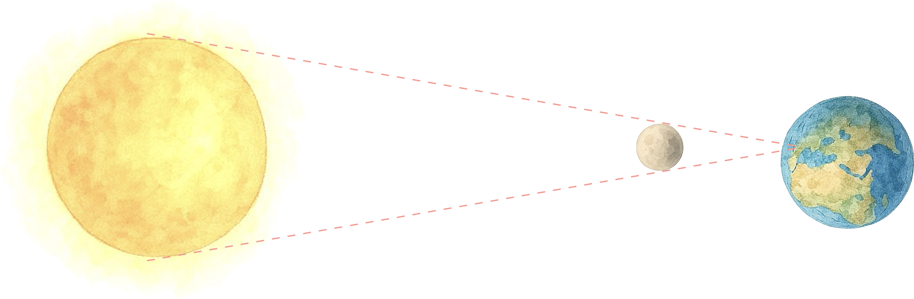

+++
title = "Curiosités en mécanique terrestre"
date = 2026-11-18T10:00:00+01:00
weight = 6
+++

# Curiosités en mécanique terrestre

Quelques questions simples en apparence sur la Terre, la Lune et le Soleil, et des réponses qui surprennent.

## Tunnels traversant la Terre

Petits exercices de niveau licence/prépa traitant de voyages autour ou à travers la Terre.



## Forces de marée

De manière "amusante", le ratio des contributions de la Lune et du Soleil aux forces de marée sur Terre est donné par le ratio de leurs masses volumiques respectives&nbsp;:

$$\frac{F_\text{marée,Lune}}{F_\text{marée,Soleil}}\approx\frac{\rho_\text{Lune}}{\rho_\text{Soleil}}$$

En effet, les forces de marée exercées par un astre sur la Terre sont proportionnelles au gradient de son champ gravitationnel, donc à $\displaystyle\frac{M_\text{Astre}}{d_\text{Astre-Terre}^3}$ .

Mais on sait aussi que la Lune et le Soleil sont à peu près vus sous le même diamètre apparent de 30' depuis la Terre (un indice parmi d'autres : les éclipses solaires parfois annulaires, parfois totales). Par conséquent, les distances des deux astres sont dans le rapport de leurs rayons (Thalès)&nbsp;:

$$\frac{d_\text{Terre-Lune}}{d_\text{Terre-Soleil}}\approx\frac{r_\text{Lune}}{r_\text{Soleil}}$$

On a donc bien au final&nbsp;:

$$
\begin{aligned}
\frac{F_\text{marée,Lune}}{F_\text{marée,Soleil}} &=\frac{M_\text{Lune}}{d_\text{Lune-Terre}^3}\left/\frac{M_\text{Soleil}}{d_\text{Soleil-Terre}^3}\right.\\\\
&=\frac{M_\text{Lune}}{M_\text{Soleil}}\times \frac{d_\text{Soleil-Terre}^3}{d_\text{Lune-Terre}^3}\\\\
&\approx \frac{M_\text{Lune}}{M_\text{Soleil}}\times \frac{r_\text{Soleil}^3}{r_\text{Lune}^3}\\\\
&=\frac{M_\text{Lune}}{r_\text{Lune}^3}\left/\frac{M_\text{Soleil}}{r_\text{Soleil}^3}\right.\\\\
&=\frac{\rho_\text{Lune}}{\rho_\text{Soleil}}
\end{aligned}
$$

Et avec $\rho_\text{Lune} = \pu{3,3 g\*cm-3}$ et $\rho_\text{Soleil} = \pu{1,4 g*cm-3}$, on retrouve que la contribution du Soleil aux forces de marée représente environ 42% (comme par hasard) de celle de la Lune.
