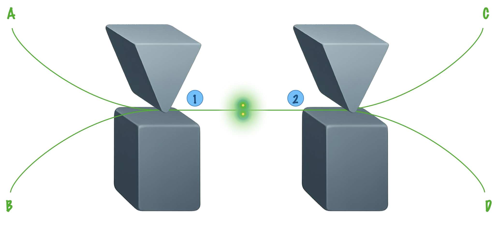

+++
title = "3N dimensions"
date = 2021-03-06T14:20:50+01:00
weight = 6
chapter = false
hidden = false
+++

# Une ontologie à 3N dimensions

> Ney, A. « Three arguments for wave function realism », *European Journal for Philosophy of Science* 13, article 50 (2023) [🌐](https://link.springer.com/content/pdf/10.1007/s13194-023-00554-5.pdf) 
Ney, A. *The World in the Wave Function: A Metaphysics for Quantum Physics*, Oxford University Press (2021)

Supposons que la fonction d'onde $\psi$ décrive quelque chose de **réel**, comme y invite le théorème PBR (voir la page [Épistémique vs. ontique](../epistovsonto/)). Une question surgit aussitôt&nbsp;: réel, mais **où**&nbsp;? Pour une seule particule, $\psi$ est un champ dans notre espace ordinaire, qui attribue un nombre complexe à chaque point. Mais pour $N$ particules, $\psi$ n'est plus un champ sur l'espace à trois dimensions&nbsp;: c'est un champ sur un espace à $3N$ dimensions.

Le **réalisme de la fonction d'onde**, défendu notamment par David Albert, Barry Loewer, Jill North et Alyssa Ney, prend cette remarque au sérieux&nbsp;: l'objet fondamental de la physique quantique serait un champ, la fonction d'onde, qui vit dans un espace de très grande dimension. Notre espace à trois dimensions, et les objets qui semblent s'y trouver, n'en seraient qu'une sorte d'ombre.

Dans l'article qui sert de fil à cette page, Alyssa Ney examine les trois arguments habituellement avancés en faveur de cette position. Sa conclusion est plus nuancée qu'on ne pourrait l'attendre d'une de ses défenseuses&nbsp;: aucun des trois n'impose le réalisme de la fonction d'onde, et le meilleur d'entre eux en fait seulement un cadre de pensée simple et commode.

↔ Voir aussi&nbsp;: <a href="../epistovsonto/#les-ψ-ontiques-des-masochistes">les familles de ψ-ontiques</a>, et <a href="../epr/">EPR</a> pour les autres façons de faire avec la non-localité

## Pourquoi 3N dimensions&nbsp;?

### L'espace des configurations

Décrire la position de $N$ particules, c'est donner les trois coordonnées de chacune, soit $3N$ nombres $(\mathbf r\_1, \mathbf r\_2, \dots, \mathbf r\_N)$. Chaque disposition possible des particules est donc un **point** d'un espace à $3N$ dimensions, l'**espace des configurations**. Cette idée n'est pas propre à la quantique&nbsp;: c'est l'«&nbsp;arène&nbsp;» de la mécanique de Lagrange, où l'évolution de tout un système devient le mouvement d'un seul point (voir [Lagrange et Hamilton](../../meca/#lagrange-et-hamilton)).

En mécanique quantique, la fonction d'onde de $N$ particules attribue un nombre complexe $\psi(\mathbf r\_1, \dots, \mathbf r\_N)$ à chaque configuration, et non à chaque point de l'espace ordinaire. D'après la règle de Born, $|\psi(\mathbf r\_1, \dots, \mathbf r\_N)|^2$ donne la densité de probabilité de trouver **à la fois** la particule 1 en $\mathbf r\_1$, la particule 2 en $\mathbf r\_2$, etc. C'est la traduction, pour des positions, du produit tensoriel qui sert à décrire un système composé (axiome 3 des [Notions fondamentales](../fondations/#un-jeu-daxiomes)).

Pour $N = 1$, l'espace des configurations est l'espace ordinaire, et rien ne distingue les deux points de vue. C'est à partir de deux particules que les choses deviennent intéressantes, à cause de l'**intrication**. Avec le spin, la fonction d'onde attribue à chaque configuration un peu plus qu'un nombre complexe (une composante par valeur possible des spins), mais l'idée reste la même.

## Premier argument&nbsp;: la place de la fonction d'onde dans la théorie

Le premier argument, formulé par Peter Lewis (2004), est le plus direct. En mécanique classique, l'état d'un système est donné par les positions et les vitesses de ses particules, et les lois décrivent leur évolution&nbsp;: il est naturel d'en conclure que le monde est fait de particules. En mécanique quantique, l'état est donné par la fonction d'onde, et la loi fondamentale (l'équation de Schrödinger) décrit son évolution. Par analogie, la fonction d'onde devrait être la «&nbsp;matière&nbsp;» du monde quantique.

Ney juge l'argument insuffisant, pour deux raisons. D'abord, on ne peut pas lire l'ontologie d'une théorie directement sur son formalisme mathématique&nbsp;: les apparences peuvent tromper. Ensuite, même si l'on accepte que la théorie parle de fonctions d'onde, rien n'indique qu'il faille les voir comme des champs sur l'espace des configurations plutôt que, par exemple, comme des vecteurs d'un espace de Hilbert, ou comme des lois guidant des objets à trois dimensions.

## Deuxième argument&nbsp;: l'intrication

### Deux particules, deux Stern-Gerlach

Préparons deux particules dans l'état singulet de spin, $\frac{1}{\sqrt2}\bigl(\lvert\uparrow\downarrow\rangle - \lvert\downarrow\uparrow\rangle\bigr)$, et envoyons-les dans des directions opposées, vers deux appareils de Stern-Gerlach qui les dévient vers le haut ou vers le bas selon leur spin sur l'axe $z$.

Deux particules intriquées traversent chacune un appareil de Stern-Gerlach. La particule 1 arrive en A (spin en haut) ou en B (spin en bas), la particule 2 en C ou en D.

Les particules s'intriquent avec leur trajectoire&nbsp;: leurs positions deviennent corrélées comme l'étaient leurs spins. L'état final est

$$\psi=\frac{1}{\sqrt{2}}\Bigl[\bigl|{\uparrow_z}, \text{A}\bigr\rangle_1\bigl|{\downarrow_z}, \text{D}\bigr\rangle_2-\bigl|{\downarrow_z}, \text{B}\bigr\rangle_1\bigl|{\uparrow_z}, \text{C}\bigr\rangle_2\Bigr].$$

La particule 1 arrive en A si et seulement si la particule 2 arrive en D. Comparons avec deux particules préparées dans un état **produit**, chacune avec son spin dirigé vers le haut selon l'axe $x$, $\lvert{\uparrow_x}\rangle_1\lvert{\uparrow_x}\rangle_2$. Comme $\lvert{\uparrow_x}\rangle = \frac{1}{\sqrt2}\bigl(\lvert{\uparrow_z}\rangle + \lvert{\downarrow_z}\rangle\bigr)$, les quatre combinaisons sont possibles après les appareils&nbsp;:

$$\psi^{\prime}=\frac{1}{2}\Bigl[\bigl|{\uparrow_z}, \text{A}\bigr\rangle_1\bigl|{\uparrow_z}, \text{C}\bigr\rangle_2+\bigl|{\uparrow_z}, \text{A}\bigr\rangle_1\bigl|{\downarrow_z}, \text{D}\bigr\rangle_2+\bigl|{\downarrow_z}, \text{B}\bigr\rangle_1\bigl|{\uparrow_z}, \text{C}\bigr\rangle_2+\bigl|{\downarrow_z}, \text{B}\bigr\rangle_1\bigl|{\downarrow_z}, \text{D}\bigr\rangle_2\Bigr].$$

### En trois dimensions, deux états indiscernables

Essayons de décrire ces deux états comme des objets de notre espace à trois dimensions. Les particules n'ont pas de position définie&nbsp;; le plus naturel est alors de voir chacune comme un **champ** étalé dans l'espace, d'intensité $\frac12$ en A et en B pour la particule 1, $\frac12$ en C et en D pour la particule 2. Mais c'est exactement ce que donnent **aussi** $\psi$ et $\psi^{\prime}$&nbsp;: les deux états, pourtant différents, sont décrits par les mêmes deux champs. Le tableau suivant résume la situation.

| | Particule 1 en A | Particule 1 en B | Particule 2 en C | Particule 2 en D |
| :--- | :---: | :---: | :---: | :---: |
| État intriqué $\psi$ | $\frac12$ | $\frac12$ | $\frac12$ | $\frac12$ |
| État produit $\psi^{\prime}$ | $\frac12$ | $\frac12$ | $\frac12$ | $\frac12$ |

Ce qui manque, c'est la **corrélation**&nbsp;: «&nbsp;1 en A si et seulement si 2 en D&nbsp;». Elle n'est inscrite dans aucun des deux champs pris isolément. C'est le phénomène déjà rencontré avec l'état de Bell, dont chaque qubit, considéré seul, est dans l'état maximalement mixte (voir [la trace partielle](../fondations/#létat-dun-seul-qubit-la-trace-partielle))&nbsp;: les parties ne permettent pas de reconstituer le tout.

### Dans l'espace des configurations, deux champs différents

Plaçons-nous maintenant dans l'espace des configurations à $3 \times 2 = 6$ dimensions. Quatre de ses points nous intéressent, que l'on nomme AC, AD, BC et BD&nbsp;: le point AC correspond à la situation où la particule 1 est en A et la particule 2 en C, et ainsi de suite.

| | AC | AD | BC | BD |
| :--- | :---: | :---: | :---: | :---: |
| État intriqué $\psi$ | $0$ | $\frac{1}{\sqrt2}$ | $-\frac{1}{\sqrt2}$ | $0$ |
| État produit $\psi^{\prime}$ | $\frac12$ | $\frac12$ | $\frac12$ | $\frac12$ |

Vus comme des champs sur cet espace, $\psi$ et $\psi^{\prime}$ sont bien différents&nbsp;: $\psi$ n'a de composantes qu'en AD et BC, alors que $\psi^{\prime}$ en a aux quatre points. La corrélation, invisible en trois dimensions, est inscrite dans la **forme** même du champ à six dimensions. C'est l'argument de l'intrication, défendu notamment par Jill North&nbsp;: pour rendre compte des états intriqués, il faudrait passer à l'espace des configurations.

On retrouve ici la grille de la [théorie-jouet de Spekkens](../spekkens/#deux-systèmes-élémentaires), qui n'est rien d'autre que l'espace des configurations d'une paire de systèmes élémentaires&nbsp;: un état produit et un état corrélé y sont bien distincts, alors que leurs marginales, projetées sur chaque axe, peuvent être identiques.

### L'objection de Ney&nbsp;: d'autres ontologies font aussi bien

L'argument est séduisant, mais il ne suffit pas. Il montre qu'une ontologie trop naïve, faite de deux champs indépendants dans l'espace ordinaire, ne peut pas distinguer $\psi$ de $\psi^{\prime}$. Il ne montre pas qu'**aucune** ontologie à trois dimensions n'en est capable. Or il en existe plusieurs, conçues précisément pour cela&nbsp;:
<ul>
<li><b>l'holisme relationnel</b> (Paul Teller)&nbsp;: les particules sont reliées par des <b>relations</b> qui ne se réduisent pas à leurs propriétés individuelles, comme «&nbsp;1 est en A si et seulement si 2 est en D&nbsp;»&nbsp;;</li>
<li><b>le réalisme de l'état spatio-temporel</b> (David Wallace et Chris Timpson)&nbsp;: chaque région de l'espace-temps porte un état, sa matrice densité réduite, et la région A∪B∪C∪D n'a pas le même état dans les deux cas&nbsp;;</li>
<li><b>l'ontologie primitive</b> (Dürr, Goldstein, Zanghì, Allori)&nbsp;: le monde est fait d'objets dans l'espace ordinaire (les particules de la théorie de Bohm, ou une densité de matière), et la fonction d'onde joue plutôt le rôle d'une loi qui guide leur mouvement&nbsp;;</li>
<li>et d'autres encore, comme le réalisme structural ontique ou la description par «&nbsp;multi-champs&nbsp;».</li>
</ul>

Toutes ces approches distinguent $\psi$ de $\psi^{\prime}$ sans quitter l'espace à trois dimensions. L'intrication, à elle seule, n'oblige donc pas à passer en $3N$ dimensions. Mais ces alternatives ont toutes un prix, qui prépare le troisième argument&nbsp;: elles renoncent soit à la **séparabilité**, soit à la **localité**.

## Troisième argument&nbsp;: séparabilité et localité

### Deux propriétés désirables

Une description du monde est <b>séparable</b> si, d'une part, elle est faite d'objets situés dans des régions distinctes, chacun ayant son propre état, et si, d'autre part, tout ce qui est vrai d'une réunion de régions R1∪R2 découle de ce qui est vrai de R1 et de R2 pris séparément.

 

Une description du monde est <b>locale</b> si un objet ne peut agir que là où il se trouve&nbsp;: une influence ne peut se propager que de proche en proche, sans action instantanée à distance.

Ces deux principes ont une longue histoire. La séparabilité est très proche du principe qu'Einstein jugeait indispensable à toute physique (1948)&nbsp;: les faits concernant un objet ne doivent pas dépendre de ceux qui concernent un autre objet éloigné. La localité reprend l'objection de Samuel Clarke à Leibniz&nbsp;: un objet ne peut pas agir là où il n'est pas.

Or, dans l'espace ordinaire, la mécanique quantique semble les violer. Les inégalités de Bell montrent qu'aucune description locale, faite d'objets séparés portant chacun ses propriétés, ne peut reproduire les corrélations quantiques observées (voir [Limites de la non-localité](../nonlocale/)). Les alternatives précédentes en tirent les conséquences&nbsp;: l'holisme relationnel et le réalisme de l'état spatio-temporel renoncent à la séparabilité (le tout a des propriétés que n'ont pas ses parties)&nbsp;; l'ontologie primitive reste séparable, mais renonce à la localité (mesurer la particule 1 change instantanément les faits concernant la particule 2).

### La fonction d'onde est séparable et locale… en 3N dimensions

Le réalisme de la fonction d'onde regagne les deux propriétés, mais dans l'espace des configurations.

<ul>
<li><b>Séparabilité.</b> La fonction d'onde est un champ ordinaire sur l'espace des configurations&nbsp;: elle attribue une valeur à chaque point. Connaître ses valeurs sur deux régions disjointes de cet espace suffit à la connaître sur leur réunion. Dans l'exemple des Stern-Gerlach, $\psi$ est concentrée près de deux points de l'espace à six dimensions, AD et BC&nbsp;: connaître le champ dans une petite boule autour de chacun de ces points, c'est tout connaître, corrélation comprise.</li>
<li><b>Localité.</b> L'équation de Schrödinger, $\mathrm{i}\hbar\,\partial_t\psi = \hat H\psi$, avec $\hat H = -\sum_k \frac{\hbar^2}{2m_k}\Delta_k + V(\mathbf r_1, \dots, \mathbf r_N)$, est une équation aux dérivées partielles dans l'espace des configurations&nbsp;: l'évolution du champ en un point ne dépend que de ses valeurs au voisinage de ce point. Même l'énergie potentielle d'interaction, comme $\frac{k}{|\mathbf r_1 - \mathbf r_2|}$, qui relie à distance deux particules de l'espace ordinaire, est une simple fonction du point de l'espace des configurations.</li>
</ul>

Ce qui paraît non local dans l'espace ordinaire devient local dans l'espace des configurations. Un petit déplacement autour du point AD, dans l'espace à six dimensions, correspond à un changement simultané **en deux endroits éloignés** de l'espace ordinaire&nbsp;: près de A pour la particule 1, et près de D pour la particule 2. Ce que l'on interprète en trois dimensions comme une influence instantanée à distance n'est, dans l'espace des configurations, qu'une évolution de proche en proche[^1].

[^1]: La question est plus délicate qu'il n'y paraît, et dépend de la manière dont on résout le problème de la mesure. Elle est particulièrement débattue pour les théories d'effondrement spontané comme celle de Ghirardi, Rimini et Weber (GRW). Ney la discute en détail dans son livre (2021, p. 105-113).

### Pourquoi tenir à ces deux propriétés&nbsp;?

On peut objecter que la violation des inégalités de Bell semble justement nous crier que le monde n'est ni séparable ni local&nbsp;: pourquoi s'acharner à préserver ces deux propriétés&nbsp;? Ney avance deux raisons.

La première est la **simplicité**. Une description séparable et locale est la plus économe possible&nbsp;: tout ce qui existe se ramène à des valeurs attribuées à des points, et à leurs relations de voisinage. C'est le programme de la «&nbsp;survenance humienne&nbsp;» du philosophe David Lewis, auquel adhèrent Albert et Loewer. Des relations irréductibles entre objets, ou des propriétés qui n'appartiennent qu'à des régions entières, sont autant d'ajouts que le rasoir d'Ockham invite à éviter si l'on peut s'en passer.

La seconde est l'**intuition**. Que les faits concernant un objet ne dépendent pas d'un autre objet, ou qu'un objet ne puisse agir là où il n'est pas, ressemblent moins à des résultats d'expérience qu'à ce que nous entendons par «&nbsp;objet&nbsp;» et par «&nbsp;agir&nbsp;». Renoncer à ces principes n'est pas impossible, mais c'est coûteux&nbsp;; et disposer d'un cadre intuitif a souvent été utile aux physiciens eux-mêmes, comme le montre le succès de la mécanique ondulatoire de Schrödinger, plus intuitive que la mécanique matricielle de Heisenberg.

## Le verdict de Ney

Au terme de son examen, Ney tire un bilan modeste.
<ul>
<li><b>Le premier argument</b> ne mène pas au réalisme de la fonction d'onde&nbsp;: le formalisme ne dit pas, à lui seul, de quoi le monde est fait.</li>
<li><b>Le deuxième argument</b> ne le distingue pas de ses concurrents&nbsp;: tous rendent compte de l'intrication.</li>
<li><b>Le troisième argument</b> est le seul qui le singularise&nbsp;: c'est la seule ontologie à la fois séparable et locale. Mais il ne fournit que des raisons pratiques (simplicité, intuitivité), pas une preuve.</li>
</ul>

Selon Ney, il est raisonnable de **travailler** avec l'ontologie de la fonction d'onde et de la développer, mais rien n'autorise encore à **croire** que le monde est fondamentalement un champ dans un espace à $3N$ dimensions. Le monde est étrange, d'une manière ou d'une autre, mais nous ne savons pas encore de quelle manière.

Ney prend ainsi ses distances avec David Albert, pour qui il serait tout simplement impossible de raconter l'histoire du monde quantique comme celle d'objets dans l'espace ordinaire&nbsp;: les tenants de l'ontologie primitive ou de l'holisme relationnel montrent que c'est possible, au prix de la séparabilité ou de la localité.

Elle précise aussi le domaine de validité de l'approche. Le réalisme de la fonction d'onde s'accorde naturellement avec les interprétations où $\psi$ est toute la réalité, comme l'interprétation d'Everett ou la théorie GRW&nbsp;: ce sont les «&nbsp;ψ-complets&nbsp;» de la page [Épistémique vs. ontique](../epistovsonto/#les-ψ-ontiques-des-masochistes). Il convient beaucoup moins à la théorie de Bohm, dont les particules vivent, elles, dans l'espace ordinaire. Être ψ-ontique, comme le suggère le théorème PBR, ne suffit donc pas&nbsp;: il reste à choisir **quelle** réalité attribuer à $\psi$.

### Et l'espace de Hilbert&nbsp;?

On pourrait aller encore plus loin dans l'abstraction&nbsp;: plutôt qu'un champ sur l'espace des configurations, le monde serait simplement un vecteur de l'espace de Hilbert. C'est la position que Sean Carroll et Ashmeet Singh ont baptisée, avec humour, «&nbsp;everettisme enragé&nbsp;» (*Mad-Dog Everettianism*). Elle est encore plus simple, et l'espace de Hilbert est plus général que l'espace des configurations.

Mais elle ne peut pas s'appuyer sur l'argument de la séparabilité&nbsp;: un vecteur de l'espace de Hilbert n'est pas fait d'objets situés dans des régions distinctes. Elle a besoin d'un autre argument (Carroll invoque la simplicité et l'unification), et il reste à comprendre comment notre monde à trois dimensions pourrait émerger d'un unique vecteur. Pour Ney, cette piste mérite d'être explorée, au même titre que les autres, mais sans plus de certitude.
