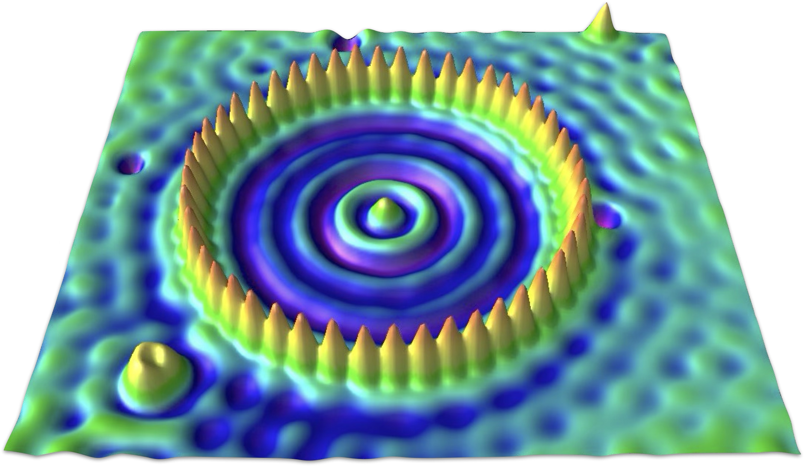

+++
title = "Mécanique quantique"
date = 2021-03-06T14:20:50+01:00
weight = 5
chapter = false
+++

# Mécanique quantique

<svg viewBox="0 0 48 48"><circle cx="24" cy="24" r="16"/><ellipse class="leger" cx="24" cy="24" rx="16" ry="5"/><path d="M24 24l8-11"/><circle class="plein" cx="32" cy="13" r="2.6"/></svg>
<h3><a href="./fondations/">Notions fondamentales</a></h3>

Les postulats, le qubit, et ce qu'on peut en faire ou non&nbsp;: cloner, téléporter.

  <a href="./fondations/#un-jeu-daxiomes" class="math-btn">Un jeu d'axiomes</a>
  <a href="./fondations/#information-quantique" class="math-btn">Information quantique</a>
  <a href="./fondations/#sphère-de-bloch" class="math-btn">Sphère de Bloch</a>
  <a href="./fondations/#paire-de-qubits" class="math-btn">Paires de qubits</a>
  <a href="./fondations/#non-clonage-quantique" class="math-btn">Non-clonage</a>
  <a href="./fondations/#téléportation-quantique" class="math-btn">Téléportation</a>

<svg viewBox="0 0 48 48"><rect x="9" y="9" width="30" height="30" rx="2"/><path d="M24 9v30M9 24h30"/><rect class="teinte" x="9" y="9" width="15" height="15"/><rect class="teinte" x="24" y="24" width="15" height="15"/></svg>
<h3><a href="./spekkens/">Théorie-jouet de Spekkens</a></h3>

Un système classique minimal, une seule contrainte sur ce qu'on peut savoir&nbsp;: combien de bizarreries quantiques en sortent&nbsp;?

  <a href="./spekkens/#le-principe-déquilibre-de-la-connaissance" class="math-btn">Principe d'équilibre</a>
  <a href="./spekkens/#le-bit-jouet-analogue-du-qubit" class="math-btn">Le bit-jouet</a>
  <a href="./spekkens/#états-corrélés-lanalogue-de-lintrication" class="math-btn">Intrication-jouet</a>
  <a href="./spekkens/#interdiction-du-clonage" class="math-btn">Non-clonage</a>
  <a href="./spekkens/#bilan-ce-que-le-jouet-explique-et-ce-quil-nexplique-pas" class="math-btn">Bilan</a>

<svg viewBox="0 0 48 48"><path d="M6 37h36"/><path d="M6 37c8 0 8-22 14-22s6 22 14 22"/><path class="leger" d="M14 37c8 0 8-17 14-17s6 17 14 17"/></svg>
<h3><a href="./epistovsonto/">Épistémique vs ontique</a></h3>

La fonction d'onde décrit-elle la réalité ou ce que l'on en sait&nbsp;? Le théorème PBR tranche.

  <a href="./epistovsonto/#ontique-ou-épistémique" class="math-btn">Ontique ou épistémique</a>
  <a href="./epistovsonto/#le-théorème-pbr" class="math-btn">Le théorème PBR</a>
  <a href="./epistovsonto/#la-preuve-de-pbr-pas-à-pas" class="math-btn">La preuve pas à pas</a>
  <a href="./epistovsonto/#que-conclure" class="math-btn">Que conclure</a>

<svg viewBox="0 0 48 48"><circle class="plein" cx="24" cy="24" r="3"/><path d="M19 24H7M11 20l-4 4 4 4"/><path d="M29 24h12M37 20l4 4-4 4"/><path class="leger" d="M7 14v-4M41 34v4"/></svg>
<h3><a href="./epr/">Paradoxe EPR</a></h3>

Intrication, inégalités de Bell et tension avec la relativité&nbsp;: comment s'en sortir&nbsp;?

  <a href="./epr/#intrication-epr-et-inégalités-de-bell" class="math-btn">Inégalités de Bell</a>
  <a href="./epr/#sans-statistiques-lexpérience-ghz" class="math-btn">Expérience GHZ</a>
  <a href="./epr/#ce-que-dit-la-relativité" class="math-btn">Et la relativité</a>
  <a href="./epr/#les-façons-de-sen-sortir" class="math-btn">Les échappatoires</a>

<svg viewBox="0 0 48 48"><rect x="12" y="15" width="24" height="18" rx="2.5"/><path d="M18 6v9M30 6v9M18 33v9M30 33v9"/></svg>
<h3><a href="./nonlocale/">Limites de la non-localité</a></h3>

Pourquoi la nature n'est-elle pas plus non locale qu'elle ne l'est&nbsp;?

  <a href="./nonlocale/#inégalité-chsh" class="math-btn">Inégalité CHSH</a>
  <a href="./nonlocale/#borne-de-tsirelson" class="math-btn">Borne de Tsirelson</a>
  <a href="./nonlocale/#boîtes-pr--corrélation-maximale" class="math-btn">Boîtes PR</a>
  <a href="./nonlocale/#le-principe-de-causalité-informationnelle" class="math-btn">Causalité informationnelle</a>

<svg viewBox="0 0 48 48"><rect x="9" y="9" width="30" height="30" rx="2"/><path d="M19 9v30M29 9v30M9 19h30M9 29h30"/></svg>
<h3><a href="./contextualite/">Contextualité</a></h3>

Le résultat d'une mesure peut dépendre de ce que l'on mesure en même temps.

  <a href="./contextualite/#quest-ce-que-la-contextualité" class="math-btn">Qu'est-ce que c'est</a>
  <a href="./contextualite/#le-carré-magique-de-mermin-et-peres" class="math-btn">Carré magique</a>
  <a href="./contextualite/#le-théorème-de-kochen-specker" class="math-btn">Kochen-Specker</a>
  <a href="./contextualite/#une-inégalité-pour-le-laboratoire-le-pentagone" class="math-btn">Le pentagone</a>
  <a href="./contextualite/#bell-un-cas-particulier" class="math-btn">Lien avec Bell</a>

<svg viewBox="0 0 48 48"><path d="M17 31V6M17 31h25M17 31L6 42"/><path class="leger" d="M13 10l4-4 4 4M38 27l4 4-4 4"/></svg>
<h3><a href="./3ndimensions/">Une ontologie à 3N dimensions</a></h3>

Une fonction d'onde locale et séparable… à condition de vivre dans un espace à 3N dimensions.

  <a href="./3ndimensions/#pourquoi-3n-dimensions" class="math-btn">Pourquoi 3N</a>
  <a href="./3ndimensions/#premier-argument-la-place-de-la-fonction-donde-dans-la-théorie" class="math-btn">La fonction d'onde</a>
  <a href="./3ndimensions/#deuxième-argument-lintrication" class="math-btn">L'intrication</a>
  <a href="./3ndimensions/#troisième-argument-séparabilité-et-localité" class="math-btn">Séparabilité et localité</a>
  <a href="./3ndimensions/#le-verdict-de-ney" class="math-btn">Le verdict de Ney</a>

<svg viewBox="0 0 48 48"><path d="M8 7c11 9 11 25 0 34M40 7c-11 9-11 25 0 34"/><path class="leger" d="M15 17h18M16 24h16M15 31h18"/></svg>
<h3><a href="./erepr/">ER = EPR</a></h3>

Des particules intriquées reliées par des trous de ver&nbsp;: et si l'intrication tissait l'espace-temps&nbsp;?

<svg viewBox="0 0 48 48"><path d="M24 43V26M24 26L11 10M24 26L37 10M24 26V8"/><circle class="plein" cx="11" cy="10" r="2.6"/><circle class="plein" cx="37" cy="10" r="2.6"/><circle class="plein" cx="24" cy="8" r="2.6"/></svg>
<h3><a href="./decoherence/">Décohérence et darwinisme quantique</a></h3>

Comment un monde classique et objectif émerge-t-il du quantique&nbsp;?

  <a href="./decoherence/#quest-ce-quune-mesure-la-répétabilité" class="math-btn">Répétabilité</a>
  <a href="./decoherence/#lenvironnement-choisit-la-base-décohérence-et-einselection" class="math-btn">Einselection</a>
  <a href="./decoherence/#doù-viennent-les-probabilités-lenvariance" class="math-btn">Envariance</a>
  <a href="./decoherence/#pourquoi-un-monde-objectif-le-darwinisme-quantique" class="math-btn">Darwinisme quantique</a>
  <a href="./decoherence/#linterprétation-existentielle" class="math-btn">Interprétation existentielle</a>

## En vidéo

Une introduction aux [notions fondamentales](./fondations/)&nbsp;:



