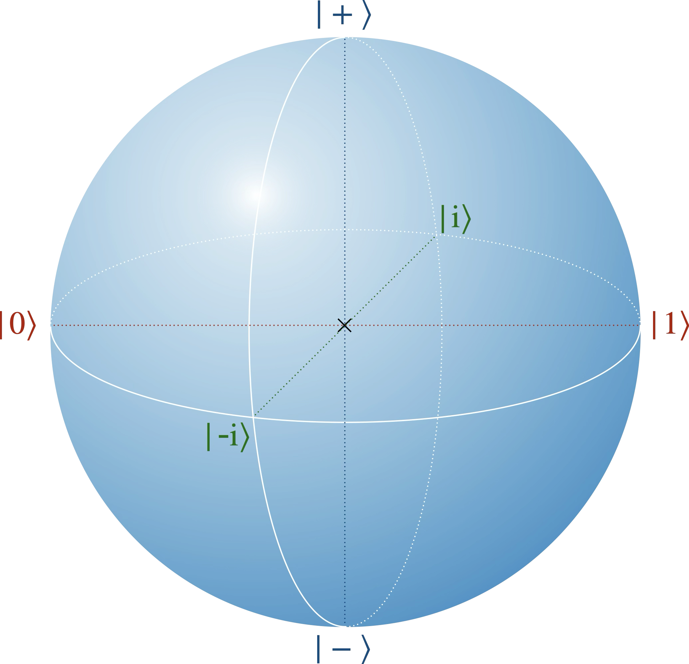

+++
title = "Notions fondamentales"
date = 2021-03-06T14:20:50+01:00
weight = 1
chapter = false
hidden = false
+++

<h1 style="overflow-x:auto;">Notions fondamentales en mécanique quantique</h1>

Le cinquième Conseil international de Solvay, en 1927, avait pour thème «&nbsp;Électrons et Photons&nbsp;» et porta principalement sur la mécanique quantique. 17 des 29 personnalités présentes à ce congrès étaient ou allaient devenir prix Nobel...

C'est à cette occasion qu'eurent lieu les échanges entre les représentants de l'«&nbsp;école de Copenhague&nbsp;» (Bohr, Heisenberg, Ehrenfest, etc.), partisans d'une mécanique quantique probabiliste et complète, et ceux qui, comme Einstein, Schrödinger ou de Broglie, y voyaient une description encore incomplète de la réalité. Ce fut le début d'une controverse de près de trente ans entre ses deux principaux protagonistes, Bohr et Einstein, qui ne prit fin qu'avec la mort d'Einstein en 1955. Contrairement à une idée répandue, le cœur de l'objection d'Einstein portait moins sur le hasard («&nbsp;Dieu ne joue pas aux dés&nbsp;») que sur la complétude et la localité de la théorie, comme le soulignait déjà Pauli.

Aujourd’hui, l’interprétation de Copenhague reste la lecture la plus couramment enseignée, même si d’autres (mondes multiples d'Everett, onde pilote de Bohm, théories d'effondrement objectif, lectures informationnelles comme le QBism…) ont leurs partisans. La plupart partagent le même **formalisme**, hérité de Dirac et de von Neumann, et divergent surtout sur ce qu'il signifie. 
Les lignes qui suivent résument brièvement les axiomes de ce formalisme et en illustrent quelques conséquences fondamentales, avec un prisme *information quantique*.

> Source&nbsp;: Knee, G. C. « Isolation of the Conceptual Ingredients of Quantum Theory by Toy Theory Comparison », mémoire de Master of Science, Imperial College London, soutenu le 20 septembre 2010 <a href="https://www.imperial.ac.uk/media/imperial-college/research-centres-and-groups/theoretical-physics/msc/dissertations/2010/George-Knee-Dissertation.pdf" target="_blank">🌐</a>

## Un jeu d'axiomes

Le formalisme **standard** de la mécanique quantique, celui des manuels, hérité de Dirac et de von Neumann, repose sur un jeu d'axiomes[^1]&nbsp;:

Axiome 1&nbsp;: <b>État quantique</b> 
À un instant fixé, l’état d’un système quantique est un <b>vecteur normé</b> $\lvert \psi\rangle$ (c'est-à-dire tel que $\langle\psi\vert\psi\rangle = 1$) d'un <b>espace de Hilbert</b> complexe $\mathcal{H}$. Deux vecteurs qui ne diffèrent que d'un facteur de phase global $\mathrm{e}^{\mathrm{i}\gamma}$ représentent le même état.

Ce premier axiome contient le **principe de superposition**&nbsp;: toute combinaison linéaire (normée) d'états possibles est encore un état possible. Le deuxième fixe la **dynamique**&nbsp;:

Axiome 2&nbsp;: <b>Évolution unitaire</b> 
Entre deux mesures, l’évolution d’un système quantique <b>isolé</b> est unitaire, c’est-à-dire décrite par un <b>opérateur unitaire</b> $\hat U$ (tel que $\hat U^\dagger = \hat U^{-1}$), parfois appelé «&nbsp;porte&nbsp;», agissant selon $\lvert \psi\rangle \\;\longmapsto\\;\hat U \lvert \psi\rangle$. 
En particulier, l’évolution dans le temps obéit à l’<b>équation de Schrödinger</b>

$$\mathrm{i}\\,\hbar\frac{\partial}{\partial t}\lvert \psi\rangle \\;=\\; \hat H \lvert \psi\rangle ,$$

où $\hat H$ est l’opérateur <b>hamiltonien</b>. Pour un hamiltonien indépendant du temps, elle s'intègre en $\hat U(t) = \mathrm{e}^{-\mathrm{i}\hat H t/\hbar}$.

L'axiome suivant décrit les systèmes formés de plusieurs parties. C'est lui qui ouvre la porte aux **états intriqués**, l'aspect le plus déroutant de la théorie. Il est parfois omis, soit parce qu'on le juge naturel, soit parce qu'on peut le déduire des autres axiomes (voir [cet article](https://arxiv.org/pdf/2003.11007) de Carcassi, Maccone et Aidala, 2021).

Axiome 3&nbsp;: <b>Produit tensoriel</b> 
L'état quantique d'un système composé est un vecteur du produit tensoriel des espaces de Hilbert de ses sous-systèmes.

Ces trois premiers axiomes contiennent toute la structure mathématique de la théorie. Les suivants traitent de la **mesure**, qu'on peut décrire comme un transfert d'information du système vers l'observateur (ou son appareil). Ils établissent la correspondance entre le vecteur de l'espace de Hilbert et les résultats d'expériences.

Axiome 4&nbsp;: <b>Règle de Born</b> 
Une grandeur mesurable est décrite par un opérateur hermitien $\hat A$ (c'est-à-dire tel que $\hat A^\dagger = \hat A$), appelé <b>observable</b>. 
Cette observable possède une décomposition spectrale

$$\hat A \\;=\\; \sum_i \lambda_i \\,\lvert e_i\rangle\langle e_i\rvert$$

où les valeurs propres $\lambda_i$, réelles, sont les résultats possibles de la mesure, et où les vecteurs propres $\lvert e_i\rangle$ forment une base orthonormée de $\mathcal{H}$ (on suppose ici les valeurs propres distinctes&nbsp;; sinon, on remplace chaque $\lvert e_i\rangle\langle e_i\rvert$ par le projecteur sur le sous-espace propre correspondant). 
Si l’on mesure $\hat A$ sur l’état $\lvert \psi\rangle$, la probabilité d’obtenir le résultat $\lambda_i$ est
$$p(\lambda_i) \\;=\\; \bigl|\langle e_i \vert \psi\rangle\bigr|^2$$

 

Axiome 5&nbsp;: <b>Postulat de réduction du paquet d'onde</b> 
Juste après une mesure ayant donné le résultat $\lambda_i$, l’état du système est «&nbsp;réduit&nbsp;» sur le vecteur propre correspondant&nbsp;:

$$\lvert\psi\rangle \\;\longmapsto\\; \frac{\lvert e_i\rangle\langle e_i \vert \psi\rangle}{\sqrt{p(\lambda_i)}},$$

c'est-à-dire $\lvert e_i\rangle$, à une phase près.

 

Axiome 6&nbsp;: <b>Relation de complétude</b> 
Les <b>projecteurs</b> associés à une mesure satisfont la relation

$$\sum_i \lvert e_i\rangle\langle e_i\rvert \\;=\\; \mathbb{I}$$

où $\mathbb{I}$ est l’opérateur identité sur $\mathcal{H}$.

Ce dernier axiome n'est pas vraiment indépendant des autres&nbsp;: il découle du fait que les vecteurs propres d'une observable forment une base orthonormée (théorème spectral). Son rôle est de garantir que les probabilités de la règle de Born somment à $1$&nbsp;:

$$\sum_i p(\lambda_i) \\;=\\; \langle\psi\vert\Bigl(\sum_i \lvert e_i\rangle\langle e_i\rvert\Bigr)\vert\psi\rangle \\;=\\; \langle\psi\vert\psi\rangle \\;=\\; 1.$$

Remarquons enfin que les axiomes 2 et 5 décrivent deux évolutions très différentes&nbsp;: l'une continue, déterministe et réversible, l'autre brutale, aléatoire et irréversible. Savoir quand l'une cède la place à l'autre, alors qu'un appareil de mesure n'est lui-même qu'un système physique parmi d'autres, c'est tout le **problème de la mesure** (voir la page [État quantique&nbsp;: ontique ou épistémique&nbsp;?](/physique/quantique/epistovsonto/)).

[^1]: D'une source à l'autre, l'ordre et le nombre d'axiomes varient.

## Information quantique

### Le bit classique
Un bit est la plus petite unité d’information&nbsp;: il distingue entre deux possibilités (le résultat d’un pile ou face, l’état marche/arrêt d’une lampe, le niveau de tension haut/bas dans un circuit, etc.). On note habituellement ces possibilités «&nbsp;zéro logique&nbsp;» et «&nbsp;un logique&nbsp;»&nbsp;: $0, 1$.

Pour représenter plus d’information, on considère une chaîne de bits&nbsp;: avec $n$ bits, on a $2^n$ possibilités (par exemple, pour 3 bits&nbsp;: $000,001, \dots,111$).

### Le qubit
L’analogue quantique du bit est le <b>qubit</b>. C’est le système quantique non trivial le plus simple&nbsp;: son espace de Hilbert $\mathcal{H}\_2$ est de dimension $2$. Une mesure y distingue, elle aussi, deux possibilités, correspondant aux deux vecteurs d'une base orthonormée.

On note $\lvert0\rangle$ et $\lvert1\rangle$ les vecteurs de la base dite «&nbsp;de calcul&nbsp;». On peut les réaliser physiquement de bien des façons&nbsp;: les deux niveaux d'énergie les plus bas d'un atome, le spin haut et le spin bas d'une particule de spin $1/2$, la polarisation horizontale et verticale d'un photon, etc.

La grande différence avec un bit classique est que l'état d'un qubit ne se limite pas à $\lvert0\rangle$ ou $\lvert1\rangle$&nbsp;: ce peut être n'importe quelle <b>superposition</b> normée
$$\lvert\psi\rangle = \alpha\\,\lvert0\rangle + \beta\\,\lvert1\rangle$$
avec $\alpha,\beta\in\mathbb{C}$ et $\lvert\alpha\rvert^2 + \lvert\beta\rvert^2 = 1$.

Attention toutefois&nbsp;: «&nbsp;être une superposition&nbsp;» n'a de sens que par rapport à une base. On va voir que $\lvert0\rangle$ est lui-même une superposition de deux autres états, $\lvert+\rangle$ et $\lvert-\rangle$. Ce qui compte physiquement, c'est la relation entre l'état et la mesure qu'on effectue.

D'après l'axiome 1, deux états qui ne diffèrent que par une phase globale sont identiques&nbsp;: ils produisent exactement les mêmes prédictions. Un qubit est donc entièrement spécifié par un poids relatif (la taille de $\lvert\beta\rvert$ par rapport à celle de $\lvert\alpha\rvert$) et une phase relative (celle de $\beta$ par rapport à $\alpha$). En ne considérant que des poids égaux, on peut écrire&nbsp;:
$$|\psi\rangle = \frac{|0\rangle+\mathrm{e}^{\mathrm{i}\theta} |1\rangle}{\sqrt{2}}$$

Les cas particuliers $\theta=0$ et $\theta=\pi$ donnent respectivement les deux états suivants&nbsp;:
$$|+\rangle = \frac{|0\rangle + |1\rangle}{\sqrt{2}}$$
$$|-\rangle = \frac{|0\rangle - |1\rangle}{\sqrt{2}}$$

Ces deux états forment eux aussi une base orthonormée. Mesurer dans cette base, c'est mesurer l'observable
$$\hat X \\;=\\; |+\rangle\langle+| \\;-\\; |-\rangle\langle-| \\;=\\; \begin{pmatrix} 0 & 1 \\\\ 1 & 0 \end{pmatrix},$$
qui n'est autre que la première matrice de Pauli (elle échange $\lvert0\rangle$ et $\lvert1\rangle$).

Mesurons alors $\hat X$ sur l'état $\lvert0\rangle$. Comme $\lvert0\rangle = \frac{1}{\sqrt2}\bigl(\lvert+\rangle + \lvert-\rangle\bigr)$, la règle de Born donne $+1$ ou $-1$ avec la probabilité $\frac12$ chacun. Et il en va exactement de même pour $\lvert1\rangle = \frac{1}{\sqrt2}\bigl(\lvert+\rangle - \lvert-\rangle\bigr)$. Cette mesure ne distingue donc pas du tout $\lvert0\rangle$ de $\lvert1\rangle$, et son résultat n'est pas fixé par l'état. C'est une différence profonde avec le cas classique&nbsp;: classiquement, connaître parfaitement l'état d'un système, c'est connaître à l'avance le résultat de toute mesure. Ici, même un état parfaitement connu ne permet de prédire que des probabilités.

L’information contenue dans un système binaire classique est d'un bit, la quantité nécessaire pour spécifier l’un des deux états possibles. Pour un qubit, en revanche, les coefficients $\alpha$ et $\beta$ peuvent varier de façon continue&nbsp;: il faudrait une quantité infinie d’information classique pour **décrire** exactement son état. Mais cette information est en grande partie **inaccessible**. Une mesure ne donne qu'un résultat parmi deux, et elle réduit l'état. Un théorème d'Alexander Holevo (1973) précise qu'on ne peut jamais **extraire** plus d'un bit d'information classique d'un qubit.

Pour aller plus loin&nbsp;: la borne de Holevo

**Le scénario.** Alice veut transmettre un message classique $x$ à Bob en lui envoyant un seul qubit, qu'elle prépare dans un état qui dépend de $x$. Bob effectue la mesure de son choix et tente d'en déduire $x$. Combien de bits de message peuvent passer ainsi&nbsp;?

**Un bit, pas plus.** Avec deux états orthogonaux ($\lvert0\rangle$ pour le message $0$, $\lvert1\rangle$ pour le message $1$), Bob distingue parfaitement les deux cas&nbsp;: un bit passe. Pour faire mieux, Alice pourrait utiliser davantage d'états, par exemple quatre pour coder deux bits. Mais dans un espace de dimension $2$, on ne trouve jamais plus de deux états deux à deux orthogonaux&nbsp;: ses quatre états seraient forcément non orthogonaux, donc imparfaitement distinguables. Holevo a montré que ce que l'on gagne d'un côté se perd toujours de l'autre&nbsp;: quelle que soit la stratégie, l'information que Bob obtient sur $x$ ne dépasse pas un bit. Plus généralement, $n$ qubits ne transmettent jamais plus de $n$ bits classiques.

**Ranger deux bits dans un qubit… à moitié.** Alice possède deux bits $x\_0$ et $x\_1$, et Bob voudra en connaître un seul, qu'il choisira plus tard. Alice code par exemple $x\_0x\_1 = 00$ par l'état $\cos\frac{\pi}{8}\lvert0\rangle + \sin\frac{\pi}{8}\lvert1\rangle$, à mi-chemin entre $\lvert0\rangle$ et $\lvert+\rangle$, et de même pour les trois autres couples. Pour lire $x\_0$, Bob mesure dans la base $\\{\lvert0\rangle, \lvert1\rangle\\}$&nbsp;; pour lire $x\_1$, dans la base $\\{\lvert+\rangle, \lvert-\rangle\\}$. Dans les deux cas, il a raison avec la probabilité $\cos^2\frac{\pi}{8} \approx 85\\,\\%$, contre $75\\,\\%$ au mieux avec un bit classique. Mais il ne peut pas lire les deux&nbsp;: sa première mesure réduit l'état et efface l'autre information. En termes d'information mutuelle, chaque lecture rapporte environ $0,40$ bit&nbsp;: même en additionnant les deux, on reste à $0,80$ bit, sous la barre d'un bit.

Ces chiffres ($85\\,\\%$, et $0,80$ bit sous la barre de $1$) se retrouvent à l'identique dans la page [Limites de la non-localité](/physique/quantique/nonlocale/#le-principe-de-causalité-informationnelle). Alice et Bob y partagent des corrélations quantiques, et Alice n'envoie qu'un bit classique. La règle qui y est discutée, le **principe de causalité informationnelle** (Bob ne peut pas extraire plus de bits qu'il n'en a reçu), est une proche cousine de la borne de Holevo, étendue aux corrélations partagées.

**Et l'intrication&nbsp;?** Si Alice et Bob partagent à l'avance une paire de qubits intriqués, Alice peut faire passer deux bits classiques en n'envoyant qu'un seul qubit&nbsp;: c'est le *codage superdense*. Il n'y a pas de contradiction&nbsp;: Bob mesure alors deux qubits (celui qu'il a reçu et sa moitié de la paire), et la borne vaut deux bits. C'est d'ailleurs le procédé «&nbsp;inverse&nbsp;» de la téléportation décrite plus bas, où une paire intriquée et deux bits classiques permettent de transmettre un qubit.

**La version formelle.** Si Alice prépare l'état $\rho\_x$ (une matrice densité, voir ci-dessous) avec la probabilité $p\_x$, l'information mutuelle entre $x$ et le résultat $y$ de Bob est bornée par la *quantité de Holevo*&nbsp;:

$$I(x:y) \\;\le\\; \chi \\;\le\\; \log\_2 d,$$

avec

$$\chi = S\Bigl(\sum\_x p\_x\\,\rho\_x\Bigr) - \sum\_x p\_x\\, S(\rho\_x),$$

où $S(\rho) = -\mathrm{Tr}\\,(\rho\log\_2\rho)$ est l'entropie de von Neumann (l'entropie de Shannon des valeurs propres de $\rho$) et $d$ la dimension de l'espace de Hilbert. La quantité $\chi$ mesure à quel point les états d'Alice sont «&nbsp;étalés&nbsp;»&nbsp;: c'est l'incertitude du mélange de tous ses états, moins l'incertitude moyenne de chacun. Pour un qubit, $d = 2$&nbsp;: un bit au plus.

### Matrice densité

On définit la matrice densité $\rho_\psi$ associée à un état pur $\lvert\psi\rangle$ par&nbsp;:
$$ \rho_\psi = \lvert\psi\rangle\langle\psi\rvert$$

Si $\lvert\psi\rangle = \alpha\\,\lvert0\rangle + \beta\\,\lvert1\rangle$, alors
$$\rho_\psi =
\begin{pmatrix}
|\alpha|^2 & \alpha\beta^\* \\\\
\alpha^\* \beta & |\beta|^2
\end{pmatrix}$$

On lit sur la diagonale les probabilités d'obtenir $0$ et $1$ en mesurant dans la base de calcul. Les termes hors diagonale, appelés **cohérences**, portent la phase relative entre $\alpha$ et $\beta$.

Cette écriture a deux avantages. D'abord, la phase globale y disparaît d'elle-même&nbsp;: multiplier $\lvert\psi\rangle$ par $\mathrm{e}^{\mathrm{i}\gamma}$ multiplie $\langle\psi\rvert$ par $\mathrm{e}^{-\mathrm{i}\gamma}$, et les deux facteurs se compensent. Ensuite, elle permet de décrire aussi des états «&nbsp;mélangés&nbsp;» (voir plus bas). La règle de Born s'y écrit $p(\lambda\_i) = \langle e\_i\vert\rho\vert e\_i\rangle$, et la condition de normalisation $\langle\psi|\psi\rangle=1$ devient $\mathrm{Tr}\\,\rho = 1$.

### Fidélité

La <b>fidélité</b> mesure la ressemblance entre deux états. Pour deux états purs $\lvert\psi\rangle$ et $\lvert\chi\rangle$, elle est définie par
$F = \bigl|\langle\psi|\chi\rangle\bigr|^2$. 
Si l'un des deux états est pur et l'autre de matrice densité $\sigma$, $F = \langle\psi\vert\sigma\vert\psi\rangle$. Pour deux états quelconques de matrices densité $\rho$ et $\sigma$, la formule générale (due à Uhlmann) est $F = \Bigl(\mathrm{Tr}\sqrt{\sqrt{\rho}\\,\sigma\\,\sqrt{\rho}}\Bigr)^2$.

La fidélité vaut $1$ pour deux états identiques et $0$ pour deux états parfaitement distinguables. Pour deux états purs, elle a une interprétation simple&nbsp;: c'est la probabilité qu'un système préparé dans l'état $\lvert\chi\rangle$ réussisse le test «&nbsp;es-tu dans l'état $\lvert\psi\rangle$&nbsp;?&nbsp;», c'est-à-dire donne le résultat associé à $\lvert\psi\rangle$ lors d'une mesure dans une base qui le contient. (Certains auteurs appellent fidélité la racine carrée de cette quantité.)

### Orthogonalité

Deux états $\lvert\psi\rangle$ et $\lvert\chi\rangle$ sont dits <b>orthogonaux</b> si
$\langle\psi|\chi\rangle = 0$.
Les deux états ont alors une fidélité nulle.

Deux états orthogonaux sont parfaitement distinguables&nbsp;: en mesurant dans une base qui contient l'un d'eux, on ne les confond jamais. À l'inverse, deux états non orthogonaux ne peuvent jamais être distingués avec certitude, quelle que soit la mesure.

### État pur et état mixte

Un <b>état pur</b> est un vecteur de l’espace de Hilbert. Toute combinaison linéaire normalisée des vecteurs de base est un état pur&nbsp;:
$$|\psi\rangle = \sum_i\alpha_i|i\rangle$$
Les $\alpha_i\in\mathbb{C}$ sont appelés <b>amplitudes</b>, et leurs carrés $|\alpha_i|^2$ sont les poids (les probabilités de la règle de Born). 
Toute combinaison linéaire d'états purs, une fois normalisée, est encore un état pur.

 

Un <b>état mixte</b> est une combinaison convexe de matrices densité&nbsp;:

$$
\rho = \sum_i p_i\\,\rho_i
$$

où chaque $\rho_i$ représente un état pur, et les $p_i$ sont des probabilités telles que $\sum_i p_i=1$.

Un état mixte ne correspond à aucun vecteur $\lvert\psi\rangle$&nbsp;: ce n'est pas une superposition. On le reconnaît à sa matrice densité&nbsp;: pour un état pur, $\rho^2 = \rho$ et donc $\mathrm{Tr}\\,\rho^2 = 1$, alors que pour un état mixte $\mathrm{Tr}\\,\rho^2 \lt 1$.

Il existe de nombreuses décompositions convexes d’un même état mixte. Par exemple, l’état maximalement mixte&nbsp;:

$$
\rho \\;=\\;\tfrac12\bigl(|0\rangle\langle0| + |1\rangle\langle1|\bigr)
\\;=\\;\tfrac12\bigl(|+\rangle\langle+| + |-\rangle\langle-|\bigr)
\\;=\\;\tfrac{\mathbb{I}}2
$$

Un mélange à parts égales de $\lvert0\rangle$ et $\lvert1\rangle$ et un mélange à parts égales de $\lvert+\rangle$ et $\lvert-\rangle$ sont donc deux préparations différentes qu'aucune mesure ne permet de distinguer&nbsp;: seule la matrice densité a un sens physique.

La différence entre un état «&nbsp;pur&nbsp;» et un état «&nbsp;mixte&nbsp;» tient au fait que l’incertitude du premier est purement quantique, tandis que le second contient en plus une part d’incertitude classique. Un état mixte apparaît par exemple si l’on prépare un état quantique en fonction du résultat d’un pile ou face, en assignant un certain état pour pile et un autre pour face. On peut aussi y voir l'effet d'une erreur expérimentale. Il existe une seconde source d'états mixtes, plus surprenante&nbsp;: l'**intrication**. Un qubit intriqué avec un autre est, considéré seul, dans un état mixte, même si la paire est dans un état pur parfaitement connu (on le verra avec l'état de Bell).

### Superposition ou mélange&nbsp;?

Comparons la superposition $\lvert+\rangle = \frac{1}{\sqrt2}\bigl(\lvert0\rangle + \lvert1\rangle\bigr)$ et le mélange à parts égales de $\lvert0\rangle$ et $\lvert1\rangle$&nbsp;:

$$
\rho_+ = \frac12\begin{pmatrix} 1 & 1 \\\\ 1 & 1 \end{pmatrix}
\qquad\text{et}\qquad
\rho_\text{mél} = \frac12\begin{pmatrix} 1 & 0 \\\\ 0 & 1 \end{pmatrix}.
$$

<ul>
<li>Mesurés dans la base $\{\lvert0\rangle, \lvert1\rangle\}$, ils donnent exactement les mêmes statistiques&nbsp;: $0$ ou $1$ avec la probabilité $\frac12$ chacun (même diagonale).</li>
<li>Mesurés dans la base $\{\lvert+\rangle, \lvert-\rangle\}$, ils diffèrent du tout au tout&nbsp;: $\lvert+\rangle$ donne le résultat $+$ <b>à coup sûr</b> ($\langle +\vert\rho_+\vert +\rangle = 1$), alors que le mélange donne $+$ ou $-$ au hasard ($\langle +\vert\rho_\text{mél}\vert +\rangle = \frac12$).</li>
</ul>

Toute la différence tient aux cohérences. C'est pourquoi on ne peut pas lire une superposition comme «&nbsp;le système est en réalité dans $\lvert0\rangle$ ou dans $\lvert1\rangle$, on ignore simplement lequel&nbsp;»&nbsp;: cette lecture décrit le mélange, pas la superposition.

## Sphère de Bloch

Il existe une représentation géométrique élégante des qubits qui facilite grandement la visualisation des opérations de mesure, d’évolution et de similarité des états.

Commençons par compter les paramètres. Un état pur $\alpha\lvert0\rangle + \beta\lvert1\rangle$ dépend de deux nombres complexes, soit quatre nombres réels. La normalisation en retire un, et l'identification des états qui ne diffèrent que par une phase globale en retire un autre&nbsp;: il reste **deux** paramètres réels, de quoi repérer un point sur une surface[^2]. Une matrice densité de qubit, elle, est une matrice hermitienne $2\times2$, décrite par quatre réels (deux sur la diagonale, une partie réelle et une partie imaginaire hors diagonale). La condition $\mathrm{Tr}\\,\rho = 1$ en retire un&nbsp;: il reste **trois** paramètres, de quoi repérer un point dans un volume. Les états purs vivent ainsi à la surface d’une sphère, et les états mixtes à l’intérieur.

[^2]: La normalisation $|\alpha|^2+|\beta|^2=1$ contraint de vivre à la surface d'une sphère $S^3$ dans $\mathbb{R}^4$. Multiplier par une phase globale $\mathrm{e}^{\mathrm{i}\gamma}$ fait parcourir un cercle $S^1$ dans cette sphère. Puisqu'on identifie tous ces points, on quotiente $S^3$ par $S^1$. Et $S^3/S^1\simeq S^2$, la sphère ordinaire.

Concrètement, tout état pur peut s'écrire, à une phase globale près,

$$\lvert\psi\rangle = \cos\frac{\theta}{2}\\,\lvert0\rangle + \mathrm{e}^{\mathrm{i}\varphi}\sin\frac{\theta}{2}\\,\lvert1\rangle,$$

avec $\theta\in[0,\pi]$ et $\varphi\in[0,2\pi[$, et l'on place le point correspondant sur la sphère avec la colatitude $\theta$ et la longitude $\varphi$, comme sur un globe&nbsp;: $\lvert0\rangle$ au pôle nord ($\theta = 0$), $\lvert1\rangle$ au pôle sud ($\theta = \pi$), $\lvert+\rangle$ et $\lvert-\rangle$ sur l'équateur ($\theta = \frac{\pi}{2}$, avec $\varphi = 0$ ou $\pi$).

Remarquez le **demi-angle** $\frac{\theta}{2}$&nbsp;: un angle sur la sphère correspond à un angle deux fois plus petit entre vecteurs de l'espace de Hilbert. Précisément, si $\Theta$ est l'angle entre les points représentant deux états purs sur la sphère, leur fidélité vaut $\bigl|\langle\psi\vert\chi\rangle\bigr|^2 = \cos^2\frac{\Theta}{2}$. D'où deux conséquences&nbsp;:
<ul>
<li>deux états <b>orthogonaux</b> (fidélité nulle) sont <b>diamétralement opposés</b> sur la sphère ($\Theta = \pi$)&nbsp;;</li>
<li>deux états de fidélité $\frac12$, comme $\lvert0\rangle$ et $\lvert+\rangle$, sont <b>à angle droit</b> sur la sphère ($\Theta = \frac{\pi}{2}$).</li>
</ul>

Pour englober aussi les états mixtes, on passe par la matrice densité.

On définit le vecteur de Bloch $\vec{r} = (r_x,\\,r_y,\\,r_z)$ associé à un état $\rho$ par

$$
\rho = \frac12\bigl(\mathbb{I} + \vec{r}\\!\cdot\\!\vec{\sigma}\bigr)
=\frac12
\begin{pmatrix}
1 + r_z & r_x - \mathrm{i}\\,r_y \\\\
r_x + \mathrm{i}\\,r_y & 1 - r_z
\end{pmatrix}
$$

où $\vec{\sigma} = (\hat X,\\,\hat Y,\\,\hat Z)$ est le triplet de matrices de Pauli.

Pour l'état pur de colatitude $\theta$ et de longitude $\varphi$, on retrouve $\vec r = (\sin\theta\cos\varphi,\\, \sin\theta\sin\varphi,\\, \cos\theta)$, un vecteur de norme $1$. Les composantes du vecteur de Bloch ont un sens simple&nbsp;: ce sont les valeurs moyennes des trois mesures $\hat X$, $\hat Y$ et $\hat Z$. Par exemple, la probabilité d'obtenir $0$ en mesurant dans la base de calcul est $\frac{1 + r\_z}{2}$. Enfin, on vérifie que $\mathrm{Tr}\\,\rho^2 = \frac{1 + |\vec r|^2}{2}$, de sorte que&nbsp;:
<ul style="margin-top:-0.5em;margin-bottom:-0.5em;">
<li>les états purs ($|\vec r| = 1$) correspondent aux points de la surface&nbsp;;</li>
<li>les états mixtes ($|\vec r| \lt 1$) se situent à l’intérieur&nbsp;;</li>
<li>deux états orthogonaux apparaissent comme des points diamétralement opposés.</li>
</ul>

Les vecteurs propres des trois matrices de Pauli occupent trois paires de points antipodaux sur la sphère&nbsp;:
<ul>
<li>$\hat X$&nbsp;: $\lvert+\rangle$ (valeur propre $+1$) et $\lvert-\rangle$ (valeur propre $-1$)&nbsp;;</li>
<li>$\hat Y$&nbsp;: $\lvert{+}\mathrm{i}\rangle = \frac{1}{\sqrt2}\bigl(\lvert0\rangle+\mathrm{i}\lvert1\rangle\bigr)$ (valeur propre $+1$) et $\lvert{-}\mathrm{i}\rangle = \frac{1}{\sqrt2}\bigl(\lvert0\rangle-\mathrm{i}\lvert1\rangle\bigr)$ (valeur propre $-1$)&nbsp;;</li>
<li>$\hat Z$&nbsp;: $\lvert0\rangle$ (valeur propre $+1$) et $\lvert1\rangle$ (valeur propre $-1$).</li>
</ul>

Chaque paire est une base orthonormée de $\mathcal{H}\_2$ et définit l'un des trois axes de la sphère.

Attention&nbsp;: ces trois axes sont perpendiculaires sur la sphère, mais cela ne veut pas dire que les trois bases sont «&nbsp;orthogonales&nbsp;» entre elles dans l'espace de Hilbert (cela n'aurait pas de sens, puisque chacune engendre déjà tout l'espace). D'après la règle du demi-angle, un angle droit sur la sphère correspond à une fidélité de $\frac12$&nbsp;: par exemple $\bigl|\langle 0\vert +\rangle\bigr|^2 = \frac12$. Les trois bases sont **mutuellement non biaisées**[^3]&nbsp;: un état de l'une donne des résultats parfaitement aléatoires lorsqu'on le mesure dans une autre. C'est exactement ce qu'on a vu en mesurant $\hat X$ sur $\lvert0\rangle$.

Par combinaison convexe, on fait passer les états purs situés sur la surface de la sphère de Bloch vers des états mixtes à l’intérieur de celle‑ci. L’état maximalement mixte, $\mathbb{I}/2$, se situe au centre de la sphère de Bloch.

[^3]: Deux bases orthonormées $\\{e_i\\}$ et $\\{f_i\\}$ sont mutuellement non biaisées si, pour tout $i,j$&nbsp;:
$\bigl|\langle e_i | f_j\rangle\bigr|^2 \\;=\\;\text{cste}$. 
On peut démontrer que la constante vaut $\frac 1 d$ où $d=\dim\mathcal H$ grâce à la relation suivante $\langle e_i|\Bigl(\sum_j |f_j\rangle\langle f_j|\Bigr)|e_i\rangle
\\;=\\;\sum_j \bigl|\langle f_j|e_i\rangle\bigr|^2
\\;=\\;\langle e_i|\mathbb I|e_i\rangle\\;=\\;1$ où on a utilisé la complétude de la base $\\{f_i\\}$, $\sum_j |f_j\rangle\langle f_j| = \mathbb I$, et la normalité des éléments $\\{e_i\\}$. Si tous les termes $\bigl|\langle f_j|e_i\rangle\bigr|^2$ sont en plus égaux (définition de bases non biaisées), chacun vaut forcément $\frac1d$ (puisqu'il y a autant de vecteurs dans chaque base que de dimensions). 
Pour un qubit ($d = 2$), la fidélité entre un état de l'une et un état de l'autre vaut donc toujours $\frac12$&nbsp;: sur la sphère de Bloch, les axes de deux bases mutuellement non biaisées sont perpendiculaires.

## Paire de qubits

Lorsqu’il faut décrire plusieurs systèmes quantiques simultanément, on a recours au **produit tensoriel** $\otimes$ (axiome 3). Supposons, par exemple, qu’on souhaite modéliser à la fois un qubit situé à La Rochelle et un autre à Paris&nbsp;; on écrit alors
$$
|\psi\rangle\_{\text{La Rochelle}}\\;\otimes\\;|\phi\rangle\_{\text{Paris}}
$$
où $|\psi\rangle$ désigne l’état du premier qubit et $|\phi\rangle$ celui du second. Une fois qu’un ordre conventionnel est adopté, il est d’usage de fusionner les deux kets en un seul&nbsp;:

$$
|\psi\rangle\_{\text{La Rochelle}}\otimes|\phi\rangle\_{\text{Paris}}
\\;=\\;
|\psi\rangle\otimes|\phi\rangle
\\;=\\;
|\psi\phi\rangle
$$

Cette expression est appelée un **état produit**&nbsp;; elle vit dans l’espace de Hilbert tensoriel $\mathcal{H}\_1\otimes \mathcal{H}\_2$. Ainsi, si $|\psi\rangle\in \mathcal{H}\_1$ possède la base $\\{|L\rangle,|R\rangle\\}$ et $|\phi\rangle\in \mathcal{H}\_2$ la base $\\{|P\rangle,|S\rangle\\}$, alors $|\psi\rangle\otimes|\phi\rangle$ appartient à $\mathcal{H}\_1\otimes \mathcal{H}\_2$ et la base combinée devient $\\{|LP\rangle,|LS\rangle,|RP\rangle,|RS\rangle\\}$.

De même qu’un qubit unique peut passer par une porte (unitaire), un état produit peut être soumis à l’action d’un opérateur tensoriel

$$
\bigl(\hat A\_{\text{La Rochelle}}\otimes\hat B\_{\text{Paris}}\bigr)\\,
|\psi\rangle\otimes|\phi\rangle
\\;=\\;
\bigl(\hat A|\psi\rangle\bigr)\otimes\bigl(\hat B|\phi\rangle\bigr)
$$

Si l’on prend $\hat A=\mathbb{I}$, on agit uniquement sur le qubit de Paris&nbsp;; si c’est $\hat B=\mathbb{I}$, on agit seulement sur celui de La Rochelle.

La base de calcul $\\{|0\rangle,|1\rangle\\}$ d’un qubit se prolonge naturellement en une base de l’espace des deux qubits&nbsp;: $\\{|00\rangle,\\;|01\rangle,\\;|10\rangle,\\;|11\rangle\\}$.
Un état général de deux qubits est donc une combinaison linéaire de ces quatre kets.

Lorsque les deux qubits **interagissent**, c'est-à-dire subissent une évolution unitaire qui ne s'écrit pas sous la forme $\hat A\otimes\hat B$, leur état peut devenir **intriqué**&nbsp;: il n'est alors plus possible de l'écrire comme un produit $|\psi\rangle\otimes|\phi\rangle$. L'exemple type est l'état de Bell
$$
|\Phi^+\rangle =
\frac{1}{\sqrt{2}}\bigl(|00\rangle+|11\rangle\bigr)
$$

Pourquoi n'est-ce pas un état produit&nbsp;? Développons un produit quelconque&nbsp;:

$$
\begin{aligned}
\bigl(a|0\rangle + b|1\rangle\bigr)\otimes\bigl(c|0\rangle + d|1\rangle\bigr) &= ac\\,|00\rangle + ad\\,|01\rangle\\\\
&\quad + bc\\,|10\rangle + bd\\,|11\rangle.
\end{aligned}
$$

Pour obtenir l'état de Bell, il faudrait annuler les termes croisés ($ad = 0$ et $bc = 0$) tout en gardant $ac \neq 0$ et $bd \neq 0$. C'est impossible&nbsp;: si $ad = 0$, alors $a = 0$ ou $d = 0$, et l'un des deux produits $ac$ ou $bd$ s'annule.

Physiquement, si l'on mesure les deux qubits dans la base de calcul, on obtient $00$ ou $11$, chacun avec la probabilité $\frac12$. Pris isolément, chaque résultat est parfaitement aléatoire, et pourtant les deux sont toujours identiques.

### L'état d'un seul qubit&nbsp;: la trace partielle

Et l'état d'un seul des deux qubits&nbsp;? Supposons qu'Alice ne dispose que du premier qubit de la paire, le second étant chez Bob. Quelle matrice densité $\rho\_1$ doit-elle attribuer à son qubit&nbsp;? Le critère est simple&nbsp;: $\rho\_1$ doit donner les bonnes probabilités pour **toutes** les mesures qu'Alice peut faire seule.

**Le calcul direct.** Prenons un état quelconque $|e\rangle$ du premier qubit et cherchons la probabilité qu'Alice le trouve en mesurant. Sur la paire, cette mesure correspond au projecteur $|e\rangle\langle e|\otimes\mathbb{I}$&nbsp;: il agit sur le qubit d'Alice et laisse celui de Bob intact. Appliqué à l'état de Bell, il donne

$$\bigl(|e\rangle\langle e|\otimes\mathbb{I}\bigr)|\Phi^+\rangle = \frac{1}{\sqrt2}\Bigl(\langle e|0\rangle\\;|e\rangle|0\rangle + \langle e|1\rangle\\;|e\rangle|1\rangle\Bigr).$$

La probabilité cherchée est le carré de la norme de ce vecteur. Or les deux vecteurs $|e\rangle|0\rangle$ et $|e\rangle|1\rangle$ sont orthogonaux, grâce au qubit de Bob&nbsp;: comme pour Pythagore, les carrés des normes s'additionnent, sans terme croisé&nbsp;:

$$
\begin{aligned}
p(e) &= \frac12\Bigl(\bigl|\langle e|0\rangle\bigr|^2 + \bigl|\langle e|1\rangle\bigr|^2\Bigr)\\\\
&= \langle e|\\;\tfrac12\bigl(|0\rangle\langle0| + |1\rangle\langle1|\bigr)\\;|e\rangle.
\end{aligned}
$$

Comparée à la règle de Born pour une matrice densité, $p(e) = \langle e|\rho\_1|e\rangle$, cette formule valable pour tout $|e\rangle$ impose

$$\rho\_1 = \tfrac12\bigl(|0\rangle\langle0| + |1\rangle\langle1|\bigr) = \tfrac{\mathbb{I}}{2}\\,,$$

l'état maximalement mixte, au centre de la sphère de Bloch. Quelle que soit la mesure, Alice obtient un résultat parfaitement aléatoire.

**La recette générale.** Ce calcul se systématise&nbsp;: c'est la **trace partielle** sur le second qubit, notée $\rho\_1 = \mathrm{Tr}\_2\\,\rho$. On part de la matrice densité de la paire, $\rho = |\Phi^+\rangle\langle\Phi^+|$, écrite dans la base $\\{|00\rangle, |01\rangle, |10\rangle, |11\rangle\\}$. On la découpe en quatre blocs $2\times2$, un pour chaque couple d'indices du premier qubit, et l'on remplace chaque bloc par sa trace&nbsp;:

$$
\rho = \frac12\left(\begin{array}{cc|cc}
1 & 0 & 0 & 1 \\\\
0 & 0 & 0 & 0 \\\\ \hline
0 & 0 & 0 & 0 \\\\
1 & 0 & 0 & 1
\end{array}\right)
\quad\longrightarrow\quad
\rho\_1 = \frac12\begin{pmatrix} 1+0 & 0+0 \\\\ 0+0 & 0+1 \end{pmatrix} = \frac12\begin{pmatrix} 1 & 0 \\\\ 0 & 1 \end{pmatrix}.
$$

D'où le nom&nbsp;: on ne prend la trace que sur la partie qui concerne le second qubit. En notation de Dirac, cela revient à la règle

$$\mathrm{Tr}\_2\bigl(|ab\rangle\langle cd|\bigr) = \langle d|b\rangle\\;|a\rangle\langle c|\\,,$$

qu'on applique terme à terme à $\rho = \frac12\bigl(|00\rangle\langle00| + |00\rangle\langle11| + |11\rangle\langle00| + |11\rangle\langle11|\bigr)$. Les deux termes diagonaux donnent $|0\rangle\langle0|$ et $|1\rangle\langle1|$. Les deux termes croisés, qui portaient les cohérences, sont multipliés par $\langle1|0\rangle = 0$ et disparaissent.

**Ce que ça signifie.** Les cohérences du qubit d'Alice ont disparu parce que le qubit de Bob garde la trace de la «&nbsp;branche&nbsp;» dans laquelle on se trouve&nbsp;: $|0\rangle$ dans un terme, $|1\rangle$ dans l'autre. Les deux branches ne peuvent plus interférer. À comparer avec l'état produit $|+\rangle|0\rangle = \frac{1}{\sqrt2}\bigl(|0\rangle|0\rangle + |1\rangle|0\rangle\bigr)$&nbsp;: le second qubit y est le même dans les deux branches, le terme croisé survit ($\langle0|0\rangle = 1$), et l'on retrouve $\rho\_1 = |+\rangle\langle+|$, un état pur.

La paire de Bell est donc dans un état pur, parfaitement connu, et pourtant chacun de ses membres est dans l'état le plus incertain possible&nbsp;: c'est la seconde origine des états mixtes annoncée plus haut. Pour un état intriqué, le tout est mieux connu que ses parties.

Les états intriqués comme celui‑ci jouent un rôle central dans la plupart des protocoles de l’information quantique.

## Non-clonage quantique

Maintenant que l'espace de deux qubits a été introduit, on peut l’utiliser pour illustrer certains traits particulièrement surprenants de la mécanique quantique.

Supposons que l’on veuille copier (cloner) un état quantique. Un cloneur universel opère simultanément sur un qubit de données $|\psi\rangle$ et sur un qubit auxiliaire initialisé dans un état fixe (par exemple l’état «&nbsp;vierge&nbsp;» $|0\rangle$), de sorte que l’état final soit le produit de deux exemplaires du qubit de données&nbsp;:

$$U\\,|\psi\rangle|0\rangle \\;=\\; |\psi\rangle|\psi\rangle$$

et, par le même procédé, pour tout autre état $|\phi\rangle$&nbsp;:

$$
U\\,|\phi\rangle|0\rangle \\;=\\; |\phi\rangle|\phi\rangle
$$

En prenant le produit scalaire des deux relations précédentes, et comme $U^\dagger U = \mathbb{I}$, on obtient&nbsp;:

$$
\langle\psi|\phi\rangle \\;=\\; \bigl(\langle\psi|\phi\rangle\bigr)^{2}
$$

Cette équation n’admet de solution que si les états sont identiques ($\langle\psi|\phi\rangle = 1$) ou orthogonaux ($\langle\psi|\phi\rangle = 0$).

Il en découle qu’un cloneur universel 🐑 capable de copier n’importe quel état est impossible.

En d’autres termes, une évolution unitaire, qui conserve les produits scalaires (et donc la structure de l’espace de Hilbert), ne peut cloner, au mieux, que des états deux à deux orthogonaux, comme $\lvert0\rangle$ et $\lvert1\rangle$.

La simple **linéarité** de la théorie suffit d'ailleurs à voir le problème. Un appareil qui copie $\lvert0\rangle$ et $\lvert1\rangle$ ($\lvert0\rangle\lvert0\rangle \mapsto \lvert00\rangle$ et $\lvert1\rangle\lvert0\rangle \mapsto \lvert11\rangle$) transforme forcément $\lvert+\rangle\lvert0\rangle$ en $\frac{1}{\sqrt2}\bigl(\lvert00\rangle + \lvert11\rangle\bigr)$, c'est-à-dire en l'état de Bell, et non en $\lvert+\rangle\lvert+\rangle = \frac12\bigl(\lvert00\rangle + \lvert01\rangle + \lvert10\rangle + \lvert11\rangle\bigr)$. Au lieu d'une copie, il fabrique de l'intrication.

Pour cloner un état, l’appareil devrait accéder à toute l’information qui le caractérise sans le perturber. Les états classiques satisfont cette condition&nbsp;: ils peuvent être entièrement déterminés par une quantité finie d’information et restent intacts lors d’une mesure, de sorte qu’il suffit de les identifier puis de préparer un second système identique. Un état quantique inconnu, lui, ne peut pas être déterminé à partir d'un seul exemplaire&nbsp;: une mesure n'en livre qu'une information partielle (au plus un bit par qubit, d'après la borne de Holevo) et le perturbe. Il faudrait une infinité de copies identiques pour reconstituer $\alpha$ et $\beta$ par des statistiques… et ce sont précisément ces copies qu'on ne peut pas fabriquer.

Cette impossibilité fondamentale d’extraire toutes les informations sans perturber le système explique pourquoi un état quantique arbitraire ne peut jamais être cloné.

## Téléportation quantique

La téléportation quantique est un autre phénomène étonnant. Il s’accorde parfaitement avec le théorème de non-clonage, puisqu’on y transfère un état sans jamais en créer de copie supplémentaire.

Alice possède un qubit dans un état $|\psi\rangle = \alpha|0\rangle + \beta|1\rangle$ qu’elle veut transmettre à Bob. Les amplitudes $\alpha$ et $\beta$ sont inconnues des deux parties, et aucune ligne «&nbsp;quantique&nbsp;» ne relie les deux laboratoires&nbsp;: Alice ne peut pas envoyer son qubit, ni le mesurer pour décrire son état par téléphone (une mesure ne livrerait qu'un bit et détruirait l'état). Alice et Bob partagent toutefois à l’avance une paire intriquée dans l'état de Bell $|\Phi^+\rangle$.

<svg viewBox="0 0 680 300" role="img" aria-label="Protocole de téléportation quantique : paire intriquée partagée, mesure de Bell chez Alice, envoi de deux bits classiques, correction chez Bob" style="width:100%;max-width:680px;height:auto;">
<defs><marker id="tpa" viewBox="0 0 10 10" refX="9" refY="5" markerWidth="7" markerHeight="7" orient="auto-start-reverse"><path d="M0,1 L9,5 L0,9" fill="none" stroke="#64748b" stroke-width="1.6"/></marker><marker id="tpb" viewBox="0 0 10 10" refX="9" refY="5" markerWidth="7" markerHeight="7" orient="auto-start-reverse"><path d="M0,1 L9,5 L0,9" fill="none" stroke="#004D80" stroke-width="1.6"/></marker></defs>
<rect x="10" y="38" width="300" height="250" rx="14" fill="#edf5f4"/>
<rect x="420" y="38" width="250" height="250" rx="14" fill="#f9f1f5"/>
<text x="160.0" y="26.0" text-anchor="middle" font-size="17" fill="#006C65" font-family="Georgia,'Times New Roman',serif" >Alice</text>
<text x="545.0" y="26.0" text-anchor="middle" font-size="17" fill="#970E53" font-family="Georgia,'Times New Roman',serif" >Bob</text>
<circle cx="70" cy="110" r="17" fill="#fff" stroke="#004D80" stroke-width="1.8"/><text x="70.0" y="115.0" text-anchor="middle" font-size="15" fill="#004D80" font-family="Georgia,'Times New Roman',serif" font-style="italic" >ψ</text><text x="70.0" y="146.0" text-anchor="middle" font-size="12" fill="#64748b" font-family="Georgia,'Times New Roman',serif" >qubit 1 (inconnu)</text>
<circle cx="70" cy="230" r="17" fill="#fff" stroke="#006C65" stroke-width="1.8"/><text x="70.0" y="235.0" text-anchor="middle" font-size="15" fill="#006C65" font-family="Georgia,'Times New Roman',serif" font-style="italic" ></text>
<text x="70.0" y="266.0" text-anchor="middle" font-size="12" fill="#64748b" font-family="Georgia,'Times New Roman',serif" >qubit 2</text>
<circle cx="490" cy="230" r="17" fill="#fff" stroke="#970E53" stroke-width="1.8"/><text x="490.0" y="235.0" text-anchor="middle" font-size="15" fill="#970E53" font-family="Georgia,'Times New Roman',serif" font-style="italic" ></text>
<text x="490.0" y="266.0" text-anchor="middle" font-size="12" fill="#64748b" font-family="Georgia,'Times New Roman',serif" >qubit 3</text>
<polyline points="90.0,230.0 91.9,231.4 93.8,232.7 95.7,233.8 97.6,234.5 99.5,234.9 101.4,235.0 103.3,234.6 105.2,233.9 107.1,232.8 109.0,231.5 110.9,230.2 112.8,228.8 114.7,227.5 116.6,226.4 118.5,225.5 120.4,225.1 122.3,225.0 124.2,225.4 126.1,226.0 128.0,227.1 129.9,228.3 131.8,229.7 133.7,231.1 135.6,232.4 137.5,233.5 139.4,234.4 141.3,234.9 143.2,235.0 145.1,234.7 147.0,234.0 148.9,233.1 150.8,231.8 152.7,230.5 154.6,229.1 156.5,227.7 158.4,226.6 160.3,225.7 162.2,225.2 164.1,225.0 166.0,225.2 167.9,225.9 169.8,226.8 171.7,228.0 173.6,229.4 175.5,230.8 177.4,232.1 179.3,233.3 181.2,234.2 183.1,234.8 185.0,235.0 186.9,234.8 188.8,234.2 190.7,233.3 192.6,232.1 194.5,230.8 196.4,229.4 198.3,228.0 200.2,226.8 202.1,225.9 204.0,225.2 205.9,225.0 207.8,225.2 209.7,225.7 211.6,226.6 213.5,227.7 215.4,229.1 217.3,230.5 219.2,231.8 221.1,233.1 223.0,234.0 224.9,234.7 226.8,235.0 228.7,234.9 230.6,234.4 232.5,233.5 234.4,232.4 236.3,231.1 238.2,229.7 240.1,228.3 242.0,227.1 243.9,226.0 245.8,225.4 247.7,225.0 249.6,225.1 251.5,225.5 253.4,226.4 255.3,227.5 257.2,228.8 259.1,230.2 261.0,231.5 262.9,232.8 264.8,233.9 266.7,234.6 268.6,235.0 270.5,234.9 272.4,234.5 274.3,233.8 276.2,232.7 278.1,231.4 280.0,230.0 281.9,228.6 283.8,227.3 285.7,226.2 287.6,225.5 289.5,225.1 291.4,225.0 293.3,225.4 295.2,226.1 297.1,227.2 299.0,228.5 300.9,229.8 302.8,231.2 304.7,232.5 306.6,233.6 308.5,234.5 310.4,234.9 312.3,235.0 314.2,234.6 316.1,234.0 318.0,232.9 319.9,231.7 321.8,230.3 323.7,228.9 325.6,227.6 327.5,226.5 329.4,225.6 331.3,225.1 333.2,225.0 335.1,225.3 337.0,226.0 338.9,226.9 340.8,228.2 342.7,229.5 344.6,230.9 346.5,232.3 348.4,233.4 350.3,234.3 352.2,234.8 354.1,235.0 356.0,234.8 357.9,234.1 359.8,233.2 361.7,232.0 363.6,230.6 365.5,229.2 367.4,227.9 369.3,226.7 371.2,225.8 373.1,225.2 375.0,225.0 376.9,225.2 378.8,225.8 380.7,226.7 382.6,227.9 384.5,229.2 386.4,230.6 388.3,232.0 390.2,233.2 392.1,234.1 394.0,234.8 395.9,235.0 397.8,234.8 399.7,234.3 401.6,233.4 403.5,232.3 405.4,230.9 407.3,229.5 409.2,228.2 411.1,226.9 413.0,226.0 414.9,225.3 416.8,225.0 418.7,225.1 420.6,225.6 422.5,226.5 424.4,227.6 426.3,228.9 428.2,230.3 430.1,231.7 432.0,232.9 433.9,234.0 435.8,234.6 437.7,235.0 439.6,234.9 441.5,234.5 443.4,233.6 445.3,232.5 447.2,231.2 449.1,229.8 451.0,228.5 452.9,227.2 454.8,226.1 456.7,225.4 458.6,225.0 460.5,225.1 462.4,225.5 464.3,226.2 466.2,227.3 468.1,228.6 470.0,230.0" fill="none" stroke="#cbd5e1" stroke-width="1.6"/>
<rect x="215" y="244" width="250" height="24" fill="#fff" opacity="0.0"/>
<text x="280.0" y="260.0" text-anchor="middle" font-size="12.5" fill="#64748b" font-family="Georgia,'Times New Roman',serif" >paire de Bell partagée à l'avance</text>
<path d="M88,116 C130,116 120,163.0 150,163.0" fill="none" stroke="#94a3b8" stroke-width="1.3"/>
<path d="M88,224 C130,224 120,179.0 150,179.0" fill="none" stroke="#94a3b8" stroke-width="1.3"/>
<rect x="150" y="140" width="120" height="62" rx="10" fill="#fff" stroke="#006C65" stroke-width="1.8"/>
<text x="210.0" y="165.0" text-anchor="middle" font-size="13.5" fill="#006C65" font-family="Georgia,'Times New Roman',serif" >mesure</text>
<text x="210.0" y="184.0" text-anchor="middle" font-size="13.5" fill="#006C65" font-family="Georgia,'Times New Roman',serif" >de Bell</text>
<text x="286.0" y="154.0" text-anchor="middle" font-size="15" fill="#006C65" font-family="Georgia,'Times New Roman',serif" >①</text>
<path d="M210.0,140 L210.0,90 L545,90 L545,123" fill="none" stroke="#004D80" stroke-width="1.6" stroke-dasharray="6 5" stroke-linejoin="round" marker-end="url(#tpb)"/>
<text x="365.0" y="78.0" text-anchor="middle" font-size="13.5" fill="#004D80" font-family="Georgia,'Times New Roman',serif" >② deux bits classiques</text>
<text x="365.0" y="110.0" text-anchor="middle" font-size="12" fill="#64748b" font-family="Georgia,'Times New Roman',serif" >(téléphone)</text>
<rect x="497" y="126" width="96" height="48" rx="10" fill="#fff" stroke="#970E53" stroke-width="1.8"/>
<text x="545.0" y="148.0" text-anchor="middle" font-size="13" fill="#970E53" font-family="Georgia,'Times New Roman',serif" >correction</text>
<text x="545.0" y="166.0" text-anchor="middle" font-size="12.5" fill="#970E53" font-family="Georgia,'Times New Roman',serif" >𝟙, X, Y ou Z</text>
<text x="615.0" y="155.0" text-anchor="middle" font-size="15" fill="#970E53" font-family="Georgia,'Times New Roman',serif" >③</text>
<path d="M502,217 C520,190 535,200 535,176" fill="none" stroke="#94a3b8" stroke-width="1.3" marker-end="url(#tpa)"/>
<line x1="593" y1="150" x2="593" y2="150" />
<path d="M575,176 C575,210 620,200 620,211" fill="none" stroke="#94a3b8" stroke-width="1.3" marker-end="url(#tpa)"/>
<circle cx="620" cy="230" r="17" fill="#fff" stroke="#004D80" stroke-width="1.8"/><text x="620.0" y="235.0" text-anchor="middle" font-size="15" fill="#004D80" font-family="Georgia,'Times New Roman',serif" font-style="italic" >ψ</text>
<text x="620.0" y="266.0" text-anchor="middle" font-size="12" fill="#64748b" font-family="Georgia,'Times New Roman',serif" >état reconstitué</text>
</svg>

Le protocole de téléportation. ① Alice effectue une mesure conjointe de son qubit inconnu et de sa moitié de la paire intriquée. ② Elle communique le résultat (deux bits) à Bob par un canal classique. ③ Bob applique à son qubit la correction indiquée et obtient l'état ψ.

La description du protocole exige un espace de Hilbert tripartite, produit tensoriel de trois qubits&nbsp;:
$$
\mathcal H = \underbrace{\mathcal H_1 \otimes \mathcal H_2}\_{\text{Alice}}
\otimes \underbrace{\mathcal H_3}\_{\text{Bob}}
$$

Le système complet est initialement dans l'état

$$|\text{teleport}\rangle
= |\psi\rangle\\,|\Phi^+\rangle
= \frac{1}{\sqrt2}\\,|\psi\rangle\bigl(|00\rangle+|11\rangle\bigr)$$

On peut le développer pour bien distinguer la partie Alice et la partie Bob&nbsp;:

$$
|\text{teleport}\rangle
= \tfrac1{\sqrt2}\bigl(
\alpha  {\color{#006C65}|00\rangle} {\color{#970E53}|0\rangle} + \alpha {\color{#006C65}|01\rangle}  {\color{#970E53}|1\rangle} + \beta {\color{#006C65}|10\rangle} {\color{#970E53}|0\rangle} + \beta {\color{#006C65}|11\rangle} {\color{#970E53}|1\rangle}\bigr)
$$

Introduisons les quatre **états de Bell**, qui forment une base orthonormée de l'espace des deux qubits d'Alice&nbsp;:

$$
|\Phi^\pm\rangle = \frac{1}{\sqrt2}\bigl(|00\rangle \pm |11\rangle\bigr)
$$
$$
|\Psi^\pm\rangle = \frac{1}{\sqrt2}\bigl(|01\rangle \pm |10\rangle\bigr)
$$

En réexprimant la partie Alice dans cette base (il suffit d'inverser ces quatre relations, par exemple $|00\rangle = \frac{1}{\sqrt2}(|\Phi^+\rangle + |\Phi^-\rangle)$, puis de regrouper les termes), on obtient l'identité qui contient tout le protocole&nbsp;:

$$
|\text{teleport}\rangle = \tfrac12\Bigl(
{\color{#006C65}|\Phi^+\rangle}\\,{\color{#970E53}|\psi\rangle} +
{\color{#006C65}|\Phi^-\rangle}\\,{\color{#970E53}\hat Z|\psi\rangle} +
{\color{#006C65}|\Psi^+\rangle}\\,{\color{#970E53}\hat X|\psi\rangle} +
{\color{#006C65}|\Psi^-\rangle}\\,{\color{#970E53}\hat X\hat Z|\psi\rangle}
\Bigr)
$$

Sans que rien n'ait encore été fait, l'état de Bob est déjà «&nbsp;presque&nbsp;» $|\psi\rangle$ dans chacun des quatre termes, à une porte de Pauli près.

Alice effectue maintenant sur ses deux qubits une **mesure dans la base de Bell**, associée aux quatre projecteurs $P\_{\Phi^\pm} = |\Phi^\pm\rangle\langle\Phi^\pm|$ et $P\_{\Psi^\pm} = |\Psi^\pm\rangle\langle\Psi^\pm|$. Ces projecteurs vérifient $\sum P = \mathbb{I}$ en accord avec l'axiome 6 et, d'après l'identité précédente et la règle de Born (axiome 4), chaque résultat apparaît avec la probabilité $\bigl(\frac12\bigr)^2 = \frac14$. Après la mesure (axiome 5), l'état est réduit sur le terme correspondant au résultat obtenu.

Exemple&nbsp;: supposons qu'Alice obtienne $\Phi^-$. Le bra $\langle\Phi^-| = \frac{1}{\sqrt2}(\langle00| - \langle11|)$ retient, dans le développement de $|\text{teleport}\rangle$, le terme $\alpha|00\rangle|0\rangle$ et, avec un signe moins, le terme $\beta|11\rangle|1\rangle$&nbsp;:

$$
\begin{aligned}
\bigl(P\_{\Phi^-}\otimes\mathbb{I}\bigr)\\,|\text{teleport}\rangle
&= {\color{#006C65}|\Phi^-\rangle} \otimes \tfrac{1}{\sqrt2}\cdot\tfrac{1}{\sqrt2}\bigl(\alpha{\color{#970E53}|0\rangle}-\beta{\color{#970E53}|1\rangle}\bigr)\\\\
&= \tfrac12\\,{\color{#006C65}|\Phi^-\rangle} \otimes {\color{#970E53}\hat{Z}|\psi\rangle}
\end{aligned}
$$

Après renormalisation, Alice détient l'état de Bell $|\Phi^-\rangle$ et Bob le qubit $\hat Z|\psi\rangle$.

Alice téléphone alors à Bob et lui envoie deux bits d'information classique pour indiquer son résultat. Bob sait alors quelle correction appliquer&nbsp;:

| Résultat d'Alice | Bits envoyés | Qubit de Bob | Correction |
|:---:|:---:|:---:|:---:|
| $\Phi^+$ | $00$ | $\lvert\psi\rangle$ | aucune |
| $\Phi^-$ | $01$ | $\hat Z\lvert\psi\rangle$ | $\hat Z$ |
| $\Psi^+$ | $10$ | $\hat X\lvert\psi\rangle$ | $\hat X$ |
| $\Psi^-$ | $11$ | $\hat X\hat Z\lvert\psi\rangle$ | $\hat X$, puis $\hat Z$ |

Dans notre exemple, Alice envoie $01$ et Bob applique $\hat Z$&nbsp;: comme $\hat Z^2 = \mathbb{I}$, il obtient $\hat Z\hat Z|\psi\rangle = |\psi\rangle$. Il en va de même dans les autres cas, toutes les matrices de Pauli étant leur propre inverse (et $\hat X\hat Z$, égal à $\hat Y$ à une phase près, se corrige en appliquant $\hat X$ puis $\hat Z$). Dans $25\\,\\%$ des cas ($\Phi^+$), Bob n'a même rien à faire.

À l'issue du protocole, conformément au paradigme LOCC (opérations locales et communication classique), on a réalisé&nbsp;:
$$|\psi\rangle\\,|\Phi^+\rangle \\;\longrightarrow\\;
|\text{Bell}\rangle\\,|\psi\rangle$$
où $|\text{Bell}\rangle$ est l'état de Bell obtenu par Alice. Une paire intriquée et deux bits classiques ont permis de transmettre un qubit.

Trois remarques pour finir.
<ul>
<li><b>Rien ne va plus vite que la lumière.</b> Tant qu'il n'a pas reçu les deux bits, Bob ignore lequel des quatre cas s'est produit. Moyenné sur les quatre, son qubit est dans l'état $\frac14\sum_\sigma \sigma|\psi\rangle\langle\psi|\sigma^\dagger = \frac{\mathbb{I}}{2}$, l'état maximalement mixte, quel que soit $|\psi\rangle$&nbsp;: il n'apprend strictement rien. L'information n'arrive qu'avec le coup de téléphone.</li>
<li><b>Rien n'est copié.</b> La mesure d'Alice a détruit l'état $|\psi\rangle$ de son côté (ses deux qubits sont désormais dans un état de Bell), conformément au théorème de non-clonage. La paire intriquée, elle, a été consommée.</li>
<li><b>Deux bits suffisent.</b> Décrire $|\psi\rangle$ demanderait une infinité de bits, et pourtant seuls deux bits classiques ont transité&nbsp;: le reste a été transmis par les corrélations de la paire intriquée.</li>
</ul>
