+++
title = "Théorie-jouet de Spekkens"
date = 2021-03-06T14:20:50+01:00
weight = 2
chapter = false
hidden = false
+++

# Théorie-jouet de Spekkens

> Spekkens, R. W. « Evidence for the epistemic view of quantum states: A toy theory », *Physical Review A* 75, 032110 (2007) [🌐](https://arxiv.org/abs/quant-ph/0401052) 
Hausmann, L., Nurgalieva, N. & del Rio, L. « A consolidating review of Spekkens’ toy theory », ETH Zurich (2021) [🌐](https://arxiv.org/abs/2105.03277) 
Knee, G. C. « Isolation of the Conceptual Ingredients of Quantum Theory by Toy Theory Comparison », mémoire de Master of Science, Imperial College London (2010) [🌐](https://www.imperial.ac.uk/media/imperial-college/research-centres-and-groups/theoretical-physics/msc/dissertations/2010/George-Knee-Dissertation.pdf) 
Aaronson, S. « Lecture 28: Stabilizer Formalism », *Introduction to Quantum Information Science* (2017) [🌐](https://www.scottaaronson.com/qclec/28.pdf)

En 2004 (l'article paraît en 2007), Robert Spekkens propose un modèle jouet d'une simplicité désarmante&nbsp;: un système **classique**, dont l'état réel est à tout instant parfaitement défini, auquel on ajoute une seule règle limitant ce que l'on peut en **savoir**. Ce petit monde reproduit pourtant un nombre étonnant de «&nbsp;bizarreries&nbsp;» quantiques&nbsp;: résultats de mesure imprévisibles, mesures qui perturbent le système, états impossibles à distinguer, interdiction du clonage, analogues de la superposition et de l'intrication…

L'enjeu est conceptuel. Dans la théorie-jouet, les états que l'on manipule ne décrivent pas la réalité elle-même mais **notre connaissance** de celle-ci&nbsp;: c'est un modèle **ψ-épistémique** au sens de Harrigan et Spekkens, dans lequel plusieurs états de connaissance différents sont compatibles avec un même état réel (voir la page [Épistémique vs. ontique](../epistovsonto/)). Si tant de phénomènes quantiques s'expliquent aussi naturellement dans un tel cadre, n'est-ce pas l'indice que l'état quantique, lui aussi, représente une connaissance plutôt qu'une réalité&nbsp;? C'est l'argument de Spekkens.

Mais un jouet reste un jouet. La théorie est locale et ne peut donc pas violer les inégalités de Bell, et le théorème PBR, publié en 2012, montre qu'aucune théorie de ce type ne peut reproduire toute la mécanique quantique. La dernière partie de cette page fait le bilan&nbsp;: ce que le jouet reproduit, ce qu'il ne peut pas reproduire, et pourquoi.

Cette page suit pas à pas la page [Notions fondamentales](../fondations/), construite à partir de la même source (le mémoire de G. Knee)&nbsp;: à chaque notion quantique (état, fidélité, superposition, mesure, intrication, non-clonage) correspond ici son analogue «&nbsp;jouet&nbsp;». Les encadrés marqués ↔ renvoient à la notion quantique correspondante.

## Le système élémentaire

↔ Pendant quantique&nbsp;: <a href="../fondations/#le-qubit">le qubit</a>

Le plus petit objet de la théorie est le **système élémentaire**. Il se trouve à tout instant dans l'un de quatre **états ontiques** (du grec *ontos*, «&nbsp;ce qui est&nbsp;»), notés $1$, $2$, $3$ et $4$&nbsp;: c'est sa réalité physique, parfaitement définie. On peut penser à un dé à quatre faces posé sous un gobelet&nbsp;: l'une de ses faces est réellement en dessous, même si on ne la voit pas.

Ce que l'on sait du système est son **état épistémique** (du grec *epistêmê*, «&nbsp;connaissance&nbsp;»)&nbsp;: la liste des états ontiques que l'on n'a pas pu exclure. On l'écrit comme une disjonction, c'est-à-dire un «&nbsp;ou&nbsp;» logique&nbsp;: $1 \lor 2$ signifie «&nbsp;le système est dans l'état $1$ ou dans l'état $2$&nbsp;». Graphiquement, on représente le système par une rangée de quatre cases, et l'on colore celles qui restent possibles.

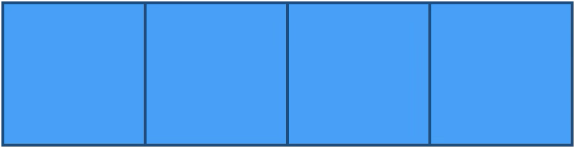

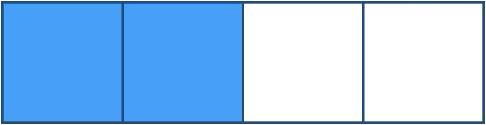

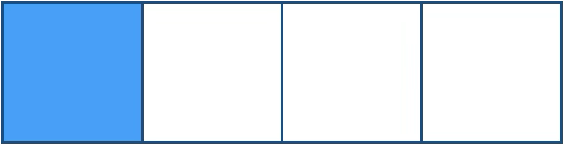

La <b>base ontique</b> d’un état épistémique est l’ensemble des états ontiques compatibles avec lui.

Par exemple, la base ontique de $1 \lor 2$ est $\\{1, 2\\}$. Faute d'autre information, tous les états de la base ontique sont considérés comme équiprobables&nbsp;: si elle en contient $n$, chacun a la probabilité $\frac{1}{n}$. Lorsqu’on sait tout, l’état épistémique coïncide avec l’état ontique, de même qu’une distribution de Dirac traduit la certitude parfaite sur une variable classique.

## Le principe d'équilibre de la connaissance

Jusqu'ici, rien de quantique&nbsp;: c'est la description ordinaire d'un dé que l'on ne voit pas. Pour obtenir des effets quantiques, Spekkens ajoute une seule contrainte, qui limite ce que l'on peut savoir de l'état ontique.

**On ne peut jamais en savoir plus qu'on n'en ignore.**

Pour donner un sens précis à «&nbsp;en savoir autant qu'on en ignore&nbsp;», Spekkens compte des questions.

Un <b>ensemble canonique</b> est un ensemble minimal de questions oui/non dont les réponses suffisent à identifier sans ambiguïté l’état ontique.

Pour un système élémentaire, poser successivement les quatre questions «&nbsp;Est-ce 1&nbsp;?&nbsp;», «&nbsp;Est-ce 2&nbsp;?&nbsp;», «&nbsp;Est-ce 3&nbsp;?&nbsp;», «&nbsp;Est-ce 4&nbsp;?&nbsp;» serait inefficace. Deux questions bien choisies suffisent, par exemple «&nbsp;Est-ce 1 ou 2&nbsp;?&nbsp;» et «&nbsp;Est-ce 2 ou 3&nbsp;?&nbsp;»&nbsp;: les quatre combinaisons de réponses (oui-non, oui-oui, non-oui, non-non) désignent respectivement $1$, $2$, $3$ et $4$. Chaque question coupe l'ensemble des possibilités en deux&nbsp;: un ensemble canonique compte donc deux questions pour un système élémentaire.

La <b>connaissance</b> $K$ est le nombre maximal de questions dont on connaît la réponse, parmi tous les ensembles canoniques possibles. L'<b>ignorance</b> $I$ est le nombre de questions restantes&nbsp;: la taille de l'ensemble canonique moins $K$.

On peut alors énoncer précisément le principe&nbsp;:

<b>Principe d'équilibre de la connaissance.</b> À tout instant et pour tout système, la connaissance ne dépasse jamais l'ignorance&nbsp;: $K \le I$. Dans un <b>état de connaissance maximale</b>, $K = I$.

Pour un système élémentaire, la connaissance maximale correspond donc à $K = I = 1$&nbsp;: on peut connaître la réponse à une question, jamais aux deux. On peut exclure deux états ontiques au plus&nbsp;; il en reste toujours au moins deux possibles.

<svg viewBox="0 0 600 190" role="img" aria-label="Chaque réponse à une question oui/non divise par deux le nombre d'états ontiques possibles : 4, puis 2, puis 1 ; le principe interdit d'aller au-delà de 2" style="width:100%;max-width:600px;height:auto;">
<defs><marker id="qa" viewBox="0 0 10 10" refX="9" refY="5" markerWidth="7" markerHeight="7" orient="auto-start-reverse"><path d="M0,1 L9,5 L0,9" fill="none" stroke="#94a3b8" stroke-width="1.6"/></marker></defs>
<rect x="30.0" y="28.0" width="26.0" height="26.0" fill="#477fa4" stroke="#94a3b8" stroke-width="1.2"/><text x="43.0" y="21.0" text-anchor="middle" font-size="12" fill="#64748b" font-family="Georgia,'Times New Roman',serif" >1</text><rect x="56.0" y="28.0" width="26.0" height="26.0" fill="#477fa4" stroke="#94a3b8" stroke-width="1.2"/><text x="69.0" y="21.0" text-anchor="middle" font-size="12" fill="#64748b" font-family="Georgia,'Times New Roman',serif" >2</text><rect x="82.0" y="28.0" width="26.0" height="26.0" fill="#477fa4" stroke="#94a3b8" stroke-width="1.2"/><text x="95.0" y="21.0" text-anchor="middle" font-size="12" fill="#64748b" font-family="Georgia,'Times New Roman',serif" >3</text><rect x="108.0" y="28.0" width="26.0" height="26.0" fill="#477fa4" stroke="#94a3b8" stroke-width="1.2"/><text x="121.0" y="21.0" text-anchor="middle" font-size="12" fill="#64748b" font-family="Georgia,'Times New Roman',serif" >4</text>
<text x="82.0" y="78.0" text-anchor="middle" font-size="13.5" fill="#334155" font-family="Georgia,'Times New Roman',serif" font-style="italic" >K = 0, I = 2</text>
<rect x="245.0" y="28.0" width="26.0" height="26.0" fill="#477fa4" stroke="#94a3b8" stroke-width="1.2"/><text x="258.0" y="21.0" text-anchor="middle" font-size="12" fill="#64748b" font-family="Georgia,'Times New Roman',serif" >1</text><rect x="271.0" y="28.0" width="26.0" height="26.0" fill="#477fa4" stroke="#94a3b8" stroke-width="1.2"/><text x="284.0" y="21.0" text-anchor="middle" font-size="12" fill="#64748b" font-family="Georgia,'Times New Roman',serif" >2</text><rect x="297.0" y="28.0" width="26.0" height="26.0" fill="#fff" stroke="#94a3b8" stroke-width="1.2"/><text x="310.0" y="21.0" text-anchor="middle" font-size="12" fill="#64748b" font-family="Georgia,'Times New Roman',serif" >3</text><rect x="323.0" y="28.0" width="26.0" height="26.0" fill="#fff" stroke="#94a3b8" stroke-width="1.2"/><text x="336.0" y="21.0" text-anchor="middle" font-size="12" fill="#64748b" font-family="Georgia,'Times New Roman',serif" >4</text>
<text x="297.0" y="78.0" text-anchor="middle" font-size="13.5" fill="#334155" font-family="Georgia,'Times New Roman',serif" font-style="italic" >K = 1, I = 1</text>
<line x1="144.0" y1="41.0" x2="235.0" y2="41.0" stroke="#94a3b8" stroke-width="1.3" marker-end="url(#qa)" />
<text x="189.5" y="64.0" text-anchor="middle" font-size="11.5" fill="#64748b" font-family="Georgia,'Times New Roman',serif" >« 1 ou 2 ? » oui</text>
<rect x="460.0" y="28.0" width="26.0" height="26.0" fill="#fff" stroke="#94a3b8" stroke-width="1.2"/><text x="473.0" y="21.0" text-anchor="middle" font-size="12" fill="#64748b" font-family="Georgia,'Times New Roman',serif" >1</text><rect x="486.0" y="28.0" width="26.0" height="26.0" fill="#477fa4" stroke="#94a3b8" stroke-width="1.2"/><text x="499.0" y="21.0" text-anchor="middle" font-size="12" fill="#64748b" font-family="Georgia,'Times New Roman',serif" >2</text><rect x="512.0" y="28.0" width="26.0" height="26.0" fill="#fff" stroke="#94a3b8" stroke-width="1.2"/><text x="525.0" y="21.0" text-anchor="middle" font-size="12" fill="#64748b" font-family="Georgia,'Times New Roman',serif" >3</text><rect x="538.0" y="28.0" width="26.0" height="26.0" fill="#fff" stroke="#94a3b8" stroke-width="1.2"/><text x="551.0" y="21.0" text-anchor="middle" font-size="12" fill="#64748b" font-family="Georgia,'Times New Roman',serif" >4</text>
<text x="512.0" y="78.0" text-anchor="middle" font-size="13.5" fill="#334155" font-family="Georgia,'Times New Roman',serif" font-style="italic" >K = 2, I = 0</text>
<line x1="359.0" y1="41.0" x2="450.0" y2="41.0" stroke="#94a3b8" stroke-width="1.3" marker-end="url(#qa)" />
<text x="404.5" y="64.0" text-anchor="middle" font-size="11.5" fill="#64748b" font-family="Georgia,'Times New Roman',serif" >« 2 ou 3 ? » oui</text>
<text x="82.0" y="106.0" text-anchor="middle" font-size="12.5" fill="#64748b" font-family="Georgia,'Times New Roman',serif" >ignorance totale</text>
<text x="297.0" y="106.0" text-anchor="middle" font-size="12.5" fill="#006C65" font-family="Georgia,'Times New Roman',serif" >✓ connaissance maximale</text>
<text x="512.0" y="106.0" text-anchor="middle" font-size="12.5" fill="#970E53" font-family="Georgia,'Times New Roman',serif" >✗ interdit</text>
<text x="300.0" y="160.0" text-anchor="middle" font-size="12.5" fill="#64748b" font-family="Georgia,'Times New Roman',serif" >Chaque réponse divise par deux le nombre de possibilités : 4 → 2 → 1.</text>
<text x="300.0" y="179.0" text-anchor="middle" font-size="12.5" fill="#64748b" font-family="Georgia,'Times New Roman',serif" >Un état à 3 cases ne correspond donc à aucun ensemble de réponses.</text>
</svg>

Le principe autorise à répondre à une question, pas à deux. Un état comme $1 \lor 2 \lor 3$ n'est pas permis non plus&nbsp;: aucune série de réponses oui/non ne mène à trois possibilités.

Il y a ainsi $\binom{4}{2} = 6$ états de connaissance maximale, appelés **bits-jouets**&nbsp;: «&nbsp;bit&nbsp;» parce qu'il ne manque qu'un bit, la réponse à la question restée ouverte, pour connaître l'état ontique. Avec l'ignorance totale, cela fait **sept** états épistémiques permis pour un système élémentaire.

Il faut bien mesurer ce qu'implique ce principe&nbsp;: même dans le meilleur des cas, la connaissance est **incomplète**. Le système a pourtant toujours un état ontique bien défini&nbsp;; c'est notre accès à cet état qui est limité. Ce déficit de connaissance, imposé *a priori*, va suffire à reproduire plusieurs effets clés de la mécanique quantique sans quitter un cadre fondamentalement classique.

## Le bit-jouet, analogue du qubit

↔ Pendant quantique&nbsp;: <a href="../fondations/#sphère-de-bloch">la sphère de Bloch</a>

On peut établir une correspondance entre les sept états permis d'un système élémentaire et sept états de qubit particulièrement importants&nbsp;: les six états propres des trois matrices de Pauli $\hat X$, $\hat Y$ et $\hat Z$, qui occupent les extrémités des trois axes de la sphère de Bloch, et l'état maximalement mixte $\mathbb{I}/2$, qui en occupe le centre.

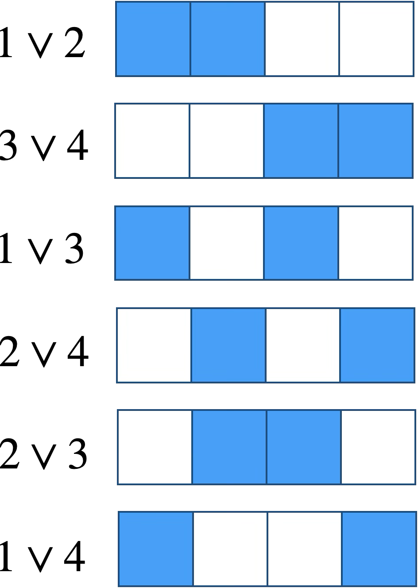

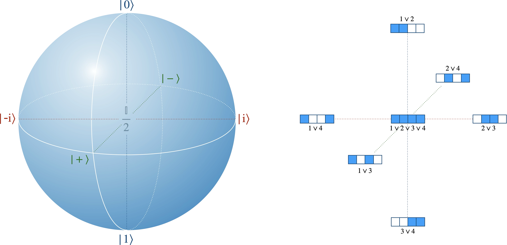

Deux états épistémiques sont <b>disjoints</b> si leurs bases ontiques n’ont aucun élément commun.

C'est l'analogue de l'orthogonalité&nbsp;: les paires de bits-jouets disjoints correspondent aux paires d'états orthogonaux ($\lvert0\rangle$, $\lvert1\rangle$), ($\lvert+\rangle$, $\lvert-\rangle$) et ($\lvert{+\mathrm i}\rangle$, $\lvert{-\mathrm i}\rangle$). On le lit d'un coup d'œil&nbsp;: deux états disjoints n'ont aucune case colorée en commun.

Une différence saute déjà aux yeux&nbsp;: le jouet ne possède que **six** états de connaissance maximale, placés aux six sommets d'un octaèdre, là où le qubit en possède une infinité, répartis sur toute la surface de la sphère. Le jouet n'imite donc qu'un petit fragment discret de la mécanique quantique, sur lequel on reviendra avec le formalisme stabilisateur.

### Fidélité

↔ Pendant quantique&nbsp;: <a href="../fondations/#fidélité">la fidélité</a>

La <b>fidélité</b> entre deux états épistémiques, de distributions de probabilité $p$ et $q$ sur les quatre états ontiques, est
$$\mathcal{F}(p,q) \\;=\\; \sum_{k=1}^{4}\sqrt{p_k}\\,\sqrt{q_k}.$$

Exemple pour les états épistémiques $1\lor 3$ et $1\lor 2$&nbsp;: chacun autorise deux états ontiques et leur attribue la probabilité $\frac12$.

<table style="text-align:center;">
<tr>
<th style="text-align:center;">État ontique</th><th style="text-align:center;">$p_k$ pour $1\lor 3$</th><th style="text-align:center;">$q_k$ pour $1\lor 2$</th>
</tr>
<tr><td>$1$</td><td>$1/2$</td><td>$1/2$</td></tr>
<tr><td>$2$</td><td>$0$</td><td>$1/2$</td></tr>
<tr><td>$3$</td><td>$1/2$</td><td>$0$</td></tr>
<tr><td>$4$</td><td>$0$</td><td>$0$</td></tr>
</table>

Seul l'état ontique $1$, commun aux deux, contribue&nbsp;: $\mathcal{F} = \sqrt{\tfrac12}\sqrt{\tfrac12} = \tfrac12$. C'est aussi la fidélité quantique entre les états correspondants, $\lvert+\rangle$ et $\lvert0\rangle$&nbsp;: $|\langle+|0\rangle|^{2} = \frac12$.

Pour les bits-jouets, la fidélité ne prend que trois valeurs&nbsp;: $1$ pour deux états identiques, $\frac12$ pour deux états qui partagent une case, $0$ pour deux états disjoints. Ce sont exactement les fidélités quantiques entre les états correspondants&nbsp;: $1$, $\frac12$ (deux états d'axes différents, à angle droit sur la sphère de Bloch) et $0$ (deux états opposés). En quantique, en revanche, la fidélité prend continûment toutes les valeurs entre $0$ et $1$.

Deux états qui partagent une case ne peuvent jamais être distingués avec certitude&nbsp;: les deux préparations peuvent produire le même état ontique, et aucune mesure ne peut alors les départager. C'est l'analogue de l'indiscernabilité des états quantiques non orthogonaux, et le jouet en donne une explication particulièrement simple. C'est d'ailleurs l'un des arguments avancés en faveur de la vision ψ-épistémique (voir [Les attraits de la vision ψ-épistémique](../epistovsonto/#les-attraits-de-la-vision-ψ-épistémique)).

### Superpositions et mélanges

↔ Pendant quantique&nbsp;: <a href="../fondations/#état-pur-et-état-mixte">état pur et état mixte</a>

La <b>combinaison convexe</b> de deux états épistémiques disjoints est l'union de leurs bases ontiques, à condition que cette union soit un état épistémique permis.

Par exemple, la combinaison de $1\lor2$ et $3\lor4$ donne l'ignorance totale $1\lor2\lor3\lor4$&nbsp;: c'est l'analogue du mélange à parts égales de $\lvert0\rangle$ et $\lvert1\rangle$, qui donne $\mathbb{I}/2$. Comme en quantique, un même état mixte admet plusieurs décompositions&nbsp;: $1\lor2\lor3\lor4$ est aussi bien le mélange de $1\lor2$ et $3\lor4$ (soit $\lvert0\rangle$ et $\lvert1\rangle$) que celui de $1\lor3$ et $2\lor4$ (soit $\lvert+\rangle$ et $\lvert-\rangle$).

Le jouet possède aussi un analogue des superpositions **cohérentes**, qui fabriquent un état pur à partir de deux états purs.

La <b>superposition cohérente</b> de deux états épistémiques disjoints $a\lor b$ et $c\lor d$ (avec $a\lt b$ et $c\lt d$) prend un état ontique dans chacun. Il y a quatre façons de le faire, notées $+\_1$, $+\_2$, $+\_3$ et $+\_4$&nbsp;:

$$
\begin{aligned}
(a\lor b)\\; +\_1 \\; (c\lor d) &= a\lor c,\\\\
(a\lor b)\\; +\_2 \\; (c\lor d) &= b\lor d,\\\\
(a\lor b)\\; +\_3 \\; (c\lor d) &= b\lor c,\\\\
(a\lor b)\\; +\_4 \\; (c\lor d) &= a\lor d.
\end{aligned}
$$

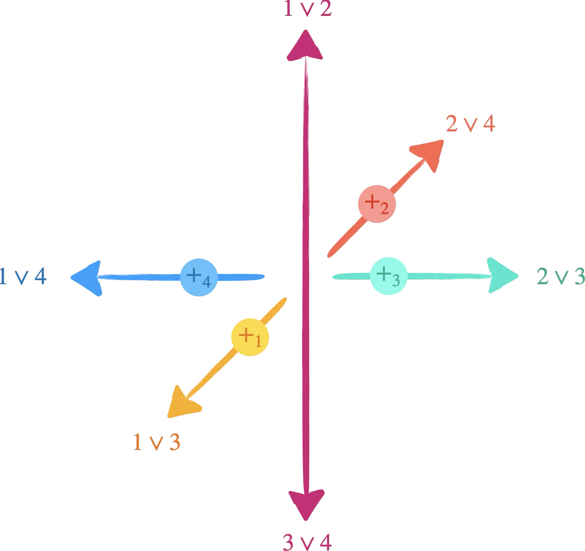

Par exemple, $(1\lor 2)+\_4(3\lor 4)=1\lor 4$, et en mécanique quantique $\tfrac1{\sqrt{2}} \bigl(|0\rangle + \mathrm{e}^{\mathrm{i}\frac{3\pi}{2}} |1\rangle\bigr)=\tfrac1{\sqrt{2}} \bigl(|0\rangle -\mathrm{i} |1\rangle\bigr)=|{-\mathrm{i}}\rangle$, qui correspond bien à $1\lor4$.

La correspondance n'est cependant pas parfaite. Appliquée à d'autres paires d'états disjoints, la même règle ne donne pas toujours la superposition quantique attendue&nbsp;: $(1\lor3)+\_3(2\lor4) = 2\lor3$, qui correspond à $\lvert{+\mathrm i}\rangle$, alors qu'en quantique $\frac{1}{\sqrt2}\bigl(\lvert+\rangle + \mathrm{i}\lvert-\rangle\bigr)$ est proportionnel à $\lvert{-\mathrm i}\rangle$. Les phases du jouet n'imitent celles de la mécanique quantique qu'en partie.

## Transformations

↔ Pendant quantique&nbsp;: <a href="../fondations/#un-jeu-daxiomes">l'évolution unitaire (axiome 2)</a>

Une transformation doit envoyer tout état permis sur un état permis. Si elle envoyait deux états ontiques différents sur le même, elle pourrait transformer $1\lor2$ en un état à une seule case, ce qui est interdit. Les transformations permises sont donc les **permutations** des quatre états ontiques&nbsp;: il y en a $4! = 24$. Ce sont des évolutions réversibles, comme les évolutions unitaires.

Les transformations de la théorie-jouet sont les permutations des états ontiques. Elles conservent la fidélité entre états épistémiques, comme les transformations unitaires conservent le produit scalaire.

Exemple de la permutation $(123)(4)$, qui envoie $1$ sur $2$, $2$ sur $3$, $3$ sur $1$ et laisse $4$ en place&nbsp;:

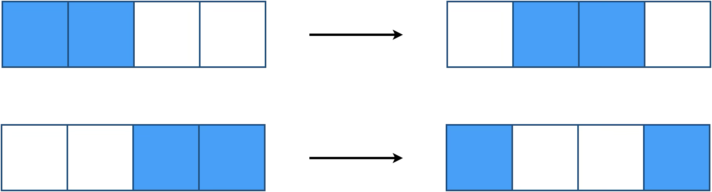

Les deux états disjoints $1\lor2$ et $3\lor4$ deviennent $2\lor3$ et $1\lor4$, toujours disjoints&nbsp;: la fidélité (nulle) est conservée. Une permutation ne fait que renommer les cases, elle conserve donc toujours les recouvrements.

Là encore, la correspondance avec les portes quantiques n'est pas parfaite. Sur l'octaèdre de la figure plus haut, la moitié des permutations (les permutations paires, comme $(123)$) agissent comme des **rotations**, analogues de portes quantiques. Mais l'autre moitié (les permutations impaires, comme l'échange $(12)$ de $1$ et $2$) agissent comme des **réflexions**&nbsp;: $(12)$ laisse $\lvert0\rangle$ et $\lvert1\rangle$ en place mais échange $\lvert+\rangle$ et $\lvert{+\mathrm i}\rangle$, comme un miroir. Or une réflexion de la sphère de Bloch ne correspond à aucune évolution unitaire, mais à une transformation *anti-unitaire*, comme la conjugaison complexe, qui n'est pas physiquement réalisable. Inversement, la porte de Hadamard, qui échange les axes $X$ et $Z$ par une rotation, n'a pas d'équivalent exact dans le jouet&nbsp;: la permutation $(23)$ échange bien $\lvert0\rangle$ et $\lvert+\rangle$, ainsi que $\lvert1\rangle$ et $\lvert-\rangle$, mais elle laisse $\lvert{\pm\mathrm i}\rangle$ en place.

## Mesure

↔ Pendant quantique&nbsp;: <a href="../fondations/#un-jeu-daxiomes">la règle de Born et la réduction (axiomes 4 et 5)</a>

Dans la théorie-jouet comme en mécanique quantique, une mesure doit fournir un résultat, et laisser le système dans un état qui respecte encore le principe d'équilibre. Une mesure ne peut donc jamais isoler un seul état ontique&nbsp;: la seule question qu'on puisse poser au système est «&nbsp;dans laquelle de deux paires se trouve l'état ontique&nbsp;?&nbsp;». Il y a exactement trois façons de partager quatre états en deux paires, et donc trois mesures, analogues des mesures d'un qubit selon les trois axes $X$, $Y$ et $Z$.

$$
\begin{array}{|c|c|c|c|}
\hline
\color{#1DB100}\text{I} & \color{#1DB100}\text{I} &\color{#D41876} \text{II} &\color{#D41876} \text{II}\\\\
\hline
\end{array} = \\{1\lor 2,3\lor 4\\} \leftrightarrow \text{mesure sur l'axe }Z
$$

$$
\begin{array}{|c|c|c|c|}
\hline
\color{#1DB100}\text{I} &\color{#D41876} \text{II} & \color{#1DB100}\text{I} &\color{#D41876} \text{II}\\\\
\hline
\end{array} = \\{1\lor 3,2\lor 4\\} \leftrightarrow \text{mesure sur l'axe }X
$$

$$
\begin{array}{|c|c|c|c|}
\hline
\color{#1DB100}\text{I} &\color{#D41876} \text{II} &\color{#D41876} \text{II} & \color{#1DB100}\text{I}\\\\
\hline
\end{array} = \\{1\lor 4,2\lor 3\\} \leftrightarrow \text{mesure sur l'axe }Y
$$

Deux états disjoints sont parfaitement distinguables par la mesure qui les sépare. La mesure $X$ sépare ainsi avec certitude $1\lor 3$ de $2\lor 4$&nbsp;: appliquée à $2\lor4$, elle donne toujours II et laisse l'état inchangé, comme la mesure de $\hat X$ sur $\lvert-\rangle$.

Appliquée à $1\lor 2$, en revanche, la mesure $X$ donne I ou II avec la probabilité $\frac12$ chacun, puisque l'état ontique est $1$ (classe I) ou $2$ (classe II). Le résultat est imprévisible, exactement comme celui de la mesure de $\hat X$ sur $\lvert0\rangle$. Mais l'origine de ce hasard est ici tout à fait ordinaire&nbsp;: c'est notre ignorance de l'état ontique.

### Une mesure qui perturbe

Un problème se pose pourtant. Si la mesure $X$ sur $1\lor 2$ donne I, on en déduit que l'état ontique **était** $1$. Cela ne viole pas encore le principe, qui porte sur ce que l'on sait de l'état présent, pas de l'état passé. Mais si le système était resté en $1$, on connaîtrait parfaitement son état actuel, ce qui est interdit. La mesure doit donc avoir **perturbé** le système de façon incontrôlable&nbsp;: l'état ontique est déplacé au hasard sur $1$ ou $3$, et l'état après la mesure est $1\lor3$.

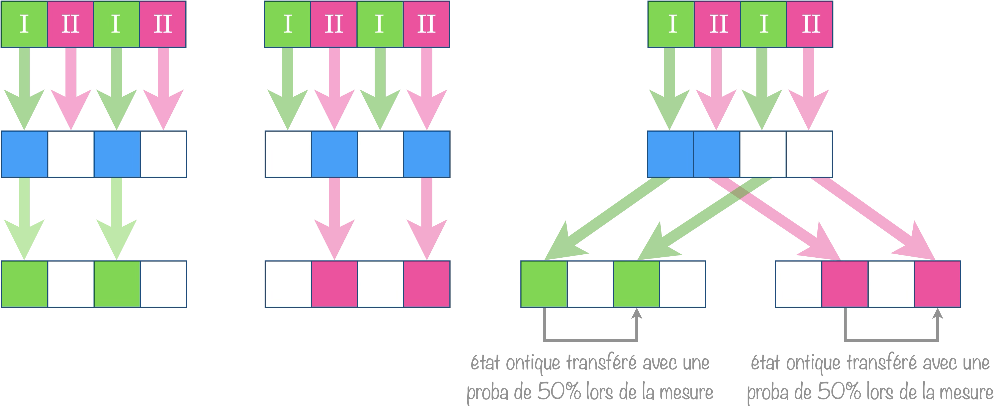

Après une mesure, l'état épistémique est la classe du résultat obtenu, et l'état ontique a été déplacé au hasard à l'intérieur de cette classe.

La «&nbsp;réduction&nbsp;» de l'état a donc ici deux composantes&nbsp;: une **mise à jour** de notre connaissance (on apprend la classe), et une **perturbation** physique, aléatoire, de l'état ontique.

### Des mesures incompatibles

Cette perturbation a une conséquence majeure&nbsp;: les mesures deviennent **incompatibles**, comme les observables quantiques qui ne commutent pas.

<svg viewBox="0 0 600 205" role="img" aria-label="Mesures successives : Z donne I (état 1∨2), puis X donne I (état 1∨3), puis Z redonne I ou II au hasard : la mesure de X a effacé la connaissance acquise sur Z" style="width:100%;max-width:600px;height:auto;">
<defs><marker id="za" viewBox="0 0 10 10" refX="9" refY="5" markerWidth="7" markerHeight="7" orient="auto-start-reverse"><path d="M0,1 L9,5 L0,9" fill="none" stroke="#94a3b8" stroke-width="1.6"/></marker></defs>
<text x="84.0" y="18.0" text-anchor="middle" font-size="13" fill="#334155" font-family="Georgia,'Times New Roman',serif" >1. mesure Z</text>
<rect x="40.0" y="28.0" width="22.0" height="16.0" fill="#c7dfdd" stroke="#fff" stroke-width="1.5"/><text x="51.0" y="40.5" text-anchor="middle" font-size="11.5" fill="#006C65" font-family="Georgia,'Times New Roman',serif" >I</text><rect x="62.0" y="28.0" width="22.0" height="16.0" fill="#c7dfdd" stroke="#fff" stroke-width="1.5"/><text x="73.0" y="40.5" text-anchor="middle" font-size="11.5" fill="#006C65" font-family="Georgia,'Times New Roman',serif" >I</text><rect x="84.0" y="28.0" width="22.0" height="16.0" fill="#eacfdd" stroke="#fff" stroke-width="1.5"/><text x="95.0" y="40.5" text-anchor="middle" font-size="11.5" fill="#970E53" font-family="Georgia,'Times New Roman',serif" >II</text><rect x="106.0" y="28.0" width="22.0" height="16.0" fill="#eacfdd" stroke="#fff" stroke-width="1.5"/><text x="117.0" y="40.5" text-anchor="middle" font-size="11.5" fill="#970E53" font-family="Georgia,'Times New Roman',serif" >II</text>
<rect x="40.0" y="66.0" width="22.0" height="22.0" fill="#477fa4" stroke="#94a3b8" stroke-width="1.2"/><rect x="62.0" y="66.0" width="22.0" height="22.0" fill="#477fa4" stroke="#94a3b8" stroke-width="1.2"/><rect x="84.0" y="66.0" width="22.0" height="22.0" fill="#fff" stroke="#94a3b8" stroke-width="1.2"/><rect x="106.0" y="66.0" width="22.0" height="22.0" fill="#fff" stroke="#94a3b8" stroke-width="1.2"/>
<text x="84.0" y="104.0" text-anchor="middle" font-size="12" fill="#006C65" font-family="Georgia,'Times New Roman',serif" >résultat I</text>
<text x="84.0" y="121.0" text-anchor="middle" font-size="12" fill="#334155" font-family="Georgia,'Times New Roman',serif" font-style="italic" >1 ∨ 2  ↔  |0⟩</text>
<line x1="144.0" y1="77.0" x2="219.0" y2="77.0" stroke="#94a3b8" stroke-width="1.3" marker-end="url(#za)" />
<text x="279.0" y="18.0" text-anchor="middle" font-size="13" fill="#334155" font-family="Georgia,'Times New Roman',serif" >2. mesure X</text>
<rect x="235.0" y="28.0" width="22.0" height="16.0" fill="#c7dfdd" stroke="#fff" stroke-width="1.5"/><text x="246.0" y="40.5" text-anchor="middle" font-size="11.5" fill="#006C65" font-family="Georgia,'Times New Roman',serif" >I</text><rect x="257.0" y="28.0" width="22.0" height="16.0" fill="#eacfdd" stroke="#fff" stroke-width="1.5"/><text x="268.0" y="40.5" text-anchor="middle" font-size="11.5" fill="#970E53" font-family="Georgia,'Times New Roman',serif" >II</text><rect x="279.0" y="28.0" width="22.0" height="16.0" fill="#c7dfdd" stroke="#fff" stroke-width="1.5"/><text x="290.0" y="40.5" text-anchor="middle" font-size="11.5" fill="#006C65" font-family="Georgia,'Times New Roman',serif" >I</text><rect x="301.0" y="28.0" width="22.0" height="16.0" fill="#eacfdd" stroke="#fff" stroke-width="1.5"/><text x="312.0" y="40.5" text-anchor="middle" font-size="11.5" fill="#970E53" font-family="Georgia,'Times New Roman',serif" >II</text>
<rect x="235.0" y="66.0" width="22.0" height="22.0" fill="#477fa4" stroke="#94a3b8" stroke-width="1.2"/><rect x="257.0" y="66.0" width="22.0" height="22.0" fill="#fff" stroke="#94a3b8" stroke-width="1.2"/><rect x="279.0" y="66.0" width="22.0" height="22.0" fill="#477fa4" stroke="#94a3b8" stroke-width="1.2"/><rect x="301.0" y="66.0" width="22.0" height="22.0" fill="#fff" stroke="#94a3b8" stroke-width="1.2"/>
<text x="279.0" y="104.0" text-anchor="middle" font-size="12" fill="#006C65" font-family="Georgia,'Times New Roman',serif" >résultat I</text>
<text x="279.0" y="121.0" text-anchor="middle" font-size="12" fill="#334155" font-family="Georgia,'Times New Roman',serif" font-style="italic" >1 ∨ 3  ↔  |+⟩</text>
<line x1="339.0" y1="77.0" x2="414.0" y2="77.0" stroke="#94a3b8" stroke-width="1.3" marker-end="url(#za)" />
<text x="474.0" y="18.0" text-anchor="middle" font-size="13" fill="#334155" font-family="Georgia,'Times New Roman',serif" >3. mesure Z</text>
<rect x="430.0" y="28.0" width="22.0" height="16.0" fill="#c7dfdd" stroke="#fff" stroke-width="1.5"/><text x="441.0" y="40.5" text-anchor="middle" font-size="11.5" fill="#006C65" font-family="Georgia,'Times New Roman',serif" >I</text><rect x="452.0" y="28.0" width="22.0" height="16.0" fill="#c7dfdd" stroke="#fff" stroke-width="1.5"/><text x="463.0" y="40.5" text-anchor="middle" font-size="11.5" fill="#006C65" font-family="Georgia,'Times New Roman',serif" >I</text><rect x="474.0" y="28.0" width="22.0" height="16.0" fill="#eacfdd" stroke="#fff" stroke-width="1.5"/><text x="485.0" y="40.5" text-anchor="middle" font-size="11.5" fill="#970E53" font-family="Georgia,'Times New Roman',serif" >II</text><rect x="496.0" y="28.0" width="22.0" height="16.0" fill="#eacfdd" stroke="#fff" stroke-width="1.5"/><text x="507.0" y="40.5" text-anchor="middle" font-size="11.5" fill="#970E53" font-family="Georgia,'Times New Roman',serif" >II</text>
<rect x="430.0" y="62.0" width="17.6" height="17.6" fill="#66a7a3" stroke="#94a3b8" stroke-width="1.2"/><rect x="447.6" y="62.0" width="17.6" height="17.6" fill="#66a7a3" stroke="#94a3b8" stroke-width="1.2"/><rect x="465.2" y="62.0" width="17.6" height="17.6" fill="#fff" stroke="#94a3b8" stroke-width="1.2"/><rect x="482.8" y="62.0" width="17.6" height="17.6" fill="#fff" stroke="#94a3b8" stroke-width="1.2"/>
<text x="508.4" y="75.2" text-anchor="start" font-size="12" fill="#006C65" font-family="Georgia,'Times New Roman',serif" >I  (1/2)</text>
<rect x="430.0" y="96.0" width="17.6" height="17.6" fill="#fff" stroke="#94a3b8" stroke-width="1.2"/><rect x="447.6" y="96.0" width="17.6" height="17.6" fill="#fff" stroke="#94a3b8" stroke-width="1.2"/><rect x="465.2" y="96.0" width="17.6" height="17.6" fill="#c16e98" stroke="#94a3b8" stroke-width="1.2"/><rect x="482.8" y="96.0" width="17.6" height="17.6" fill="#c16e98" stroke="#94a3b8" stroke-width="1.2"/>
<text x="508.4" y="109.2" text-anchor="start" font-size="12" fill="#970E53" font-family="Georgia,'Times New Roman',serif" >II  (1/2)</text>
<text x="300.0" y="170.0" text-anchor="middle" font-size="12.5" fill="#64748b" font-family="Georgia,'Times New Roman',serif" >La mesure de X a effacé ce que la première mesure de Z avait appris :</text>
<text x="300.0" y="190.0" text-anchor="middle" font-size="12.5" fill="#64748b" font-family="Georgia,'Times New Roman',serif" >le troisième résultat est aussi imprévisible que si l'on n'avait jamais mesuré Z.</text>
</svg>

Trois mesures successives sur un même système élémentaire.

Connaître à la fois la réponse à $Z$ et la réponse à $X$ reviendrait à connaître l'état ontique, ce que le principe interdit&nbsp;: apprendre l'une efface forcément l'autre. C'est l'analogue de la complémentarité quantique, et de l'exemple de la mesure de $\hat X$ sur $\lvert0\rangle$ dans la page [Notions fondamentales](../fondations/#le-qubit).

### Superposition ou mélange&nbsp;?

↔ Pendant quantique&nbsp;: <a href="../fondations/#superposition-ou-mélange">superposition ou mélange</a>

La mesure permet aussi de retrouver la différence entre une superposition et un mélange. Comparons l'état $1\lor3$, analogue de $\lvert+\rangle$, et l'ignorance totale, analogue du mélange $\mathbb{I}/2$&nbsp;:

<svg viewBox="0 0 600 235" role="img" aria-label="L'état 1∨3 (analogue de |+⟩) et l'ignorance totale (analogue du mélange 𝕀/2) donnent les mêmes statistiques pour la mesure Z mais pas pour la mesure X" style="width:100%;max-width:600px;height:auto;">
<text x="270.0" y="20.0" text-anchor="middle" font-size="13.5" fill="#334155" font-family="Georgia,'Times New Roman',serif" >mesure Z</text>
<text x="480.0" y="20.0" text-anchor="middle" font-size="13.5" fill="#334155" font-family="Georgia,'Times New Roman',serif" >mesure X</text>
<rect x="222.0" y="30.0" width="24.0" height="16.0" fill="#c7dfdd" stroke="#fff" stroke-width="1.5"/><text x="234.0" y="42.5" text-anchor="middle" font-size="11.5" fill="#006C65" font-family="Georgia,'Times New Roman',serif" >I</text><rect x="246.0" y="30.0" width="24.0" height="16.0" fill="#c7dfdd" stroke="#fff" stroke-width="1.5"/><text x="258.0" y="42.5" text-anchor="middle" font-size="11.5" fill="#006C65" font-family="Georgia,'Times New Roman',serif" >I</text><rect x="270.0" y="30.0" width="24.0" height="16.0" fill="#eacfdd" stroke="#fff" stroke-width="1.5"/><text x="282.0" y="42.5" text-anchor="middle" font-size="11.5" fill="#970E53" font-family="Georgia,'Times New Roman',serif" >II</text><rect x="294.0" y="30.0" width="24.0" height="16.0" fill="#eacfdd" stroke="#fff" stroke-width="1.5"/><text x="306.0" y="42.5" text-anchor="middle" font-size="11.5" fill="#970E53" font-family="Georgia,'Times New Roman',serif" >II</text>
<rect x="432.0" y="30.0" width="24.0" height="16.0" fill="#c7dfdd" stroke="#fff" stroke-width="1.5"/><text x="444.0" y="42.5" text-anchor="middle" font-size="11.5" fill="#006C65" font-family="Georgia,'Times New Roman',serif" >I</text><rect x="456.0" y="30.0" width="24.0" height="16.0" fill="#eacfdd" stroke="#fff" stroke-width="1.5"/><text x="468.0" y="42.5" text-anchor="middle" font-size="11.5" fill="#970E53" font-family="Georgia,'Times New Roman',serif" >II</text><rect x="480.0" y="30.0" width="24.0" height="16.0" fill="#c7dfdd" stroke="#fff" stroke-width="1.5"/><text x="492.0" y="42.5" text-anchor="middle" font-size="11.5" fill="#006C65" font-family="Georgia,'Times New Roman',serif" >I</text><rect x="504.0" y="30.0" width="24.0" height="16.0" fill="#eacfdd" stroke="#fff" stroke-width="1.5"/><text x="516.0" y="42.5" text-anchor="middle" font-size="11.5" fill="#970E53" font-family="Georgia,'Times New Roman',serif" >II</text>
<text x="20.0" y="84.0" text-anchor="start" font-size="13" fill="#004D80" font-family="Georgia,'Times New Roman',serif" font-style="italic" >1 ∨ 3</text>
<text x="20.0" y="102.0" text-anchor="start" font-size="13" fill="#004D80" font-family="Georgia,'Times New Roman',serif" font-style="italic" >↔  |+⟩</text>
<rect x="222.0" y="74.0" width="24.0" height="24.0" fill="#477fa4" stroke="#94a3b8" stroke-width="1.2"/><rect x="246.0" y="74.0" width="24.0" height="24.0" fill="#fff" stroke="#94a3b8" stroke-width="1.2"/><rect x="270.0" y="74.0" width="24.0" height="24.0" fill="#477fa4" stroke="#94a3b8" stroke-width="1.2"/><rect x="294.0" y="74.0" width="24.0" height="24.0" fill="#fff" stroke="#94a3b8" stroke-width="1.2"/>
<rect x="432.0" y="74.0" width="24.0" height="24.0" fill="#477fa4" stroke="#94a3b8" stroke-width="1.2"/><rect x="456.0" y="74.0" width="24.0" height="24.0" fill="#fff" stroke="#94a3b8" stroke-width="1.2"/><rect x="480.0" y="74.0" width="24.0" height="24.0" fill="#477fa4" stroke="#94a3b8" stroke-width="1.2"/><rect x="504.0" y="74.0" width="24.0" height="24.0" fill="#fff" stroke="#94a3b8" stroke-width="1.2"/>
<text x="270.0" y="115.0" text-anchor="middle" font-size="12" fill="#64748b" font-family="Georgia,'Times New Roman',serif" >I ou II (1/2 chacun)</text>
<text x="480.0" y="115.0" text-anchor="middle" font-size="12" fill="#006C65" font-family="Georgia,'Times New Roman',serif" >I à coup sûr</text>
<text x="20.0" y="156.0" text-anchor="start" font-size="13" fill="#004D80" font-family="Georgia,'Times New Roman',serif" font-style="italic" >1 ∨ 2 ∨ 3 ∨ 4</text>
<text x="20.0" y="174.0" text-anchor="start" font-size="13" fill="#004D80" font-family="Georgia,'Times New Roman',serif" font-style="italic" >↔  𝕀/2</text>
<rect x="222.0" y="146.0" width="24.0" height="24.0" fill="#477fa4" stroke="#94a3b8" stroke-width="1.2"/><rect x="246.0" y="146.0" width="24.0" height="24.0" fill="#477fa4" stroke="#94a3b8" stroke-width="1.2"/><rect x="270.0" y="146.0" width="24.0" height="24.0" fill="#477fa4" stroke="#94a3b8" stroke-width="1.2"/><rect x="294.0" y="146.0" width="24.0" height="24.0" fill="#477fa4" stroke="#94a3b8" stroke-width="1.2"/>
<rect x="432.0" y="146.0" width="24.0" height="24.0" fill="#477fa4" stroke="#94a3b8" stroke-width="1.2"/><rect x="456.0" y="146.0" width="24.0" height="24.0" fill="#477fa4" stroke="#94a3b8" stroke-width="1.2"/><rect x="480.0" y="146.0" width="24.0" height="24.0" fill="#477fa4" stroke="#94a3b8" stroke-width="1.2"/><rect x="504.0" y="146.0" width="24.0" height="24.0" fill="#477fa4" stroke="#94a3b8" stroke-width="1.2"/>
<text x="270.0" y="187.0" text-anchor="middle" font-size="12" fill="#64748b" font-family="Georgia,'Times New Roman',serif" >I ou II (1/2 chacun)</text>
<text x="480.0" y="187.0" text-anchor="middle" font-size="12" fill="#64748b" font-family="Georgia,'Times New Roman',serif" >I ou II (1/2 chacun)</text>
<line x1="375.0" y1="18.0" x2="375.0" y2="215.0" stroke="#cbd5e1" stroke-width="1" />
<text x="270.0" y="228.0" text-anchor="middle" font-size="12.5" fill="#64748b" font-family="Georgia,'Times New Roman',serif" >mêmes statistiques</text>
<text x="480.0" y="228.0" text-anchor="middle" font-size="12.5" fill="#970E53" font-family="Georgia,'Times New Roman',serif" >statistiques différentes</text>
</svg>

L'état $1\lor3$ et l'ignorance totale ne se distinguent pas par la mesure $Z$, mais se distinguent par la mesure $X$.

C'est exactement ce qui se passe en quantique avec $\lvert+\rangle$ et $\mathbb{I}/2$. Le jouet en donne une lecture limpide&nbsp;: dans l'état $1\lor3$, on connaît la réponse à la question $X$, que l'on ignore dans le mélange. Une «&nbsp;superposition&nbsp;» n'est pas un manque de connaissance plus grand qu'un mélange&nbsp;: c'est une connaissance portant sur une autre question.

## Deux systèmes élémentaires

↔ Pendant quantique&nbsp;: <a href="../fondations/#paire-de-qubits">paire de qubits</a>

Tout système se construit à partir de systèmes élémentaires. Pour deux systèmes, les états ontiques sont les **couples** d'états ontiques individuels, notés $(a\cdot b)$&nbsp;: le premier système est dans l'état $a$ et le second dans l'état $b$. Il y en a $4\times4 = 16$, que l'on range sur une grille, comme le produit tensoriel range les états de base $\lvert00\rangle$, $\lvert01\rangle$, etc.

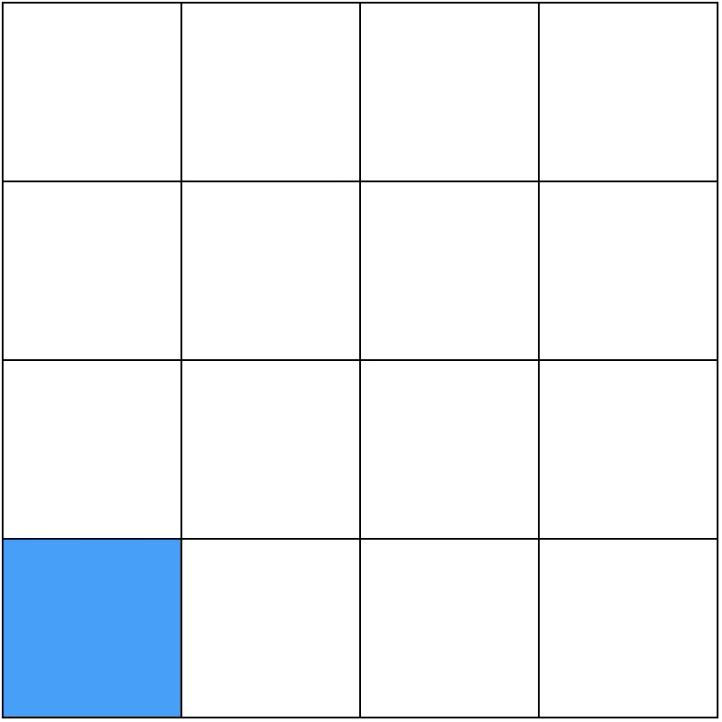

Il faut maintenant $4$ questions pour identifier l'état ontique de la paire (deux par système). Plus généralement, pour $n$ systèmes élémentaires, on a $4^n$ états ontiques et $2n$ questions dans un ensemble canonique.

Le principe d'équilibre s'applique à la paire comme à chacune de ses parties. Sur la paire, on peut connaître au plus $2$ réponses sur $4$&nbsp;: il reste au moins $2^2 = 4$ cases possibles sur $16$. L'état ontique $(1\cdot 1)$ seul, par exemple, n'est pas un état épistémique permis. Cela laisse a priori $\binom{16}{4} = 1820$ candidats à $4$ cases pour la connaissance maximale. Mais beaucoup d'entre eux sont exclus.

### Ce que l'on sait d'un seul système

↔ Pendant quantique&nbsp;: <a href="../fondations/#létat-dun-seul-qubit-la-trace-partielle">la trace partielle</a>

Pour savoir ce que l'on sait d'un seul des deux systèmes, on «&nbsp;projette&nbsp;» la grille sur l'un des axes&nbsp;: une case de la rangée est colorée dès qu'une case de la ligne (ou de la colonne) correspondante l'est. C'est la **distribution marginale**[^1], l'analogue de la trace partielle.

[^1]: [Petit cours](https://www.unige.ch/math/mgene/cours/slides7.pdf) sur les distributions conjointe et marginale en probabilité.

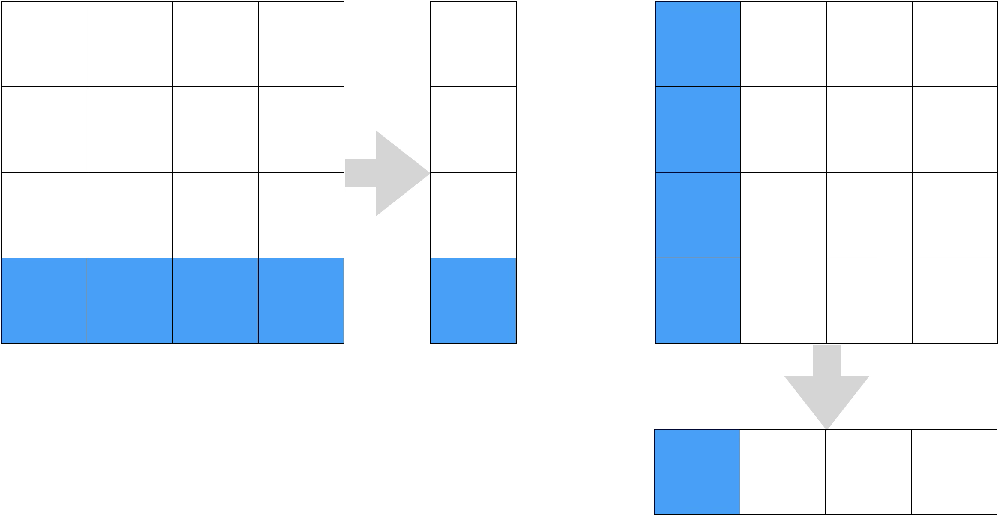

Le principe d'équilibre doit être respecté à la fois sur la paire et sur chacune de ses marginales&nbsp;: chaque marginale doit compter au moins deux cases.

### Ce qu'une mesure pourrait révéler

Lorsqu'on mesure l'un des deux systèmes, on ne garde que les cases compatibles avec le résultat, le système mesuré est perturbé comme un système seul, et l'état final est le produit des deux marginales ainsi obtenues. Cette règle élimine encore des candidats&nbsp;: certains états, aux marginales pourtant permises, seraient «&nbsp;trahis&nbsp;» par une mesure, qui en apprendrait trop sur l'autre système.

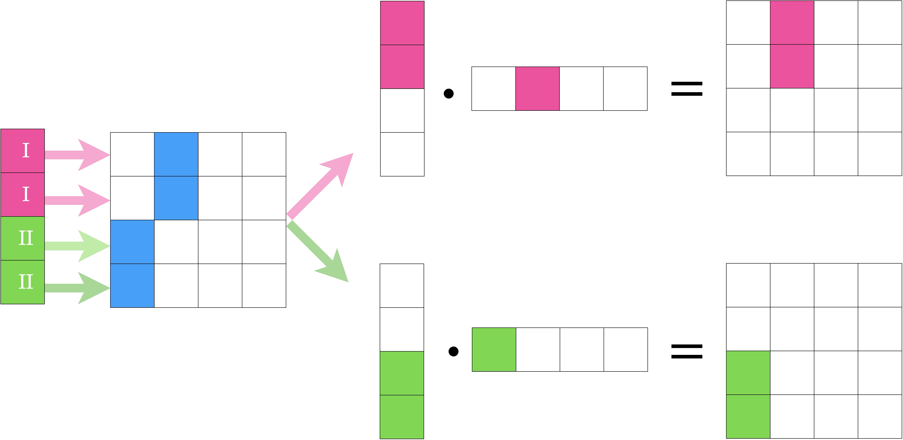

Au bout du compte, ce tri sévère ne laisse que deux familles d'états de connaissance maximale&nbsp;: les **états produits** et les **états corrélés**.

Un <b>état produit</b> est un état de la paire dans lequel on possède la connaissance maximale sur chacun des deux systèmes. Si le système 1 a pour marginale $a\lor b$ et le système 2 la marginale $c\lor d$, il s’écrit&nbsp;:

$$(a\lor b)\\,\cdot\\,(c\lor d)\\;=\\;
(a\cdot c)\\;\lor\\;(a\cdot d)\\;\lor\\;(b\cdot c)\\;\lor\\;(b\cdot d),$$

en distribuant la disjonction comme on développe $(x+y)(z+t)=xz+xt+yz+yt$. Sur la grille, c'est un rectangle formé de deux lignes et de deux colonnes.

## États corrélés&nbsp;: l'analogue de l'intrication

↔ Pendant quantique&nbsp;: <a href="../fondations/#paire-de-qubits">l'état de Bell</a>

Un <b>état corrélé</b> est un état de la paire dans lequel on connaît parfaitement la <b>relation</b> entre les deux systèmes, mais rien de chacun d'eux pris séparément&nbsp;: leurs deux marginales sont l'ignorance totale.

L’exemple type est $(1\cdot1)\lor(2\cdot2)\lor(3\cdot3)\lor(4\cdot4)$&nbsp;: «&nbsp;les deux systèmes sont dans le même état ontique&nbsp;». Les autres s'obtiennent en permutant les lignes ou les colonnes.

Cet état n'est pas un état produit&nbsp;: il lui manque les «&nbsp;termes croisés&nbsp;» $(1\cdot2)$, $(2\cdot1)$, etc., exactement comme l'état de Bell ne peut pas s'écrire comme un produit de deux états à un qubit. Et ses marginales sont l'ignorance totale&nbsp;: on sait tout de la relation, rien des parties. C'est la situation de l'état de Bell, dont chaque qubit est dans l'état maximalement mixte alors que la paire est dans un état pur. Mais l'explication est ici transparente&nbsp;: connaître une relation («&nbsp;les deux valeurs sont égales&nbsp;») n'apprend rien sur les valeurs elles-mêmes.

### Une «&nbsp;action à distance&nbsp;» qui n'en est pas une

Confions le premier système à Alice et le second à Bob, aussi loin qu'on voudra.

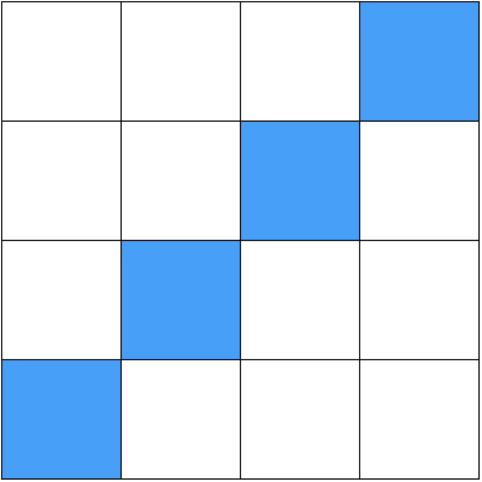

En mécanique quantique, la situation est la même avec l'état de Bell&nbsp;: la mesure d'Alice semble «&nbsp;réduire&nbsp;» instantanément l'état du qubit de Bob, ce qui troublait tant Einstein (voir la page [EPR](../epr/)). Dans le jouet, rien de mystérieux&nbsp;: Alice n'a pas agi sur le système de Bob, elle a seulement **appris** quelque chose sur lui grâce à la corrélation, comme lorsqu'on découvre qu'on a emporté la chaussette gauche et qu'on en déduit que celle restée à la maison est la droite. C'est l'un des arguments les plus convaincants de Spekkens en faveur de la lecture épistémique.

Cette explication a toutefois ses limites. Les corrélations du jouet, comme celles des chaussettes, sont celles d'une réalité locale et ne peuvent donc jamais violer les inégalités de Bell (voir le bilan plus bas). Et elles ne coïncident pas tout à fait avec les corrélations quantiques&nbsp;: l'état $(1\cdot1)\lor(2\cdot2)\lor(3\cdot3)\lor(4\cdot4)$ est parfaitement corrélé pour les trois mesures $X$, $Y$ et $Z$, ce qu'aucun état quantique ne peut faire. L'état de Bell $\frac{1}{\sqrt2}\bigl(\lvert00\rangle + \lvert11\rangle\bigr)$, par exemple, est corrélé selon $X$ et $Z$, mais **anti**corrélé selon $Y$. On retrouve la «&nbsp;réflexion&nbsp;» rencontrée avec les transformations.

### Un état mixte de la paire

Que dire de l'état suivant&nbsp;?

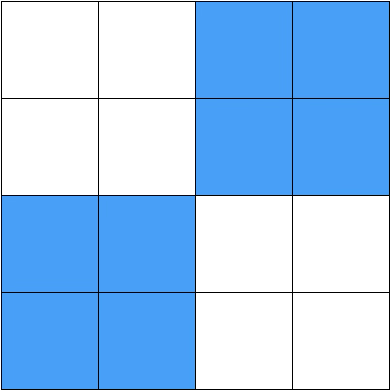

Il respecte le principe d'équilibre (au moins quatre cases pour la paire, au moins deux pour chaque marginale). Mais il compte huit cases au lieu des quatre d'un état de connaissance maximale&nbsp;: c'est un **état mixte**. Ses deux marginales sont l'ignorance totale, mais ce n'est pas pour autant un état corrélé au sens précédent&nbsp;: connaître l'état d'un système ne détermine que la paire de l'autre ($1\lor2$ ou $3\lor4$), pas sa valeur. C'est un mélange classique de deux états produits, $(1\lor 2)\cdot(1\lor 2)$ et $(3\lor 4)\cdot(3\lor 4)$&nbsp;: une simple corrélation statistique, analogue d'un état mixte séparable.

## Combien d'états&nbsp;?

Pour $n$ systèmes élémentaires, on a $4^{n}$ états ontiques et $2n$ questions. Une connaissance maximale répond à $n$ questions et laisse donc $2^{n}$ cases colorées. Il y a $\binom{4^n}{2^n}$ façons de les choisir, mais la plupart sont exclues. Pour deux systèmes, il reste&nbsp;:
<ul>
<li>les <b>états produits</b>&nbsp;: on choisit deux lignes parmi quatre et deux colonnes parmi quatre, soit $\binom{4}{2}\times\binom{4}{2}=36$ possibilités&nbsp;;</li>
<li>les <b>états corrélés</b>&nbsp;: on associe à chaque état du système 1 un état du système 2, ce qui revient à choisir une permutation, soit $4!=24$ possibilités.</li>
</ul>

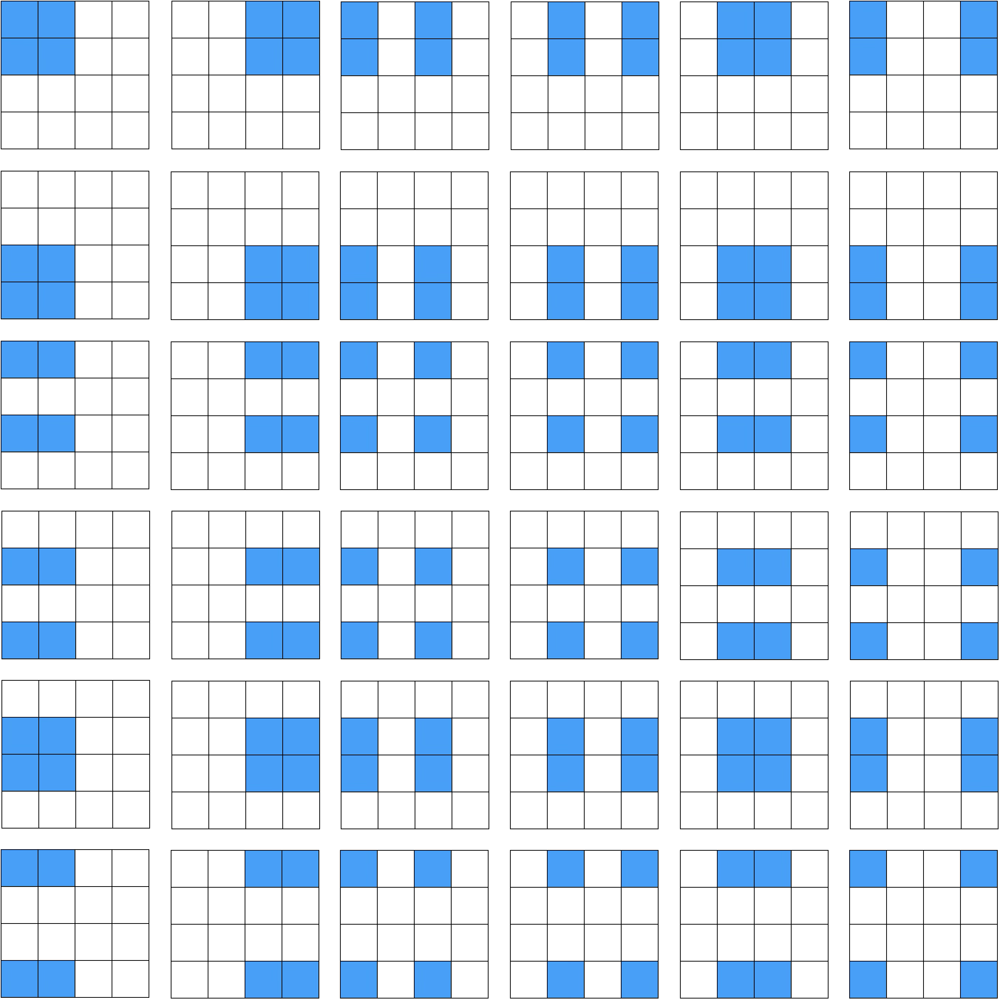

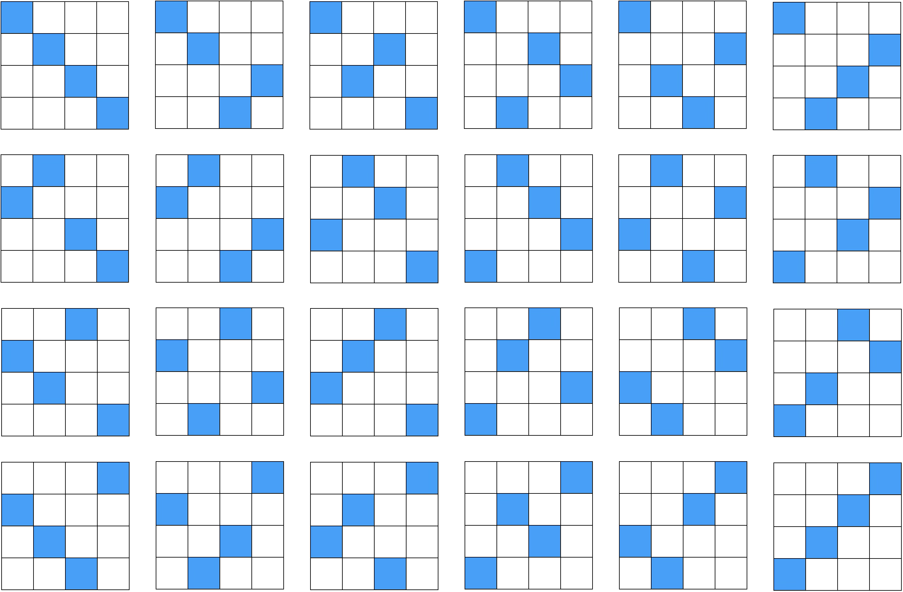

Cela donne $60$ états de connaissance maximale pour deux systèmes élémentaires. Ce nombre n'est pas anodin&nbsp;: c'est aussi le nombre d'**états stabilisateurs** à deux qubits (voir plus bas), de même que les six bits-jouets correspondent aux six états stabilisateurs à un qubit.

## Interdiction du clonage

↔ Pendant quantique&nbsp;: <a href="../fondations/#non-clonage-quantique">le non-clonage quantique</a>

Dans la théorie-jouet, «&nbsp;cloner&nbsp;» un état de connaissance consiste à attribuer ce même état épistémique à un second système, tout en le conservant pour le premier. Comme les états quantiques, les états-jouets sont non clonables.

Un cloneur universel devrait réaliser la transformation

$$(a\lor b)\\;\cdot\\;(c\lor d)\\;\longrightarrow\\;(a\lor b)\\;\cdot\\;(a\lor b)$$

où $a\lor b$ est le bit-jouet à copier et $c\lor d$ l'état de départ du second système, et la même transformation devrait réaliser

$$(e\lor f)\\;\cdot\\;(c\lor d)\\;\longrightarrow\\;(e\lor f)\\;\cdot\\;(e\lor f)$$

pour tout autre bit-jouet $e\lor f$. La fidélité de deux états produits étant le produit des fidélités de leurs facteurs, la fidélité entre les deux états de départ vaut $\mathcal{F}\times 1 = \mathcal F$, où $\mathcal{F}$ est la fidélité entre $a\lor b$ et $e\lor f$, et celle entre les deux états d'arrivée vaut $\mathcal{F}^2$. Une transformation permise conservant la fidélité, il faudrait $\mathcal{F} = \mathcal{F}^2$, ce qui n'est possible que si $\mathcal F = 1$ (états identiques) ou $\mathcal F = 0$ (états disjoints). C'est le même argument qu'en quantique, avec la fidélité à la place du produit scalaire.

<b>Un cloneur universel est impossible</b> dans la théorie-jouet&nbsp;: on ne peut cloner que des ensembles d'états deux à deux disjoints.

L'intuition est simple. Classiquement, copier une valeur demande une «&nbsp;feuille blanche&nbsp;»&nbsp;: un second système dans un état **connu**, sur lequel on recopie la valeur de façon réversible. Dans le jouet, la feuille blanche n'existe pas&nbsp;: le principe d'équilibre interdit de connaître parfaitement l'état ontique du second système.

## Le formalisme stabilisateur

Le jouet n'imite pas toute la mécanique quantique, mais un fragment bien précis&nbsp;: le **formalisme stabilisateur**, introduit par Daniel Gottesman en 1997 pour décrire les codes correcteurs d'erreurs quantiques. Ce fragment joue aujourd'hui un rôle central dans la correction d'erreurs et la simulation de circuits quantiques. On peut le présenter de deux façons complémentaires&nbsp;: par des portes quantiques, ou par des matrices de Pauli.

### Trois portes quantiques

Les trois portes <b>Hadamard</b> $H=\frac{1}{\sqrt{2}}\begin{pmatrix}
1 & 1 \\\\
1 & -1
\end{pmatrix}$, <b>phase</b> $P=\begin{pmatrix}
1 & 0 \\\\
0 & \mathrm{i}
\end{pmatrix}$ et <b>CNOT</b> (qui retourne le qubit cible si et seulement si le qubit de contrôle est $|1\rangle$) sont appelées <b>portes stabilisatrices</b>. Un <b>circuit stabilisateur</b> est un circuit composé uniquement de ces portes, et un <b>état stabilisateur</b> est un état qu'un circuit stabilisateur peut produire à partir de l'état $|00\ldots 0\rangle$.

À partir d'un seul qubit, les portes $H$ et $P$ permettent d'atteindre six états&nbsp;:

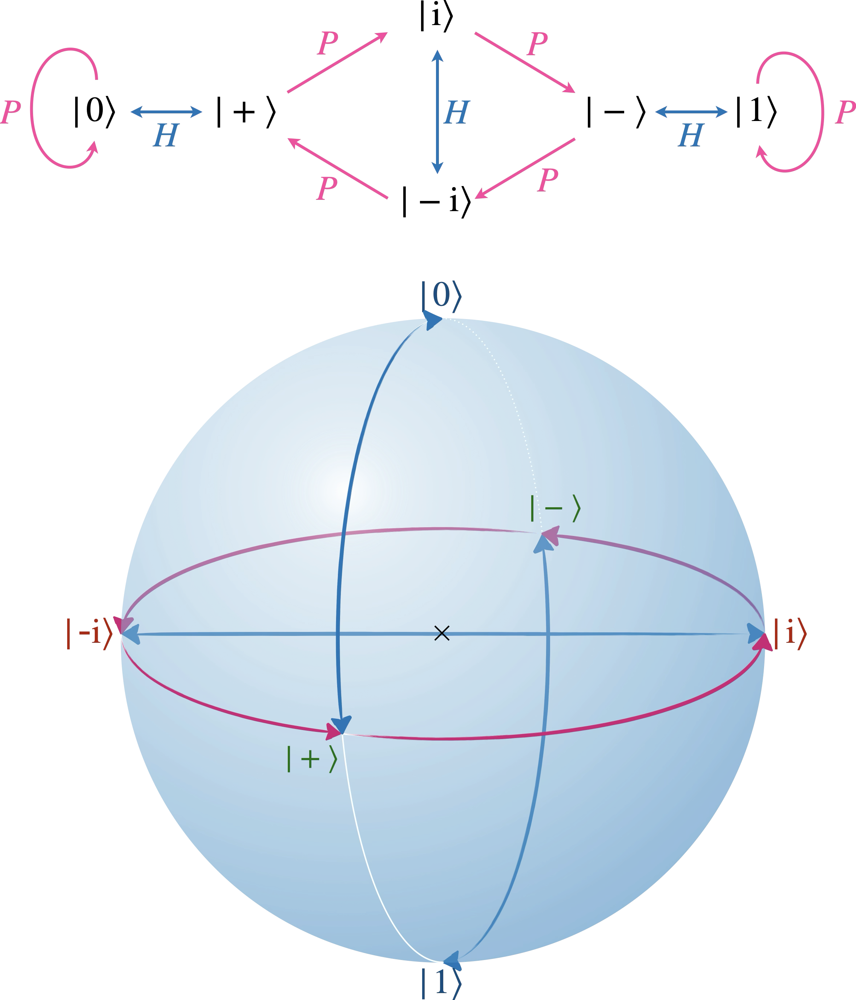

Ce sont exactement les six états qui correspondent aux bits-jouets. À partir de deux qubits, la porte CNOT permet d'atteindre des états intriqués, comme l'état de Bell $\frac{1}{\sqrt{2}}(|00\rangle+|11\rangle)$&nbsp;:
<ul>
<li>on crée une superposition sur le premier qubit (qubit de contrôle) grâce à $H$&nbsp;: $(H \otimes \mathbb{I})|00\rangle=\frac{1}{\sqrt{2}}(|0\rangle+|1\rangle)\otimes|0\rangle=\frac{1}{\sqrt{2}}(|00\rangle+|10\rangle)$&nbsp;;</li>
<li>puis on intrique les deux qubits grâce à CNOT, qui retourne le second qubit dans le terme $|10\rangle$&nbsp;: on obtient $\frac{1}{\sqrt{2}}(|00\rangle+|11\rangle)$.</li>
</ul>

On atteint ainsi $60$ états stabilisateurs à deux qubits, autant que d'états de connaissance maximale pour deux systèmes élémentaires. Comme dans le jouet, toute mesure d'une matrice de Pauli sur un état stabilisateur donne un résultat soit certain, soit parfaitement aléatoire (probabilités $\frac12$ et $\frac12$)&nbsp;: aucune probabilité intermédiaire n'apparaît.

Surtout, le **théorème de Gottesman–Knill** affirme que les circuits stabilisateurs se simulent efficacement sur un ordinateur classique&nbsp;: ce fragment n'offre aucun avantage de calcul. Il n'est donc pas si surprenant qu'un modèle classique comme le jouet parvienne à l'imiter.

### Matrices de Pauli

Un opérateur unitaire $U$ <b>stabilise</b> un état $|\Psi\rangle$ si $U|\Psi\rangle=|\Psi\rangle$, c'est-à-dire si $|\Psi\rangle$ est un vecteur propre de $U$ pour la valeur propre $+1$.

Attention, le signe compte&nbsp;: si $U|\Psi\rangle=-|\Psi\rangle$, alors $U$ ne stabilise pas $|\Psi\rangle$. Si $U$ et $V$ stabilisent tous deux $|\Psi\rangle$, alors $UV$, $VU$, $U^{-1}$ et $V^{-1}$ aussi&nbsp;; et comme $\mathbb{I}$ stabilise tout, les opérateurs qui stabilisent $|\Psi\rangle$ forment un <b>groupe</b>.

Chacun des six états stabilisateurs à un qubit est stabilisé par une matrice de Pauli, au signe près&nbsp;:
<ul>
<li>$\hat Z$ stabilise $|0\rangle$ et $-\hat Z$ stabilise $|1\rangle$&nbsp;;</li>
<li>$\hat X$ stabilise $|+\rangle$ et $-\hat X$ stabilise $|-\rangle$&nbsp;;</li>
<li>$\hat Y$ stabilise $|{+\mathrm{i}}\rangle$ et $-\hat Y$ stabilise $|{-\mathrm{i}}\rangle$&nbsp;;</li>
<li>$\mathbb{I}$ stabilise tout, et $-\mathbb{I}$ ne stabilise rien.</li>
</ul>

Les matrices de Pauli décrivent aussi les différents types d'erreur sur un qubit, d'où leur omniprésence dans les codes correcteurs&nbsp;:
<ul>
<li>pas d'erreur&nbsp;: $\mathbb{I}|1\rangle = |1\rangle$&nbsp;;</li>
<li>retournement de bit&nbsp;: $\hat X|1\rangle = |0\rangle$&nbsp;;</li>
<li>retournement de phase&nbsp;: $\hat Z|1\rangle = -|1\rangle$&nbsp;;</li>
<li>les deux à la fois&nbsp;: $\hat Y|1\rangle = -\mathrm{i}|0\rangle$.</li>
</ul>

Le <b>groupe stabilisateur</b> d'un état $|\Psi\rangle$ de $n$ qubits est le groupe de tous les produits tensoriels de matrices de Pauli (avec leur signe) qui stabilisent $|\Psi\rangle$.

Exemple&nbsp;: quel est le groupe stabilisateur de l'état de Bell $\frac{1}{\sqrt{2}}(|00\rangle+|11\rangle)$&nbsp;?
<ul>
<li>$\hat X\hat X$ en fait partie, puisqu'il échange $|00\rangle$ et $|11\rangle$&nbsp;;</li>
<li>$-\hat Y\hat Y$ aussi, puisque $\hat Y\hat Y|00\rangle = (\mathrm{i}|1\rangle)(\mathrm{i}|1\rangle) = -|11\rangle$ et $\hat Y\hat Y|11\rangle = -|00\rangle$&nbsp;;</li>
<li>ainsi que leur produit, $\hat X\hat X\cdot(-\hat Y\hat Y) = -(\hat X\hat Y)\otimes(\hat X\hat Y) = -(\mathrm{i}\hat Z)\otimes(\mathrm{i}\hat Z) = \hat Z\hat Z$.</li>
</ul>

Le groupe complet est $\\{\mathbb{I}\mathbb{I},\\, \hat X\hat X,\\, -\hat Y\hat Y,\\, \hat Z\hat Z\\}$. On y lit les corrélations de l'état de Bell&nbsp;: résultats identiques pour $X$ et pour $Z$ ($+\hat X\hat X$, $+\hat Z\hat Z$), opposés pour $Y$ ($-\hat Y\hat Y$). Le groupe $\\{\mathbb{I}\mathbb{I}, \hat X\hat X, \hat Y\hat Y, \hat Z\hat Z\\}$, qui décrirait des corrélations parfaites selon les trois axes comme celles de l'état-jouet $(1\cdot1)\lor(2\cdot2)\lor(3\cdot3)\lor(4\cdot4)$, n'en est pas un&nbsp;: le produit de $\hat X\hat X$ et $\hat Y\hat Y$ vaut $-\hat Z\hat Z$, et non $\hat Z\hat Z$.

Les états stabilisateurs à $n$ qubits sont exactement les états de $n$ qubits dont le groupe stabilisateur compte $2^n$ éléments.

Les états stabilisateurs à un qubit ont ainsi un groupe stabilisateur à deux éléments, ceux à deux qubits un groupe à quatre éléments, etc. On caractérise ainsi les états stabilisateurs sans aucune mention de circuit, par les corrélations qu'ils présentent.

## Bilan&nbsp;: ce que le jouet explique… et ce qu'il n'explique pas

### Ce que le jouet reproduit

| Phénomène quantique | Dans la théorie-jouet | Lecture épistémique |
| :--- | :--- | :--- |
| Résultats de mesure imprévisibles | La mesure $X$ sur $1\lor2$ donne I ou II | On ignore l'état ontique |
| États non orthogonaux indiscernables | États qui partagent une case | Deux préparations peuvent produire le même état ontique |
| Réduction du paquet d'onde | La classe du résultat devient l'état | Mise à jour de la connaissance (plus une perturbation) |
| Mesures incompatibles | $Z$, puis $X$, puis $Z$ | On ne peut pas connaître deux réponses à la fois |
| Superposition ≠ mélange | $1\lor3$ et $1\lor2\lor3\lor4$ | Connaître la réponse à une autre question |
| Décompositions multiples d'un mélange | $1\lor2\lor3\lor4$ de deux façons | Une même ignorance, plusieurs histoires |
| Intrication, marginales mixtes | États corrélés | Connaître une relation, pas les valeurs |
| «&nbsp;Réduction à distance&nbsp;» (EPR) | Mesure d'Alice, état de Bob | Une déduction, pas une action |
| Non-clonage | Fidélité conservée, pas de feuille blanche | Impossible de recopier sans tout connaître |

Spekkens montre que la liste est bien plus longue&nbsp;: le jouet possède aussi des analogues de l'interférence, des bases mutuellement non biaisées, de la monogamie de l'intrication, de la téléportation, du codage superdense…

### Ce que le jouet ne peut pas reproduire

<ul>
<li><b>La non-localité.</b> Le jouet est un modèle à variables cachées locales&nbsp;: il ne peut pas violer les inégalités de Bell. Dans le jeu CHSH, il plafonne à $S = 2$, là où la mécanique quantique atteint $2\sqrt2$ (voir la page <a href="../nonlocale/">Limites de la non-localité</a>).</li>
<li><b>La contextualité.</b> Le jouet est non contextuel&nbsp;: le résultat d'une mesure y révèle une propriété (la classe de l'état ontique) qui ne dépend pas des autres mesures effectuées en même temps. Le théorème de Kochen et Specker interdit un tel modèle pour la mécanique quantique.</li>
<li><b>Le continu.</b> Le jouet n'a que six états purs par système et des probabilités qui valent $0$, $\frac12$ ou $1$. Il ne connaît pas les états intermédiaires, comme ceux qui permettent de «&nbsp;ranger&nbsp;» deux bits dans un qubit avec $85\,\%$ de réussite (voir la borne de Holevo dans <a href="../fondations/#le-qubit">Notions fondamentales</a>).</li>
<li><b>L'avantage de calcul.</b> Comme le formalisme stabilisateur, le jouet se simule efficacement&nbsp;: il ne permet aucun calcul quantique «&nbsp;difficile&nbsp;».</li>
<li><b>Les détails des phases et des corrélations.</b> On l'a vu&nbsp;: certaines permutations correspondent à des réflexions impossibles en quantique, la règle de superposition ne marche pas pour toutes les paires, et l'état corrélé est corrélé selon les trois axes.</li>
</ul>

Le dernier point n'est pas anecdotique. Le formalisme stabilisateur, que le jouet imite si bien pour un ou deux systèmes, est lui-même contextuel dès deux qubits (carré de Mermin–Peres) et non local dès trois (paradoxe GHZ, voir la page [EPR](../epr/#ghz)). C'est précisément là que le jouet et la mécanique quantique se séparent.

### La théorie-jouet face au théorème PBR

↔ Voir&nbsp;: <a href="../epistovsonto/#la-preuve-de-pbr-pas-à-pas">la preuve de PBR, pas à pas</a>

Le jouet est ψ-épistémique&nbsp;: les états $1\lor2$ (analogue de $\lvert0\rangle$) et $1\lor3$ (analogue de $\lvert+\rangle$) ont l'état ontique $1$ en commun. C'est précisément la situation dont le théorème PBR montre qu'elle est impossible en mécanique quantique, sous l'hypothèse que deux systèmes préparés indépendamment ont des états physiques indépendants. Suivons la preuve dans le jouet.

<svg viewBox="0 0 600 160" role="img" aria-label="Les quatre préparations produits de 1∨2 et 1∨3 : toutes contiennent l'état ontique (1·1)" style="width:100%;max-width:600px;height:auto;">
<rect x="40.0" y="85.0" width="20.0" height="20.0" fill="#970E53" stroke="#94a3b8" stroke-width="1"/><rect x="60.0" y="85.0" width="20.0" height="20.0" fill="#477fa4" stroke="#94a3b8" stroke-width="1"/><rect x="80.0" y="85.0" width="20.0" height="20.0" fill="#fff" stroke="#94a3b8" stroke-width="1"/><rect x="100.0" y="85.0" width="20.0" height="20.0" fill="#fff" stroke="#94a3b8" stroke-width="1"/><rect x="40.0" y="65.0" width="20.0" height="20.0" fill="#477fa4" stroke="#94a3b8" stroke-width="1"/><rect x="60.0" y="65.0" width="20.0" height="20.0" fill="#477fa4" stroke="#94a3b8" stroke-width="1"/><rect x="80.0" y="65.0" width="20.0" height="20.0" fill="#fff" stroke="#94a3b8" stroke-width="1"/><rect x="100.0" y="65.0" width="20.0" height="20.0" fill="#fff" stroke="#94a3b8" stroke-width="1"/><rect x="40.0" y="45.0" width="20.0" height="20.0" fill="#fff" stroke="#94a3b8" stroke-width="1"/><rect x="60.0" y="45.0" width="20.0" height="20.0" fill="#fff" stroke="#94a3b8" stroke-width="1"/><rect x="80.0" y="45.0" width="20.0" height="20.0" fill="#fff" stroke="#94a3b8" stroke-width="1"/><rect x="100.0" y="45.0" width="20.0" height="20.0" fill="#fff" stroke="#94a3b8" stroke-width="1"/><rect x="40.0" y="25.0" width="20.0" height="20.0" fill="#fff" stroke="#94a3b8" stroke-width="1"/><rect x="60.0" y="25.0" width="20.0" height="20.0" fill="#fff" stroke="#94a3b8" stroke-width="1"/><rect x="80.0" y="25.0" width="20.0" height="20.0" fill="#fff" stroke="#94a3b8" stroke-width="1"/><rect x="100.0" y="25.0" width="20.0" height="20.0" fill="#fff" stroke="#94a3b8" stroke-width="1"/><text x="31.0" y="99.0" text-anchor="middle" font-size="11.5" fill="#64748b" font-family="Georgia,'Times New Roman',serif" >1</text><text x="50.0" y="120.0" text-anchor="middle" font-size="11.5" fill="#64748b" font-family="Georgia,'Times New Roman',serif" >1</text><text x="31.0" y="79.0" text-anchor="middle" font-size="11.5" fill="#64748b" font-family="Georgia,'Times New Roman',serif" >2</text><text x="70.0" y="120.0" text-anchor="middle" font-size="11.5" fill="#64748b" font-family="Georgia,'Times New Roman',serif" >2</text><text x="31.0" y="59.0" text-anchor="middle" font-size="11.5" fill="#64748b" font-family="Georgia,'Times New Roman',serif" >3</text><text x="90.0" y="120.0" text-anchor="middle" font-size="11.5" fill="#64748b" font-family="Georgia,'Times New Roman',serif" >3</text><text x="31.0" y="39.0" text-anchor="middle" font-size="11.5" fill="#64748b" font-family="Georgia,'Times New Roman',serif" >4</text><text x="110.0" y="120.0" text-anchor="middle" font-size="11.5" fill="#64748b" font-family="Georgia,'Times New Roman',serif" >4</text>
<text x="80.0" y="141.0" text-anchor="middle" font-size="15" fill="#004D80" font-family="Georgia,'Times New Roman',serif" font-style="italic" >|0⟩|0⟩</text>
<rect x="180.0" y="85.0" width="20.0" height="20.0" fill="#970E53" stroke="#94a3b8" stroke-width="1"/><rect x="200.0" y="85.0" width="20.0" height="20.0" fill="#fff" stroke="#94a3b8" stroke-width="1"/><rect x="220.0" y="85.0" width="20.0" height="20.0" fill="#477fa4" stroke="#94a3b8" stroke-width="1"/><rect x="240.0" y="85.0" width="20.0" height="20.0" fill="#fff" stroke="#94a3b8" stroke-width="1"/><rect x="180.0" y="65.0" width="20.0" height="20.0" fill="#477fa4" stroke="#94a3b8" stroke-width="1"/><rect x="200.0" y="65.0" width="20.0" height="20.0" fill="#fff" stroke="#94a3b8" stroke-width="1"/><rect x="220.0" y="65.0" width="20.0" height="20.0" fill="#477fa4" stroke="#94a3b8" stroke-width="1"/><rect x="240.0" y="65.0" width="20.0" height="20.0" fill="#fff" stroke="#94a3b8" stroke-width="1"/><rect x="180.0" y="45.0" width="20.0" height="20.0" fill="#fff" stroke="#94a3b8" stroke-width="1"/><rect x="200.0" y="45.0" width="20.0" height="20.0" fill="#fff" stroke="#94a3b8" stroke-width="1"/><rect x="220.0" y="45.0" width="20.0" height="20.0" fill="#fff" stroke="#94a3b8" stroke-width="1"/><rect x="240.0" y="45.0" width="20.0" height="20.0" fill="#fff" stroke="#94a3b8" stroke-width="1"/><rect x="180.0" y="25.0" width="20.0" height="20.0" fill="#fff" stroke="#94a3b8" stroke-width="1"/><rect x="200.0" y="25.0" width="20.0" height="20.0" fill="#fff" stroke="#94a3b8" stroke-width="1"/><rect x="220.0" y="25.0" width="20.0" height="20.0" fill="#fff" stroke="#94a3b8" stroke-width="1"/><rect x="240.0" y="25.0" width="20.0" height="20.0" fill="#fff" stroke="#94a3b8" stroke-width="1"/><text x="171.0" y="99.0" text-anchor="middle" font-size="11.5" fill="#64748b" font-family="Georgia,'Times New Roman',serif" >1</text><text x="190.0" y="120.0" text-anchor="middle" font-size="11.5" fill="#64748b" font-family="Georgia,'Times New Roman',serif" >1</text><text x="171.0" y="79.0" text-anchor="middle" font-size="11.5" fill="#64748b" font-family="Georgia,'Times New Roman',serif" >2</text><text x="210.0" y="120.0" text-anchor="middle" font-size="11.5" fill="#64748b" font-family="Georgia,'Times New Roman',serif" >2</text><text x="171.0" y="59.0" text-anchor="middle" font-size="11.5" fill="#64748b" font-family="Georgia,'Times New Roman',serif" >3</text><text x="230.0" y="120.0" text-anchor="middle" font-size="11.5" fill="#64748b" font-family="Georgia,'Times New Roman',serif" >3</text><text x="171.0" y="39.0" text-anchor="middle" font-size="11.5" fill="#64748b" font-family="Georgia,'Times New Roman',serif" >4</text><text x="250.0" y="120.0" text-anchor="middle" font-size="11.5" fill="#64748b" font-family="Georgia,'Times New Roman',serif" >4</text>
<text x="220.0" y="141.0" text-anchor="middle" font-size="15" fill="#004D80" font-family="Georgia,'Times New Roman',serif" font-style="italic" >|0⟩|+⟩</text>
<rect x="320.0" y="85.0" width="20.0" height="20.0" fill="#970E53" stroke="#94a3b8" stroke-width="1"/><rect x="340.0" y="85.0" width="20.0" height="20.0" fill="#477fa4" stroke="#94a3b8" stroke-width="1"/><rect x="360.0" y="85.0" width="20.0" height="20.0" fill="#fff" stroke="#94a3b8" stroke-width="1"/><rect x="380.0" y="85.0" width="20.0" height="20.0" fill="#fff" stroke="#94a3b8" stroke-width="1"/><rect x="320.0" y="65.0" width="20.0" height="20.0" fill="#fff" stroke="#94a3b8" stroke-width="1"/><rect x="340.0" y="65.0" width="20.0" height="20.0" fill="#fff" stroke="#94a3b8" stroke-width="1"/><rect x="360.0" y="65.0" width="20.0" height="20.0" fill="#fff" stroke="#94a3b8" stroke-width="1"/><rect x="380.0" y="65.0" width="20.0" height="20.0" fill="#fff" stroke="#94a3b8" stroke-width="1"/><rect x="320.0" y="45.0" width="20.0" height="20.0" fill="#477fa4" stroke="#94a3b8" stroke-width="1"/><rect x="340.0" y="45.0" width="20.0" height="20.0" fill="#477fa4" stroke="#94a3b8" stroke-width="1"/><rect x="360.0" y="45.0" width="20.0" height="20.0" fill="#fff" stroke="#94a3b8" stroke-width="1"/><rect x="380.0" y="45.0" width="20.0" height="20.0" fill="#fff" stroke="#94a3b8" stroke-width="1"/><rect x="320.0" y="25.0" width="20.0" height="20.0" fill="#fff" stroke="#94a3b8" stroke-width="1"/><rect x="340.0" y="25.0" width="20.0" height="20.0" fill="#fff" stroke="#94a3b8" stroke-width="1"/><rect x="360.0" y="25.0" width="20.0" height="20.0" fill="#fff" stroke="#94a3b8" stroke-width="1"/><rect x="380.0" y="25.0" width="20.0" height="20.0" fill="#fff" stroke="#94a3b8" stroke-width="1"/><text x="311.0" y="99.0" text-anchor="middle" font-size="11.5" fill="#64748b" font-family="Georgia,'Times New Roman',serif" >1</text><text x="330.0" y="120.0" text-anchor="middle" font-size="11.5" fill="#64748b" font-family="Georgia,'Times New Roman',serif" >1</text><text x="311.0" y="79.0" text-anchor="middle" font-size="11.5" fill="#64748b" font-family="Georgia,'Times New Roman',serif" >2</text><text x="350.0" y="120.0" text-anchor="middle" font-size="11.5" fill="#64748b" font-family="Georgia,'Times New Roman',serif" >2</text><text x="311.0" y="59.0" text-anchor="middle" font-size="11.5" fill="#64748b" font-family="Georgia,'Times New Roman',serif" >3</text><text x="370.0" y="120.0" text-anchor="middle" font-size="11.5" fill="#64748b" font-family="Georgia,'Times New Roman',serif" >3</text><text x="311.0" y="39.0" text-anchor="middle" font-size="11.5" fill="#64748b" font-family="Georgia,'Times New Roman',serif" >4</text><text x="390.0" y="120.0" text-anchor="middle" font-size="11.5" fill="#64748b" font-family="Georgia,'Times New Roman',serif" >4</text>
<text x="360.0" y="141.0" text-anchor="middle" font-size="15" fill="#004D80" font-family="Georgia,'Times New Roman',serif" font-style="italic" >|+⟩|0⟩</text>
<rect x="460.0" y="85.0" width="20.0" height="20.0" fill="#970E53" stroke="#94a3b8" stroke-width="1"/><rect x="480.0" y="85.0" width="20.0" height="20.0" fill="#fff" stroke="#94a3b8" stroke-width="1"/><rect x="500.0" y="85.0" width="20.0" height="20.0" fill="#477fa4" stroke="#94a3b8" stroke-width="1"/><rect x="520.0" y="85.0" width="20.0" height="20.0" fill="#fff" stroke="#94a3b8" stroke-width="1"/><rect x="460.0" y="65.0" width="20.0" height="20.0" fill="#fff" stroke="#94a3b8" stroke-width="1"/><rect x="480.0" y="65.0" width="20.0" height="20.0" fill="#fff" stroke="#94a3b8" stroke-width="1"/><rect x="500.0" y="65.0" width="20.0" height="20.0" fill="#fff" stroke="#94a3b8" stroke-width="1"/><rect x="520.0" y="65.0" width="20.0" height="20.0" fill="#fff" stroke="#94a3b8" stroke-width="1"/><rect x="460.0" y="45.0" width="20.0" height="20.0" fill="#477fa4" stroke="#94a3b8" stroke-width="1"/><rect x="480.0" y="45.0" width="20.0" height="20.0" fill="#fff" stroke="#94a3b8" stroke-width="1"/><rect x="500.0" y="45.0" width="20.0" height="20.0" fill="#477fa4" stroke="#94a3b8" stroke-width="1"/><rect x="520.0" y="45.0" width="20.0" height="20.0" fill="#fff" stroke="#94a3b8" stroke-width="1"/><rect x="460.0" y="25.0" width="20.0" height="20.0" fill="#fff" stroke="#94a3b8" stroke-width="1"/><rect x="480.0" y="25.0" width="20.0" height="20.0" fill="#fff" stroke="#94a3b8" stroke-width="1"/><rect x="500.0" y="25.0" width="20.0" height="20.0" fill="#fff" stroke="#94a3b8" stroke-width="1"/><rect x="520.0" y="25.0" width="20.0" height="20.0" fill="#fff" stroke="#94a3b8" stroke-width="1"/><text x="451.0" y="99.0" text-anchor="middle" font-size="11.5" fill="#64748b" font-family="Georgia,'Times New Roman',serif" >1</text><text x="470.0" y="120.0" text-anchor="middle" font-size="11.5" fill="#64748b" font-family="Georgia,'Times New Roman',serif" >1</text><text x="451.0" y="79.0" text-anchor="middle" font-size="11.5" fill="#64748b" font-family="Georgia,'Times New Roman',serif" >2</text><text x="490.0" y="120.0" text-anchor="middle" font-size="11.5" fill="#64748b" font-family="Georgia,'Times New Roman',serif" >2</text><text x="451.0" y="59.0" text-anchor="middle" font-size="11.5" fill="#64748b" font-family="Georgia,'Times New Roman',serif" >3</text><text x="510.0" y="120.0" text-anchor="middle" font-size="11.5" fill="#64748b" font-family="Georgia,'Times New Roman',serif" >3</text><text x="451.0" y="39.0" text-anchor="middle" font-size="11.5" fill="#64748b" font-family="Georgia,'Times New Roman',serif" >4</text><text x="530.0" y="120.0" text-anchor="middle" font-size="11.5" fill="#64748b" font-family="Georgia,'Times New Roman',serif" >4</text>
<text x="500.0" y="141.0" text-anchor="middle" font-size="15" fill="#004D80" font-family="Georgia,'Times New Roman',serif" font-style="italic" >|+⟩|+⟩</text>
</svg>

Les quatre préparations de la preuve de PBR, transposées dans le jouet. La case $(1\cdot1)$ est compatible avec les quatre.

<ul>
<li><b>Étapes 1 et 2.</b> On prépare deux systèmes indépendamment, chacun dans $1\lor2$ ou dans $1\lor3$. Les quatre préparations possibles contiennent toutes la case $(1\cdot 1)$, atteinte avec la probabilité $\frac14$&nbsp;: c'est le $q^2$ de la preuve, avec $q = \frac12$.</li>
<li><b>Étape 3.</b> La mécanique quantique prévoit une mesure conjointe dont chaque résultat est impossible pour l'une des quatre préparations. Dans le jouet, une telle mesure ne peut pas exister&nbsp;: quand l'état ontique est $(1\cdot 1)$, elle devrait bien donner un résultat, or chacun est censé exclure une préparation qui contient $(1\cdot 1)$.</li>
</ul>

Le jouet n'a donc aucun analogue de la mesure de PBR&nbsp;: c'est une prédiction quantique qu'il ne peut pas reproduire. Détail remarquable&nbsp;: les quatre états de cette mesure sont des états stabilisateurs (ils s'obtiennent à partir d'états de Bell par des portes de Hadamard). La preuve de PBR se déroule donc entièrement à l'intérieur du fragment que le jouet imite le mieux, et pointe exactement l'endroit où l'imitation échoue.

### Que conclure&nbsp;?

Le jouet montre qu'un grand nombre de «&nbsp;bizarreries&nbsp;» quantiques s'expliquent sans mystère si l'état décrit une connaissance incomplète d'une réalité sous-jacente&nbsp;: indéterminisme, perturbation par la mesure, indiscernabilité, non-clonage, réduction à distance. C'est un argument fort en faveur de la lecture épistémique.

Mais PBR montre qu'on ne peut pas pousser cette stratégie jusqu'au bout&nbsp;: un modèle ψ-épistémique de **toute** la mécanique quantique est impossible, sauf à renoncer à l'une des hypothèses du théorème (voir [Que conclure&nbsp;?](../epistovsonto/#que-conclure) dans la page sur PBR). Il reste alors deux voies&nbsp;: renoncer à décrire une réalité sous-jacente (lectures informationnelles, QBism), ou admettre une réalité bien plus étrange que celle du jouet (non locale, contextuelle, ou dont les parties ne sont pas indépendantes).

Spekkens en tire une leçon d'une autre nature&nbsp;: les phénomènes que le jouet reproduit ne seraient pas les vrais mystères quantiques, puisqu'une théorie classique avec une restriction de connaissance suffit à les expliquer. Les vrais mystères seraient ceux qu'il ne peut pas reproduire&nbsp;: la non-localité, la contextualité, l'avantage de calcul.
